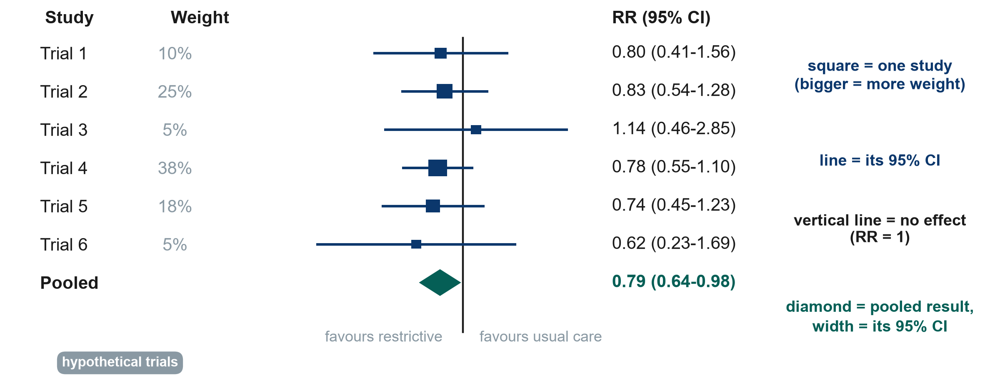

[Download the PDF](files/sessions/s4_exercises.pdf) · [Download the Word file (to fill in)](files/sessions/s4_exercises.docx) · [Back to Session 4](session4.qmd)

**Foundations of Clinical Research · Level 1** · Neudata · *#ClearDataClearImpact* · Week 4 · Saturday 21 November 2026 · online, 19:30–22:30

Name: ______________________________   Department: ______________________________

This sheet is sent by email before the session, as a Word file and as a PDF. Keep it open on your screen and type your answers into the Word file (or print the PDF). Have a pen, paper and a calculator (or your phone) ready. For the calculations, simple division is enough. The instructor checks every answer live with the 2x2 calculator (`Course/Resources/tools/2x2_calculator.xlsx`).

All in-session exercises are done by the **whole class together**: the instructor shows each item on the shared screen, you answer in the **poll** or the **chat**, and the instructor types the class answer on the shared screen. There are no groups. The proposal builder (Part F) is your **own** individual work.

| Part | Activity | When | How |
|---|---|---|---|
| A | Spot the bias (4 scenarios) | End of section 4.1 (5 min) | Whole class: poll for each scenario, one fix in the chat |
| B | Confounding or effect modification? (3 scenarios) | Homework (optional) | On your own |
| C | Two 2x2 calculations | After the break (15 min) | Whole class: poll for each answer |
| D | PPV in two settings | Homework (optional) | On your own |
| E | Read a forest plot and choose the risk-of-bias tool | End of section 4.3 (8 min) | Whole class: polls and chat |
| F | Proposal builder 4: exposure, outcomes and biases | End of the session (38 min) and homework | Instructor models it live; then you draft your own |

**Our running question:** in adults with septic shock, does a restrictive fluid strategy, compared with usual care, reduce 28-day mortality?
**The two papers** (course folder, `Course/Papers`): Paper 1, Boulet 2024 (a pilot randomised trial of restrictive fluids); Paper 2, Hyun 2023 (a registry cohort of fluid balance and death).

**Key words of the day:** bias · confounding · effect modification (interaction) · reverse causation · risk · risk ratio (RR) · risk difference (RD) · number needed to treat (NNT) · odds ratio (OR) · sensitivity · specificity · positive and negative predictive value (PPV, NPV) · ROC (receiver operating characteristic) curve · forest plot · I-squared (I², heterogeneity) · risk-of-bias tool.

**Other abbreviations on this sheet:** ICU = intensive care unit; CI = confidence interval; RCT = randomised controlled trial.

* * *

## Part A: Spot the bias

**How it runs.** The instructor shows each scenario and opens a poll: **selection bias**, **recall bias**, **observer bias** or **confounding**. After the result, type **one practical way** to reduce it in the chat.

| # | Scenario | Main bias | One way to reduce it |
|---|---|---|---|
| 1 | In a case-control study, families of patients who died of sepsis remember the days before ICU admission in more detail than families of survivors. | | |
| 2 | In an unblinded trial of restrictive fluids, the doctor who knows each patient's group decides when the patient is "ready for ICU discharge". | | |
| 3 | A study of fluid balance and death includes only patients who stayed in the ICU for 3 days or more. | | |
| 4 | In a registry, patients with a higher lactate received more fluid and also died more often. The authors conclude that fluid increases mortality. | | |

* * *

## Part B: Confounding or effect modification? (homework, optional)

**Instructions.** Each study splits its result by a third factor. Compare the strata **with each other** and **with the overall (crude) result**. Decide: **confounding**, **effect modification (interaction)** or **neither**. Then say what the authors should report.

> Rule of thumb: strata similar to each other but different from the crude result mean confounding. Strata different from each other mean effect modification.

| # | Study (hypothetical) | Overall RR | Stratum 1 | Stratum 2 | Your answer | What to report |
|---|---|---|---|---|---|---|
| 1 | Vasopressor X vs Y in septic shock and death by day 28. Clinicians chose X mainly for patients with a high lactate. | 1.80 | lactate below 4: RR 1.00 | lactate 4 or more: RR 1.00 | | |
| 2 | Restrictive vs usual fluids and death by day 28 | 0.70 | age below 65: RR 0.50 | age 65 or over: RR 0.95 | | |
| 3 | A nurse-led charting protocol and incomplete fluid charts | 0.80 | day shift: RR 0.80 | night shift: RR 0.79 | | |

* * *

## Part C: Two 2x2 calculations

**How it runs.** Draw each table on your paper first. The instructor then asks each answer as a poll, checks it live with the 2x2 calculator on the shared screen, and a volunteer says the result in one plain sentence.

1. **Draw the 2x2 table first.** Exposure (or treatment) in **rows**, with the exposed or treated group on top. Outcome in **columns**, with "outcome yes" on the left.
2. Round to two decimals.
3. Say the result in **one sentence** a colleague without research training would understand.

**Reminder**

| Measure | Formula (from the table a, b, c, d) |
|---|---|
| Risk in exposed or treated | a / (a + b) |
| Risk in unexposed or control | c / (c + d) |
| Risk ratio (RR) | risk exposed ÷ risk control |
| Risk difference (RD) | risk exposed minus risk control |
| Number needed to treat (NNT) | 1 ÷ \|RD\| (RD written as a proportion, e.g. 0.05) |
| Odds ratio (OR) | (a × d) ÷ (b × c) |

### Calculation 1: a fluid trial

A hypothetical trial randomised 400 adults with septic shock to a restrictive fluid strategy (200 patients) or usual care (200 patients). By day 28, **20** patients had died in the restrictive group and **30** in the usual-care group.

|  | Died by day 28: YES | Died by day 28: NO | Total |
|---|---|---|---|
| Restrictive | a = | b = | |
| Usual care | c = | d = | |

1. Risk with restrictive fluids = ______  Risk with usual care = ______
2. RR = ______  3. RD = ______  4. NNT = ______  5. OR = ______
6. The worked example in the slides had the same RR (20/100 vs 30/100). Why is the NNT different here?  ______________________
7. One sentence for a colleague: ____________________________________________

### Calculation 2: a fluid case-control study

Investigators selected **40** ICU patients with sepsis who needed new dialysis (cases) and **80** ICU patients with sepsis from the same units who did not (controls). They looked back at each patient's fluid balance on day 3. Among the cases, **24** had a positive balance and 16 had not. Among the controls, **16** had a positive balance and 64 had not.

|  | Cases (new dialysis) | Controls (no dialysis) |
|---|---|---|
| Positive fluid balance on day 3 | a = | b = |
| Zero or negative balance | c = | d = |

1. OR = ______
2. Why can you **not** calculate the risk of dialysis, the RR or the NNT from this study?  ______________________________
3. Could the arrow run the other way here (reverse causation)? Why?  ______________________________
4. One sentence for a colleague: ____________________________________________

*Note: in a case-control study the columns are the case and control groups. The OR formula (a × d) ÷ (b × c) stays the same.*

### Extra practice (self-study): another topic

A trial randomised 400 adults on a medical ward to a new pressure-relieving mattress (200 patients) or a standard mattress (200 patients). A new pressure injury developed in **10** patients on the new mattress and in **20** on the standard mattress. Draw the table and calculate the two risks, RR, RD, NNT and OR. Is the OR close to the RR here? Why?

* * *

## Part D: PPV in two settings (homework, optional)

**Instructions.** The same test has **sensitivity 90%** and **specificity 80%**. Complete each table for 500 people, then calculate PPV and NPV.

> Disease present = prevalence × 500. True positives (TP) = sensitivity × disease present. True negatives (TN) = specificity × disease absent. FP = false positives; FN = false negatives.

**Setting 1: ICU, prevalence 20%**

|  | Disease present | Disease absent | Total |
|---|---|---|---|
| Test positive | TP = | FP = | |
| Test negative | FN = | TN = | |
| Total | | | 500 |

PPV = TP / (TP + FP) = ______  NPV = TN / (TN + FN) = ______

**Setting 2: screening, prevalence 2%**

|  | Disease present | Disease absent | Total |
|---|---|---|---|
| Test positive | TP = | FP = | |
| Test negative | FN = | TN = | |
| Total | | | 500 |

PPV = ______  NPV = ______

1. Why is the PPV so different when the test is the same? ________________________________
2. Calculate the positive likelihood ratio, LR+ = sensitivity / (1 − specificity) = ______. Does it change between the settings? ______
3. Optional: repeat for a prevalence of 50%.

* * *

## Part E: Read a forest plot and choose the risk-of-bias tool

**How it runs.** The instructor shows the plot on the shared screen and asks each question as a poll or in the chat. The plot is the one shown in section 4.3 (six hypothetical trials of restrictive vs usual fluids; outcome death; fixed-effect pooling).

| Trial | Restrictive: died / total | Usual care: died / total |
|---|---|---|
| Trial 1 | 12 / 60 | 15 / 60 |
| Trial 2 | 30 / 150 | 36 / 150 |
| Trial 3 | 8 / 40 | 7 / 40 |
| Trial 4 | 45 / 250 | 58 / 250 |
| Trial 5 | 20 / 100 | 27 / 100 |
| Trial 6 | 5 / 30 | 8 / 30 |

**Reading the plot**

1. (Poll) Which trial carries the most weight? Why?  ______________________
2. (Poll) Does any single trial show a clear effect (a 95% CI that does not cross 1)?  ______________________
3. (Chat) Does the pooled diamond cross RR = 1? Write the pooled result in one plain sentence.  ______________________
4. (Self-study) Trial 3 points the other way (RR 1.14). Should it worry you? Why or why not?  ______________________

**Choosing the tool (poll).** For each study, choose: **RoB 2** (Cochrane risk-of-bias tool for randomised trials), **ROBINS-I** (non-randomised studies of interventions), **Newcastle-Ottawa Scale (or ROBINS-E)** (cohort or case-control studies of exposures), **QUADAS-2** (diagnostic accuracy studies) or **AMSTAR 2** (systematic reviews). A one-page chooser is in `Course/Resources/Risk_of_Bias_Tool_Chooser.pdf`.

| # | Study | Tool |
|---|---|---|
| a | Paper 1, Boulet 2024: randomised trial of restrictive vs usual fluids | |
| b | Paper 2, Hyun 2023: registry cohort, positive vs negative fluid balance | |
| c | Systematic review and meta-analysis of fluid-restriction trials | |
| d | (Self-study) Before-after study of a fluid protocol on one unit | |
| e | (Self-study) Point-of-care lactate compared with the laboratory reference test | |
| f | (Self-study) Cluster-randomised trial of a fluid-charting protocol (12 ICUs) | |

* * *

## Part F: Proposal builder 4 (exposure, outcomes and biases)

**This is your own work.** Every participant writes their own research proposal on a question from their own department (see `Course/Assignment/proposal_brief.md`).

**How it runs (38 minutes).**

1. **Watch (15 min).** The instructor fills in rows 4-6 below for the running example on the shared screen, thinking aloud.
2. **Draft (16 min).** You fill in the same rows for your own question, quietly (cameras optional). Ask questions in the chat.
3. **Feedback (7 min).** Three volunteers paste one bias and its fix in the chat; the instructor comments.

Then finish as homework and copy your answers into the proposal template (`Course/Templates/Research_Proposal_Template.docx`, Part 2). Rows 1-3 (design, setting, population) were drafted after Session 3. For every outcome write **what**, **how** and **when**.

**My research question:** _______________________________________________

| # | Section | What to write | My answer |
|---|---|---|---|
| 4 | **Exposure or intervention** and **comparator** | What exactly is the exposure or intervention, and how is it defined or measured? Who is the comparison group? | |
| 5 | **Outcomes** | **ONE primary outcome**: what it is, how and when it is measured. **2-3 secondary outcomes.** | |
| 6 | **Main biases and how I reduce them** | Name at least **two** threats (selection, information, confounding) and the step in your design that reduces each. | |

**My claim at the end will be:** ☐ "caused" (randomised design) ☐ "associated with" (observational design), because ____________________

**Self-check before you finish**

- [ ] There is a comparison group, or I explain why my study is descriptive.
- [ ] There is only ONE primary outcome, with a method and a time point.
- [ ] If my design is observational, I have named the main confounders (think: confounding by indication).
- [ ] Each bias has a concrete mitigation step ("we will be careful" is not a mitigation).
- [ ] Part 2 is complete: design, setting, population (Session 3) + exposure, comparator, outcomes, biases (today).
