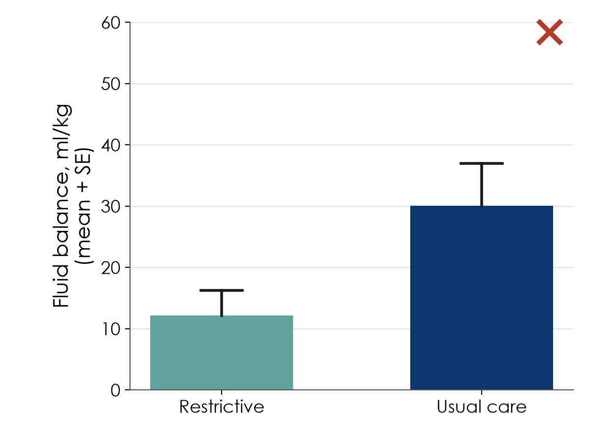

[Download the PDF](files/sessions/s5_exercises.pdf) · [Download the Word file (to fill in)](files/sessions/s5_exercises.docx) · [Back to Session 5](session5.qmd)

**Foundations of Clinical Research · Level 1** · Neudata · *#ClearDataClearImpact* · Week 5 · Saturday 28 November 2026 · online, 19:30–22:30

Name: ______________________________   Department: ______________________________

Type your answers in the Word file, or print the PDF. Exercises marked **[FLUID-ICU]** use the course dataset and its five results packs (`Results_Pack_Q1.pdf` to `Results_Pack_Q5.pdf`, sent by email). FLUID-ICU is simulated.

| # | Exercise | When |
|---|---|---|
| 1 | Classify the variables | At home |
| 2 | Fix the bad CRF items | In class, section 5.1 |
| 3 | Choose the right summary | At home |
| 4 | Judge a bad figure | At home |
| 5 | [FLUID-ICU] Spot the problems in the raw data | At home |
| 6 | [FLUID-ICU] Read the FLUID-ICU Table 1 | In class, section 5.4 |
| 7 | [FLUID-ICU] A FLUID-ICU question as a PECO sentence | In class, section 5.2 |
| 8 | Proposal builder 5: data for your own proposal | In class (8.1), then at home |

**Abbreviations:** CRF = case report form, ICU = intensive care unit, IQR = interquartile range, SD = standard deviation.

* * *

## Exercise 1: Classify the variables

**Task.** For each variable, tick **one** type. Then answer the bonus question.

| # | Variable (ICU study of septic shock) | Continuous | Count | Binary | Nominal | Ordinal | Time-to-event |
|---|---|:-:|:-:|:-:|:-:|:-:|:-:|
| a | Age at ICU admission (years) | ☐ | ☐ | ☐ | ☐ | ☐ | ☐ |
| b | Sex (male / female) | ☐ | ☐ | ☐ | ☐ | ☐ | ☐ |
| c | Glasgow Coma Scale on admission (3–15) | ☐ | ☐ | ☐ | ☐ | ☐ | ☐ |
| d | Main source of sepsis (lung / urine / abdomen / skin / other) | ☐ | ☐ | ☐ | ☐ | ☐ | ☐ |
| e | Number of vasopressors running at 24 h (0, 1, 2, 3) | ☐ | ☐ | ☐ | ☐ | ☐ | ☐ |
| f | Cumulative fluid balance at day 5 (ml/kg) | ☐ | ☐ | ☐ | ☐ | ☐ | ☐ |
| g | Alive at day 28 (yes / no) | ☐ | ☐ | ☐ | ☐ | ☐ | ☐ |
| h | Time from ICU admission to death (patients alive at day 28 are censored) | ☐ | ☐ | ☐ | ☐ | ☐ | ☐ |
| i | Pain: none / mild / moderate / severe | ☐ | ☐ | ☐ | ☐ | ☐ | ☐ |
| j | Blood group (A, B, AB, O) | ☐ | ☐ | ☐ | ☐ | ☐ | ☐ |

**Bonus:** which ONE of these would you most like to collect as an exact number rather than in groups, and why?

* * *

## Exercise 2: Fix the bad CRF items

**Task.** Two nurses could fill in each item below in two different ways. For each item, write what is wrong, then rewrite it so that it has **only one possible reading**. Be ready to read one rewrite aloud when the instructor asks.

Check each rewrite: Is the unit in the question? Is the time point in the question? Is only one answer possible? Is there an "unknown / not done" option?

| # | Bad item | What is wrong? | Your rewritten item |
|---|---|---|---|
| a | Fluid given: ________ | | |
| b | Weight: ______ | | |
| c | Comorbidities: ______________________ | | |
| d | Lactate high?   Y / N | | |

* * *

## Exercise 3: Choose the right summary

**Task.** For each variable, write its shape or type, the summary you would report in Table 1, and the best graph.

> **Choose from:** shape or type: symmetric · right-skewed · binary · nominal. Summary: mean (SD) · median (IQR) · n (%). Graph: bar chart · histogram · boxplot · scatter plot

| # | Variable (200 ICU patients) | Shape / type | Summary | Graph |
|---|---|---|---|---|
| a | Age (years), bell-shaped | | | |
| b | ICU length of stay (days): most 1–5 days, a few > 30 days | | | |
| c | Died in hospital (yes / no) | | | |
| d | C-reactive protein (mg/L): long right tail | | | |
| e | Source of sepsis (5 categories) | | | |
| f | Systolic blood pressure, compared between two treatment groups | | | |

* * *

## Exercise 4: Judge a bad figure

**Task.** Look at the three posters described below and answer questions 1 to 5.

A poster in the hospital corridor shows this figure (fluid balance at day 5, 24 patients per group):

1. What does each bar show, and what does the error bar show? What is missing?
2. Name **two things the reader cannot see** in this figure.
3. Sketch how you would show the same data in a paper. What do you gain?

A second poster shows ward mortality as bars of 31% (Ward A) and 29% (Ward B), with the y-axis running from 28% to 32%.

4. What impression does it give, and how would you fix it?

A third poster puts hand-hygiene compliance (%) and infection rate on one graph with two different y-axes and writes "hygiene works!".

5. Give two reasons to be careful.

* * *

## Exercise 5: [FLUID-ICU] Spot the problems in the raw FLUID-ICU data

**Task.** The six values below come from the raw file `fluid_icu_raw.csv`, as the four ICUs sent it. For each one, write what is wrong and what the cleaning script should do. Then answer the bonus question.

| # | Column | Value in the raw file | What is wrong? | What should the script do? |
|---|---|---|---|---|
| a | sex | `m`, `male`, ` Female` | | |
| b | admission date | `14/03/2023` in one row, `14-Mar-2023` in another | | |
| c | lactate (ICU C) | `23.4` | | |
| d | lactate | `999` | | |
| e | age | `210` | | |
| f | patient ID | `FLU-139` appears in two identical rows | | |

**Bonus:** why must the raw file never be edited by hand? Name two things the cleaning log records for every change.

* * *

## Exercise 6: [FLUID-ICU] Read the FLUID-ICU Table 1

**Task.** Open Table 1 (baseline characteristics by fluid-balance group) in any results pack. The same table is in all five. Answer questions 1 to 5 alone, ending with your two Results sentences, and be ready to share them when the instructor asks. Question 6 is for after class.

1. How many patients are in each column? Why is the overall number 618 and not 620?
2. For **three** variables, write the summary used (mean (SD), median (IQR) or n (%)) and why.

| Variable | Summary used | Why this summary? |
|---|---|---|
| | | |
| | | |
| | | |

3. Were the two groups alike at the start? Name the **biggest** difference between the negative- and positive-balance groups.
4. Which variable has the most missing values, and how many?
5. Write **two sentences** describing the patients, as they would appear at the start of a Results section (numbers in brackets, no p-values).

> ______________________________________________________________________________

6. Looking at this table, would you expect the crude association between positive fluid balance and death to be larger or smaller than the adjusted one? Why?

* * *

## Exercise 7: [FLUID-ICU] A FLUID-ICU question as a PECO sentence

**Task.** Fill in the table for Question 1 (Q1), from page 1 of its results pack. Be ready to read your sentence aloud when the instructor asks. At the end of Session 6 you choose one of the five questions: then fill in the table again for that question.

PECO: P = population, E = exposure, C = comparison, O = outcome.

| | Your answer |
|---|---|
| The question (Q1 to Q5), copied from page 1 of its results pack | |
| **P**: population | |
| **E**: exposure (variable name in the data dictionary) and its type | |
| **C**: comparator | |
| **O**: outcome (variable name) and its type | |
| One-sentence research question | |
| Which test will compare the groups? Which model will adjust? (guess now, check in Session 6) | |

* * *

## Exercise 8: Proposal builder 5 worksheet

**Task.** Plan the data for your **own** research question, not for FLUID-ICU. First watch the instructor fill in each part for the running example. In class, draft the variables table (8.1, 10 minutes). At home, finish 8.2 to 8.4. Then copy everything into Part 3 of your proposal template (`Research_Proposal_Template.docx`, sent by email).

### 8.1 Variables table (in class)

| Role | Variable | How measured (unit, time point) | Type |
|---|---|---|---|
| Primary outcome | | | |
| Secondary outcome (optional) | | | |
| Exposure / intervention | | | |
| Confounder 1 | | | |
| Confounder 2 | | | |
| Confounder 3 | | | |
| Descriptive (e.g. age, sex) | | | |

*Tip: in an RCT, randomisation deals with most confounding. List the key baseline variables you will show in Table 1 instead.*

### 8.2 Mini-CRF: 6–10 items

| # | Question exactly as the data collector will read it | Answer format (boxes / ticks / unit) | "Unknown / not done" option? |
|---|---|---|:-:|
| 1 | | | ☐ |
| 2 | | | ☐ |
| 3 | | | ☐ |
| 4 | | | ☐ |
| 5 | | | ☐ |
| 6 | | | ☐ |
| 7 | | | ☐ |
| 8 | | | ☐ |

### 8.3 Data dictionary: 3–5 rows and one data-quality plan

| Variable name | Label (meaning) | Type | Unit / codes | Allowed values |
|---|---|---|---|---|
| | | | | |
| | | | | |
| | | | | |

**Data-quality plan (one or two sentences):** who checks the forms, how often, and which range or consistency check you will run.

> ______________________________________________________________________________

### 8.4 Data-management plan

| Question | Your answer |
|---|---|
| Paper CRF with double data entry, or electronic data capture (e.g. REDCap / KoBoToolbox)? | |
| Coded study IDs? Where is the linking log kept, and who can open it? | |
| Validation rules at entry (two examples from your data dictionary) | |
| Audit trail / cleaning log: who records changes? | |
| Backups (3-2-1) and data-sharing statement in the consent form | |
