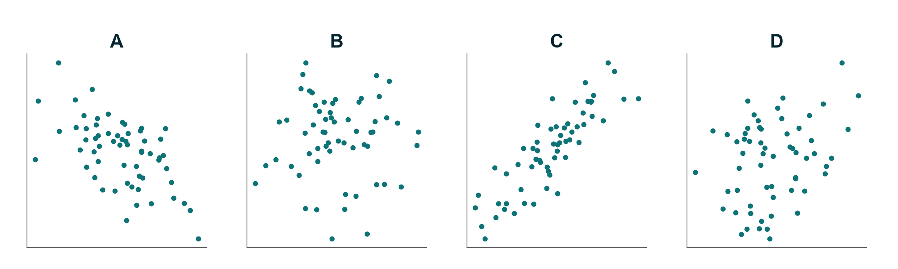
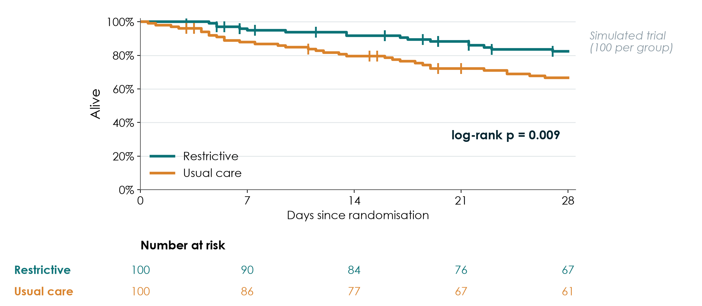

[Download the PDF](files/sessions/s6_exercises.pdf) · [Download the Word file (to fill in)](files/sessions/s6_exercises.docx) · [Back to Session 6](session6.qmd)

**Foundations of Clinical Research · Level 1** · Neudata · *#ClearDataClearImpact* · Week 6 · Saturday 5 December 2026 · online, 19:30–22:30

Name: ______________________________   Department: ______________________________

Type your answers in the Word file, or print the PDF.

| # | Exercise | When |
|---|---|---|
| 1 | True or false: CIs, p-values and multiple tests | Section 6.1, or at home |
| 2 | Choose the test | Section 6.1, or at home |
| 3 | Match r to the scatter plots | At home |
| 4 | [FLUID-ICU] Interpret the comparison | Section 6.2 for Q1, then at home for your question |
| 5 | Read a regression table | At home |
| 6 | Read a Kaplan–Meier curve | At home |
| 7 | Why is it missing? MCAR, MAR or MNAR | At home |
| 8 | [FLUID-ICU] Interpret the model | Section 6.4 for Q1, then at home for your question |
| 9 | Proposal builder 6: Part 3 of your own proposal | In class (9.1), then at home |

**Your FLUID-ICU question.** At the end of the session you choose one question (Q1 to Q5). Then do Exercises 4 and 8 again for it, using its results pack. Your answers become the core of your Results section.

**Abbreviations:** CI = confidence interval, HR = hazard ratio, OR = odds ratio, SD = standard deviation, ICU = intensive care unit, SAP = statistical analysis plan.

* * *

## Exercise 1: True or false: confidence intervals, p-values and multiple tests

**Task.** Circle **T** (true) or **F** (false) for each statement. For each F, be ready to say in one sentence why it is false.

| # | Statement | |
|---|---|:-:|
| 1 | Paper 2 reports HR 2.13 (95% CI 1.48 to 3.06). The data are compatible with a true hazard ratio anywhere from about 1.5 to about 3.1. | T / F |
| 2 | Paper 1 found p = 0.42 for fluid balance, so the restrictive strategy has no effect on fluid balance. | T / F |
| 3 | p = 0.03 means there is a 3% probability that the null hypothesis (no difference) is true. | T / F |
| 4 | If the 95% CI for a difference between two means includes 0, the p-value is greater than 0.05. | T / F |
| 5 | Other things being equal, a larger study gives a narrower confidence interval. | T / F |
| 6 | p < 0.001 proves that the effect is large and clinically important. | T / F |
| 7 | If we repeated the same study many times, about 95% of the 95% CIs would contain the true value. | T / F |
| 8 | A "negative" result (p > 0.05) in a small pilot trial could be a type II error. | T / F |
| 9 | Alpha (usually 5%) is the risk we accept of concluding there is an effect when there really is none. | T / F |
| 10 | p = 0.06 shows "a trend towards significance". | T / F |
| 11 | If you test 20 different outcomes and none has a real effect, you will usually still find at least one with p < 0.05. | T / F |
| 12 | Lactate measured in the same 40 patients at admission and 6 hours later should be compared with an unpaired t-test. | T / F |
| 13 | A trial finds two-sided p = 0.08 in the expected direction, so the authors may report a one-sided p = 0.04 instead. | T / F |
| 14 | A non-inferiority trial is simply a superiority trial analysed with a one-sided test. | T / F |

* * *

## Exercise 2: Choose the test

**Task.** For each scenario, write the test you would use and one reason. Decide in three steps: the type of outcome (a number or a category), then its shape or the counts, then whether the same patients are measured twice (paired).

> **Choose from:** t-test · paired t-test · Wilcoxon rank-sum (Mann-Whitney U) · Wilcoxon signed-rank · chi-square · Fisher's exact · McNemar

| # | Scenario | Test | Why? |
|---|---|---|---|
| a | Mean systolic blood pressure (roughly bell-shaped) in 60 patients on drug A vs 60 on drug B. | | |
| b | ICU length of stay (skewed) in the restrictive-fluid group vs the usual-care group, 24 patients each. | | |
| c | 28-day mortality (yes/no) in 200 patients with a positive fluid balance vs 200 with a negative balance. | | |
| d | Acute kidney injury needing dialysis: 2 of 24 patients in one group vs 5 of 24 in the other. | | |
| e | Serum lactate at ICU admission and 6 hours later in the same 40 patients (the changes are roughly symmetric). | | |
| f | Pressure injury (yes/no) in the same 80 patients assessed before and after a new turning protocol. | | |

* * *

## Exercise 3: Match r to the scatter plots

**Task.** Match each plot (A to D) to one correlation coefficient. Then answer the bonus question.

> **Choose from:** r = 0.86 · r = 0.30 · r = 0.01 · r = −0.58

| Plot | r |
|---|---|
| A | |
| B | |
| C | |
| D | |

Bonus: a bedside glucose meter and the laboratory have r = 0.97 in 50 patients. Can the meter replace the laboratory? What would you look at instead?

* * *

## Exercise 4: [FLUID-ICU] Interpret the comparison (6.2)

**Task.** Fill in the table and write one Results sentence. In class, do it for Q1. At home, do it again for your chosen question. All the numbers are in the results pack of the question. The second table shows where to find them.

| | Your answer |
|---|---|
| Outcome and its type | |
| Test, and why this test | |
| Result in the negative-balance group (Q4: survivors), n (%) or median (IQR) | |
| Result in the positive-balance group (Q4: patients who died) | |
| Effect with 95% CI (risk difference, ratio or Hodges–Lehmann difference) | |
| p-value | |
| One reason this unadjusted comparison could be biased | |

**Where to find the numbers in the results pack**

| Question | Result in each group | Effect with 95% CI, and p-value |
|---|---|---|
| Q1 | Table 2, row "Died by day 28" | Table 2, same row: risk difference with its 95% CI and the chi-square p |
| Q2 | Section 4, line "AKI: positive balance ... vs negative balance" | Table 4, row "Positive vs negative balance, crude" (odds ratio) |
| Q3 | Table 2, row "VFD, median (IQR)" | Table 3, row "Positive vs negative balance, Mann-Whitney (Hodges-Lehmann)" |
| Q4 | Table 1, row "Lactate, mmol/L" | Table 4, row "Unadjusted", method "Complete case" (odds ratio per 1 mmol/L) |
| Q5 | Table 2, row "Median (IQR), days" | Table 3, row "Mann-Whitney (Hodges-Lehmann difference, days)" |

The Q1 and Q2 packs do not name the test for this comparison, so choose it yourself (Exercise 2 helps). In Q4, the odds ratio comes from an unadjusted logistic regression. For the reason for bias, compare the two groups in Table 1 of the same pack.

**Your Results sentence** (no "significant" on its own, no causal words):

> ______________________________________________________________________________

* * *

## Exercise 5: Read a regression table (another example, homework)

**Task.** Read the table and the authors' conclusion, then answer the seven questions.

A (mock) cohort study of 600 adults admitted to a medical ICU asked which factors are associated with **hospital-acquired delirium** (yes/no) during the ICU stay.

**Table 3. Multivariable logistic regression: factors associated with delirium**

| Variable | Adjusted OR | 95% CI | p-value |
|---|:-:|:-:|:-:|
| Benzodiazepine infusion (yes vs no) | 2.10 | 1.40 – 3.20 | < 0.001 |
| Age (per 10 years) | 1.30 | 1.12 – 1.51 | < 0.001 |
| Mechanical ventilation (yes vs no) | 1.60 | 0.95 – 2.70 | 0.08 |
| Female sex (vs male) | 0.85 | 0.60 – 1.20 | 0.36 |
| Pre-existing dementia (yes vs no) | 3.40 | 1.90 – 6.10 | < 0.001 |
| Sleep protocol: eye masks + earplugs (yes vs no) | 0.62 | 0.41 – 0.94 | 0.02 |

*Adjusted for all variables in the table and for APACHE II score.*

**Authors' conclusion:** *"Benzodiazepines cause delirium in ICU patients. Mechanical ventilation showed a trend towards more delirium (p = 0.08). Our sleep protocol reduces delirium by 38%."*

1. What type of outcome is this, and why was logistic regression used?
2. What is the "no effect" value for the numbers in this table?
3. For each row, does the 95% CI include the no-effect value? Mark ✔ (excludes) or ✖ (includes).
4. Write **one plain-language sentence** for the benzodiazepine row.
5. Interpret the age row: what does "1.30 per 10 years" mean for a patient 20 years older?
6. Which rows are compatible with no association?
7. Find **three** problems in the authors' conclusion.

* * *

## Exercise 6: Read a Kaplan–Meier curve

**Task.** Read the curve and answer the six questions.

A (simulated) trial randomised 200 adults with septic shock to a restrictive fluid strategy or usual care and followed them for 28 days.

1. Approximately what proportion of patients in each group were alive at day 28?
2. What do the small vertical ticks on the curves mean?
3. How many patients in the usual-care group were still being followed (at risk) at day 21? Why does the number fall even in a group where few patients die?
4. What does "log-rank p = 0.009" tell you? What does it **not** tell you?
5. Which model would give a hazard ratio with a 95% CI, and what assumption would you check by looking at the curves?
6. Would you be happy if the authors had shown this figure **without** the numbers at risk? Why?

* * *

## Exercise 7: Why is it missing? MCAR, MAR or MNAR

**Task.** For each scenario, write the most likely mechanism and what it means for a complete-case analysis (an analysis of only the patients with no missing values).

> **Choose from:** MCAR (missing completely at random) · MAR (missing at random: depends on something recorded) · MNAR (missing not at random: depends on the missing value itself)

| # | Scenario | Mechanism | Consequence for complete-case analysis |
|---|---|---|---|
| a | 12 blood samples for lactate were lost when a courier box was dropped. | | |
| b | Weight is missing more often in patients admitted at night. Admission time is recorded for everyone. | | |
| c | Pain scores are missing for the patients in most pain, who could not complete the questionnaire. | | |
| d | Day-28 status is missing for patients transferred to another hospital, often because they were deteriorating. | | |
| e | A form version used in the first month did not include the "smoking" question. | | |
| f | Older patients are less likely to return a quality-of-life questionnaire at 3 months. Age is recorded for all. | | |

* * *

## Exercise 8: [FLUID-ICU] Interpret the model: crude vs adjusted, complete case vs imputation (6.4)

**Task.** Fill in the parts and write two Results sentences. In class, do Part A and the sentences for Q1. At home, do Parts B and C for Q1. Then do Part A again for your chosen question, and Part B too if you chose Q4. Only the Q1 and Q4 packs have a multiple-imputation analysis. The table below shows where to find each number.

**Where to find the numbers in the results pack**

| Question | Part A: crude and adjusted estimate, 95% CI and n | Confounders (question 1) | Part B: complete case vs multiple imputation (questions 4 and 5) |
|---|---|---|---|
| Q1 | Table 6, rows "Crude, all patients" and "Adjusted, complete cases (main)". Table 3 gives the same odds ratios. | Section 2, line "Pre-specified confounders (SAP)" | Table 6, rows "Adjusted, complete cases (main)" and "Adjusted, multiple imputation (m = 20)". Who was left out: participant flow at the end of section 2 |
| Q2 | Table 4, rows "Balance per 10 ml/kg, crude" and "Balance per 10 ml/kg, adjusted" | Section 2, line "Pre-specified confounders (SAP)" | Not in this pack |
| Q3 | Table 3, rows "Balance per 10 ml/kg, crude (linear)" and "Balance per 10 ml/kg, adjusted (linear)" | Section 2, line "Pre-specified confounders (SAP)" | Not in this pack |
| Q4 | Table 4, rows "Unadjusted" and "Adjusted: age, sex, diabetes, CKD, heart failure (main)", both with method "Complete case" | Table 4, row name "Adjusted: ..." | Table 4, the two "(main)" rows. Who was left out: Table 2 |
| Q5 | Table 3, rows "Log-linear, crude (ratio of geometric means)" and "Log-linear, adjusted (ratio of geometric means)" | Section 2, line "Pre-specified confounders (SAP)" | Not in this pack |

**Part A: crude vs adjusted**

| | Estimate | 95% CI | n |
|---|---|---|---|
| Crude | | | |
| Adjusted | | | |

1. Which confounders were in the adjusted model? Were they chosen before the analysis (look at the SAP)?
2. How much did the estimate move after adjustment, and in which direction? What does that tell you about confounding by indication?
3. Does the adjusted 95% CI include the "no effect" value (1 for a ratio, 0 for a difference)?

**Part B (Q1 and Q4 only): complete case vs multiple imputation**

4. How many patients were in the complete-case model, and how many in the multiple-imputation model? Who was left out of the complete-case analysis?
5. Is the multiple-imputation estimate close to the complete-case estimate?

**Part C (Q1 only): Kaplan–Meier and Cox**

6. Give the survival at day 28 in each group and the log-rank p (Table 2 of the Q1 pack), and the adjusted Cox HR with its 95% CI (Table 4). Why do the logistic (p = 0.044) and Cox (p = 0.053) results tell the same story?

**Your two Results sentences** (crude, then adjusted, with CIs, "associated with", not "caused"):

> ______________________________________________________________________________

* * *

## Exercise 9: Proposal builder 6 (your own proposal)

**Task.** Draft Part 3 of your proposal for your own question: sample size, analysis plan, confounders and missing-data plan. First watch the instructor fill it in for the running example. In class, fill in 9.1 (10 minutes). Finish 9.2 to 9.4 at home, then copy your answers into Part 3 of the proposal template (`Research_Proposal_Template.docx`, sent by email).

### 9.1 Sample-size statement

| Input | Your value | Source (paper, audit, pilot, clinical judgement) |
|---|---|---|
| Expected value in the comparison group (proportion or mean) | | |
| Smallest difference worth detecting | | |
| SD (only for a numerical outcome) | | |
| Alpha (two-sided) | 5% | convention |
| Power | 80% / 90% | |
| Expected drop-out | | |

**Sentence.** Find the number per group with the spreadsheet `sample_size_calculator.xlsx` (sent by email), then complete:

> Assuming ______ in the control group and ______ in the intervention group, ______ patients per group give ____% power at a two-sided alpha of 5%. Allowing ____% loss, we will recruit ______ patients in total.

### 9.2 Plain-language analysis plan

| Step | What we will do |
|---|---|
| Describe the patients (Table 1) | Numerical symmetric variables as ______, skewed as ______, categories as ______ |
| Compare the primary outcome | Test: ______ because the outcome is ______ |
| Report the effect | Effect measure (difference / RR / OR / HR) with 95% CI: ______ |
| Deal with confounding (observational designs only) | We will adjust for: ______ using ______ (e.g. logistic regression) |
| Missing data | We will report how many values are missing for each variable and prevent it by: ______ |

### 9.3 Confounders

| Confounder | Why it is a confounder (linked to exposure AND outcome, not caused by the exposure) |
|---|---|
| | |
| | |
| | |

Expected number of events: ____  Maximum number of model terms (about 1 per 10 events): ____

### 9.4 Missing-data plan

| Question | Our answer |
|---|---|
| Which variables are most likely to be missing, and why? (MCAR / MAR / MNAR thinking) | |
| How will we prevent it? (form design, training, weekly checks, chasing outcome status) | |
| How will we report missingness? (n missing per variable, flow diagram) | |
