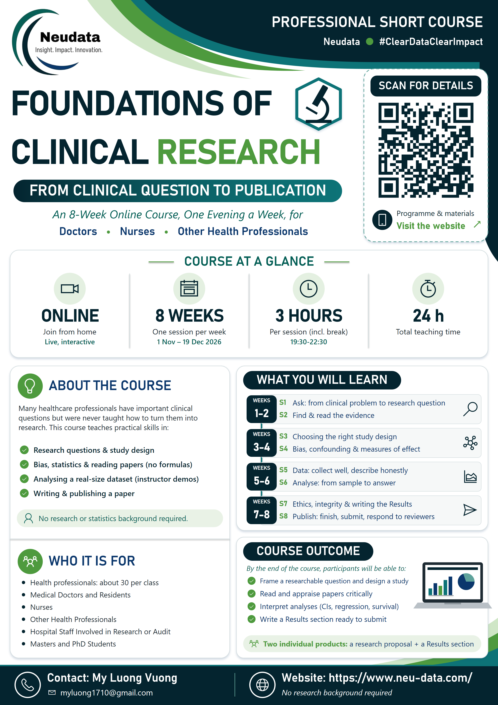

::: {.course-hero}
# Foundations of Clinical Research · Level 1
From Clinical Question to Publication

::: {.badges}
[Level 1]{} [Online]{} [8 Saturdays, 19:30–22:30]{} [one session per week]{} [24 contact hours]{} [No software needed]{} [EN + VN]{}
:::

[See the full schedule](schedule.qmd){.btn .btn-light role="button"} [Get your free access code](access.qmd){.btn .btn-light role="button"}
:::

{.float-end width="34%" style="margin:0 0 1rem 1.5rem" fig-alt="Course poster"}

```{=html}
<div class="facts"><div><strong>Format</strong><span>Online, 8 sessions × 3 hours</span></div><div><strong>When</strong><span>Every Saturday, 19:30–22:30, for 8 weeks: 31 Oct – 19 Dec 2026</span></div><div><strong>For</strong><span>Health professionals (doctors, nurses, etc.), about 30</span></div><div><strong>Software</strong><span>None: the trainers run the analyses</span></div></div>
```

## About this course

Clinical staff make decisions every day that research could improve, but few have been taught how to turn a bedside uncertainty into a published study. Over eight weeks, with one 3-hour online session every Saturday evening (19:30–22:30), this course walks the whole road of research: asking a good question, finding and reading the evidence, choosing a design, recognising bias, collecting and analysing data, protecting participants, writing the paper and getting it published.

- **Slow and visual.** Built for participants with no research background: pictures first, a "check your understanding" every 20 minutes, no formulas beyond a 2×2 table, and extra slides at the end of each session for anyone who wants to read further at home.
- **Online, one class.** You join from home. There are no groups or breakout rooms: every exercise is done by the whole class together, with polls and the chat.
- **The whole road in one course.** Weeks 1–4 build understanding and design skills; Weeks 5–8 read the results of a realistic simulated dataset (FLUID-ICU, 620 ICU patients) through live instructor demos in R, and each participant writes them up as a manuscript.
- **Level 1 of three.** This course is Level 1. Level 2 is a separate hands-on course in R for those who want to run analyses themselves (in preparation). Level 3 covers advanced, specialised methods on request. See [Course levels](levels.qmd).
- **One running example:** fluids in septic shock. The example is followed through question and search, design, analysis, write-up and publication, and appraised through two real papers.

## Eight Saturdays, eight sessions

| Week | Session |
|:--:|:--|
| 1 | [Session 1 · Ask: from clinical problem to research question](session1.qmd) |
| 2 | [Session 2 · Find & read: the evidence](session2.qmd) |
| 3 | [Session 3 · Design: choosing the right study](session3.qmd) |
| 4 | [Session 4 · Bias & effect: can we trust it, how big is it?](session4.qmd) |
| 5 | [Session 5 · Data: collect it well, describe it honestly](session5.qmd) |
| 6 | [Session 6 · Analyse: from sample to answer](session6.qmd) |
| 7 | [Session 7 · Protect & write: ethics, integrity, Methods and Results](session7.qmd) |
| 8 | [Session 8 · Publish: finish the paper, get it out, present](session8.qmd) |

[See the full schedule](schedule.qmd)

## Two individual products

```{=html}
<div class="cards2"><div><h4>1 · A research proposal</h4><p>On your <strong>own clinical question</strong> from your department, with a publication plan. Each part is shown live on the running example and you write your own as homework. Everyone <strong>submits it in Session 8</strong>; about 5 volunteers also present it (6 minutes + 2 minutes feedback).</p></div><div><h4>2 · A draft manuscript</h4><p>From the course dataset <strong>FLUID-ICU</strong>: you choose one of the five questions (Q1 to Q5). We give you the results in a results pack, and you write the paper: Methods and Results after Session 7, the rest after Session 8. After the course, you <strong>peer review</strong> one classmate's draft and reply to the review of yours like a real author.</p></div></div>
```

## Who it is for

**Health professionals (doctors, nurses, etc.)**, about 30 participants per class, joining online from home. No research or statistics background is assumed, and no software is needed: the trainers run the analyses and you learn to read, interpret and write them up. You need a computer with a stable internet connection, camera and microphone.

## How to start

- Request your free [access code](access.qmd) (once per browser).
- Read the [participant handbook](handbook.qmd) and look at the [schedule](schedule.qmd).
- Each [session page](session1.qmd) has the agenda, the slides, the exercise sheet and what to prepare.

## Trainers

```{=html}
<div class="cards2"><div><h4>Vương Mỹ Lượng</h4><p>Senior Biostatistician, Neudata</p></div><div><h4>Bernard Osang'ir</h4><p>Senior Biostatistician, Neudata</p></div></div>
```

## Contact

Questions about the course: contact Vương Mỹ Lượng at [myluong1710@gmail.com](mailto:myluong1710@gmail.com).

Neudata Consulting Ltd · [www.neu-data.com](https://www.neu-data.com)
