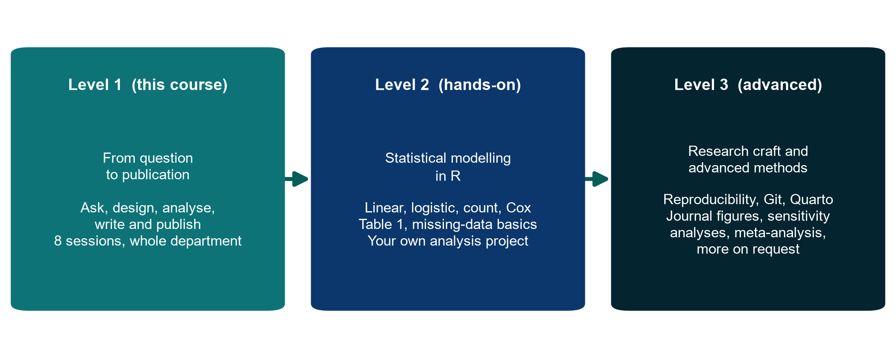

::: {.callout-tip title="Where you are: Level 1"}
This website is **Level 1: Foundations**, the whole 8-session course, from a clinical question to a draft manuscript. Level 2 and Level 3 are separate courses that build on it.
:::

{fig-alt="Level 1, Level 2 and Level 3"}

- **Level 1: Foundations (this course).** Understand research from question to publication. Online, for health professionals (doctors, nurses, etc.), no software needed; the analyses are demonstrated live on FLUID-ICU.
- **Level 2: Doing the analysis (in preparation).** A separate course in R on statistical modelling, for those who want to run, check and report the analyses themselves.
- **Level 3: Advanced topics (on request).** Reproducible research, journal-quality figures and specialised methods for complex designs and data, as workshops or consultancy on the participant's own project.

[Download the course levels overview (PDF)](files/docs/Course_Levels_Overview.pdf)

**Organisation:** Neudata · *#ClearDataClearImpact*

Neudata's clinical-research training runs in three levels. Each level builds on the one before, and each department can stop at the level that fits its needs.

| | **Level 1: Foundations** | **Level 2: Doing the analysis** | **Level 3: Advanced topics** |
|---|---|---|---|
| **In one line** | Understand research from question to publication | Fit, check and interpret the common statistical models yourself, in R | Reproducible research, journal-quality output and specialised methods for complex data |
| **Who** | A whole department (about 30 health professionals: doctors, nurses, etc.) | An interested subgroup (8 to 12) who want to run their own analyses | Researchers with a specific project or dataset |
| **Prerequisites** | None | Level 1 and the free Neudata course *Clinical Data Analysis in R* (or equivalent basics) | Level 2 (or equivalent experience), plus a real question or dataset |
| **Format** | 8 online sessions of 3 hours, every Saturday for 8 weeks | 8 online sessions of 3 hours over about 4 to 6 weeks, with homework | Online workshops of 1 or 2 sessions, or consultancy, on request |
| **Software** | None for participants (instructor demos) | R and RStudio on own laptops | R (and specialised packages) |
| **Hands-on?** | Concepts, reading and interpreting; analyses demonstrated live on FLUID-ICU | Every session is hands-on coding; the class works together, exercises are individual | Hands-on on the participant's own data |
| **Outcome** | An individual research proposal and an individual draft manuscript | R scripts for an analysis question and a draft Results section | A reproducible analysis, or an analysis plan, for a real project, with Neudata support |
| **Documents** | [This website](index.qmd) (the full Level 1 course) | [Level 2](level2.qmd) | [Level 3](level3.qmd) |

## How the levels connect

- **From Level 1 to Level 2.** In Level 1, participants *read* the FLUID-ICU analyses (Table 1, crude vs adjusted ORs, Kaplan-Meier, multiple imputation) that the instructor runs. Level 2 is a statistical-modelling course: participants clean and describe the data, then fit, check and interpret the models that clinical papers use most (linear, logistic, Poisson, negative binomial, zero-inflated and Cox), each session starting with the exploratory data analysis (EDA) suited to that model. It ends with an individual analysis question and a written Results section. The FLUID-ICU dataset and R scripts in `Course/Data/` are shared by both levels.
- **From Level 2 to Level 3.** Level 3 adds the research-craft topics moved out of Level 2 (reproducible projects, version control, Quarto reports, figures that meet journal requirements, and missing-data and sensitivity analyses in depth) and the methods that complex data demand (meta-analysis, prediction models, diagnostic accuracy, advanced survival analysis, longitudinal and multilevel models, large or clustered datasets). Every Level 3 lecture includes an EDA section and journal-ready figure code for its analysis problem.

## Progression at a glance

| Skill | Level 1 | Level 2 | Level 3 |
|---|---|---|---|
| Research question, design, ethics | Taught in depth | Assumed | Assumed |
| Data management and cleaning | Concepts; live demo | Hands-on in R scripts: import, clean, validate, cleaning log | Reproducible projects and version control (Module G); large, linked or clustered data (Module F) |
| Describing data, Table 1, figures | Read and judge | Table 1; EDA plots suited to each model, from course code | Figures that meet journal requirements (vector vs raster, dimensions, resolution, fonts) and figure code in every module |
| Regression | Read and interpret outputs | Fit, check, interpret and report linear, logistic, count (Poisson, negative binomial, zero-inflated) and Cox models | Mixed models, competing risks, time-varying covariates, prediction models |
| Missing data | Mechanisms and ideas | Describe missingness; complete-case vs multiple imputation, touched on | Multiple imputation in practice and sensitivity analyses in depth (Module H) |
| Survival analysis | Read Kaplan-Meier and HRs | Kaplan-Meier and Cox, including the proportional-hazards check | Advanced: time-varying covariates, competing risks, restricted mean survival time (Module D) |
| Writing and publishing | Full manuscript workflow (individual draft) | Results section written from own R output | Quarto reports in which every number comes from code; Methods and Results for complex analyses |

**Status:** Level 1 materials are in `Course/`. Level 2 and Level 3 are outlines. Their materials will be developed after Level 1 has run.
