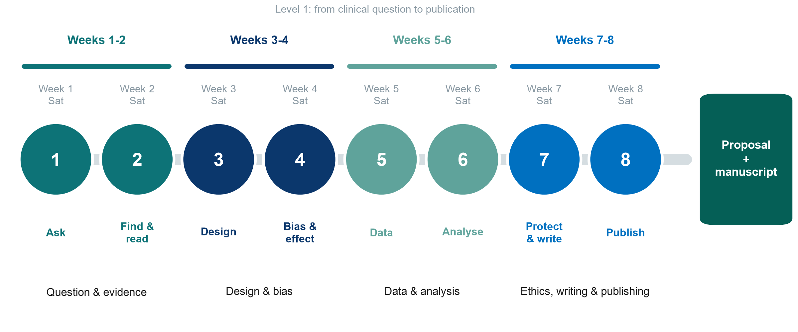
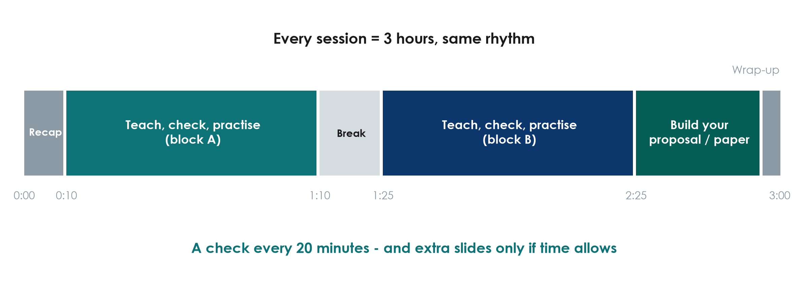
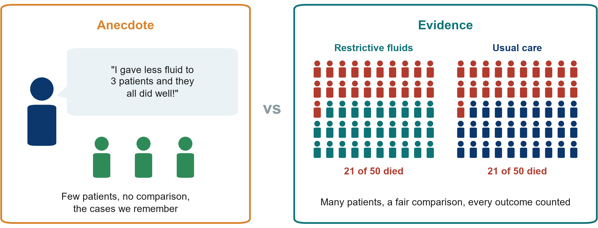
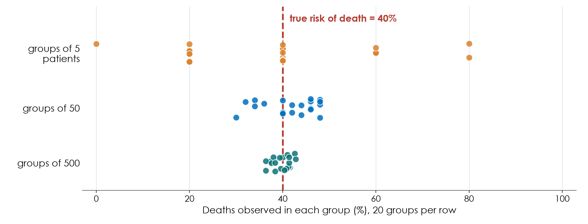
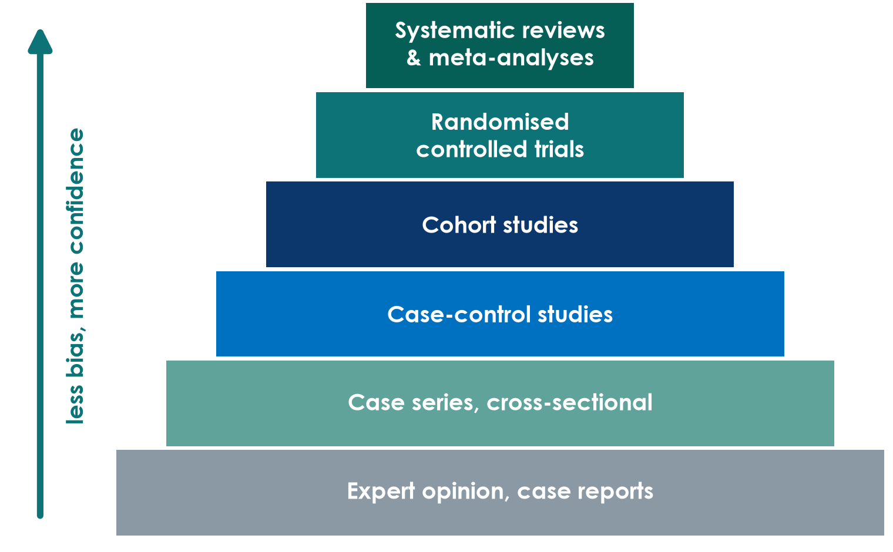
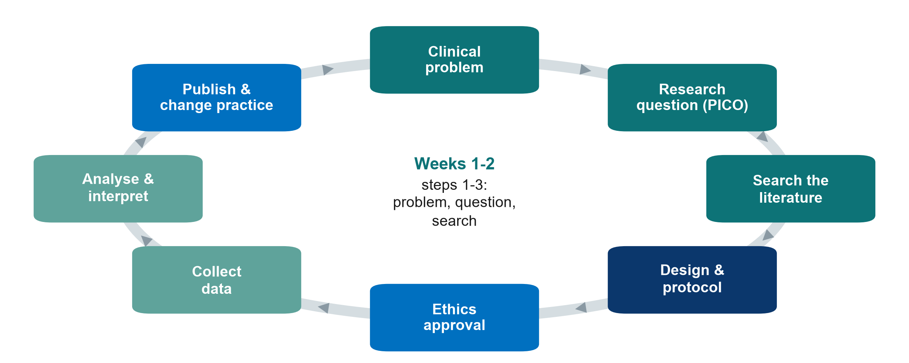
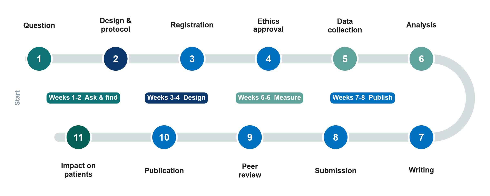
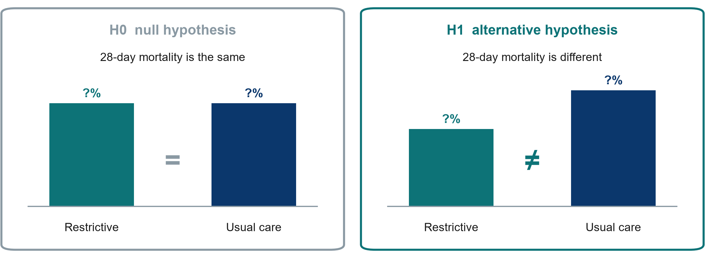

---

:::: {.neu-statement}
::: {.neu-big}
Every day you make decisions that research could improve.
:::

::: {.neu-sub}
This course helps you ask those questions properly, answer them and publish the answer.
:::
::::

::: {.notes}
Open with a question to the class: 'Think of one thing in your department where colleagues do it differently and nobody knows which way is best. Type it in the chat.'

Read 2-3 answers aloud. Expected: fluids, sedation, mobilisation, wound dressings, line care.

Key teaching point: research starts from clinical uncertainty, not from statistics.

Copy the chat answers into the shared course document. They are candidate topics for your own proposals.

Timing: 2 minutes.
:::

## Eight Saturdays, eight sessions

{.neu-fig}

::: {.notes}
Walk along the road: Weeks 1-2 the question and the evidence. Weeks 3-4 design and bias. Weeks 5-6 data and analysis. Weeks 7-8 ethics, writing and publishing. One online session every Saturday (19:30 to 22:30), with a full week between sessions for the homework.

This whole course is Level 1: it covers every step from question to publication. Weeks 1-4 build understanding and design skills. Weeks 5-8 apply them to data, writing and publishing.

One running example travels with us: fluids in septic shock and 28-day mortality. From Session 5 it continues in the course study, FLUID-ICU.

Timing: 2 minutes.
:::

## This course is Level 1 of three

:::: {.neu-cards style="--n:3"}
::: {.neu-card .plain style="--c:#0D7377"}
[Level 1  (this course)]{.neu-card-title}

- **From question to publication**
- Ask, design, analyse, write and publish
- 8 sessions, whole department
:::
::: {.neu-card .plain style="--c:#0B376C"}
[Level 2  (hands-on)]{.neu-card-title}

- **Statistical modelling in R**
- Linear, logistic, count, Cox
- Table 1, missing-data basics
- Your own analysis project
:::
::: {.neu-card .plain style="--c:#04242F"}
[Level 3  (advanced)]{.neu-card-title}

- **Research craft and advanced methods**
- Reproducibility, Git, Quarto
- Journal figures, sensitivity analyses, meta-analysis
- More on request
:::
::::

::: {.neu-takeaway}
**KEY MESSAGE** Level 1 is this course, Level 2 is statistical modelling in R, Level 3 is advanced methods.
:::

::: {.notes}
This course (Level 1) takes you from a clinical question to a published paper. Level 2 is a hands-on statistics course in R for those who want to run analyses themselves. Level 3 covers advanced, specialised methods.

Within Level 1 we use a realistic dataset of 620 ICU patients (FLUID-ICU): we describe it, analyse it and write it up. The trainers run the software. You read and interpret the results.

Misconception to defuse: 'research is only for statisticians or professors'. Most good clinical questions come from nurses and doctors at the bedside.

Timing: 1 minute.
:::

## Two things you will produce, each on your own

::: {.neu-intro}
Both are individual work. We guide every step in class.
:::

:::: {.neu-cards style="--n:2"}
::: {.neu-card .plain style="--c:#0D7377"}
[Your research proposal]{.neu-card-title}

- On a question from your own department
- Built one part at a time, Sessions 1 to 7
- Submitted by everyone in Session 8
- A few volunteers also present it
:::
::: {.neu-card .plain style="--c:#0B376C"}
[A draft manuscript]{.neu-card-title}

- Based on the course study, FLUID-ICU
- You choose one of its five questions (Q1 to Q5)
- We give you the results. You write the paper
- After Session 8 you review one colleague's draft
:::
::::

::: {.notes}
Product 1: your own research proposal on a question from your own department, built one part every two weeks and submitted in Session 8. About five volunteers present theirs in Session 8 (6 minutes each). The written proposal is what is scored for everyone.

Product 2: your own draft manuscript. FLUID-ICU is a course study of 620 ICU patients with sepsis. It has five research questions (Q1 to Q5). Each of you chooses one question and receives its results pack (tables and figures). Yes: we give you the results and you write the paper. You do not analyse data yourself.

We read the results together in Weeks 5-6 and write in Weeks 7-8. After Session 8 each participant reviews one colleague's draft (the trainers assign it) and replies to the review of their own draft, like real authors.

Point to the briefs in the course folder: Course/Assignment/proposal\_brief and Course/Assignment/manuscript\_brief.

Timing: 3 minutes.
:::

## By the end of the course you will be able to

:::: {.neu-cards style="--n:4"}
::: {.neu-card .plain style="--c:#0D7377"}
[Ask & find]{.neu-card-title}

- Turn a problem into a PICO question
- Search PubMed and manage references
- Read a paper in 15 minutes
:::
::: {.neu-card .plain style="--c:#0B376C"}
[Design]{.neu-card-title}

- Pick the right study design
- Recognise bias and confounding
- Read RR, OR, NNT and forest plots
:::
::: {.neu-card .plain style="--c:#5FA39B"}
[Analyse]{.neu-card-title}

- Plan good data and a CRF
- Read CIs, p-values and regression
- Interpret a real dataset's results
:::
::: {.neu-card .plain style="--c:#0070C0"}
[Write & publish]{.neu-card-title}

- Plan ethics and registration
- Write each section of a paper
- Submit and answer reviewers
:::
::::

::: {.neu-takeaway}
**KEY MESSAGE** Understand and interpret: you will not be asked to calculate.
:::

::: {.notes}
Walk across the four cards, one per two-week block.

Key teaching point: the aim is understanding and interpretation, not computation. The trainers run the analyses. You learn to read them and write them up.

Ask the class: 'Which card worries you most? Answer in the chat.' Expected: analyse. Reassure: we go slowly, with pictures, and check understanding every 20 minutes.

Return to this slide in Session 8 to show progress.

Timing: 2 minutes.
:::

## How each session runs

{.neu-fig}

::: {.notes}
Same rhythm every Saturday, 19:30 to 22:30: recap, two teaching blocks with checks and short tasks, a 15-minute break, and time to build your proposal or your paper.

Every 20 minutes we stop for a quick check of understanding, usually a poll. If the class is not with us, we slow down. Each session ends with 'extra slides' that we only use if there is time. You can read them at home.

Keep the break to 15 minutes and start again on time.

Timing: 1 minute.
:::

## Build your proposal one part at a time

:::: {.neu-steps}
::: {.neu-step style="--c:#0D7377"}
[Part 1]{.neu-step-label}

- **Sessions 1-2**
- Question, background, aims
:::
::: {.neu-step style="--c:#0B376C"}
[Part 2]{.neu-step-label}

- **Sessions 3-4**
- Design and participants
:::
::: {.neu-step style="--c:#5FA39B"}
[Part 3]{.neu-step-label}

- **Sessions 5-6**
- Data collection, sample size, analysis plan
:::
::: {.neu-step style="--c:#0070C0"}
[Part 4]{.neu-step-label}

- **Session 7**
- Ethics, feasibility, publication plan
:::
::: {.neu-step style="--c:#055F56"}
[Submit]{.neu-step-label}

- **Session 8**
- Complete proposal submitted
:::
::::

::: {.neu-takeaway}
**KEY MESSAGE** Your own question, one template, one part every two weeks, submitted in Session 8.
:::

::: {.notes}
Part 1 (Weeks 1-2): the question and the background. Part 2 (Weeks 3-4): the design. Part 3 (Weeks 5-6): the data and the analysis plan. Part 4 (Session 7): ethics, feasibility and a publication plan.

In each proposal-builder slot the trainer first fills in the part for the running example on a shared screen. then you draft the same part for your own question.

Everyone submits the complete proposal in Session 8. About five volunteers present theirs (6 minutes each).

Template: Course/Templates/Research\_Proposal\_Template.docx (sent by email before Session 1).

Timing: 1 minute.
:::

## Welcome: introduce yourself

::: {.neu-banner style="--c:#0D7377"}
WHOLE-CLASS TASK · 6 min
:::

:::: {.columns}
::: {.column width="60%"}
::: {.neu-activity-steps style="--c:#0D7377"}
- Type your name, department and profession in the chat
- Add one question you wish research could answer in your department
- Read the other messages: many are possible research topics
- A few of you then say your question with the microphone on. We keep the full list for your proposals
:::
:::
::: {.column width="40%"}
::: {.neu-side .plain style="--c:#0D7377"}
Example message

- Lan, ICU, nurse
- 'Do patients with septic shock need less fluid than we give?'
:::
:::
::::

::: {.neu-output style="--c:#0D7377"}
**OUTPUT** One introduction per person in the chat, and a few spoken questions
:::

::: {.notes}
The class is about 30 doctors and nurses joining from home. We work as one class for every task, so there are no groups and no roles.

Give 3 minutes for typing. Then call on 4-5 people to say their question with the microphone on and point out shared themes (fluids, sedation, infection, mobilisation, medication safety).

Save the chat after the session and paste the questions into the shared course document. They are the starting list for each person's own proposal in Proposal builder 1.

Timing: 6 minutes.
:::

## How we learn together online

:::: {.neu-cards style="--n:4"}
::: {.neu-card .plain style="--c:#0D7377"}
[Ask anything]{.neu-card-title}

- There are no silly questions
- Use the chat or 'raise hand'
:::
::: {.neu-card .plain style="--c:#0B376C"}
[Go slow]{.neu-card-title}

- We check understanding often
- Extra slides only if time allows
:::
::: {.neu-card .plain style="--c:#5FA39B"}
[Bring your department]{.neu-card-title}

- Use examples from your own practice
- No patient names or details
:::
::: {.neu-card .plain style="--c:#0070C0"}
[Online habits]{.neu-card-title}

- Camera on when you can
- Microphone off unless speaking
- When called on, answer with the microphone on
- Back on time after the break
:::
::::

::: {.notes}
Set the climate: this is a safe place to say 'I do not understand'. A private chat message to the trainer is fine.

Language: questions and chat can be in Vietnamese or English, whatever helps you think.

Patient confidentiality applies to every example: no names or identifiable details.

Timing: 1 minute.
:::

## Pre-course quiz (online form)

::: {.neu-banner style="--c:#6C3483"}
QUICK QUIZ · 15 min
:::

:::: {.columns}
::: {.column width="60%"}
::: {.neu-activity-steps style="--c:#6C3483"}
- Open the quiz form: the link is in the chat now
- 24 multiple-choice questions, one answer each (about 12 minutes)
- Work alone: no notes and no colleagues
- Guess if you are not sure: this is not an exam
- Enter your participant code, not your name
:::
:::
::: {.column width="40%"}
::: {.neu-side style="--c:#6C3483"}
Why a quiz now?

- Shows where the class starts
- The same quiz again in Session 8
- We measure the course, not you
:::
:::
::::

::: {.neu-output style="--c:#6C3483"}
**OUTPUT** Form submitted (participant code only)
:::

::: {.notes}
The quiz is Course/Assessment/pre\_post\_quiz.md (24 questions, 3 per session), set up before the course as an online form. Paste the link in the chat at this slide.

Participant code: the number next to each name on the attendance list, sent by email before Session 1. The same code is used in Session 8 so the two scores can be compared.

Reassure: results are anonymous and used only to measure what the course achieved.

Close the form after 15 minutes. Do not give answers today. The same quiz is repeated in the last 15 minutes of Session 8, and the answers are shared after that second attempt.

Timing: 15 minutes. Session 1 teaching starts at 0:35 (20:05).
:::

# Session 1 · Ask: from clinical problem to research question

## Week 1 · Saturday

- 1.1  Why research? Evidence, the two course papers, types of research, the road to publication
- Break
- 1.2  From problem to question: PICO(T) and PECO, FINER, a whole-class task
- 1.3  Aims, objectives and hypotheses (quick exercise)
- Proposal builder 1: start your own question, aim and objectives
- Wrap-up: key words, recap, exit question, homework for next Saturday

::: {.notes}
Session 1 opening (0:35, 20:05). The front matter (welcome, course map, introductions in the chat, pre-course quiz) has just finished.

Teaching point: today has one job: everyone leaves with the start of one clear, answerable research question of their own, with an aim and objectives. Next Saturday (Session 2) we search and read the literature for it.

Pace: this audience has little or no research background, and it is evening after a working day. Go slowly, use the worked examples, and stop at every 'Check your understanding' slide. They are short on purpose.

Show the shape of the session: three short teaching blocks, a break, one whole-class task, one quick individual exercise, then 30 minutes to start your own proposal.

Ask the class: 'Who has ever taken part in a research study, as a researcher, data collector or participant? Answer yes or no in the poll.' It tells you where to pitch the session.

Timing: 1 minute. Do not read the agenda aloud. Point at it.
:::

## 1.1  Why research?

:::: {.neu-statement}
::: {.neu-big}
Why do we need research when we already have experience?
:::

::: {.neu-sub}
35 minutes: evidence, the two course papers, the pyramid, types of research and the road to publication
:::
::::

::: {.notes}
Segment 1.1 (0:35-1:10, 20:05-20:40).

Pause on the question and call on two or three people to answer with the microphone on before you click on. Read 2-3 answers aloud.

Expected answers: experience is biased towards memorable cases. Colleagues disagree, practice changes. We need to know whether what we do actually helps.

Teaching point: experience is valuable for generating questions, but it is a weak way of answering them.

Timing: 1 minute.
:::

## Anecdote vs evidence

{.neu-fig}

::: {.neu-takeaway}
**KEY MESSAGE** Experience suggests questions. Fair comparisons in many patients answer them.
:::

::: {.notes}
Left: one clinician, three patients, a vivid memory, no comparison group.

Right: 50 patients per group, every death counted, the same outcome measured in both arms.

The numbers are illustrative, but the pattern is real: the large CLASSIC trial (Meyhoff, NEJM 2022, 1,554 septic shock patients) found 90-day mortality of 42.3% with restrictive fluids vs 42.1% with standard care. The three 'success' patients would have done well either way.

Misconception: 'if it worked in my patients it works'. Without a comparison we cannot tell what would have happened anyway (natural recovery, regression to the mean, selective memory).

Ask the class (call on two or three people, microphone on): 'Why do we remember the three good outcomes?' Expected answer: recall bias. Dramatic and recent cases stick, and we forget the failures.

Timing: 4 minutes. Go slowly: this is the idea the whole course rests on.
:::

## Why one ward's experience is not enough

{.neu-fig}

::: {.neu-takeaway}
**KEY MESSAGE** Small numbers jump around by chance. Large, fair comparisons settle down.
:::

::: {.notes}
This picture is a simulation (fixed seed): imagine a disease where the true risk of death is 40%.

Top row: 20 wards each see only 5 patients. By pure chance some see 0% deaths, others 80%. Each ward would 'learn' something different from its own experience.

Middle row: groups of 50, closer to the truth but still scattered. Bottom row: groups of 500 cluster tightly around 40%.

Teaching point: chance alone produces impressive-looking differences in small numbers. This is why research needs enough patients and a comparison group, and why 'my last three patients' can mislead.

Misconception: 'a big difference in a small group must be real'. A big difference in a small group is exactly what chance produces.

Ask the class (poll, yes / no / cannot tell): 'One ward lost 0 of 5 patients after a new protocol. Does the protocol work?' Expected answer: cannot tell, because 0 of 5 happens often by chance even when the true risk is 40%.

Timing: 4 minutes. Sample size returns in Session 6.
:::

## The two papers we read together in this course

::: {.neu-intro}
Both are in the course folder, Course/Papers: the original and an annotated copy in English and Vietnamese.
:::

:::: {.neu-cards style="--n:2"}
::: {.neu-card .plain style="--c:#0D7377"}
[Paper 1: Boulet 2024, a trial]{.neu-card-title}

- **Boulet N, et al. Crit Care 2024;28:429**
- Impact on fluid balance of an optimized restrictive strategy targeting non-resuscitative fluids in intensive care patients with septic shock
- A small pilot randomised controlled trial (RCT) of 48 patients
- Main outcome: fluid balance at day 5
:::
::: {.neu-card .plain style="--c:#0B376C"}
[Paper 2: Hyun 2023, a cohort]{.neu-card-title}

- **Hyun DG, et al. Ann Intensive Care 2023;13:105**
- Impact of a cumulative positive fluid balance during the first three ICU days in patients with sepsis
- A matched cohort study from the Korean sepsis registry
- Main outcome: death by day 28
:::
::::

::: {.neu-takeaway}
**KEY MESSAGE** Paper 1 is a trial, Paper 2 is a cohort. Both study fluids in sepsis.
:::

::: {.notes}
Introduce the two course papers now, because we refer to them in every session from here on.

Paper 1 (Boulet 2024, Critical Care): a pilot RCT in three French ICUs. Adults with septic shock were randomised to a restrictive strategy for 'non-resuscitative' fluids (maintenance fluids and fluids used to dilute drugs) or usual care. Primary outcome: cumulative fluid balance at day 5.

Paper 2 (Hyun 2023, Annals of Intensive Care): a propensity score-matched cohort from the Korean Sepsis Alliance registry. Patients with a positive cumulative fluid balance on ICU days 2-3 were compared with those without. Outcome: 28-day mortality.

Where to find them: Course/Papers in the course folder, sent by email before Session 1. Each paper has the original PDF and an annotated teaching copy in English and Vietnamese.

Do not read them now. In Session 2 we read Paper 1's abstract together.

Timing: 3 minutes.
:::

## The evidence pyramid

:::: {.columns}
::: {.column width="38%"}
::: {.neu-side-notes}
### How to read it

- Higher = less risk of bias for questions about treatment effects
- Paper 1 (Boulet 2024) is a trial. Paper 2 (Hyun 2023) is a cohort
- A well-done cohort can beat a poorly done trial
- Descriptive questions do not need a trial
:::
:::
::: {.column width="62%"}
{.neu-fig-side}
:::
::::

::: {.neu-takeaway}
**KEY MESSAGE** The pyramid ranks designs, not individual papers: quality still has to be checked.
:::

::: {.notes}
Build from the bottom: expert opinion and case reports, then case series and cross-sectional studies, case-control, cohort, randomised trials, and at the top systematic reviews and meta-analyses that combine several studies.

Teaching point: moving up, the design does more to protect against bias. That is why higher levels give more confidence for 'does treatment X work?' questions.

Misconception 1: 'an RCT is always right'. A small or badly run trial can mislead. Frameworks such as GRADE rate the certainty of a whole body of evidence, not the design label alone.

Misconception 2: 'only RCTs count'. For prevalence, harm and prognosis, observational designs are often the right (or only ethical) choice. Qualitative research sits outside this pyramid because it answers different questions.

Ask the class (call on two or three people, microphone on): 'Where would a systematic review of 10 poor-quality trials sit?' Expected answer: at the top by label, but its conclusions are only as strong as the trials inside it.

Timing: 4 minutes. Session 3 covers each design in detail, so do not teach designs here.
:::

## Quick quiz: rank the evidence

::: {.neu-banner style="--c:#6C3483"}
QUICK QUIZ · 3 min
:::

:::: {.columns}
::: {.column width="60%"}
::: {.neu-activity-steps style="--c:#6C3483"}
- The question: do restrictive fluids reduce deaths in septic shock?
- A: a senior colleague says, 'In 20 years, my patients kept dry did better'
- B: a study that followed thousands of ICU patients with sepsis in a registry (a cohort)
- C: a trial that randomly assigned 1,554 patients to restrictive or usual fluids
- D: a systematic review that combines all trials of fluid restriction
- Vote in the poll: which order runs from weakest to strongest?
:::
:::
::: {.column width="40%"}
::: {.neu-side .plain style="--c:#6C3483"}
Poll options

- A, B, C, D
- B, A, C, D
- A, C, B, D
- D, C, B, A
:::
:::
::::

::: {.neu-output style="--c:#6C3483"}
**OUTPUT** Poll results on screen, then one question: what could make C weaker than B?
:::

::: {.notes}
Launch the poll with the four orders shown on the right. Give 1 minute, then share the results.

Answer: A (expert opinion), then B (cohort), then C (RCT), then D (systematic review / meta-analysis).

C is the real CLASSIC trial (NEJM 2022), which found no difference in 90-day mortality. B resembles Paper 2 (Hyun 2023): a positive fluid balance on days 2-3 was associated with higher 28-day mortality.

Ask (call on two or three people, microphone on): 'What could make C weaker than B?' Expected: very small, many patients lost, poorly concealed allocation, a population unlike ours.

If time allows: why might a cohort find harm when a trial finds none? In a cohort, sicker patients get more fluid, so fluid looks harmful (confounding by indication). This is a preview of Session 4.

Timing: 3 minutes, strictly.
:::

## The research cycle

{.neu-fig}

::: {.neu-takeaway}
**KEY MESSAGE** Research is a cycle: published results change practice and raise new questions.
:::

::: {.notes}
Walk round the cycle quickly, one sentence per box.

Weeks 1-2 = clinical problem and research question (today), literature search (next Saturday). These are the three teal boxes top right.

Teaching point: published results change practice, which creates new uncertainties and new questions.

Misconception: 'research = collecting data'. Data collection comes after the question, design, protocol and ethics approval.

Timing: 2 minutes.
:::

## The question decides the type of research

| Type of research | What it gives | Example |
|:---|:---|:---|
| Quantitative | Numbers: how many? Does X change Y? | 28-day mortality with two fluid strategies |
| Qualitative | Words: why? How? What is it like? | Interviews: why nurses hesitate to stop fluids |
| Mixed methods | Numbers + words in one study | Survey of fluid practice + focus groups |
| Primary research | You collect new data: trial, cohort, survey, interviews | Paper 1: a new trial |
| Secondary research | You reuse data that exist: records, registries, systematic reviews | Paper 2: a sepsis registry |

::: {.neu-takeaway}
**KEY MESSAGE** Numbers answer how many and how much. Words answer why and how.
:::

::: {.notes}
First three rows: what kind of data. Quantitative research counts and measures (mortality, fluid balance). Qualitative research collects words (interviews, focus groups, observation) to understand experiences, reasons and barriers. Mixed methods combine both in one study.

Last two rows: where the data come from. Primary research collects new data for this study (Paper 1, a new trial). Secondary research reuses data that already exist: medical records, registries (Paper 2 used a sepsis registry) or published studies (a systematic review).

Teaching point: the question decides the type. 'Does restriction reduce deaths?' is quantitative. 'Why do nurses hesitate to stop fluids?' is qualitative.

Misconception: 'qualitative research is just opinion'. It has its own rigorous methods and reporting guideline (COREQ for interviews and focus groups). It is the right tool when numbers cannot explain behaviour.

Timing: 3 minutes. Qualitative designs return in Session 3.
:::

## Check your understanding: which type of research?

::: {.neu-banner style="--c:#6C3483"}
QUICK QUIZ · 2 min
:::

::: {.neu-activity-steps style="--c:#6C3483"}
- A: counting how many patients with septic shock are fluid-positive on day 3 this year
- B: interviewing ICU nurses about why they hesitate to stop IV fluids
- C: re-analysing 3 years of ICU records for fluid balance and death
- D: a survey of fluid prescribing plus focus groups with doctors
- For each: numbers, words or both? New data or existing data?
:::

::: {.neu-output style="--c:#6C3483"}
**OUTPUT** Two or three people answer aloud, e.g. 'A: numbers, new'. The next slide shows them
:::

::: {.notes}
Quick check, not a test. Read each item. Call on two or three people for short answers, microphone on.

Answers (next slide): A quantitative, primary. B qualitative, primary. C quantitative, secondary (records already exist). D mixed methods, primary.

If people hesitate on C: the data were collected for care, not for this study, so reusing them is secondary research. It still needs ethics review.

Timing: 2 minutes.
:::

## Answers: which type of research?

:::: {.neu-cards style="--n:4"}
::: {.neu-card .plain style="--c:#0D7377"}
[A  Counting]{.neu-card-title}

- Quantitative
- Primary
- (new counts)
:::
::: {.neu-card .plain style="--c:#0B376C"}
[B  Interviews]{.neu-card-title}

- Qualitative
- Primary
- (words, why)
:::
::: {.neu-card .plain style="--c:#5FA39B"}
[C  Old records]{.neu-card-title}

- Quantitative
- Secondary
- (data exist)
:::
::: {.neu-card .plain style="--c:#0070C0"}
[D  Survey + groups]{.neu-card-title}

- Mixed methods
- Primary
- (numbers + words)
:::
::::

::: {.neu-takeaway}
**KEY MESSAGE** Ask two things: numbers or words? New data or existing data?
:::

::: {.notes}
Go through the four cards quickly.

Teaching point: two simple questions classify almost any study: what kind of data (numbers or words) and where they come from (new or existing).

Secondary research is often the most feasible for a busy department, but data quality depends on how well the records were kept (Session 5).

Research, audit and quality improvement are compared in the extra slides at the end of this session, for self-study.

Timing: 2 minutes.
:::

## The whole road: from idea to publication

{.neu-fig}

::: {.neu-takeaway}
**KEY MESSAGE** This course walks the whole road. Your proposal covers stops 1 to 6.
:::

::: {.notes}
Eleven stops from question to impact. The colours show which weeks of the course teach each stop.

Stops 1-6 are planning and doing: question, design and protocol, registration (trials must be registered before the first patient: Paper 1 was registered in July 2021 and recruitment began in September 2021), ethics approval, data collection, analysis.

Stops 7-11 are publishing: writing, submission, peer review, publication and impact on patients. The road usually takes one to three years. Many good studies stall at stop 7.

Teaching point: every stop depends on stop 1. A vague question produces a weak protocol, an unanswerable analysis and a paper that is hard to publish.

Misconception: 'publication is the end'. The point is impact: a changed guideline, protocol or practice.

Ask the class (call on two or three people, microphone on): 'At which stop do you think most hospital studies get stuck?' Expected answers: ethics paperwork, data collection, or writing (stop 7). We will tackle each one.

Timing: 3 minutes, then 3 minutes for questions (raise hand or chat). Segment 1.1 ends at 1:10 (20:40), then the break.
:::

---

::: {style="text-align:center"}
{width="32%"}

[Break]{style="color:#0D7377;font-size:1.6em;font-weight:700"}

[15 min]{style="color:#595959;font-size:0.9em"}
:::

::: {.notes}
The slide is only a picture on purpose. Before the break, say the restart time aloud and post it in the chat. Optional thought to leave with the class: which problem in your own department could become your question?

Break (1:10-1:25, 20:40-20:55).

During the break: post the link to the Session 1 exercise sheet (PDF sent by email before the session) in the chat again. Exercise 1 is used after the break.

Say clearly in the chat what time you will begin again, and restart on time.
:::

## 1.2  From problem to question

:::: {.neu-statement}
::: {.neu-big}
A good question is half of the answer.
:::

::: {.neu-sub}
40 minutes: where questions come from, PICO(T) and PECO, question types and FINER, then a whole-class task
:::
::::

::: {.notes}
Segment 1.2 (1:25-2:05, 20:55-21:35).

Teaching point: a vague clinical worry ('are fluids bad?') must be turned into a precise, answerable question before anything else can happen.

We build PICO slowly on the running example, look at three more examples, and then improve our running example together as a class.

Timing: 30 seconds.
:::

## Where do research questions come from?

::: {.neu-intro}
Clinical uncertainty: is the answer already known? How we find out: search first.
:::

:::: {.neu-cards style="--n:3"}
::: {.neu-card style="--c:#0D7377"}
[Where questions come from]{.neu-card-title}

- Bedside doubt: "Why do we do it this way?"
- Variation: colleagues do it differently
- Audit, incident and registry data
- Guidelines that say "low-certainty evidence"
- Papers ending with "more research is needed"
- Questions from patients and families
:::
::: {.neu-card .plain style="--c:#5FA39B"}
[Yes: known]{.neu-card-title}

- **Apply it**
- Guideline, audit or quality improvement (QI) project
:::
::: {.neu-card .plain style="--c:#055F56"}
[No or unsure]{.neu-card-title}

- **Research question**
:::
::::

::: {.neu-takeaway}
**KEY MESSAGE** If the answer is known, apply it. If it is not, you have a research question.
:::

::: {.notes}
Six common sources of good questions, all from daily work.

The key decision is in the line under the title: before calling something research, check whether the answer already exists. If it does, the job is implementation: a guideline, an audit or a quality improvement project.

Teaching point: 'how we find out' is the literature search, covered next Saturday in Session 2.

Point back to the questions the class typed in the chat during the welcome. They are candidate topics for each person's proposal.

Timing: 3 minutes.
:::

## PICO(T): our running example

::: {.neu-intro}
In adults with septic shock in the ICU, does a restrictive fluid strategy, compared with usual care, reduce 28-day mortality?
:::

:::: {.neu-cards style="--n:5"}
::: {.neu-card .plain style="--c:#0D7377"}
[P  Population]{.neu-card-title}

- Adults (18+) with septic shock in the ICU
:::
::: {.neu-card .plain style="--c:#0B376C"}
[I  Intervention]{.neu-card-title}

- Restrictive fluid strategy
:::
::: {.neu-card .plain style="--c:#5FA39B"}
[C  Comparison]{.neu-card-title}

- Usual care (standard fluids)
:::
::: {.neu-card .plain style="--c:#0070C0"}
[O  Outcome]{.neu-card-title}

- Death from any cause
:::
::: {.neu-card .plain style="--c:#8A99A3"}
[T  Time]{.neu-card-title}

- Within 28 days
:::
::::

::: {.neu-takeaway}
**KEY MESSAGE** Every session we come back to this one question.
:::

::: {.notes}
PICO = Population, Intervention, Comparison, Outcome. The T (Time) states when the outcome is measured.

Read the five boxes, then the full sentence above them. This is the running example for the whole course.

Teaching point: each letter forces a decision. Which patients exactly? Restrictive how? Compared with what? Which outcome, measured when?

Misconception: 'the comparison is obvious'. Usual care varies between hospitals and over time, so it must be described.

Ask the class (call on two or three people, microphone on): 'Is 28-day mortality the only sensible outcome?' Expected: 90-day mortality, days alive without life support, kidney injury needing dialysis, fluid balance. The large trials used 90-day mortality.

Timing: 4 minutes. The next slide shows a variant, PECO.
:::

## Three more examples: PICO, PECO and P + O

| P | I / E | C | O | T |
|:---|:---|:---|:---|:---|
| Treatment (PICO) | Ventilated adults in the ICU | Twice-daily bed-head checklist | Usual care | Ventilator-associated pneumonia | ICU day 28 |
| Risk factor (PECO) E = Exposure | Adults on the medical ward | Obesity (BMI 30+) | BMI under 30 | New pressure injury | During admission |
| How common? (P + O) | Adults 65+ after hip surgery | - | - | Delirium (4AT screen) | First 7 days |

::: {.neu-takeaway}
**KEY MESSAGE** PECO: E = Exposure, used when we cannot assign the factor (e.g. obesity).
:::

::: {.notes}
Three other examples, not about fluids, to show that the method works on any ward.

Define PECO first: PECO is PICO with E (Exposure) in place of I (Intervention). An exposure is something patients have or receive that the researcher does not assign, such as obesity or a positive fluid balance. We use PECO for risk-factor (observational) questions.

Row 1, treatment (PICO): ventilated adults. A twice-daily bed-head checklist vs usual care. Ventilator-associated pneumonia by ICU day 28.

Row 2, risk factor (PECO): we cannot assign obesity, so I becomes E. Adults on the medical ward. Obese vs not. New pressure injury during admission.

Row 3, how common? Only P and O (and T): adults 65 and over after hip-fracture surgery. Delirium screened with the 4AT in the first 7 days.

Ask the class (call on two or three people, microphone on): 'Make a PECO question about fluids.' Expected: in adults with sepsis, is a positive fluid balance by day 3 (E), compared with a neutral or negative balance (C), associated with death by day 28 (O, T)? This is Paper 2's question, and the main question of the FLUID-ICU course study (Session 5).

Timing: 4 minutes.
:::

## Check your understanding: spot the PICO

::: {.neu-banner style="--c:#6C3483"}
QUICK QUIZ · 3 min
:::

:::: {.columns}
::: {.column width="60%"}
::: {.neu-activity-steps style="--c:#6C3483"}
- Paper 1's question (Boulet 2024): 'In adults with septic shock in the first 24 hours of vasopressors, does restricting non-resuscitative fluids, compared with usual care, reduce cumulative fluid balance at day 5?'
- Which words are P, I, C, O and T?
- Poll: which words are the outcome (O)?
- Then two or three people say the population (P), microphone on
:::
:::
::: {.column width="40%"}
::: {.neu-side .plain style="--c:#6C3483"}
Poll options

- A: septic shock
- B: restricting non-resuscitative fluids
- C: cumulative fluid balance
- D: day 5
:::
:::
::::

::: {.neu-output style="--c:#6C3483"}
**OUTPUT** Poll answer, then P said aloud. The full answer is on the next slide
:::

::: {.notes}
Read the question aloud slowly. Launch the poll, give 1 minute, share the results.

Answer: C, cumulative fluid balance, is the outcome. D (day 5) is the time point (T). A is part of the population. B is the intervention.

Then call on two or three people to say P with the microphone on. Answer: adults with septic shock in the first 24 hours of vasopressors.

Watch for people choosing 'septic shock' as the outcome. It is part of the population: it has already happened.

Timing: 3 minutes.
:::

## Answer: spot the PICO in Paper 1's question

:::: {.neu-cards style="--n:5"}
::: {.neu-card .plain style="--c:#0D7377"}
[P]{.neu-card-title}

- Adults with septic shock
- First 24 hours of vasopressors
:::
::: {.neu-card .plain style="--c:#0B376C"}
[I]{.neu-card-title}

- Restricting non-resuscitative fluids
:::
::: {.neu-card .plain style="--c:#5FA39B"}
[C]{.neu-card-title}

- Usual care
:::
::: {.neu-card .plain style="--c:#0070C0"}
[O]{.neu-card-title}

- Cumulative fluid balance
:::
::: {.neu-card .plain style="--c:#055F56"}
[T]{.neu-card-title}

- Day 5
:::
::::

::: {.neu-takeaway}
**KEY MESSAGE** The condition that brings patients in (septic shock) is part of P, not O.
:::

::: {.notes}
Reveal and ask in a poll how many got the outcome right.

Teaching point: the outcome must be something that can happen after the intervention starts. Septic shock has already happened: it defines who is eligible.

Note: Paper 1's outcome is fluid balance, not death. Keep this in mind: it explains why the trial cannot answer our 28-day mortality question (Session 2).

Timing: 2 minutes.
:::

## Two families of questions

::: {.neu-intro}
The question decides the design (more in Session 3).
:::

:::: {.neu-cards style="--n:3"}
::: {.neu-card .plain style="--c:#5FA39B"}
[Descriptive]{.neu-card-title}

- What? How many? Who?
- "How many of our septic shock patients have a positive fluid balance on day 3?"
- **Case series, cross-sectional**
:::
::: {.neu-card .plain style="--c:#0B376C"}
[Analytical: observe]{.neu-card-title}

- Is X linked to Y?
- Observe (no intervention)
- "Is a positive fluid balance associated with death?"
- **Cohort, case-control**
:::
::: {.neu-card .plain style="--c:#055F56"}
[Analytical: intervene]{.neu-card-title}

- Does X cause Y?
- Intervene (we assign)
- "Does restricting fluids reduce 28-day mortality?"
- **Randomised controlled trial**
:::
::::

::: {.neu-takeaway}
**KEY MESSAGE** Descriptive questions describe. Analytical questions compare or test a cause.
:::

::: {.notes}
Descriptive: what, how many, who. No comparison group is needed.

Analytical: is X linked to Y (observational: we watch), or does X cause Y (experimental: we assign X).

Teaching point: the verbs give it away. 'How many' is descriptive. 'Is associated with' is observational. 'Does it reduce' implies an experiment.

Misconception: 'descriptive studies are not real research'. They often come first and show that the problem exists.

Ask the class (call on two or three people, microphone on): 'Paper 2 (Hyun): which box?' Expected: analytical, observational (cohort).

Timing: 3 minutes. The full design menu is Session 3.
:::

## From a vague worry to an answerable question

:::: {.neu-cards style="--n:2"}
::: {.neu-card .plain style="--c:#B23B2E"}
[Vague]{.neu-card-title}

- **"Are fluids bad for ICU patients?"**
- Which patients?
- Which fluid, how much?
- Bad compared with what?
- Bad how? By when?
:::
::: {.neu-card .plain style="--c:#2E8B57"}
[Answerable, with PICO]{.neu-card-title}

- P: In adults with septic shock in the ICU,
- I: does a restrictive fluid strategy,
- C: compared with usual care,
- O: reduce mortality
- T: at 28 days?
:::
::::

::: {.neu-takeaway}
**KEY MESSAGE** If you cannot fill all four PICO boxes, the question is not ready yet.
:::

::: {.notes}
Left: the question we ask in the corridor: every word is undefined. Right: the same worry written with PICO(T).

Teaching point: a researchable question is specific, has one primary outcome, and implies the design.

Misconception: 'a broad question is more important'. Broad questions produce vague answers.

Ask the class (call on two or three people, microphone on): 'Make this answerable: Is albumin better?' Expected direction: in adults with septic shock (P), does albumin plus crystalloid (I) vs crystalloid alone (C) reduce 28-day mortality (O, T)?

Timing: 3 minutes.
:::

## FINER: is the question worth asking?

::: {.neu-intro}
Check every question against five tests before you invest time in it.
:::

:::: {.neu-cards style="--n:5"}
::: {.neu-card .plain style="--c:#0D7377"}
[F  Feasible]{.neu-card-title}

- Enough patients
- Time, money and skills
- Data you can get
:::
::: {.neu-card .plain style="--c:#0B376C"}
[I  Interesting]{.neu-card-title}

- To you and your team
- To readers
:::
::: {.neu-card .plain style="--c:#5FA39B"}
[N  Novel]{.neu-card-title}

- Confirms, refutes or extends what is known
:::
::: {.neu-card .plain style="--c:#0070C0"}
[E  Ethical]{.neu-card-title}

- An ethics committee could approve it
:::
::: {.neu-card .plain style="--c:#055F56"}
[R  Relevant]{.neu-card-title}

- Could change practice, policy or research
:::
::::

::: {.neu-takeaway}
**KEY MESSAGE** If the question fails one letter, rewrite it before going further.
:::

::: {.notes}
FINER = Feasible, Interesting, Novel, Ethical, Relevant (Hulley and colleagues, Designing Clinical Research). Say each English word with its letter, as we did for PICO.

Feasible fails most often in hospital research: not enough eligible patients, or an outcome that is too rare.

Novel does not mean 'never studied'. Repeating a study in a new setting, or with a better design, can be novel. That is why the literature search matters.

Ethical: is there genuine uncertainty (equipoise) about which option is better?

Ask the class (poll with F, I, N, E, R): 'Which letter does our running example fail?' The next slide answers.

Timing: 3 minutes.
:::

## FINER check of our running example

::: {.neu-intro}
Restrictive fluids vs usual care in septic shock: 28-day mortality, in our own ICU.
:::

:::: {.neu-cards style="--n:5"}
::: {.neu-card .plain style="--c:#B23B2E"}
[F  Feasible]{.neu-card-title}

- **[Red]{style="color:#B23B2E"}**
- Mortality needs more than 1,000 patients
- Too big for one unit
:::
::: {.neu-card .plain style="--c:#2E8B57"}
[I  Interesting]{.neu-card-title}

- **[Green]{style="color:#2E8B57"}**
- Fluids are debated on every ward round
:::
::: {.neu-card .plain style="--c:#D9822B"}
[N  Novel]{.neu-card-title}

- **[Amber]{style="color:#D9822B"}**
- Large trials exist: CLASSIC 2022 and CLOVERS 2023
:::
::: {.neu-card .plain style="--c:#D9822B"}
[E  Ethical]{.neu-card-title}

- **[Amber]{style="color:#D9822B"}**
- Both strategies are used today
- Consent in the ICU needs care
:::
::: {.neu-card .plain style="--c:#2E8B57"}
[R  Relevant]{.neu-card-title}

- **[Green]{style="color:#2E8B57"}**
- Every patient with septic shock gets fluid
:::
::::

::: {.neu-takeaway}
**KEY MESSAGE** Important, but not feasible for one unit: rewrite it, e.g. as a pilot like Paper 1.
:::

::: {.notes}
F is red: to show a few percentage points difference in mortality you need well over a thousand patients. CLASSIC randomised 1,554. CLOVERS (NEJM 2023) 1,563. One ICU cannot do this.

N is amber: large trials already exist and neither found a mortality difference.

E is amber: both strategies are used in practice so equipoise exists, but consent in septic shock is difficult (Session 7).

How to rescue it: change the outcome (fluid balance at day 5, as Paper 1 did), make it a feasibility pilot, or ask a descriptive question about our own practice. The whole-class task on the next slide does exactly this.

Misconception: 'a failed FINER check means a bad idea'. It means the idea needs reshaping, which is normal and expected.

Timing: 3 minutes.
:::

## Whole-class task: rescue our running example

::: {.neu-banner style="--c:#0D7377"}
WHOLE-CLASS TASK · 11 min
:::

:::: {.columns}
::: {.column width="60%"}
::: {.neu-activity-steps style="--c:#0D7377"}
- Open the Session 1 exercise sheet (PDF sent before the session), Exercise 1
- It gives three feasible versions of our question: A, B and C (right)
- Poll: which version could our own ICU do within two years?
- For the version most of the class chose, people called on give P, I or E, C, O and T aloud
- Together: name the question type and give each FINER letter a colour
- Together: write H0 and H1, or say why none is needed
:::
:::
::: {.column width="40%"}
::: {.neu-side .plain style="--c:#0D7377"}
The three versions

- A: restrictive protocol vs usual care. Fluid balance at day 5 (a pilot trial)
- B: fluid-positive vs not by day 3. Death by day 28 (a cohort)
- C: how many of our patients are fluid-positive on day 3? (descriptive)
:::
:::
::::

::: {.neu-output style="--c:#0D7377"}
**OUTPUT** One class question with PICO(T), FINER colours and H0/H1, typed on the shared screen
:::

::: {.notes}
Whole class, led by the trainer. Share a blank copy of Exercise 1 on screen and type the class answers into it as people say them (call on one person per letter, microphone on).

Poll first (1 minute). Most classes choose A or C. If the vote is split, work on A: it is the pilot that Paper 1 ran, and it is used again in the quick exercise in segment 1.3.

Ask one letter at a time and call on a different person each time: 'Who is P?', 'What is compared?', 'Which outcome, measured when?'. Accept the first good answer and correct gently.

Point out: version B is an observational PECO question (fluid balance is an exposure we do not assign). It is the main question of the FLUID-ICU course study from Session 5. Version C is descriptive and needs no hypothesis.

Commonest problems to correct: a missing comparison, an outcome without a time point, two outcomes squeezed into one question.

Model answers for all three versions: Course/Solutions/s1\_solutions.md, Exercise 1. Extra practice with other ward scenarios is at the end of the exercise sheet, for home.

Timing: 8 minutes work + 3 minutes summary. Segment 1.3 starts at 2:05 (21:35).
:::

## 1.3  Aims, objectives, hypotheses

:::: {.neu-statement}
::: {.neu-big}
A question tells us what we want to know. Aims and objectives tell us what we will do.
:::

::: {.neu-sub}
20 minutes: aim, objectives, null and alternative hypotheses, and one quick exercise
:::
::::

::: {.notes}
Segment 1.3 (2:05-2:25, 21:35-21:55).

Teaching point: the aim, objectives and hypothesis are the question written as a plan. Ethics committees and grant reviewers read them first.

Keep it concrete: every example uses the running example or the pilot version (A) from the whole-class task.

Timing: 30 seconds.
:::

## Aim, objectives, hypothesis: our running example

:::: {.neu-cards style="--n:3"}
::: {.neu-card .plain style="--c:#055F56"}
[Aim]{.neu-card-title}

- **The broad why, in one sentence**
- To compare a restrictive fluid strategy with usual care in adults with septic shock in the ICU
:::
::: {.neu-card .plain style="--c:#0D7377"}
[Objectives]{.neu-card-title}

- **The specific what, with measurable verbs**
- Primary: compare 28-day mortality
- Compare fluid balance at day 5
- Compare kidney injury needing dialysis
:::
::: {.neu-card .plain style="--c:#0B376C"}
[Hypothesis]{.neu-card-title}

- **The predicted answer to the primary objective**
- H0: 28-day mortality is the same in both groups
- H1: 28-day mortality differs between the groups
:::
::::

::: {.neu-takeaway}
**KEY MESSAGE** One aim, 2-3 measurable objectives, one testable hypothesis per main objective.
:::

::: {.notes}
Read the three cards from left to right: the aim leads to the objectives, and the primary objective leads to the hypothesis.

Aim = the broad purpose in one sentence ('To compare...', 'To describe...').

Objectives = specific, measurable steps. Use measurable verbs: compare, estimate, describe, determine. Avoid 'understand', 'explore', 'study'.

Mark the primary objective: it drives the sample size (Session 6).

Hypothesis = the predicted answer to the main analytical objective, stated so data can reject it.

Misconception: 'every study needs a hypothesis'. Purely descriptive studies estimate. They do not test a hypothesis.

Timing: 3 minutes.
:::

## Objectives start with a measurable verb

:::: {.neu-cards style="--n:2"}
::: {.neu-card .plain style="--c:#B23B2E"}
[Vague verbs]{.neu-card-title}

- understand, know, study, explore, look at
- "To understand fluid management in our ICU"
:::
::: {.neu-card .plain style="--c:#2E8B57"}
[Measurable verbs]{.neu-card-title}

- compare, estimate, describe, determine, measure
- "To compare cumulative fluid balance at day 5 between the two groups"
:::
::::

::: {.neu-takeaway}
**KEY MESSAGE** If you cannot say how you will measure it, it is not yet an objective.
:::

::: {.notes}
Left: verbs that describe a wish, not an action you can check. Right: verbs that point to something you can count or measure.

Bottom: the same idea rewritten. 'To understand fluid management' cannot be finished or checked. 'To compare cumulative fluid balance at day 5 between groups' tells us the outcome, the time and the comparison.

Teaching point: each objective should match one outcome and, later, one analysis (Session 6).

Misconception: 'more objectives make a stronger proposal'. Two or three focused objectives are better than eight vague ones.

Ask the class (call on two or three people, microphone on): 'Rewrite: to study fluid balance in our ICU.' Expected: to estimate the proportion of adults with septic shock in our ICU who have a positive cumulative fluid balance on day 3.

Timing: 3 minutes.
:::

## Null and alternative hypotheses

{.neu-fig}

::: {.neu-takeaway}
**KEY MESSAGE** We test H0. Data can reject it or fail to reject it, but never prove it.
:::

::: {.notes}
H0, the null hypothesis: no difference. H1, the alternative: a difference.

Analogy: a court assumes 'not guilty' (H0) until the evidence is strong enough. 'Not guilty' is not 'innocent', and 'no significant difference' is not 'no difference'.

H1 is usually written as 'differs' (in either direction), even when we expect benefit, because restriction could also harm. One- vs two-sided tests: Session 6.

Misconception: 'p \> 0.05 proves the treatments are equal'. Small studies like Paper 1 (48 patients) often cannot detect real differences. P-values are Session 6.

Timing: 3 minutes.
:::

## Quick exercise: aim, objectives and hypothesis for the pilot

::: {.neu-banner style="--c:#0B376C"}
INDIVIDUAL TASK · 7 min
:::

:::: {.columns}
::: {.column width="60%"}
::: {.neu-activity-steps style="--c:#0B376C"}
- Our pilot question (version A of Exercise 1): in adults with septic shock, does a restrictive fluid protocol, compared with usual care, reduce cumulative fluid balance at day 5?
- On your own, write one aim: 'To compare...'
- Write two objectives with measurable verbs. Mark the primary one
- Write H0 and H1 for the primary objective
- Two or three people read their primary objective aloud
:::
:::
::: {.column width="40%"}
::: {.neu-side .plain style="--c:#0B376C"}
Verbs that work

- compare
- estimate
- describe
- determine
- measure
:::
:::
::::

::: {.neu-output style="--c:#0B376C"}
**OUTPUT** Exercise 2 on the Session 1 exercise sheet. Model answer on the next slide
:::

::: {.notes}
Individual, in your own notes or on the exercise sheet: 5 minutes writing, then 2 minutes in which two or three people read theirs aloud.

Call on several people to read their primary objective aloud. Look for 'understand/know/study', objectives with no time point, and hypotheses about an outcome that is not in the objectives.

Model answer on the next slide and in Course/Solutions/s1\_solutions.md (Exercise 2).

Timing: 7 minutes.
:::

## Model answer: the pilot question

:::: {.neu-cards style="--n:3"}
::: {.neu-card .plain style="--c:#0D7377"}
[Aim]{.neu-card-title}

- To compare a restrictive fluid protocol with usual care in adults with septic shock in our ICU
:::
::: {.neu-card .plain style="--c:#0B376C"}
[Objectives]{.neu-card-title}

- Primary: to compare cumulative fluid balance at day 5 between groups
- Secondary: to estimate the recruitment rate and protocol adherence
:::
::: {.neu-card .plain style="--c:#5FA39B"}
[Hypothesis]{.neu-card-title}

- H0: fluid balance at day 5 is the same in both groups
- H1: it differs between the groups
:::
::::

::: {.neu-takeaway}
**KEY MESSAGE** Aim, primary objective and hypothesis all name the same outcome.
:::

::: {.notes}
Read the three cards.

Check the chain: the question's O (cumulative fluid balance at day 5) = the primary objective = the outcome in H0/H1. If any of these differ, the proposal is inconsistent, and reviewers spot this immediately.

A descriptive version (C) needs no hypothesis: 'To estimate the proportion of adults with septic shock in our ICU who have a positive cumulative fluid balance on day 3.'

Timing: 3 minutes. Segment 1.3 ends at 2:25 (21:55).
:::

## Proposal builder 1

:::: {.neu-statement}
::: {.neu-big}
Now start your own proposal: one question, one aim.
:::

::: {.neu-sub}
30 minutes: we model Part 1 on the running example, then you draft your own
:::
::::

::: {.notes}
Proposal builder 1 (2:25-2:55, 21:55-22:25). The 30 minutes start with this slide.

Teaching point: everything taught today is now applied to each participant's own question from their own department. Everyone writes their own proposal. Nobody works in a group.

The search, the 5 references, the problem statement and the working title are next Saturday (Proposal builder 2).

Move straight to the next slide.
:::

## Proposal builder 1: your own question

::: {.neu-banner style="--c:#055F56"}
PROPOSAL BUILDER · 30 min
:::

:::: {.columns}
::: {.column width="60%"}
::: {.neu-activity-steps style="--c:#055F56"}
- Watch: we fill Part 1 of the proposal template for the running example
- Open your copy of the template (sent by email before the session)
- Choose one problem from your own department
- Write your PICO(T) question in one sentence and check it with FINER
- Add one aim, 2-3 objectives (mark the primary) and H0/H1
- Two volunteers read their question aloud. Others suggest one improvement, microphone on
:::
:::
::: {.column width="40%"}
::: {.neu-side .plain style="--c:#055F56"}
Timing

- 0-8 min: we model Part 1
- 8-25 min: you draft your own
- 25-30 min: two volunteers share
:::
:::
::::

::: {.neu-output style="--c:#055F56"}
**OUTPUT** Your Proposal Part 1 started: question, FINER check, aim, objectives, hypothesis
:::

::: {.notes}
Minutes 0-8, the trainer models it: share Course/Templates/Research\_Proposal\_Template.docx and fill Part 1 for the pilot version (A) of the running example, using the class answers from today: problem, PICO(T), question, FINER colours, aim, objectives, H0/H1. Think aloud about each choice.

Minutes 8-25, everyone drafts their own Part 1 alone. Cameras may go off. The trainers stay online and answer questions in the chat. A second trainer can take private chat messages.

If someone cannot choose a topic, point them to the questions saved from the welcome chat, or let them use version A or C of the running example for now.

Remind people of the commonest problem: a red F. Shrink the outcome, shorten the time frame, or make it a descriptive question or a pilot.

Minutes 25-30: two volunteers read their question and aim aloud. Call on two or three people to suggest one improvement each, microphone on.

What good looks like: Course/Solutions/s1\_solutions.md (Exercise 3). Anything unfinished becomes homework.

Timing: 30 minutes. Wrap-up starts at 2:55 (22:25).
:::

## Key words of the day

| Key word | In one line |
|:---|:---|
| Evidence pyramid | Ranks designs by how well they protect against bias |
| PICO(T) | Population, Intervention, Comparison, Outcome, Time |
| PECO | The same, with E = Exposure, for factors we do not assign |
| FINER | Feasible, Interesting, Novel, Ethical, Relevant |
| Aim / objective | The broad why / the specific, measurable what |
| H0 / H1 | No difference / a difference (we test H0) |

::: {.notes}
Wrap-up (2:55-3:00, 22:25-22:30).

Read the six key words quickly. These are also in the course glossary (EN-VN), Course/References/glossary\_EN\_VN.

Ask one participant to explain PICO in their own words.

Timing: 1 minute.
:::

## Session 1 recap

:::: {.neu-cards style="--n:3"}
::: {.neu-card .plain style="--c:#0D7377"}
[Why research]{.neu-card-title}

- Experience suggests questions
- Fair comparisons in enough patients answer them
:::
::: {.neu-card .plain style="--c:#0B376C"}
[Ask precisely]{.neu-card-title}

- A PICO(T) question
- One primary outcome
- A FINER check before you start
:::
::: {.neu-card .plain style="--c:#5FA39B"}
[Plan it]{.neu-card-title}

- One aim
- 2-3 measurable objectives
- A testable H0 and H1
:::
::::

::: {.neu-takeaway}
**KEY MESSAGE** Next Saturday: find and read what is already known about your question.
:::

::: {.notes}
Read the three messages.

Link forward: next Saturday (Session 2) we search PubMed live for our question, manage references in Zotero, and learn to read a paper in 15 minutes.

Timing: 1.5 minutes.
:::

## Exit question (in the chat)

::: {.neu-banner style="--c:#6C3483"}
QUICK QUIZ · 2 min
:::

:::: {.columns}
::: {.column width="60%"}
::: {.neu-activity-steps style="--c:#6C3483"}
- Answer now in the chat, or in the 1-question form linked there
- Q1: which FINER letter did our running example fail, and why?
- Q2: rewrite as an objective: 'To understand fluid balance in our ICU'
:::
:::
::: {.column width="40%"}
::: {.neu-side .plain style="--c:#6C3483"}
Why we ask

- It is not homework and not marked
- It shows us what is still unclear
- We read every answer before next Saturday
- Session 2 opens with what we find
:::
:::
::::

::: {.neu-output style="--c:#6C3483"}
**OUTPUT** One short answer per person, before you leave
:::

::: {.notes}
Purpose: a 2-minute check of understanding on the running example. It is not homework.

Answers: Q1 Feasible: a mortality outcome needs well over a thousand patients. Q2 For example, 'To estimate the proportion of adults with septic shock in our ICU who have a positive cumulative fluid balance on day 3'.

Save the chat (or download the form responses). Read them during the week. If many still use vague verbs, open Session 2 with one extra minute on objectives.

Timing: 1.5 minutes.
:::

## Homework for next Saturday (Session 2)

::: {.neu-banner style="--c:#0B376C"}
INDIVIDUAL TASK
:::

:::: {.columns}
::: {.column width="60%"}
::: {.neu-activity-steps style="--c:#0B376C"}
- Finish your own Proposal Part 1 draft: question, FINER check, aim, objectives, H0/H1
- Exercise 4 on the Session 1 exercise sheet: 2-3 English synonyms for each PICO word
- Install Zotero (free, zotero.org) and its Word plug-in: required before Session 2
:::
:::
::: {.column width="40%"}
::: {.neu-side .plain style="--c:#0B376C"}
Ready for next Saturday

- Your PICO question
- Your synonym list
- A computer with internet and Zotero
:::
:::
::::

::: {.neu-output style="--c:#0B376C"}
**OUTPUT** Question, synonym list and Zotero ready for next Saturday's search
:::

::: {.notes}
Keep it light: about 45 minutes during the week, on your own.

The synonym list makes next Saturday's PubMed search much faster, because PubMed searches in English.

Zotero is required: in Session 2 everyone imports references from PubMed into Zotero and cites them in Word. Install Zotero desktop, the Zotero Connector for your browser and the Word plug-in (zotero.org/download). Anyone who has problems should email the trainers before Friday.

Close on time. Thank the class.

Timing: 1 minute.
:::

---

:::: {.neu-statement}
::: {.neu-big}
Extra slides: Session 1
:::

::: {.neu-sub}
Use if time allows, or for self-study
:::
::::

::: {.notes}
Extra slides (Session 1).

Everything after this slide is optional. Use it if the class is fast or asks, or point participants to it for self-study.

The core session is complete without these slides.
:::

## Research, audit or quality improvement?

| Research | Clinical audit | Quality improvement |
|:---|:---|:---|
| Asks | What is the best practice? | Are we meeting the standard? | How do we get better, step by step? |
| Fluid example | Restrictive vs usual: which is better? | Is fluid balance recorded daily? | A daily checklist, tested in PDSA cycles |
| Results apply to | Patients elsewhere (generalisable) | Our unit | Our unit |
| Ethics | **[Ethics committee approval: always]{style="color:#B23B2E"}** | Local approval, usually no committee | Local approval, ethics review if new risk |

::: {.neu-table-caption}
Not sure which it is? Ask the ethics committee before you start. Journals ask for approval or a waiver.
:::

::: {.neu-takeaway}
**KEY MESSAGE** Research asks what is best. Audit asks if we do it. QI makes it better.
:::

::: {.notes}
Extra: research, audit and quality improvement (for self-study, or when a participant asks whether their project needs ethics approval).

Research generates new, generalisable knowledge: which option is best? Audit compares our practice with an agreed standard. Quality improvement (QI) changes a local process step by step, usually in Plan-Do-Study-Act (PDSA) cycles.

Why it matters: research always needs ethics committee approval before it starts. Audit and QI usually need local approval only. But if a project randomises patients, adds a new intervention or risk, or collects data beyond routine care, it is research and needs ethics review.

Publishing does not change what a project was. Journals ask for ethics approval or a formal waiver, so decide (and ask) at the start, not after the data are collected.

Note: rules differ between institutions. Tell participants to check the local policy and, if in doubt, ask the ethics committee. Ethics approval is taught in Session 7.

Timing: 3 minutes if used.
:::

## PICO for other kinds of question

:::: {.neu-cards style="--n:3"}
::: {.neu-card .plain style="--c:#0D7377"}
[Diagnosis]{.neu-card-title}

- P: patients tested
- I: the new test
- C: the reference standard
- O: accuracy
- Example: in adults with suspected sepsis in the emergency department, how accurate is qSOFA compared with the full Sepsis-3 criteria?
:::
::: {.neu-card .plain style="--c:#0B376C"}
[Prognosis]{.neu-card-title}

- P: patients with a condition
- E: a risk factor (Exposure)
- O: what happens
- T: by when
- Example: in adults with septic shock, is a lactate above 4 mmol/L on admission linked to death by day 28?
:::
::: {.neu-card .plain style="--c:#5FA39B"}
[Qualitative (SPIDER)]{.neu-card-title}

- S: Sample
- PI: Phenomenon of Interest
- D: Design
- E: Evaluation, R: Research type
- Example: how do ICU nurses (S) experience stopping IV fluids (PI), in interviews (D), in terms of barriers (E), in a qualitative study (R)?
:::
::::

::: {.neu-takeaway}
**KEY MESSAGE** The letters change, but the idea stays the same: be explicit.
:::

::: {.notes}
Extra: diagnosis, prognosis and qualitative question frameworks, each with one example question.

Diagnostic questions: the index test is I, the reference standard is C, the outcome is accuracy (sensitivity and specificity, Session 4). Example: qSOFA against Sepsis-3 in the emergency department.

Prognosis: often PECO plus a time frame (E = Exposure). Example: high lactate on admission and death by day 28.

Qualitative questions often use SPIDER (Cooke and colleagues, 2012): Sample, Phenomenon of Interest, Design, Evaluation, Research type. Example: ICU nurses' experience of stopping fluids, studied by interviews.

Timing: 2 minutes if used.
:::

## More practice: which FINER letter fails?

::: {.neu-banner style="--c:#6C3483"}
QUICK QUIZ · 4 min
:::

::: {.neu-activity-steps style="--c:#6C3483"}
- All hospitalised adults in the country: does vitamin D reduce mortality over 10 years?
- Septic shock: does withholding antibiotics for 24 h reduce resistance?
- Do our ICU nurses wash their hands? (already audited monthly for 5 years)
- Pneumonia: does the colour of the drug chart affect 28-day mortality?
:::

::: {.neu-output style="--c:#6C3483"}
**OUTPUT** One letter per question, in the poll
:::

::: {.notes}
Extra: extra FINER practice.

Answers: 1 Feasible (huge, long, expensive, large vitamin D trials also exist, so Novel too). 2 Ethical (withholding antibiotics in septic shock causes harm, so there is no equipoise). 3 Novel (the answer is already measured: an audit question). 4 Relevant (no plausible mechanism, no impact on practice).

Also in the extra practice section at the end of the Session 1 exercise sheet.

Timing: 4 minutes if used.
:::

## Vague vs answerable: another example from the ward

:::: {.neu-cards style="--n:2"}
::: {.neu-card .plain style="--c:#B23B2E"}
[Vague]{.neu-card-title}

- **"Are fluids bad for ICU patients?"**
- Which patients?
- Which fluid, how much?
- Bad compared with what?
- Bad how? By when?
:::
::: {.neu-card .plain style="--c:#2E8B57"}
[Answerable, with PICO]{.neu-card-title}

- P: In adults with septic shock in the ICU,
- I: does a restrictive fluid strategy,
- C: compared with usual care,
- O: reduce mortality
- T: at 28 days?
:::
::::

::: {.neu-takeaway}
**KEY MESSAGE** Practise on your own ward: take a corridor question and fill the PICO boxes.
:::

::: {.notes}
Extra: more vague-to-answerable practice with another example from the ward.

Use this slide again if the class needs more practice.

Ask: 'Make this answerable: Do night shifts cause medication errors?' Expected direction: in ward nurses (P), are night shifts (E) compared with day shifts (C) associated with more medication administration errors per 1,000 doses (O) over 6 months (T)?

Point out that this becomes a PECO (observational) question, E = Exposure, because we cannot easily randomise nurses to night shifts.

Timing: 3 minutes if used.
:::
