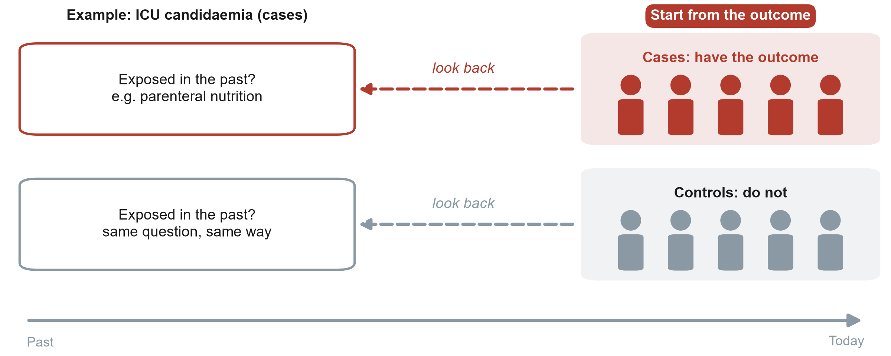
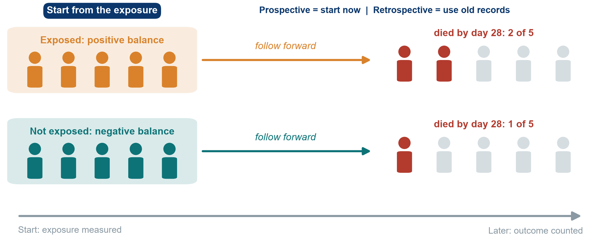
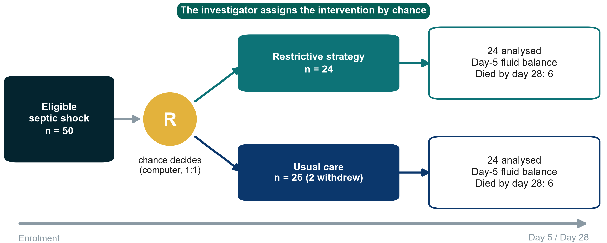
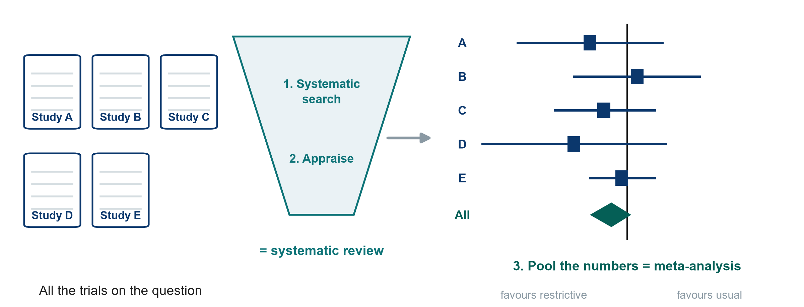
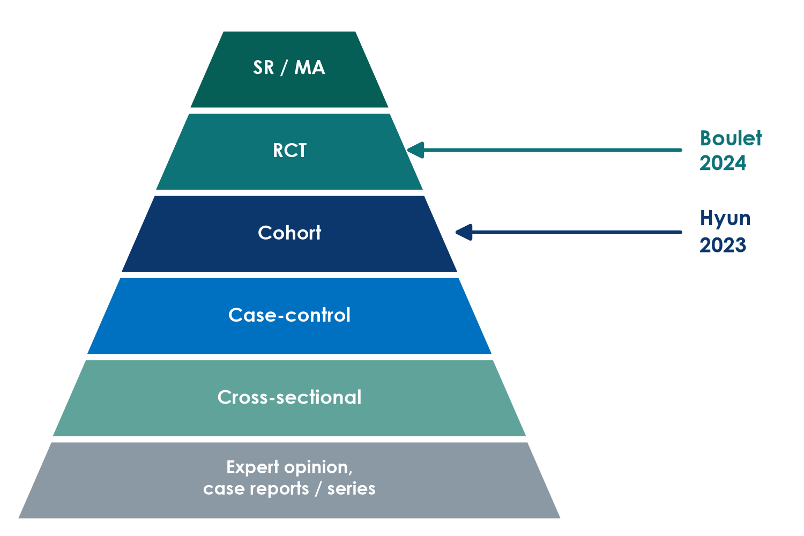
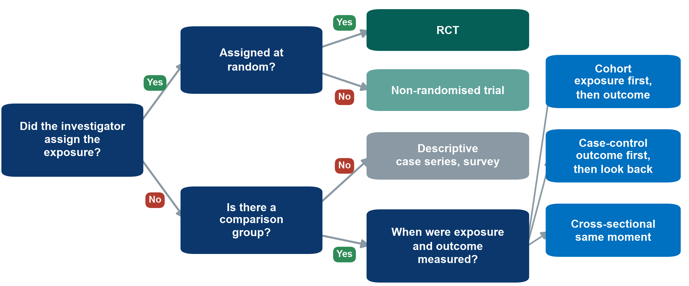
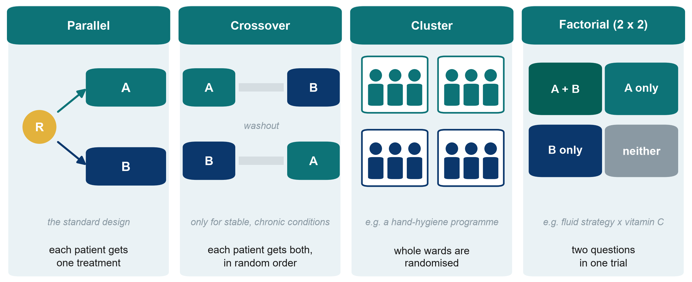
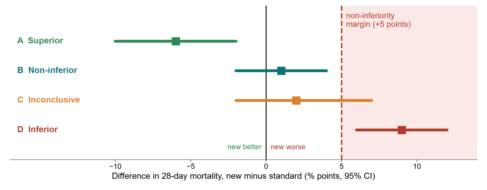
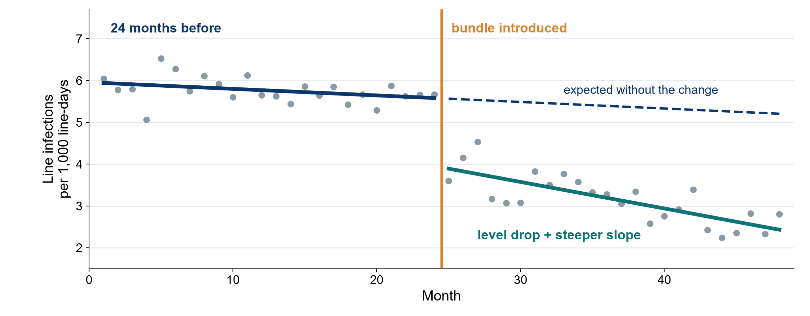
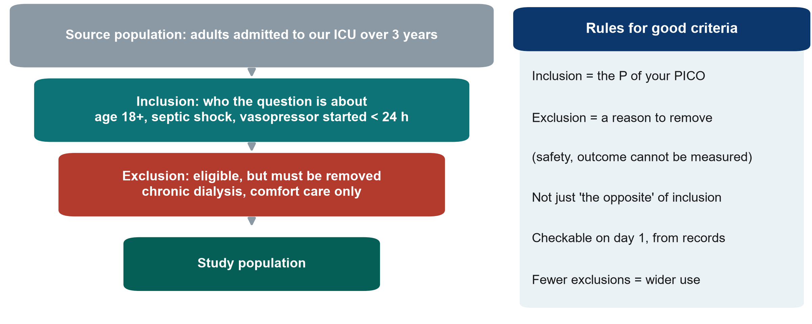

# Session 3 · Design: choosing the right study

## Week 3 · Saturday · online, 19:30-22:30

- Recap quiz on Session 2 (10 min)
- 3.1  Study designs in pictures (45 min)
- Whole-class exercise: Name that design (15 min)
- Break (15 min)
- 3.2  More designs: trial variants, pilots, quality improvement, qualitative (30 min)
- Whole-class exercise: choose the design (15 min)
- Proposal builder 3: design, setting and population (45 min), then wrap-up (5 min)

::: {.notes}
Start 19:30. Point: the design decides what you may claim at the end.

Ask: 'Who has ever collected data for a study?' Use them as examples later.

Clock: 19:30 recap, 19:40 3.1, 20:25 Name that design, 20:40 break, 20:55 3.2, 21:25 choose the design, 21:40 proposal builder 3, 22:25 wrap-up.

Timing: 1 minute.
:::

## Recap quiz: three questions on Session 2

::: {.neu-banner style="--c:#6C3483"}
QUICK QUIZ · 9 min
:::

:::: {.columns}
::: {.column width="60%"}
::: {.neu-activity-steps style="--c:#6C3483"}
- Q1. Your PubMed search finds 3,000 papers. Add a concept with AND, or a synonym with OR?
- Q2. After the title and abstract, what do you read next in a paper?
- Q3. An abstract says 'a trend towards lower mortality (p = 0.42)'. What is this called?
- Then re-read your own research question (your Proposal Part 1 from Sessions 1 and 2): 3 min
:::
:::
::: {.column width="40%"}
::: {.neu-side .plain style="--c:#6C3483"}
How we run it

- Answer in the poll (30 s each)
- Results on screen, then the answer
- No marks, just a warm-up
:::
:::
::::

::: {.neu-output style="--c:#6C3483"}
**OUTPUT** Poll answers, and your own question re-read
:::

::: {.notes}
Three poll questions. Show results, then the answer.

Answers: Q1 AND narrows, OR widens. Q2 the figures and tables. Q3 spin.

After Q3 ask for a rewrite. Expected: 'mortality did not differ clearly between groups (p = 0.42)'.

Timing: 9 minutes.
:::

## Key words of the day

::: {.neu-intro}
The words you will use today (no need to memorise definitions)
:::

:::: {.neu-cards style="--n:4"}
::: {.neu-card .plain style="--c:#0D7377"}
[The pieces]{.neu-card-title}

- Exposure: what comes first
- Outcome: what we count later
- Comparison group
:::
::: {.neu-card .plain style="--c:#0B376C"}
[Who decides?]{.neu-card-title}

- Observational: we watch
- Experimental: we assign
- Randomised: chance assigns
:::
::: {.neu-card .plain style="--c:#0070C0"}
[Which way in time?]{.neu-card-title}

- Cross-sectional: snapshot
- Case-control: look back
- Cohort: follow forward
:::
::: {.neu-card .plain style="--c:#055F56"}
[After the break]{.neu-card-title}

- Cluster and crossover trials
- Non-inferiority and pilot trials
- Time series, qualitative
:::
::::

::: {.neu-takeaway}
**KEY MESSAGE** Two questions name most designs: who decided the exposure, and which way does time run?
:::

::: {.notes}
3.1 starts here (45 minutes). Read the four headings only.

Ask: 'In our fluid question, what is the exposure and what is the outcome?' Expected: restrictive fluids (vs usual care), death by day 28.

Timing: 1 minute.
:::

## One question, two designs

::: {.neu-intro}
In adults with septic shock, does a restrictive fluid strategy reduce 28-day mortality? Both papers were emailed before Session 1
:::

:::: {.neu-cards style="--n:2"}
::: {.neu-card .plain style="--c:#0D7377"}
[Paper 1: Boulet 2024, randomised trial]{.neu-card-title}

- 50 patients randomised, 48 analysed
- Restrictive (non-resuscitation) fluids vs usual care
- Primary outcome: fluid balance at day 5
- **The investigator assigns the strategy**
:::
::: {.neu-card .plain style="--c:#0070C0"}
[Paper 2: Hyun 2023, cohort study]{.neu-card-title}

- Sepsis registry: 11,981 patients, 20 hospitals
- Positive vs negative fluid balance, days 1-3
- Outcome: death by day 28 (matched pairs)
- **The investigator observes what happened**
:::
::::

::: {.neu-takeaway}
**KEY MESSAGE** Same question, two designs: the design decides what you may claim.
:::

::: {.notes}
Boulet assigned the strategy by chance. Hyun only observed. Boulet's primary outcome was fluid balance, not mortality.

Ask (poll): 'Which study would you trust more on whether restriction saves lives?' Expected: mixed. Neither answers it fully. Resolve it by the end of 3.1.

Timing: 2.5 minutes.
:::

## 3.1  Study designs in pictures

:::: {.neu-statement}
::: {.neu-big}
Did the investigator assign the exposure, or just watch?
:::

::: {.neu-sub}
That one question sorts almost every study design. (45 minutes)
:::
::::

::: {.notes}
For each design ask: who decided the exposure, and which way does time run? No need to memorise names.

Timing: 30 seconds.
:::

## Four families of study designs

:::: {.neu-cards style="--n:4"}
::: {.neu-card .plain style="--c:#5FA39B"}
[Descriptive]{.neu-card-title}

- Describes, no comparison
- Case report or case series
- Cross-sectional survey
:::
::: {.neu-card .plain style="--c:#0070C0"}
[Observational]{.neu-card-title}

- Compares groups, we watch
- Case-control
- Cohort (prospective or retrospective)
:::
::: {.neu-card .plain style="--c:#0D7377"}
[Experimental]{.neu-card-title}

- Compares groups, we assign
- Randomised controlled trial (RCT)
- Non-randomised trial
:::
::: {.neu-card .plain style="--c:#0B376C"}
[Studies of studies]{.neu-card-title}

- Combine many studies
- Systematic review
- Meta-analysis
:::
::::

::: {.neu-takeaway}
**KEY MESSAGE** Descriptive designs describe. Analytical designs (observational and experimental) compare groups.
:::

::: {.notes}
Observational does not mean bad: harm, prognosis and rare diseases often need it.

Poll: 'Which card for Paper 1? Paper 2?' Expected: Boulet experimental (RCT), Hyun observational (cohort).

Timing: 2 minutes.
:::

## Exposure and outcome: the two words you need

| Example | Exposure (comes first) | Outcome (counted later) |
|:---|:---|:---|
| Paper 2: Hyun 2023, cohort | Positive fluid balance by day 3 | Death by day 28 |
| Paper 1: Boulet 2024, RCT | Restrictive fluid strategy | Fluid balance at day 5 |
| Another example: ICU infection | Parenteral (intravenous) nutrition | Candidaemia (Candida in the blood) |
| Another example: the ward | Air mattress | Pressure injury |

::: {.neu-table-caption}
Exposure: a treatment, strategy or risk factor. Outcome: death, infection, injury, a lab value. Comparison group: people without the exposure, or with usual care.
:::

::: {.notes}
Fluid balance is the outcome in Boulet but the exposure in Hyun. A treatment is an exposure too.

Ask: 'Name the exposure, outcome and comparison in our question.' Expected: restrictive fluids, death by day 28, usual care.

Timing: 3 minutes.
:::

## Descriptive designs: describe, do not compare

:::: {.neu-cards style="--n:2"}
::: {.neu-card .plain style="--c:#0D7377"}
[Case report or case series]{.neu-card-title}

- A few unusual patients, described in detail
- No comparison group
- Raises ideas but cannot test them
- e.g. the first reports of thalidomide harm
:::
::: {.neu-card .plain style="--c:#0070C0"}
[Cross-sectional study]{.neu-card-title}

- One snapshot of a whole unit, on one day
- Gives prevalence: how many have it now
- Exposure and outcome measured together
- Cannot show which came first
:::
::::

::: {.neu-takeaway}
**KEY MESSAGE** Descriptive studies raise questions. They cannot answer 'does X cause Y?'
:::

::: {.notes}
Cross-sectional: exposure and outcome measured at the same moment, so time order is unknown.

Ask: 'How could you measure, on one day, how common a positive fluid balance is in your ICU?' Expected: a point-prevalence survey.

Timing: 2 minutes.
:::

## Another example: a one-day point-prevalence survey

::: {.neu-intro}
A cross-sectional study you could run next week
:::

:::: {.neu-steps}
::: {.neu-step style="--c:#0D7377"}
[Choose a day]{.neu-step-label}

- All inpatients on all wards, one weekday
:::
::: {.neu-step style="--c:#0B376C"}
[Examine everyone]{.neu-step-label}

- Two trained nurses, one standard form
:::
::: {.neu-step style="--c:#5FA39B"}
[Record both]{.neu-step-label}

- Pressure injury (yes or no) and mattress type, at the same visit
:::
::: {.neu-step style="--c:#0070C0"}
[Count]{.neu-step-label}

- e.g. 37 of 412 patients = 9% prevalence today
:::
::::

::: {.neu-takeaway}
**KEY MESSAGE** A snapshot gives prevalence. It cannot show which came first.
:::

::: {.notes}
Hypothetical numbers. You cannot tell whether the mattress or the injury came first. For 'how common is it now?' this is the right design.

Ask: 'What could you measure in one day for the fluid question?' Expected: today's fluid balance and kidney function for every patient.

Timing: 2 minutes.
:::

## Case-control: start from the outcome, look back

{.neu-fig}

::: {.neu-caption}
ICU: intensive care unit
:::

::: {.neu-takeaway}
**KEY MESSAGE** Case-control: pick people by outcome, then compare their past exposures.
:::

::: {.notes}
Trace the arrow right to left. Good for rare outcomes. Weaknesses: recall bias, choosing controls, odds ratio only.

Case-control selects by outcome, a cohort by exposure.

Ask: 'Why can you not calculate the risk of candidaemia here?' Expected: we chose how many cases and controls.

Timing: 2.5 minutes.
:::

## Another example: a case-control study in the ICU

::: {.neu-intro}
Question: is parenteral nutrition a risk factor for candidaemia in the ICU?
:::

:::: {.neu-steps}
::: {.neu-step style="--c:#0D7377"}
[Find cases]{.neu-step-label}

- 40 ICU patients with candidaemia, from lab records
:::
::: {.neu-step style="--c:#0B376C"}
[Find controls]{.neu-step-label}

- 80 ICU patients without it, same units and months
:::
::: {.neu-step style="--c:#5FA39B"}
[Look back]{.neu-step-label}

- Parenteral nutrition in the 14 days before?
:::
::: {.neu-step style="--c:#0070C0"}
[Compare]{.neu-step-label}

- Exposed: 24 of 40 cases vs 16 of 80 controls
:::
::: {.neu-step style="--c:#055F56"}
[Report]{.neu-step-label}

- An odds ratio (OR), calculated in Session 4
:::
::::

::: {.neu-takeaway}
**KEY MESSAGE** Cases and controls are chosen by outcome. Exposure is measured looking back.
:::

::: {.notes}
Take your time: Session 4 uses the same numbers to calculate the OR.

Controls must come from the population that produced the cases, not healthy volunteers.

Timing: 2.5 minutes.
:::

## Cohort: start from the exposure, follow forward

{.neu-fig}

::: {.neu-takeaway}
**KEY MESSAGE** Cohort: exposure first, outcome later, so time runs the right way.
:::

::: {.notes}
Arrow left to right. This is Paper 2. A retrospective cohort still goes from exposure to outcome.

Ask: 'In Hyun, who decided which patients got more fluid?' Expected: the clinicians, by how sick the patient looked. Hold this for Session 4.

Timing: 2 minutes.
:::

## Worked example: Paper 2 (Hyun 2023), step by step

::: {.neu-intro}
Read it as in Session 2. Question: is a positive fluid balance associated with death by day 28?
:::

:::: {.neu-steps}
::: {.neu-step style="--c:#0D7377"}
[Define the cohort]{.neu-step-label}

- Adults with sepsis in 20 hospitals, ICU stay of 3 days or more
:::
::: {.neu-step style="--c:#0B376C"}
[Measure exposure]{.neu-step-label}

- Cumulative fluid balance, ICU days 1-3: positive or negative
:::
::: {.neu-step style="--c:#5FA39B"}
[Follow forward]{.neu-step-label}

- Record who dies by day 28
:::
::: {.neu-step style="--c:#0070C0"}
[Compare]{.neu-step-label}

- Matched pairs. On day 2, deaths about twice as frequent
:::
::::

::: {.neu-takeaway}
**KEY MESSAGE** A cohort groups people by exposure and follows them to the outcome.
:::

::: {.notes}
Day 2 result: HR 2.13 (95% CI 1.48-3.06). Day 1: no clear difference. Say the HR in plain words. HR is taught in Session 6.

Timing: 3 minutes.
:::

## RCT (randomised controlled trial): randomise, then follow forward

{.neu-fig}

::: {.neu-caption}
R: randomisation by a central computer, 1:1
:::

::: {.neu-takeaway}
**KEY MESSAGE** In an RCT chance, not the clinician, decides who gets what.
:::

::: {.notes}
An RCT is a cohort in which chance assigns the exposure, so groups are alike for measured and unmeasured factors.

6 deaths in each group: almost nothing about mortality. The pilot was powered for fluid balance.

Ask: 'Why not randomise everything?' Expected: ethics, rare or slow outcomes, cost.

Timing: 2 minutes.
:::

## Worked example: Paper 1 (Boulet 2024), step by step

::: {.neu-intro}
Question: does restricting non-resuscitation fluids reduce the day-5 fluid balance?
:::

:::: {.neu-steps}
::: {.neu-step style="--c:#0D7377"}
[Eligibility]{.neu-step-label}

- Septic shock, age 18-85, vasopressor started less than 24 h ago
:::
::: {.neu-step style="--c:#0B376C"}
[Consent]{.neu-step-label}

- Patient or legal surrogate
:::
::: {.neu-step style="--c:#5FA39B"}
[Randomise]{.neu-step-label}

- Central computer, 1:1, so nobody can predict
:::
::: {.neu-step style="--c:#0070C0"}
[Treat]{.neu-step-label}

- Restrictive vs usual care for 7 days
:::
::: {.neu-step style="--c:#055F56"}
[Measure]{.neu-step-label}

- Fluid balance at day 5. Death by day 28
:::
::::

::: {.neu-takeaway}
**KEY MESSAGE** In a trial the investigator assigns the exposure by chance.
:::

::: {.notes}
Clinicians knew the group. Only patients and statisticians were blinded.

Poll: 'Which step makes this an experiment?' Expected: step 3, randomisation.

Timing: 2.5 minutes.
:::

## Systematic reviews and meta-analysis: studies of studies

{.neu-fig}

::: {.neu-takeaway}
**KEY MESSAGE** A systematic review searches and appraises. A meta-analysis pools the numbers.
:::

::: {.notes}
Illustrative forest plot. A meta-analysis is only as good as the studies it pools.

Ask: 'Narrative vs systematic review?' Expected: a systematic review has a stated, reproducible search and selection.

Timing: 2 minutes.
:::

## Where the two papers sit on the evidence pyramid

:::: {.columns}
::: {.column width="38%"}
::: {.neu-side-notes}
### Read it with care

- SR / MA: systematic review and meta-analysis
- Higher = less prone to bias, on average
- A rule of thumb, not a law
- A good cohort can beat a poor RCT
- The best design is the one that fits the question
:::
:::
::: {.column width="62%"}
{.neu-fig-side}
:::
::::

::: {.notes}
A 48-patient pilot does not overrule a careful cohort on mortality.

Poll: 'Which paper is higher, and is it more useful for our mortality question?' Expected: Boulet is higher, but it was not powered for mortality.

Timing: 1.5 minutes.
:::

## Name the design in three questions

{.neu-fig}

::: {.neu-takeaway}
**KEY MESSAGE** Assigned? Random? Which way does time run? Three questions name the design.
:::

::: {.notes}
Walk the tree once with Boulet (assigned, random: RCT) and once with Hyun (not assigned, comparison, exposure first: cohort). Do not name designs from title words.

Poll: 'Fluid balance and kidney function of every patient on one day?' Expected: cross-sectional. 'Protocol from one date, before vs after?' Expected: non-randomised (quasi-experimental).

Timing: 5 minutes.
:::

## Every design trades something away

::: {.neu-intro}
Strengths and weaknesses at a glance
:::

:::: {.neu-cards style="--n:4"}
::: {.neu-card .plain style="--c:#5FA39B"}
[Cross-sectional]{.neu-card-title}

- [+ quick and cheap]{style="color:#2E8B57"}
- [+ gives prevalence]{style="color:#2E8B57"}
- [- which came first?]{style="color:#B23B2E"}
:::
::: {.neu-card .plain style="--c:#0070C0"}
[Case-control]{.neu-card-title}

- [+ rare outcomes]{style="color:#2E8B57"}
- [+ few patients, fast]{style="color:#2E8B57"}
- [- recall bias]{style="color:#B23B2E"}
- [- odds ratio only]{style="color:#B23B2E"}
:::
::: {.neu-card .plain style="--c:#0B376C"}
[Cohort]{.neu-card-title}

- [+ clear time order]{style="color:#2E8B57"}
- [+ risks, many outcomes]{style="color:#2E8B57"}
- [- slow if prospective]{style="color:#B23B2E"}
- [- confounding]{style="color:#B23B2E"}
:::
::: {.neu-card .plain style="--c:#0D7377"}
[RCT]{.neu-card-title}

- [+ balances the unknown]{style="color:#2E8B57"}
- [+ strongest for cause]{style="color:#2E8B57"}
- [- costly, ethical limits]{style="color:#B23B2E"}
- [- selected patients]{style="color:#B23B2E"}
:::
::::

::: {.neu-takeaway}
**KEY MESSAGE** No design is perfect: choose the one whose weakness hurts your question least.
:::

::: {.notes}
Pick one strength and one weakness per card. The RCT balances unknown confounders but trial patients are selected (Boulet excluded patients over 85).

Ask: 'Which design for risk factors of a rare drug reaction?' Expected: case-control.

Timing: 2 minutes.
:::

## What can each design claim?

:::: {.neu-cards style="--n:2"}
::: {.neu-card .plain style="--c:#0D7377"}
[RCT: Paper 1, Boulet 2024 (48 patients)]{.neu-card-title}

- **[It can claim]{style="color:#2E8B57"}**
- Groups alike at the start (chance)
- A difference can be blamed on the strategy
- **[Its limits]{style="color:#B23B2E"}**
- Too small for mortality (6 vs 6 deaths)
- Clinicians knew the group (single-blind)
:::
::: {.neu-card .plain style="--c:#0070C0"}
[Cohort: Paper 2, Hyun 2023 (thousands)]{.neu-card-title}

- **[It can claim]{style="color:#2E8B57"}**
- Large, real patients, 28-day mortality
- 'Associated with' (day 2: deaths about twice as frequent)
- **[Its limits]{style="color:#B23B2E"}**
- Cannot prove that fluid causes death
- Sicker patients got more fluid (confounding)
:::
::::

::: {.neu-takeaway}
**KEY MESSAGE** RCTs can say 'caused'. Cohorts should say 'associated'.
:::

::: {.notes}
Adjusting or matching reduces measured confounding only.

Ask for one honest conclusion per paper. Expected: Boulet 'did not clearly reduce day-5 fluid balance'. Hyun 'a positive balance on days 2-3 was associated with higher mortality'.

Timing: 4 minutes.
:::

## Check your understanding: caused or associated?

::: {.neu-banner style="--c:#6C3483"}
QUICK QUIZ · 3 min
:::

:::: {.columns}
::: {.column width="60%"}
::: {.neu-activity-steps style="--c:#6C3483"}
- A. Paper 1, Boulet (RCT): 'The restrictive strategy did not reduce the day-5 fluid balance'
- B. Paper 2, Hyun (cohort): 'A positive fluid balance causes higher 28-day mortality'
- C. A one-day survey of ICU patients: 'A positive fluid balance today is associated with kidney injury today'
:::
:::
::: {.column width="40%"}
::: {.neu-side .plain style="--c:#6C3483"}
For each sentence

- Is the wording right for the design?
- Vote in the poll: right or wrong
:::
:::
::::

::: {.neu-output style="--c:#6C3483"}
**OUTPUT** One poll vote (right or wrong) for each sentence
:::

::: {.notes}
Three-question poll. Answers: A right. B wrong, a cohort says 'associated with'. C right.

Timing: 3 minutes. 3.1 ends here.
:::

## Exercise: Name that design

::: {.neu-banner style="--c:#0D7377"}
WHOLE-CLASS TASK · 15 min
:::

:::: {.columns}
::: {.column width="60%"}
::: {.neu-activity-steps style="--c:#0D7377"}
- Six short abstracts on our fluid question: Session 3 exercise sheet (PDF sent before the session), Part A
- The instructor shows one abstract at a time on the shared screen
- Vote for the design in the poll
- A volunteer says the phrase that proves it, microphone on
- Use the three questions: assigned? random? which way does time run?
:::
:::
::: {.column width="40%"}
::: {.neu-side .plain style="--c:#0D7377"}
Use the tree

- Assigned and random: RCT
- Outcome first, look back: case-control
- Exposure first, follow forward: cohort
- Same moment: cross-sectional
:::
:::
::::

::: {.neu-output style="--c:#0D7377"}
**OUTPUT** Six designs named by the class, each with one evidence phrase
:::

::: {.notes}
About 2.5 minutes per abstract: read it, poll, ask one person for the phrase that proves it, type it on screen.

Abstracts 3 and 4 are the hardest. If someone says 'old records, so case-control', ask: selected by outcome or by exposure?

Key: s3\_solutions, Part A. Announce the break at the end.
:::

---

::: {style="text-align:center"}
{width="32%"}

[Break]{style="color:#0D7377;font-size:1.6em;font-weight:700"}

[15 min]{style="color:#595959;font-size:0.9em"}
:::

::: {.notes}
Break 20:40-20:55. Put a countdown timer on screen. Restart on time.
:::

## 3.2  More designs

:::: {.neu-statement}
::: {.neu-big}
Real projects bend the basic designs.
:::

::: {.neu-sub}
Trial variants, non-inferiority, pilots, quality-improvement designs and qualitative research. (30 minutes)
:::
::::

::: {.notes}
3.2 runs 30 minutes. Most hospital projects are unit-level changes, QI, pilots or interviews.

Timing: 30 seconds.
:::

## Not every trial is parallel: four layouts

{.neu-fig}

::: {.neu-caption}
R: randomisation. A and B: the two treatments
:::

::: {.neu-takeaway}
**KEY MESSAGE** Choose the trial layout that fits the treatment and the unit of care.
:::

::: {.notes}
Crossover only for stable chronic conditions, never septic shock. A cluster trial is a proper RCT, analysed for clustering.

Poll: 'A nurse-led fluid-charting protocol: which layout?' Expected: cluster, randomise ICUs.

Timing: 5.5 minutes.
:::

## Superiority or non-inferiority? The margin picture

{.neu-fig}

::: {.neu-caption}
CI: confidence interval. Hypothetical results.
:::

::: {.neu-takeaway}
**KEY MESSAGE** Non-inferiority: the whole CI must stay below a margin fixed in advance.
:::

::: {.notes}
The margin is fixed in the protocol before the data. A superior, B non-inferior, C inconclusive, D inferior.

Boulet's p = 0.42 does not show restriction is as good as usual care.

Poll: 'Who decides the margin?' Expected: clinicians and patients, with the statistician.

Timing: 5 minutes.
:::

## Pilot and feasibility studies: the rehearsal

:::: {.neu-cards style="--n:2"}
::: {.neu-card .plain style="--c:#0D7377"}
[Paper 1, Boulet 2024: a pilot trial]{.neu-card-title}

- 1,201 patients screened
- 50 randomised (4%)
- 48 analysed (96%)
- About 3 patients per month across 3 ICUs
:::
::: {.neu-card .plain style="--c:#0070C0"}
[A pilot asks: can we do the big trial?]{.neu-card-title}

- Can we recruit enough patients?
- Will patients or families consent?
- Can staff deliver the intervention?
- Are outcomes measurable and complete?
- What numbers do we need for the big trial?
:::
::::

::: {.neu-takeaway}
**KEY MESSAGE** A pilot asks 'can we do it?', not 'does it work?'
:::

::: {.notes}
Boulet: 1,201 screened, 50 randomised, about 3 patients per month. A pilot tests feasibility, not effectiveness, and is planned as a pilot from the start.

Poll: 'Would you launch a 1,000-patient trial in the same 3 ICUs?' Expected: not as designed. It would take decades.

Timing: 4 minutes.
:::

## Quasi-experimental designs: before-after and interrupted time series

{.neu-fig}

::: {.neu-caption}
Simulated data for teaching. ITS: interrupted time series, QI: quality improvement.
:::

::: {.neu-takeaway}
**KEY MESSAGE** Compare against the trend you expected, not against one 'before' average.
:::

::: {.notes}
Before-after is weak: rates often fall anyway. ITS compares the post-change data with the earlier trend (level and slope).

Ask: 'What else changed in your hospital in the month of your last QI project?' Expected: usually something.

Timing: 5 minutes.
:::

## Qualitative designs: when numbers cannot answer

::: {.neu-intro}
Why? How? What is it like? Words, not numbers, analysed as themes
:::

:::: {.neu-cards style="--n:3"}
::: {.neu-card .plain style="--c:#5FA39B"}
[In-depth interviews]{.neu-card-title}

- One person, open questions
- Usually 30-60 minutes
- e.g. why urine output goes unrecorded at night
:::
::: {.neu-card .plain style="--c:#0D7377"}
[Focus groups]{.neu-card-title}

- 6-8 people discuss together
- Views spark other views
- e.g. how families experience consent in the ICU
:::
::: {.neu-card .plain style="--c:#0B376C"}
[Observation]{.neu-card-title}

- Watch what people actually do
- It may differ from what they say
- e.g. how fluid charts are filled in
:::
::::

::: {.neu-takeaway}
**KEY MESSAGE** Qualitative research explains why and how. It complements numbers.
:::

::: {.notes}
Sampling is purposive, until no new themes appear. Reporting: COREQ or SRQR.

Ask: 'One fluid question only interviews could answer?' Expected: why fluid charts are incomplete, why doctors hesitate to stop maintenance fluids.

Timing: 4.5 minutes.
:::

## Match the design to the question

| If your question is... | Start with | Example on our fluid question |
|:---|:---|:---|
| How common is it right now? | Cross-sectional | Patients with a positive fluid balance in our ICU today |
| Rare outcome: what raised the risk? | Case-control | Patients with sepsis who needed new dialysis, looking back at their fluid |
| What happens after an exposure? | Cohort | Positive fluid balance and death by day 28 (Paper 2) |
| Does this treatment work? | RCT | Restrictive vs usual fluids (Paper 1) |
| What do all the studies say? | Systematic review and meta-analysis | All fluid-restriction trials, pooled |

::: {.neu-table-caption}
Start from the question, and the design follows from it. Then check that it is feasible in your setting.
:::

::: {.notes}
In the proposal builder everyone justifies their design this way: 'my question is about X, so the best feasible design is Y'. A retrospective cohort with honest limits is acceptable.

Poll: 'How many ICU patients have a positive fluid balance today?' Expected: cross-sectional.

Timing: 5.5 minutes. 3.2 ends here.
:::

## Exercise: choose the design

::: {.neu-banner style="--c:#0D7377"}
WHOLE-CLASS TASK · 15 min
:::

:::: {.columns}
::: {.column width="60%"}
::: {.neu-activity-steps style="--c:#0D7377"}
- Five planning questions about our fluid question: exercise sheet, Part B
- For each: vote in the poll for the best feasible design
- A volunteer gives one reason and the main weakness. The instructor types them on the shared screen
- Then your own question: two or three people say their design, and 'caused' or 'associated'
:::
:::
::: {.column width="40%"}
::: {.neu-side .plain style="--c:#0D7377"}
Remember

- Does it work? RCT or cluster trial
- Not worse? Non-inferiority trial
- Already changed? Time series
- Why or how? Qualitative
- Can we do it? Pilot
:::
:::
::::

::: {.neu-output style="--c:#0D7377"}
**OUTPUT** Five designs chosen together, then a few people share their own design and claim
:::

::: {.notes}
About 2 minutes per question, then 5 minutes on people's own questions.

Answers: 1 non-inferiority RCT. 2 cluster RCT. 3 interrupted time series. 4 qualitative interviews or focus groups. 5 pilot or feasibility study.

Then call on 4 or 5 people: 'my design is ..., so I may say caused / associated'.

Watch for: an RCT for a harm or prognosis question. Ask: could you ethically assign this?

Key: s3\_solutions, Part B.
:::

## Who is in your study? Inclusion and exclusion criteria

{.neu-fig}

::: {.neu-takeaway}
**KEY MESSAGE** Inclusion describes your P (Population). Exclusion removes eligible people for a stated reason.
:::

::: {.notes}
Proposal builder 3 starts here (3 minutes on this slide, then 42 minutes).

Boulet included ages 18-85 within 24 h of vasopressors, and excluded dialysis within 24 h, end-stage kidney disease and BMI below 18.

'Age under 18' is not an exclusion, it is simply not included.

Ask: 'One good exclusion for our fluid study?' Expected: chronic dialysis, comfort care only.

Timing: 3 minutes.
:::

## Proposal builder 3: design, setting and population

::: {.neu-banner style="--c:#055F56"}
PROPOSAL BUILDER · 45 min
:::

:::: {.columns}
::: {.column width="60%"}
::: {.neu-activity-steps style="--c:#055F56"}
- Watch: the instructor writes Part 2a live for the running example (15 min)
- Design and a 3-5 sentence justification, chosen with the decision tree
- Setting: where, when, which units, which data source
- Population: 3-5 inclusion and 3-5 exclusion criteria, each exclusion with a reason
- Your turn: draft the same for your own question (20 min, quiet individual work)
- Three volunteers read their design sentence aloud for feedback (7 min)
:::
:::
::: {.column width="40%"}
::: {.neu-side .plain style="--c:#055F56"}
Check your draft

- Design matches the question?
- Feasible in your unit?
- Inclusion = your P (Population)?
- Each exclusion has a reason?
- 'Caused' or 'associated'?
:::
:::
::::

::: {.neu-output style="--c:#055F56"}
**OUTPUT** Your own Proposal Part 2a drafted (finish it as homework)
:::

::: {.notes}
15 minutes: fill in Part 2a for the running example on screen, thinking aloud. 20 minutes: everyone drafts alone. 7 minutes: three volunteers read their design and justification.

Model: retrospective cohort, one adult ICU, 3 years. An RCT is not feasible without funding, so we say 'associated with'. Full model in s3\_solutions, Part C.

Watch for: an RCT for an exposure that cannot be assigned, a setting far too large, exclusions that repeat the inclusions.

Warn at 10 and 2 minutes before the end.
:::

## Session 3 in one slide

:::: {.neu-cards style="--n:3"}
::: {.neu-card .plain style="--c:#0D7377"}
[3.1 Basic designs]{.neu-card-title}

- Snapshot, look back, follow forward
- RCT: chance assigns the exposure
- RCT may say 'caused', cohort says 'associated'
:::
::: {.neu-card .plain style="--c:#0B376C"}
[3.2 More designs]{.neu-card-title}

- Cluster, crossover, factorial
- Non-inferiority needs a margin
- Pilot, time series, qualitative
:::
::: {.neu-card .plain style="--c:#055F56"}
[Your proposal]{.neu-card-title}

- Design and justification
- Setting
- Inclusion and exclusion criteria
:::
::::

::: {.neu-takeaway}
**KEY MESSAGE** The question picks the design. The design decides what you may claim.
:::

::: {.notes}
Ask three volunteers to explain one card each. If time is short, read the key message only.

Timing: 2 minutes.
:::

## Wrap-up and homework

::: {.neu-banner style="--c:#1F5C7A"}
DISCUSSION · 5 min
:::

::: {.neu-activity-steps style="--c:#1F5C7A"}
- Exit question (in the chat): doctors chose restrictive fluids for some patients with septic shock and not for others. Both groups are followed to day 28. Which design? 'Caused' or 'associated'?
- Homework: finish your own Proposal Part 2a (design, setting, population)
- Reading: 'Patients' in Paper 1 (Boulet) and 'Data source' in Paper 2 (Hyun)
- Next Saturday (Session 4): can we trust the result, and how big is the effect?
:::

::: {.neu-output style="--c:#1F5C7A"}
**OUTPUT** One exit answer per person, in the chat
:::

::: {.notes}
Exit answer: a cohort. It may only say 'associated' (confounding by indication, next Saturday).

Open Session 4 with three anonymous answers.

Timing: 3 minutes. Finish at 22:30.
:::

## Extra slides: Session 3

:::: {.neu-statement}
::: {.neu-big}
Extra slides: Session 3
:::

::: {.neu-sub}
Use if time allows, or for self-study
:::
::::

::: {.notes}
Optional. Use if time allows, or for self-study.
:::

## The decision tree in action: Paper 1 (Boulet) and Paper 2 (Hyun)

:::: {.neu-steps}
::: {.neu-step style="--c:#0D7377"}
[Assigned?]{.neu-step-label}

- Boulet: yes, the trial assigned the strategy
- Hyun: no, clinicians decided
:::
::: {.neu-step style="--c:#0B376C"}
[Random?]{.neu-step-label}

- Boulet: yes, by a central computer
:::
::: {.neu-step style="--c:#5FA39B"}
[Comparison?]{.neu-step-label}

- Hyun: yes, positive vs negative balance
:::
::: {.neu-step style="--c:#0070C0"}
[Time order?]{.neu-step-label}

- Hyun: exposure on days 1-3, then death by day 28
:::
::: {.neu-step style="--c:#055F56"}
[Design]{.neu-step-label}

- Boulet: RCT
- Hyun: cohort
:::
::::

::: {.neu-takeaway}
**KEY MESSAGE** Walk every paper through the same questions before reading its results.
:::

::: {.notes}
Use if 'Name that design' showed confusion. Then ask people to try a paper from their own reference list.

Timing: 2 minutes if used.
:::

## More practice (other examples): name the design

::: {.neu-banner style="--c:#6C3483"}
QUICK QUIZ · 3 min
:::

:::: {.columns}
::: {.column width="60%"}
::: {.neu-activity-steps style="--c:#6C3483"}
- A. All 300 inpatients are checked today for a urinary catheter and for urinary infection
- B. Patients with ventilator-associated pneumonia are compared with patients without it for earlier sedation use
- C. Patients who received early mobilisation (the physiotherapist's decision) and those who did not are followed to discharge
:::
:::
::: {.column width="40%"}
::: {.neu-side .plain style="--c:#6C3483"}
Choose

- Cross-sectional
- Case-control
- Cohort
- RCT
:::
:::
::::

::: {.neu-output style="--c:#6C3483"}
**OUTPUT** One design named for each scenario (answers on the next slide)
:::

::: {.notes}
Watch for scenario C: two groups, but the physiotherapist decided, not chance.

Timing: 3 minutes with the answers, if used.
:::

## Answers: name the design (other examples)

:::: {.neu-cards style="--n:3"}
::: {.neu-card .plain style="--c:#5FA39B"}
[A. Cross-sectional]{.neu-card-title}

- One day, everyone
- Exposure and outcome measured together
- Gives prevalence
:::
::: {.neu-card .plain style="--c:#0070C0"}
[B. Case-control]{.neu-card-title}

- Chosen by outcome (pneumonia)
- Look back for exposure (sedation)
- Gives an odds ratio
:::
::: {.neu-card .plain style="--c:#0B376C"}
[C. Cohort]{.neu-card-title}

- Grouped by exposure (mobilisation)
- Followed forward to discharge
- Not an RCT: nobody randomised
:::
::::

::: {.neu-takeaway}
**KEY MESSAGE** Ask: chosen by exposure or by outcome? Assigned by chance or not?
:::

::: {.notes}
Two groups do not make a trial. Selected by outcome = case-control, by exposure = cohort.
:::

## More practice (other examples): which design?

::: {.neu-banner style="--c:#6C3483"}
QUICK QUIZ · 3 min
:::

:::: {.columns}
::: {.column width="60%"}
::: {.neu-activity-steps style="--c:#6C3483"}
- A. A cheaper antibiotic schedule. We only need to show it is not worse
- B. A hand-hygiene programme delivered to whole wards
- C. Why do families refuse research consent in the ICU?
:::
:::
::: {.column width="40%"}
::: {.neu-side .plain style="--c:#6C3483"}
Choose

- Cluster trial
- Non-inferiority trial
- Qualitative interviews
:::
:::
::::

::: {.neu-output style="--c:#6C3483"}
**OUTPUT** One design for each (answers in the notes)
:::

::: {.notes}
Answers: A non-inferiority trial with a margin set in advance. B cluster RCT. C qualitative interviews or focus groups.

Timing: 3 minutes if used.
:::

## Choosing good controls in a case-control study

:::: {.neu-cards style="--n:3"}
::: {.neu-card .plain style="--c:#0D7377"}
[Same source]{.neu-card-title}

- Same hospital, units and period as the cases
- Would have become a case if they had the outcome
:::
::: {.neu-card .plain style="--c:#0B376C"}
[Same measurement]{.neu-card-title}

- Same records, same questions
- Ideally an assessor who does not know who is a case
:::
::: {.neu-card .plain style="--c:#0070C0"}
[Matching (optional)]{.neu-card-title}

- e.g. age, month of admission
- Do not match on the exposure itself
:::
::::

::: {.neu-takeaway}
**KEY MESSAGE** Bad controls make any case-control study meaningless.
:::

::: {.notes}
Controls from the same units and months. Measure exposure the same way in both groups. Do not over-match.

Timing: 2 minutes if used.
:::

## Superiority, equivalence and non-inferiority

::: {.neu-intro}
CI: confidence interval. Margin: the largest difference we accept, fixed in advance
:::

:::: {.neu-cards style="--n:3"}
::: {.neu-card .plain style="--c:#2E8B57"}
[Superiority]{.neu-card-title}

- Is the new treatment better?
- Whole CI on the 'better' side of 0
:::
::: {.neu-card .plain style="--c:#0B376C"}
[Equivalence]{.neu-card-title}

- Is it about the same?
- Whole CI between minus and plus the margin
:::
::: {.neu-card .plain style="--c:#0D7377"}
[Non-inferiority]{.neu-card-title}

- Is it not unacceptably worse?
- Whole CI below plus the margin
:::
::::

::: {.neu-takeaway}
**KEY MESSAGE** The question (better, same, not worse) is fixed in the protocol, before the data.
:::

::: {.notes}
A failed superiority trial does not show equivalence: it had no margin.

Timing: 2 minutes if used.
:::

## Making a quality-improvement evaluation stronger

:::: {.neu-cards style="--n:3"}
::: {.neu-card .plain style="--c:#0D7377"}
[More time points]{.neu-card-title}

- At least 8-12 points before and after
- Same definition every month
:::
::: {.neu-card .plain style="--c:#0B376C"}
[A control series]{.neu-card-title}

- A unit or hospital without the change
- Same months, same measure
:::
::: {.neu-card .plain style="--c:#B23B2E"}
[Record co-interventions]{.neu-card-title}

- Staff changes, new policies, audits
- Write them down as they happen
:::
::::

::: {.neu-takeaway}
**KEY MESSAGE** A before-after average is weak. A long, controlled time series is much stronger.
:::

::: {.notes}
More data points, a control series and a diary of other changes. Reporting: SQUIRE 2.0.

Timing: 2 minutes if used.
:::
