# Session 5 · Data: collect it well, describe it honestly

## Week 5 · Saturday

- Recap quiz on Sessions 3-4 (10 min)
- 5.1 Good data by design: variables, CRF, data dictionary, checks, data management
- 5.2 Meet the course dataset FLUID-ICU (live R cleaning demo)
- 5.3 Describing and showing data: summaries, figures, tables
- 5.4 Describe the course dataset: Table 1 and figures
- Proposal builder 5: variables, mini-CRF, data dictionary, data management

::: {.notes}
Welcome to Week 5. We meet online, 19:30 to 22:30 with a 15-minute break. Sessions 1-4 asked a question, found the evidence and chose a design. Over these two Saturdays we measure and analyse: today (Session 5) the data, next Saturday (Session 6) the analysis.

Key promise: no formulas. Every idea comes as a picture, then a worked example, then a one-minute check: a poll, or two or three people called on with the microphone on. Your job is to interpret, not to calculate.

New in Weeks 5-6: the course dataset FLUID-ICU, a realistic (simulated) cohort of 620 adults with sepsis. You will see it cleaned and described live in R on the shared screen. It comes with five research questions (Q1 to Q5), each with a results pack. In class we work through the questions together. Later, each of you chooses one question and writes your own manuscript from its results pack in Weeks 7-8: we give you the results, you write the paper.

Running example: fluids in septic shock. The variable 'cumulative fluid balance (ml/kg)' follows us all evening: on the form, in the data dictionary, in the cleaned dataset, in Table 1.

Ask the class (call on two or three people, microphone on): who has ever filled in a data collection form and thought 'what does this box actually want?' Expected: many replies. That is section 5.1.

Timing: recap 19:30, 5.1 at 19:40, 5.2 at 20:15, break at 20:40, 5.3 at 20:55, 5.4 at 21:30, proposal builder at 21:55, wrap-up at 22:25.

Pace: slow. Attention is lower online in the evening. If the class needs time, skip the extra slides at the end. Never skip the checks.
:::

## Recap quiz: Sessions 3-4 in three questions

::: {.neu-banner style="--c:#6C3483"}
QUICK QUIZ · 10 min
:::

:::: {.columns}
::: {.column width="60%"}
::: {.neu-activity-steps style="--c:#6C3483"}
- Q1. Patients who smoke are followed for 10 years to see who develops a stroke. Which design?
- Q2. In a cohort, sicker septic patients receive more fluid and die more often. What is this called?
- Q3. Mortality is 30% with usual care and 20% with a new strategy. What are the risk ratio (RR) and the number needed to treat (NNT)?
- Answer each question in the poll (1 minute each), then we discuss
:::
:::
::: {.column width="40%"}
::: {.neu-side .plain style="--c:#6C3483"}
Answers (reveal after)

- Q1: prospective cohort
- Q2: confounding by indication
- Q3: RR = 20/30 = 0.67. Risk difference (RD) = 10%. NNT = 1/0.10 = 10
:::
:::
::::

::: {.neu-output style="--c:#6C3483"}
**OUTPUT** Everyone back on track with designs, confounding and the 2x2 measures
:::

::: {.notes}
Purpose: wake up Session 4 memory and catch anyone who missed it. Keep it light: no marks.

Run it: launch one poll per question (Zoom/Teams poll), give 1 minute each, show the results, then reveal. Hide the side panel until the reveal (or read the answers from these notes).

Q1 answer: prospective cohort. Exposure (smoking) is measured first, then we wait for the outcome. Common wrong answer: case-control. Point out that case-control starts from the outcome and looks back.

Q2 answer: confounding by indication. Severity causes both more fluid and more death. This is exactly why Paper 2 (Hyun 2023, a cohort of fluid balance and mortality in septic shock, in the course folder, Course/Papers) used propensity-score matching, and why Session 6 (6.3 and 6.4) is about 'adjusted' results.

Q3 answer: RR = 0.20 / 0.30 = 0.67 (a one-third relative reduction). Risk difference = 10 percentage points. NNT = 1 / 0.10 = 10 patients treated to prevent one death.

If more than a third of the class gets Q3 wrong, spend 2 extra minutes drawing the 2x2 table on the shared screen (whiteboard) before moving on.

Timing: 10 minutes including the reveal (19:30 to 19:40).
:::

## 5.1 Good data by design

:::: {.neu-statement}
::: {.neu-big}
Bad data cannot be rescued by good statistics.
:::

::: {.neu-sub}
5.1 Good data by design  \|  35 minutes
:::
::::

::: {.notes}
Section 5.1 opener (35 minutes, 19:40 to 20:15: variable types with a check, CRF design with a worked example, data dictionary, validation, data management, missing data, then a 7-minute whole-class task on fixing CRF items).

Key message: most problems in clinical research lie in the data rather than in the analysis. A statistician cannot fix a blank box, a missing unit or an impossible value six months later.

Garbage in, garbage out: the quality of your answer is capped by the quality of your form.

Ask the class (call on two or three people, microphone on): has anyone been asked to 'help with the data' after a study finished, and found half the forms incomplete? Invite one or two people to unmute and tell their story in one sentence.

Transition: we start with the most basic decision of all: what type of variable are you collecting? It decides how you write the CRF item, how you summarise it and which test you use.
:::

## What type of variable is it?

::: {.neu-intro}
Numbers are measured (first two cards). Categories are groups (last three). Time-to-event combines how long and whether it happened.
:::

:::: {.neu-cards style="--n:5"}
::: {.neu-card .plain style="--c:#0D7377"}
[Continuous]{.neu-card-title}

- Any value on a scale
- Fluid balance (ml/kg), lactate, age
:::
::: {.neu-card .plain style="--c:#5FA39B"}
[Count]{.neu-card-title}

- A whole number
- Number of organ failures
:::
::: {.neu-card .plain style="--c:#0B376C"}
[Binary]{.neu-card-title}

- Two options
- Died by day 28: yes or no
:::
::: {.neu-card .plain style="--c:#0070C0"}
[Nominal]{.neu-card-title}

- Groups with no order
- Source of sepsis: lung, urine, abdomen
:::
::: {.neu-card .plain style="--c:#055F56"}
[Ordinal]{.neu-card-title}

- Groups in an order
- Acute kidney injury (AKI) stage 1, 2 or 3
:::
::::

::: {.neu-takeaway}
**KEY MESSAGE** The variable type decides the CRF box, the summary and the test.
:::

::: {.notes}
Teaching point: every variable is either a number you measure or a category you assign. Then split once more.

Numbers: continuous (any value on a scale: fluid balance in ml/kg, lactate, age) or counts (whole numbers: number of organ failures).

Categories: binary (two options: died yes/no), nominal (several groups with no order: source of sepsis) and ordinal (ordered groups: acute kidney injury (AKI) stage 1 to 3, pain mild/moderate/severe).

Time-to-event (in the intro line) is special: it combines how long (time to death) and whether it happened (died, or censored at day 28 if still alive). Just mention it. We meet it again with Kaplan-Meier curves and Cox models in Session 6 (6.3).

Common misconception: 'coded as numbers means numerical'. Sex coded 1/2 is still a category. The average of 1.4 means nothing.

Quick sorting game: name a variable and call on someone to say its type: Glasgow Coma Scale (ordinal, though often treated as a number), heart rate (continuous), ventilated yes/no (binary), blood group (nominal), days on ventilator (count), time to extubation (time-to-event).

Tip: collect continuous variables as numbers whenever possible. You can always group age into bands later, but you can never get the exact age back from '60-69'.

This slide replaces the earlier tree picture with editable cards. The content is the same.
:::

## Check your understanding: what type of variable?

::: {.neu-banner style="--c:#6C3483"}
QUICK QUIZ · 3 min
:::

:::: {.columns}
::: {.column width="60%"}
::: {.neu-activity-steps style="--c:#6C3483"}
- Heart rate (beats per minute)
- Glasgow Coma Scale (GCS, 3-15)
- Blood group (A, B, AB, O)
- Ventilated on day 1 (yes / no)
- Time from ICU admission to extubation
:::
:::
::: {.column width="40%"}
::: {.neu-side .plain style="--c:#6C3483"}
Answers

- Continuous
- Ordinal (often analysed as a number)
- Nominal
- Binary
- Time-to-event (some never extubated)
:::
:::
::::

::: {.neu-output style="--c:#6C3483"}
**OUTPUT** Everyone can name the variable types
:::

::: {.notes}
Check your understanding (3 minutes). Launch a poll for each variable with six options (continuous, count, binary, nominal, ordinal, time-to-event), or call on one person per variable. Reveal the side panel only after each vote.

Heart rate: continuous.

GCS: ordinal. Ordered scores with unequal steps, often analysed like a number, which is acceptable if stated.

Blood group: nominal, no order.

Ventilated yes/no: binary.

Time to extubation: time-to-event, because some patients are never extubated (they die or are transferred) and must be censored.

If more than a third get GCS or time-to-extubation wrong, go back to the previous slide for one minute.

Why this matters: the type decides the CRF box, the summary (5.3) and the test (Session 6).
:::

## Good vs bad CRF items

::: {.neu-intro}
A case report form (CRF) question must have only one possible reading.
:::

:::: {.columns}
::: {.column width="50%"}
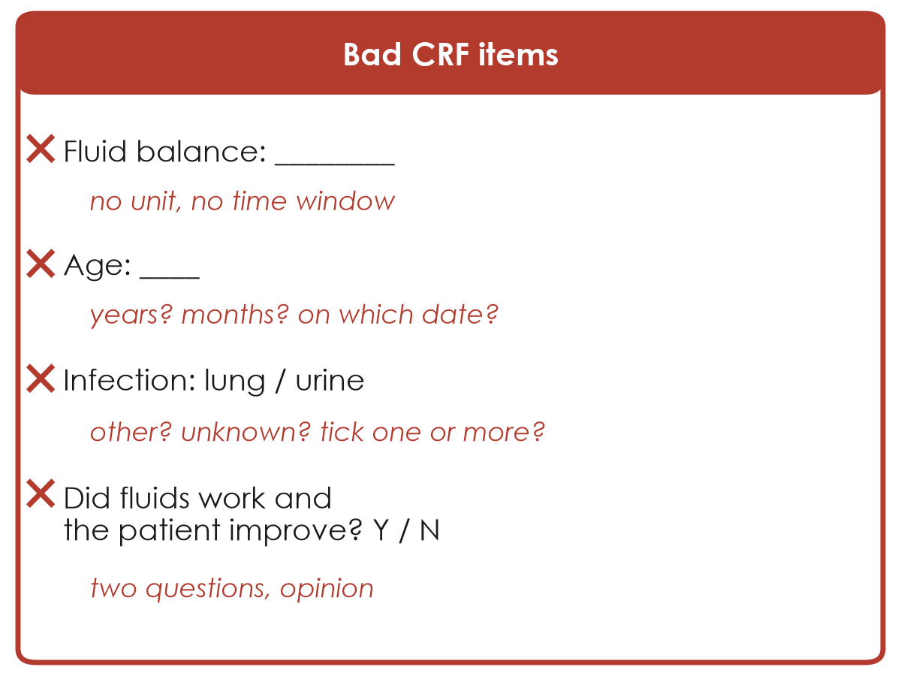{.neu-fig-half}

::: {.neu-caption}
Ambiguous: two nurses will write two different things
:::
:::
::: {.column width="50%"}
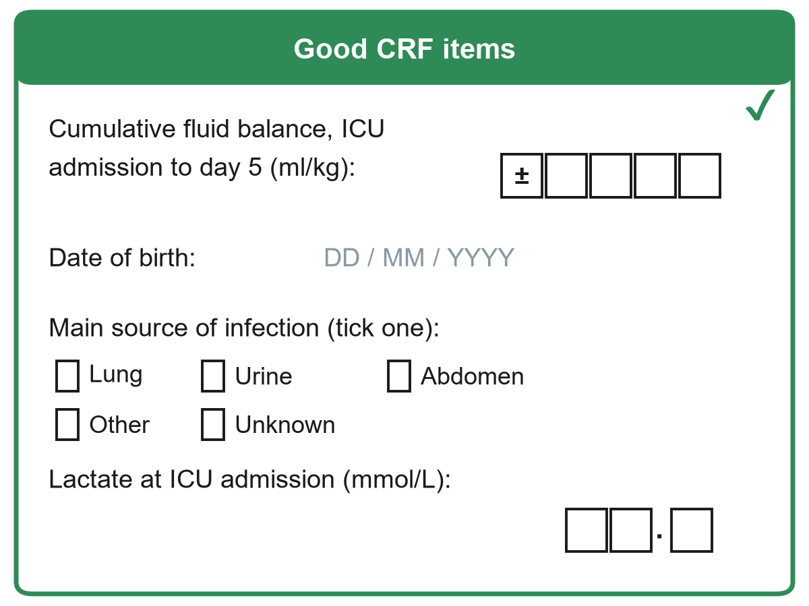{.neu-fig-half}

::: {.neu-caption}
Clear: unit, time window, one answer, 'unknown'
:::
:::
::::

::: {.notes}
Teaching point: a CRF item is good when two different people, filling it for the same patient, would write the same answer.

Go through the left side and call on people to diagnose each problem before you reveal the red text:

Fluid balance: no unit (ml? litres? ml/kg?), no time window (today? cumulative?). For our running example this single box decides the primary outcome of the whole study.

Age: years or months, on which date? Better: collect date of birth and date of admission and let the computer calculate age.

Infection source: options are incomplete (no 'other', no 'unknown') and it is unclear whether you can tick more than one.

Did fluids work and did the patient improve: two questions in one (double-barrelled), and both are opinions. Replace with objective measures (lactate, mean arterial pressure, vasopressor dose).

Right side: unit and time window inside the question, boxes for digits including a +/- sign (fluid balance can be negative), fixed date format, tick one, 'other' and 'unknown' options, decimal place shown for lactate.

Ask: what is wrong with leaving a box blank? Expected: we cannot tell 'not done' from 'forgot' from 'zero'. That is why we add 'unknown / not done'.
:::

## Worked example: from a question to one CRF item

::: {.neu-intro}
The variable 'cumulative fluid balance' in five decisions.
:::

:::: {.neu-steps}
::: {.neu-step style="--c:#0D7377"}
[What?]{.neu-step-label}

- Fluid in minus fluid out
- All routes, including drug diluents
:::
::: {.neu-step style="--c:#0B376C"}
[When?]{.neu-step-label}

- From ICU admission to the end of day 3
:::
::: {.neu-step style="--c:#5FA39B"}
[Unit?]{.neu-step-label}

- ml per kg of admission weight
:::
::: {.neu-step style="--c:#0070C0"}
[Format?]{.neu-step-label}

- A number with a +/- sign
- One box per digit
:::
::: {.neu-step style="--c:#055F56"}
[Missing?]{.neu-step-label}

- A 'not recorded' box
- A reason for the gap
:::
::::

::: {.neu-takeaway}
**KEY MESSAGE** Answer what, when, unit, format and missing before the first patient.
:::

::: {.notes}
Worked example (3 minutes): build one CRF item together, the primary exposure of the course dataset.

What: cumulative fluid balance = total fluid in (crystalloids, colloids, blood, drug diluents, enteral) minus total fluid out (urine, drains, losses). Decide whether insensible losses count. Write it in the data dictionary.

When: from ICU admission to the end of day 3 (the FLUID-ICU definition). A different window gives a different variable.

Unit: ml/kg of admission weight, so patients of different sizes can be compared. That means weight must also be on the CRF.

Format: a signed number with digit boxes. Fluid balance can be negative.

Missing: a 'not recorded' box and a reason, so a blank always means 'forgotten'.

Ask (call on two or three people, microphone on): what other item must the CRF now contain because of the unit? Expected: body weight at admission (and how it was obtained).

In the proposal builder at the end of this session, the instructor models the same steps for the running example, and you then do it for your own variables.
:::

## Five rules for a good CRF

::: {.neu-intro}
Write the form before the first patient, then test it on five patients.
:::

:::: {.neu-cards style="--n:5"}
::: {.neu-card .plain style="--c:#0D7377"}
[Only what you need]{.neu-card-title}

- Every item links to an objective
- Short forms get completed
:::
::: {.neu-card .plain style="--c:#0B376C"}
[One question, one answer]{.neu-card-title}

- No double questions
- Objective, not opinion
:::
::: {.neu-card .plain style="--c:#5FA39B"}
[Units and timing]{.neu-card-title}

- ml/kg, mmol/L
- 'at ICU admission', 'day 5'
:::
::: {.neu-card .plain style="--c:#0070C0"}
[Closed answers]{.neu-card-title}

- Tick boxes
- Include 'other' and 'unknown'
:::
::: {.neu-card .plain style="--c:#055F56"}
[Pilot it]{.neu-card-title}

- Two people, same patient
- Do they agree?
:::
::::

::: {.neu-takeaway}
**KEY MESSAGE** If two colleagues can fill an item differently, rewrite it.
:::

::: {.notes}
Teaching point: five rules cover most CRF problems. Read the card titles, give one example each.

Only what you need: every item must answer an objective, describe the population, or adjust for a confounder. 'Nice to know' items make forms long and incomplete.

One question, one answer: avoid double-barrelled questions. Prefer measured values over opinions.

Units and timing: write the unit and the time point into the question.

Closed answers: tick boxes with codes are faster to fill and to analyse than free text. Always include 'other (specify)' and 'unknown / not done'.

Pilot it: give the form to two colleagues for the same five patients and compare. Disagreement shows you which item to rewrite.

Common mistake: designing the form after data collection has started. Changing a form mid-study creates two different datasets.

Ask (call on two or three people, microphone on): which rule is most often broken on forms in your unit? Expected answers: too long, no units, free text everywhere.
:::

## The data dictionary: one row per variable

| Variable name | Label (meaning) | Type | Unit / codes | Allowed values |
|:---|:---|:---|:---|:---|
| fb\_d5 | Cumulative fluid balance, day 5 | Continuous | ml/kg | -100 to 300 |
| age | Age at ICU admission | Continuous | years | 18 to 110 |
| sex | Sex | Binary | 1 = male, 2 = female | 1, 2 |
| src | Main source of infection | Nominal | 1 lung, 2 urine, 3 abdomen, 4 other, 9 unknown | 1 to 4, 9 |
| died28 | Died by day 28 | Binary | 0 = alive, 1 = died | 0, 1 |

::: {.neu-table-caption}
Example rows for the fluids-in-septic-shock study. The data dictionary is the instruction manual for your dataset.
:::

::: {.notes}
Teaching point: the data dictionary (also called a codebook) explains every column of your dataset: short name, meaning, type, unit or codes, and allowed values.

Why it matters: in six months nobody will remember whether sex 1 meant male or female, or whether fb\_d5 was ml or ml/kg. A statistician, a co-author or a reviewer must be able to understand your data without phoning you.

Read one row aloud: fb\_d5 is cumulative fluid balance at day 5, continuous, in ml/kg, allowed from -100 to 300. That allowed range becomes an automatic range check on the next slide.

Note the 'unknown' code (9) for source of infection. Missing and unknown are written down, not left blank.

Tip: short variable names with no spaces (fb\_d5, not 'Fluid balance day 5') work in every software.

The proposal builder today asks you to write 3 to 5 rows like these for your own study (Exercise 8 of the Session 5 exercise sheet).

Ask (call on two or three people, microphone on): who has a data dictionary for an audit they ran? Usually very few. That is normal and easy to fix.

The table is editable: you can change a row live if the class suggests a better one.
:::

## Data validation: let the rules catch the errors

::: {.neu-intro}
Four simple checks catch most data-entry errors.
:::

:::: {.neu-cards style="--n:4"}
::: {.neu-card .plain style="--c:#0D7377"}
[Range check]{.neu-card-title}

- Age = 230
- Allowed: 18 to 110
:::
::: {.neu-card .plain style="--c:#0B376C"}
[Consistency check]{.neu-card-title}

- Discharge 02/03, admission 05/03
- Discharge must come after admission
:::
::: {.neu-card .plain style="--c:#5FA39B"}
[Logic check]{.neu-card-title}

- Sex = male, pregnant = yes
- An impossible combination
:::
::: {.neu-card .plain style="--c:#0070C0"}
[Completeness check]{.neu-card-title}

- Day-28 status left blank
- A required field: chase it now
:::
::::

::: {.neu-takeaway}
**KEY MESSAGE** Check data while the patient is still in the unit, not a year later.
:::

::: {.notes}
Teaching point: four simple types of check catch most data-entry errors.

Range check: a value outside the allowed range (age 230 was probably 23 or 30). The range comes straight from the data dictionary.

Consistency check: two values that cannot both be true (discharge before admission).

Logic check: an impossible combination of answers (male and pregnant).

Completeness check: a required field is empty. Chase it now while the chart is still available.

How to do it in practice: electronic forms can block impossible values at entry (next slide). On paper, a weekly check by the study coordinator does the same job.

Clinical point: the earlier you find the error, the easier it is to fix. Next week the patient's chart is still on the ward. Next year it is archived.

Ask (call on two or three people, microphone on): what impossible values have you seen in hospital data? Expected: weights of 700 kg, dates in the future, a heart rate of 0 in a living patient.

Timing: 2 minutes. Then data management in practice, then the two missing-data slides.
:::

## Data management in practice: from bedside to database

::: {.neu-intro}
Two safe routes from the patient to one secure database.
:::

:::: {.neu-cards style="--n:3"}
::: {.neu-card .plain style="--c:#0D7377"}
[Paper CRF]{.neu-card-title}

- Double data entry: two people type each form
- A computer compares the two copies
- Mismatches are fixed from the paper form
:::
::: {.neu-card .plain style="--c:#0B376C"}
[Electronic data capture (EDC)]{.neu-card-title}

- Form on a tablet or computer
- For example REDCap or KoBoToolbox
- Range, logic and required-field checks at entry
:::
::: {.neu-card .plain style="--c:#5FA39B"}
[Secure database]{.neu-card-title}

- Coded study IDs, no names
- Audit trail: who changed what, when and why
- Example: lactate 21 corrected to 2.1, 'typo'
:::
::::

::: {.neu-takeaway}
**KEY MESSAGE** Check at entry, enter twice if on paper, and log every change.
:::

::: {.notes}
Teaching point: good data need a safe route from the patient to the analysis file. Two routes are shown.

Paper route: the CRF is typed into the computer twice by two different people (double data entry). A simple comparison shows every mismatch, and each one is corrected by looking at the paper form. This catches most typing errors (lactate 21 instead of 2.1).

Electronic data capture (EDC): the form is filled directly on a tablet or computer. Free, widely used examples are REDCap and KoBoToolbox. The range, logic and required-field checks from the data dictionary run at entry, so impossible values are blocked before they are saved.

Audit trail (third card): a good system records who changed what, when and why. Never overwrite silently. Ethics committees, monitors and journals may ask for this.

The database holds coded study IDs, not names. The key linking IDs to names is kept separately and locked.

Ask (call on two or three people, microphone on): who has seen an Excel sheet with names, phone numbers and results in the same file, emailed around? Expected: many. That is exactly what we want to avoid.

Timing: 2 minutes.
:::

## Missing data: why it matters

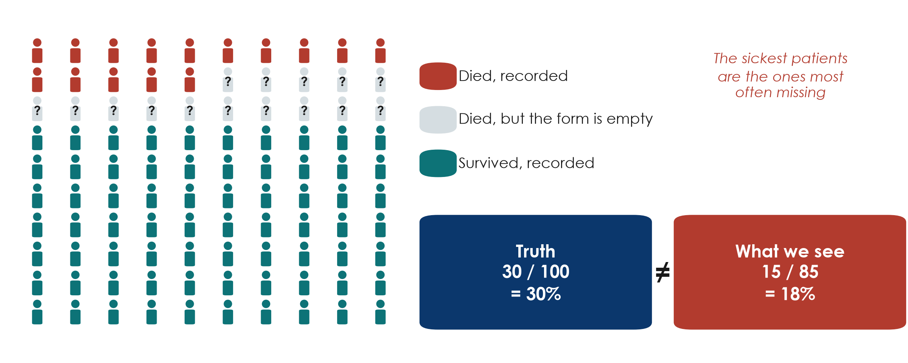{.neu-fig}

::: {.neu-takeaway}
**KEY MESSAGE** Missing data are rarely random: the sickest patients go missing first.
:::

::: {.notes}
Missing data, part 1: why it matters (prevention is next, the mechanisms and statistical handling come in Session 6, section 6.4).

Teaching point: missing data reduce the number of patients, and they can also give the wrong answer.

Walk through the picture: 100 patients, 30 truly died. But 15 of the deaths have an empty outcome box (transferred out, died at night, form never completed). Among the 85 recorded patients we see 15 deaths: 18%. The truth was 30%.

Why? Because missing is linked to the outcome itself. The sickest, most chaotic patients are the ones whose forms stay empty.

Common misconception: 'we lost only 15%, that is fine'. The amount matters less than who is missing.

Next Saturday (Session 6, 6.4) we name the mechanisms (MCAR, MAR, MNAR) and see the idea of multiple imputation. But statistical fixes are always second best to prevention.

Ask (call on two or three people, microphone on): in your unit, which patients are most likely to have incomplete records? Expected: transfers, deaths, night admissions, very short stays.
:::

## Missing data: how to prevent it

::: {.neu-intro}
Prevention is the only reliable cure.
:::

:::: {.neu-steps}
::: {.neu-step style="--c:#0D7377"}
[Fewer items]{.neu-step-label}

- Collect only what you need
- Short forms get finished
:::
::: {.neu-step style="--c:#0B376C"}
[Clear form]{.neu-step-label}

- Required fields marked
- 'Not done' and 'unknown' options
:::
::: {.neu-step style="--c:#5FA39B"}
[Train]{.neu-step-label}

- Train every data collector
- Same rules, same definitions
:::
::: {.neu-step style="--c:#0070C0"}
[Check weekly]{.neu-step-label}

- A completeness report
- Who and what is missing?
:::
::: {.neu-step style="--c:#055F56"}
[Chase early]{.neu-step-label}

- Fix while the chart is on the ward
- Plan follow-up for transfers
:::
::::

::: {.neu-takeaway}
**KEY MESSAGE** Plan who completes, checks and chases each form before you start.
:::

::: {.notes}
Missing data, part 2: prevention.

Teaching point: five habits prevent most missing data.

Fewer items: every extra item increases the chance that something is left blank.

Clear form: mark required fields. Give 'not done' and 'unknown' options so a blank always means 'forgotten'.

Train: a 30-minute session for every nurse or resident who will collect data, with the data dictionary in hand.

Check weekly: a simple count of empty boxes per variable and per patient. If one item is always empty, the item is the problem.

Chase early: the day-28 outcome is the most often missing variable in ICU studies. Plan who will check it (phone call, records) for patients transferred out.

Mention: write these steps into your proposal as the 'data quality plan' (Part 3).

Transition: now we fix some bad CRF items together.
:::

## Fix the CRF items together

::: {.neu-banner style="--c:#0D7377"}
WHOLE-CLASS TASK · 7 min
:::

:::: {.columns}
::: {.column width="60%"}
::: {.neu-activity-steps style="--c:#0D7377"}
- Open the Session 5 exercise sheet (PDF sent before the session), Exercise 2: four unclear CRF items
- The instructor shows one item at a time on the shared screen
- Rewrite each item, then two or three people read theirs aloud (1 minute per item)
- The instructor builds the class version live, using the four checks
- Items we do not reach, and Exercise 1 (classify 10 variables), are homework
:::
:::
::: {.column width="40%"}
::: {.neu-side .plain style="--c:#0D7377"}
The four checks

- Unit in the question?
- Time point in the question?
- One answer only?
- 'Unknown' option?
:::
:::
::::

::: {.neu-output style="--c:#0D7377"}
**OUTPUT** Rewritten CRF items agreed by the whole class
:::

::: {.notes}
Whole-class task closing 5.1 (7 minutes, 20:08 to 20:15). Exercises 1 and 2 are in the Session 5 exercise sheet (Course/Practicals/s5\_exercises.md, sent as a PDF before the session). Answers in Course/Solutions/s5\_solutions.md.

Run it: share the sheet on screen. For each item (start with 'Fluid given: \_\_\_\_', then 'Lactate high? Y / N'), give 1 minute, call on two or three people to read their version, and type the class version into the shared document while the class applies the four checks on the side panel. Aim for two items done well rather than four done in a hurry.

Model rewrite for (a): 'Total IV fluid received from ICU admission to 24 h (ml), including crystalloids, colloids and drug diluents: \[ \]\[ \]\[ \]\[ \]\[ \] ml, or tick: not recorded.'

Model rewrite for (d): 'Serum lactate at ICU admission (mmol/L): \[ \]\[ \].\[ \], or tick: not done.' Collecting the number is better than a yes/no.

Exercise 1 (classify 10 variables) was covered by the quick quiz. It stays as homework and self-check.

If the class is fast: ask them to suggest one data dictionary row for the rewritten fluid item.
:::

## 5.2 Meet the course dataset

:::: {.neu-statement}
::: {.neu-big}
One realistic dataset, five research questions.
:::

::: {.neu-sub}
5.2 Meet the course dataset FLUID-ICU  \|  25 minutes
:::
::::

::: {.notes}
Section 5.2 opener (25 minutes, 20:15 to 20:40: the study, the flow of patients, raw vs clean data, an 8-minute live R cleaning demo, the cleaning log, the five questions, then Question 1 written together as a PECO sentence).

Key message: from now on you will analyse and write up a realistic study, as well as reading other people's. FLUID-ICU is simulated: invented by computer, no real patient, hospital or country. But it behaves like real ICU data, including its problems.

Nobody needs to run R. The instructor runs it live on the shared screen. You read and interpret. Participants who took the Neudata course 'Clinical Data Analysis in R' can reproduce everything with the scripts in Course/Data/R.

Link to the running example: Sessions 1-4 asked an interventional question (restrictive fluids: an RCT, Paper 1, Boulet 2024, a pilot trial of restrictive vs usual fluids in septic shock, in Course/Papers). FLUID-ICU asks the observational form: is a positive fluid balance associated with death? That is a cohort question, like Paper 2 (Hyun 2023). Ask (call on two or three people, microphone on): what can a cohort claim that an RCT cannot, and vice versa? Expected: association, not causation. But real-world patients and more of them.
:::

## FLUID-ICU at a glance (simulated cohort)

::: {.neu-intro}
A multicentre prospective cohort in 4 intensive care units (ICUs), January 2023 to December 2024.
:::

:::: {.neu-cards style="--n:4"}
::: {.neu-card .plain style="--c:#0D7377"}
[Who]{.neu-card-title}

- 620 adults with sepsis
- ICU A 191, ICU B 164, ICU C 147, ICU D 118
:::
::: {.neu-card .plain style="--c:#0B376C"}
[Exposure]{.neu-card-title}

- Cumulative fluid balance by day 3 (ml/kg)
- Positive in 373/618 (60.4%)
:::
::: {.neu-card .plain style="--c:#5FA39B"}
[Primary outcome]{.neu-card-title}

- Death by day 28: 179/620 (28.9%)
- Time to death also recorded
:::
::: {.neu-card .plain style="--c:#0070C0"}
[Also recorded]{.neu-card-title}

- Severity scores (SOFA, APACHE II)
- Lactate
- Acute kidney injury (AKI)
- Ventilator-free days, ICU stay
:::
::::

::: {.neu-takeaway}
**KEY MESSAGE** Question: is a positive fluid balance by day 3 associated with 28-day death?
:::

::: {.notes}
Teaching point: before any analysis, know the study: who, exposure, outcome, what else was measured.

Who: 620 adults with sepsis in 4 ICUs (ICU A 191, ICU B 164, ICU C 147, ICU D 118), enrolled January 2023 to December 2024. Simulated data.

Exposure: cumulative fluid balance by day 3, (all fluid in minus all fluid out over days 1-3) divided by admission weight, in ml/kg. Positive balance in 373 of 618 patients with a computable balance (60.4%), median 8.8 ml/kg (IQR -10.3 to 26.2).

Primary outcome: death by day 28: 179 of 620 (28.9%). Time to death is also recorded (survivors censored at day 28).

Other variables: demographics, comorbidities, infection source, severity scores (SOFA = Sequential Organ Failure Assessment, APACHE II = Acute Physiology and Chronic Health Evaluation II), lactate, vasopressors, ventilation, AKI, renal replacement, ventilator-free days, ICU stay.

The full data dictionary is Course/Data/data\_dictionary.md (also sent as a PDF): the same structure as the one you saw in 5.1.

Ask (call on two or three people, microphone on): from what you know of Session 4 and Paper 2, which patients do you expect to have a positive balance? Expected: the sickest ones. Keep that in mind for Table 1 and Session 6.
:::

## From 623 rows to 527 complete cases

::: {.neu-intro}
FLUID-ICU (simulated): who is included at each step, and why not.
:::

:::: {.neu-steps}
::: {.neu-step style="--c:#0D7377"}
[Raw file]{.neu-step-label}

- 623 rows
- Minus 3 duplicate records
:::
::: {.neu-step style="--c:#0B376C"}
[Enrolled]{.neu-step-label}

- 620 patients
- Minus 2 without a day-3 fluid balance
:::
::: {.neu-step style="--c:#5FA39B"}
[Exposure analysis]{.neu-step-label}

- 618 patients (Table 1, comparisons)
- Minus 91 without lactate (or age)
:::
::: {.neu-step style="--c:#0070C0"}
[Complete cases]{.neu-step-label}

- 527 patients
- Used for the adjusted model
:::
::::

::: {.neu-takeaway}
**KEY MESSAGE** Every paper reports this flow: who was included at each step, and why not.
:::

::: {.notes}
Teaching point: the flow of patients (the STROBE flow diagram in the manuscript, STROBE is the reporting guideline for observational studies, Session 7).

Raw file: 623 rows. Three patients were entered twice: after removing duplicates, 620 enrolled patients.

Two patients have no day-3 fluid balance (their weight or one fluid output was impossible and set to missing during cleaning): 618 in the exposure population, used for Table 1 and the comparisons.

91 more have no lactate (or age): 527 complete cases for the adjusted model in Session 6.

Why it matters: 527 of 620 is 85%. Are the 91 patients without lactate different? Session 6 (6.4) answers this: they were less sick.

Ask (call on two or three people, microphone on): in which section of your manuscript will this flow go? Expected: the first paragraph of the Results (participants), as Figure 1.

This slide is now built from editable shapes (it was a picture before). The numbers are unchanged.
:::

## Raw vs clean: what the four ICUs actually sent

| Problem | Raw file (as sent) | Clean file (01\_clean.R) |
|:---|:---|:---|
| Sex | 8 spellings: M, m, male, F, f ... | Male / Female |
| Yes / No | Yes, Y, yes, 1  \|  No, N, no, 0 | Yes / No |
| Admission date | 2023-03-14 \| 14/03/2023 \| 14-Mar-2023 | 2023-03-14 |
| Lactate, ICU C | 23.4  (mg/dL) | 2.6  (mmol/L) |
| Missing codes | 999  \|  -99 | missing (NA) |
| Impossible | age 210 \| weight 7 kg \| output -2990 ml | missing + query to site |
| Duplicates | 623 rows (3 IDs twice) | 620 patients |

::: {.neu-takeaway}
**KEY MESSAGE** Real data arrive messy: clean them with a script, never by hand.
:::

::: {.notes}
Teaching point: these are the data-quality problems found in the raw file, and how each was fixed. Call on people to guess the problem for each row before revealing the clean column.

Sex and yes/no variables spelled in many ways. Three date formats (is 03/04 March or April?). ICU C sent lactate in mg/dL instead of mmol/L (found by comparing medians by ICU), 999 and -99 used as missing codes. Impossible values (an age of 210, a weight of 7 kg, a negative fluid output). Duplicate records (623 rows for 620 patients).

Each problem breaks the analysis silently: a lactate of 999 inflates the mean. 'Y' and 'Yes' become two categories. Mg/dL values make ICU C look like a lactate catastrophe.

Impossible values are set to missing and a query is sent to the site. The patient stays in the study. We never guess.

Link to 5.1: every one of these would have been prevented by an electronic CRF with validation rules and a data dictionary.

Ask (call on two or three people, microphone on): which problem would you never have spotted without a graph or a summary by ICU? Expected: the lactate unit.
:::

## Live demo: cleaning FLUID-ICU in R

::: {.neu-banner style="--c:#B5651D"}
LIVE DEMO · 8 min
:::

:::: {.columns}
::: {.column width="60%"}
::: {.neu-activity-steps style="--c:#B5651D"}
- Open FLUID-ICU.Rproj and the script 01\_clean.R
- Read the raw file as text and look at it
- Run one block per problem: names, duplicates, sites, dates, codes
- Find the lactate unit problem with a summary by ICU
- Last block: the cleaned file is identical to the reference file
:::
:::
::: {.column width="40%"}
::: {.neu-side .plain style="--c:#B5651D"}
Watch for

- One problem, one block
- The raw file is never changed
- Every step goes in the log
- Re-run = same result
:::
:::
::::

::: {.neu-output style="--c:#B5651D"}
**OUTPUT** Everyone has seen raw data become clean, reproducibly
:::

::: {.notes}
Live demo on the shared screen, 8 minutes. Full script with expected outputs and fallback screenshots: Course/Demos/s5\_demo.md (Part A).

You run R, participants watch. Run blocks one at a time with Ctrl+Enter and say aloud what each block fixes. Before a block, ask the class to predict (poll, or call on two or three people).

Show: the raw data read as text, 623 rows reduced to 620 by removing the 3 duplicates. The table of sex spellings before and after. The three date formats. The lactate medians by ICU (ICU C about 9 times higher) and the conversion. Impossible values set to missing. The final check that the cleaned file is identical to the reference clean file.

Teaching points: (1) the raw file is never edited. (2) one problem, one block, one log entry. (3) because it is a script, anyone can re-run it and get exactly the same clean data: reproducibility.

If R fails: show the raw-vs-clean slide again and the screenshots in the demo script. The teaching points are the same.

Do not let the demo run over: stop after 8 minutes, even if you skip a block.
:::

## The cleaning log: the audit trail of the data

::: {.neu-intro}
Course/Data/cleaning\_log.md: one row for every change made to the raw data.
:::

:::: {.neu-cards style="--n:4"}
::: {.neu-card .plain style="--c:#0D7377"}
[The rule]{.neu-card-title}

- Never edit the raw file
- Every change is made by the script and logged
:::
::: {.neu-card .plain style="--c:#0B376C"}
[Each row says]{.neu-card-title}

- The problem found
- How many records
- What we did and why
:::
::: {.neu-card .plain style="--c:#5FA39B"}
[Queries]{.neu-card-title}

- Impossible value set to missing
- Query sent to the site
- The patient stays in
:::
::: {.neu-card .plain style="--c:#0070C0"}
[What is left]{.neu-card-title}

- Real missing values
- Lactate: 93/620 (15.0%)
- Others: 1% or less
:::
::::

::: {.neu-takeaway}
**KEY MESSAGE** A reviewer must be able to trace every number back to the raw data.
:::

::: {.notes}
Teaching point: the cleaning log is the audit trail of the dataset. Show the real file on the shared screen (Course/Data/cleaning\_log.md).

The rule: the raw file is never edited. Every change is made by the script and written down.

Each row: the problem found, how many records, what was done and why (for example: lactate at ICU C in mg/dL, divided by 9.01 to obtain mmol/L, confirmed with the site laboratory).

Queries: impossible values are set to missing and a query is sent to the site. The patient is not deleted (deleting would bias the sample).

What is left after cleaning is real missing data: lactate 93 of 620 (15.0%), every other variable 1% or less. These gaps are the subject of 6.4 next Saturday.

Ask (call on two or three people, microphone on): why not just delete the patient with an age of 210? Expected: the rest of the record is valid. Deleting patients for typing errors can bias the sample.

Your manuscript's Methods will say: 'Data were cleaned with a script. All changes are documented in a cleaning log.'
:::

## Five questions, one dataset

::: {.neu-intro}
In class we work through all five together. For your manuscript, you choose one.
:::

:::: {.neu-cards style="--n:5"}
::: {.neu-card .plain style="--c:#0D7377"}
[Q1 Mortality]{.neu-card-title}

- Positive balance and 28-day death
- Logistic regression
- Kaplan-Meier and Cox
:::
::: {.neu-card .plain style="--c:#0B376C"}
[Q2 Kidneys]{.neu-card-title}

- Fluid balance and acute kidney injury (AKI)
- Logistic regression
:::
::: {.neu-card .plain style="--c:#5FA39B"}
[Q3 Ventilation]{.neu-card-title}

- Fluid balance and ventilator-free days
- Mann-Whitney and linear regression
:::
::: {.neu-card .plain style="--c:#0070C0"}
[Q4 Lactate]{.neu-card-title}

- Lactate and 28-day death
- Missing lactate: complete case vs multiple imputation
:::
::: {.neu-card .plain style="--c:#055F56"}
[Q5 ICU stay]{.neu-card-title}

- Fluid balance and ICU stay in survivors
- A skewed outcome
:::
::::

::: {.neu-takeaway}
**KEY MESSAGE** We give you the results. You write the paper on the question you choose.
:::

::: {.notes}
Teaching point: one dataset, five different research questions, matching the secondary objectives of the FLUID-ICU statistical analysis plan (SAP, Course/Data/SAP\_FLUID-ICU.md).

Question 1 (Q1): positive fluid balance by day 3 and 28-day mortality: logistic regression plus Kaplan-Meier and Cox. The primary question. We work through Q1 in full in Sessions 5 and 6.

Question 2 (Q2): cumulative fluid balance and acute kidney injury: logistic regression.

Question 3 (Q3): cumulative fluid balance and ventilator-free days: a count from 0 to 28, piled up at both ends: Mann-Whitney and linear regression.

Question 4 (Q4): initial lactate and 28-day mortality, and what missing lactate does: complete-case analysis vs multiple imputation.

Question 5 (Q5): fluid balance and ICU length of stay among survivors: a skewed outcome (median, IQR, log scale).

Each question has a results pack: Course/Data/results\_packs/Results\_Pack\_Q1 to Q5 (Table 1, figures, regression tables, plain-language notes), sent to everyone as PDFs before this session. In class we use all five as worked examples (Q1 in full, Q2 to Q5 more briefly).

For the manuscript (Weeks 7-8), each participant chooses one question and writes the paper from its results pack: we give you the results, you write the paper. Ask participants to tell you their choice (chat, email or the course form) before Session 6.
:::

## Question 1 as a PECO sentence, together

::: {.neu-banner style="--c:#0D7377"}
WHOLE-CLASS TASK · 4 min
:::

:::: {.columns}
::: {.column width="60%"}
::: {.neu-activity-steps style="--c:#0D7377"}
- Open the Q1 results pack (PDF sent before the session), page 1
- Question for the class: what is the outcome, and what type is it?
- Question for the class: what is the exposure, and what type is it?
- The instructor writes Q1 as one PECO sentence on the shared screen
- Q2 to Q5: outcome and exposure types, one line each
:::
:::
::: {.column width="40%"}
::: {.neu-side .plain style="--c:#0D7377"}
PECO for Q1

- P (population): adults with sepsis in ICU
- E (exposure): positive balance by day 3
- C (comparison): negative balance
- O (outcome): death by day 28 (binary)
:::
:::
::::

::: {.neu-output style="--c:#0D7377"}
**OUTPUT** Q1 as one PECO sentence, with outcome and exposure types (Exercise 7)
:::

::: {.notes}
Whole-class task, 4 minutes (20:36 to 20:40). Exercise 7 of the Session 5 exercise sheet has the same table. Participants complete it later for the question they choose.

PECO: P = population, E = exposure, C = comparison, O = outcome (the observational form of PICO from Session 1). Use the variable types from 5.1.

Q1 in full: call on two or three people for the outcome type (binary, and also time-to-event) and the exposure type (binary: positive vs negative balance). Then type the sentence: 'In adults with sepsis admitted to the ICU, is a positive cumulative fluid balance by day 3, compared with a negative balance, associated with higher 28-day mortality?'

Q2 to Q5, one line each: Q2 binary outcome (AKI), continuous exposure. Q3 count outcome (0-28, skewed), continuous exposure. Q4 binary outcome, continuous exposure (lactate) with missing values. Q5 continuous skewed outcome (survivors only), binary exposure.

Then break.
:::

---

::: {style="text-align:center"}
{width="32%"}

[Break]{style="color:#0D7377;font-size:1.6em;font-weight:700"}

[15 min]{style="color:#595959;font-size:0.9em"}
:::

::: {.notes}
The slide is only a picture on purpose. Before the break, say: we restart at 20:55 with 5.3 (mean or median, SD or IQR, which graph, good and bad figures, Table 1). Optional: look at Table 1 in the Q1 results pack.

Break: 15 minutes (20:40 to 20:55). Start again on time.

During the break: check that the R project for 02\_describe.R opens and runs, and that the fallback figures for 5.4 are ready to share.

Read the chat, or ask two or three people what was hardest so far (often the course-dataset cleaning). Adjust the pace of 5.3.
:::

## 5.3 Describing and showing data

:::: {.neu-statement}
::: {.neu-big}
Before comparing groups, describe them.
:::

::: {.neu-sub}
5.3 Describing and showing data  \|  35 minutes
:::
::::

::: {.notes}
Section 5.3 opener (35 minutes, 20:55 to 21:30: a worked example by hand, mean vs median, spread, shapes, a check, which graph, honest figures, Table 1 and publication-quality tables).

Key message: every paper begins its results by describing the patients: who they were, how sick, how old. You need two numbers for any numerical variable: a centre (where is the typical patient?) and a spread (how different are patients from each other?).

The choice between the two families (mean and SD, or median and IQR) depends on one thing: the shape of the data.

Transition: let us look at the most famous skewed variable in hospital medicine: length of stay.
:::

## Worked example: mean and median by hand

::: {.neu-intro}
ICU stay of 7 patients (days): 1, 2, 2, 3, 4, 6, 24
:::

:::: {.neu-steps}
::: {.neu-step style="--c:#0D7377"}
[Line up]{.neu-step-label}

- Sort from the shortest to the longest stay
:::
::: {.neu-step style="--c:#0B376C"}
[Median]{.neu-step-label}

- The 4th of 7 patients: 3 days
:::
::: {.neu-step style="--c:#5FA39B"}
[Mean]{.neu-step-label}

- 42 days / 7 patients = 6 days
:::
::: {.neu-step style="--c:#0070C0"}
[Compare]{.neu-step-label}

- One 24-day stay doubles the mean
:::
::::

::: {.neu-takeaway}
**KEY MESSAGE** One very long stay moves the mean a lot and the median not at all.
:::

::: {.notes}
Worked example (3 minutes). Type the seven numbers on the shared screen (whiteboard or a blank slide).

Line up: they are already sorted: 1, 2, 2, 3, 4, 6, 24.

Median: the middle patient of seven is the 4th: 3 days. Half stayed less, half more.

Mean: add them up: 1 + 2 + 2 + 3 + 4 + 6 + 24 = 42. Divide by 7 = 6 days.

Compare: six of the seven patients stayed 6 days or less. The mean of 6 is pulled up by the single 24-day stay. The median describes the typical patient.

Now ask (call on two or three people, microphone on): if the long-stay patient had stayed 60 days instead of 24, what happens? Expected: the median stays 3, the mean jumps to about 11 (78 / 7 = 11.1).

This is the only hand calculation today. Afterwards the computer does it and you interpret.
:::

## Mean or median? Look at the shape first

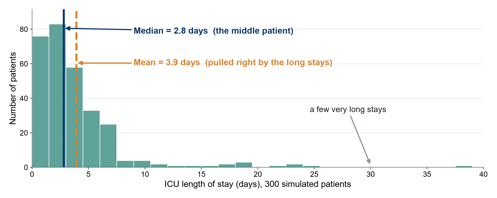{.neu-fig}

::: {.neu-takeaway}
**KEY MESSAGE** For skewed data like length of stay, the median describes the typical patient.
:::

::: {.notes}
Teaching point: the median is the middle patient when you line everyone up. The mean is the arithmetic average.

In this simulated ICU, most patients stay 1 to 5 days, but a few stay 3 to 6 weeks. Those few long stays pull the mean to the right (3.9 days) while the median stays with the typical patient (2.8 days).

Clinical translation: if a manager says 'the average ICU stay is 3.9 days', most of your patients actually leave earlier than that.

Common misconception: 'the mean is always the correct average'. For skewed data it describes no real patient.

Rule of thumb: if the mean and median are far apart, the data are skewed: report the median.

Ask (call on two or three people, microphone on): name other skewed variables in your work. Expected: hospital costs, CRP, troponin, time to antibiotics, days on ventilator.

Running example: Paper 1 (Boulet 2024) reported cumulative fluid balance as medians (6.9 vs 35.0 ml/kg) for exactly this reason.
:::

## Spread: SD for symmetric, IQR for skewed

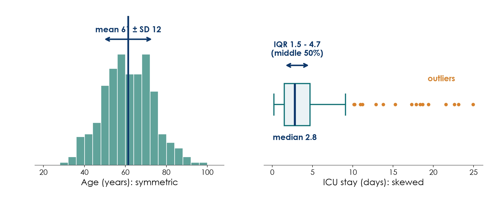{.neu-fig}

::: {.neu-takeaway}
**KEY MESSAGE** Report mean (SD) or median (IQR): never mix the pairs.
:::

::: {.notes}
Teaching point: the spread tells you how different patients are from each other.

Left: age is roughly symmetric. The standard deviation (SD) is the typical distance of a patient from the mean. In bell-shaped data, about two thirds of patients lie within one SD of the mean.

Right: length of stay is skewed. The boxplot shows the median (thick line), the box from the 25th to the 75th percentile (the interquartile range, IQR: the middle 50% of patients), whiskers, and outliers as dots.

How to read 'median 2.8 (IQR 1.5-4.7)': half the patients stayed less than 2.8 days. The middle half stayed between 1.5 and 4.7 days.

Common mistakes: reporting mean with IQR, or median with SD. And confusing SD (spread of patients) with the standard error or CI (precision of the estimate), which comes in 6.1.

Paper 1 example: control-group fluid balance 'median 35.0 (IQR -7.9, 40.2)'. Point out the negative lower quartile: a quarter of patients had a negative balance.
:::

## Why these two shapes? They cover most clinical data

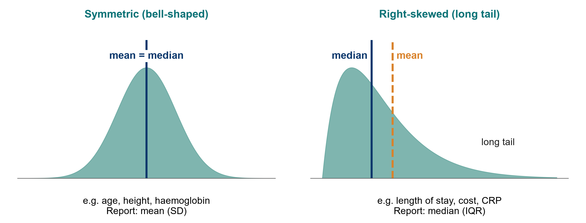{.neu-fig}

::: {.neu-takeaway}
**KEY MESSAGE** Most clinical data cluster around a typical value or have a long tail. Check which.
:::

::: {.notes}
Teaching point: two shapes cover most clinical data.

Why these two (reviewer question): most clinical measurements either cluster around a typical value (body size, physiology tightly regulated by the body: symmetric) or cannot go below zero but can go very high (times, counts, costs, inflammatory markers: right-skewed). Together they cover the large majority of variables in a clinical dataset, and they lead to the two ways of summarising data.

Other shapes exist but are rarer: left-skewed (a ceiling, e.g. gestational age at birth, oxygen saturation), bimodal (two groups mixed, e.g. age on a ward that admits both children and adults). For any shape that is not clearly symmetric, show the histogram and report median (IQR).

Symmetric, bell-shaped (often called 'normal'): mean and median are in the same place. Examples: age in adults, height, haemoglobin, systolic blood pressure. Report mean (SD).

Right-skewed: a long tail of high values pulls the mean to the right of the median. Examples: length of stay, cost, CRP, many lab values that cannot go below zero. Report median (IQR).

Quick check without software: if the SD is larger than half the mean for a variable that cannot be negative, it is probably skewed.

Why this matters later: the shape also decides the test (t-test for symmetric, Mann-Whitney for skewed). That is the decision table in 6.1.

Ask (call on two or three people, microphone on): is 'number of days on vasopressors' symmetric or skewed? Expected: skewed (most patients 1-3 days, a few for weeks).
:::

## Check your understanding: which summary?

::: {.neu-banner style="--c:#6C3483"}
QUICK QUIZ · 3 min
:::

:::: {.columns}
::: {.column width="60%"}
::: {.neu-activity-steps style="--c:#6C3483"}
- ICU length of stay in 200 patients: mean (SD) or median (IQR)?
- Age of 200 adult ICU patients, bell-shaped: mean (SD) or median (IQR)?
- Ventilated on admission (yes/no): which summary?
- Acute kidney injury (AKI) stage 1 to 3: which summary and which graph?
:::
:::
::: {.column width="40%"}
::: {.neu-side .plain style="--c:#6C3483"}
Answers

- Length of stay: median (IQR)
- Age: mean (SD)
- Ventilated: n (%)
- AKI stage: n (%) per stage, bar chart
:::
:::
::::

::: {.neu-output style="--c:#6C3483"}
**OUTPUT** Every participant can pick the right summary for a variable type
:::

::: {.notes}
Check your understanding (3 minutes), half-way through 5.3. Run it as a poll (one question per item).

Q1: median (IQR): length of stay is right-skewed.

Q2: mean (SD): bell-shaped data.

Q3: n (%): a binary variable has no mean or SD. Report the number and percentage.

Q4: n (%) for each stage, shown with a bar chart. The median stage is also acceptable for an ordinal variable. Do not report a 'mean stage of 1.8'.

If many get Q1 wrong, return to the histogram slide for one minute.

Transition: now, how to show these summaries: graphs, figures and tables.
:::

## Which graph for which data?

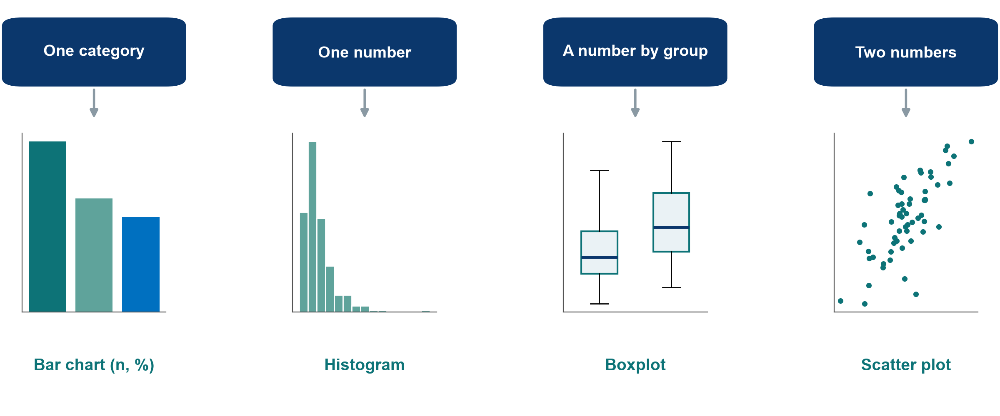{.neu-fig}

::: {.neu-takeaway}
**KEY MESSAGE** Choose the graph from the variable type, not from the software menu.
:::

::: {.notes}
Teaching point: four graphs cover most of what you need to describe data. Survival curves (Kaplan-Meier) come in Session 6, when we analyse time-to-event outcomes.

One categorical variable: bar chart with counts or percentages (source of sepsis). Avoid 3-D pie charts.

One numerical variable: histogram to see the shape (length of stay).

A number compared between groups: side-by-side boxplots (fluid balance in restrictive vs usual care).

Two numerical variables: scatter plot (fluid balance against lactate).

Common mistake: a bar chart of means with a small error bar for skewed data. It hides the shape and the outliers. A boxplot shows much more.

Ask (call on two or three people, microphone on): which graph would you use to compare ICU length of stay between the two fluid groups? Expected: side-by-side boxplots (skewed numbers by group).
:::

## Show the data: dynamite plot vs dots + box

::: {.neu-intro}
Same 48 patients, two pictures.
:::

:::: {.columns}
::: {.column width="50%"}
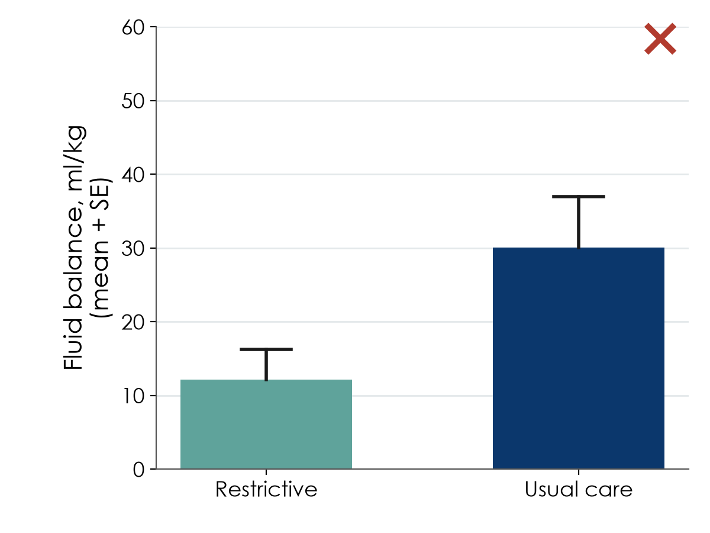{.neu-fig-half}

::: {.neu-caption}
Dynamite plot: a mean and an error bar hide everything
:::
:::
::: {.column width="50%"}
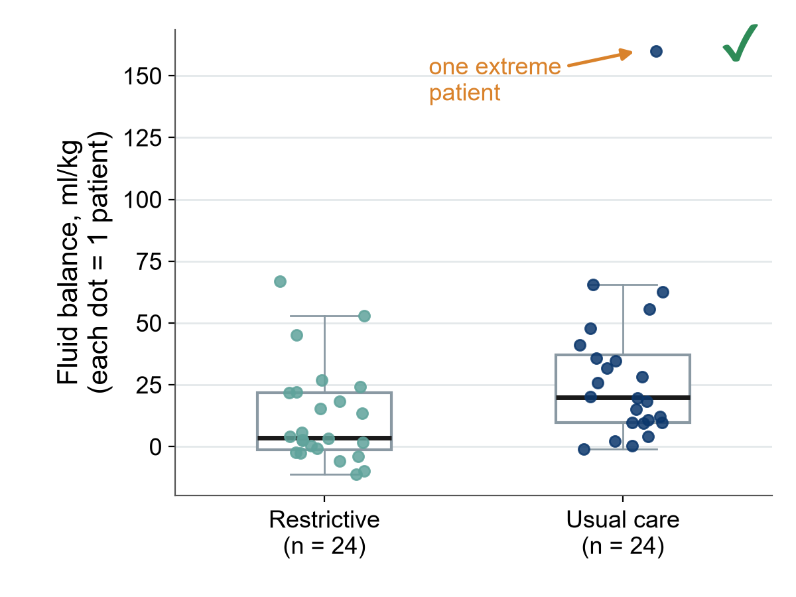{.neu-fig-half}

::: {.neu-caption}
Every patient visible: shape, spread and the outlier
:::
:::
::::

::: {.notes}
Teaching point: the 'dynamite plot' (bar of the mean plus an error bar) is the most common bad figure in clinical journals. It shows two numbers per group and hides the rest.

Left: the bars suggest the usual-care group has much higher fluid balance. Right: the same simulated data as dots plus a boxplot. Now you see that one extreme patient (160 ml/kg) drags the usual-care mean up, that the data are skewed, and that the groups overlap a lot.

Also note: the left plot shows the standard error (SE), not the SD, which makes the spread look small. Always say whether bars are SD, SE or 95% CI.

Rule: with fewer than about 100 patients per group, show the individual points.

Many journals now explicitly discourage bar charts for continuous data.

Ask (call on two or three people, microphone on): what would you have concluded from the left picture alone? Expected: 'the usual-care group is clearly higher'. That is the danger.

Timing: 2 minutes.
:::

## What a 'Table 1' shows

| Characteristic | Restrictive (n = 24) | Usual care (n = 24) |
|:---|:---|:---|
| Age, years, mean (SD) | 64 (11) | 66 (12) |
| Male, n (%) | 15 (63) | 16 (67) |
| SOFA score, median (IQR) | 9 (7-11) | 9 (6-12) |
| Lactate, mmol/L, median (IQR) | 3.1 (2.2-4.8) | 2.9 (2.0-5.1) |
| Source: lung, n (%) | 11 (46) | 10 (42) |

::: {.neu-table-caption}
Illustrative numbers. Symmetric: mean (SD). Skewed: median (IQR). Categories: n (%). SD = standard deviation. IQR = interquartile range. SOFA = Sequential Organ Failure Assessment. Ask: who were the patients, and were the groups alike at the start?
:::

::: {.notes}
Teaching point: Table 1 in almost every clinical paper describes the patients at baseline, by group.

Read it row by row: the summary is written in the row label. Symmetric variables as mean (SD), skewed ones as median (IQR), categories as n (%).

Two questions to ask of every Table 1: (1) Do these patients look like mine? (generalisability) (2) Are the groups similar at the start? (fair comparison).

In an RCT, groups should be similar by chance thanks to randomisation. Small differences are expected. Many guidelines (CONSORT, the reporting guideline for trials) advise against p-values in an RCT's Table 1, because any difference is due to chance by definition.

In a cohort (Paper 2), large baseline differences are a warning sign of confounding. That is why Paper 2 matched patients on a propensity score before comparing them.

Numbers on the slide are illustrative, not from Paper 1. Paper 1's real Table 1 has 24 patients per group. Participants can open it in Course/Papers.

Ask (call on two or three people, microphone on): what would worry you if the restrictive group had a median SOFA of 6 and usual care 11? Expected: the groups are not comparable. Sicker patients in one arm.

This slide is now an editable table (it was a picture before). Timing: 2 minutes. Next: a table written badly and well.
:::

## Publication-quality tables: bad vs good

::: {.neu-intro}
Rules: units and summary in the row label, n per column, consistent decimals, footnotes.
:::

:::: {.columns}
::: {.column width="50%"}
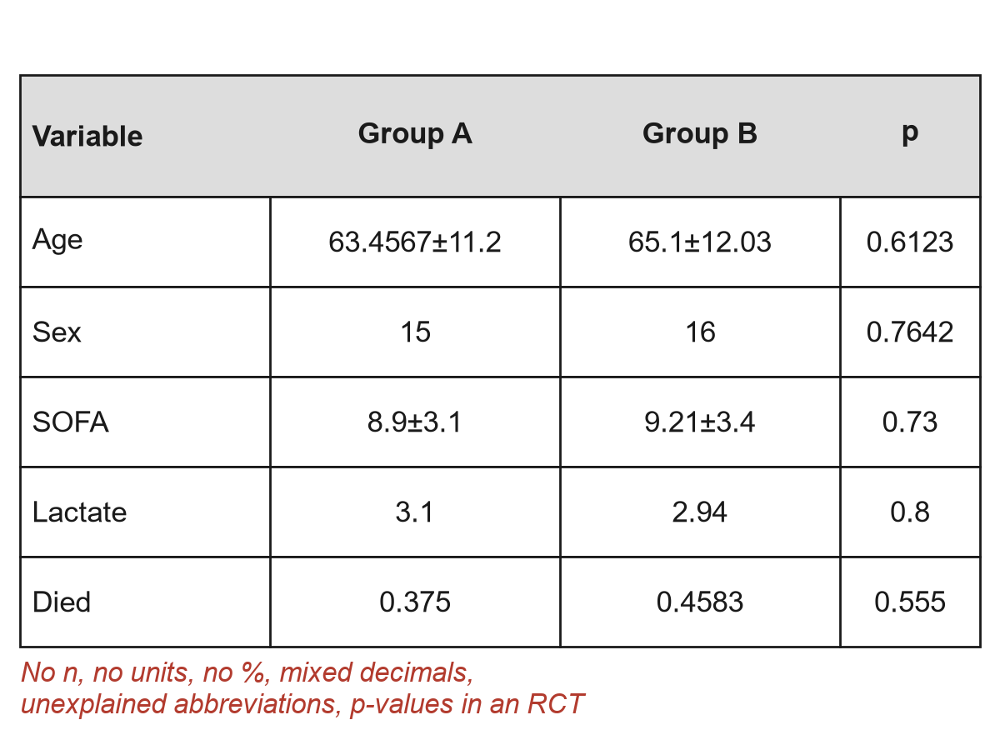{.neu-fig-half}

::: {.neu-caption}
Grid lines, no n, no units, 4 decimals
:::
:::
::: {.column width="50%"}
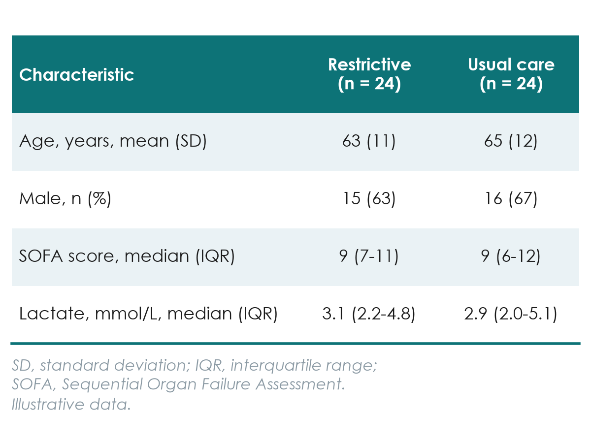{.neu-fig-half}

::: {.neu-caption}
Clean, self-explanatory, ready for a journal
:::
:::
::::

::: {.notes}
Teaching point: a table in a paper must stand alone. Compare the two versions row by row. (These two stay as pictures on purpose: the bad one shows formatting faults, such as grid lines, that a native slide table would hide.)

Column headers: 'Group A / Group B' tells the reader nothing. Write the group names and the number of patients in each column (n = 24).

Row labels: say the unit and the summary used: 'Age, years, mean (SD)', 'Lactate, mmol/L, median (IQR)'.

Numbers: sensible, consistent decimals: age as whole years, percentages without decimals for small samples, lactate with one decimal. 63.4567 suggests a precision that does not exist.

Categories as n (%), never as a proportion like 0.375.

Footnotes explain every abbreviation (SOFA, IQR) and, if p-values are shown, which test was used. In an RCT Table 1, leave p-values out (CONSORT).

No vertical lines, few horizontal ones. Journals will re-typeset anyway, but reviewers notice messy tables.

The proposal template and Sessions 7-8 (writing the paper) use these same rules.

Ask (call on two or three people, microphone on): find four problems in the left table in 30 seconds. Expected: no n, no units, no %, too many decimals, unexplained SOFA, p-values in an RCT.

Timing: 2 minutes.
:::

## 5.4 Describe the course dataset

:::: {.neu-statement}
::: {.neu-big}
Before comparing groups, describe them: now with real numbers.
:::

::: {.neu-sub}
5.4 Describe the course dataset  \|  25 minutes
:::
::::

::: {.notes}
Section 5.4 opener (25 minutes, 21:30 to 21:55: a 6-minute live demo of Table 1 and figures, four slides of FLUID-ICU results, then a 10-minute whole-class reading of Table 1).

Key message: everything from 5.3 (shape, mean or median, which graph, Table 1) now applied to FLUID-ICU. Same rules, real (simulated) numbers.
:::

## Live demo: Table 1 and figures in R

::: {.neu-banner style="--c:#B5651D"}
LIVE DEMO · 6 min
:::

:::: {.columns}
::: {.column width="60%"}
::: {.neu-activity-steps style="--c:#B5651D"}
- Open 02\_describe.R and load the clean data
- Look at the shape first: histograms of age, lactate, ICU stay
- Build Table 1 by fluid-balance group (no p-values)
- Draw the figures: histogram, boxplot, bar chart
- Save tables and figures for the results packs
:::
:::
::: {.column width="40%"}
::: {.neu-side .plain style="--c:#B5651D"}
Same rules as 5.3

- Shape decides the summary
- n per column
- Units in the row label
- Missing reported
:::
:::
::::

::: {.neu-output style="--c:#B5651D"}
**OUTPUT** Everyone has seen a Table 1 built from data, reproducibly
:::

::: {.notes}
Live demo on the shared screen, 6 minutes. Full script: Course/Demos/s5\_demo.md (Part B), using Course/Data/R/02\_describe.R.

Show: the shape of age (roughly symmetric, so mean and SD) vs lactate and ICU stay (right-skewed, so median and IQR). The Table 1 by fluid-balance group with overall, negative (n = 245) and positive (n = 373) columns and the number missing per variable. The histogram of fluid balance, the SOFA boxplot by group, the sorted bar chart of infection source.

Point out: no p-values in Table 1 (it describes, it does not test), as written in the FLUID-ICU SAP.

If R fails: go straight to the next slides. They show the same outputs.
:::

## FLUID-ICU Table 1: were the groups alike at the start?

| Characteristic | Overall
n = 618 | Negative balance
n = 245 | Positive balance
n = 373 |
|:---|:---|:---|:---|
| Age, years, mean (SD) | 62.6 (15.2) | 64.6 (15.0) | 61.4 (15.2) |
| Male sex, n (%) | 375 (61%) | 143 (58%) | 232 (62%) |
| Heart failure, n (%) | 97 (16%) | 54 (22%) | 43 (12%) |
| **SOFA score, median (IQR)** | **[7 (5, 9)]{style="color:#0B376C"}** | **[6 (4, 8)]{style="color:#0B376C"}** | **[8 (6, 10)]{style="color:#0B376C"}** |
| **Lactate, mmol/L, median (IQR)** | **[2.6 (1.7, 3.7)]{style="color:#0B376C"}** | **[2.2 (1.4, 3.0)]{style="color:#0B376C"}** | **[2.9 (1.9, 4.0)]{style="color:#0B376C"}** |
| **Vasopressor, n (%)** | **[266 (43%)]{style="color:#0B376C"}** | **[61 (25%)]{style="color:#0B376C"}** | **[205 (55%)]{style="color:#0B376C"}** |
| **Mechanical ventilation, n (%)** | **[313 (51%)]{style="color:#0B376C"}** | **[97 (40%)]{style="color:#0B376C"}** | **[216 (58%)]{style="color:#0B376C"}** |

::: {.neu-takeaway}
**KEY MESSAGE** The positive-balance group was sicker at baseline: a warning for Session 6.
:::

::: {.notes}
Teaching point: read Table 1 with the two questions from 5.3: do these patients look like mine, and were the groups alike at the start?

Age: mean 64.6 vs 61.4 years (negative vs positive): similar.

Severity is not similar: SOFA median 6 (4 to 8) vs 8 (6 to 10). Vasopressor 61/245 (24.9%) vs 205/373 (55.0%). Mechanical ventilation 97/245 (39.6%) vs 216/373 (57.9%), lactate median 2.2 vs 2.9 mmol/L.

Heart failure: 54/245 (22.0%) vs 43/373 (11.5%): clinicians give less fluid to patients with heart failure.

Interpretation: patients with a positive balance were sicker before the fluid was given. Sicker patients receive more fluid and die more often: confounding by indication (Session 4). Any crude comparison of mortality will be biased. Session 6 adjusts for it.

Ask (poll, or call on two or three people): from this table alone, would you expect the crude odds ratio for death to be larger or smaller than the adjusted one? Expected: larger (the sickness inflates it).
:::

## The exposure: cumulative fluid balance at day 3

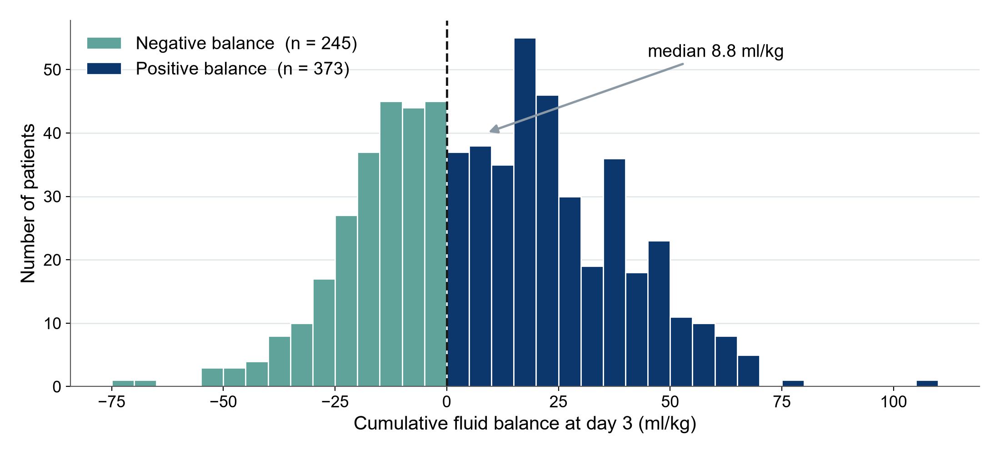{.neu-fig}

::: {.neu-takeaway}
**KEY MESSAGE** A continuous exposure, cut at 0 ml/kg into negative and positive balance.
:::

::: {.notes}
Teaching point: always look at the exposure before using it.

The cumulative fluid balance at day 3 ranges widely. Median 8.8 ml/kg (IQR -10.3 to 26.2). 373 of 618 patients (60.4%) had a positive balance.

The primary analysis (Q1) cuts the continuous variable at 0 ml/kg into two groups. Q2 and Q3 keep it continuous (per 10 ml/kg). Cutting loses information but is easier to explain. The SAP fixed this choice in advance.

Ask (call on two or three people, microphone on): which summary would you report for this variable in Table 1? Expected: median (IQR), as here, because of the tails. Roughly symmetric in the middle, so mean (SD) would also be acceptable if stated.
:::

## Severity by group: show every patient

:::: {.columns}
::: {.column width="38%"}
::: {.neu-side-notes}
### How to read it

- Each dot is one patient
- Box = middle 50%
- Median SOFA 6 vs 8
- Sicker patients got more fluid
:::
:::
::: {.column width="62%"}
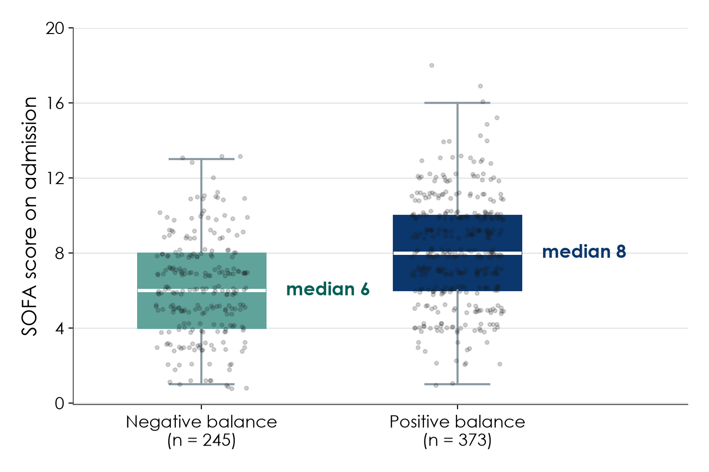{.neu-fig-side}
:::
::::

::: {.neu-takeaway}
**KEY MESSAGE** Dots plus box show the overlap and the shift: confounding you can see.
:::

::: {.notes}
Teaching point: the 'dots plus box' figure from 5.3, applied to FLUID-ICU.

SOFA score on admission: median 6 (IQR 4 to 8) in the negative-balance group vs 8 (6 to 10) in the positive-balance group. Every dot is a patient, so the reader sees the overlap and the shift.

This single picture is the visual proof of confounding by indication in this dataset.

Ask (call on two or three people, microphone on): why a boxplot and not a bar of the mean SOFA? Expected: SOFA is a score with a skewed distribution. The bar would hide the spread and the overlap.
:::

## The skewed outcome: ICU stay in survivors (Q5)

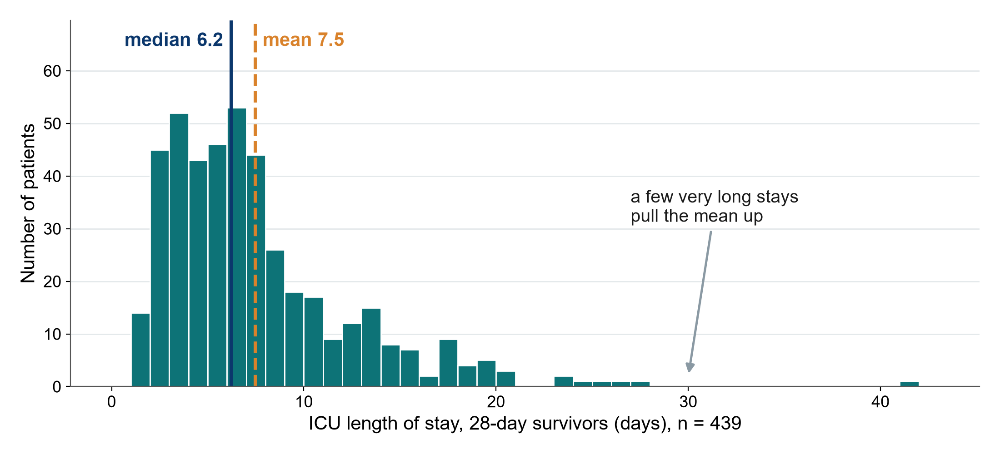{.neu-fig}

::: {.neu-takeaway}
**KEY MESSAGE** Mean 7.5 vs median 6.2 days: report the median and IQR.
:::

::: {.notes}
Teaching point: the length-of-stay picture from 5.3 is true in FLUID-ICU too.

ICU stay among the 439 survivors is right-skewed: a few very long stays pull the mean (7.5 days) above the median (6.2 days). Across all patients: mean 7.3, median 6.0.

Question 5 (Q5) is about this outcome: it reports medians (IQR), compares groups with the Mann-Whitney test, and uses a log scale in the model (Session 6).

Ask (call on two or three people, microphone on): who most needs this slide? Expected: anyone who chooses Q5 for the manuscript, but every manuscript reports at least one skewed variable in Table 1.
:::

## Read the FLUID-ICU Table 1 together

::: {.neu-banner style="--c:#0D7377"}
WHOLE-CLASS TASK · 10 min
:::

:::: {.columns}
::: {.column width="60%"}
::: {.neu-activity-steps style="--c:#0D7377"}
- Open Table 1 in the Q1 results pack (PDF): the same table is in every pack
- Poll: which summary is used for age, SOFA and vasopressor, and why?
- Question for the class: were the groups alike at the start? Name the biggest difference
- Together we write two Results sentences describing the patients
- Q2 to Q5: what each pack adds (for example, Q5 has a survivors-only table)
:::
:::
::: {.column width="40%"}
::: {.neu-side .plain style="--c:#0D7377"}
Check

- n per column?
- Units in labels?
- Median for skewed?
- Missing reported?
:::
:::
::::

::: {.neu-output style="--c:#0D7377"}
**OUTPUT** Two Results sentences describing the FLUID-ICU patients (Exercise 6)
:::

::: {.notes}
Whole-class task, 10 minutes (21:45 to 21:55). Exercise 6 of the Session 5 exercise sheet. Model answers in Course/Solutions/s5\_solutions.md.

Share Table 1 from the Q1 results pack on screen. All five packs contain the same Table 1 by fluid-balance group (the Q5 pack also has a table for survivors).

Poll (2 minutes): age = mean (SD), symmetric. SOFA = median (IQR), skewed score. Vasopressor = n (%), binary.

Call on two or three people (3 minutes): biggest difference = severity (SOFA, vasopressor, ventilation). Someone may spot heart failure going the other way: clinicians give less fluid in heart failure.

Write together (4 minutes), typing in the shared document: 'Of 620 enrolled patients, 618 had a computable day-3 fluid balance, 373 (60.4%) had a positive balance. Patients with a positive balance were more severely ill at admission (median SOFA 8 vs 6, vasopressor 55.0% vs 24.9%, mechanical ventilation 57.9% vs 39.6%).'

Q2 to Q5 (1 minute): the same patients, so the same Table 1. Q5 adds survivors only (n = 439).

Listen for: correct summaries (mean vs median), no interpretation of 'significance' in Table 1, and the realisation that severity differs between groups.

These sentences go straight into the Results of each participant's manuscript (Session 7).
:::

## Proposal builder 5: what a good one contains

::: {.neu-intro}
Modelled on the running example (a restrictive fluids trial).
:::

:::: {.neu-cards style="--n:4"}
::: {.neu-card .plain style="--c:#0D7377"}
[Variables table]{.neu-card-title}

- Outcome: 28-day death (binary)
- Exposure: restrictive vs usual
- Confounders: age, SOFA, lactate
:::
::: {.neu-card .plain style="--c:#0B376C"}
[Mini-CRF]{.neu-card-title}

- 6 to 10 items
- Units and time points
- 'Unknown' options
:::
::: {.neu-card .plain style="--c:#5FA39B"}
[Data dictionary]{.neu-card-title}

- 3 to 5 rows
- Name, label, type, unit or codes
- Allowed values
:::
::: {.neu-card .plain style="--c:#0070C0"}
[Data management]{.neu-card-title}

- Electronic capture (EDC) or double entry
- Coded IDs and an audit trail
- Backups and a data-sharing statement
:::
::::

::: {.neu-takeaway}
**KEY MESSAGE** Today: what you will collect and how you will keep it safe.
:::

::: {.notes}
Show for 1 minute before the instructor starts modelling, so participants see the expected level.

Variables table: primary outcome, exposure (or intervention), 3-5 confounders, each with its type. This table drives everything else.

Mini-CRF: 6 to 10 items that collect exactly those variables, with units, time points and 'unknown' options (the worked example).

Data dictionary: 3 to 5 rows with short variable names, labels, types, units or codes, and allowed values.

Data-management plan: one or two sentences: EDC (electronic data capture) or paper with double entry, coded IDs with a separately locked linking log, audit trail, backups, and a data-sharing statement in the consent form.

Each participant writes this for their own research question (their own proposal), not for FLUID-ICU.

Next Saturday (Session 6) the proposal gets the sample size, the analysis plan and the missing-data plan.
:::

## Proposal builder 5: variables, CRF and data management

::: {.neu-banner style="--c:#055F56"}
PROPOSAL BUILDER · 30 min
:::

:::: {.columns}
::: {.column width="60%"}
::: {.neu-activity-steps style="--c:#055F56"}
- The instructor models each part live on the running example (18 min)
- Variables table, mini-CRF, data dictionary rows, data-management plan
- Then draft your own variables table in your proposal template (10 min, on your own)
- Questions (2 min): raise your hand or use the chat. The other parts are homework
:::
:::
::: {.column width="40%"}
::: {.neu-side .plain style="--c:#055F56"}
Use these tools

- Variable-type cards (5.1)
- Good vs bad CRF items
- FLUID-ICU data dictionary
- Exercise sheet: Exercise 8
:::
:::
::::

::: {.neu-output style="--c:#055F56"}
**OUTPUT** Your own proposal, Part 3 (first half): variables table started now, the rest as homework
:::

::: {.notes}
Proposal builder 5: 30 minutes (21:55 to 22:25). Template: Course/Templates/Research\_Proposal\_Template.docx (sent before Session 1). Worksheet: Exercise 8 of the Session 5 exercise sheet, with the same headings.

Model live (18 minutes) on the running example, typing into a copy of the template on the shared screen: variables table (5 min), mini-CRF (5 min), data dictionary rows with one validation rule (4 min), data-management plan (4 min). Call on people to suggest items as you go.

Individual slot (10 minutes): everyone drafts their own variables table quietly (cameras can stay off). Then 2 minutes for questions in the chat.

Use the FLUID-ICU data dictionary as a model: participants have just seen what a real one looks like.

Common problems to mention while modelling: too many CRF items (keep to 10). Confounders that are actually outcomes. Names and IDs in the same file. No plan for backups.

Homework: finish the mini-CRF, data dictionary rows and data-management plan in your own template before Session 6.

At 22:25, stop for the wrap-up.
:::

## Key words of the day

::: {.neu-intro}
Twelve words you should now be able to explain to a colleague.
:::

:::: {.neu-cards style="--n:4"}
::: {.neu-card .plain style="--c:#0D7377"}
[Collect]{.neu-card-title}

- Variable type
- CRF
- Data dictionary
:::
::: {.neu-card .plain style="--c:#0B376C"}
[Protect]{.neu-card-title}

- Validation check
- Audit trail
- Cleaning log
:::
::: {.neu-card .plain style="--c:#5FA39B"}
[Describe]{.neu-card-title}

- Median (IQR)
- Mean (SD)
- Skewed
:::
::: {.neu-card .plain style="--c:#0070C0"}
[Show]{.neu-card-title}

- Table 1
- Dots + box
- n (%)
:::
::::

::: {.neu-takeaway}
**KEY MESSAGE** If one word is unclear, ask now or look it up in the glossary.
:::

::: {.notes}
Key words of the day (2 minutes). Point to each word and call on someone for a one-line definition, microphone on. Correct gently.

Variable type: number vs category, and the subtypes. CRF (case report form): the form that collects the data. Data dictionary: one row per variable, with type, unit/codes and allowed values.

Validation check: a rule that flags impossible values (range, consistency, logic, completeness). Audit trail: the record of who changed what, when and why. Cleaning log: the list of every correction made to the raw data (FLUID-ICU).

Median (IQR) for skewed data, mean (SD) for symmetric data. Skewed = long tail.

Table 1: baseline characteristics by group. Dots + box: show every patient, n (%): how categories are reported.

All terms are in the EN-VN glossary in Course/References.
:::

## Session 5 recap

::: {.neu-intro}
Three messages to take home.
:::

:::: {.neu-cards style="--n:3"}
::: {.neu-card .plain style="--c:#0D7377"}
[Design the data]{.neu-card-title}

- Clear CRF items
- Data dictionary first
- Checks at entry
:::
::: {.neu-card .plain style="--c:#0B376C"}
[Keep it clean]{.neu-card-title}

- Never edit raw data
- Log every correction
- Backups, coded IDs
:::
::: {.neu-card .plain style="--c:#5FA39B"}
[Describe honestly]{.neu-card-title}

- Shape decides the summary
- Show every patient
- Table 1 that stands alone
:::
::::

::: {.neu-takeaway}
**KEY MESSAGE** Good analysis starts with good data, described honestly.
:::

::: {.notes}
Session recap (2 minutes). Ask three volunteers (raise-hand button) to give one example for each card from today.

Design the data: the worked CRF item, the data dictionary, validation rules.

Keep it clean: FLUID-ICU showed what real data look like before cleaning and why the cleaning log matters.

Describe honestly: median vs mean, dots instead of dynamite plots, a Table 1 a reader understands without the text.

Next Saturday (Session 6): from the sample to an answer: confidence intervals, p-values, tests, regression, survival and missing data, all run live on FLUID-ICU.
:::

## Wrap-up and homework

::: {.neu-banner style="--c:#1F5C7A"}
DISCUSSION · 5 min
:::

:::: {.columns}
::: {.column width="60%"}
::: {.neu-activity-steps style="--c:#1F5C7A"}
- Key words and recap (previous two slides)
- Exit question in the chat: one data-quality problem found in FLUID-ICU, and how it was fixed
- Homework: finish Part 3 (first half) of your own proposal
- Choose one question (Q1 to Q5) for your manuscript and read its results pack before Session 6
:::
:::
::: {.column width="40%"}
::: {.neu-side .plain style="--c:#1F5C7A"}
Next Saturday: Session 6

- Confidence intervals, p-values
- Choosing a test
- Regression and survival
- Missing data
- The five FLUID-ICU questions
:::
:::
::::

::: {.neu-output style="--c:#1F5C7A"}
**OUTPUT** Exit answer in the chat
:::

::: {.notes}
Wrap-up: 5 minutes (22:25 to 22:30), including the key-words and recap slides.

Exit question in the chat: name one data-quality problem found in the raw FLUID-ICU data and how the cleaning fixed it. Purpose: it checks understanding of today's core idea (clean with a script and a log, never by hand). Read the answers before Session 6 and open Session 6 with two or three of them.

Homework: finish the mini-CRF, data dictionary rows and data-management plan of your own proposal (Part 3, first half). Choose one of the five FLUID-ICU questions for your manuscript, tell the instructor, and read its results pack (Table 1, figures). Optional: Exercises 1, 3, 4 and 5 of the Session 5 exercise sheet.

Thank the class: today was a lot of new vocabulary. Next Saturday builds directly on it.
:::

## Extra slides: Session 5

:::: {.neu-statement}
::: {.neu-big}
Extra slides: use if time allows, or for self-study.
:::

::: {.neu-sub}
Not needed to follow Session 6
:::
::::

::: {.notes}
Extra: the slides after this point are optional. Use them if the class is ahead of time, or point participants to them for self-study (they are in the handout deck).
:::

## Extra: Coding, versions, backups and data sharing

::: {.neu-intro}
Four habits that protect your data and your future paper.
:::

:::: {.neu-cards style="--n:4"}
::: {.neu-card .plain style="--c:#0D7377"}
[Coding]{.neu-card-title}

- Codes, not free text
- Study ID, not names
- Codes in the dictionary
:::
::: {.neu-card .plain style="--c:#0B376C"}
[Versions]{.neu-card-title}

- Raw file: read-only
- Dated copies, e.g. data\_2026-03-12\_v2
:::
::: {.neu-card .plain style="--c:#5FA39B"}
[Backups]{.neu-card-title}

- 3 copies on 2 media
- 1 copy off-site, encrypted
- Test a restore
:::
::: {.neu-card .plain style="--c:#0070C0"}
[Data sharing]{.neu-card-title}

- Journals ask for a data-sharing statement
- Plan it at the start
:::
::::

::: {.neu-takeaway}
**KEY MESSAGE** Never edit the raw file: keep it, copy it, date it, back it up.
:::

::: {.notes}
Extra: Teaching point: four habits that cost little and save studies.

Coding: store categories as numeric codes defined in the data dictionary (1 = lung, 2 = urine...). Use a study ID for each patient. Names and hospital numbers stay in a separate, locked linking log.

Versions: the raw data file is never edited. It is set to read-only. Every cleaning step creates a new, dated copy (data\_2026-03-12\_v2) and a short log of what changed. Then any result can be traced back.

Backups: the 3-2-1 rule: three copies, on two different media, one off-site, encrypted. A backup you have never restored is only a hope.

Data-sharing statement: most journals now require one (Sessions 7-8). Example wording: 'De-identified participant data and the data dictionary will be available from the corresponding author on reasonable request after publication, subject to ethics approval.' Write it into the consent form and protocol now, or you may not be allowed to share later.

Ask: if your laptop were stolen tonight, would your study survive? Expected: an uncomfortable silence. Good.

Timing: 2 minutes.
:::

## Extra: Three more chart crimes, and how to fix them

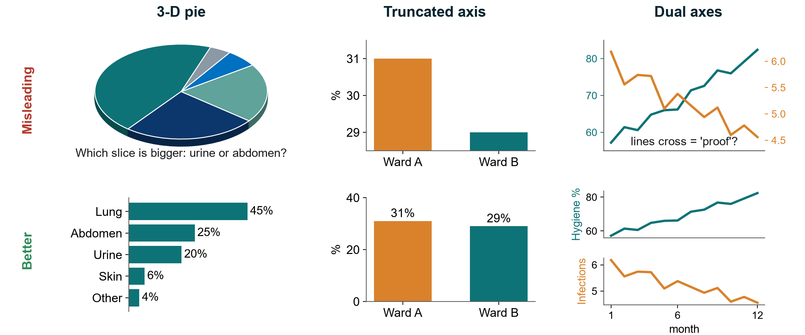{.neu-fig}

::: {.neu-takeaway}
**KEY MESSAGE** Bars start at zero, one axis per graph, and no 3-D effects.
:::

::: {.notes}
Extra: Teaching point: three distortions you will see in posters, reports and papers. Top row misleading, bottom row fixed.

3-D pie: the tilt makes slices at the front look bigger. The eye cannot compare angles well. Ask: which slice is bigger, urine or abdomen? Then show the sorted bar chart: 25% vs 20%, instantly clear.

Truncated axis: the y-axis starts at 28.5%, so a 2-point difference in mortality (31% vs 29%) looks like a tripling. Bars must start at zero. (Line charts may zoom in, but say so.)

Dual axes: two different y-axes scaled by the author make any two lines cross wherever the author wants, suggesting 'hand hygiene went up, so infections went down'. Better: two panels sharing the time axis, and remember correlation is not causation (6.3).

All data here are simulated.

Ask: where have you seen a truncated axis recently? Expected: hospital dashboards, pharmaceutical advertisements, news.

Timing: 2 minutes.
:::
