# Session 6 · Analyse: from sample to answer

## Week 6 · Saturday

- Recap quiz on Session 5 (10 min)
- 6.1 From sample to population: CI, p-value, one- or two-sided, power, sample size, choosing a test
- 6.2 Compare groups in the course dataset (live R demo)
- 6.3 Relationships and models: regression, Kaplan-Meier and Cox
- 6.4 Model the course dataset: adjusted OR, Cox HR, missing data, the SAP
- Proposal builder 6: sample size, analysis plan, missing-data plan

::: {.notes}
Session 6 (19:30-22:30, break 20:40-20:55). The most technical session: go slowly, drop extra slides, never checks.

FLUID-ICU returns in 6.2 (comparisons) and 6.4 (models, survival, missing data): Q1 in full, Q2 to Q5 briefly.

At the end, each participant chooses one question for the Results section and receives the manuscript brief.
:::

## Recap quiz: Session 5 in three questions

::: {.neu-banner style="--c:#6C3483"}
QUICK QUIZ · 10 min
:::

:::: {.columns}
::: {.column width="60%"}
::: {.neu-activity-steps style="--c:#6C3483"}
- Q1. ICU length of stay in 300 patients is right-skewed. Which summary goes in Table 1?
- Q2. A CRF item reads 'Lactate: \_\_\_\_'. Name two things missing.
- Q3. In the raw FLUID-ICU data, one age was 210. Which check catches it, and what goes in the cleaning log?
- Q1 in a poll. Q2 and Q3: two or three people answer with the microphone on (1 to 2 minutes each)
:::
:::
::: {.column width="40%"}
::: {.neu-side .plain style="--c:#6C3483"}
Answers (reveal after)

- Q1: median (IQR)
- Q2: unit (mmol/L), time point, 'not done' option
- Q3: range check. The value, the correction, the reason, who and when
:::
:::
::::

::: {.neu-output style="--c:#6C3483"}
**OUTPUT** Everyone back on track with data types, CRF items and cleaning
:::

::: {.notes}
Recap (19:30-19:40). Q1 as a poll, Q2 and Q3: call on two or three people. Then reveal.

Q1: median (IQR). Q2: unit, time point, 'not done' option. Q3: range check. The log records the ID, the value, the action, the reason, who and when.

First read three or four Session 5 exit answers and correct misunderstandings.
:::

## 6.1 From sample to population, without fear

:::: {.neu-statement}
::: {.neu-big}
We study a few patients to learn about many.
:::

::: {.neu-sub}
6.1 From sample to population  \|  40 minutes
:::
::::

::: {.notes}
Section 6.1 (19:40-20:20).

We study a sample and use statistics to say how far our answer might be from the truth.

Reassure: reading CIs and p-values correctly is more than many published authors manage.
:::

## The dance of the confidence intervals

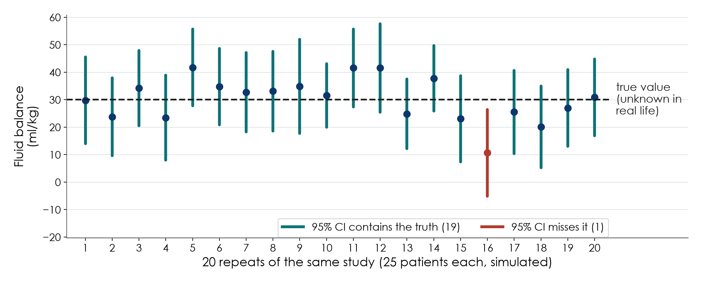{.neu-fig}

::: {.neu-takeaway}
**KEY MESSAGE** About 95 of 100 such intervals capture the truth. We never know which ones.
:::

::: {.notes}
The most important picture tonight. Same study 20 times, 25 patients each: 19 intervals contain the true value, one misses. That is what '95%' means.

In real life you see one interval and never the dashed line.

Safe wording: 'a range of plausible values'.

Ask: what makes intervals shorter? Expected: more patients, less variability.
:::

## The p-value in one picture

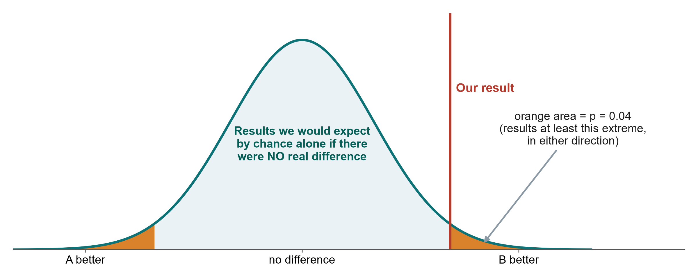{.neu-fig}

::: {.neu-takeaway}
**KEY MESSAGE** p = how surprising our result would be if there were truly no difference.
:::

::: {.notes}
Imagine no real difference (H0): chance alone scatters results around zero. The p-value is the orange area: results at least as extreme as ours.

p = 0.04: surprising if there were no difference. p = 0.42 (Paper 1): not surprising, but not proof of no difference.

0.05 is a convention: 0.049 and 0.051 are the same evidence.
:::

## One-sided or two-sided? Two-sided is the default

::: {.neu-intro}
H0 (null hypothesis): no difference. H1 (alternative hypothesis): there is a difference. The direction of H1 decides which tails count.
:::

:::: {.neu-cards style="--n:3"}
::: {.neu-card .plain style="--c:#0D7377"}
[Two-sided (the default)]{.neu-card-title}

- H1: the groups differ, in either direction
- Benefit and harm both count
- The p-value uses both tails
:::
::: {.neu-card .plain style="--c:#B5651D"}
[One-sided (rarely justified)]{.neu-card-title}

- H1: one direction only, e.g. 'restrictive is better'
- Needs a strong reason, written before the data
- Same data give about half the p-value
:::
::: {.neu-card .plain style="--c:#0B376C"}
[Not non-inferiority]{.neu-card-title}

- Non-inferiority is a different design
- It has a margin set in advance (Session 3)
- It needs its own sample size and analysis
:::
::::

::: {.neu-takeaway}
**KEY MESSAGE** Use two-sided tests. A one-sided test chosen after seeing the data is not acceptable.
:::

::: {.notes}
Two-sided is the default: benefit and harm both count. Paper 1 and the FLUID-ICU SAP use two-sided tests.

One-sided halves the p-value: acceptable only with a reason written before the data. Switching after seeing results is p-hacking.

Non-inferiority is a different design with its own margin.

Poll: 'one-sided p = 0.03' with no reason. Convinced? Expected: no.

Timing: 3 minutes.
:::

## Five common p-value mistakes

::: {.neu-intro}
Each of these sentences appears in published papers. All are wrong. (H0 = the null hypothesis: no difference.)
:::

:::: {.neu-cards style="--n:5"}
::: {.neu-card .plain style="--c:#0D7377"}
['Chance of H0']{.neu-card-title}

- p is not the chance that there is no effect
:::
::: {.neu-card .plain style="--c:#0B376C"}
['Big effect']{.neu-card-title}

- A small p is not a big or important effect
:::
::: {.neu-card .plain style="--c:#5FA39B"}
['No effect']{.neu-card-title}

- p \> 0.05 is not proof of no effect
:::
::: {.neu-card .plain style="--c:#0070C0"}
['A trend']{.neu-card-title}

- p = 0.08 is not 'almost significant'
:::
::: {.neu-card .plain style="--c:#055F56"}
['Only p']{.neu-card-title}

- p alone is not enough
- Give the effect and its 95% CI
:::
::::

::: {.neu-takeaway}
**KEY MESSAGE** Report the effect size with its 95% CI. The p-value is a supporting actor.
:::

::: {.notes}
Run a quick true/false poll on each card before explaining.

1: p assumes H0, it is not its probability. 2: a tiny p can come with a trivial effect. 3: Paper 1, p = 0.42 with a wide CI means 'we do not know'. 4: no 'trend'. 5: give the effect and its CI, as Paper 2 does (HR 2.13, 1.48-3.06).

Also in Exercise 1.
:::

## Check your understanding: CI and p-value

::: {.neu-banner style="--c:#6C3483"}
QUICK QUIZ · 3 min
:::

:::: {.columns}
::: {.column width="60%"}
::: {.neu-activity-steps style="--c:#6C3483"}
- 'Hazard ratio (HR) 2.13, 95% confidence interval (CI) 1.48 to 3.06': the data are compatible with a true HR from about 1.5 to 3.1. True or false?
- 'p = 0.42, so the two strategies are equivalent.' True or false?
- 'p = 0.03 means a 3% chance that there is no effect.' True or false?
- 'A larger study usually gives a narrower CI.' True or false?
:::
:::
::: {.column width="40%"}
::: {.neu-side .plain style="--c:#6C3483"}
Answers

- True
- False: we do not know
- False: p assumes no effect
- True
:::
:::
::::

::: {.neu-output style="--c:#6C3483"}
**OUTPUT** Everyone can read a CI and avoid the classic p-value mistakes
:::

::: {.notes}
Check (3 minutes), one true/false poll each.

1 true. 2 false: absence of evidence is not evidence of absence. 3 false: p assumes no effect. 4 true.

If the class splits on 2 or 3, go back to the p-value picture.
:::

## Type I and type II errors: the fire alarm

| There is a fire (real effect) | No fire (no real effect) |
|:---|:---|
| Alarm rings (p \< 0.05, 'significant') | Correct alarm: power (aim for 80-90%) | False alarm: type I error (alpha, usually 5%) |
| Alarm silent (p of 0.05 or more) | Missed fire: type II error (beta) | Correctly quiet |

::: {.neu-table-caption}
Alpha = risk of a false alarm. Power = chance of detecting a real effect. A less sensitive alarm (smaller alpha) gives fewer false alarms but more missed fires, unless you buy a better alarm: more patients.
:::

::: {.notes}
A test is a fire alarm. Type I error: false alarm (alpha, 5%). Type II error: missed fire (beta). Power: the alarm rings when there is a fire (aim 80-90%).

A small 'negative' trial may be a missed fire: Paper 1 was a pilot.

Ask: which error is worse for an expensive, risky drug? For a cheap, safe one?
:::

## Sample size: bigger effect, less noise = fewer patients

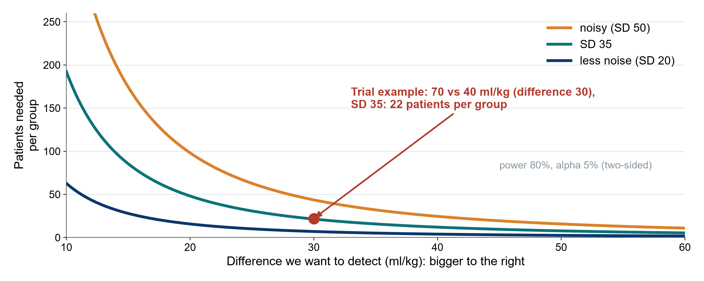{.neu-fig}

::: {.neu-takeaway}
**KEY MESSAGE** Sample size depends on the effect you hope to detect and on the noise.
:::

::: {.notes}
Fewer patients are needed when the difference is bigger and patients vary less.

Halve the difference: about four times the patients.

Paper 1: 70 vs 40 ml/kg, SD 35, 80% power: 22 per group, 50 in total with deaths.

The expected effect comes from earlier studies or the smallest difference that would change practice.
:::

## Live demo: an online sample-size calculator

::: {.neu-banner style="--c:#B5651D"}
LIVE DEMO · 5 min
:::

:::: {.columns}
::: {.column width="60%"}
::: {.neu-activity-steps style="--c:#B5651D"}
- Open a free online calculator (for example OpenEpi) on the shared screen
- Two means: 70 vs 40 ml/kg, SD (standard deviation) 35, power 80%, alpha 5%: 22 per group
- Two proportions: mortality 40% vs 30%: about 356 per group
- Change one input at a time. Predict the direction first (poll)
- Offline fallback: the Neudata sample-size spreadsheet
:::
:::
::: {.column width="40%"}
::: {.neu-side .plain style="--c:#B5651D"}
What changes n?

- Smaller effect: n goes up
- More noise (SD): n goes up
- More power: n goes up
- Add 10-20% for drop-outs
:::
:::
::::

::: {.neu-output style="--c:#B5651D"}
**OUTPUT** Everyone knows the 4 numbers needed for their own sample-size statement
:::

::: {.notes}
Live demo, 5 minutes. Script: s6\_demo.md, Part A.

Reproduce Paper 1 (70 vs 40, SD 35): 22 per group. Then mortality 40% vs 30%: about 356 per group.

Change one input at a time and poll the direction first.

Offline: the sample-size spreadsheet. Participants watch and predict, they do not calculate.
:::

## Choosing a test: one decision table

| Outcome | Shape or counts | Two independent groups | Same patients twice (paired) |
|:---|:---|:---|:---|
| A number (continuous) | Roughly symmetric | t-test | Paired t-test |
| A number (continuous) | Skewed, or small sample | Mann-Whitney U | Wilcoxon signed-rank |
| A category (yes/no) | Expected counts 5 or more | Chi-square | McNemar |
| A category (yes/no) | Small counts (under 5) | Fisher's exact | McNemar |

::: {.neu-table-caption}
Outcome type + shape + paired or not = the right test. Paper 1 (Boulet 2024) used Mann-Whitney because fluid balance was skewed.
:::

::: {.notes}
Two questions choose the test: number or category, then shape or counts. Paired data use the last column.

Paper 1 used Mann-Whitney because fluid balance is skewed.

Three or more groups: mention ANOVA or Kruskal-Wallis only.

Ask: AKI in 24 vs 24 patients, 3 and 7 events? Expected: Fisher's exact.
:::

## Paired or unpaired? Same patients or different patients

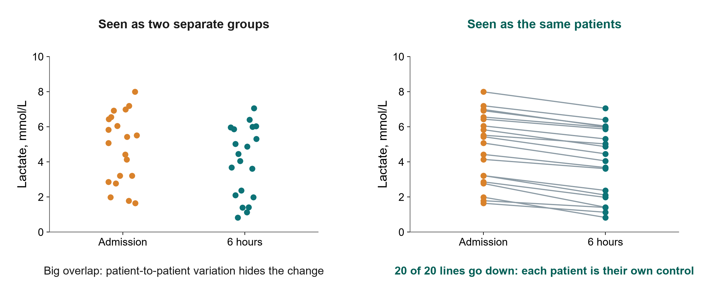{.neu-fig}

::: {.neu-takeaway}
**KEY MESSAGE** Same patients measured twice = paired test. Different patients = unpaired.
:::

::: {.notes}
Same 20 patients: as two clouds the change is hidden, joined as pairs every line goes down. Each patient is their own control.

Common mistake: an unpaired test on before/after data.

Ask: pain scores before and after a new protocol in 30 patients? Expected: paired.

Timing: 2 minutes.
:::

## Multiple comparisons: the jelly-bean problem

:::: {.columns}
::: {.column width="38%"}
::: {.neu-side-notes}
### What to do

- Pre-specify one primary outcome
- Label the rest as exploratory
- Adjust, e.g. Bonferroni: 0.05 / number of tests
- Report every test you ran
:::
:::
::: {.column width="62%"}
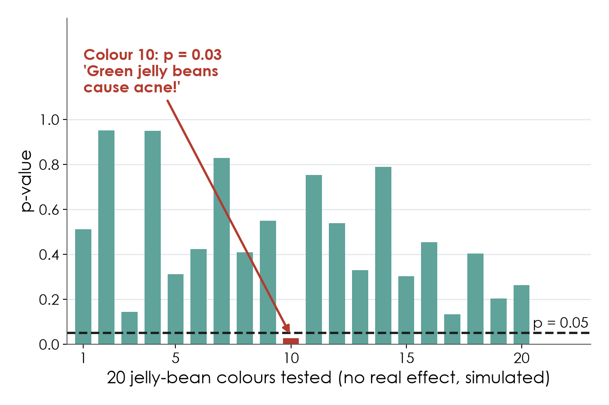{.neu-fig-side}
:::
::::

::: {.neu-takeaway}
**KEY MESSAGE** Test 20 things and one will be 'significant' by chance alone.
:::

::: {.notes}
Test 20 colours with no real effect and one comes out at p = 0.03. With 20 tests the chance of at least one false alarm is about 64%.

Remedies: one pre-specified primary outcome, the rest exploratory, Bonferroni if needed, report every test.

Ask: 12 subgroups, one with p = 0.04. Convinced? Expected: not very.

Timing: 2 minutes.
:::

## Check your understanding: which test?

::: {.neu-banner style="--c:#6C3483"}
QUICK QUIZ · 3 min
:::

:::: {.columns}
::: {.column width="60%"}
::: {.neu-activity-steps style="--c:#6C3483"}
- ICU stay (skewed) in positive vs negative fluid balance groups
- 28-day death (yes/no) in 300 vs 300 patients
- Lactate at admission and 6 h later in the same 40 patients
- Dialysis (yes/no): 2 of 24 vs 5 of 24 patients
:::
:::
::: {.column width="40%"}
::: {.neu-side .plain style="--c:#6C3483"}
Answers

- Mann-Whitney U
- Chi-square
- Paired t-test
- Fisher's exact
:::
:::
::::

::: {.neu-output style="--c:#6C3483"}
**OUTPUT** Everyone can use the decision table
:::

::: {.notes}
Check (3 minutes), one poll per scenario.

1 Mann-Whitney (skewed, this is Q5). 2 chi-square. 3 paired t-test. 4 Fisher's exact.

Next: these tests on FLUID-ICU.
:::

## 6.2 Compare groups in the course dataset

:::: {.neu-statement}
::: {.neu-big}
Choose the test from the outcome, then read the result as an effect with a CI.
:::

::: {.neu-sub}
6.2 Compare groups in the course dataset  \|  20 minutes
:::
::::

::: {.notes}
Section 6.2 (20:20-20:40).

The decision table applied to FLUID-ICU. All comparisons are unadjusted: the positive-balance group was sicker (Table 1).
:::

## Live demo: comparing two groups in R

::: {.neu-banner style="--c:#B5651D"}
LIVE DEMO · 6 min
:::

:::: {.columns}
::: {.column width="60%"}
::: {.neu-activity-steps style="--c:#B5651D"}
- Open 03\_compare.R
- Age (symmetric): t-test
- SOFA and lactate (skewed): Mann-Whitney
- 28-day death (yes/no): 2x2 table and chi-square
- The common mistake: a t-test on skewed ICU stay
:::
:::
::: {.column width="40%"}
::: {.neu-side .plain style="--c:#B5651D"}
Decision table

- Number or category?
- Symmetric or skewed?
- Paired or not?
- Effect + 95% CI
:::
:::
::::

::: {.neu-output style="--c:#B5651D"}
**OUTPUT** Everyone has seen the test chosen from the outcome type
:::

::: {.notes}
Live demo, 6 minutes. Script: s6\_demo.md, Part B (03\_compare.R).

Call on someone to name the test before each run.

Show death as a 2x2 table: 134/373 (35.9%) vs 45/245 (18.4%). End with the wrong t-test on skewed ICU stay.

If R fails, use the next slide.
:::

## FLUID-ICU: four outcomes, four comparisons

| Outcome (type) | Negative balance (n = 245) | Positive balance (n = 373) | Test | Result |
|:---|:---|:---|:---|:---|
| 28-day death (yes/no) | 45 (18.4%) | 134 (35.9%) | Chi-square | Risk difference 17.6 points (95% CI 10.7 to 24.4), p \< 0.001 |
| Acute kidney injury (yes/no) | 71 (29.0%) | 230 (61.7%) | Chi-square | p \< 0.001 |
| Ventilator-free days (0-28, skewed) | Median 28 (22 to 28) | Median 20 (0 to 28) | Mann-Whitney | p \< 0.001 |
| ICU stay in survivors (days, skewed) | 4.8 (3.3 to 7.1), n = 200 | 7.5 (5.2 to 11.2), n = 239 | Mann-Whitney | Difference 2.5 days (95% CI 1.8 to 3.2), p \< 0.001 |

::: {.neu-table-caption}
n (%) or median (IQR). Unadjusted comparisons, simulated data (key\_results.md). Every outcome is worse in the positive-balance group, before any adjustment.
:::

::: {.notes}
One test per outcome type, each result read as an effect.

Death (Q1): risk difference 17.6 points (10.7 to 24.4). AKI (Q2): 61.7% vs 29.0%. Ventilator-free days (Q3): median 20 vs 28. ICU stay in survivors (Q5): difference 2.5 days (1.8 to 3.2).

All unadjusted: they mix fluid and severity.

Ask: which number goes in an abstract? Expected: the effect with its CI.
:::

## Worked example: reading the mortality comparison

::: {.neu-intro}
Question 1 (Q1), unadjusted: positive vs negative fluid balance by day 3.
:::

:::: {.neu-steps}
::: {.neu-step style="--c:#0D7377"}
[Risks]{.neu-step-label}

- Positive: 134/373 = 35.9%
- Negative: 45/245 = 18.4%
:::
::: {.neu-step style="--c:#0B376C"}
[Difference]{.neu-step-label}

- 17.6 percentage points
- 95% CI 10.7 to 24.4
:::
::: {.neu-step style="--c:#5FA39B"}
[Ratio]{.neu-step-label}

- Risk ratio (RR) 1.96
- About twice the risk
:::
::: {.neu-step style="--c:#0070C0"}
[Test]{.neu-step-label}

- Chi-square, p \< 0.001
:::
::: {.neu-step style="--c:#055F56"}
[But...]{.neu-step-label}

- Unadjusted: the positive group was sicker
:::
::::

::: {.neu-takeaway}
**KEY MESSAGE** Report the effect and its CI. Then ask what else could explain it.
:::

::: {.notes}
Worked example (3 minutes): the Session 4 2x2 table on the dataset.

35.9% vs 18.4%: difference 17.6 points (10.7 to 24.4), RR 1.96, p \< 0.001.

But the positive group was sicker: the crude comparison cannot separate fluid from severity.

Model Results sentence: 'Twenty-eight-day mortality was 35.9% with a positive and 18.4% with a negative balance (risk difference 17.6 percentage points, 95% CI 10.7 to 24.4).'
:::

## Interpret the comparisons together

::: {.neu-banner style="--c:#0D7377"}
WHOLE-CLASS TASK · 7 min
:::

:::: {.columns}
::: {.column width="60%"}
::: {.neu-activity-steps style="--c:#0D7377"}
- Q1 in full: 28-day death in the comparison table of the Q1 results pack (PDF)
- Poll: which test was used, and why that test?
- Question for the class: say the result as an effect with its 95% CI. The instructor builds one Results sentence
- Question for the class: one reason the comparison could be biased
- Q2 to Q5: the instructor reads each result in one sentence
:::
:::
::: {.column width="40%"}
::: {.neu-side .plain style="--c:#0D7377"}
Avoid

- p-value alone
- 'proves', 'causes'
- 'trend' for p \> 0.05
- Forgetting the n
:::
:::
::::

::: {.neu-output style="--c:#0D7377"}
**OUTPUT** One Results sentence for Q1, one line each for Q2 to Q5 (Exercise 4)
:::

::: {.notes}
Whole class, 7 minutes (20:33-20:40). Exercise 4. Answers: s6\_solutions.md.

Q1 (4 min): poll the test (chi-square), build one Results sentence with the CI, then ask for a bias: confounding by indication.

Q2 to Q5 (3 min): read one sentence each from the solutions.

Participants later redo it for the question they choose. Then break.
:::

---

::: {style="text-align:center"}
{width="32%"}

[Break]{style="color:#0D7377;font-size:1.6em;font-weight:700"}

[15 min]{style="color:#595959;font-size:0.9em"}
:::

::: {.notes}
Break (20:40-20:55). Say: we restart at 20:55 with 6.3.

Open 04\_models.R and 05\_missing.R. Collect chat questions about the comparisons and answer them at the start of 6.3.
:::

## 6.3 Relationships and models (concepts)

:::: {.neu-statement}
::: {.neu-big}
You do not need to run a model to read one.
:::

::: {.neu-sub}
6.3 Relationships and models  \|  35 minutes
:::
::::

::: {.notes}
Section 6.3 (20:55-21:30).

Every model answers one question: how is the outcome related to the exposure, and how sure are we? Read four things: the outcome, the model, the number, the 'no effect' value.

Models are a main tool against measured confounding (Session 4).
:::

## Correlation: how closely two numbers move together

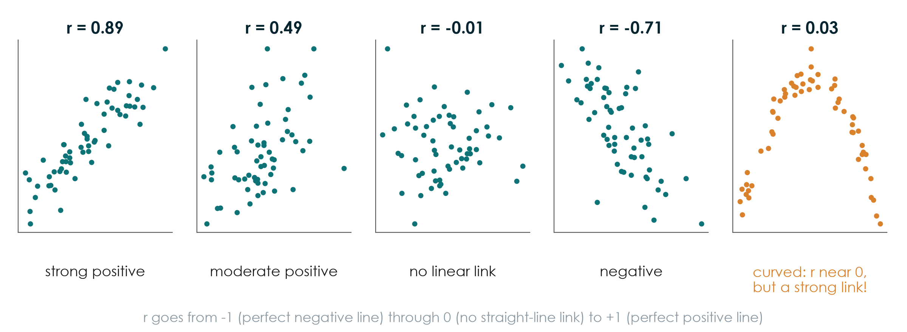{.neu-fig}

::: {.neu-takeaway}
**KEY MESSAGE** r measures straight-line association, from -1 to +1. Always look at the plot.
:::

::: {.notes}
r summarises a scatter plot in one number, from -1 to +1.

The last panel is the trap: r near 0 but a strong curve. Always look at the plot.

With many patients a tiny r can be 'significant' and useless.

Timing: 2 minutes.
:::

## Linear regression: the best straight line

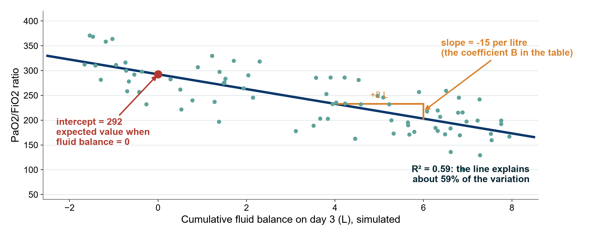{.neu-fig}

::: {.neu-takeaway}
**KEY MESSAGE** Slope = change in the outcome per unit of exposure. R² = how much the line explains.
:::

::: {.notes}
Linear regression: the best straight line for a numerical outcome. Slope = change per unit of exposure, null 0. R² = how much the line explains.

Adding variables gives 'adjusted' slopes.

Ask: B = -15 (-19 to -11)? Expected: each extra litre goes with a P/F ratio about 15 lower.

Timing: 2 minutes.
:::

## Logistic regression: an S-curve for yes/no outcomes

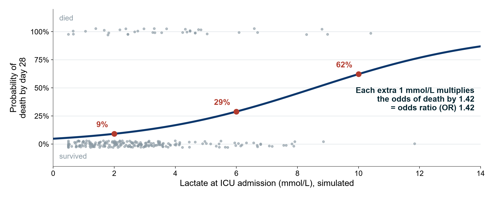{.neu-fig}

::: {.neu-takeaway}
**KEY MESSAGE** Logistic regression turns a yes/no outcome into an odds ratio per unit of exposure.
:::

::: {.notes}
For yes/no outcomes the curve is an S. The model reports an OR per unit (here 1.42 per mmol/L lactate). Null 1.

Common mistake: 'OR 1.42 means 42% more deaths'. It is 42% higher odds.

Ask: what if lactate had no effect? Expected: a flat line, OR 1.

Timing: 2 minutes.
:::

## Which model? It depends on the outcome

| Your outcome is... | Model | The paper reports | 'No effect' value |
|:---|:---|:---|:---|
| A number, e.g. fluid balance (ml/kg) | Linear regression | Coefficient (B): a difference | 0 |
| Yes / no, e.g. died by day 28 | Logistic regression | Odds ratio (OR) | 1 |
| Time to event, e.g. time to death | Cox regression | Hazard ratio (HR) | 1 |

::: {.neu-table-caption}
The outcome type tells you the model and the number to read.
:::

::: {.notes}
The outcome decides the model: number, linear (difference, null 0). Yes/no, logistic (OR, null 1). Time to event, Cox (HR, null 1).

Common mistake: looking for 0 in an OR table.

Ask: length of stay as a number? Expected: linear, null 0.
:::

## What 'adjusted' means: compare like with like

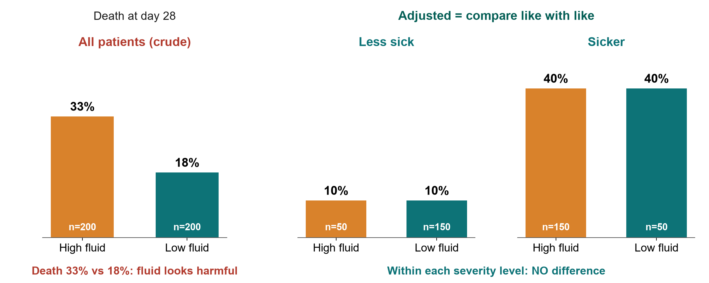{.neu-fig}

::: {.neu-caption}
Simulated numbers
:::

::: {.neu-takeaway}
**KEY MESSAGE** Adjusting = comparing patients who are alike on the confounders.
:::

::: {.notes}
Crude: more fluid, more deaths (33% vs 18%). Split by severity: no difference in either stratum.

Severity drove both: confounding by indication. A model does this split for many confounders at once.

Only measured confounders can be adjusted for. Only randomisation handles the rest.
:::

## Reading a regression table, row by row

| Variable | Adjusted OR | 95% CI | p-value | Does the CI include 1? |
|:---|:---|:---|:---|:---|
| Positive fluid balance (yes vs no) | 1.80 | 1.20 to 2.70 | 0.004 | No |
| Age (per 10 years) | 1.25 | 1.10 to 1.42 | \< 0.001 | No |
| SOFA score (per 1 point) | 1.15 | 1.08 to 1.23 | \< 0.001 | No |
| Female (vs male) | 0.92 | 0.65 to 1.30 | 0.64 | Yes: compatible with no effect |
| Lactate (per 1 mmol/L) | 1.10 | 0.98 to 1.24 | 0.11 | Yes: compatible with no effect |

::: {.neu-table-caption}
Outcome: death by day 28. Multivariable logistic regression, mock data. The rows below row 1 are the confounders the authors 'adjusted for'. Read each row: comparison, effect, 95% CI, does the CI include 1?
:::

::: {.notes}
Read each row in four steps: the comparison (reference and unit), the effect, the CI, does the CI include 1?

OR 1.80 (1.20 to 2.70): 1.8 times the odds, adjusted.

Sex and lactate rows include 1: compatible with no association.

Mock data. Say 'associated', and 'odds', not 'risk'.
:::

## Check your understanding: read the regression table

::: {.neu-banner style="--c:#6C3483"}
QUICK QUIZ · 4 min
:::

:::: {.columns}
::: {.column width="60%"}
::: {.neu-activity-steps style="--c:#6C3483"}
- Use the table on the previous slide ('Reading a regression table')
- Poll: for female sex, does the 95% CI include 1? What does that mean?
- Poll: what does 'OR 1.15 per SOFA point' mean?
- Question for the class: one plain-language sentence for positive fluid balance
- Extra practice at home: Exercises 5 and 6 of the exercise sheet
:::
:::
::: {.column width="40%"}
::: {.neu-side .plain style="--c:#6C3483"}
The 4-step reading

- What is compared?
- How big is the effect?
- How wide is the CI?
- Does it cross 1 (or 0)?
:::
:::
::::

::: {.neu-output style="--c:#6C3483"}
**OUTPUT** One correct plain-language sentence, agreed by the class
:::

::: {.notes}
Check (4 minutes), using the previous table.

Poll 1: yes, compatible with no association. Poll 2: odds multiplied by 1.15 per SOFA point ('15% more deaths' is the classic wrong answer).

Model sentence: 'After adjustment, patients with a positive balance had about 1.8 times the odds of death by day 28 (OR 1.80, 95% CI 1.20 to 2.70).'

Exercises 5 and 6 are homework.
:::

## Overfitting: too many variables for too few events

:::: {.columns}
::: {.column width="38%"}
::: {.neu-side-notes}
### Why stepwise misleads

- Picks variables by p-value
- Finds chance 'predictors'
- Effects too big, CIs too narrow
- Better: choose confounders in advance
:::
:::
::: {.column width="62%"}
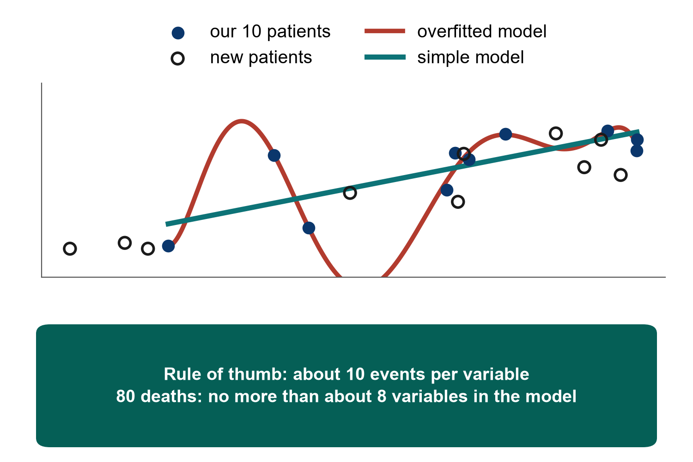{.neu-fig-side}
:::
::::

::: {.neu-takeaway}
**KEY MESSAGE** Plan about 10 events per variable and choose variables by knowledge, not p-values.
:::

::: {.notes}
Too many variables for too few events: the model learns the noise and fails on new patients.

Rule of thumb: about 10 events per variable. Stepwise selection keeps chance findings.

Choose confounders in advance and write them in the SAP.

Timing: 2 minutes.
:::

## Survival analysis starts with censoring

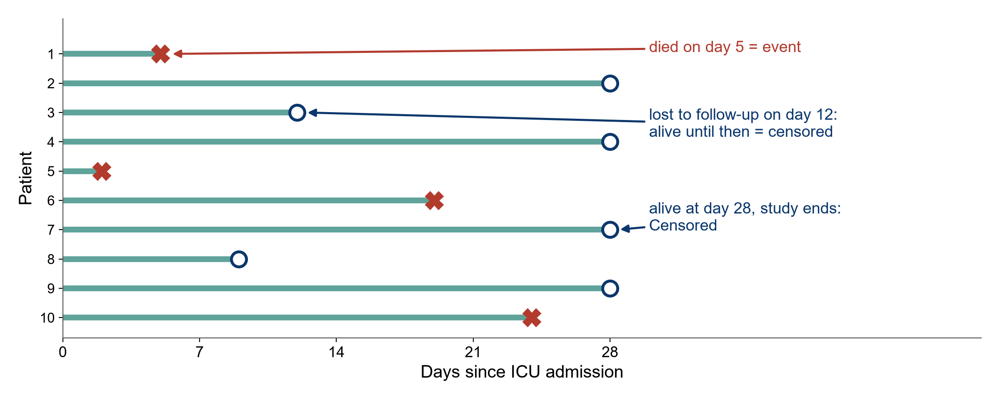{.neu-fig}

::: {.neu-takeaway}
**KEY MESSAGE** Censored patients still count: they tell us they survived up to that day.
:::

::: {.notes}
A circle is a censored patient: followed until then, without the event. Censored is not excluded: they still tell us they were alive up to that day.

Ask: discharged home on day 9, never contacted again? Expected: censored at day 9.

Timing: 2 minutes.
:::

## How to read a Kaplan-Meier curve

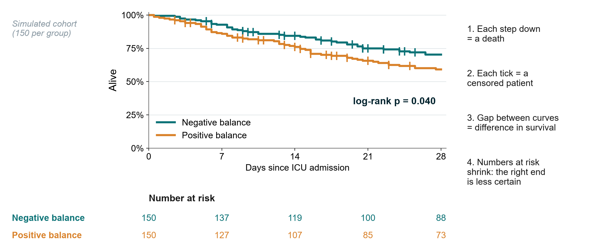{.neu-fig}

::: {.neu-takeaway}
**KEY MESSAGE** Read the steps, the ticks, the gap, and always the numbers at risk.
:::

::: {.notes}
Four reading steps: steps down are deaths, ticks are censored patients, the gap is the difference, and the numbers at risk show how certain the right end is.

The log-rank test gives a p-value, not the size of the effect (Cox, 6.4).

Ask: curves cross half-way? Expected: the effect changes over time.

Timing: 3 minutes.
:::

## 6.4 Model the course dataset

:::: {.neu-statement}
::: {.neu-big}
Adjust for what you planned, read the CI, and be honest about the gaps.
:::

::: {.neu-sub}
6.4 Model the course dataset  \|  25 minutes
:::
::::

::: {.notes}
Section 6.4 (21:30-21:55): the models applied to FLUID-ICU. You will see confounding by indication shrink an odds ratio.
:::

## The SAP came first

::: {.neu-intro}
The statistical analysis plan (SAP) was signed before the database was locked.
:::

:::: {.neu-steps}
::: {.neu-step style="--c:#0D7377"}
[Primary]{.neu-step-label}

- 28-day death
- Logistic regression, odds ratio (OR)
:::
::: {.neu-step style="--c:#0B376C"}
[Confounders]{.neu-step-label}

- Age, SOFA, lactate
- Vasopressor, ventilation
- Chronic kidney disease (CKD)
:::
::: {.neu-step style="--c:#5FA39B"}
[Supportive]{.neu-step-label}

- Kaplan-Meier and log-rank test
- Cox hazard ratio (HR)
:::
::: {.neu-step style="--c:#0070C0"}
[Subgroup]{.neu-step-label}

- One pre-specified: heart failure
:::
::: {.neu-step style="--c:#055F56"}
[Missing data]{.neu-step-label}

- Complete-case analysis
- Multiple imputation
:::
::::

::: {.neu-takeaway}
**KEY MESSAGE** Everything on the next slides was decided before anyone saw the results.
:::

::: {.notes}
Show the SAP on screen (SAP\_FLUID-ICU.md). Primary: logistic regression for 28-day death. Confounders chosen in advance. Kaplan-Meier and Cox as support. One subgroup. Complete case plus multiple imputation.

AKI and dialysis are not adjusted for: they come after the fluid.

Ask: why write this first? Expected: no one can say you chose the analysis with the best p-value.
:::

## Confounding by indication, made visible

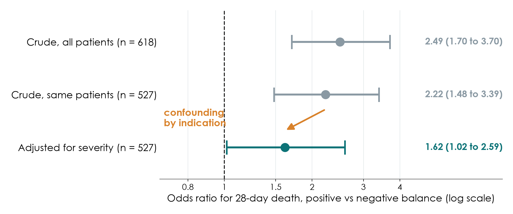{.neu-fig}

::: {.neu-takeaway}
**KEY MESSAGE** Crude OR 2.49 shrinks to 1.62 after adjusting for severity: still above 1.
:::

::: {.notes}
The key picture of the dataset (4 minutes).

Crude OR 2.49 (1.70 to 3.70). Crude in the same 527 complete cases 2.22. Adjusted 1.62 (1.02 to 2.59), p = 0.044.

It shrank because sicker patients got more fluid and died more. What remains is modest and imprecise, and still an association.

Ask: adjust for AKI too? Expected: no, it comes after the fluid.
:::

## The adjusted model, as a forest plot

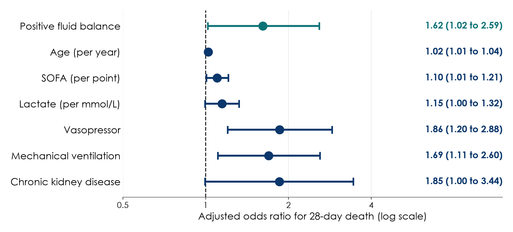{.neu-fig}

::: {.neu-takeaway}
**KEY MESSAGE** Read each row: comparison, OR, 95% CI, does it cross 1?
:::

::: {.notes}
The Q1 model as a forest plot (n = 527). Positive balance: OR 1.62 (1.02 to 2.59).

The other rows are confounders: they are there to adjust, not to interpret.

Ask: which row goes in your abstract? Expected: only the exposure row, with its CI.
:::

## Kaplan-Meier: survival to day 28 by fluid balance

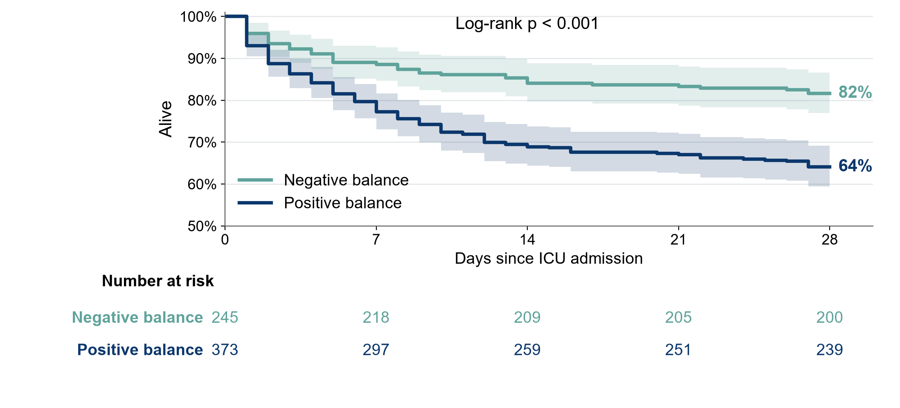{.neu-fig}

::: {.neu-takeaway}
**KEY MESSAGE** Day-28 survival 81.6% vs 64.1%, log-rank p \< 0.001: unadjusted.
:::

::: {.notes}
Read the real curve with the four steps. Most deaths are in the first week.

Day-28 survival 81.6% vs 64.1%, log-rank p \< 0.001, but unadjusted.

Ask: is the gap larger early or late? Expected: it opens early, then the curves run roughly parallel.
:::

## Cox model: the same story in hazard ratios

::: {.neu-intro}
Q1 supportive analysis (04\_models.R). HR = hazard ratio. OR = odds ratio.
:::

:::: {.neu-cards style="--n:4"}
::: {.neu-card .plain style="--c:#0D7377"}
[Crude HR]{.neu-card-title}

- 2.17
- 95% CI 1.55 to 3.05
:::
::: {.neu-card .plain style="--c:#0B376C"}
[Adjusted HR]{.neu-card-title}

- 1.46
- 95% CI 1.00 to 2.13
- p = 0.053
:::
::: {.neu-card .plain style="--c:#5FA39B"}
[Assumption]{.neu-card-title}

- Proportional hazards: global test p = 0.10
- Acceptable
:::
::: {.neu-card .plain style="--c:#0070C0"}
[Compare]{.neu-card-title}

- Adjusted OR 1.62, p = 0.044
- Adjusted HR 1.46, p = 0.053
- Same direction and size
:::
::::

::: {.neu-takeaway}
**KEY MESSAGE** p = 0.044 and p = 0.053 tell the same story: read the estimates and CIs.
:::

::: {.notes}
Cox adjusted HR 1.46 (1.00 to 2.13), p = 0.053. Proportional hazards acceptable (p = 0.10).

The lesson: OR p = 0.044 and HR p = 0.053 tell the same story. Never let 0.05 decide what you believe.

Ask: how would you write this in the Results? Expected: both estimates with their CIs.
:::

## RR, OR and HR: what each means and when you meet it

::: {.neu-intro}
All three compare two groups. 1 = no difference. Above 1: more events. Below 1: fewer.
:::

:::: {.neu-cards style="--n:3"}
::: {.neu-card .plain style="--c:#0D7377"}
[Risk ratio (RR)]{.neu-card-title}

- Risk in one group / risk in the other
- Trials and cohorts, from a 2x2 table
- Session 4
:::
::: {.neu-card .plain style="--c:#0070C0"}
[Odds ratio (OR)]{.neu-card-title}

- Odds in one group / odds in the other
- Case-control studies and logistic regression
- Close to the RR when the outcome is rare
:::
::: {.neu-card .plain style="--c:#0B376C"}
[Hazard ratio (HR)]{.neu-card-title}

- Event rate over time, one group vs the other
- Time to event: Kaplan-Meier and Cox regression
- Session 6
:::
::::

::: {.neu-takeaway}
**KEY MESSAGE** The outcome and the design decide the ratio: risk (RR), odds (OR) or rate over time (HR).
:::

::: {.notes}
RR: risks, from a 2x2 table (trials, cohorts). OR: odds, from case-control studies and logistic regression, close to the RR only when the outcome is rare. HR: event rates over time, from Cox.

Ask: Paper 2 compared deaths over time. Which ratio? Expected: HR.

Timing: 2 minutes.
:::

## Why is it missing? MCAR, MAR and MNAR

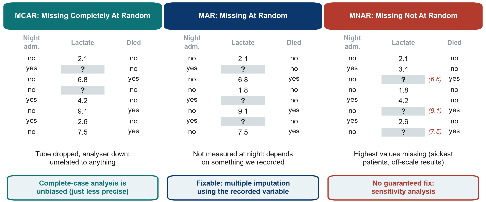{.neu-fig}

::: {.neu-takeaway}
**KEY MESSAGE** The reason data are missing decides how dangerous the gaps are.
:::

::: {.notes}
Three mechanisms on the same 8 patients. MCAR: unrelated to the patient. MAR: depends on something recorded, imputation can help. MNAR: depends on the missing value itself, no method fully fixes it.

The data cannot prove which applies: write down why values are missing.

Timing: 2 minutes.
:::

## Who is missing lactate? Not a random 15%

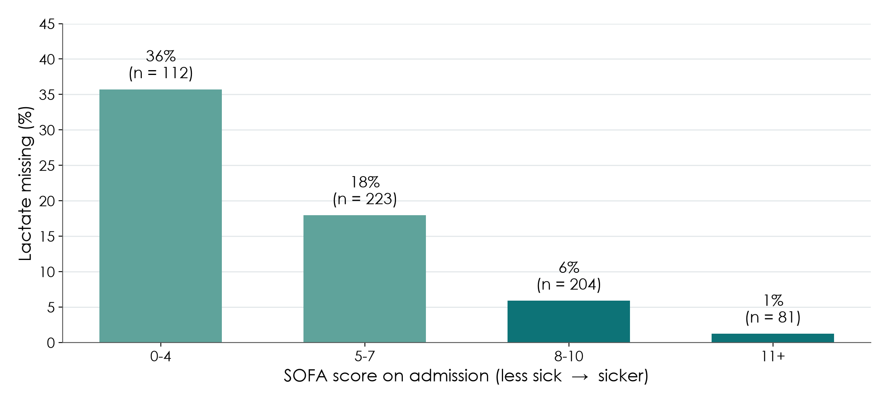{.neu-fig}

::: {.neu-takeaway}
**KEY MESSAGE** Lactate was missing mostly in less sick patients: not MCAR, but MAR is plausible.
:::

::: {.notes}
Lactate missing in 93 of 620 (15.0%), mostly in less sick patients (median SOFA 5 vs 8, mortality 19.4% vs 30.6%).

So not MCAR: complete cases drop the less sick. MAR is plausible, which suits multiple imputation.

Ask: why would lactate not be measured in the less sick?
:::

## Complete case vs multiple imputation (Q4)

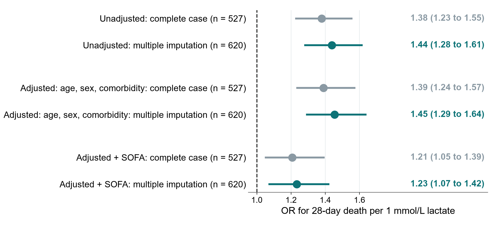{.neu-fig}

::: {.neu-takeaway}
**KEY MESSAGE** Multiple imputation keeps all 620 patients. The answer changes only modestly.
:::

::: {.notes}
The sensitivity analysis from the SAP.

Q4: OR per mmol/L 1.39 (complete case, n = 527) vs 1.45 (imputation, n = 620).

Q1: adjusted OR 1.70 (1.09 to 2.64) with imputation vs 1.62 in complete cases.

The conclusion does not depend on how missing lactate was handled.

Ask: how would you report this? Expected: both estimates, and that they were similar.
:::

## Interpret the models together

::: {.neu-banner style="--c:#0D7377"}
WHOLE-CLASS TASK · 7 min
:::

:::: {.columns}
::: {.column width="60%"}
::: {.neu-activity-steps style="--c:#0D7377"}
- Q1 in full: crude and adjusted OR in the model table of the Q1 results pack (PDF)
- Question for the class: how much did adjustment change the estimate, and why?
- Poll: does the adjusted 95% CI include 1?
- Together we write two Results sentences: crude, then adjusted, with CIs
- Q2 to Q5: crude and adjusted estimates read in one line each
:::
:::
::: {.column width="40%"}
::: {.neu-side .plain style="--c:#0D7377"}
Words to use

- 'associated with'
- 'after adjustment for'
- '95% CI'
- not 'caused'
:::
:::
::::

::: {.neu-output style="--c:#0D7377"}
**OUTPUT** Two Results sentences for Q1, one line each for Q2 to Q5 (Exercise 8)
:::

::: {.notes}
Whole class, 7 minutes (21:48-21:55). Exercise 8. Answers: s6\_solutions.md.

Q1 (4 min): crude 2.49, adjusted 1.62. Ask why it shrank. Type two Results sentences, crude then adjusted, with CIs.

Q2 to Q5 (3 min): read one line each from the solutions.

Pattern: every adjusted estimate is closer to no effect. These sentences are the core of each participant's Results section.
:::

## Proposal builder 6: what a good one contains

::: {.neu-intro}
Modelled on the running example (a restrictive fluids trial).
:::

:::: {.neu-cards style="--n:4"}
::: {.neu-card .plain style="--c:#0D7377"}
[Sample size]{.neu-card-title}

- Mortality 40% vs 30%
- Power 80%, alpha 5% two-sided
- 356 per group, plus 10%
:::
::: {.neu-card .plain style="--c:#0B376C"}
[Analysis plan]{.neu-card-title}

- Describe: n (%), median (IQR)
- Compare: chi-square
- Report: RR with 95% CI
:::
::: {.neu-card .plain style="--c:#5FA39B"}
[Confounders]{.neu-card-title}

- Chosen in advance
- About 10 events per variable
:::
::: {.neu-card .plain style="--c:#0070C0"}
[Missing data]{.neu-card-title}

- Expected gaps and why
- Prevention
- How it will be reported
:::
::::

::: {.neu-takeaway}
**KEY MESSAGE** Today: how many patients, which analysis, and what if data are missing.
:::

::: {.notes}
Show for 1 minute before modelling.

Sample size in one sentence with its four inputs and the drop-out allowance (356 per group, 396 with 10% loss).

Analysis plan in plain words, confounders in advance, a missing-data plan.

Each participant writes this for their own proposal.
:::

## Proposal builder 6: sample size and analysis plan

::: {.neu-banner style="--c:#055F56"}
PROPOSAL BUILDER · 30 min
:::

:::: {.columns}
::: {.column width="60%"}
::: {.neu-activity-steps style="--c:#055F56"}
- The instructor models each part live on the running example (18 min)
- Sample size, analysis plan, confounders, missing-data plan
- Then draft your own sample-size inputs in your proposal template (10 min, on your own)
- Questions (2 min): raise your hand or use the chat. The other parts are homework
:::
:::
::: {.column width="40%"}
::: {.neu-side .plain style="--c:#055F56"}
Use these tools

- Sample-size spreadsheet
- Test decision table (6.1)
- FLUID-ICU SAP as a model
- Exercise sheet: Exercise 9
:::
:::
::::

::: {.neu-output style="--c:#055F56"}
**OUTPUT** Your own proposal, Part 3 completed: sample size started now, the rest as homework
:::

::: {.notes}
Proposal builder 6, 30 minutes (21:55-22:25). Template: Research\_Proposal\_Template.docx. Worksheet: Exercise 9.

Model live (18 min): sample size, analysis plan, confounders, missing-data plan. Then 10 minutes on their own sample-size inputs, 2 minutes for questions.

Watch for: 'SPSS will be used' as a plan, stepwise selection, no word on missing data.
:::

## Key words of the day

::: {.neu-intro}
Twelve words you should now be able to explain to a colleague.
:::

:::: {.neu-cards style="--n:4"}
::: {.neu-card .plain style="--c:#0D7377"}
[Uncertainty]{.neu-card-title}

- 95% CI
- p-value (two-sided)
- Power
:::
::: {.neu-card .plain style="--c:#0B376C"}
[Comparing]{.neu-card-title}

- t-test / Mann-Whitney
- Chi-square
- Paired
:::
::: {.neu-card .plain style="--c:#5FA39B"}
[Models]{.neu-card-title}

- Adjusted OR
- Hazard ratio
- Censoring
:::
::: {.neu-card .plain style="--c:#0070C0"}
[Honesty]{.neu-card-title}

- SAP
- MCAR / MAR / MNAR
- Multiple imputation
:::
::::

::: {.neu-takeaway}
**KEY MESSAGE** If one word is unclear, ask now or look it up in the glossary.
:::

::: {.notes}
Key words (2 minutes). Point to a word and call on someone for a one-line definition.

All terms are in the English-Vietnamese glossary.
:::

## Session 6 recap

::: {.neu-intro}
Three messages to take home.
:::

:::: {.neu-cards style="--n:3"}
::: {.neu-card .plain style="--c:#0D7377"}
[Read the CI]{.neu-card-title}

- Effect + 95% CI
- Where is the null?
- p is a supporting actor
:::
::: {.neu-card .plain style="--c:#0B376C"}
[Adjust honestly]{.neu-card-title}

- Crude vs adjusted
- Confounders chosen in advance
:::
::: {.neu-card .plain style="--c:#5FA39B"}
[Plan first]{.neu-card-title}

- SAP before the data
- Two-sided tests
- Missing data: report, handle, test
:::
::::

::: {.neu-takeaway}
**KEY MESSAGE** A good analysis is planned before, adjusted honestly and read through its CI.
:::

::: {.notes}
Recap (1 minute). Ask volunteers for one example per card.

Next Saturday: ethics, integrity, Methods and Results (the Results written live on Q1).
:::

## Your second product: the Results section

::: {.neu-intro}
Choose one FLUID-ICU question (Q1 to Q5) tonight. The manuscript brief arrives by email.
:::

:::: {.neu-cards style="--n:3"}
::: {.neu-card .plain style="--c:#0D7377"}
[Required]{.neu-card-title}

- The Results section for your question
- A working title
- Table 1 and one main table or figure
:::
::: {.neu-card .plain style="--c:#0B376C"}
[Optional to submit]{.neu-card-title}

- Methods, Introduction
- Discussion, Abstract
- All taught in Sessions 7 and 8
:::
::: {.neu-card .plain style="--c:#5FA39B"}
[When]{.neu-card-title}

- Session 7: Results written live on Q1
- Session 8: improve your draft
- Due 23:59, Sunday 20 December
:::
::::

::: {.neu-takeaway}
**KEY MESSAGE** Tell the course lead your question tonight, in the chat or by email.
:::

::: {.notes}
Product 2 (2 minutes). Say it plainly: we give you the results, you write a submission-ready Results section. The other sections are all taught in Sessions 7 and 8. Submitting them is optional, and we give feedback on them too.

Ask everyone to post their question (Q1 to Q5) in the chat. Q1 is the easiest start because it is modelled live next Saturday.

After the session, email the manuscript brief (Manuscript\_Brief.pdf) and the manuscript template.
:::

## Wrap-up and homework

::: {.neu-banner style="--c:#1F5C7A"}
DISCUSSION · 5 min
:::

:::: {.columns}
::: {.column width="60%"}
::: {.neu-activity-steps style="--c:#1F5C7A"}
- Key words, recap and your Results section (previous slides)
- Exit question in the chat: in one sentence, what does '95% CI 1.48 to 3.06' tell you?
- Homework: finish Part 3 of your own proposal. Start your proposal slides (everyone submits them)
- Choose your FLUID-ICU question tonight and read its results pack
:::
:::
::: {.column width="40%"}
::: {.neu-side .plain style="--c:#1F5C7A"}
Weeks 7-8

- Protocol, ethics, registration
- Research integrity
- Writing every section of a paper
- Getting published
- Volunteer presentations
:::
:::
::::

::: {.neu-output style="--c:#1F5C7A"}
**OUTPUT** Exit answer in the chat. Part 3 complete
:::

::: {.notes}
Wrap-up (22:25-22:30).

Exit question: what does '95% CI 1.48 to 3.06' tell you? Good answer: the true HR is plausibly 1.48 to 3.06, all above 1. Open Session 7 with two or three answers.

Homework: Part 3 of the proposal, start the 6 slides, choose a question and read its results pack.

After the session: email the manuscript brief to everyone.
:::

## Extra slides: Session 6

:::: {.neu-statement}
::: {.neu-big}
Extra slides: use if time allows, or for self-study.
:::

::: {.neu-sub}
Interaction, null values, prediction and machine learning, missing-data details
:::
::::

::: {.notes}
Extra slides: optional, for a fast class or self-study.
:::

## Extra: the pre-specified interaction with heart failure (Q1)

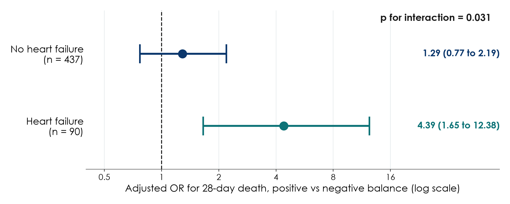{.neu-fig}

::: {.neu-takeaway}
**KEY MESSAGE** Stronger association in heart failure (p for interaction 0.031): needs confirmation.
:::

::: {.notes}
Extra. The one pre-specified effect modifier: heart failure (n = 90) OR 4.39 (1.65 to 12.38) vs 1.29 without, p for interaction 0.031.

Plausible, but small and imprecise: report it as exploratory.
:::

## Extra: AKI rises with fluid balance (Q2)

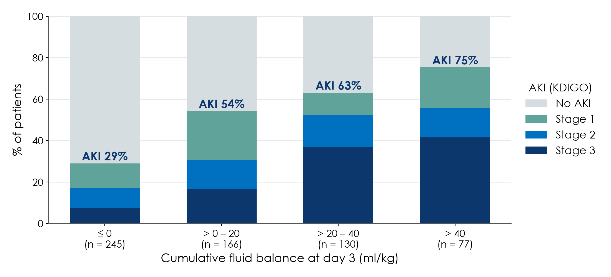{.neu-fig}

::: {.neu-takeaway}
**KEY MESSAGE** A dose-response gradient: 29%, 54%, 63%, 75% AKI across balance groups.
:::

::: {.notes}
Extra, Q2. AKI rises across balance groups: 29%, 54%, 63%, 75%. Adjusted OR 1.27 (1.16 to 1.40) per 10 ml/kg.

Caution: AKI can also cause a positive balance (reverse causation).
:::

## Extra: ventilator-free days, a tricky outcome (Q3)

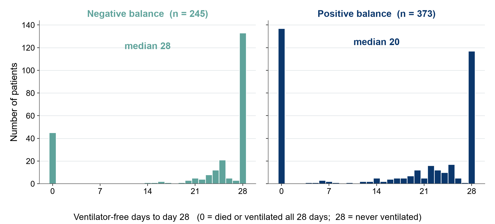{.neu-fig}

::: {.neu-takeaway}
**KEY MESSAGE** Piled up at 0 and 28: report medians and use non-parametric tests.
:::

::: {.notes}
Extra, Q3. Ventilator-free days pile up at 0 (death) and 28: report medians, use non-parametric tests.

Adjusted -0.61 days (-1.00 to -0.21) per 10 ml/kg.
:::

## Extra: Sample and population

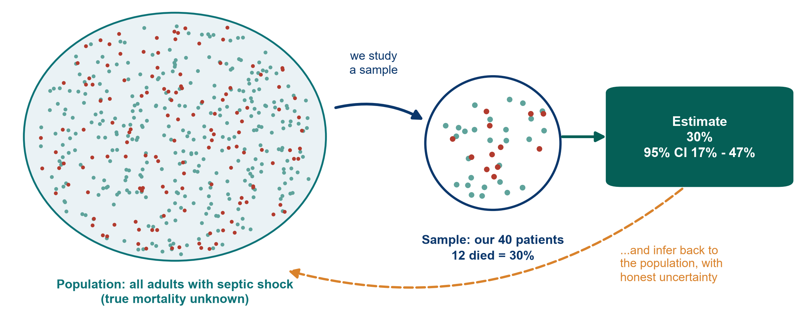{.neu-fig}

::: {.neu-takeaway}
**KEY MESSAGE** A sample gives an estimate. The CI says how precise it is.
:::

::: {.notes}
Extra. The sample is the patients we study, the population everyone we want to learn about. 12 of 40 died: 30% (95% CI 17% to 47%).

Ask: 400 patients instead of 40? Expected: a narrower interval.
:::

## Extra: Reading a 95% CI in a real paper

::: {.neu-intro}
Paper 1 (Boulet 2024, pilot RCT), primary outcome: cumulative fluid balance at day 5.
:::

:::: {.neu-cards style="--n:3"}
::: {.neu-card .plain style="--c:#0D7377"}
[The result]{.neu-card-title}

- Median 6.9 vs 35.0 ml/kg
- Mean difference 13.2 ml/kg
- 95% CI -15.2 to 41.6
- p = 0.42
:::
::: {.neu-card .plain style="--c:#0B376C"}
[Where is 0?]{.neu-card-title}

- 0 = no difference
- The CI includes 0
- So 'no difference' is compatible with the data
:::
::: {.neu-card .plain style="--c:#5FA39B"}
[How wide?]{.neu-card-title}

- From 15 ml/kg in one direction to 42 ml/kg in the other
- Very imprecise: only 48 patients
:::
::::

::: {.neu-takeaway}
**KEY MESSAGE** 'Not significant' with a wide CI means 'we do not know', not 'no effect'.
:::

::: {.notes}
Extra. Read every CI in three steps: the estimate, where the null is, how wide.

Paper 1: 13.2 ml/kg (-15.2 to 41.6), p = 0.42. Includes 0 and also a large difference: we do not know.

If asked why 13.2 is not 35.0 minus 6.9: it is a difference in means, the medians describe skewed data.
:::

## Extra: the running example in one forest plot

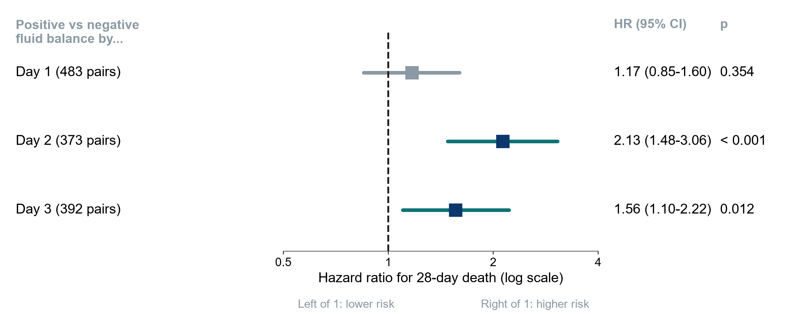{.neu-fig}

::: {.neu-caption}
Paper 2 (Hyun 2023): positive vs negative cumulative fluid balance, propensity-matched cohorts
:::

::: {.neu-takeaway}
**KEY MESSAGE** Day 1: CI crosses 1. Days 2 and 3: CIs above 1, so higher risk.
:::

::: {.notes}
Extra. Paper 2 forest plot: day 1 HR 1.17 (0.85-1.60) crosses 1. Day 2 HR 2.13 (1.48-3.06) and day 3 HR 1.56 (1.10-2.22) are above 1.

Associated, not caused: residual confounding remains.
:::

## Extra: Log-rank, Cox and proportional hazards

::: {.neu-intro}
Three terms you will meet in every survival paper. KM = Kaplan-Meier. HR = hazard ratio.
:::

:::: {.neu-cards style="--n:3"}
::: {.neu-card .plain style="--c:#0D7377"}
[Log-rank test]{.neu-card-title}

- Compares whole KM curves
- Gives a p-value
- No effect size, no adjustment
:::
::: {.neu-card .plain style="--c:#0B376C"}
[Cox regression]{.neu-card-title}

- Gives an HR with its 95% CI
- No effect = 1
- Can adjust for confounders
:::
::: {.neu-card .plain style="--c:#5FA39B"}
[Proportional hazards]{.neu-card-title}

- Assumes the HR is constant over time
- Crossing curves: be careful
:::
::::

::: {.neu-takeaway}
**KEY MESSAGE** Paper 2 (Hyun 2023): Cox HR 2.13 (1.48-3.06), about double the hazard of death.
:::

::: {.notes}
Extra. Log-rank: a p-value, no size, no adjustment. Cox: an adjusted HR with its CI. Proportional hazards: the HR is assumed constant, check it when curves cross.

Timing: 2 minutes.
:::

## Extra: Correlation is not agreement, and not causation

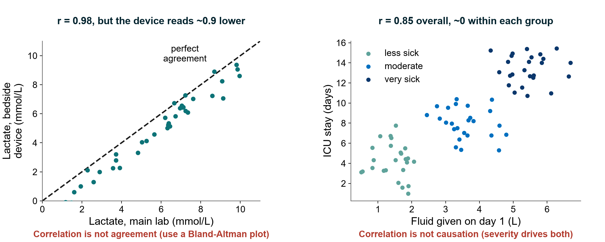{.neu-fig}

::: {.neu-takeaway}
**KEY MESSAGE** High r does not mean two methods agree, nor that one causes the other.
:::

::: {.notes}
Extra. Left: r = 0.98 but the device reads 0.9 lower: correlation is not agreement (use Bland-Altman). Right: fluid and ICU stay correlate only through severity.

Timing: 2 minutes.
:::

## Extra: Interaction in a model: does the effect differ between groups?

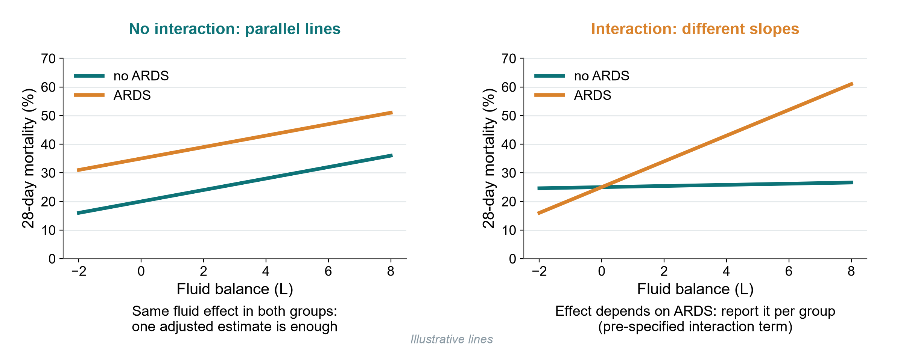{.neu-fig}

::: {.neu-takeaway}
**KEY MESSAGE** Parallel lines: adjust. Different slopes: report the effect for each group.
:::

::: {.notes}
Extra. Parallel lines: one adjusted effect is enough. Different slopes: interaction, report the effect in each group.

Pre-specify the few interactions you test, and test the interaction itself.

Timing: 2 minutes.
:::

## Extra: The 'no effect' line: 0 for differences, 1 for ratios

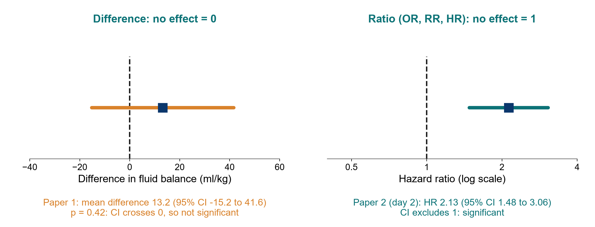{.neu-fig}

::: {.neu-takeaway}
**KEY MESSAGE** Find the null value first, then see if the CI crosses it.
:::

::: {.notes}
Extra. Find the null first: 0 for differences (Paper 1 crosses it), 1 for ratios (Paper 2 day 2 is above it).

A CI that excludes the null means p \< 0.05, and the CI also gives size and precision.
:::

## Extra: Prediction models: discrimination and calibration

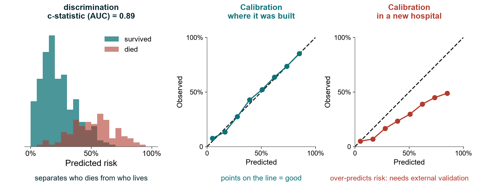{.neu-fig}

::: {.neu-takeaway}
**KEY MESSAGE** A good prediction model separates patients and gets the risks right, in new hospitals too.
:::

::: {.notes}
Extra. Prediction models are judged by discrimination (AUC), calibration and external validation. A high AUC alone is not enough.

Ask: a vendor quotes AUC 0.92 in its own data. What do you ask?

Timing: 2 minutes.
:::

## Extra: Prediction and machine learning: how to judge a model

::: {.neu-intro}
Machine learning (ML) is a flexible way to build prediction models. The same questions apply.
:::

:::: {.neu-cards style="--n:4"}
::: {.neu-card .plain style="--c:#0D7377"}
[What is it for?]{.neu-card-title}

- Predict an individual's risk
- Not to explain causes
- Who, when, which decision?
:::
::: {.neu-card .plain style="--c:#0B376C"}
[Enough data?]{.neu-card-title}

- ML needs many events
- Overfitting risk is high
- Internal validation done?
:::
::: {.neu-card .plain style="--c:#5FA39B"}
[Does it work?]{.neu-card-title}

- Discrimination (AUC)
- Calibration plot
- External validation
:::
::: {.neu-card .plain style="--c:#0070C0"}
[Is it reported?]{.neu-card-title}

- TRIPOD+AI checklist
- Code, data, fairness
- Impact on patients?
:::
::::

::: {.neu-takeaway}
**KEY MESSAGE** An AI score is a prediction model: ask for calibration and external validation.
:::

::: {.notes}
Extra. Machine learning is prediction. Four questions: what is it for, enough data, does it work (AUC, calibration, external validation), is it reported (TRIPOD+AI)?

Accuracy is not the same as benefit.

Timing: 2 minutes.
:::

## Extra: Complete-case analysis vs multiple imputation

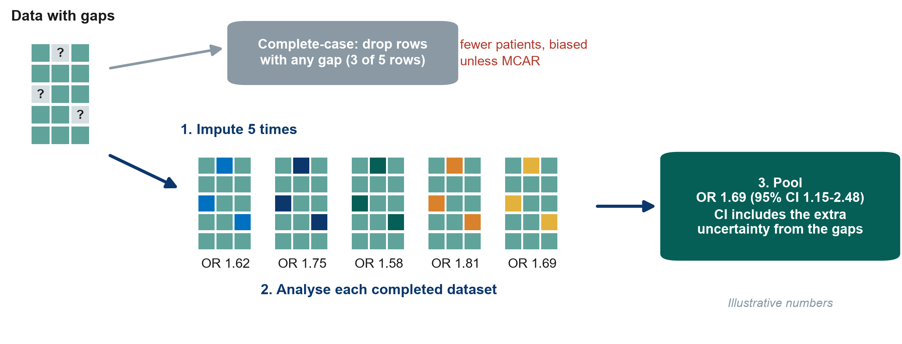{.neu-fig}

::: {.neu-takeaway}
**KEY MESSAGE** Multiple imputation keeps every patient and admits the uncertainty of the gaps.
:::

::: {.notes}
Extra. Complete case: simple, loses patients, biased unless MCAR. Multiple imputation: fill each gap several times, analyse each, pool. It is honest about what we do not know.

Timing: 2 minutes.
:::

## Extra: Report and test your missing data

::: {.neu-intro}
Four things a reviewer will look for. MI = multiple imputation.
:::

:::: {.neu-cards style="--n:4"}
::: {.neu-card .plain style="--c:#0D7377"}
[Report]{.neu-card-title}

- n missing per variable
- Flow diagram: who and why
- In Table 1 or a footnote
:::
::: {.neu-card .plain style="--c:#0B376C"}
[Compare]{.neu-card-title}

- Patients with vs without complete data
- Are they different?
:::
::: {.neu-card .plain style="--c:#5FA39B"}
[Sensitivity (Level 3)]{.neu-card-title}

- Complete case vs MI
- Example script: 05\_missing.R
- Done hands-on in Level 3, Module H
:::
::: {.neu-card .plain style="--c:#0070C0"}
[Plan]{.neu-card-title}

- Write it in the SAP before you see the data
- Part 3 of your proposal
:::
::::

::: {.neu-takeaway}
**KEY MESSAGE** Missing data are a result: report them, handle them, test the answer.
:::

::: {.notes}
Extra. What a reviewer looks for: missing values reported per variable, patients with and without complete data compared, a sensitivity analysis, and a plan written in advance.

Timing: 2 minutes.
:::
