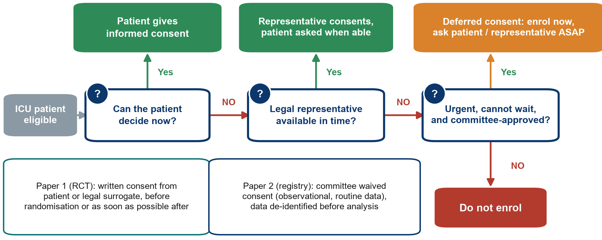
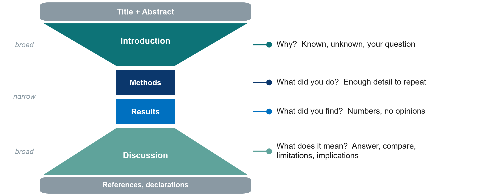
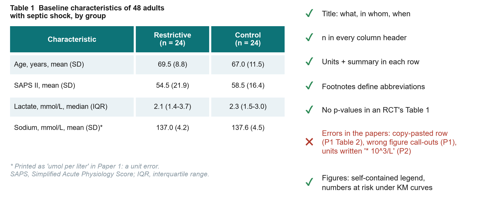

# Session 7 · Protect & write: ethics, integrity, Methods and Results

## Week 7 · Saturday, 19:30-22:30 (online)

- 19:30  Recap: Session 6
- 19:40  7.1  Protocol, ethics, consent, registration, feasibility
- 20:10  7.2  Research integrity: authorship, conflicts of interest, data sharing, AI
- 20:30  Proposal builder 7: ethics and publication plan
- 21:00  7.3  Writing the paper (I): IMRaD, Methods and Results
- 21:35  Manuscript workshop 1: the Results section, together then on your own

::: {.notes}
Session 7 (19:30-22:30, break 20:45-21:00). Before the break: ethics, integrity and Proposal Part 4. After the break: IMRaD, Methods and Results.

Before the session, email the exercise sheet, the five results packs, the manuscript template and the list of reviewer pairs.

If time is short, drop extra slides, never the workshop.
:::

## Recap quiz: Session 6 in five questions

::: {.neu-banner style="--c:#6C3483"}
QUICK QUIZ · 8 min
:::

:::: {.columns}
::: {.column width="60%"}
::: {.neu-activity-steps style="--c:#6C3483"}
- A crude OR (odds ratio) is 2.1. The adjusted OR is 1.4. What happened?
- HR (hazard ratio) 0.85, 95% CI 0.60 to 1.20: a clear benefit?
- Lactate is missing for 15% of patients. Name one way to handle it
- Kaplan-Meier curve: what does a 'censored' patient mean?
- The FLUID-ICU question you chose (Q1 to Q5): what is its main result? Answer in the chat
:::
:::
::: {.column width="40%"}
::: {.neu-side .plain style="--c:#6C3483"}
Answers

- Confounding: part of the crude link came from severity
- No: the CI includes 1
- Complete-case analysis, or multiple imputation with a sensitivity analysis
- Left the study alive. Outcome unknown after that
- From your results pack
:::
:::
::::

::: {.neu-output style="--c:#6C3483"}
**OUTPUT** Everyone re-activated: adjustment, CIs, missing data, survival
:::

::: {.notes}
Recap (19:30-19:40). Start with two or three Session 6 exit answers.

Questions 1-4: 30 seconds each, call on two or three people, then reveal. Question 1 leads to today: the Results report both crude and adjusted estimates.

Question 5 in the chat: the main result of the question each person chose. Anyone without a question chooses one now.
:::

## Today: finish the proposal, start the paper

::: {.neu-intro}
FLUID-ICU = the course dataset: a simulated cohort of 620 adults with sepsis in 4 ICUs (Sessions 5-6).
:::

:::: {.neu-cards style="--n:3"}
::: {.neu-card .plain style="--c:#0D7377"}
[Product 1: your proposal]{.neu-card-title}

- Your own question
- Today: Part 4 (ethics, registration, feasibility, publication)
- Session 8: submit it. About 5 people present
:::
::: {.neu-card .plain style="--c:#0B376C"}
[Product 2: your Results section]{.neu-card-title}

- Your FLUID-ICU question (Q1 to Q5)
- We give the results. You write
- Today: Methods, Results (live on Q1)
- Session 8: Introduction, Discussion, abstract, title
:::
::: {.neu-card .plain style="--c:#5FA39B"}
[Our two example papers]{.neu-card-title}

- Paper 1: Boulet 2024, randomised trial, 48 patients
- Paper 2: Hyun 2023, cohort, 2,516 patients
- PDFs sent by email
:::
::::

::: {.neu-takeaway}
**KEY MESSAGE** Before the break: proposal Part 4. After the break: Methods and Results.
:::

::: {.notes}
Two individual products. Proposal: Part 4 today, submitted next Saturday.

Results section: we give the results for each person's question, they write a submission-ready Results section.

Every section is taught: Methods and Results today, Introduction, Discussion, abstract and title next week. Only the Results must be submitted.

Ask: which question (Q1-Q5) have you chosen?
:::

## 7.1  \|  30 minutes

:::: {.neu-statement}
::: {.neu-big}
Protocol, ethics and consent
:::

::: {.neu-sub}
Protect the patient before the first data point
:::
::::

::: {.notes}
Section 7.1 (19:40-20:10). Ten slides, about 3 minutes each.

Spend the most time on ICU consent: it is the real problem in our units.

Everything here becomes a paragraph of Proposal Part 4.
:::

## The protocol: your study's building plan

::: {.neu-intro}
Protocol = the full written plan of a study, approved before the first patient. Trial checklist: SPIRIT 2025.
:::

:::: {.neu-cards style="--n:4"}
::: {.neu-card .plain style="--c:#0D7377"}
[Who and what]{.neu-card-title}

- Title page
- Title, version, date
- Registration number
- Team, roles, funding
:::
::: {.neu-card .plain style="--c:#0B376C"}
[Why]{.neu-card-title}

- Proposal Part 1
- Problem and rationale
- Question (PICO)
- Aim, objectives, hypothesis
:::
::: {.neu-card .plain style="--c:#5FA39B"}
[How]{.neu-card-title}

- Proposal Parts 2-3
- Design, setting, participants
- Exposure, outcomes
- Sample size, data, analysis plan
:::
::: {.neu-card .plain style="--c:#0070C0"}
[Protect and share]{.neu-card-title}

- Proposal Part 4 (today)
- Ethics approval, consent
- Confidentiality, data safety
- Publication plan
:::
::::

::: {.neu-takeaway}
**KEY MESSAGE** Your four proposal parts are the skeleton of a protocol.
:::

::: {.notes}
A protocol is the full plan, approved before the first patient. SPIRIT 2025 is the checklist for trial protocols.

Walk the four cards: they are the four proposal parts.

Paper 1 registered its protocol and SAP before the first patient (NCT04947904).

Poll: which part of your proposal is weakest? Expected: sample size or analysis plan.
:::

## Two rule books: Helsinki and Good Clinical Practice

:::: {.neu-cards style="--n:2"}
::: {.neu-card style="--c:#0D7377"}
[Declaration of Helsinki (World Medical Association, 2024)]{.neu-card-title}

- Participants' rights and well-being first
- Protocol approved by an ethics committee
- Free, informed consent
- Risks minimised and justified
- Privacy and confidentiality
- Register first, publish all results
:::
::: {.neu-card style="--c:#0B376C"}
[Good Clinical Practice (GCP: ICH E6(R3), 2025)]{.neu-card-title}

- Qualified, trained team
- Quality built in by design
- Clear, feasible protocol
- Checks in proportion to the risk
- Reliable, traceable data
- Clear roles and responsibilities
:::
::::

::: {.neu-takeaway}
**KEY MESSAGE** Helsinki says why we protect participants. GCP says how we run a trial well.
:::

::: {.notes}
Helsinki (2024): the participant comes before new knowledge. Ethics approval, free consent, privacy, registration, publish all results.

GCP (ICH E6(R3), 2025): the quality standard for trials. Paper 1, an academic trial, followed it.

Poll: which of the 12 points would be hardest in our unit?
:::

## The ethics-committee journey: approval before data

::: {.neu-intro}
Plan 1 to 3 months. Questions and revisions from the committee are normal.
:::

:::: {.neu-steps}
::: {.neu-step style="--c:#0D7377"}
[Prepare]{.neu-step-label}

- Protocol
- Consent form
- Case report form (CRF)
:::
::: {.neu-step style="--c:#0B376C"}
[Review]{.neu-step-label}

- Scientific or department review first
:::
::: {.neu-step style="--c:#5FA39B"}
[Submit]{.neu-step-label}

- Dossier to the research ethics committee
:::
::: {.neu-step style="--c:#0070C0"}
[Decide]{.neu-step-label}

- Exempt, expedited or full committee
- The committee decides
:::
::: {.neu-step style="--c:#055F56"}
[Approve]{.neu-step-label}

- Approval letter with number and date
:::
::: {.neu-step style="--c:#8A99A3"}
[Start]{.neu-step-label}

- Trials: register first
- Then the first patient
:::
::::

::: {.neu-takeaway}
**KEY MESSAGE** No approval letter, no data collection: not even 'just a few patients'.
:::

::: {.notes}
Walk the six steps. Most institutions want a scientific review first.

The committee decides the review type, not you. Plan 1 to 3 months.

Misconception: 'collect now, ask later'. Committees cannot approve retrospectively.

Paper 1 gives its approval number in the Methods.
:::

## Register before the first participant

::: {.neu-intro}
The order: protocol, ethics approval, registration, first participant.
:::

:::: {.neu-cards style="--n:3"}
::: {.neu-card .plain style="--c:#0D7377"}
[Clinical trials]{.neu-card-title}

- **[Mandatory]{style="color:#C0392B"}**
- ClinicalTrials.gov or another who primary registry
- Paper 1: registered 1 July 2021, first patient September 2021
:::
::: {.neu-card .plain style="--c:#0B376C"}
[Systematic reviews]{.neu-card-title}

- **[Expected]{style="color:#D9822B"}**
- PROSPERO, the register for review protocols
- Before data extraction
:::
::: {.neu-card .plain style="--c:#5FA39B"}
[Observational studies]{.neu-card-title}

- **[Recommended]{style="color:#2E8B57"}**
- For example on ClinicalTrials.gov
- Check the journal and local rules
:::
::::

::: {.neu-takeaway}
**KEY MESSAGE** Trials: no registration before the first patient, no publication.
:::

::: {.notes}
Registration puts the study and its primary outcome on public record before anyone is enrolled.

Trials: mandatory. Reviews: PROSPERO. Observational: recommended.

Paper 1: registered 1 July 2021, first patient September 2021.

Ask: does your study need registration?
:::

## Informed consent: four essentials

::: {.neu-intro}
Consent is a conversation, not a signature.
:::

:::: {.neu-cards style="--n:4"}
::: {.neu-card .plain style="--c:#0D7377"}
[Informed]{.neu-card-title}

- Purpose and what will happen
- Risks, benefits, alternatives
- How data are protected
- Who to contact
:::
::: {.neu-card .plain style="--c:#0B376C"}
[Understood]{.neu-card-title}

- Plain, local language
- Time to ask questions
- Teach-back: 'tell me in your words'
:::
::: {.neu-card .plain style="--c:#5FA39B"}
[Voluntary]{.neu-card-title}

- No pressure
- Free to refuse or withdraw
- Care is not affected
:::
::: {.neu-card .plain style="--c:#0070C0"}
[Documented]{.neu-card-title}

- Signed and dated form
- A copy for the participant
- Re-consent if the study changes
:::
::::

::: {.neu-takeaway}
**KEY MESSAGE** If the patient cannot explain the study back to you, consent is not informed.
:::

::: {.notes}
Valid consent needs all four: information, understanding, voluntariness, a record.

In Paper 1, two control patients withdrew and were not analysed: the right respected.

Ask: who takes consent in your study, and when? Expected: a trained team member, not the treating doctor under time pressure.
:::

## Consent in the ICU: when the patient cannot decide

{.neu-fig}

::: {.neu-takeaway}
**KEY MESSAGE** Patient, then legal representative, then deferred consent (only if approved).
:::

::: {.notes}
Most ICU patients cannot decide when they become eligible.

Patient, then legal representative, then deferred consent only if the committee approved it in advance. Paper 1 used this route. Paper 2 had a waiver for registry data.

Local law decides who may be the representative.

Ask: the family refuses after enrolment. What happens? Expected: the patient leaves the study.
:::

## Worked example: who consents for these three ICU patients?

::: {.neu-intro}
Walk each patient through the flowchart on the previous slide.
:::

:::: {.neu-cards style="--n:3"}
::: {.neu-card .plain style="--c:#0D7377"}
[Mr A, 54]{.neu-card-title}

- Pneumonia, awake, oriented
- Eligible for a fluid trial
- **[Patient consents]{style="color:#2E8B57"}**
:::
::: {.neu-card .plain style="--c:#0B376C"}
[Mrs B, 71]{.neu-card-title}

- Septic shock, sedated
- Daughter at the bedside
- **[Representative consents. Ask Mrs B when awake]{style="color:#2E8B57"}**
:::
::: {.neu-card .plain style="--c:#5FA39B"}
[Mr C, 38]{.neu-card-title}

- Septic shock at 03:00, no family yet
- Treatment cannot wait, committee approved
- **[Deferred consent: ask as soon as possible]{style="color:#D9822B"}**
:::
::::

::: {.neu-takeaway}
**KEY MESSAGE** The pathway and the timing are written in the protocol before patient 1.
:::

::: {.notes}
Call on someone for each patient before revealing.

Mr A: consents himself. Mrs B: the representative consents, ask her when she can decide. Mr C: deferred consent, only if approved.

Misconception: the treating doctor can consent for the patient. No.
:::

## Confidentiality: de-identify before you analyse

| Item | Before: identifiable | After: de-identified |
|:---|:---|:---|
| Name | Ana P. | Study code SEP-001 |
| Hospital number | 1084521 | Removed |
| Date of birth | 12/03/1956 | Age 68 |
| Admission date | 14/03/2024 | Month 03/2024 |
| Fluid balance, ml/kg | +35 | +35 |

::: {.neu-table-caption}
Names stay on the ward. Only study codes travel. The key file (code = identity) is locked and kept separately. Beware very small groups (n \< 5).
:::

::: {.notes}
Confidentiality by design: study codes, age instead of birth date, month instead of exact date.

The key file is kept separately, locked, with one or two named people.

No patient data on personal phones, messaging apps or public AI tools.

Ask: where would your key file live?
:::

## Worked example: the ethics paragraph for a cohort like FLUID-ICU

::: {.neu-intro}
FLUID-ICU is simulated. If it were real, this is what the paper would say.
:::

:::: {.neu-cards style="--n:4"}
::: {.neu-card .plain style="--c:#0D7377"}
[Approval]{.neu-card-title}

- Ethics committee of each ICU
- Approval number and date
- Before data collection
:::
::: {.neu-card .plain style="--c:#0B376C"}
[Consent]{.neu-card-title}

- Routine data, minimal risk
- Committee may waive consent (as in Paper 2)
:::
::: {.neu-card .plain style="--c:#5FA39B"}
[Confidentiality]{.neu-card-title}

- Study codes only
- Key file kept in each ICU
- Data de-identified before analysis
:::
::: {.neu-card .plain style="--c:#0070C0"}
[Registration and sharing]{.neu-card-title}

- Registration recommended
- Data-sharing statement
- Data dictionary shared
:::
::::

::: {.neu-takeaway}
**KEY MESSAGE** Your manuscript's ethics paragraph answers four questions in four sentences.
:::

::: {.notes}
If FLUID-ICU were real, the ethics paragraph would answer these four questions in four sentences.

Ask: where does this paragraph go in a real paper? Expected: the Methods.
:::

## Feasibility: five honest questions

:::: {.neu-cards style="--n:5"}
::: {.neu-card .plain style="--c:#0D7377"}
[Timeline]{.neu-card-title}

- Ethics alone: 1 to 3 months
- Recruitment takes longer than planned
- Draw a simple timeline (Gantt chart)
:::
::: {.neu-card .plain style="--c:#0B376C"}
[Budget]{.neu-card-title}

- Staff time
- Materials and tests
- Publication fee
:::
::: {.neu-card .plain style="--c:#5FA39B"}
[People]{.neu-card-title}

- Who collects data at night?
- Who analyses?
- Protected time?
:::
::: {.neu-card .plain style="--c:#0070C0"}
[Recruitment]{.neu-card-title}

- Paper 1: 1201 screened, 50 randomised (4%)
- 17 months, 3 ICUs
:::
::: {.neu-card .plain style="--c:#055F56"}
[Data]{.neu-card-title}

- Recorded routinely?
- How much will be missing?
- Paper 2: no diuretic data
:::
::::

::: {.neu-takeaway}
**KEY MESSAGE** Count the eligible patients in your unit before you write the sample size.
:::

::: {.notes}
Walk the five cards. Ethics takes 1-3 months. Recruitment always takes longer: Paper 1 screened 1,201 patients to randomise 50.

Rule of thumb: count last year's eligible patients and expect to enrol a fraction.

Poll: which card is the biggest risk for your study?
:::

## 7.2  \|  20 minutes

:::: {.neu-statement}
::: {.neu-big}
Research integrity
:::

::: {.neu-sub}
Honest data, honest credit, honest use of AI
:::
::::

::: {.notes}
Section 7.2 (20:10-20:30). Six slides, then a 5-minute scenario poll.

Tone: most integrity problems start as small shortcuts under pressure.

Every Results draft needs the AI-use statement.
:::

## Research misconduct: fabrication, falsification, plagiarism

::: {.neu-intro}
FFP = the three forms of research misconduct. An honest error is not misconduct: correct it openly.
:::

:::: {.neu-cards style="--n:3"}
::: {.neu-card .plain style="--c:#0D7377"}
[Fabrication]{.neu-card-title}

- Making up data or patients
- Example: day-3 fluid balances entered 'from memory'
:::
::: {.neu-card .plain style="--c:#0B376C"}
[Falsification]{.neu-card-title}

- Changing or leaving out data to fit the story
- Example: dropping two 'odd' patients who weaken the result
:::
::: {.neu-card .plain style="--c:#5FA39B"}
[Plagiarism]{.neu-card-title}

- Using others' words or ideas without credit
- Example: a copied paragraph, cited but without quotation marks
:::
::::

::: {.neu-takeaway}
**KEY MESSAGE** Missing data are reported as missing: never invented, never quietly removed.
:::

::: {.notes}
Fabrication, falsification, plagiarism. An honest error is not misconduct: correct it openly.

The data-quality plan from Session 5 protects against accidental falsification.

Poll: which is most common in student theses? Expected: plagiarism.
:::

## Also off-limits: tricks that distort the record

::: {.neu-intro}
One study should tell one complete, honest story.
:::

:::: {.neu-cards style="--n:3"}
::: {.neu-card .plain style="--c:#0D7377"}
[Duplicate publication]{.neu-card-title}

- Same results published twice
- The second paper does not say so
:::
::: {.neu-card .plain style="--c:#0B376C"}
[Salami slicing]{.neu-card-title}

- One study cut into thin papers
- Done to multiply publications
- The reader never sees the whole
:::
::: {.neu-card .plain style="--c:#5FA39B"}
[Selective reporting]{.neu-card-title}

- Only the 'significant' outcomes reported
- Primary outcome switched after seeing the data
:::
::::

::: {.neu-takeaway}
**KEY MESSAGE** Register first, pre-specify the primary outcome, report all of it.
:::

::: {.notes}
Duplicate publication counts the same patients twice. Salami slicing hides the whole study. Selective reporting is why trials register one primary outcome.

Paper 1 reported its negative primary outcome plainly.

Ask: why does it matter that a negative trial is published? Expected: publication bias.
:::

## Who is an author? The four ICMJE criteria

::: {.neu-intro}
ICMJE = International Committee of Medical Journal Editors. An author meets all four.
:::

:::: {.neu-cards style="--n:5"}
::: {.neu-card .plain style="--c:#0D7377"}
[1  Substantial work]{.neu-card-title}

- Idea, design, data, analysis or interpretation
:::
::: {.neu-card .plain style="--c:#0B376C"}
[2  Writing]{.neu-card-title}

- Drafted or critically revised the manuscript
:::
::: {.neu-card .plain style="--c:#5FA39B"}
[3  Approval]{.neu-card-title}

- Approved the final version
:::
::: {.neu-card .plain style="--c:#0070C0"}
[4  Accountable]{.neu-card-title}

- Answers for all of the work
:::
::: {.neu-card .plain style="--c:#C0392B"}
[Not all four?]{.neu-card-title}

- Thank them in the Acknowledgements
- Gift author: named, did not do the work
- Ghost author: did the work, not named
:::
::::

::: {.neu-takeaway}
**KEY MESSAGE** All four criteria, for every author. Decide the list at the start.
:::

::: {.notes}
An author meets all four ICMJE criteria. Others go in the Acknowledgements.

Gift author: named without the work. Ghost author: did the work, not named.

Poll: is data collection alone enough for authorship? Expected: no.

Agree the author list at the protocol stage.
:::

## Conflicts of interest and funding: declare them all

:::: {.neu-cards style="--n:3"}
::: {.neu-card .plain style="--c:#0D7377"}
[Financial interests]{.neu-card-title}

- Consultancy, speaker fees
- Grants, travel support
- Shares, patents
- Employment
:::
::: {.neu-card .plain style="--c:#0B376C"}
[Non-financial interests]{.neu-card-title}

- Personal relationships
- Role in a guideline panel
- Strong prior beliefs
- Academic rivalry
:::
::: {.neu-card .plain style="--c:#5FA39B"}
[Funding statement]{.neu-card-title}

- Who paid, grant number
- Role of the funder in design, analysis, writing and the decision to publish
- Paper 2: the funder had no role
:::
::::

::: {.neu-takeaway}
**KEY MESSAGE** A declared interest is information. A hidden one is a scandal.
:::

::: {.notes}
Having an interest is common. Hiding it is the problem. Most journals use the ICMJE form.

Paper 2 states its funder had no role. Paper 1 states an internal grant.

Ask: a company paid your travel last year. Declare it? Expected: if in doubt, declare.
:::

## Data sharing: from 'on request' to open

:::: {.neu-cards style="--n:2"}
::: {.neu-card style="--c:#0D7377"}
[From closed to open]{.neu-card-title}

- Not available
- 'Available on reasonable request' (Papers 1 and 2)
- Controlled-access repository
- Open repository with a DOI (permanent web identifier)
:::
::: {.neu-card style="--c:#0B376C"}
[Before you share]{.neu-card-title}

- Consent form and ethics approval allow it
- Data de-identified
- Data dictionary and analysis code included
- Data-sharing statement in the paper
:::
::::

::: {.neu-takeaway}
**KEY MESSAGE** Plan data sharing at the protocol stage: consent must allow it.
:::

::: {.notes}
From 'available on request' (both papers) to an open repository with a DOI.

Before sharing: consent and ethics must allow it, data de-identified, dictionary and code included.

Ask: what must your consent form say today so you can share tomorrow?
:::

## AI in research and writing: what is allowed

:::: {.neu-cards style="--n:2"}
::: {.neu-card style="--c:#2E8B57"}
[Allowed, with care]{.neu-card-title}

- Polish the language of your own text
- Brainstorm or summarise, then check every claim
- Disclose the tool, version and purpose
:::
::: {.neu-card style="--c:#C0392B"}
[Never]{.neu-card-title}

- List AI as an author
- Paste patient data or a confidential manuscript into a public AI tool
- Let AI invent references, data or images
:::
::::

::: {.neu-takeaway}
**KEY MESSAGE** Use AI like a junior assistant: check everything, disclose it, keep patient data out.
:::

::: {.notes}
AI cannot be an author. Disclose its use and check every claim and reference.

Never paste patient data or a manuscript you review into a public AI tool.

Ask: a colleague has a chatbot write the Discussion and submits it unread. Which rules does this break?
:::

## Integrity scenarios: green, amber or red?

::: {.neu-banner style="--c:#6C3483"}
QUICK QUIZ · 5 min
:::

:::: {.columns}
::: {.column width="60%"}
::: {.neu-activity-steps style="--c:#6C3483"}
- Scenarios: Session 7 exercise sheet, Part A (PDF sent before the session), also on the shared screen
- Vote in the poll: green (fine), amber (fine only if fixed or disclosed) or red (misconduct)
- One or two volunteers explain their vote with the microphone on
- We do 3 scenarios together now. The other 3 are homework
:::
:::
::: {.column width="40%"}
::: {.neu-side .plain style="--c:#6C3483"}
Scenario 1

- Three day-3 fluid charts are lost. A resident enters the balances 'from memory'.
- Your colour?
:::
:::
::::

::: {.neu-output style="--c:#6C3483"}
**OUTPUT** Everyone can name FFP, gift and ghost authorship, and the AI rules
:::

::: {.notes}
Quiz (20:25-20:30). Scenarios and answers: s7\_exercises Part A and s7\_solutions.

Use scenarios 1 (red, fabrication), 3 (red, gift authorship) and 4 (green for checked and disclosed polishing, red for the patient spreadsheet).

Ask one person from the largest and one from the smallest colour for a reason.
:::

## Proposal builder 7: ethics, registration, feasibility, publication plan

::: {.neu-banner style="--c:#055F56"}
PROPOSAL BUILDER · 15 min
:::

:::: {.columns}
::: {.column width="60%"}
::: {.neu-activity-steps style="--c:#055F56"}
- Watch: the instructor drafts Part 4 for the running example on the shared screen
- Consent: who consents, who asks, when? Two or three people answer with the microphone on (4 min)
- Registration and the key file: where? (3 min)
- Feasibility: the biggest risk and one fix (3 min)
- Publication plan: journal, reporting guideline, authors and roles (5 min)
:::
:::
::: {.column width="40%"}
::: {.neu-side .plain style="--c:#055F56"}
Then, at home

- Write Part 4 for your own proposal
- Worksheet: Session 7 exercise sheet, Part B (PDF)
- Use the class example as a model
:::
:::
::::

::: {.neu-output style="--c:#055F56"}
**OUTPUT** Part 4 modelled together. Your own Part 4 drafted at home this week
:::

::: {.notes}
Proposal builder 7 (20:30-20:45). Fill in Part B live for the running example. Answers: s7\_solutions Part B.

Watch for: 'consent will be obtained' with no who or when, chart reviews assumed exempt, recruitment from the sample size, CONSORT for a cohort.

Homework: Part 4 of their own proposal. Volunteers who want to present email the instructor by Wednesday 16 December.
:::

---

::: {style="text-align:center"}
{width="32%"}

[Break]{style="color:#0D7377;font-size:1.6em;font-weight:700"}

[15 min]{style="color:#595959;font-size:0.9em"}
:::

::: {.notes}
Break (20:45-21:00). Say: we restart at 21:00 with the Results section. Open your results pack and the manuscript template.

Prepare your screen: the template and results pack Q1 side by side.
:::

## 7.3  \|  35 minutes

:::: {.neu-statement}
::: {.neu-big}
Writing the paper (I): IMRaD, Methods and Results
:::

::: {.neu-sub}
Say what you did, then report what you found
:::
::::

::: {.notes}
Section 7.3 (21:00-21:35). Ten slides and a 3-minute check.

IMRaD first, then Methods and Results, each with a worked example on Q1. The check practises both.
:::

## IMRaD: the hourglass shape of every paper

{.neu-fig}

::: {.neu-takeaway}
**KEY MESSAGE** Introduction narrows to your question. Discussion widens back to practice.
:::

::: {.notes}
IMRaD: Introduction (why), Methods (what we did), Results (what we found), Discussion (what it means). The abstract and title summarise it.

The Introduction narrows to the question, the Discussion widens back to practice. Paper 1's Introduction is a three-paragraph funnel, and its Discussion opens by answering the question.

Today: Methods and Results. Next Saturday: Introduction, Discussion, abstract and title.
:::

## Write in a different order from the one readers read

::: {.neu-intro}
Readers read: Title, Abstract, Introduction, Methods, Results, Discussion. Writers start from the data.
:::

:::: {.neu-steps}
::: {.neu-step style="--c:#0D7377"}
[1 Tables]{.neu-step-label}

- Tables and figures: the story is in your data
:::
::: {.neu-step style="--c:#0B376C"}
[2 Methods]{.neu-step-label}

- You know what you did
:::
::: {.neu-step style="--c:#5FA39B"}
[3 Results]{.neu-step-label}

- Describe your tables
:::
::: {.neu-step style="--c:#0070C0"}
[4 Introduction]{.neu-step-label}

- Set up the question you answered
:::
::: {.neu-step style="--c:#055F56"}
[5 Discussion]{.neu-step-label}

- Answer, compare, explain
:::
::: {.neu-step style="--c:#8A99A3"}
[6 Abstract, title]{.neu-step-label}

- Summarise the paper, name it last
:::
::::

::: {.neu-takeaway}
**KEY MESSAGE** Start with your tables. Write the title last.
:::

::: {.notes}
Writers start from the evidence: tables first, the title last.

For FLUID-ICU the tables already exist in your results pack, so your Results section starts from them.

Misconception: 'I must finish the Introduction before I can start'.
:::

## Methods: enough detail for someone to repeat it

::: {.neu-intro}
Methods say what you did. If a colleague could not redo the study from it, add detail.
:::

:::: {.neu-cards style="--n:4"}
::: {.neu-card .plain style="--c:#0D7377"}
[Who and where]{.neu-card-title}

- Design, setting, dates
- Eligibility criteria
- Ethics approval and consent
- Registration number
:::
::: {.neu-card .plain style="--c:#0B376C"}
[What was done]{.neu-card-title}

- Intervention or exposure in full
- Variables defined
- Paper 1: staff training, daily pharmacist check
:::
::: {.neu-card .plain style="--c:#5FA39B"}
[Outcomes and size]{.neu-card-title}

- One primary outcome: how and when
- Sample size: assumptions and source
- Paper 2: no sample-size statement
:::
::: {.neu-card .plain style="--c:#0070C0"}
[Statistical analysis]{.neu-card-title}

- A method for each comparison
- Estimate matches the test
- Missing data, multiple comparisons
- Software and version
:::
::::

::: {.neu-takeaway}
**KEY MESSAGE** The statistical paragraph names a method for every comparison you report.
:::

::: {.notes}
Methods: enough detail to repeat the study, in STROBE order.

Good: Paper 1 describes its intervention well enough to replicate. To fix: Paper 2 never says how missing covariates were handled.

For FLUID-ICU, all the facts are in the results pack, the SAP and the data dictionary.
:::

## Worked example: Methods for FLUID-ICU question 1

::: {.neu-intro}
One sentence per STROBE item (simulated data). STROBE = the reporting checklist for observational studies.
:::

- Items 4-6: We analysed FLUID-ICU, a prospective cohort of consecutive adults with sepsis admitted to four ICUs between January 2023 and December 2024.
- Item 7: The exposure was a positive cumulative fluid balance by ICU day 3 (fluid in minus fluid out over days 1-3, \> 0 ml/kg). The outcome was death from any cause within 28 days of ICU admission.
- Item 8: Data came from ICU charts on a standard case report form.
- Item 9: To address confounding by indication, we adjusted for severity and comorbidity pre-specified in the analysis plan.
- Item 10: All eligible patients in the cohort were included (no separate sample size).
- [Ethics (course version): This analysis used a simulated teaching dataset. No ethics approval or consent was required.]{style="color:#0B376C"}

::: {.notes}
One sentence per STROBE item, all from results pack Q1, section 2.

Item 10: for a fixed cohort, say all eligible patients were included.

Ask: which sentence would a reader need to repeat the study? Expected: how fluid balance was calculated.
:::

## Worked example: the statistical-analysis paragraph

::: {.neu-intro}
STROBE item 12 for Q1: one sentence per decision, all chosen before seeing the data.
:::

- Baseline characteristics: mean (SD), median (IQR) or n (%), by balance group.
- 28-day mortality: chi-square test. Crude and adjusted odds ratios from logistic regression (age, SOFA score, lactate, vasopressor, mechanical ventilation, chronic kidney disease).
- Time to death: Kaplan-Meier curves (log-rank test) and Cox regression with the same covariates. Proportional hazards checked.
- Effect modification by heart failure: an interaction term (pre-specified).
- Main analysis on complete cases. Missing lactate (15%) handled by multiple imputation (20 data sets) as a sensitivity analysis.
- Estimates with 95% confidence intervals. Analyses in R 4.6.

::: {.notes}
STROBE item 12 for Q1. Covariates were chosen in the SAP before the data were seen.

Every number in the Results must trace back to one sentence here. Reviewers read this paragraph first.
:::

## Results: report, do not interpret

:::: {.neu-cards style="--n:4"}
::: {.neu-card .plain style="--c:#0D7377"}
[1  Participants first]{.neu-card-title}

- Screened, included, analysed, and why some were lost
- Paper 1: 1201 screened, 50 randomised, 48 analysed
:::
::: {.neu-card .plain style="--c:#0B376C"}
[2  Numbers with CIs]{.neu-card-title}

- Effect size with its 95% confidence interval (CI)
- Not 'p = 0.42, not significant'
:::
::: {.neu-card .plain style="--c:#5FA39B"}
[3  No interpretation]{.neu-card-title}

- Results report, the Discussion interprets
- Paper 2: results in the order of the aims
:::
::: {.neu-card .plain style="--c:#0070C0"}
[4  One home per number]{.neu-card-title}

- Key numbers in the text, details in the tables
- Paper 1: text and Table 1 disagree on creatinine
:::
::::

::: {.neu-takeaway}
**KEY MESSAGE** Participants first, then each outcome as an effect size with its 95% CI.
:::

::: {.notes}
Four rules. Participants first, with a flow. Effects with 95% CIs, not 'p = 0.42, NS'. No interpretation. One home per number, and text and tables must agree: Paper 1's text and Table 1 disagree on creatinine.

Before submitting, check every number against your results pack.
:::

## Worked example: Results for FLUID-ICU question 1

::: {.neu-intro}
Participants, Table 1, outcome numbers, crude and adjusted estimates (simulated data).
:::

- Item 13: Of 620 patients enrolled, 618 had a day-3 fluid balance and were analysed, 527 had complete data for the adjusted model.
- Item 14: 373 (60.4%) had a positive balance. They were sicker: median SOFA 8 vs 6. Vasopressors 55.0% vs 24.9% (Table 1).
- Item 15: By day 28, 134 of 373 (35.9%) patients with a positive balance and 45 of 245 (18.4%) with a negative balance had died.
- Item 16: Crude OR 2.49 (95% CI 1.70 to 3.70), adjusted OR 1.62 (95% CI 1.02 to 2.59).
- Item 17: Multiple imputation: adjusted OR 1.70 (1.09 to 2.64). Adjusted Cox HR 1.46 (1.00 to 2.13).
- [No 'because', no 'significant', no 'suggests': numbers with 95% CIs only.]{style="color:#0B376C"}

::: {.notes}
All numbers from results pack Q1 (simulated). One sentence per STROBE item, 13 to 17.

Point out what is missing: no 'because', no 'significant', no reason why the OR shrank. That belongs in a Discussion.

Poll: which item asks for crude and adjusted estimates? Expected: 16.
:::

## Tables and figures that stand alone

{.neu-fig}

::: {.neu-takeaway}
**KEY MESSAGE** A reader should understand each table without reading the text.
:::

::: {.notes}
A table must stand alone: a title that says what, who and when, n per column, units and summary per row, footnotes for abbreviations and missing data.

Errors in the papers: wrong units (Paper 1), no numbers at risk under a Kaplan-Meier curve (Paper 2).

Ask: what is wrong with a table titled 'Results'?
:::

## Worked example: FLUID-ICU Table 1 in one sentence

| Characteristic | Negative balance (n = 245) | Positive balance (n = 373) |
|:---|:---|:---|
| Age, years, mean | 64.6 | 61.4 |
| SOFA score, median (IQR) | 6 (4 to 8) | 8 (6 to 10) |
| Vasopressor, n (%) | 61 (24.9%) | 205 (55.0%) |
| Mechanical ventilation, n (%) | 97 (39.6%) | 216 (57.9%) |
| Lactate, mmol/L, median (IQR) | 2.2 (1.4 to 3.0) | 2.9 (1.9 to 4.0) |
| Heart failure, n (%) | 54 (22.0%) | 43 (11.5%) |

::: {.neu-table-caption}
Simulated data (results pack Q1, Table 1). SOFA = organ failure score. IQR = interquartile range. Sentence: 'Patients with a positive balance were sicker at baseline.'
:::

::: {.notes}
From Table 1 to one Results sentence (STROBE 14): 'Patients with a positive balance were sicker at baseline (median SOFA 8 vs 6, vasopressors 55.0% vs 24.9%) and less often had heart failure (11.5% vs 22.0%).'

The sentence describes, it does not test: no p-values.
:::

## STROBE for the FLUID-ICU paper: which item goes where

::: {.neu-intro}
FLUID-ICU is a cohort, so the paper follows STROBE. Numbers are STROBE item numbers.
:::

:::: {.neu-cards style="--n:2"}
::: {.neu-card .plain style="--c:#0D7377"}
[Methods (items 4-12)]{.neu-card-title}

- 4  Design
- 5  Setting, dates
- 6  Participants
- 7  Variables
- 8  Data sources
- 9  Bias
- 10  Study size
- 12  Statistics, missing data
:::
::: {.neu-card .plain style="--c:#0B376C"}
[Results (items 13-17)]{.neu-card-title}

- 13  Participants and flow
- 14  Descriptive data (Table 1)
- 15  Outcome data
- 16  Main results: crude and adjusted, 95% CI
- 17  Other analyses
:::
::::

::: {.neu-takeaway}
**KEY MESSAGE** Methods: items 4 to 12. Results: items 13 to 17.
:::

::: {.notes}
FLUID-ICU is a cohort, so STROBE. The Results section covers items 13 to 17.

Most often forgotten: 16 (crude and adjusted, with the variables adjusted for) and missing data.

Poll: which item covers Table 1? Expected: 14.
:::

## Check: Methods, Results or Discussion?

::: {.neu-banner style="--c:#6C3483"}
QUICK QUIZ · 3 min
:::

:::: {.columns}
::: {.column width="60%"}
::: {.neu-activity-steps style="--c:#6C3483"}
- 'We used logistic regression adjusted for SOFA score and age.'
- 'Of 620 patients enrolled, 618 had a day-3 fluid balance.'
- 'This may be because sicker patients received more fluid.'
- 'Lactate was missing in 15.0% of patients and was imputed.'
- '28-day mortality was higher with a positive balance (adjusted OR 1.62, 95% CI 1.02 to 2.59).'
:::
:::
::: {.column width="40%"}
::: {.neu-side .plain style="--c:#6C3483"}
Answers

- Methods
- Results (participants)
- Discussion (explains)
- Methods (how) and Results (how many)
- Results
:::
:::
::::

::: {.notes}
Check (21:32-21:35). One poll per sentence.

Sentence 4 is the trick: how missing data were handled is Methods, how many were missing is Results.

Sentence 3 is the classic error: interpretation in the Results.
:::

## Manuscript workshop 1  \|  45 minutes

:::: {.neu-statement}
::: {.neu-big}
Write the Results section: together, then on your own
:::

::: {.neu-sub}
30 minutes on Q1 with the whole class, then 15 minutes on your own question
:::
::::

::: {.notes}
Manuscript workshop 1 (21:35-22:20).

Part 1: you write the Q1 Results live, calling on people for sentences. Part 2: each participant starts the Results for their own question.

Instructions: s7\_exercises Part C. Model text: s7\_solutions Part C (steer with it, do not paste it).
:::

## Manuscript workshop 1, part 1: we draft Q1 together

::: {.neu-banner style="--c:#0D7377"}
WHOLE-CLASS TASK · 30 min
:::

:::: {.columns}
::: {.column width="60%"}
::: {.neu-activity-steps style="--c:#0D7377"}
- The instructor shares the manuscript template and results pack Q1
- Participants and Table 1 (10 min): you suggest each sentence when called on
- Main results (12 min): deaths per group, crude and adjusted OR with 95% CI
- Other analyses (5 min): Cox model and multiple imputation
- Number check (3 min): a volunteer reads each number against the pack
:::
:::
::: {.column width="40%"}
::: {.neu-side .plain style="--c:#0D7377"}
Use

- Results pack Q1
- Manuscript template
- STROBE items 13-17
- The worked examples (slides)
:::
:::
::::

::: {.neu-output style="--c:#0D7377"}
**OUTPUT** A class Results section for Q1, sent as a PDF after the session
:::

::: {.notes}
Workshop part 1 (21:35-22:05). Keep a visible timer.

Order: flow, Table 1 sentence, deaths per group, crude and adjusted OR, Cox HR and imputation.

Prompts: 'Is there a number without its CI?' 'Is there an adjective that should be a number?' 'Any interpretation?'

Aim for about 300 words. Send the class draft as a PDF after the session.
:::

## Manuscript workshop 1, part 2: start your own draft

::: {.neu-banner style="--c:#0B376C"}
INDIVIDUAL TASK · 15 min
:::

:::: {.columns}
::: {.column width="60%"}
::: {.neu-activity-steps style="--c:#0B376C"}
- Open the results pack for your question (Q1 to Q5)
- Follow the structure of the class draft. Take every number from your pack
- Start with participants and the Table 1 sentence
- Questions: raise your hand or use the chat
- At home: finish the Results, Table 1 and one main table or figure
:::
:::
::: {.column width="40%"}
::: {.neu-side .plain style="--c:#0B376C"}
The five questions

- Q1 Fluid balance and 28-day death
- Q2 Fluid balance and AKI (acute kidney injury)
- Q3 Fluid balance and ventilator-free days
- Q4 Lactate, death and missing data
- Q5 Fluid balance and ICU stay (survivors)
:::
:::
::::

::: {.neu-output style="--c:#0B376C"}
**OUTPUT** Your Results section, due 23:59 on Sunday 20 December
:::

::: {.notes}
Workshop part 2 (22:05-22:20). Quiet individual writing. Answer questions in the chat.

Q1: rewrite in your own words, do not copy the class draft. Q3: ventilator-free days count death as zero. Q4: report both complete-case and imputed estimates. Q5: survivors only, medians and IQR.

Other sections may be added, but only the Results must be submitted.
:::

## Key words of Session 7

| Term | In plain words |
|:---|:---|
| Deferred consent | Enrol first in an emergency, ask consent as soon as possible (committee-approved) |
| Registration | Public record of a study before patient 1 (mandatory for trials) |
| FFP | Research misconduct: fabrication, falsification, plagiarism |
| ICMJE criteria | The four conditions every author must meet |
| Conflict of interest | Anything that could be seen to influence your judgement. Declare it |
| STROBE | Reporting checklist for observational studies: Methods items 4-12, Results 13-17 |

::: {.neu-table-caption}
Full glossary (English-Vietnamese): the PDF sent by email
:::

::: {.notes}
Key words (22:20-22:22). Show the term, call on someone to explain it, then reveal.
:::

## Peer review: your reviewer and your deadlines

| When | What you do |
|:---|:---|
| 23:59, Sunday 20 December | Email your Results section to your reviewer and the instructor |
| Wednesday 30 December | Reviewers email their review to the author and the instructor |
| Saturday 9 January 2027 | Email your revised Results section and response letter to the instructor |

::: {.neu-table-caption}
Reviewers were assigned at random: see the list on screen and in your email. Instructor: myluong1710\@gmail.com
:::

::: {.notes}
Peer review (22:22-22:24). Show the list of reviewer pairs on screen and say it was drawn at random. Everyone reviews one draft and receives one review.

Sending the draft straight to the reviewer saves time: the review is due ten days later, the revision ten days after that.
:::

## Wrap-up, exit question and homework

::: {.neu-banner style="--c:#1F5C7A"}
DISCUSSION · 6 min
:::

:::: {.columns}
::: {.column width="60%"}
::: {.neu-activity-steps style="--c:#1F5C7A"}
- Three take-home messages (right)
- Exit question in the chat: 'Who consents for a sedated patient in septic shock, and when?'
- Homework 1: write Part 4 of your own proposal
- Homework 2: write your Results section (due 23:59, Sunday 20 December)
- Homework 3: prepare your 6 presentation slides (everyone submits them)
:::
:::
::: {.column width="40%"}
::: {.neu-side .plain style="--c:#1F5C7A"}
Take home

- No approval, no data: not even 'a few patients'
- Every author meets all four criteria. Declare every interest
- Results = numbers with CIs, no opinions
:::
:::
::::

::: {.neu-output style="--c:#1F5C7A"}
**OUTPUT** Exit answers read before Session 8. Part 4 and the Results drafted
:::

::: {.notes}
Wrap-up (22:24-22:30). Read the three messages and call on one person to add a fourth.

Read the exit answers before Session 8 and open with them.

Homework: Part 4 of the proposal, the Results draft, the 6 slides (Presentation\_Guide).
:::

## Extra slides  \|  Session 7

:::: {.neu-statement}
::: {.neu-big}
Extra slides: Session 7
:::

::: {.neu-sub}
Use only if time allows, or for self-study
:::
::::

::: {.notes}
Extra slides: optional, for a fast class or self-study.
:::

## Check: register or not?

::: {.neu-banner style="--c:#6C3483"}
QUICK QUIZ · 2 min
:::

:::: {.columns}
::: {.column width="60%"}
::: {.neu-activity-steps style="--c:#6C3483"}
- A randomised trial of restrictive vs usual fluids in septic shock
- A systematic review of fluid strategies in sepsis
- A retrospective cohort from ICU charts (like FLUID-ICU)
- A clinical audit of fluid-balance charting against the unit standard
:::
:::
::: {.column width="40%"}
::: {.neu-side .plain style="--c:#6C3483"}
Answers

- Must: a trial registry, before patient 1
- Should: PROSPERO
- Recommended, not required
- Audit: no research registration, local approval
:::
:::
::::

::: {.notes}
Extra check. One poll per scenario: must, should or not needed.

Scenario 4: an audit goes through the quality office, not a registry. To publish it as research, ask the ethics committee first.
:::

## CRediT: say who did what

::: {.neu-intro}
CRediT (Contributor Roles Taxonomy): 14 standard roles that journals now ask for.
:::

:::: {.neu-cards style="--n:3"}
::: {.neu-card .plain style="--c:#0D7377"}
[Some of the 14 roles]{.neu-card-title}

- Conceptualization
- Methodology
- Investigation
- Formal analysis
- Writing (original draft)
- Writing (review and editing)
- Supervision
:::
::: {.neu-card .plain style="--c:#0B376C"}
[Paper 1 did it]{.neu-card-title}

- NB: Writing (original draft)
- CS: Methodology, Formal analysis
- SDB: Conceptualization, Supervision, Funding acquisition
:::
::: {.neu-card .plain style="--c:#5FA39B"}
[Your proposal]{.neu-card-title}

- Agree the author list now
- Write each person's roles
- Revisit before submission
:::
::::

::: {.neu-takeaway}
**KEY MESSAGE** Transparent roles prevent gift and ghost authorship.
:::

::: {.notes}
Extra. CRediT names who did what (14 roles). It does not replace the ICMJE criteria.

Paper 1 gives a CRediT statement.

Ask each participant to write who would do what in their own proposal.
:::
