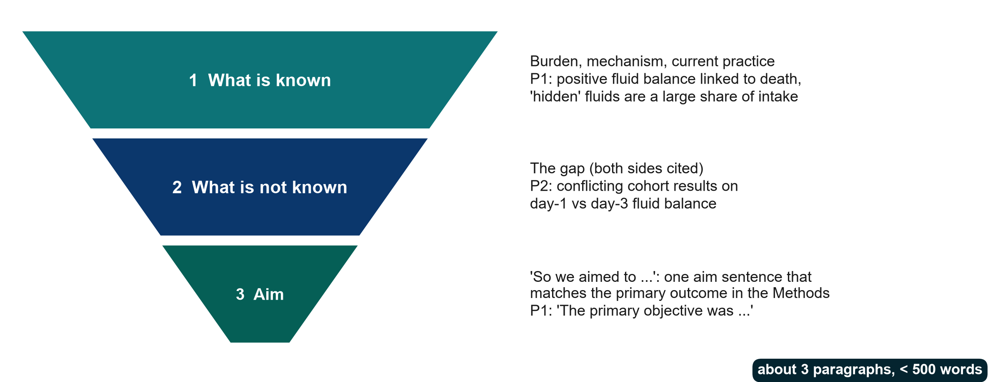
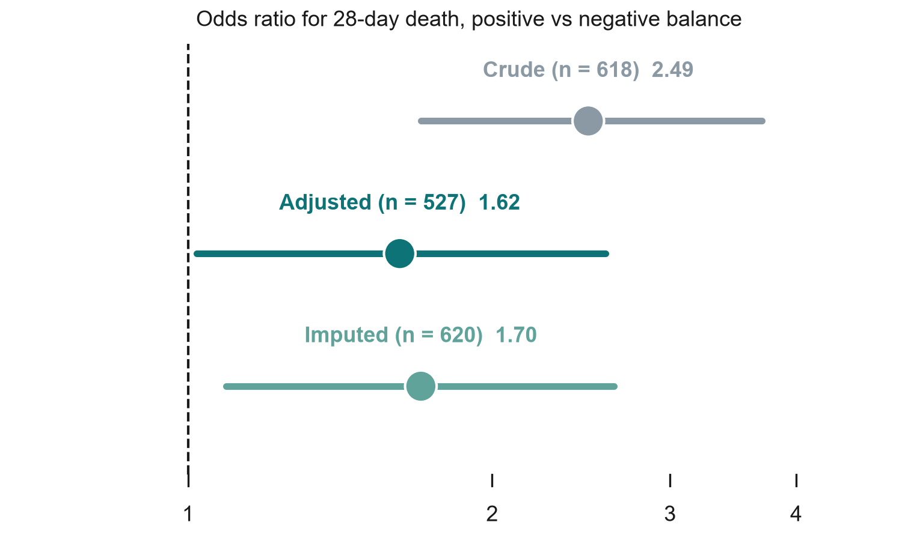
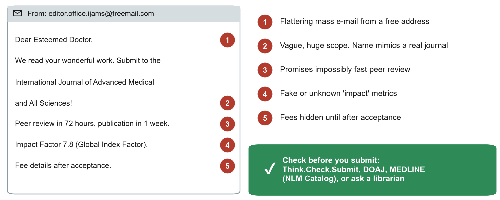
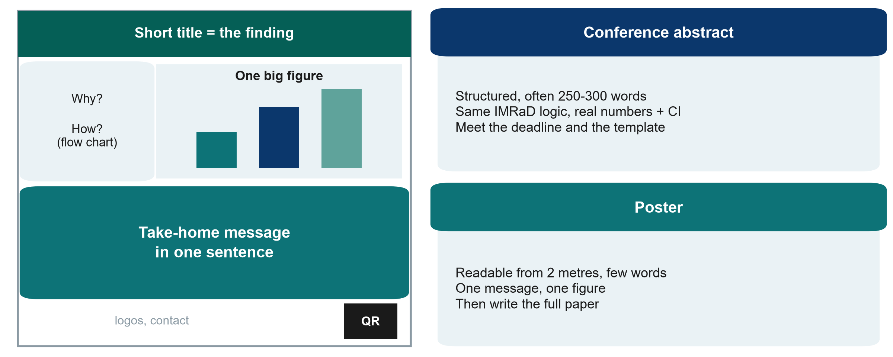

# Session 8 · Publish: polish your Results, get it out, present

## Week 8 · Saturday, 19:30-22:30 (online)

- 19:30  Recap: Session 7
- 19:35  8.1  Writing the paper (II): Introduction, Discussion, abstract, title
- 20:05  Manuscript workshop 2: improve your Results section
- 20:30  8.2  Getting published: from checklist to reviewers
- 21:05  8.3  Be the reviewer: Papers 1 and 2, as a whole class
- 21:30  Proposal presentations (about 5 volunteers), 22:15 closing

::: {.notes}
Session 8 (19:30-22:30, break 20:50-21:05). The last session.

Today: the Introduction, Discussion, abstract and title, improving the Results drafts, publishing, reviewing, and about five proposal presentations. The closing (22:15) has its own slides.

Before: email the exercise sheet, the original papers and the class Q1 Results from Session 7. Collect and open the presenters' slides.
:::

## Recap: three questions from Session 7

::: {.neu-banner style="--c:#6C3483"}
QUICK QUIZ · 5 min
:::

:::: {.columns}
::: {.column width="60%"}
::: {.neu-activity-steps style="--c:#6C3483"}
- Who consents for a sedated patient in septic shock?
- Which STROBE item asks for crude and adjusted estimates?
- Where does 'this may be because sicker patients got more fluid' belong?
:::
:::
::: {.column width="40%"}
::: {.neu-side .plain style="--c:#6C3483"}
Answers

- The legal representative (or deferred consent, if the committee approved it)
- Item 16 (main results)
- Discussion, not Results
:::
:::
::::

::: {.neu-output style="--c:#6C3483"}
**OUTPUT** Everyone back in writing mode
:::

::: {.notes}
Recap (19:30-19:35). Question 1 was the exit question: read two or three answers. Questions 2 and 3 are quick polls.

Question 3 leads into 8.1: the Discussion is where interpretation lives.
:::

## 8.1  \|  30 minutes

:::: {.neu-statement}
::: {.neu-big}
Writing the paper (II): Introduction, Discussion, abstract and title
:::

::: {.neu-sub}
What each part does, a worked example on Q1, a short check
:::
::::

::: {.notes}
Section 8.1 (19:35-20:05). About 2 minutes per slide and three 2-minute checks.

All four parts are taught as core. For the assignment, the title is required with the Results. The Introduction, Discussion and abstract are optional to submit. Slow down on the Discussion example.
:::

## Introduction: a funnel in three paragraphs

{.neu-fig}

::: {.neu-takeaway}
**KEY MESSAGE** Known, unknown, aim. The aim matches the primary outcome.
:::

::: {.notes}
The Introduction is a funnel: known, not known, aim. The aim matches the primary outcome.

Paper 1 does this in under 500 words. Paper 2 cites both sides of a conflict in paragraph 2.

Ask: in one sentence, what is not known about your question? That is paragraph 2.
:::

## Worked example: the Introduction funnel for FLUID-ICU (Q1)

:::: {.neu-cards style="--n:3"}
::: {.neu-card .plain style="--c:#0D7377"}
[1  Known]{.neu-card-title}

- Fluids save lives early in sepsis
- A positive balance is linked to death (Paper 2 and other cohorts)
:::
::: {.neu-card .plain style="--c:#0B376C"}
[2  Not known]{.neu-card-title}

- Sicker patients get more fluid
- Unclear whether the link remains after adjusting for severity
:::
::: {.neu-card .plain style="--c:#5FA39B"}
[3  Aim]{.neu-card-title}

- We examined whether a positive balance by day 3 is associated with 28-day mortality, after adjustment
:::
::::

::: {.neu-takeaway}
**KEY MESSAGE** Three paragraphs, about 350 words. The aim uses 'associated'.
:::

::: {.notes}
Worked example for Q1. Model sentences (adapt, do not copy):

P2: 'Because sicker patients receive more fluid, it remains uncertain whether this association persists after adjustment for severity.'

P3: 'We therefore examined whether a positive fluid balance by day 3 was associated with 28-day mortality.'

The gap is the confounding by indication from Session 4.
:::

## Check: known, not known or aim?

::: {.neu-banner style="--c:#6C3483"}
QUICK QUIZ · 2 min
:::

:::: {.columns}
::: {.column width="60%"}
::: {.neu-activity-steps style="--c:#6C3483"}
- 'Early fluids are a core part of sepsis care.'
- 'Sicker patients receive more fluid, so it is unclear whether the link with death remains after adjustment.'
- 'We examined whether a positive balance by day 3 was associated with 28-day mortality.'
- 'In our cohort, 35.9% of patients with a positive balance died.'
:::
:::
::: {.column width="40%"}
::: {.neu-side .plain style="--c:#6C3483"}
Answers

- Paragraph 1: known
- Paragraph 2: not known
- Paragraph 3: aim
- Not in the Introduction: your own results go in the Results
:::
:::
::::

::: {.notes}
Check (2 minutes). One poll per sentence: known, not known, aim, or not in the Introduction.

Sentence 4 is the trap: your own results never go in the Introduction.
:::

## Discussion: six moves

:::: {.neu-steps}
::: {.neu-step style="--c:#0D7377"}
[1 Answer]{.neu-step-label}

- First sentence answers the question
- Paper 1, p.8
:::
::: {.neu-step style="--c:#0B376C"}
[2 Compare]{.neu-step-label}

- With other studies, and why they differ
- Paper 1: vs CLASSIC, POINCARE-2
:::
::: {.neu-step style="--c:#5FA39B"}
[3 Explain]{.neu-step-label}

- Mechanism, briefly
- Paper 2: four-phase fluid model
:::
::: {.neu-step style="--c:#0070C0"}
[4 Limits]{.neu-step-label}

- Specific: mechanism, direction, fix
- Paper 1: control-group contamination
:::
::: {.neu-step style="--c:#055F56"}
[5 Implications]{.neu-step-label}

- For practice and research, labelled
- Paper 1: 'would probably be advantageous' is speculation
:::
::: {.neu-step style="--c:#8A99A3"}
[6 Conclusion]{.neu-step-label}

- Same message as abstract and title
:::
::::

::: {.neu-takeaway}
**KEY MESSAGE** Answer first. Limitations with their direction. Conclusion = abstract = title.
:::

::: {.notes}
Six moves in order: answer, compare, explain, limitations with their direction, implications, conclusion.

Paper 1 answers in its first sentence. Paper 2 misses survivor bias in its limitations.

Poll: which move do first-time writers skip? Expected: the direction of each limitation.
:::

## Worked example: the Discussion for FLUID-ICU question 1

::: {.neu-intro}
Six moves, one sentence each (simulated data).
:::

- 1 Answer: A positive balance by day 3 was associated with higher 28-day mortality (adjusted OR 1.62, 95% CI 1.02 to 2.59).
- 2 Compare: This agrees with Paper 2 (day-2 HR 2.13), although our adjusted estimate is smaller.
- 3 Explain: Most of the crude association (OR 2.49) reflected confounding by indication: sicker patients received more fluid.
- 4 Limitations: Residual confounding and reverse causation may exaggerate the association. The CI of the adjusted Cox HR reached 1.00.
- 5 Implications: These data do not justify restricting fluid. A randomised trial (like Paper 1) is needed.
- 6 Conclusion: 'associated with', the same verb as the aim, abstract and title.

::: {.notes}
Six moves, one sentence each, numbers from results pack Q1 (simulated).

The heart-failure interaction (OR 4.39 vs 1.29) is a hypothesis, not a finding.

The conclusion uses the same verb as the aim and the title: 'associated with'.
:::

## Why the odds ratio shrank: explain it in the Discussion

:::: {.columns}
::: {.column width="38%"}
::: {.neu-side-notes}
### FLUID-ICU Q1 (simulated)

- Crude OR 2.49 (1.70 to 3.70)
- Adjusted OR 1.62 (1.02 to 2.59)
- Imputed OR 1.70 (1.09 to 2.64)
- Gap = confounding by indication
:::
:::
::: {.column width="62%"}
{.neu-fig-side}
:::
::::

::: {.neu-takeaway}
**KEY MESSAGE** Report both, explain the gap. Keep the verb at 'associated'.
:::

::: {.notes}
Crude 2.49, adjusted 1.62, imputed 1.70. The drop is the Session 4 lesson made visible.

The adjusted CI starts at 1.02: 'a modest association remained'.

Ask: what if the adjusted CI had crossed 1? Expected: 'no clear evidence of an association after adjustment', not 'no effect'.
:::

## Calibrated language: match the verb to the design

::: {.neu-intro}
Stronger claim = needs a stronger design
:::

| Verb (strongest at the top) | Needs at least |
|:---|:---|
| **['causes', 'prevents', 'proves']{style="color:#FFFFFF"}** | Several large RCTs agree |
| **['reduced', 'increased', 'did not reduce']{style="color:#FFFFFF"}** | A randomised trial (Paper 1) |
| **['may contribute to', 'is consistent with']{style="color:#FFFFFF"}** | Observational + causal reasoning |
| **['is associated with', 'predicts']{style="color:#FFFFFF"}** | Cohort, case-control (Paper 2) |
| **['was observed in', 'was common']{style="color:#FFFFFF"}** | Descriptive, case series |

::: {.neu-table-caption}
Never: 'trend' for p = 0.42. 'No difference' (say 'no evidence of a difference'). 'First', 'ever', 'novel' unchecked. 'Impact' in an observational study.
:::

::: {.neu-takeaway}
**KEY MESSAGE** Climb the ladder only as far as your design allows.
:::

::: {.notes}
The strength of a verb is a claim. Read the ladder from the bottom.

Never: 'trend' for p = 0.42 (Paper 1), 'impact' in a cohort (Paper 2), 'first' or 'novel' unchecked.

These words matter in the Results section too.

Ask: rewrite 'positive fluid balance increases mortality' for Paper 2.
:::

## Check: fix the verb (FLUID-ICU, simulated)

::: {.neu-banner style="--c:#6C3483"}
QUICK QUIZ · 2 min
:::

:::: {.columns}
::: {.column width="60%"}
::: {.neu-activity-steps style="--c:#6C3483"}
- 'A positive balance caused higher mortality (OR 1.62).'
- 'Fluid overload increases AKI (acute kidney injury) (OR 1.27 per 10 ml/kg).'
- 'There was a trend towards death (Cox HR 1.46, 95% CI 1.00 to 2.13).'
- 'Lactate predicts death (OR 1.39 per mmol/L).'
:::
:::
::: {.column width="40%"}
::: {.neu-side .plain style="--c:#6C3483"}
Better

- '... was associated with ...'
- '... was associated with higher odds of AKI'
- 'HR 1.46 (1.00 to 2.13): the CI reaches 1'
- Fine for prediction. For cause, 'associated with'
:::
:::
::::

::: {.notes}
Check (2 minutes). One poll per sentence: 'fine' or 'fix'. Call on one person for the fix.

Sentence 3: no 'trend', give the estimate and say the CI reaches 1. Sentence 4: 'predicts' is fine for prediction.
:::

## The structured abstract: the shop window

| Section | What it must say | Good example |
|:---|:---|:---|
| Background | Problem, gap and aim in 1-2 sentences |
| Methods | Design, setting, participants, exposure, primary outcome, analysis | Paper 2: population, setting and size |
| Results | Numbers analysed. Main effect with 95% CI. Key secondary results | Paper 2: every result as HR (95% CI) |
| Conclusion | Answer the aim in words the design allows | Paper 1: negative result stated plainly |

::: {.neu-table-caption}
250-300 words, plus the registration number for trials. Fix in Paper 1: medians reported, but the estimate called a 'mean difference'.
:::

::: {.notes}
Structured abstract, 250-300 words, must stand alone.

Paper 2 gives every result as HR with CI. Paper 1 states its negative result plainly.

Write it last and check every number matches the text and tables.
:::

## Worked example: the abstract and title for FLUID-ICU question 1

::: {.neu-intro}
Copy the numbers from your Results (simulated data, about 120 words shown).
:::

- **Title: Positive fluid balance by day 3 and 28-day mortality in sepsis: a multicentre cohort study**
- Background: A positive fluid balance is linked to death in sepsis, but sicker patients receive more fluid. We examined the association after adjustment for severity.
- Methods: Prospective cohort (simulated teaching data), 620 adults, 4 ICUs, 2023-2024. Exposure: positive balance by day 3. Outcome: 28-day death. Logistic and Cox regression adjusted for severity.
- Results: Of 618 patients, 373 (60.4%) had a positive balance, 35.9% vs 18.4% died. Crude OR 2.49 (1.70 to 3.70), adjusted OR 1.62 (95% CI 1.02 to 2.59).
- Conclusions: A positive balance was modestly associated with 28-day mortality. Most of the crude association reflected severity. A randomised trial is needed.

::: {.notes}
Worked example (simulated). The title is required for everyone. The abstract is optional to submit, but everyone should be able to write one.

Conclusions: 'modestly associated', matching a CI of 1.02 to 2.59.

Ask: which sentences change if the CI had been 0.95 to 2.40? Expected: Results and Conclusions.
:::

## Check: fix these abstract sentences

::: {.neu-banner style="--c:#6C3483"}
QUICK QUIZ · 2 min
:::

:::: {.columns}
::: {.column width="60%"}
::: {.neu-activity-steps style="--c:#6C3483"}
- Methods: 'We studied fluid balance in ICU patients.'
- Results: 'Mortality was significantly higher with a positive balance.'
- Conclusions: 'A positive balance increases mortality.'
- Results: 'The results are discussed in the paper.'
:::
:::
::: {.column width="40%"}
::: {.neu-side .plain style="--c:#6C3483"}
Better

- Add design, setting, participants, exposure, outcome
- Give n, %, and the OR with its 95% CI
- 'was associated with': it is a cohort
- Give the main numbers: the abstract must stand alone
:::
:::
::::

::: {.notes}
Check (2 minutes). Call on one person per sentence for the fix.

Every number in the abstract must match the Results.
:::

## Title and keywords: your PICO in one line

::: {.neu-intro}
Formula from your PICO: design, I vs C, in P, on O. 10-16 words. No 'impact', 'novel', 'first'.
:::

:::: {.neu-cards style="--n:2"}
::: {.neu-card .plain style="--c:#0D7377"}
[Paper 1 (trial)]{.neu-card-title}

- Published: 'Impact on fluid balance of an optimized restrictive strategy targeting non-resuscitative fluids in ... septic shock: a single-blind, ... pilot study'
- [Problem: over 25 words, value words]{style="color:#C0392B"}
- **[Better: Restricting non-resuscitative fluids in septic shock: a multicentre pilot randomised trial]{style="color:#2E8B57"}**
:::
::: {.neu-card .plain style="--c:#0B376C"}
[Paper 2 (cohort)]{.neu-card-title}

- Published: 'Impact of a cumulative positive fluid balance during the first three ICU days in patients with sepsis: a propensity score-matched cohort study'
- [Problem: 'impact' is a causal word for a cohort]{style="color:#C0392B"}
- **[Better: Positive fluid balance in the first three ICU days and 28-day mortality in sepsis: a propensity-matched cohort]{style="color:#2E8B57"}**
:::
::::

::: {.neu-takeaway}
**KEY MESSAGE** Keywords: 3-6 MeSH terms (PubMed subject headings) not already in the title.
:::

::: {.notes}
Build the title from the PICO: design, exposure, population, outcome, 10-16 words. No 'impact', 'novel', 'first'.

Paper 2's 'Impact' is causal wording for a cohort.

Keywords: 3-6 MeSH terms not already in the title.

Everyone writes their own working title in the workshop that follows.
:::

## Before you submit: references, checklist, final read

:::: {.neu-cards style="--n:3"}
::: {.neu-card .plain style="--c:#0D7377"}
[References]{.neu-card-title}

- Use a reference manager
- Check every citation
- Paper 2 cites the wrong reference for its covariates
:::
::: {.neu-card .plain style="--c:#0B376C"}
[Reporting checklist]{.neu-card-title}

- Fill it in while writing
- Add page numbers
- Neither paper names CONSORT or STROBE
:::
::: {.neu-card .plain style="--c:#5FA39B"}
[Final read]{.neu-card-title}

- Text = table, for every number
- Call-outs point to the right figure
- A colleague reads the tables
:::
::::

::: {.neu-takeaway}
**KEY MESSAGE** Most errors in these two papers needed no new data, only a careful co-author.
:::

::: {.notes}
References: use a reference manager and check every citation. Never cite a reference an AI suggested without reading it.

Checklist: fill it in while you write.

Final read: every number in the text against the tables. Most errors in both papers needed only a careful co-author.
:::

## Manuscript workshop 2  \|  25 minutes

:::: {.neu-statement}
::: {.neu-big}
Improve your Results section: together, then on your own
:::

::: {.neu-sub}
17 minutes on the class Q1 draft, then 8 minutes on your own draft and title
:::
::::

::: {.notes}
Manuscript workshop 2 (20:05-20:30).

Part 1: improve last week's class Q1 Results live, using the reviewer checklist. Part 2: each participant checks their own draft and writes the working title.

Instructions: s8\_exercises Part B. Model text: s8\_solutions Part B.
:::

## Manuscript workshop 2, part 1: we improve the Q1 Results together

::: {.neu-banner style="--c:#0D7377"}
WHOLE-CLASS TASK · 17 min
:::

:::: {.columns}
::: {.column width="60%"}
::: {.neu-activity-steps style="--c:#0D7377"}
- Number check (5 min): every number against results pack Q1
- Tables and figure (4 min): does each stand alone?
- Words (5 min): no interpretation, no 'trend', no causal verbs
- Working title (3 min): design stated, 'associated'
:::
:::
::: {.column width="40%"}
::: {.neu-side .plain style="--c:#0D7377"}
Use

- Class Q1 Results from Session 7 (PDF)
- Results pack Q1
- The checklist in Peer\_Review\_Instructions
:::
:::
::::

::: {.neu-output style="--c:#0D7377"}
**OUTPUT** An improved class Q1 Results section, sent as a PDF after the session
:::

::: {.notes}
Workshop part 1 (20:05-20:22). Open last week's class draft and type into it. Call each phase.

Prompts: 'Does every percentage have a denominator?' 'Can Table 1 be read without the text?' 'Is any sentence explaining rather than reporting?'

Send the improved draft as a PDF after the session.
:::

## Manuscript workshop 2, part 2: your own Results and title

::: {.neu-banner style="--c:#0B376C"}
INDIVIDUAL TASK · 8 min
:::

:::: {.columns}
::: {.column width="60%"}
::: {.neu-activity-steps style="--c:#0B376C"}
- Run the same checks on your own Results draft
- Write your working title: design stated, 10-16 words, 'associated'
- Two volunteers read their title aloud. The instructor comments
- By 23:59 on Sunday 20 December: a final check, then email it
:::
:::
::: {.column width="40%"}
::: {.neu-side .plain style="--c:#0B376C"}
Submit

- Results section, working title, Table 1, main table or figure
- By 23:59, Sunday 20 December
- Email it to your reviewer and the instructor
- Other sections (optional) in the same file
:::
:::
::::

::: {.neu-output style="--c:#0B376C"}
**OUTPUT** Your working title. Your Results section emailed by 23:59 on Sunday 20 December
:::

::: {.notes}
Workshop part 2 (20:22-20:30). Individual.

Post in the chat: Q2, AKI may also cause fluid accumulation. Q3, ventilator-free days count death as zero. Q4, give both complete-case and imputed estimates. Q5, survivors only.

Remind: the draft goes by email to the reviewer and the instructor (myluong1710\@gmail.com) by 23:59 tomorrow, Sunday 20 December.
:::

## 8.2  \|  20 minutes

:::: {.neu-statement}
::: {.neu-big}
Getting published
:::

::: {.neu-sub}
From checklist to reviewers, and the traps on the way
:::
::::

::: {.notes}
Section 8.2 (20:30-20:50). About 2 minutes per slide, a 3-minute demo and a 2-minute check.

Preprints, licences, acceptance and rejection are in the extra slides.
:::

## Reporting guidelines: choose by design

| Study design | Reporting guideline | Our example |
|:---|:---|:---|
| Randomised trial | CONSORT | Paper 1 |
| Cohort, case-control, cross-sectional | STROBE | Paper 2, FLUID-ICU |
| Diagnostic accuracy study | STARD |
| Systematic review or meta-analysis | PRISMA |
| Trial protocol | SPIRIT |
| Case report | CARE |

::: {.neu-table-caption}
All checklists are free at the EQUATOR Network (equator-network.org). Name your guideline in Proposal Part 4 and use it as a writing checklist.
:::

::: {.notes}
One reporting guideline per design, all free on the EQUATOR Network. Many journals require the checklist with page numbers.

Neither paper names its guideline.

Poll: which guideline fits your proposal? Expected: mostly STROBE.
:::

## Choosing a journal: four checks

::: {.neu-intro}
Decide the target journal before you write: it sets the rules.
:::

:::: {.neu-cards style="--n:4"}
::: {.neu-card .plain style="--c:#0D7377"}
[Fit]{.neu-card-title}

- Who needs your result?
- Read 3 recent issues
- Similar designs published?
:::
::: {.neu-card .plain style="--c:#0B376C"}
[Trust]{.neu-card-title}

- Indexed in MEDLINE, DOAJ, Scopus or Web of Science
- Clear peer-review policy
:::
::: {.neu-card .plain style="--c:#5FA39B"}
[Rules]{.neu-card-title}

- Guide for Authors
- Word limit, checklist
- Registration required?
:::
::: {.neu-card .plain style="--c:#0070C0"}
[Cost and speed]{.neu-card-title}

- Article fee (APC) and waivers
- Licence: who may re-use the paper
- Paper 1: 7 weeks. Paper 2: 7 months
:::
::::

::: {.neu-takeaway}
**KEY MESSAGE** A good journal is one your readers read, and one that is honestly run.
:::

::: {.notes}
Choose the journal first: its Guide for Authors sets the rules.

Trust: indexed in MEDLINE, DOAJ, Scopus or Web of Science. Cost: the article fee and waivers.

Paper 1 took 7 weeks to acceptance, Paper 2 7 months.

Ask: name one journal your unit reads.
:::

## Spot the predatory journal

{.neu-fig}

::: {.neu-takeaway}
**KEY MESSAGE** If a journal finds you by flattering e-mail, check it twice.
:::

::: {.notes}
Predatory journals take fees without real peer review or indexing.

Walk the five red flags on the invented e-mail. Checks: Think.Check.Submit, DOAJ, the NLM Catalog, the hospital librarian.

Poll: did you get an e-mail like this last month?
:::

## Live demo: find a checklist and check a journal

::: {.neu-banner style="--c:#B5651D"}
LIVE DEMO · 3 min
:::

:::: {.columns}
::: {.column width="60%"}
::: {.neu-activity-steps style="--c:#B5651D"}
- Open the EQUATOR Network website and search 'CONSORT'
- Show the checklist and the flow diagram (Paper 1 has one)
- Find STROBE the same way (Paper 2 and FLUID-ICU)
- Check a journal in DOAJ and in the NLM Catalog
- Open the Think.Check.Submit checklist
:::
:::
::: {.column width="40%"}
::: {.neu-side .plain style="--c:#B5651D"}
Watch for

- Where the checklist PDF is
- How to see if a journal is in MEDLINE
- Three questions to ask any journal
:::
:::
::::

::: {.neu-output style="--c:#B5651D"}
**OUTPUT** Everyone checks the journal and guideline in their own publication plan at home
:::

::: {.notes}
Demo (20:36-20:39). Script and offline fallback: s8\_demo.md.

EQUATOR: CONSORT, then STROBE. DOAJ, then the NLM Catalog ('currently indexed in MEDLINE'). End on Think.Check.Submit. Paste the four addresses in the chat.
:::

## The submission package

| Item | What it contains |
|:---|:---|
| Cover letter | Why this journal, what is new. Not under review elsewhere |
| Title page | Authors, affiliations, ORCID iDs (free researcher identifiers), corresponding author, word count |
| Manuscript | IMRaD, formatted as the Guide for Authors says (blinded if asked) |
| Tables and figures | Separate files, right format and resolution |
| Reporting checklist | CONSORT, STROBE ..., with page numbers |
| Declarations | Ethics number, consent, conflicts of interest, funding, data sharing, author roles, AI use |
| Registration number | Trials and systematic reviews |
| Suggested reviewers | Experts with no conflict, not recent co-authors |
| Supplementary files | Protocol, extra tables, long flow charts |

::: {.notes}
Journals check the package before any scientific review. Missing items send the paper back.

ORCID iD: free, register at orcid.org.

Paper 1 has a complete declarations block. Template: Cover\_Letter\_Template.

Ask: who already has an ORCID iD?
:::

## The peer-review journey

::: {.neu-intro}
Rejected? Improve the paper, then submit to another journal. Never to two at once.
:::

:::: {.neu-steps}
::: {.neu-step style="--c:#0D7377"}
[Submit]{.neu-step-label}

- Manuscript, cover letter, checklist
:::
::: {.neu-step style="--c:#0B376C"}
[Editor]{.neu-step-label}

- Screens the paper
- Desk rejection is common
:::
::: {.neu-step style="--c:#5FA39B"}
[Reviewers]{.neu-step-label}

- 2 or 3 peer reviewers comment
:::
::: {.neu-step style="--c:#0070C0"}
[Decision]{.neu-step-label}

- Accept, minor or major revision, or reject
:::
::: {.neu-step style="--c:#055F56"}
[Revise]{.neu-step-label}

- Change the paper
- Reply point by point
:::
::: {.neu-step style="--c:#8A99A3"}
[Accepted]{.neu-step-label}

- Proofs, then publication
:::
::::

::: {.neu-takeaway}
**KEY MESSAGE** Most papers are revised before acceptance. Reply to every point politely.
:::

::: {.notes}
Submit, editor screen (desk rejection is common), 2 or 3 reviewers, decision, revision, acceptance.

One journal at a time. After rejection, improve the paper and submit elsewhere.

Ask: a reviewer is wrong. What do you do? Expected: thank, explain with evidence, clarify the text.
:::

## Responding to reviewers: the point-by-point table

::: {.neu-intro}
Comment, response, and exactly where the paper changed. Illustrative rows built on the annotated Paper 1.
:::

:::: {.neu-cards style="--n:3"}
::: {.neu-card .plain style="--c:#0D7377"}
[R1.1]{.neu-card-title}

- Comment: please do not call p = 0.42 a 'non-significant trend'.
- [Accept: thank you, we agree. We report the estimate with its 95% CI and removed 'trend'.]{style="color:#2E8B57"}
- Change: Discussion, p.10, lines 4-6
:::
::: {.neu-card .plain style="--c:#0B376C"}
[R1.2]{.neu-card-title}

- Comment: how was allocation concealed with blocks of 2?
- [Clarify: allocation was central and computer-generated. Block size added as a limitation.]{style="color:#0B376C"}
- Change: Methods p.3, limitations p.10
:::
::: {.neu-card .plain style="--c:#5FA39B"}
[R2.1]{.neu-card-title}

- Comment: please add 90-day mortality.
- [Rebut, politely: 90-day status was not a pre-specified outcome and was not collected.]{style="color:#D9822B"}
- Change: noted as a limitation, p.10
:::
::::

::: {.neu-takeaway}
**KEY MESSAGE** Thank, answer every point, show what changed, and disagree politely with evidence.
:::

::: {.notes}
The response letter is a table: comment, response, and where the paper changed.

The three rows: accept, clarify, and a polite rebuttal for data never collected.

Common mistakes: 'done' with no detail, changes without a location.

Participants use Response\_to\_Reviewers\_Template after their peer review.
:::

## Check: true or false?

::: {.neu-banner style="--c:#6C3483"}
QUICK QUIZ · 2 min
:::

:::: {.columns}
::: {.column width="60%"}
::: {.neu-activity-steps style="--c:#6C3483"}
- 'A journal that e-mails me first is probably predatory'
- 'I can send my paper to two journals at once to save time'
- 'A preprint has been peer reviewed'
- 'I must answer every reviewer comment, even if I disagree'
- 'The FLUID-ICU paper should follow CONSORT'
:::
:::
::: {.column width="40%"}
::: {.neu-side .plain style="--c:#6C3483"}
Answers

- Often: check it twice
- False: duplicate submission
- False: posted before peer review
- True: politely, with evidence
- False: STROBE (cohort)
:::
:::
::::

::: {.notes}
Check (20:48-20:50). One true/false poll each.

Statement 1 is 'often true'. Statement 3: a preprint is posted before peer review.
:::

---

::: {style="text-align:center"}
{width="32%"}

[Break]{style="color:#0D7377;font-size:1.6em;font-weight:700"}

[15 min]{style="color:#595959;font-size:0.9em"}
:::

::: {.notes}
Break (20:50-21:05). Say: we restart at 21:05 with 8.3, then presentations and closing. Open Paper 1, Paper 2 and Part D of the exercise sheet.

Check you can share each presenter's slides.
:::

## 8.3  \|  25 minutes

:::: {.neu-statement}
::: {.neu-big}
Be the reviewer
:::

::: {.neu-sub}
The whole class appraises Paper 1 and Paper 2 together
:::
::::

::: {.notes}
Section 8.3 (21:05-21:30). Guide with model answers: appraisal\_instructor\_guide.md.

3 minutes set-up, 15 minutes appraisal with polls, 7 minutes on what each design may claim.

The reviewing skills return in the peer review of the Results sections, which uses the Results checklist in Peer\_Review\_Instructions.
:::

## Two papers, one question

::: {.neu-intro}
Same clinical question (fluids in septic shock), two designs. Both PDFs were sent by email.
:::

:::: {.neu-cards style="--n:2"}
::: {.neu-card .plain style="--c:#0D7377"}
[Paper 1: randomised trial]{.neu-card-title}

- Boulet 2024, Critical Care
- Pilot trial, 48 patients analysed
- Restrictive vs usual fluids in septic shock
- Primary outcome: fluid balance on day 5
:::
::: {.neu-card .plain style="--c:#0B376C"}
[Paper 2: cohort study]{.neu-card-title}

- Hyun 2023, Annals of Intensive Care
- Propensity-matched cohort, 2516 patients
- Positive fluid balance in sepsis
- Outcome: 28-day mortality
:::
::::

::: {.neu-takeaway}
**KEY MESSAGE** Same question, two designs: compare what each may claim.
:::

::: {.notes}
Set-up (1 minute): same clinical question, two designs, the same 10 questions.

Each participant fills in their own answer grid (Part D): Yes, No or Can't tell, plus the page.
:::

## The 10-question checklist (1-5)

:::: {.neu-cards style="--n:5"}
::: {.neu-card .plain style="--c:#0D7377"}
[1  Question]{.neu-card-title}

- Can you write the study's PICO in one line?
:::
::: {.neu-card .plain style="--c:#0B376C"}
[2  Design]{.neu-card-title}

- What is the design, and is it the right one for the question?
:::
::: {.neu-card .plain style="--c:#5FA39B"}
[3  Participants]{.neu-card-title}

- Who was included, and who was left out?
- Would your patients have been included?
:::
::: {.neu-card .plain style="--c:#0070C0"}
[4  Comparison groups]{.neu-card-title}

- Were the groups similar at the start (Table 1)?
- How was this achieved: randomisation, matching or adjustment?
:::
::: {.neu-card .plain style="--c:#055F56"}
[5  Bias]{.neu-card-title}

- Who knew which group patients were in (blinding)?
- Could that change the outcome?
:::
::::

::: {.notes}
Read each question once. Do not give answers.

Q3 is external validity: would your patients be in this study? Q4: look at Table 1.
:::

## The 10-question checklist (6-10)

:::: {.neu-cards style="--n:5"}
::: {.neu-card .plain style="--c:#0D7377"}
[6  Outcome]{.neu-card-title}

- Was there one pre-specified primary outcome, measured the same way in both groups?
:::
::: {.neu-card .plain style="--c:#0B376C"}
[7  Numbers]{.neu-card-title}

- What is the main result as an effect size with 95% CI?
- Is the CI narrow or wide?
:::
::: {.neu-card .plain style="--c:#5FA39B"}
[8  Words vs design]{.neu-card-title}

- Do the conclusions match the design ('associated' vs 'caused', no 'trend' for p = 0.42)?
:::
::: {.neu-card .plain style="--c:#0070C0"}
[9  Limitations]{.neu-card-title}

- Are the main limitations stated honestly?
- Name one the authors missed.
:::
::: {.neu-card .plain style="--c:#055F56"}
[10  Use]{.neu-card-title}

- Would this change practice in your unit?
- Why, or why not?
:::
::::

::: {.notes}
Q6 and Q7 use Session 6. Q8 is the heart of today: are the words as strong as the design allows? Q9: one limitation the authors missed. Q10: a reason is needed.
:::

## Be the reviewer: the whole class appraises both papers

::: {.neu-banner style="--c:#0D7377"}
WHOLE-CLASS TASK · 15 min
:::

:::: {.columns}
::: {.column width="60%"}
::: {.neu-activity-steps style="--c:#0D7377"}
- The instructor shows the right page of each paper on the shared screen
- Paper 1: questions 4, 5, 7, 8 and 9
- Paper 2: questions 4, 5, 8 and 9
- For each question, vote in the poll: Yes, No or Can't tell
- A volunteer gives the page and the sentence, microphone on
:::
:::
::: {.column width="40%"}
::: {.neu-side .plain style="--c:#0D7377"}
Where to look

- Abstract: question and result
- Methods: design, blinding, outcome
- Table 1: groups similar?
- Discussion: words and limitations
:::
:::
::::

::: {.neu-output style="--c:#0D7377"}
**OUTPUT** A class answer grid for both papers, shared as a PDF. The other questions as homework
:::

::: {.notes}
Appraisal (21:08-21:23), about 1.5 minutes per question: read, show the page, poll, one person gives the evidence.

Key prompts: Paper 1, who was not blinded and who prescribed the fluid? Paper 2, who is missing when patients must stay 3 days?

Questions 1-3, 6 and 10 are homework.
:::

## What may each design claim?

:::: {.neu-cards style="--n:2"}
::: {.neu-card .plain style="--c:#0D7377"}
[Paper 1: randomised trial (n = 48)]{.neu-card-title}

- Chance decided the groups: known and unknown factors balanced
- Day-5 balance: difference 13.2 ml/kg (95% CI -15.2 to 41.6), p = 0.42
- **[May say: 'did not reduce']{style="color:#2E8B57"}**
- [But too small to be sure: no 'trend']{style="color:#C0392B"}
:::
::: {.neu-card .plain style="--c:#0B376C"}
[Paper 2: matched cohort (n = 2516)]{.neu-card-title}

- Doctors decided the fluid: only measured factors balanced
- Day-2 positive balance and 28-day death: HR 2.13 (95% CI 1.48 to 3.06)
- **[May say: 'is associated with']{style="color:#2E8B57"}**
- [Not 'impact' or 'show': sicker patients get more fluid]{style="color:#C0392B"}
:::
::::

::: {.neu-takeaway}
**KEY MESSAGE** Randomisation earns the word 'caused'. Observation earns 'associated'.
:::

::: {.notes}
Plenary (21:23-21:30).

Paper 1: randomised, may say 'did not reduce', but 48 patients: no evidence of an effect, not evidence of none, and no 'trend'.

Paper 2: doctors decided the fluid, so 'is associated with', not 'impact'.

Poll: which paper is stronger for causation, which for real-world risk?
:::

## The two papers side by side

| Paper 1: RCT (Boulet 2024) | Paper 2: cohort (Hyun 2023) |
|:---|:---|
| Groups made similar by | Randomisation 1:1 (blocks of 2) | Propensity matching (measured factors only) |
| Who knew the group | Clinicians knew, patients, statistician blinded | Everyone (observational) |
| Main result | 13.2 ml/kg (95% CI -15.2 to 41.6), p = 0.42 | Day 2: HR 2.13 (1.48 to 3.06) |
| Missed limitation | Blocks of 2 with unblinded clinicians | Survivor bias (ICU stay of 3+ days) |
| Wording problem | 'Non-significant trend' (p = 0.42) | 'Impact', 'did not impact', 'show' |
| May claim | Did not reduce day-5 balance (small pilot) | Positive balance associated with death |

::: {.neu-table-caption}
RCT = randomised controlled trial. Pages and details: the trainers' appraisal guide
:::

::: {.notes}
Reveal this table only after the class has answered.

Four messages: design sets the verb, a wide CI means 'we don't know yet', published is not the same as correct, name the reporting guideline.

Transition: 'Now some of your own proposals.'
:::

## Proposal presentations  \|  45 minutes

:::: {.neu-statement}
::: {.neu-big}
Your proposals and publication plans
:::

::: {.neu-sub}
About 5 volunteers, 6 minutes each, then 2 minutes of feedback. Everyone submits slides.
:::
::::

::: {.notes}
Presentations (21:30-22:15): about five volunteers, 6 minutes plus 2 minutes feedback, then a 5-minute closing round.

Everyone submits slides and the written proposal by email to the instructor (myluong1710\@gmail.com) before 19:30 today.

The co-instructor posts '2 min', '1 min' and 'Time' in the chat. Stop the talk at 6:30.
:::

## How proposals and presentations are scored

| Criterion | What we look for | Points |
|:---|:---|:---|
| 12  Structure and content | All 6 slides. Question, design, outcome, sample size, ethics, journal and guideline visible | 0-6 |
| 13  Clarity | Everyone in the class understands. One message per slide | 0-6 |
| 14  Visual design | Readable on a shared screen. Pictures, not text | 0-6 |
| 15  Timekeeping | Finished between 5:00 and 6:00 | 0-6 |
| 16  Questions and discussion | Answers directly and honestly, names the limitations | 0-6 |

::: {.neu-table-caption}
Written proposal (criteria 1-11, /70): everyone. Criteria 12-16 (/30): presenters only. Rubric: Proposal\_Rubric (sent by email with the proposal brief)
:::

::: {.notes}
The written proposal is scored for everyone after the course. Criteria 12-16 score the presentation, for presenters only. Presenting does not lower the score.

Feedback in 2 minutes: two people give two strengths and one suggestion, then the instructor, then the presenter says thank you.
:::

## Proposal presentations

::: {.neu-banner style="--c:#0070C0"}
PRESENTATIONS · 45 min
:::

:::: {.columns}
::: {.column width="60%"}
::: {.neu-activity-steps style="--c:#0070C0"}
- About 5 volunteers present their own proposal: 6 minutes, 6 slides
- Slides: title, problem and PICO, design, data and analysis, ethics and feasibility, publication plan
- Time signals in the chat: '2 min' at 4:00, '1 min' at 5:00, 'Time' at 6:00
- Feedback, 2 minutes: two people give two strengths and one suggestion (microphone on), then the instructor
- Everyone submits slides and the written proposal
:::
:::
::: {.column width="40%"}
::: {.neu-side .plain style="--c:#0070C0"}
Running order

- 21:30  Presenter 1
- 21:38  Presenter 2
- 21:46  Presenter 3
- 21:54  Presenter 4
- 22:02  Presenter 5
- 22:10  Closing round (5 min)
:::
:::
::::

::: {.neu-output style="--c:#0070C0"}
**OUTPUT** About five proposals presented. Every proposal and slide set submitted
:::

::: {.notes}
Share each presenter's slides. Keep this slide up between talks.

Feedback: a genuine strength, the most important improvement, one question if time allows. Check slide 6: journal, guideline, a calibrated title, author roles.

If late, shorten the closing round, never the last talks. At 22:15 move to the closing.
:::

## Extra slides  \|  Session 8

:::: {.neu-statement}
::: {.neu-big}
Extra slides: Session 8
:::

::: {.neu-sub}
Use only if time allows, or for self-study
:::
::::

::: {.notes}
Extra slides: optional, for a fast class or self-study.
:::

## Key words of Session 8

| Term | In plain words |
|:---|:---|
| Introduction funnel | Known, not known, aim: three paragraphs |
| Six moves | Answer, compare, explain, limitations, implications, conclusion |
| Calibrated language | Verbs as strong as the design allows ('associated', not 'caused') |
| Predatory journal | Takes fees without real peer review or indexing |
| Point-by-point response | A table answering every reviewer comment with the change made |
| Preprint | Public manuscript posted before peer review |

::: {.neu-table-caption}
Full glossary (English-Vietnamese): the PDF sent by email
:::

::: {.notes}
Extra: the key words of Session 8, for self-study and the post-course quiz.
:::

## Write it right: fix the spin, then draft your title

::: {.neu-banner style="--c:#0B376C"}
INDIVIDUAL TASK · 6 min
:::

:::: {.columns}
::: {.column width="60%"}
::: {.neu-activity-steps style="--c:#0B376C"}
- Rewrite Paper 1's 'non-significant trend' sentence honestly (2 min)
- Rewrite Paper 2's title with calibrated wording
- Draft the working title of your own proposal from its PICO (4 min)
- One line each for Background, Methods, expected Results, Conclusion
:::
:::
::: {.column width="40%"}
::: {.neu-side .plain style="--c:#0B376C"}
Publication plan (Part 4)

- Working title
- Abstract skeleton
- Authors and their roles
- Target journal and guideline (8.2)
:::
:::
::::

::: {.neu-output style="--c:#0B376C"}
**OUTPUT** Working title and abstract skeleton for your own presentation
:::

::: {.notes}
Extra writing drill (homework). Worksheet: s8\_exercises Part A.

Model rewrite of Paper 1's 'trend': 'The point estimate favoured the restrictive strategy, but the 95% CI was wide (-15.2 to 41.6 ml/kg) and included no effect.'

Paper 2's title: 'association', not 'impact'.
:::

## Preprints, open access and licences

:::: {.neu-cards style="--n:3"}
::: {.neu-card .plain style="--c:#0D7377"}
[Preprint]{.neu-card-title}

- Posted before peer review (e.g. medRxiv)
- Fast, timestamped, open feedback
- Not peer-reviewed: say so
- Check the journal's policy
:::
::: {.neu-card .plain style="--c:#0B376C"}
[Open access]{.neu-card-title}

- Free for everyone to read
- Gold: the journal charges a fee (APC)
- Green: accepted version in a repository
- Ask about fee waivers
:::
::: {.neu-card .plain style="--c:#5FA39B"}
[Licence]{.neu-card-title}

- CC BY: re-use with credit (Paper 2)
- CC BY-NC-ND: share, no changes (Paper 1)
- Read it before you sign
:::
::::

::: {.neu-takeaway}
**KEY MESSAGE** Know who can read, re-use and pay before you submit.
:::

::: {.notes}
Extra. A preprint is posted before peer review: say so. Gold open access usually has a fee, green means a repository copy. Paper 2 is CC BY, Paper 1 CC BY-NC-ND.
:::

## After acceptance: proofs, sharing, corrections

:::: {.neu-steps}
::: {.neu-step style="--c:#0D7377"}
[Accepted]{.neu-step-label}

- Congratulations
:::
::: {.neu-step style="--c:#0B376C"}
[Proofs]{.neu-step-label}

- Check every number, name and table
:::
::: {.neu-step style="--c:#5FA39B"}
[Published]{.neu-step-label}

- Online, with a DOI
:::
::: {.neu-step style="--c:#0070C0"}
[Share]{.neu-step-label}

- Repository, plain-language summary, your unit
:::
::: {.neu-step style="--c:#055F56"}
[Correct]{.neu-step-label}

- Openly, if errors appear
:::
::::

::: {.neu-takeaway}
**KEY MESSAGE** Read the proofs as carefully as the data. Errors become permanent.
:::

::: {.notes}
Extra. Read proofs as carefully as the data: Paper 1 prints its protocol paragraph twice. Share as the licence allows. Correct errors openly.
:::

## Rejected? Resubmit smarter

::: {.neu-intro}
Rejection is normal: most papers are rejected at least once.
:::

:::: {.neu-cards style="--n:3"}
::: {.neu-card .plain style="--c:#0D7377"}
[Desk rejection]{.neu-card-title}

- Out of scope or poorly reported
- Often within days
- Re-target the journal
:::
::: {.neu-card .plain style="--c:#0B376C"}
[After review]{.neu-card-title}

- Read the reviews, wait a day
- Fix what they found
- Never resubmit unchanged
:::
::: {.neu-card .plain style="--c:#5FA39B"}
[Next journal]{.neu-card-title}

- Reformat to its Guide for Authors
- Use transfer offers if given
- Appeal only for a clear error
:::
::::

::: {.neu-takeaway}
**KEY MESSAGE** The next reviewer may be the same person. Fix the problems first.
:::

::: {.notes}
Extra. Rejection is normal. Desk rejection: re-target. After review: fix what the reviewers found before resubmitting. Never submit to two journals at once.
:::

## Conference abstracts and posters

{.neu-fig}

::: {.neu-takeaway}
**KEY MESSAGE** A poster is a billboard: one message, one figure, readable from 2 metres.
:::

::: {.notes}
Extra. A conference abstract has real numbers and CIs, never 'results will be presented'. A poster is a billboard: one message, one figure, readable from 2 metres. Template: Conference\_Abstract\_Template.
:::

## From question to publication: what you can now do

:::: {.neu-cards style="--n:4"}
::: {.neu-card .plain style="--c:#0D7377"}
[Protect]{.neu-card-title}

- Ethics, consent, registration
- Honest data and authorship
:::
::: {.neu-card .plain style="--c:#0B376C"}
[Write]{.neu-card-title}

- IMRaD in the right order
- Numbers with CIs
- Verbs that match the design
:::
::: {.neu-card .plain style="--c:#5FA39B"}
[Publish]{.neu-card-title}

- Reporting checklist
- Trusted journal
- Polite, complete responses
:::
::: {.neu-card .plain style="--c:#0070C0"}
[Review]{.neu-card-title}

- 10 questions
- What each design may claim
:::
::::

::: {.neu-takeaway}
**KEY MESSAGE** Next: submit your proposal and your Results section, then review one peer's draft.
:::

::: {.notes}
Extra: one-slide summary of Sessions 7-8 for self-study.
:::

# Closing: what you built and what happens next

## Session 8 · 22:15-22:30

- Post-course quiz (the same 24 questions)
- What you built in eight sessions
- Course evaluation
- After the course: submit, then review one peer's Results section
- Next steps

::: {.notes}
Closing 22:15-22:30. Keep it brisk. Thank the presenters and everyone who submitted.

Paste the links to the post-course quiz and the evaluation form in the chat.
:::

## Post-course quiz

::: {.neu-banner style="--c:#6C3483"}
QUICK QUIZ · 8 min
:::

::: {.neu-activity-steps style="--c:#6C3483"}
- Open the form: the link is in the chat
- Enter your full name, as in Session 1
- The same 24 questions as in Session 1
- Work alone. The answers are shared after the course
:::

::: {.neu-output style="--c:#6C3483"}
**OUTPUT** Form submitted
:::

::: {.notes}
Same Google Form as Session 1. The full name matches the two attempts. Participants see no score.

Timing: 8 minutes.
:::

## What you built in eight sessions

:::: {.neu-steps}
::: {.neu-step style="--c:#0D7377"}
[Ask & find]{.neu-step-label}

- A PICO question
- 5 key references
- A working title
:::
::: {.neu-step style="--c:#0B376C"}
[Design]{.neu-step-label}

- A justified design
- Outcomes
- A bias plan
:::
::: {.neu-step style="--c:#5FA39B"}
[Analyse]{.neu-step-label}

- A CRF and analysis plan
- The course dataset read and interpreted
:::
::: {.neu-step style="--c:#0070C0"}
[Write]{.neu-step-label}

- A Results section
- How to write every section and the abstract
:::
::: {.neu-step style="--c:#055F56"}
[Publish]{.neu-step-label}

- Your own proposal
- Your own Results section
:::
::::

::: {.neu-takeaway}
**KEY MESSAGE** Each of you leaves with a research proposal and a Results section ready to submit.
:::

::: {.notes}
Ask two or three people: what is your next step with your proposal?

Timing: 1 minute.
:::

## Course evaluation

::: {.neu-banner style="--c:#0B376C"}
INDIVIDUAL TASK · 2 min
:::

::: {.neu-activity-steps style="--c:#0B376C"}
- Rate each session: content, pace, usefulness
- One thing to keep, one thing to change
- Interested in Level 2 (statistical modelling in R)?
:::

::: {.neu-output style="--c:#0B376C"}
**OUTPUT** Evaluation form submitted (anonymous)
:::

::: {.notes}
Anonymous form, link in the chat. The pace question matters most.

Timing: 2 minutes.
:::

## After the course: peer review like real authors

:::: {.neu-steps}
::: {.neu-step style="--c:#0D7377"}
[Session 7]{.neu-step-label}

- Your reviewer is assigned at random
:::
::: {.neu-step style="--c:#0B376C"}
[Sun 20 Dec]{.neu-step-label}

- Email your Results draft by 23:59
- To your reviewer and the instructor
:::
::: {.neu-step style="--c:#5FA39B"}
[Wed 30 Dec]{.neu-step-label}

- Send your review report
- Use the Results checklist
:::
::: {.neu-step style="--c:#0070C0"}
[Sat 9 Jan]{.neu-step-label}

- Revised Results section
- Response to reviewers
:::
::::

::: {.neu-takeaway}
**KEY MESSAGE** Everyone reviews one Results draft and receives one review.
:::

::: {.notes}
Each draft is reviewed once. Reviewers were assigned at random and announced in Session 7.

Submissions go by email to myluong1710\@gmail.com. Results draft due 23:59 on Sunday 20 December (Vietnam time). Review report due Wednesday 30 December. Revised Results section and response to reviewers due Saturday 9 January 2027.

Files: Peer\_Review\_Instructions and Response\_to\_Reviewers\_Template.

Timing: 2 minutes.
:::

## What comes next

:::: {.neu-cards style="--n:2"}
::: {.neu-card .plain style="--c:#0D7377"}
[Your toolkit]{.neu-card-title}

- Slides, handouts, glossary
- Templates for every step, from proposal to response to reviewers
:::
::: {.neu-card .plain style="--c:#0B376C"}
[Keep going]{.neu-card-title}

- Take your proposal to the ethics committee
- Level 2: statistical modelling in R
- Level 3: advanced methods
:::
::::

::: {.notes}
Presenting is not required.

Post the trainers' contact details in the chat.

Timing: 2 minutes.
:::

---

:::: {.neu-statement}
::: {.neu-big}
Thank you!
:::

::: {.neu-sub}
Good questions. Sound designs. Honest analysis. Clear writing.
:::
::::

::: {.notes}
Thank the leadership, organisers and participants. If everyone agrees, take a screenshot with cameras on.
:::
