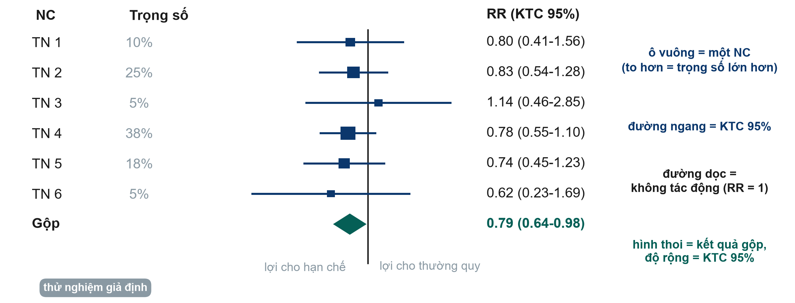

[Tải bản PDF](files/sessions/s4_exercises_VN.pdf) · [Tải bản Word (để điền)](files/sessions/s4_exercises_VN.docx) · [Quay lại Buổi 4](session4.qmd)

**Nền tảng Nghiên cứu Lâm sàng · Cấp độ 1** · Neudata · *#ClearDataClearImpact* · Tuần 4 · Thứ Bảy 21/11/2026 · trực tuyến, 19:30–22:30

Họ và tên: ______________________________   Khoa/Phòng: ______________________________

Phiếu được gửi qua email trước buổi học, dưới dạng tệp Word và tệp PDF. Hãy mở phiếu trên màn hình và gõ câu trả lời vào tệp Word (hoặc in bản PDF). Chuẩn bị sẵn bút, giấy và máy tính bỏ túi (hoặc điện thoại). Các phép tính chỉ cần phép chia đơn giản. Giảng viên kiểm tra mọi đáp án trực tiếp bằng công cụ tính bảng 2x2 (`Course/Resources/tools/2x2_calculator.xlsx`).

Mọi bài tập trong buổi học đều do **cả lớp cùng làm**: giảng viên trình chiếu từng mục trên màn hình chia sẻ, bạn trả lời bằng **bình chọn** hoặc trong **khung chat**, và giảng viên gõ câu trả lời của lớp lên màn hình chia sẻ. Không chia nhóm. Phần xây dựng đề cương (Phần F) là bài làm cá nhân **của riêng bạn**.

| Phần | Hoạt động | Khi nào | Cách làm |
|---|---|---|---|
| A | Phát hiện sai lệch (4 tình huống) | Cuối phần 4.1 (5 phút) | Cả lớp: bình chọn cho từng tình huống, một cách khắc phục gõ vào khung chat |
| B | Nhiễu hay thay đổi tác động? (3 tình huống) | Bài về nhà (không bắt buộc) | Tự làm |
| C | Hai phép tính bảng 2x2 | Sau giờ nghỉ (15 phút) | Cả lớp: bình chọn cho từng đáp án |
| D | PPV ở hai bối cảnh | Bài về nhà (không bắt buộc) | Tự làm |
| E | Đọc biểu đồ rừng và chọn công cụ đánh giá nguy cơ sai lệch | Cuối phần 4.3 (8 phút) | Cả lớp: bình chọn và khung chat |
| F | Xây dựng đề cương 4: phơi nhiễm, kết cục và sai lệch | Cuối buổi (38 phút) và bài về nhà | Giảng viên làm mẫu trực tiếp; sau đó bạn viết bản nháp của mình |

**Câu hỏi xuyên suốt:** ở người lớn bị sốc nhiễm khuẩn, chiến lược hạn chế dịch, so với chăm sóc thường quy, có làm giảm tử vong 28 ngày không?
**Hai bài báo** (thư mục khóa học, `Course/Papers`): Bài báo 1, Boulet 2024 (thử nghiệm ngẫu nhiên thí điểm về hạn chế dịch); Bài báo 2, Hyun 2023 (nghiên cứu thuần tập từ sổ đăng ký về cân bằng dịch và tử vong).

**Từ khóa của buổi học:** sai lệch · nhiễu · thay đổi tác động (tương tác) · quan hệ nhân quả ngược · nguy cơ · nguy cơ tương đối (RR) · hiệu số nguy cơ (RD) · số người cần điều trị (NNT) · tỷ số chênh (OR) · độ nhạy · độ đặc hiệu · giá trị tiên đoán dương và âm (PPV, NPV) · đường cong ROC · biểu đồ rừng (forest plot) · I² (tính không đồng nhất) · công cụ đánh giá nguy cơ sai lệch.

**Các chữ viết tắt khác trong phiếu:** ICU = khoa hồi sức tích cực; KTC = khoảng tin cậy (CI); RCT = thử nghiệm lâm sàng ngẫu nhiên có đối chứng.

* * *

## Phần A: Phát hiện sai lệch

**Cách làm.** Giảng viên trình chiếu từng tình huống và mở bình chọn: **sai lệch chọn lựa**, **sai lệch nhớ lại**, **sai lệch người quan sát** hay **nhiễu**. Sau khi có kết quả, gõ **một cách thực tế** để giảm sai lệch đó vào khung chat.

| # | Tình huống | Sai lệch chính | Một cách để giảm |
|---|---|---|---|
| 1 | Trong một nghiên cứu bệnh–chứng, gia đình của người bệnh tử vong do nhiễm khuẩn huyết nhớ những ngày trước khi vào ICU chi tiết hơn gia đình của người sống sót. | | |
| 2 | Trong một thử nghiệm không làm mù về hạn chế dịch, bác sĩ biết người bệnh thuộc nhóm nào là người quyết định khi nào người bệnh "đủ điều kiện ra khỏi ICU". | | |
| 3 | Một nghiên cứu về cân bằng dịch và tử vong chỉ đưa vào những người bệnh nằm ICU từ 3 ngày trở lên. | | |
| 4 | Trong một sổ đăng ký, người bệnh có lactate cao hơn được truyền nhiều dịch hơn và cũng tử vong nhiều hơn. Tác giả kết luận rằng dịch truyền làm tăng tử vong. | | |

* * *

## Phần B: Nhiễu hay thay đổi tác động? (bài về nhà, không bắt buộc)

**Hướng dẫn.** Mỗi nghiên cứu chia kết quả theo một yếu tố thứ ba. So sánh các tầng **với nhau** và **với kết quả chung (thô)**. Quyết định: **nhiễu**, **thay đổi tác động (tương tác)** hay **không phải cả hai**. Sau đó nói tác giả nên báo cáo gì.

> Quy tắc nhanh: các tầng giống nhau nhưng khác kết quả thô là nhiễu. Các tầng khác nhau là thay đổi tác động.

| # | Nghiên cứu (giả định) | RR chung | Tầng 1 | Tầng 2 | Câu trả lời | Nên báo cáo gì |
|---|---|---|---|---|---|---|
| 1 | Thuốc vận mạch X so với Y trong sốc nhiễm khuẩn và tử vong trước ngày 28. Bác sĩ chọn X chủ yếu cho người bệnh có lactate cao. | 1.80 | lactate dưới 4: RR 1.00 | lactate từ 4 trở lên: RR 1.00 | | |
| 2 | Hạn chế dịch so với thường quy và tử vong trước ngày 28 | 0.70 | dưới 65 tuổi: RR 0.50 | từ 65 tuổi trở lên: RR 0.95 | | |
| 3 | Quy trình ghi chép do điều dưỡng thực hiện và phiếu theo dõi dịch không đầy đủ | 0.80 | ca ngày: RR 0.80 | ca đêm: RR 0.79 | | |

* * *

## Phần C: Hai phép tính bảng 2x2

**Cách làm.** Vẽ từng bảng ra giấy trước. Sau đó giảng viên hỏi từng đáp án bằng bình chọn, kiểm tra trực tiếp bằng công cụ tính 2x2 trên màn hình chia sẻ, và một bạn tình nguyện nói kết quả bằng một câu đơn giản.

1. **Vẽ bảng 2x2 trước.** Phơi nhiễm (hoặc điều trị) theo **hàng**, nhóm phơi nhiễm hoặc được điều trị ở trên. Kết cục theo **cột**, "có kết cục" ở bên trái.
2. Làm tròn đến hai chữ số thập phân.
3. Nói kết quả bằng **một câu** mà một đồng nghiệp chưa học nghiên cứu cũng hiểu.

**Nhắc lại**

| Chỉ số | Công thức (từ bảng a, b, c, d) |
|---|---|
| Nguy cơ ở nhóm phơi nhiễm hoặc điều trị | a / (a + b) |
| Nguy cơ ở nhóm không phơi nhiễm hoặc nhóm chứng | c / (c + d) |
| Nguy cơ tương đối (RR) | nguy cơ nhóm phơi nhiễm ÷ nguy cơ nhóm chứng |
| Hiệu số nguy cơ (RD) | nguy cơ nhóm phơi nhiễm trừ nguy cơ nhóm chứng |
| Số người cần điều trị (NNT) | 1 ÷ \|RD\| (RD viết dưới dạng tỷ lệ, ví dụ 0.05) |
| Tỷ số chênh (OR) | (a × d) ÷ (b × c) |

### Phép tính 1: một thử nghiệm về dịch truyền

Một thử nghiệm giả định phân bổ ngẫu nhiên 400 người lớn bị sốc nhiễm khuẩn vào chiến lược hạn chế dịch (200 người bệnh) hoặc chăm sóc thường quy (200 người bệnh). Đến ngày 28, **20** người bệnh đã tử vong ở nhóm hạn chế dịch và **30** ở nhóm chăm sóc thường quy.

|  | Tử vong trước ngày 28: CÓ | Tử vong trước ngày 28: KHÔNG | Tổng |
|---|---|---|---|
| Hạn chế dịch | a = | b = | |
| Chăm sóc thường quy | c = | d = | |

1. Nguy cơ với hạn chế dịch = ______  Nguy cơ với chăm sóc thường quy = ______
2. RR = ______  3. RD = ______  4. NNT = ______  5. OR = ______
6. Ví dụ mẫu trên slide có cùng RR (20/100 so với 30/100). Vì sao NNT ở đây lại khác?  ______________________
7. Một câu cho đồng nghiệp: ____________________________________________

### Phép tính 2: một nghiên cứu bệnh–chứng về dịch truyền

Các nhà nghiên cứu chọn **40** người bệnh nhiễm khuẩn huyết tại ICU cần lọc máu mới (nhóm bệnh) và **80** người bệnh nhiễm khuẩn huyết tại cùng các đơn vị không cần lọc máu (nhóm chứng). Họ xem lại cân bằng dịch ngày 3 của từng người bệnh. Trong nhóm bệnh, **24** người có cân bằng dịch dương và 16 người không. Trong nhóm chứng, **16** người có cân bằng dịch dương và 64 người không.

|  | Nhóm bệnh (lọc máu mới) | Nhóm chứng (không lọc máu) |
|---|---|---|
| Cân bằng dịch dương ngày 3 | a = | b = |
| Cân bằng dịch bằng 0 hoặc âm | c = | d = |

1. OR = ______
2. Vì sao bạn **không** thể tính nguy cơ lọc máu, RR hay NNT từ nghiên cứu này?  ______________________________
3. Mũi tên có thể đi theo chiều ngược lại ở đây không (quan hệ nhân quả ngược)? Vì sao?  ______________________________
4. Một câu cho đồng nghiệp: ____________________________________________

*Lưu ý: trong nghiên cứu bệnh–chứng, các cột là nhóm bệnh và nhóm chứng. Công thức OR (a × d) ÷ (b × c) vẫn giữ nguyên.*

### Thực hành thêm (tự học): một chủ đề khác

Một thử nghiệm phân bổ ngẫu nhiên 400 người lớn tại khoa nội vào nhóm nằm đệm chống loét mới (200 người bệnh) hoặc đệm thường (200 người bệnh). Tổn thương do tì đè mới xuất hiện ở **10** người bệnh nằm đệm mới và **20** người nằm đệm thường. Vẽ bảng và tính hai nguy cơ, RR, RD, NNT và OR. Ở đây OR có gần với RR không? Vì sao?

* * *

## Phần D: PPV ở hai bối cảnh (bài về nhà, không bắt buộc)

**Hướng dẫn.** Cùng một xét nghiệm có **độ nhạy 90%** và **độ đặc hiệu 80%**. Hoàn thành từng bảng cho 500 người, rồi tính PPV và NPV.

> Số người mắc bệnh = tỷ lệ hiện mắc × 500. Dương tính thật (TP) = độ nhạy × số người mắc bệnh. Âm tính thật (TN) = độ đặc hiệu × số người không mắc bệnh. FP = dương tính giả; FN = âm tính giả.

**Bối cảnh 1: ICU, tỷ lệ hiện mắc 20%**

|  | Có bệnh | Không có bệnh | Tổng |
|---|---|---|---|
| Xét nghiệm dương tính | TP = | FP = | |
| Xét nghiệm âm tính | FN = | TN = | |
| Tổng | | | 500 |

PPV = TP / (TP + FP) = ______  NPV = TN / (TN + FN) = ______

**Bối cảnh 2: sàng lọc, tỷ lệ hiện mắc 2%**

|  | Có bệnh | Không có bệnh | Tổng |
|---|---|---|---|
| Xét nghiệm dương tính | TP = | FP = | |
| Xét nghiệm âm tính | FN = | TN = | |
| Tổng | | | 500 |

PPV = ______  NPV = ______

1. Vì sao PPV khác nhau nhiều như vậy khi xét nghiệm vẫn là một? ________________________________
2. Tính tỷ số khả dĩ dương, LR+ = độ nhạy / (1 − độ đặc hiệu) = ______. LR+ có thay đổi giữa hai bối cảnh không? ______
3. Không bắt buộc: làm lại với tỷ lệ hiện mắc 50%.

* * *

## Phần E: Đọc biểu đồ rừng và chọn công cụ đánh giá nguy cơ sai lệch

**Cách làm.** Giảng viên trình chiếu biểu đồ trên màn hình chia sẻ và hỏi từng câu bằng bình chọn hoặc trong khung chat. Đây là biểu đồ trong phần 4.3 (sáu thử nghiệm giả định về hạn chế dịch so với thường quy; kết cục tử vong; gộp theo mô hình ảnh hưởng cố định).

| Thử nghiệm | Hạn chế dịch: tử vong / tổng | Chăm sóc thường quy: tử vong / tổng |
|---|---|---|
| Thử nghiệm 1 | 12 / 60 | 15 / 60 |
| Thử nghiệm 2 | 30 / 150 | 36 / 150 |
| Thử nghiệm 3 | 8 / 40 | 7 / 40 |
| Thử nghiệm 4 | 45 / 250 | 58 / 250 |
| Thử nghiệm 5 | 20 / 100 | 27 / 100 |
| Thử nghiệm 6 | 5 / 30 | 8 / 30 |

**Đọc biểu đồ**

1. (Bình chọn) Thử nghiệm nào có trọng số lớn nhất? Vì sao?  ______________________
2. (Bình chọn) Có thử nghiệm đơn lẻ nào cho thấy tác động rõ ràng (KTC 95% không cắt qua 1) không?  ______________________
3. (Khung chat) Hình thoi gộp có cắt qua RR = 1 không? Viết kết quả gộp bằng một câu đơn giản.  ______________________
4. (Tự học) Thử nghiệm 3 chỉ theo hướng ngược lại (RR 1.14). Điều đó có đáng lo không? Vì sao?  ______________________

**Chọn công cụ (bình chọn).** Với mỗi nghiên cứu, chọn: **RoB 2** (công cụ đánh giá nguy cơ sai lệch của Cochrane cho thử nghiệm ngẫu nhiên), **ROBINS-I** (nghiên cứu can thiệp không ngẫu nhiên), **thang Newcastle-Ottawa (hoặc ROBINS-E)** (nghiên cứu thuần tập hoặc bệnh–chứng về phơi nhiễm), **QUADAS-2** (nghiên cứu độ chính xác chẩn đoán) hoặc **AMSTAR 2** (tổng quan hệ thống). Bảng chọn công cụ một trang có trong `Course/Resources/Risk_of_Bias_Tool_Chooser.pdf`.

| # | Nghiên cứu | Công cụ |
|---|---|---|
| a | Bài báo 1, Boulet 2024: thử nghiệm ngẫu nhiên về hạn chế dịch so với thường quy | |
| b | Bài báo 2, Hyun 2023: thuần tập từ sổ đăng ký, cân bằng dịch dương so với âm | |
| c | Tổng quan hệ thống và phân tích gộp các thử nghiệm hạn chế dịch | |
| d | (Tự học) Nghiên cứu trước–sau về một quy trình truyền dịch tại một khoa | |
| e | (Tự học) Lactate tại giường so với xét nghiệm tham chiếu của phòng xét nghiệm | |
| f | (Tự học) Thử nghiệm ngẫu nhiên theo cụm về quy trình ghi chép dịch (12 ICU) | |

* * *

## Phần F: Xây dựng đề cương 4 (phơi nhiễm, kết cục và sai lệch)

**Đây là bài làm của riêng bạn.** Mỗi học viên viết đề cương nghiên cứu của riêng mình về một câu hỏi từ khoa của mình (xem `Course/Assignment/proposal_brief.md`).

**Cách làm (38 phút).**

1. **Xem (15 phút).** Giảng viên điền các dòng 4–6 dưới đây cho ví dụ xuyên suốt trên màn hình chia sẻ, vừa làm vừa nói ra suy nghĩ.
2. **Viết nháp (16 phút).** Bạn điền các dòng tương tự cho câu hỏi của mình, làm yên lặng (không bắt buộc bật camera). Đặt câu hỏi trong khung chat.
3. **Phản hồi (7 phút).** Ba bạn tình nguyện dán một sai lệch và cách khắc phục vào khung chat; giảng viên nhận xét.

Sau đó hoàn thành ở nhà và chép câu trả lời vào mẫu đề cương (`Course/Templates/Research_Proposal_Template.docx`, Phần 2). Các dòng 1–3 (thiết kế, bối cảnh, đối tượng) đã viết nháp sau Buổi 3. Với mỗi kết cục, ghi rõ **cái gì**, **đo thế nào** và **khi nào**.

**Câu hỏi nghiên cứu của tôi:** _______________________________________________

| # | Mục | Cần viết gì | Câu trả lời của tôi |
|---|---|---|---|
| 4 | **Phơi nhiễm hoặc can thiệp** và **nhóm so sánh** | Chính xác phơi nhiễm hoặc can thiệp là gì, và được định nghĩa hoặc đo như thế nào? Nhóm so sánh là ai? | |
| 5 | **Kết cục** | **MỘT kết cục chính**: là gì, đo thế nào và khi nào. **2–3 kết cục phụ.** | |
| 6 | **Các sai lệch chính và cách giảm** | Nêu ít nhất **hai** mối đe dọa (chọn lựa, thông tin, nhiễu) và bước nào trong thiết kế giúp giảm từng mối đe dọa. | |

**Khẳng định cuối cùng của tôi sẽ là:** ☐ "gây ra" (thiết kế ngẫu nhiên) ☐ "có liên quan với" (thiết kế quan sát), vì ____________________

**Tự kiểm tra trước khi hoàn thành**

- [ ] Có nhóm so sánh, hoặc tôi giải thích vì sao nghiên cứu của tôi là nghiên cứu mô tả.
- [ ] Chỉ có MỘT kết cục chính, kèm phương pháp đo và thời điểm đo.
- [ ] Nếu thiết kế là quan sát, tôi đã nêu các yếu tố gây nhiễu chính (nghĩ đến nhiễu do chỉ định).
- [ ] Mỗi sai lệch có một bước giảm thiểu cụ thể ("chúng tôi sẽ cẩn thận" không phải là bước giảm thiểu).
- [ ] Phần 2 đã hoàn chỉnh: thiết kế, bối cảnh, đối tượng (Buổi 3) + phơi nhiễm, nhóm so sánh, kết cục, sai lệch (hôm nay).
