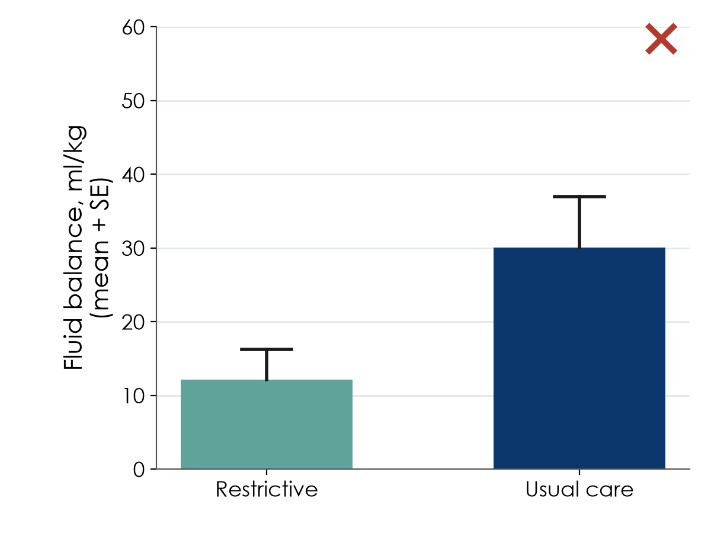

[Tải bản PDF](files/sessions/s5_exercises_VN.pdf) · [Tải bản Word (để điền)](files/sessions/s5_exercises_VN.docx) · [Quay lại Buổi 5](session5.qmd)

**Nền tảng Nghiên cứu Lâm sàng · Cấp độ 1** · Neudata · *#ClearDataClearImpact* · Tuần 5 · Thứ Bảy 28/11/2026 · trực tuyến, 19:30–22:30

Họ và tên: ______________________________   Khoa/Phòng: ______________________________

Gõ câu trả lời vào tệp Word, hoặc in bản PDF. Các bài có dấu **[FLUID-ICU]** dùng bộ dữ liệu của khóa học và năm gói kết quả (`Results_Pack_Q1_VN.pdf` đến `Results_Pack_Q5_VN.pdf`, gửi qua email). FLUID-ICU là dữ liệu mô phỏng.

| # | Bài tập | Khi nào |
|---|---|---|
| 1 | Phân loại biến số | Ở nhà |
| 2 | Sửa các mục CRF viết chưa tốt | Trên lớp, phần 5.1 |
| 3 | Chọn cách tóm tắt phù hợp | Ở nhà |
| 4 | Đánh giá một biểu đồ chưa tốt | Ở nhà |
| 5 | [FLUID-ICU] Tìm lỗi trong dữ liệu thô | Ở nhà |
| 6 | [FLUID-ICU] Đọc Bảng 1 của FLUID-ICU | Trên lớp, phần 5.4 |
| 7 | [FLUID-ICU] Một câu hỏi FLUID-ICU dưới dạng câu PECO | Trên lớp, phần 5.2 |
| 8 | Xây dựng đề cương 5: dữ liệu cho đề cương của bạn | Trên lớp (8.1), rồi ở nhà |

**Chữ viết tắt:** CRF = phiếu thu thập dữ liệu, ICU = khoa hồi sức tích cực, IQR = khoảng tứ phân vị, SD = độ lệch chuẩn.

* * *

## Bài tập 1: Phân loại biến số

**Nhiệm vụ.** Với mỗi biến số, đánh dấu **một** loại. Sau đó trả lời câu hỏi thêm.

| # | Biến số (nghiên cứu ICU về sốc nhiễm khuẩn) | Liên tục | Đếm | Nhị phân | Định danh | Thứ hạng | Thời gian đến biến cố |
|---|---|:-:|:-:|:-:|:-:|:-:|:-:|
| a | Tuổi lúc vào ICU (năm) | ☐ | ☐ | ☐ | ☐ | ☐ | ☐ |
| b | Giới (nam / nữ) | ☐ | ☐ | ☐ | ☐ | ☐ | ☐ |
| c | Thang điểm hôn mê Glasgow lúc nhập viện (3–15) | ☐ | ☐ | ☐ | ☐ | ☐ | ☐ |
| d | Ổ nhiễm khuẩn chính (phổi / tiết niệu / ổ bụng / da / khác) | ☐ | ☐ | ☐ | ☐ | ☐ | ☐ |
| e | Số thuốc vận mạch đang dùng ở giờ 24 (0, 1, 2, 3) | ☐ | ☐ | ☐ | ☐ | ☐ | ☐ |
| f | Cân bằng dịch tích lũy ở ngày 5 (ml/kg) | ☐ | ☐ | ☐ | ☐ | ☐ | ☐ |
| g | Còn sống ở ngày 28 (có / không) | ☐ | ☐ | ☐ | ☐ | ☐ | ☐ |
| h | Thời gian từ lúc vào ICU đến tử vong (người bệnh còn sống ở ngày 28 bị kiểm duyệt) | ☐ | ☐ | ☐ | ☐ | ☐ | ☐ |
| i | Đau: không / nhẹ / vừa / nặng | ☐ | ☐ | ☐ | ☐ | ☐ | ☐ |
| j | Nhóm máu (A, B, AB, O) | ☐ | ☐ | ☐ | ☐ | ☐ | ☐ |

**Câu hỏi thêm:** bạn muốn thu thập biến nào nhất dưới dạng con số chính xác thay vì theo nhóm, và vì sao?

* * *

## Bài tập 2: Sửa các mục CRF viết chưa tốt

**Nhiệm vụ.** Mỗi mục dưới đây có thể được hai điều dưỡng điền theo hai cách khác nhau. Với mỗi mục, ghi lỗi ở đâu, rồi viết lại để mục đó **chỉ có một cách hiểu**. Chuẩn bị đọc to một mục đã viết lại khi giảng viên mời.

Kiểm tra từng mục viết lại: Câu hỏi có đơn vị không? Có thời điểm không? Chỉ có một câu trả lời? Có lựa chọn "không rõ / không làm"?

| # | Mục chưa tốt | Sai ở đâu? | Mục bạn viết lại |
|---|---|---|---|
| a | Dịch đã truyền: ________ | | |
| b | Cân nặng: ______ | | |
| c | Bệnh kèm theo: ______________________ | | |
| d | Lactate cao?   Có / Không | | |

* * *

## Bài tập 3: Chọn cách tóm tắt phù hợp

**Nhiệm vụ.** Với mỗi biến số, ghi hình dạng hoặc loại biến, cách tóm tắt bạn sẽ báo cáo trong Bảng 1, và loại biểu đồ tốt nhất.

> **Chọn trong:** hình dạng hoặc loại: đối xứng · lệch phải · nhị phân · định danh. Cách tóm tắt: trung bình (SD) · trung vị (IQR) · n (%). Biểu đồ: biểu đồ cột · biểu đồ tần suất · biểu đồ hộp · biểu đồ phân tán

| # | Biến số (200 người bệnh ICU) | Hình dạng / loại | Cách tóm tắt | Biểu đồ |
|---|---|---|---|---|
| a | Tuổi (năm), phân phối hình chuông | | | |
| b | Thời gian nằm ICU (ngày): phần lớn 1–5 ngày, một số > 30 ngày | | | |
| c | Tử vong trong bệnh viện (có / không) | | | |
| d | Protein phản ứng C (mg/L): đuôi dài bên phải | | | |
| e | Ổ nhiễm khuẩn (5 nhóm) | | | |
| f | Huyết áp tâm thu, so sánh giữa hai nhóm điều trị | | | |

* * *

## Bài tập 4: Đánh giá một biểu đồ chưa tốt

**Nhiệm vụ.** Xem ba poster mô tả dưới đây và trả lời câu 1 đến 5.

Một poster ở hành lang bệnh viện có biểu đồ này (cân bằng dịch ở ngày 5, mỗi nhóm 24 người bệnh):

1. Mỗi cột thể hiện gì, và thanh sai số thể hiện gì? Còn thiếu gì?
2. Nêu **hai điều người đọc không thể thấy** trong biểu đồ này.
3. Phác thảo cách bạn sẽ trình bày cùng dữ liệu này trong một bài báo. Bạn được thêm gì?

Poster thứ hai trình bày tử vong theo khoa bằng hai cột 31% (Khoa A) và 29% (Khoa B), với trục y chạy từ 28% đến 32%.

4. Biểu đồ tạo ấn tượng gì, và bạn sẽ sửa thế nào?

Poster thứ ba vẽ tỷ lệ tuân thủ vệ sinh tay (%) và tỷ lệ nhiễm khuẩn trên cùng một biểu đồ với hai trục y khác nhau, và viết "vệ sinh tay có hiệu quả!".

5. Nêu hai lý do cần thận trọng.

* * *

## Bài tập 5: [FLUID-ICU] Tìm lỗi trong dữ liệu thô FLUID-ICU

**Nhiệm vụ.** Sáu giá trị dưới đây lấy từ tệp thô `fluid_icu_raw.csv`, đúng như bốn ICU gửi về. Với mỗi giá trị, ghi sai ở đâu và script làm sạch nên làm gì. Sau đó trả lời câu hỏi thêm.

| # | Cột | Giá trị trong tệp thô | Sai ở đâu? | Script nên làm gì? |
|---|---|---|---|---|
| a | sex | `m`, `male`, ` Female` | | |
| b | ngày nhập viện | `14/03/2023` ở một dòng, `14-Mar-2023` ở dòng khác | | |
| c | lactate (ICU C) | `23.4` | | |
| d | lactate | `999` | | |
| e | age | `210` | | |
| f | mã người bệnh | `FLU-139` xuất hiện ở hai dòng giống hệt nhau | | |

**Câu hỏi thêm:** vì sao không bao giờ được sửa tệp thô bằng tay? Nêu hai thông tin mà nhật ký làm sạch dữ liệu ghi lại cho mỗi thay đổi.

* * *

## Bài tập 6: [FLUID-ICU] Đọc Bảng 1 của FLUID-ICU

**Nhiệm vụ.** Mở Bảng 1 (đặc điểm nền theo nhóm cân bằng dịch) trong gói kết quả bất kỳ. Cả năm gói đều có cùng bảng này. Tự trả lời câu 1 đến 5, cuối cùng là hai câu Kết quả của bạn, và chuẩn bị chia sẻ khi giảng viên mời. Câu 6 làm sau buổi học.

1. Mỗi cột có bao nhiêu người bệnh? Vì sao tổng số là 618 mà không phải 620?
2. Với **ba** biến số, ghi cách tóm tắt đã dùng (trung bình (SD), trung vị (IQR) hoặc n (%)) và vì sao.

| Biến số | Cách tóm tắt đã dùng | Vì sao dùng cách này? |
|---|---|---|
| | | |
| | | |
| | | |

3. Lúc bắt đầu, hai nhóm có giống nhau không? Nêu khác biệt **lớn nhất** giữa nhóm cân bằng dịch âm và nhóm cân bằng dịch dương.
4. Biến nào thiếu nhiều giá trị nhất, và thiếu bao nhiêu?
5. Viết **hai câu** mô tả người bệnh, như cách chúng sẽ xuất hiện ở đầu một phần Kết quả (số liệu trong ngoặc, không có giá trị p).

> ______________________________________________________________________________

6. Nhìn vào bảng này, bạn dự đoán mối liên quan thô giữa cân bằng dịch dương và tử vong sẽ lớn hơn hay nhỏ hơn mối liên quan đã hiệu chỉnh? Vì sao?

* * *

## Bài tập 7: [FLUID-ICU] Một câu hỏi FLUID-ICU dưới dạng câu PECO

**Nhiệm vụ.** Điền bảng này cho Câu hỏi 1 (Q1), dựa vào trang 1 của gói kết quả. Chuẩn bị đọc to câu của bạn khi giảng viên mời. Vào cuối Buổi 6 bạn chọn một trong năm câu hỏi: khi đó hãy điền lại bảng cho câu hỏi đó.

PECO: P = đối tượng, E = phơi nhiễm, C = so sánh, O = kết cục.

| | Câu trả lời của bạn |
|---|---|
| Câu hỏi (Q1 đến Q5), chép từ trang 1 của gói kết quả | |
| **P**: đối tượng | |
| **E**: phơi nhiễm (tên biến trong từ điển dữ liệu) và loại biến | |
| **C**: nhóm so sánh | |
| **O**: kết cục (tên biến) và loại biến | |
| Câu hỏi nghiên cứu viết thành một câu | |
| Kiểm định nào sẽ so sánh các nhóm? Mô hình nào sẽ hiệu chỉnh? (đoán ngay bây giờ, kiểm tra lại ở Buổi 6) | |

* * *

## Bài tập 8: Phiếu Xây dựng đề cương 5

**Nhiệm vụ.** Lập kế hoạch dữ liệu cho câu hỏi nghiên cứu **của riêng bạn**, không phải cho FLUID-ICU. Trước tiên xem giảng viên điền từng phần cho ví dụ xuyên suốt. Trên lớp, viết nháp bảng biến số (8.1, 10 phút). Ở nhà, hoàn thành 8.2 đến 8.4. Sau đó chép tất cả vào Phần 3 trong mẫu đề cương của bạn (`Research_Proposal_Template_VN.docx`, gửi qua email).

### 8.1 Bảng biến số (trên lớp)

| Vai trò | Biến số | Cách đo (đơn vị, thời điểm) | Loại |
|---|---|---|---|
| Kết cục chính | | | |
| Kết cục phụ (không bắt buộc) | | | |
| Phơi nhiễm / can thiệp | | | |
| Yếu tố gây nhiễu 1 | | | |
| Yếu tố gây nhiễu 2 | | | |
| Yếu tố gây nhiễu 3 | | | |
| Mô tả (ví dụ tuổi, giới) | | | |

*Gợi ý: trong RCT, phân bổ ngẫu nhiên xử lý phần lớn yếu tố gây nhiễu. Thay vào đó, hãy liệt kê các biến nền chính bạn sẽ trình bày trong Bảng 1.*

### 8.2 CRF thu nhỏ: 6–10 mục

| # | Câu hỏi đúng như người thu thập dữ liệu sẽ đọc | Cách trả lời (ô số / ô đánh dấu / đơn vị) | Có lựa chọn "không rõ / không làm"? |
|---|---|---|:-:|
| 1 | | | ☐ |
| 2 | | | ☐ |
| 3 | | | ☐ |
| 4 | | | ☐ |
| 5 | | | ☐ |
| 6 | | | ☐ |
| 7 | | | ☐ |
| 8 | | | ☐ |

### 8.3 Từ điển dữ liệu: 3–5 dòng và một kế hoạch chất lượng dữ liệu

| Tên biến | Nhãn (ý nghĩa) | Loại | Đơn vị / mã | Giá trị cho phép |
|---|---|---|---|---|
| | | | | |
| | | | | |
| | | | | |

**Kế hoạch chất lượng dữ liệu (một hoặc hai câu):** ai kiểm tra phiếu, bao lâu một lần, và bạn sẽ chạy kiểm tra khoảng giá trị hoặc tính nhất quán nào.

> ______________________________________________________________________________

### 8.4 Kế hoạch quản lý dữ liệu

| Câu hỏi | Câu trả lời của bạn |
|---|---|
| CRF giấy với nhập liệu kép, hay thu thập dữ liệu điện tử (ví dụ REDCap / KoBoToolbox)? | |
| Mã nghiên cứu cho từng người bệnh? Danh sách liên kết mã được lưu ở đâu, và ai được mở? | |
| Quy tắc kiểm tra khi nhập liệu (hai ví dụ từ từ điển dữ liệu của bạn) | |
| Nhật ký thay đổi dữ liệu / nhật ký làm sạch: ai ghi lại các thay đổi? | |
| Sao lưu (3-2-1) và tuyên bố chia sẻ dữ liệu trong phiếu đồng ý | |
