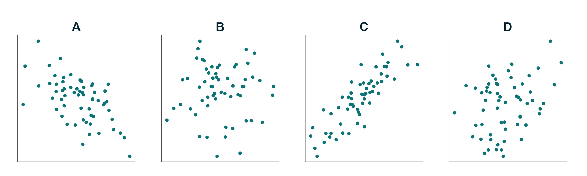
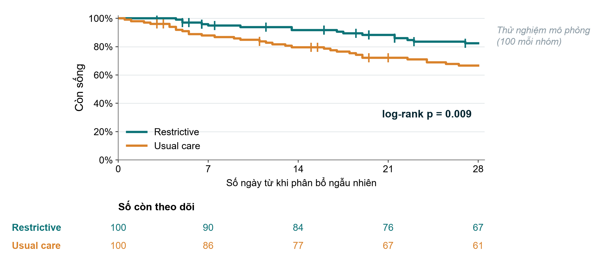

[Tải bản PDF](files/sessions/s6_exercises_VN.pdf) · [Tải bản Word (để điền)](files/sessions/s6_exercises_VN.docx) · [Quay lại Buổi 6](session6.qmd)

**Nền tảng Nghiên cứu Lâm sàng · Cấp độ 1** · Neudata · *#ClearDataClearImpact* · Tuần 6 · Thứ Bảy 05/12/2026 · trực tuyến, 19:30–22:30

Họ và tên: ______________________________   Khoa/Phòng: ______________________________

Gõ câu trả lời vào tệp Word, hoặc in bản PDF.

| # | Bài tập | Khi nào |
|---|---|---|
| 1 | Đúng hay sai: khoảng tin cậy, giá trị p và so sánh bội | Phần 6.1, hoặc ở nhà |
| 2 | Chọn kiểm định | Phần 6.1, hoặc ở nhà |
| 3 | Ghép hệ số r với biểu đồ phân tán | Ở nhà |
| 4 | [FLUID-ICU] Diễn giải phép so sánh | Phần 6.2 cho Q1, sau đó ở nhà cho câu hỏi của bạn |
| 5 | Đọc bảng hồi quy | Ở nhà |
| 6 | Đọc đường cong Kaplan–Meier | Ở nhà |
| 7 | Vì sao dữ liệu bị thiếu? MCAR, MAR hay MNAR | Ở nhà |
| 8 | [FLUID-ICU] Diễn giải mô hình | Phần 6.4 cho Q1, sau đó ở nhà cho câu hỏi của bạn |
| 9 | Xây dựng đề cương 6: Phần 3 đề cương của bạn | Trên lớp (9.1), rồi ở nhà |

**Câu hỏi FLUID-ICU của bạn.** Cuối buổi, bạn chọn một câu hỏi (Q1 đến Q5). Sau đó làm lại Bài tập 4 và 8 cho câu hỏi đó, dùng gói kết quả của nó. Câu trả lời sẽ là phần cốt lõi của phần Kết quả.

**Viết tắt:** KTC = khoảng tin cậy, HR = tỷ số nguy cơ tức thời, OR = tỷ số chênh, SD = độ lệch chuẩn, ICU = đơn vị hồi sức tích cực, SAP = kế hoạch phân tích thống kê.

* * *

## Bài tập 1: Đúng hay sai: khoảng tin cậy, giá trị p và so sánh bội

**Nhiệm vụ.** Khoanh **Đ** (đúng) hoặc **S** (sai) cho mỗi nhận định. Với mỗi câu S, chuẩn bị nói bằng một câu vì sao nó sai.

| # | Nhận định | |
|---|---|:-:|
| 1 | Bài báo 2 báo cáo HR 2.13 (khoảng tin cậy 95% 1.48 đến 3.06). Dữ liệu phù hợp với một tỷ số nguy cơ tức thời thật nằm ở bất kỳ đâu trong khoảng từ khoảng 1.5 đến khoảng 3.1. | Đ / S |
| 2 | Bài báo 1 có p = 0.42 cho cân bằng dịch, vậy chiến lược hạn chế dịch không có tác động gì lên cân bằng dịch. | Đ / S |
| 3 | p = 0.03 nghĩa là có 3% xác suất giả thuyết không (không có khác biệt) là đúng. | Đ / S |
| 4 | Nếu khoảng tin cậy 95% của hiệu số giữa hai trung bình chứa 0, giá trị p lớn hơn 0.05. | Đ / S |
| 5 | Khi các yếu tố khác như nhau, nghiên cứu lớn hơn cho khoảng tin cậy hẹp hơn. | Đ / S |
| 6 | p < 0.001 chứng minh tác động lớn và quan trọng về mặt lâm sàng. | Đ / S |
| 7 | Nếu lặp lại cùng một nghiên cứu nhiều lần, khoảng 95% các khoảng tin cậy 95% sẽ chứa giá trị thật. | Đ / S |
| 8 | Một kết quả "âm tính" (p > 0.05) trong một thử nghiệm thí điểm nhỏ có thể là sai lầm loại II. | Đ / S |
| 9 | Alpha (thường là 5%) là nguy cơ chấp nhận được khi kết luận có tác động trong khi thực ra không có. | Đ / S |
| 10 | p = 0.06 cho thấy "một xu hướng tiến tới có ý nghĩa thống kê". | Đ / S |
| 11 | Nếu bạn kiểm định 20 kết cục khác nhau và không kết cục nào có tác động thật, bạn thường vẫn tìm thấy ít nhất một kết cục có p < 0.05. | Đ / S |
| 12 | Lactat đo trên cùng 40 người bệnh lúc nhập viện và 6 giờ sau nên được so sánh bằng kiểm định t không ghép cặp. | Đ / S |
| 13 | Một thử nghiệm có p hai phía = 0.08 theo đúng hướng dự kiến, vì vậy tác giả có thể báo cáo p một phía = 0.04 thay thế. | Đ / S |
| 14 | Thử nghiệm không kém hơn chỉ đơn giản là thử nghiệm vượt trội được phân tích bằng kiểm định một phía. | Đ / S |

* * *

## Bài tập 2: Chọn kiểm định

**Nhiệm vụ.** Với mỗi tình huống, ghi kiểm định bạn sẽ dùng và một lý do. Quyết định theo ba bước: loại kết cục (một số đo hay một phân loại), rồi hình dạng phân phối hoặc số đếm, rồi có phải cùng người bệnh được đo hai lần không (ghép cặp).

> **Chọn trong:** kiểm định t · kiểm định t ghép cặp · Wilcoxon rank-sum (Mann-Whitney U) · Wilcoxon dấu hạng · Chi bình phương · Fisher chính xác · McNemar

| # | Tình huống | Kiểm định | Vì sao? |
|---|---|---|---|
| a | Huyết áp tâm thu trung bình (phân phối gần hình chuông) ở 60 người bệnh dùng thuốc A so với 60 người dùng thuốc B. | | |
| b | Thời gian nằm ICU (phân phối lệch) ở nhóm hạn chế dịch so với nhóm chăm sóc thường quy, mỗi nhóm 24 người bệnh. | | |
| c | Tử vong 28 ngày (có/không) ở 200 người bệnh có cân bằng dịch dương so với 200 người có cân bằng dịch âm. | | |
| d | Tổn thương thận cấp cần lọc máu: 2 trên 24 người bệnh ở một nhóm so với 5 trên 24 ở nhóm kia. | | |
| e | Lactat huyết thanh lúc vào ICU và 6 giờ sau trên cùng 40 người bệnh (các thay đổi phân bố gần đối xứng). | | |
| f | Tổn thương do tì đè (có/không) ở cùng 80 người bệnh được đánh giá trước và sau một quy trình xoay trở mới. | | |

* * *

## Bài tập 3: Ghép hệ số r với biểu đồ phân tán

**Nhiệm vụ.** Ghép mỗi biểu đồ (A đến D) với một hệ số tương quan. Sau đó trả lời câu hỏi thêm.

> **Chọn trong:** r = 0.86 · r = 0.30 · r = 0.01 · r = −0.58

| Biểu đồ | r |
|---|---|
| A | |
| B | |
| C | |
| D | |

Câu hỏi thêm: máy đo đường huyết tại giường và phòng xét nghiệm có r = 0.97 trên 50 người bệnh. Máy đo có thay thế được phòng xét nghiệm không? Thay vào đó bạn sẽ xem xét điều gì?

* * *

## Bài tập 4: [FLUID-ICU] Diễn giải phép so sánh (6.2)

**Nhiệm vụ.** Điền bảng và viết một câu Kết quả. Trên lớp, làm cho Q1. Ở nhà, làm lại cho câu hỏi bạn chọn. Mọi con số đều có trong gói kết quả của câu hỏi. Bảng thứ hai cho biết tìm chúng ở đâu.

| | Câu trả lời của bạn |
|---|---|
| Kết cục và loại biến | |
| Kiểm định, và vì sao dùng kiểm định này | |
| Kết quả ở nhóm cân bằng dịch âm (Q4: nhóm sống), n (%) hoặc trung vị (IQR) | |
| Kết quả ở nhóm cân bằng dịch dương (Q4: nhóm tử vong) | |
| Tác động kèm khoảng tin cậy 95% (hiệu số nguy cơ, tỷ số hoặc hiệu số Hodges–Lehmann) | |
| Giá trị p | |
| Một lý do khiến phép so sánh chưa hiệu chỉnh này có thể bị sai lệch | |

**Tìm các con số ở đâu trong gói kết quả**

| Câu hỏi | Kết quả ở mỗi nhóm | Tác động kèm khoảng tin cậy 95%, và giá trị p |
|---|---|---|
| Q1 | Bảng 2, dòng "Tử vong trong 28 ngày" | Bảng 2, cùng dòng: hiệu số nguy cơ kèm khoảng tin cậy 95% và p Chi bình phương |
| Q2 | Mục 4, dòng "AKI: cân bằng dương ... so với cân bằng âm" | Bảng 4, dòng "Cân bằng dương so với âm, thô" (tỷ số chênh) |
| Q3 | Bảng 2, dòng "VFD, trung vị (IQR)" | Bảng 3, dòng "Cân bằng dương so với âm, Mann-Whitney (Hodges-Lehmann)" |
| Q4 | Bảng 1, dòng "Lactat, mmol/L" | Bảng 4, dòng "Chưa hiệu chỉnh", phương pháp "Trường hợp đầy đủ" (tỷ số chênh mỗi 1 mmol/L) |
| Q5 | Bảng 2, dòng "Trung vị (IQR), ngày" | Bảng 3, dòng "Mann-Whitney (chênh lệch Hodges-Lehmann, ngày)" |

Gói kết quả Q1 và Q2 không nêu tên kiểm định cho phép so sánh này, nên bạn tự chọn (Bài tập 2 sẽ giúp bạn). Ở Q4, tỷ số chênh lấy từ hồi quy logistic chưa hiệu chỉnh. Để tìm lý do sai lệch, so sánh hai nhóm trong Bảng 1 của cùng gói kết quả.

**Câu Kết quả của bạn** (không dùng chữ "có ý nghĩa" đứng một mình, không dùng từ chỉ quan hệ nhân quả):

> ______________________________________________________________________________

* * *

## Bài tập 5: Đọc bảng hồi quy (một ví dụ khác, bài về nhà)

**Nhiệm vụ.** Đọc bảng và kết luận của tác giả, rồi trả lời bảy câu hỏi.

Một nghiên cứu thuần tập (giả lập) trên 600 người lớn nằm ICU nội khoa tìm các yếu tố liên quan đến **mê sảng mắc phải trong bệnh viện** (có/không) trong thời gian nằm ICU.

**Bảng 3. Hồi quy logistic đa biến: các yếu tố liên quan đến mê sảng**

| Biến số | OR hiệu chỉnh | KTC 95% | Giá trị p |
|---|:-:|:-:|:-:|
| Truyền benzodiazepine (có so với không) | 2.10 | 1.40 – 3.20 | < 0.001 |
| Tuổi (mỗi 10 năm) | 1.30 | 1.12 – 1.51 | < 0.001 |
| Thở máy (có so với không) | 1.60 | 0.95 – 2.70 | 0.08 |
| Giới nữ (so với nam) | 0.85 | 0.60 – 1.20 | 0.36 |
| Sa sút trí tuệ từ trước (có so với không) | 3.40 | 1.90 – 6.10 | < 0.001 |
| Quy trình giấc ngủ: bịt mắt + nút tai (có so với không) | 0.62 | 0.41 – 0.94 | 0.02 |

*Hiệu chỉnh theo mọi biến trong bảng và theo điểm APACHE II.*

**Kết luận của tác giả:** *"Benzodiazepine gây mê sảng ở người bệnh ICU. Thở máy cho thấy xu hướng tăng mê sảng (p = 0.08). Quy trình giấc ngủ của chúng tôi làm giảm mê sảng 38%."*

1. Đây là loại kết cục gì, và vì sao dùng hồi quy logistic?
2. Giá trị "không có tác động" của các con số trong bảng này là bao nhiêu?
3. Với mỗi dòng, khoảng tin cậy 95% có chứa giá trị không có tác động không? Đánh dấu ✔ (không chứa) hoặc ✖ (có chứa).
4. Viết **một câu bằng ngôn ngữ dễ hiểu** cho dòng benzodiazepine.
5. Diễn giải dòng tuổi: "1.30 mỗi 10 năm" có nghĩa gì đối với một người bệnh lớn hơn 20 tuổi?
6. Những dòng nào phù hợp với việc không có mối liên quan?
7. Tìm **ba** vấn đề trong kết luận của tác giả.

* * *

## Bài tập 6: Đọc đường cong Kaplan–Meier

**Nhiệm vụ.** Đọc đường cong và trả lời sáu câu hỏi.

Một thử nghiệm (mô phỏng) phân bổ ngẫu nhiên 200 người lớn bị sốc nhiễm khuẩn vào chiến lược hạn chế dịch hoặc chăm sóc thường quy và theo dõi họ trong 28 ngày.

1. Ở ngày 28, khoảng bao nhiêu phần trăm người bệnh ở mỗi nhóm còn sống?
2. Các vạch dọc nhỏ trên đường cong có ý nghĩa gì?
3. Ở ngày 21, nhóm chăm sóc thường quy còn bao nhiêu người bệnh đang được theo dõi (còn trong nhóm nguy cơ)? Vì sao con số này giảm ngay cả ở nhóm có ít người tử vong?
4. "log-rank p = 0.009" cho bạn biết điều gì? Nó **không** cho biết điều gì?
5. Mô hình nào sẽ cho tỷ số nguy cơ tức thời kèm khoảng tin cậy 95%, và bạn sẽ kiểm tra giả định nào bằng cách nhìn các đường cong?
6. Bạn có hài lòng nếu tác giả trình bày hình này **không kèm** số người còn trong nhóm nguy cơ không? Vì sao?

* * *

## Bài tập 7: Vì sao dữ liệu bị thiếu? MCAR, MAR hay MNAR

**Nhiệm vụ.** Với mỗi tình huống, ghi cơ chế có khả năng nhất và điều đó có ý nghĩa gì đối với phân tích các trường hợp đầy đủ (phân tích chỉ những người bệnh không thiếu giá trị nào).

> **Chọn trong:** MCAR (thiếu hoàn toàn ngẫu nhiên) · MAR (thiếu ngẫu nhiên: phụ thuộc vào điều đã ghi nhận) · MNAR (thiếu không ngẫu nhiên: phụ thuộc vào chính giá trị bị thiếu)

| # | Tình huống | Cơ chế | Hệ quả đối với phân tích các trường hợp đầy đủ |
|---|---|---|---|
| a | 12 mẫu máu xét nghiệm lactat bị mất khi thùng vận chuyển bị rơi. | | |
| b | Cân nặng bị thiếu thường hơn ở người bệnh nhập viện ban đêm. Giờ nhập viện được ghi cho mọi người. | | |
| c | Điểm đau bị thiếu ở những người bệnh đau nhiều nhất, vì họ không thể hoàn thành bảng hỏi. | | |
| d | Tình trạng ở ngày 28 bị thiếu ở những người bệnh chuyển sang bệnh viện khác, thường vì họ đang diễn tiến xấu. | | |
| e | Một phiên bản phiếu dùng trong tháng đầu không có câu hỏi về "hút thuốc". | | |
| f | Người bệnh lớn tuổi ít gửi lại bảng hỏi chất lượng cuộc sống ở tháng thứ 3. Tuổi được ghi cho mọi người. | | |

* * *

## Bài tập 8: [FLUID-ICU] Diễn giải mô hình: thô so với hiệu chỉnh, trường hợp đầy đủ so với quy gán đa bội (multiple imputation) (6.4)

**Nhiệm vụ.** Điền các phần và viết hai câu Kết quả. Trên lớp, làm Phần A và hai câu cho Q1. Ở nhà, làm Phần B và C cho Q1. Sau đó làm lại Phần A cho câu hỏi bạn chọn, và cả Phần B nếu bạn chọn Q4. Chỉ gói kết quả Q1 và Q4 có phân tích quy gán đa bội. Bảng dưới đây cho biết tìm từng con số ở đâu.

**Tìm các con số ở đâu trong gói kết quả**

| Câu hỏi | Phần A: ước lượng thô và hiệu chỉnh, khoảng tin cậy 95% và n | Yếu tố gây nhiễu (câu 1) | Phần B: trường hợp đầy đủ so với quy gán đa bội (câu 4 và 5) |
|---|---|---|---|
| Q1 | Bảng 6, dòng "Thô, tất cả người bệnh" và "Hiệu chỉnh, các trường hợp đầy đủ (chính)". Bảng 3 cho cùng các tỷ số chênh. | Mục 2, dòng "Các yếu tố gây nhiễu xác định trước (SAP)" | Bảng 6, dòng "Hiệu chỉnh, các trường hợp đầy đủ (chính)" và "Hiệu chỉnh, quy gán đa bội (m = 20)". Ai bị loại: lưu đồ người tham gia ở cuối mục 2 |
| Q2 | Bảng 4, dòng "Cân bằng dịch mỗi 10 ml/kg, thô" và "Cân bằng dịch mỗi 10 ml/kg, hiệu chỉnh" | Mục 2, dòng "Các yếu tố gây nhiễu xác định trước (SAP)" | Không có trong gói này |
| Q3 | Bảng 3, dòng "Cân bằng dịch mỗi 10 ml/kg, thô (tuyến tính)" và "Cân bằng dịch mỗi 10 ml/kg, hiệu chỉnh (tuyến tính)" | Mục 2, dòng "Các yếu tố gây nhiễu xác định trước (SAP)" | Không có trong gói này |
| Q4 | Bảng 4, dòng "Chưa hiệu chỉnh" và "Hiệu chỉnh: tuổi, giới, đái tháo đường, bệnh thận mạn, suy tim (chính)", cả hai với phương pháp "Trường hợp đầy đủ" | Bảng 4, tên dòng "Hiệu chỉnh: ..." | Bảng 4, hai dòng "(chính)". Ai bị loại: Bảng 2 |
| Q5 | Bảng 3, dòng "Tuyến tính trên thang log, thô (tỷ số trung bình nhân)" và "Tuyến tính trên thang log, hiệu chỉnh (tỷ số trung bình nhân)" | Mục 2, dòng "Các yếu tố gây nhiễu xác định trước (SAP)" | Không có trong gói này |

**Phần A: thô so với hiệu chỉnh**

| | Ước lượng | KTC 95% | n |
|---|---|---|---|
| Thô | | | |
| Hiệu chỉnh | | | |

1. Mô hình hiệu chỉnh gồm những yếu tố gây nhiễu nào? Chúng có được chọn trước khi phân tích không (xem SAP)?
2. Ước lượng thay đổi bao nhiêu sau khi hiệu chỉnh, và theo hướng nào? Điều đó cho bạn biết gì về nhiễu do chỉ định?
3. khoảng tin cậy 95% đã hiệu chỉnh có chứa giá trị "không có tác động" (1 với tỷ số, 0 với hiệu số) không?

**Phần B (chỉ Q1 và Q4): trường hợp đầy đủ so với quy gán đa bội**

4. Mô hình trường hợp đầy đủ có bao nhiêu người bệnh, và mô hình quy gán đa bội có bao nhiêu? Ai bị loại khỏi phân tích trường hợp đầy đủ?
5. Ước lượng quy gán đa bội có gần với ước lượng trường hợp đầy đủ không?

**Phần C (chỉ Q1): Kaplan–Meier và Cox**

6. Ghi tỷ lệ sống ở ngày 28 của mỗi nhóm và giá trị p của log-rank (Bảng 2 của gói Q1), và HR Cox đã hiệu chỉnh kèm khoảng tin cậy 95% (Bảng 4). Vì sao kết quả logistic (p = 0.044) và Cox (p = 0.053) cho cùng một thông điệp?

**Hai câu Kết quả của bạn** (thô, rồi hiệu chỉnh, kèm khoảng tin cậy, dùng "có liên quan với", không dùng "gây ra"):

> ______________________________________________________________________________

* * *

## Bài tập 9: Xây dựng đề cương 6 (đề cương của bạn)

**Nhiệm vụ.** Viết nháp Phần 3 đề cương cho câu hỏi của riêng bạn: cỡ mẫu, kế hoạch phân tích, yếu tố gây nhiễu và kế hoạch dữ liệu thiếu. Trước tiên xem giảng viên điền cho ví dụ xuyên suốt. Trên lớp, điền mục 9.1 (10 phút). Hoàn thành mục 9.2 đến 9.4 ở nhà, rồi chép câu trả lời vào Phần 3 của mẫu đề cương (`Research_Proposal_Template_VN.docx`, gửi qua email).

### 9.1 Phát biểu về cỡ mẫu

| Thông số | Giá trị của bạn | Nguồn (bài báo, đánh giá thực hành, nghiên cứu thí điểm, nhận định lâm sàng) |
|---|---|---|
| Giá trị dự kiến ở nhóm so sánh (tỷ lệ hoặc trung bình) | | |
| Khác biệt nhỏ nhất đáng phát hiện | | |
| SD (chỉ với kết cục dạng số) | | |
| Alpha (hai phía) | 5% | quy ước |
| Lực thống kê | 80% / 90% | |
| Tỷ lệ mất mẫu dự kiến | | |

**Câu phát biểu.** Tính số người bệnh mỗi nhóm bằng bảng tính `sample_size_calculator.xlsx` (gửi qua email), rồi điền vào:

> Giả định ______ ở nhóm chứng và ______ ở nhóm can thiệp, ______ người bệnh mỗi nhóm cho lực thống kê ____% với alpha hai phía 5%. Tính thêm ____% mất mẫu, chúng tôi sẽ tuyển tổng cộng ______ người bệnh.

### 9.2 Kế hoạch phân tích bằng ngôn ngữ dễ hiểu

| Bước | Chúng tôi sẽ làm gì |
|---|---|
| Mô tả người bệnh (Bảng 1) | Biến số dạng số phân phối đối xứng trình bày bằng ______, phân phối lệch bằng ______, biến phân loại bằng ______ |
| So sánh kết cục chính | Kiểm định: ______ vì kết cục là ______ |
| Báo cáo tác động | Chỉ số tác động (hiệu số / RR / OR / HR) kèm khoảng tin cậy 95%: ______ |
| Xử lý nhiễu (chỉ với thiết kế quan sát) | Chúng tôi sẽ hiệu chỉnh theo: ______ bằng ______ (ví dụ hồi quy logistic) |
| Dữ liệu thiếu | Chúng tôi sẽ báo cáo số giá trị thiếu của từng biến và phòng ngừa bằng cách: ______ |

### 9.3 Các yếu tố gây nhiễu

| Yếu tố gây nhiễu | Vì sao đây là yếu tố gây nhiễu (liên quan đến phơi nhiễm VÀ kết cục, không do phơi nhiễm gây ra) |
|---|---|
| | |
| | |
| | |

Số biến cố dự kiến: ____  Số số hạng tối đa trong mô hình (khoảng 1 cho mỗi 10 biến cố): ____

### 9.4 Kế hoạch xử lý dữ liệu thiếu

| Câu hỏi | Câu trả lời của chúng tôi |
|---|---|
| Biến nào dễ bị thiếu nhất, và vì sao? (suy nghĩ theo MCAR / MAR / MNAR) | |
| Chúng tôi sẽ phòng ngừa thế nào? (thiết kế phiếu, tập huấn, kiểm tra hằng tuần, truy tìm tình trạng kết cục) | |
| Chúng tôi sẽ báo cáo dữ liệu thiếu thế nào? (số thiếu của từng biến, sơ đồ dòng người tham gia) | |
