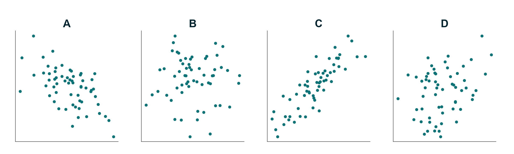
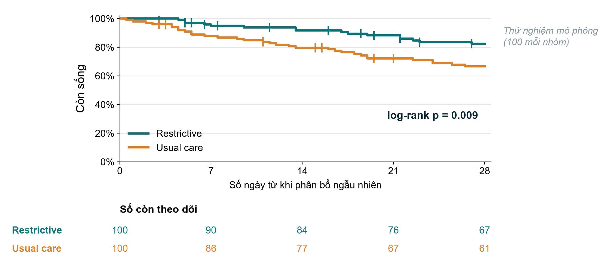

[Tải bản PDF](files/sessions/s6_exercises_VN.pdf) · [Tải bản Word (để điền)](files/sessions/s6_exercises_VN.docx) · [Quay lại Buổi 6](session6.qmd)

**Nền tảng Nghiên cứu Lâm sàng · Cấp độ 1** · Neudata · *#ClearDataClearImpact* · Tuần 6 · Thứ Bảy 05/12/2026 · trực tuyến, 19:30–22:30

Họ và tên: ______________________________   Khoa/Phòng: ______________________________

Phiếu được gửi qua email trước buổi học, dưới dạng tệp Word và tệp PDF. Gõ câu trả lời vào tệp Word (hoặc in bản PDF). Trong lớp, cả lớp cùng làm Bài tập 4 và 8: làm đầy đủ cho Câu hỏi 1 (Q1) và làm nhanh cho Q2 đến Q5 (trả lời trong khung chat hoặc bằng bình chọn; giảng viên gõ câu trả lời của lớp lên màn hình chia sẻ). Sau buổi học, hãy hoàn thành Bài tập 4 và 8 cho MỘT câu hỏi bạn đã chọn cho bản thảo, dùng gói kết quả phân tích của câu hỏi đó (`Course/Data/results_packs/Results_Pack_Q1` đến `Q5`, PDF): câu trả lời của bạn sẽ là phần cốt lõi của mục Kết quả trong bản thảo (Buổi 7). Các bài tập khác là bài về nhà hoặc tự kiểm tra. Không cần máy tính bỏ túi. Các bài tập có ký hiệu **[FLUID-ICU]** dùng bộ dữ liệu của khóa học FLUID-ICU (mô phỏng). Bài tập 9 hoàn thiện Phần 3 đề cương của riêng bạn.

| # | Bài tập | Khi nào | Thời gian |
|---|---|---|---|
| 1 | Đúng hay sai: KTC, giá trị p và so sánh bội | phần 6.1 / bài về nhà | 5 phút |
| 2 | Chọn kiểm định | kiểm tra nhanh phần 6.1 / bài về nhà | 5 phút |
| 3 | Ghép hệ số r với biểu đồ phân tán | bài về nhà | 3 phút |
| 4 | [FLUID-ICU] Diễn giải phép so sánh cho câu hỏi bạn chọn | phần 6.2, cả lớp cùng làm (Q1), sau đó làm ở nhà cho câu hỏi của bạn | 7 phút |
| 5 | Đọc bảng hồi quy (một ví dụ khác) | bài về nhà (phần kiểm tra 6.3 dùng bảng trên slide) | 5 phút |
| 6 | Đọc đường cong Kaplan–Meier | bài về nhà | 5 phút |
| 7 | Vì sao dữ liệu bị thiếu? MCAR, MAR hay MNAR | bài về nhà | 5 phút |
| 8 | [FLUID-ICU] Diễn giải mô hình cho câu hỏi bạn chọn | phần 6.4, cả lớp cùng làm (Q1), sau đó làm ở nhà cho câu hỏi của bạn | 7 phút |
| 9 | Phiếu Xây dựng đề cương 6 (đề cương của riêng bạn) | xây dựng đề cương: giảng viên làm mẫu, bạn viết nháp; hoàn thành ở nhà | 30 phút |

Hình cho Bài tập 3 và 6 nằm trong `Resources/figures/vi/sat3/` (bản tiếng Anh trong `.../en/sat3/`).

* * *

## Bài tập 1: Đúng hay sai: khoảng tin cậy, giá trị p và so sánh bội

Khoanh **Đ** (đúng) hoặc **S** (sai). Chuẩn bị giải thích mỗi câu "sai" bằng một câu.

| # | Nhận định | |
|---|---|:-:|
| 1 | Bài báo 2 báo cáo HR 2.13 (KTC 95% 1.48 đến 3.06). Dữ liệu phù hợp với một tỷ số nguy cơ tức thời thật nằm ở bất kỳ đâu trong khoảng từ khoảng 1.5 đến khoảng 3.1. | Đ / S |
| 2 | Bài báo 1 có p = 0.42 cho cân bằng dịch, vậy chiến lược hạn chế dịch không có tác động gì lên cân bằng dịch. | Đ / S |
| 3 | p = 0.03 nghĩa là có 3% xác suất giả thuyết không (không có khác biệt) là đúng. | Đ / S |
| 4 | Nếu KTC 95% của hiệu số giữa hai trung bình chứa 0, giá trị p lớn hơn 0.05. | Đ / S |
| 5 | Khi các yếu tố khác như nhau, nghiên cứu lớn hơn cho khoảng tin cậy hẹp hơn. | Đ / S |
| 6 | p < 0.001 chứng minh tác động lớn và quan trọng về mặt lâm sàng. | Đ / S |
| 7 | Nếu lặp lại cùng một nghiên cứu nhiều lần, khoảng 95% các KTC 95% sẽ chứa giá trị thật. | Đ / S |
| 8 | Một kết quả "âm tính" (p > 0.05) trong một thử nghiệm thí điểm nhỏ có thể là sai lầm loại II. | Đ / S |
| 9 | Alpha (thường là 5%) là nguy cơ chúng ta chấp nhận khi kết luận có tác động trong khi thực ra không có. | Đ / S |
| 10 | p = 0.06 cho thấy "một xu hướng tiến tới có ý nghĩa thống kê". | Đ / S |
| 11 | Nếu bạn kiểm định 20 kết cục khác nhau và không kết cục nào có tác động thật, bạn thường vẫn tìm thấy ít nhất một kết cục có p < 0.05. | Đ / S |
| 12 | Lactate đo trên cùng 40 người bệnh lúc nhập viện và 6 giờ sau nên được so sánh bằng kiểm định t không ghép cặp. | Đ / S |
| 13 | Một thử nghiệm có p hai phía = 0.08 theo đúng hướng dự kiến, vì vậy tác giả có thể báo cáo p một phía = 0.04 thay thế. | Đ / S |
| 14 | Thử nghiệm không kém hơn chỉ đơn giản là thử nghiệm vượt trội được phân tích bằng kiểm định một phía. | Đ / S |

* * *

## Bài tập 2: Chọn kiểm định

Dùng bảng quyết định trên slide (trước hết là loại kết cục, rồi đến hình dạng phân phối hoặc số đếm, rồi đến ghép cặp hay không). Ghi kiểm định và một lý do.

| # | Tình huống | Kiểm định | Vì sao? |
|---|---|---|---|
| a | Huyết áp tâm thu trung bình (phân phối gần hình chuông) ở 60 người bệnh dùng thuốc A so với 60 người dùng thuốc B. | | |
| b | Thời gian nằm ICU (phân phối lệch) ở nhóm hạn chế dịch so với nhóm chăm sóc thường quy, mỗi nhóm 24 người bệnh. | | |
| c | Tử vong 28 ngày (có/không) ở 200 người bệnh có cân bằng dịch dương so với 200 người có cân bằng dịch âm. | | |
| d | Tổn thương thận cấp cần lọc máu: 2 trên 24 người bệnh ở một nhóm so với 5 trên 24 ở nhóm kia. | | |
| e | Lactate huyết thanh lúc vào ICU và 6 giờ sau trên cùng 40 người bệnh (các thay đổi phân bố gần đối xứng). | | |
| f | Tổn thương do tì đè (có/không) ở cùng 80 người bệnh được đánh giá trước và sau một quy trình xoay trở mới. | | |

* * *

## Bài tập 3: Ghép hệ số r với biểu đồ phân tán

Ghép mỗi biểu đồ (A–D) với một hệ số tương quan: **r = 0.86**, **r = 0.30**, **r = 0.01**, **r = −0.58**.

| Biểu đồ | r |
|---|---|
| A | |
| B | |
| C | |
| D | |

Câu hỏi thêm: máy đo đường huyết tại giường và phòng xét nghiệm có r = 0.97 trên 50 người bệnh. Máy đo có thay thế được phòng xét nghiệm không? Thay vào đó bạn sẽ xem xét điều gì?

* * *

## Bài tập 4: [FLUID-ICU] Diễn giải phép so sánh cho câu hỏi bạn chọn (6.2)

Trong lớp chúng ta cùng làm cho Q1. Sau đó hoàn thành cho câu hỏi bạn chọn, dùng bảng so sánh trong gói kết quả của câu hỏi đó.

| | Câu trả lời của bạn |
|---|---|
| Kết cục và loại biến | |
| Kiểm định đã dùng, và vì sao dùng kiểm định này | |
| Kết quả ở nhóm cân bằng dịch âm (n (%) hoặc trung vị (IQR)) | |
| Kết quả ở nhóm cân bằng dịch dương | |
| Tác động kèm KTC 95% (hiệu số, hiệu số nguy cơ, tỷ số hoặc hiệu số Hodges–Lehmann) | |
| Giá trị p | |
| Một lý do khiến phép so sánh chưa hiệu chỉnh này có thể bị sai lệch | |

**Câu Kết quả của bạn** (không dùng chữ "có ý nghĩa" đứng một mình, không dùng từ chỉ quan hệ nhân quả):

> ______________________________________________________________________________

* * *

## Bài tập 5: Đọc bảng hồi quy (một ví dụ khác, bài về nhà)

Trong lớp chúng ta đọc bảng của ví dụ xuyên suốt trên slide. Để luyện thêm: một nghiên cứu thuần tập (giả lập) trên 600 người lớn nằm ICU nội khoa tìm các yếu tố liên quan đến **mê sảng mắc phải trong bệnh viện** (có/không) trong thời gian nằm ICU.

**Bảng 3. Hồi quy logistic đa biến: các yếu tố liên quan đến mê sảng**

| Biến số | OR hiệu chỉnh | KTC 95% | Giá trị p |
|---|:-:|:-:|:-:|
| Truyền benzodiazepine (có so với không) | 2.10 | 1.40 – 3.20 | < 0.001 |
| Tuổi (mỗi 10 năm) | 1.30 | 1.12 – 1.51 | < 0.001 |
| Thở máy (có so với không) | 1.60 | 0.95 – 2.70 | 0.08 |
| Giới nữ (so với nam) | 0.85 | 0.60 – 1.20 | 0.36 |
| Sa sút trí tuệ từ trước (có so với không) | 3.40 | 1.90 – 6.10 | < 0.001 |
| Quy trình giấc ngủ: bịt mắt + nút tai (có so với không) | 0.62 | 0.41 – 0.94 | 0.02 |

*Hiệu chỉnh theo mọi biến trong bảng và theo điểm APACHE II.*

**Kết luận của tác giả:** *"Benzodiazepine gây mê sảng ở người bệnh ICU. Thở máy cho thấy xu hướng tăng mê sảng (p = 0.08). Quy trình giấc ngủ của chúng tôi làm giảm mê sảng 38%."*

Câu hỏi:

1. Đây là loại kết cục gì, và vì sao dùng hồi quy logistic?
2. Giá trị "không có tác động" của các con số trong bảng này là bao nhiêu?
3. Với mỗi dòng, KTC 95% có chứa giá trị không có tác động không? Đánh dấu ✔ (không chứa) hoặc ✖ (có chứa).
4. Viết **một câu bằng ngôn ngữ dễ hiểu** cho dòng benzodiazepine.
5. Diễn giải dòng tuổi: "1.30 mỗi 10 năm" có nghĩa gì đối với một người bệnh lớn hơn 20 tuổi?
6. Những dòng nào phù hợp với việc không có mối liên quan?
7. Tìm **ba** vấn đề trong kết luận của tác giả.

* * *

## Bài tập 6: Đọc đường cong Kaplan–Meier

Một thử nghiệm (mô phỏng) phân bổ ngẫu nhiên 200 người lớn bị sốc nhiễm khuẩn vào chiến lược hạn chế dịch hoặc chăm sóc thường quy và theo dõi họ trong 28 ngày.

1. Ở ngày 28, khoảng bao nhiêu phần trăm người bệnh ở mỗi nhóm còn sống?
2. Các vạch dọc nhỏ trên đường cong có ý nghĩa gì?
3. Ở ngày 21, nhóm chăm sóc thường quy còn bao nhiêu người bệnh đang được theo dõi (còn trong nhóm nguy cơ)? Vì sao con số này giảm ngay cả ở nhóm có ít người tử vong?
4. "log-rank p = 0.009" cho bạn biết điều gì? Nó **không** cho biết điều gì?
5. Mô hình nào sẽ cho tỷ số nguy cơ tức thời kèm KTC 95%, và bạn sẽ kiểm tra giả định nào bằng cách nhìn các đường cong?
6. Bạn có hài lòng nếu tác giả trình bày hình này **không kèm** số người còn trong nhóm nguy cơ không? Vì sao?

* * *

## Bài tập 7: Vì sao dữ liệu bị thiếu? MCAR, MAR hay MNAR

Với mỗi tình huống, chọn cơ chế có khả năng nhất (**MCAR**, **MAR** hay **MNAR**) và nói điều đó có ý nghĩa gì đối với phân tích các trường hợp đầy đủ.

| # | Tình huống | Cơ chế | Hệ quả đối với phân tích các trường hợp đầy đủ |
|---|---|---|---|
| a | 12 mẫu máu xét nghiệm lactate bị mất khi thùng vận chuyển bị rơi. | | |
| b | Cân nặng bị thiếu thường hơn ở người bệnh nhập viện ban đêm; giờ nhập viện được ghi cho mọi người. | | |
| c | Điểm đau bị thiếu ở những người bệnh đau nhiều nhất, vì họ không thể hoàn thành bảng hỏi. | | |
| d | Tình trạng ở ngày 28 bị thiếu ở những người bệnh chuyển sang bệnh viện khác, thường vì họ đang diễn tiến xấu. | | |
| e | Một phiên bản phiếu dùng trong tháng đầu không có câu hỏi về "hút thuốc". | | |
| f | Người bệnh lớn tuổi ít gửi lại bảng hỏi chất lượng cuộc sống ở tháng thứ 3; tuổi được ghi cho mọi người. | | |

*(Phân tích độ nhạy, dùng để kiểm tra dữ liệu thiếu có làm thay đổi câu trả lời hay không, được thực hành ở Cấp độ 3, Học phần H.)*

* * *

## Bài tập 8: [FLUID-ICU] Diễn giải mô hình cho câu hỏi bạn chọn: thô so với hiệu chỉnh, trường hợp đầy đủ so với quy gán (6.4)

Trong lớp chúng ta cùng làm cho Q1. Sau đó hoàn thành cho câu hỏi bạn chọn, dùng bảng hồi quy và bảng dữ liệu thiếu trong gói kết quả của câu hỏi đó.

**Phần A: thô so với hiệu chỉnh**

| | Ước lượng | KTC 95% | n |
|---|---|---|---|
| Thô | | | |
| Hiệu chỉnh | | | |

1. Mô hình hiệu chỉnh gồm những yếu tố gây nhiễu nào? Chúng có được chọn trước khi phân tích không (xem SAP)?
2. Ước lượng thay đổi bao nhiêu sau khi hiệu chỉnh, và theo hướng nào? Điều đó cho bạn biết gì về nhiễu do chỉ định?
3. KTC 95% đã hiệu chỉnh có chứa giá trị "không có tác động" (1 với tỷ số, 0 với hiệu số) không?

**Phần B: trường hợp đầy đủ so với quy gán đa bội** *(đọc kết quả từ gói của bạn; kết quả được tạo bởi script mẫu `Course/Data/R/05_missing.R`. Cấp độ 1 không dạy cách quy gán hoạt động; Cấp độ 2 có giới thiệu và Cấp độ 3, Học phần H trình bày sâu.)*

4. Mô hình trường hợp đầy đủ có bao nhiêu người bệnh, và mô hình quy gán đa bội có bao nhiêu? Ai bị loại khỏi phân tích trường hợp đầy đủ?
5. Ước lượng quy gán đa bội có gần với ước lượng trường hợp đầy đủ không?

**Phần C (chỉ Q1): Kaplan–Meier và Cox**

6. Tỷ lệ sống ở ngày 28 của mỗi nhóm; giá trị p của log-rank; HR Cox đã hiệu chỉnh kèm KTC 95%. Vì sao kết quả logistic (p = 0.044) và Cox (p = 0.053) cho cùng một thông điệp?

**Hai câu Kết quả của bạn** (thô, rồi hiệu chỉnh, kèm KTC; dùng "có liên quan với", không dùng "gây ra"):

> ______________________________________________________________________________

* * *

## Bài tập 9: Phiếu Xây dựng đề cương 6 (cá nhân)

Lại là câu hỏi **của riêng bạn**. Giảng viên làm mẫu từng phần với ví dụ xuyên suốt; bạn viết nháp các thông số cỡ mẫu trong lớp (8 phút) và hoàn thành phần còn lại ở nhà. Chép câu trả lời vào Phần 3 trong mẫu đề cương của riêng bạn (`Course/Templates/Research_Proposal_Template.docx`).

### 9.1 Phát biểu về cỡ mẫu (8 phút)

| Thông số | Giá trị của bạn | Nguồn (bài báo, đánh giá thực hành, nghiên cứu thí điểm, nhận định lâm sàng) |
|---|---|---|
| Giá trị dự kiến ở nhóm so sánh (tỷ lệ hoặc trung bình) | | |
| Khác biệt nhỏ nhất đáng phát hiện | | |
| SD (chỉ với kết cục dạng số) | | |
| Alpha (hai phía) | 5% | quy ước |
| Lực thống kê | 80% / 90% | |
| Tỷ lệ mất mẫu dự kiến | | |

**Câu phát biểu** (dùng bảng tính `Resources/tools/sample_size_calculator.xlsx` hoặc email cho giảng viên):

> Giả định ______ ở nhóm chứng và ______ ở nhóm can thiệp, ______ người bệnh mỗi nhóm cho lực thống kê ____% với alpha hai phía 5%; tính thêm ____% mất mẫu, chúng tôi sẽ tuyển tổng cộng ______ người bệnh.

### 9.2 Kế hoạch phân tích bằng ngôn ngữ dễ hiểu (10 phút)

| Bước | Chúng tôi sẽ làm gì |
|---|---|
| Mô tả người bệnh (Bảng 1) | Biến số dạng số phân phối đối xứng trình bày bằng ______; phân phối lệch bằng ______; biến phân loại bằng ______ |
| So sánh kết cục chính | Kiểm định: ______ vì kết cục là ______ |
| Báo cáo tác động | Chỉ số tác động (hiệu số / RR / OR / HR) kèm KTC 95%: ______ |
| Xử lý nhiễu (chỉ với thiết kế quan sát) | Chúng tôi sẽ hiệu chỉnh theo: ______ bằng ______ (ví dụ hồi quy logistic) |
| Dữ liệu thiếu | Chúng tôi sẽ báo cáo số giá trị thiếu của từng biến và phòng ngừa bằng cách: ______ |

### 9.3 Các yếu tố gây nhiễu (5 phút)

| Yếu tố gây nhiễu | Vì sao đây là yếu tố gây nhiễu (liên quan đến phơi nhiễm VÀ kết cục, không do phơi nhiễm gây ra) |
|---|---|
| | |
| | |
| | |

Số biến cố dự kiến: ____  Số số hạng tối đa trong mô hình (khoảng 1 cho mỗi 10 biến cố): ____

### 9.4 Kế hoạch xử lý dữ liệu thiếu (7 phút)

| Câu hỏi | Câu trả lời của chúng tôi |
|---|---|
| Biến nào dễ bị thiếu nhất, và vì sao? (suy nghĩ theo MCAR / MAR / MNAR) | |
| Chúng tôi sẽ phòng ngừa thế nào? (thiết kế phiếu, tập huấn, kiểm tra hằng tuần, truy tìm tình trạng kết cục) | |
| Chúng tôi sẽ báo cáo dữ liệu thiếu thế nào? (số thiếu của từng biến, sơ đồ dòng người tham gia) | |
