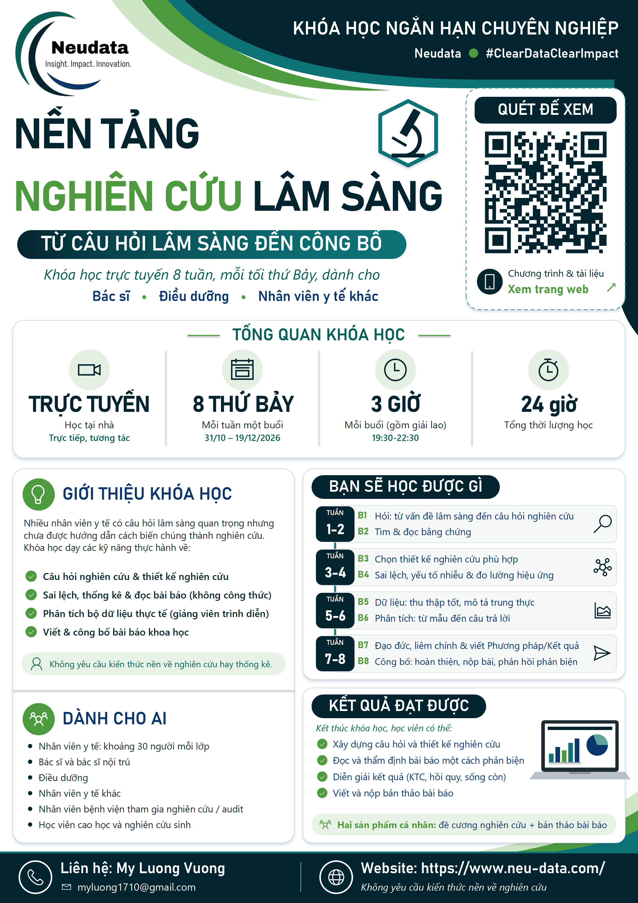

::: {.course-hero}
# Nền tảng Nghiên cứu Lâm sàng · Cấp độ 1
Từ câu hỏi lâm sàng đến công bố

::: {.badges}
[Cấp độ 1]{} [Trực tuyến]{} [8 thứ Bảy, 19:30–22:30]{} [mỗi tuần một buổi]{} [24 giờ học]{} [Không cần phần mềm]{} [Anh + Việt]{}
:::

[Xem toàn bộ lịch học](schedule.qmd){.btn .btn-light role="button"} [Nhận mã truy cập miễn phí](access.qmd){.btn .btn-light role="button"}
:::

{.float-end width="34%" style="margin:0 0 1rem 1.5rem" fig-alt="Poster khóa học"}

```{=html}
<div class="facts"><div><strong>Hình thức</strong><span>Trực tuyến, 8 buổi × 3 giờ</span></div><div><strong>Thời gian</strong><span>Mỗi thứ Bảy, 19:30–22:30, trong 8 tuần: 31/10 – 19/12/2026</span></div><div><strong>Đối tượng</strong><span>Nhân viên y tế (bác sĩ, điều dưỡng, v.v.), khoảng 30 người</span></div><div><strong>Phần mềm</strong><span>Không cần: giảng viên chạy phân tích</span></div></div>
```

## Giới thiệu khóa học

Nhân viên y tế đưa ra quyết định lâm sàng mỗi ngày mà nghiên cứu có thể giúp cải thiện, nhưng ít ai được hướng dẫn cách biến một điều chưa chắc chắn tại giường bệnh thành một nghiên cứu được công bố. Trong 8 tuần, mỗi tối thứ Bảy một buổi học trực tuyến 3 giờ (19:30–22:30), khóa học đi hết con đường nghiên cứu: đặt câu hỏi tốt, tìm và đọc bằng chứng, chọn thiết kế, nhận biết sai lệch, thu thập và phân tích dữ liệu, bảo vệ người tham gia, viết bài báo và công bố.

- **Chậm và trực quan.** Dành cho người chưa có nền tảng nghiên cứu: hình ảnh trước, kiểm tra mức hiểu mỗi 20 phút, không có công thức nào ngoài bảng 2×2, và mỗi buổi có slide bổ sung để ai muốn có thể đọc thêm ở nhà.
- **Học trực tuyến, cả lớp cùng làm.** Bạn học từ nhà. Không chia nhóm, không chia phòng nhỏ: mọi bài tập đều do cả lớp cùng làm, trả lời qua khảo sát nhanh và khung chat.
- **Cả con đường trong một khóa.** Tuần 1–4 xây dựng hiểu biết và kỹ năng thiết kế; tuần 5–8 đọc kết quả phân tích bộ dữ liệu mô phỏng FLUID-ICU (620 người bệnh ICU) qua các trình diễn R của giảng viên, và mỗi học viên viết phần Kết quả của một bài báo từ các kết quả đó.
- **Cấp độ 1 trong ba cấp độ.** Khóa học này là Cấp độ 1. Cấp độ 2 là một khóa thực hành R riêng cho những ai muốn tự phân tích (đang chuẩn bị). Cấp độ 3 gồm các phương pháp nâng cao, chuyên sâu theo yêu cầu. Xem [Các cấp độ](levels.qmd).
- **Một ví dụ xuyên suốt:** dịch truyền trong sốc nhiễm khuẩn. Ví dụ này đi qua các bước đặt câu hỏi và tìm kiếm, thiết kế, phân tích, viết và công bố, và được thẩm định qua hai bài báo thực tế.

## Tám thứ Bảy, tám buổi học

| Tuần | Buổi |
|:--:|:--|
| 1 | [Buổi 1 · Hỏi: từ vấn đề lâm sàng đến câu hỏi nghiên cứu](session1.qmd) |
| 2 | [Buổi 2 · Tìm & đọc bằng chứng](session2.qmd) |
| 3 | [Buổi 3 · Thiết kế: chọn đúng loại nghiên cứu](session3.qmd) |
| 4 | [Buổi 4 · Sai lệch và tác động: có tin được không, lớn đến đâu?](session4.qmd) |
| 5 | [Buổi 5 · Dữ liệu: thu thập tốt, mô tả trung thực](session5.qmd) |
| 6 | [Buổi 6 · Phân tích: từ mẫu đến câu trả lời](session6.qmd) |
| 7 | [Buổi 7 · Bảo vệ & viết: đạo đức, liêm chính và phần Kết quả](session7.qmd) |
| 8 | [Buổi 8 · Công bố: hoàn thiện phần Kết quả, gửi đăng, trình bày](session8.qmd) |

[Xem toàn bộ lịch học](schedule.qmd)

## Hai sản phẩm cá nhân

```{=html}
<div class="cards2"><div><h4>1 · Đề cương nghiên cứu</h4><p>Cho <strong>câu hỏi lâm sàng của chính bạn</strong> tại khoa, kèm kế hoạch công bố. Giảng viên làm mẫu từng phần trên ví dụ xuyên suốt, bạn tự viết phần của mình ở nhà. Mọi học viên <strong>nộp đề cương ở Buổi 8</strong>; khoảng 5 học viên tình nguyện trình bày (6 phút + 2 phút góp ý).</p></div><div><h4>2 · Phần Kết quả</h4><p>Từ bộ dữ liệu khóa học <strong>FLUID-ICU</strong>: vào cuối Buổi 6, bạn chọn một trong năm câu hỏi (Q1 đến Q5). Chúng tôi cung cấp gói kết quả, bạn viết <strong>phần Kết quả sẵn sàng để nộp tạp chí</strong>, kèm tên bài dự kiến, Bảng 1 và một bảng hoặc hình chính. Các phần khác không bắt buộc. Hạn nộp là 23:59 ngày học Buổi 8. Một bạn cùng lớp <strong>bình duyệt</strong> bài của bạn (hạn 2/1/2027), và bạn gửi bản đã sửa cùng thư phản hồi trước 30/1/2027.</p></div></div>
```

## Dành cho ai

**Nhân viên y tế (bác sĩ, điều dưỡng, v.v.)**, khoảng 30 học viên mỗi lớp, học trực tuyến từ nhà. Không yêu cầu nền tảng nghiên cứu hay thống kê, và không cần phần mềm: giảng viên chạy các phân tích, học viên học cách đọc, diễn giải và viết lại kết quả. Bạn cần một máy tính có kết nối internet ổn định, camera và micro.

## Bắt đầu thế nào

- Yêu cầu [mã truy cập](access.qmd) miễn phí (một lần cho mỗi trình duyệt).
- **Trước Buổi 1, hãy đọc [hướng dẫn đề cương](proposal-brief.qmd).** Đây là tài liệu duy nhất cần đọc trước khóa học. Tài liệu được gửi qua email cùng mẫu đề cương, hướng dẫn trình bày và thang chấm đề cương (bảng bên dưới).
- Sau đó xem [Buổi 1](session1.qmd): hai bài báo, phiếu bài tập và cách chuẩn bị học trực tuyến. Xem [lịch học](schedule.qmd).
- Mỗi trang buổi học có nội dung, bài giảng, phiếu bài tập và những việc cần chuẩn bị.

| | Tiếng Việt | English |
|:----------------|:--------------|:--------------|
| **[Hướng dẫn đề cương](proposal-brief.qmd)** | [Word](files/assignments/Proposal_Brief_VN.docx) · [PDF](files/assignments/Proposal_Brief_VN.pdf) | [Word](../en/files/assignments/Proposal_Brief.docx) · [PDF](../en/files/assignments/Proposal_Brief.pdf) |
| **Mẫu đề cương** | [Word](files/templates/Research_Proposal_Template_VN.docx) · [PDF](files/templates/Research_Proposal_Template_VN.pdf) | [Word](../en/files/templates/Research_Proposal_Template.docx) · [PDF](../en/files/templates/Research_Proposal_Template.pdf) |
| **[Hướng dẫn trình bày](presentation-guide.qmd)** | [Word](files/assignments/Presentation_Guide_VN.docx) · [PDF](files/assignments/Presentation_Guide_VN.pdf) | [Word](../en/files/assignments/Presentation_Guide.docx) · [PDF](../en/files/assignments/Presentation_Guide.pdf) |
| **[Thang chấm đề cương](proposal-rubric.qmd)** | [Word](files/assignments/Proposal_Rubric_VN.docx) · [PDF](files/assignments/Proposal_Rubric_VN.pdf) | [Word](../en/files/assignments/Proposal_Rubric.docx) · [PDF](../en/files/assignments/Proposal_Rubric.pdf) |


## Giảng viên

```{=html}
<div class="cards2"><div><h4>Vương Mỹ Lượng</h4><p>Chuyên gia Thống kê Sinh học cao cấp, Neudata</p></div><div><h4>Bernard Osang'ir</h4><p>Chuyên gia Thống kê Sinh học cao cấp, Neudata</p></div></div>
```

## Liên hệ

Câu hỏi về khóa học: liên hệ Vương Mỹ Lượng qua [myluong1710@gmail.com](mailto:myluong1710@gmail.com).

Neudata Consulting Ltd · [www.neu-data.com](https://www.neu-data.com)
