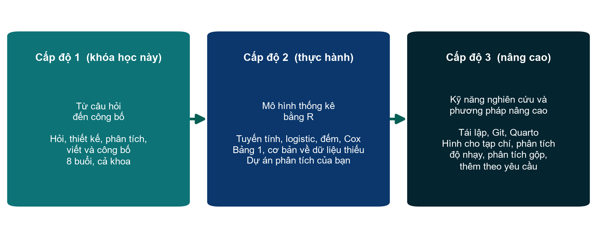

::: {.callout-tip title="Bạn đang ở đây: Cấp độ 1"}
Trang web này là **Cấp độ 1: Nền tảng**, toàn bộ khóa học 8 buổi, từ câu hỏi lâm sàng đến bản thảo bài báo. Cấp độ 2 và Cấp độ 3 là các khóa học riêng, xây dựng tiếp trên nền tảng này.
:::

{fig-alt="Cấp độ 1, Cấp độ 2 và Cấp độ 3"}

- **Cấp độ 1: Nền tảng (khóa học này).** Hiểu nghiên cứu từ câu hỏi đến công bố. Học trực tuyến, dành cho nhân viên y tế (bác sĩ, điều dưỡng, v.v.), không cần phần mềm; các phân tích được giảng viên trình diễn trực tiếp trên FLUID-ICU.
- **Cấp độ 2: Tự phân tích (đang chuẩn bị).** Một khóa riêng về mô hình thống kê bằng R, cho những ai muốn tự chạy, kiểm tra và báo cáo các phân tích.
- **Cấp độ 3: Chủ đề nâng cao (theo yêu cầu).** Nghiên cứu có thể lặp lại, biểu đồ đạt chuẩn tạp chí và các phương pháp chuyên sâu cho thiết kế và dữ liệu phức tạp, dưới dạng hội thảo hoặc tư vấn trên chính dự án của học viên.

[Tải tổng quan các cấp độ (PDF)](files/docs/Course_Levels_Overview_VN.pdf)

## Chi tiết

**Đơn vị tổ chức:** Neudata · *#ClearDataClearImpact*

Chương trình đào tạo nghiên cứu lâm sàng của Neudata gồm ba cấp độ. Mỗi cấp độ xây dựng tiếp trên cấp độ trước, và mỗi khoa có thể dừng ở cấp độ phù hợp với nhu cầu của mình.

| | **Cấp độ 1: Nền tảng** | **Cấp độ 2: Tự phân tích** | **Cấp độ 3: Chủ đề nâng cao** |
|---|---|---|---|
| **Tóm tắt** | Hiểu nghiên cứu từ câu hỏi đến công bố | Tự xây dựng, kiểm tra và diễn giải các mô hình thống kê thường gặp bằng R | Nghiên cứu có thể lặp lại, kết quả đạt chuẩn tạp chí và các phương pháp chuyên sâu cho dữ liệu phức tạp |
| **Đối tượng** | Cả một khoa (khoảng 30 nhân viên y tế: bác sĩ, điều dưỡng, v.v.) | Một nhóm nhỏ quan tâm (8 đến 12 người) muốn tự chạy phân tích | Nhà nghiên cứu có một dự án hoặc bộ dữ liệu cụ thể |
| **Điều kiện tham gia** | Không có | Cấp độ 1 và khóa miễn phí *Phân tích Dữ liệu Lâm sàng bằng R* của Neudata (hoặc kiến thức cơ bản tương đương) | Cấp độ 2 (hoặc kinh nghiệm tương đương), cùng một câu hỏi hoặc bộ dữ liệu thực tế |
| **Hình thức** | 8 buổi trực tuyến, mỗi buổi 3 giờ, vào thứ Bảy hằng tuần trong 8 tuần | 8 buổi trực tuyến, mỗi buổi 3 giờ, trong khoảng 4 đến 6 tuần, có bài tập về nhà | Hội thảo trực tuyến 1 hoặc 2 buổi, hoặc tư vấn, theo yêu cầu |
| **Phần mềm** | Học viên không cần phần mềm (giảng viên trình diễn) | R và RStudio trên máy tính xách tay của học viên | R (và các gói chuyên dụng) |
| **Thực hành?** | Khái niệm, đọc và diễn giải; các phân tích được trình diễn trực tiếp trên FLUID-ICU | Buổi nào cũng viết code thực hành; cả lớp học cùng nhau, bài tập làm cá nhân | Thực hành trên chính dữ liệu của học viên |
| **Kết quả đầu ra** | Một đề cương nghiên cứu cá nhân và một bản thảo bài báo cá nhân | Script R cho một câu hỏi phân tích và bản thảo phần Kết quả | Một phân tích có thể lặp lại, hoặc một kế hoạch phân tích, cho một dự án thực tế, với sự hỗ trợ của Neudata |
| **Tài liệu** | [Trang web này](index.qmd) (toàn bộ khóa Cấp độ 1) | [Cấp độ 2](level2.qmd) | [Cấp độ 3](level3.qmd) |

## Các cấp độ nối tiếp nhau như thế nào

- **Từ Cấp độ 1 lên Cấp độ 2.** Ở Cấp độ 1, học viên *đọc* các phân tích FLUID-ICU do giảng viên thực hiện (Bảng 1, OR thô và OR đã hiệu chỉnh, Kaplan–Meier, quy gán đa bội). Cấp độ 2 là một khóa về mô hình thống kê: học viên làm sạch và mô tả dữ liệu, rồi xây dựng, kiểm tra và diễn giải các mô hình mà bài báo lâm sàng dùng nhiều nhất (tuyến tính, logistic, Poisson, nhị thức âm, mô hình thừa số 0 và Cox). Mỗi buổi bắt đầu bằng phân tích khám phá dữ liệu (exploratory data analysis, EDA) phù hợp với mô hình đó. Khóa kết thúc bằng một câu hỏi phân tích cá nhân và một phần Kết quả viết hoàn chỉnh. Bộ dữ liệu FLUID-ICU và các script R trong `Course/Data/` được dùng chung cho cả hai cấp độ.
- **Từ Cấp độ 2 lên Cấp độ 3.** Cấp độ 3 bổ sung các chủ đề về kỹ năng làm nghiên cứu đã chuyển ra khỏi Cấp độ 2 (dự án có thể lặp lại, quản lý phiên bản, báo cáo Quarto, biểu đồ đạt yêu cầu của tạp chí, dữ liệu thiếu và phân tích độ nhạy chuyên sâu) và các phương pháp mà dữ liệu phức tạp đòi hỏi (phân tích gộp, mô hình dự báo, độ chính xác chẩn đoán, phân tích sống còn nâng cao, mô hình dọc và đa tầng, bộ dữ liệu lớn hoặc theo cụm). Mỗi bài giảng Cấp độ 3 đều có phần EDA và code vẽ biểu đồ đạt chuẩn tạp chí cho vấn đề phân tích của bài.

## Tóm tắt lộ trình

| Kỹ năng | Cấp độ 1 | Cấp độ 2 | Cấp độ 3 |
|---|---|---|---|
| Câu hỏi nghiên cứu, thiết kế, đạo đức | Dạy chuyên sâu | Coi như đã biết | Coi như đã biết |
| Quản lý và làm sạch dữ liệu | Khái niệm, trình diễn trực tiếp | Thực hành bằng script R: nhập, làm sạch, kiểm tra dữ liệu, nhật ký làm sạch dữ liệu | Dự án có thể lặp lại và quản lý phiên bản (Học phần G); dữ liệu lớn, liên kết hoặc theo cụm (Học phần F) |
| Mô tả dữ liệu, Bảng 1, biểu đồ | Đọc và đánh giá | Bảng 1; biểu đồ EDA phù hợp với từng mô hình, dùng code của khóa học | Biểu đồ đạt yêu cầu của tạp chí (vector và raster, kích thước, độ phân giải, phông chữ) và code vẽ biểu đồ trong mọi học phần |
| Hồi quy | Đọc và diễn giải kết quả | Xây dựng, kiểm tra, diễn giải và báo cáo mô hình tuyến tính, logistic, mô hình cho biến đếm (Poisson, nhị thức âm, thừa số 0) và mô hình Cox | Mô hình hỗn hợp, nguy cơ cạnh tranh, biến số thay đổi theo thời gian, mô hình dự báo |
| Dữ liệu thiếu | Cơ chế và ý tưởng | Mô tả tình trạng thiếu dữ liệu; phân tích ca đầy đủ và quy gán đa bội, giới thiệu sơ lược | Quy gán đa bội trong thực hành và phân tích độ nhạy chuyên sâu (Học phần H) |
| Phân tích sống còn | Đọc đường cong Kaplan–Meier và HR | Kaplan–Meier và Cox, kể cả kiểm tra giả định nguy cơ tỷ lệ | Nâng cao: biến số thay đổi theo thời gian, nguy cơ cạnh tranh, thời gian sống trung bình giới hạn (Học phần D) |
| Viết và công bố | Toàn bộ quy trình viết bài báo (bản thảo cá nhân) | Phần Kết quả viết từ kết quả R của chính học viên | Báo cáo Quarto trong đó mọi con số đều do code tạo ra; phần Phương pháp và Kết quả cho các phân tích phức tạp |

**Tình trạng:** Tài liệu Cấp độ 1 nằm trong `Course/`. Cấp độ 2 và Cấp độ 3 hiện là đề cương. Tài liệu của hai cấp độ này sẽ được xây dựng sau khi Cấp độ 1 diễn ra.
