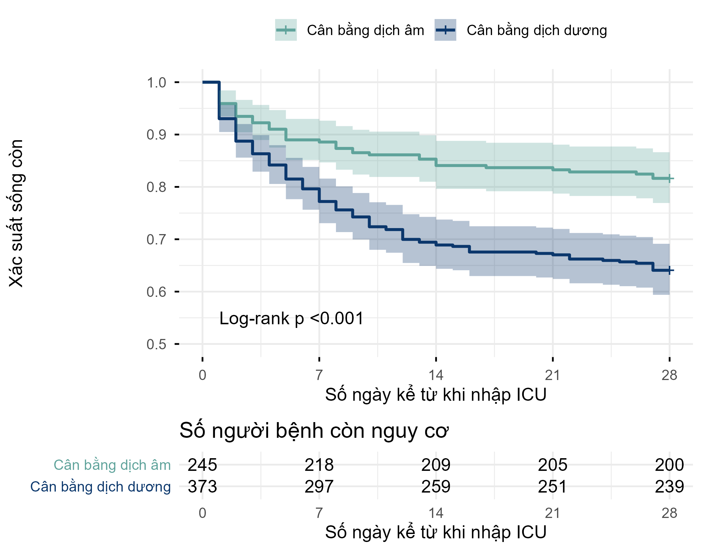
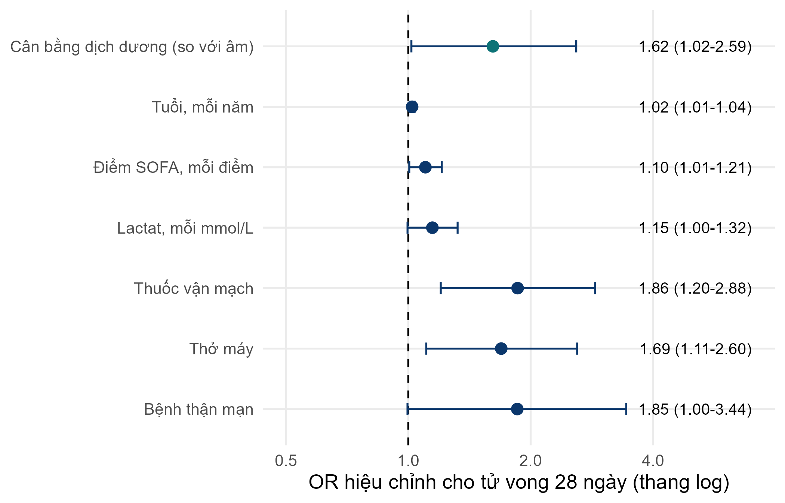
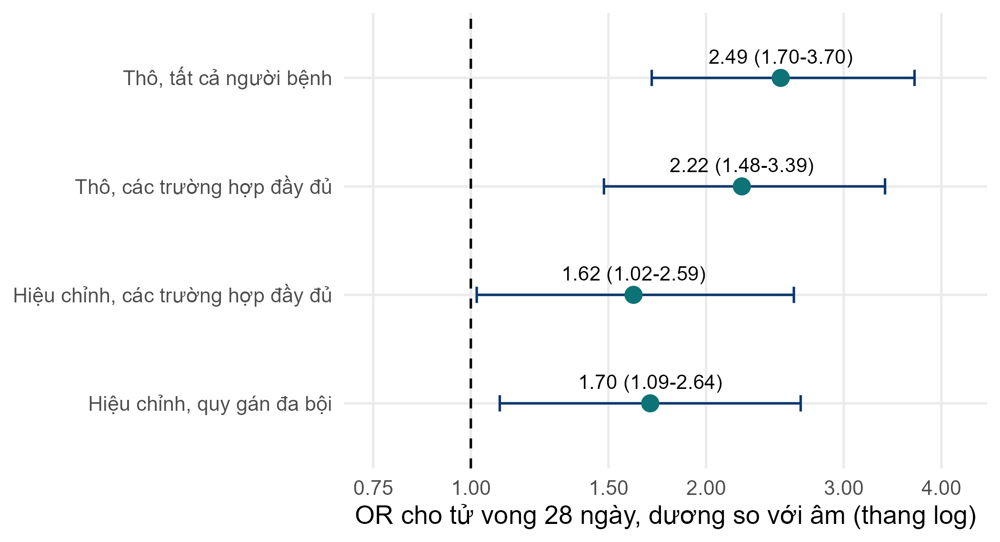
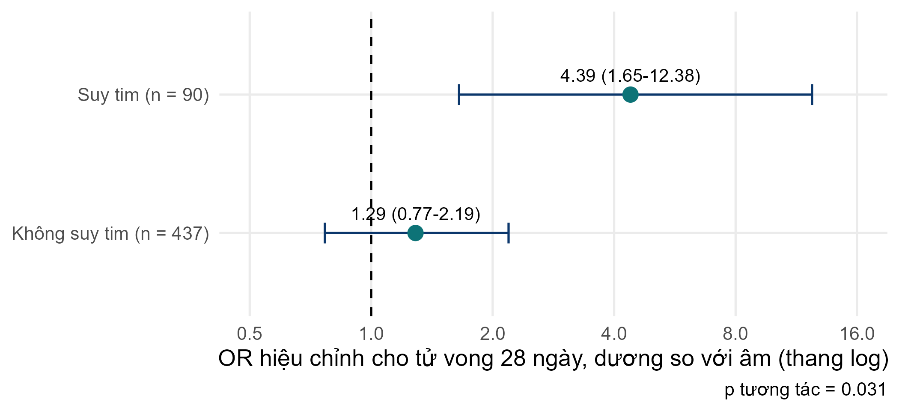

::: {.simulated}
**Dữ liệu mô phỏng, không phải người bệnh thật.** FLUID-ICU là một nghiên cứu giả định: mọi giá trị đều do chương trình máy tính tạo ra với hạt giống ngẫu nhiên cố định. Dữ liệu không mô tả bất kỳ người bệnh, bệnh viện hay ICU thật nào. Mọi bản thảo viết từ bộ dữ liệu này phải ghi rõ dữ liệu là mô phỏng và không bao giờ được nộp như một nghiên cứu thật.
:::

Tải về: [Word](files/data/results_packs/Results_Pack_Q1_VN.docx) · [PDF](files/data/results_packs/Results_Pack_Q1_VN.pdf) · [zip (Markdown, bảng, biểu đồ)](files/data/results_packs/Results_Pack_Q1_VN.zip) · [Quay lại trang bộ dữ liệu](dataset.qmd)

> **DỮ LIỆU MÔ PHỎNG: KHÔNG PHẢI NGƯỜI BỆNH THẬT.** FLUID-ICU được tạo bằng máy tính cho khóa học này. Hãy viết bản thảo như một bài tập huấn luyện và ghi rõ rằng dữ liệu là mô phỏng.

## 1. Câu hỏi

**Ở người lớn bị nhiễm khuẩn huyết điều trị tại ICU, cân bằng dịch tích lũy dương vào ngày 3 có liên quan với tử vong 28 ngày cao hơn không?**

## 2. Thiết kế và dữ liệu

- Thiết kế: nghiên cứu thuần tập tiến cứu đa trung tâm (quan sát).
- Bối cảnh: 4 ICU (ICU A-D), người lớn bị nhiễm khuẩn huyết được tuyển liên tiếp, thời gian tuyển từ tháng 1/2023 đến tháng 12/2024.
- Phơi nhiễm: cân bằng dịch tích lũy dương vào ngày 3 (dịch vào trừ dịch ra trong các ngày ICU 1-3 > 0 ml/kg) so với cân bằng âm hoặc bằng 0.
- Kết cục: tử vong do mọi nguyên nhân trong vòng 28 ngày kể từ khi nhập ICU (died_28d); thời gian đến tử vong cho phân tích sống còn (time_to_event_28d, kiểm duyệt tại ngày 28).
- Mẫu phân tích: 618 trong số 620 người bệnh (2 người không có cân bằng dịch ngày 3). Các mô hình hiệu chỉnh: 527 trường hợp đầy đủ.
- Các yếu tố gây nhiễu xác định trước (SAP): tuổi, điểm SOFA, lactat, thuốc vận mạch, thở máy, bệnh thận mạn.
- Phần mềm: R 4.6 (các gói gtsummary, survival, mice). Script: FLUID-ICU/R/.

Lưu đồ người tham gia: 620 người bệnh được tuyển -> 2 người không có cân bằng dịch ngày 3 (thiếu cân nặng hoặc lượng dịch ra sau khi làm sạch) -> 618 người trong phân tích phơi nhiễm -> 91 người không có lactat (hoặc tuổi) -> 527 người trong mô hình hiệu chỉnh trên các trường hợp đầy đủ.

## 3. Bảng 1: đối tượng nghiên cứu

**Bảng 1. Đặc điểm ban đầu theo nhóm cân bằng dịch**

|Đặc điểm                            |Toàn bộ   N = 618 |Cân bằng dịch âm   N = 245 |Cân bằng dịch dương   N = 373 |
|:-----------------------------------|:-----------------|:--------------------------|:-----------------------------|
|Tuổi, năm                           |62.6 (15.2)       |64.6 (15.0)                |61.4 (15.2)                   |
|&emsp;Thiếu                         |1                 |1                          |0                             |
|Giới                                |                  |                           |                              |
|&emsp;Nữ                            |243 (39%)         |102 (42%)                  |141 (38%)                     |
|&emsp;Nam                           |375 (61%)         |143 (58%)                  |232 (62%)                     |
|Cân nặng, kg                        |64.7 (11.9)       |65.1 (12.4)                |64.4 (11.6)                   |
|Đái tháo đường                      |158 (26%)         |70 (29%)                   |88 (24%)                      |
|Bệnh thận mạn                       |64 (10%)          |28 (11%)                   |36 (9.7%)                     |
|Suy tim                             |97 (16%)          |54 (22%)                   |43 (12%)                      |
|Tăng huyết áp                       |282 (46%)         |124 (51%)                  |158 (42%)                     |
|Nguồn nhiễm khuẩn                   |                  |                           |                              |
|&emsp;Hô hấp                        |267 (43%)         |101 (41%)                  |166 (45%)                     |
|&emsp;Tiết niệu                     |126 (20%)         |54 (22%)                   |72 (19%)                      |
|&emsp;Ổ bụng                        |106 (17%)         |46 (19%)                   |60 (16%)                      |
|&emsp;Da/mô mềm                     |57 (9.2%)         |18 (7.3%)                  |39 (10%)                      |
|&emsp;Khác                          |62 (10%)          |26 (11%)                   |36 (9.7%)                     |
|Điểm SOFA                           |7 (5, 9)          |6 (4, 8)                   |8 (6, 10)                     |
|Điểm APACHE II                      |19 (15, 24)       |17 (12, 21)                |20 (17, 25)                   |
|&emsp;Thiếu                         |6                 |3                          |3                             |
|Lactat, mmol/L                      |2.6 (1.7, 3.7)    |2.2 (1.4, 3.0)             |2.9 (1.9, 4.0)                |
|&emsp;Thiếu                         |91                |50                         |41                            |
|Huyết áp động mạch trung bình, mmHg |73 (66, 80)       |76 (70, 84)                |71 (65, 78)                   |
|&emsp;Thiếu                         |4                 |1                          |3                             |
|Thuốc vận mạch lúc nhập ICU         |266 (43%)         |61 (25%)                   |205 (55%)                     |
|Thở máy                             |313 (51%)         |97 (40%)                   |216 (58%)                     |

*Trung bình (SD); n (%); trung vị (Q1, Q3). Thiếu = số người bệnh không có giá trị đó.*

Tệp: `tables/table1_by_balance_VN.csv` và `tables/table1_by_balance_VN.docx`

Hãy đọc Bảng 1 trước: nhóm cân bằng dịch dương **nặng hơn** lúc ban đầu: SOFA trung vị 8 (6 đến 10) so với 6 (4 đến 8), dùng thuốc vận mạch 205/373 (55.0%) so với 61/245 (24.9%). Đây là nhiễu do chỉ định: người bệnh nặng hơn được truyền nhiều dịch hơn VÀ tử vong nhiều hơn.

## 4. Kết quả chính

**Bảng 2. Tử vong 28 ngày theo nhóm cân bằng dịch (chưa hiệu chỉnh)**

|Kết cục                                |Cân bằng dịch âm |Cân bằng dịch dương |Tác động (KTC 95%)                                    |
|:--------------------------------------|:----------------|:-------------------|:-----------------------------------------------------|
|Tử vong trong 28 ngày, n/N (%)         |45/245 (18.4%)   |134/373 (35.9%)     |Hiệu số nguy cơ 17.6 (KTC 95% 10.7 đến 24.4); RR 1.96 |
|Sống còn tại ngày 28 (Kaplan-Meier), % |81.6             |64.1                |Log-rank p <0.001                                     |

Tệp: `tables/table2_outcome_VN.csv` và `tables/table2_outcome_VN.docx`

**Bảng 3. Hồi quy logistic cho tử vong 28 ngày: tỷ số chênh thô và hiệu chỉnh (mô hình hiệu chỉnh n = 527)**

|Biến số                         |OR thô (KTC 95%)     |p thô  |OR hiệu chỉnh (KTC 95%) |p hiệu chỉnh |
|:-------------------------------|:--------------------|:------|:-----------------------|:------------|
|Cân bằng dịch dương (so với âm) |2.49 (1.70 đến 3.70) |<0.001 |1.62 (1.02 đến 2.59)    |0.044        |
|Tuổi, mỗi năm                   |1.02 (1.01 đến 1.03) |<0.001 |1.02 (1.01 đến 1.04)    |0.002        |
|Điểm SOFA, mỗi điểm             |1.26 (1.18 đến 1.35) |<0.001 |1.10 (1.01 đến 1.21)    |0.039        |
|Lactat, mỗi mmol/L              |1.38 (1.23 đến 1.55) |<0.001 |1.15 (1.00 đến 1.32)    |0.059        |
|Thuốc vận mạch                  |3.31 (2.31 đến 4.78) |<0.001 |1.86 (1.20 đến 2.88)    |0.005        |
|Thở máy                         |2.98 (2.07 đến 4.34) |<0.001 |1.69 (1.11 đến 2.60)    |0.016        |
|Bệnh thận mạn                   |2.58 (1.52 đến 4.36) |<0.001 |1.85 (1.00 đến 3.44)    |0.050        |

Tệp: `tables/table3_logistic_VN.csv` và `tables/table3_logistic_VN.docx`

- OR thô (tất cả 618 người bệnh): **2.49 (KTC 95% 1.70 đến 3.70)**, p <0.001.
- OR thô trên cùng 527 trường hợp đầy đủ: 2.22 (KTC 95% 1.48 đến 3.39).
- OR hiệu chỉnh (tuổi, SOFA, lactat, thuốc vận mạch, thở máy, bệnh thận mạn): **1.62 (KTC 95% 1.02 đến 2.59)**, p 0.044.
- Sống còn Kaplan-Meier tại ngày 28: 81.6% (âm) so với 64.1% (dương); log-rank p <0.001.
- Tỷ số nguy cơ tức thời (HR) theo mô hình Cox: thô 2.17 (KTC 95% 1.55 đến 3.05); hiệu chỉnh **1.46 (KTC 95% 1.00 đến 2.13)**, p 0.053 (kiểm định giả định nguy cơ tỷ lệ, p toàn cục = 0.10).

**Bảng 4. Hồi quy Cox cho thời gian đến tử vong trong 28 ngày**

|Mô hình                                          |n   |Số biến cố |HR (KTC 95%)         |p      |
|:------------------------------------------------|:---|:----------|:--------------------|:------|
|Thô                                              |618 |179        |2.17 (1.55 đến 3.05) |<0.001 |
|Hiệu chỉnh (các yếu tố gây nhiễu xác định trước) |527 |161        |1.46 (1.00 đến 2.13) |0.053  |

Tệp: `tables/table4_cox_VN.csv` và `tables/table4_cox_VN.docx`

*Hình 1. Đường cong sống còn Kaplan-Meier đến ngày 28 theo nhóm cân bằng dịch, kèm số người bệnh còn nguy cơ* (`figures/fig1_km_balance_VN.png`)

*Hình 2. Tỷ số chênh hiệu chỉnh cho tử vong 28 ngày (biểu đồ rừng)* (`figures/fig2_forest_adjusted_VN.png`)

*Hình 3. Tỷ số chênh của cân bằng dịch dương trước và sau hiệu chỉnh* (`figures/fig3_crude_vs_adjusted_VN.png`)

## 5. Các phân tích khác

**Bảng 5. Thay đổi tác động theo suy tim (xác định trước)**

|Phân nhóm     |Tử vong, cân bằng dịch âm |Tử vong, cân bằng dịch dương |OR hiệu chỉnh (KTC 95%) |p tương tác |
|:-------------|:-------------------------|:----------------------------|:-----------------------|:-----------|
|Không suy tim |34/191 (18%)              |108/330 (33%)                |1.29 (0.77 đến 2.19)    |0.031       |
|Suy tim       |11/54 (20%)               |26/43 (60%)                  |4.39 (1.65 đến 12.38)   |0.031       |

Tệp: `tables/table5_interaction_hf_VN.csv` và `tables/table5_interaction_hf_VN.docx`

*Hình 4. Tỷ số chênh của cân bằng dịch dương ở người bệnh có và không có suy tim* (`figures/fig4_interaction_hf_VN.png`)

**Bảng 6. Các phân tích độ nhạy cho mối liên quan chính**

|Phân tích                                 |n   |OR (KTC 95%)         |p      |
|:-----------------------------------------|:---|:--------------------|:------|
|Thô, tất cả người bệnh                    |618 |2.49 (1.70 đến 3.70) |<0.001 |
|Thô, các trường hợp đầy đủ                |527 |2.22 (1.48 đến 3.39) |<0.001 |
|Hiệu chỉnh, các trường hợp đầy đủ (chính) |527 |1.62 (1.02 đến 2.59) |0.044  |
|Hiệu chỉnh, quy gán đa bội (m = 20)       |620 |1.70 (1.09 đến 2.64) |0.020  |

Tệp: `tables/table6_sensitivity_VN.csv` và `tables/table6_sensitivity_VN.docx`

## 6. Ý nghĩa (bằng lời đơn giản)

- Người bệnh có cân bằng dịch dương tử vong nhiều hơn (36% so với 18%). Nhưng họ cũng nặng hơn.
- Sau khi tính đến mức độ nặng, mối liên quan nhỏ đi nhiều (OR giảm từ 2.49 xuống 1.62). Phần lớn chênh lệch thô là do nhiễu do chỉ định.
- Vẫn còn một mối liên quan vừa phải: KTC 95% chỉ vừa đủ loại trừ 1, và mô hình Cox cho HR tương tự với KTC vừa chạm 1. Bằng chứng ở mức yếu đến trung bình, không mạnh.
- Mối liên quan có vẻ mạnh hơn ở người bệnh suy tim (p tương tác 0.031). Phân tích này được xác định trước nhưng chỉ dựa trên 90 người bệnh suy tim, vì vậy hãy xem đây là một giả thuyết.

## 7. Kết quả này KHÔNG có nghĩa là gì

- Kết quả KHÔNG cho thấy dịch GÂY RA tử vong. Đây là nghiên cứu quan sát: hãy viết 'có liên quan với', không viết 'gây ra' hay 'làm tăng'.
- Kết quả KHÔNG khuyên bác sĩ hạn chế dịch. Chỉ một thử nghiệm ngẫu nhiên (như Bài báo 1) mới kiểm chứng được một chiến lược truyền dịch.
- Giá trị p 0.044 không phải là 'bằng chứng chắc chắn'; KTC từ 1.02 đến 2.59 phù hợp với cả một tác động rất nhỏ lẫn một tác động lớn.

## 8. Các hạn chế cần bàn luận (gợi ý)

- Nhiễu tồn dư: SOFA và lactat chỉ đo mức độ nặng một cách chưa hoàn hảo; mức độ nặng không đo được có thể giải thích mối liên quan còn lại.
- Quan hệ nhân quả ngược: người bệnh diễn tiến xấu (sốc, thiểu niệu) tích lũy dịch vì họ đang dần tử vong, chứ không phải ngược lại.
- Cân bằng dịch được đo trong các ngày 1-3; người bệnh tử vong trước ngày 3 có ít thời gian tích lũy dịch hơn (vấn đề thời gian bất tử, immortal time).
- Thiếu lactat (15%): mô hình trường hợp đầy đủ mất 91 người bệnh; quy gán đa bội cho kết quả tương tự (Bảng 6).
- Lượng dịch mất không nhận biết được không được ghi nhận; chia đôi thành dương/âm làm mất thông tin (xem Q2 cho phiên bản liên tục).

## Các mục STROBE mà gói này giúp bạn viết

- Mục 4-5: thiết kế và bối cảnh (phần 2)
- Mục 6: người tham gia và tiêu chuẩn chọn
- Mục 7: các biến số (phơi nhiễm, kết cục, yếu tố gây nhiễu và yếu tố thay đổi tác động là suy tim)
- Mục 12a-e: phương pháp thống kê, gồm nhiễu, tương tác, dữ liệu thiếu, phân tích độ nhạy
- Mục 13: số người tham gia (câu mô tả lưu đồ)
- Mục 14: dữ liệu mô tả (Bảng 1, dữ liệu thiếu)
- Mục 15: dữ liệu kết cục (Bảng 2)
- Mục 16: ước lượng chưa hiệu chỉnh và đã hiệu chỉnh kèm KTC 95% (Bảng 3-4)
- Mục 17: các phân tích khác (phân nhóm/tương tác và độ nhạy, Bảng 5-6)

