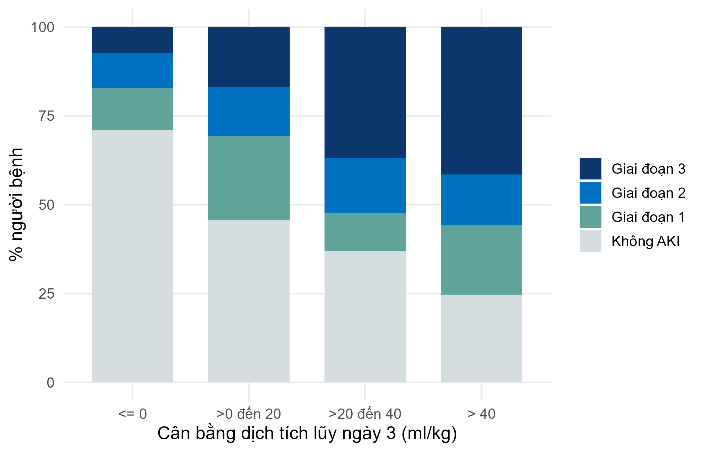
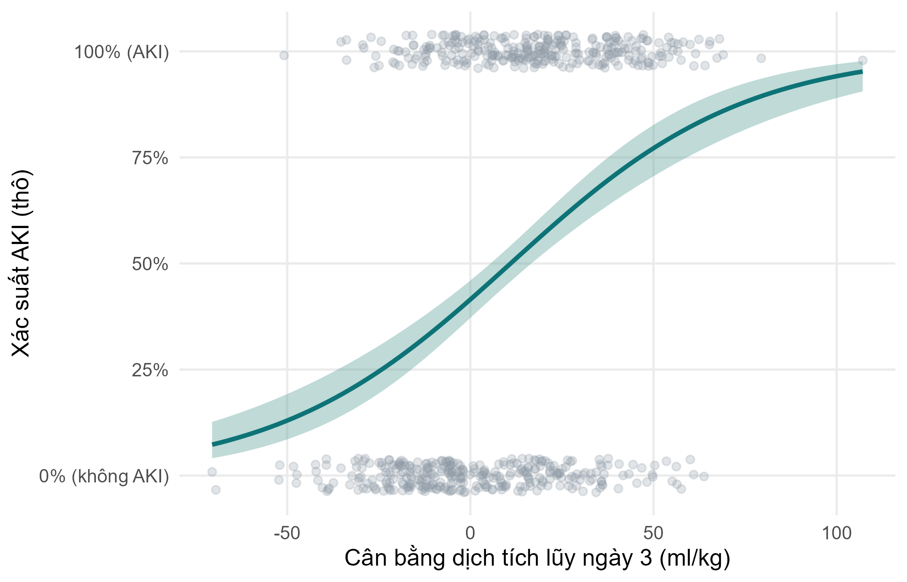

::: {.simulated}
**Dữ liệu mô phỏng, không phải người bệnh thật.** FLUID-ICU là một nghiên cứu giả định: mọi giá trị đều do chương trình máy tính tạo ra với hạt giống ngẫu nhiên cố định. Dữ liệu không mô tả bất kỳ người bệnh, bệnh viện hay ICU thật nào. Mọi bản thảo viết từ bộ dữ liệu này phải ghi rõ dữ liệu là mô phỏng và không bao giờ được nộp như một nghiên cứu thật.
:::

Tải về: [Word](files/data/results_packs/Results_Pack_Q2_VN.docx) · [PDF](files/data/results_packs/Results_Pack_Q2_VN.pdf) · [zip (Markdown, bảng, biểu đồ)](files/data/results_packs/Results_Pack_Q2_VN.zip) · [Quay lại trang bộ dữ liệu](dataset.qmd)

> **DỮ LIỆU MÔ PHỎNG: KHÔNG PHẢI NGƯỜI BỆNH THẬT.** FLUID-ICU được tạo bằng máy tính cho khóa học này. Hãy viết bản thảo như một bài tập huấn luyện và ghi rõ rằng dữ liệu là mô phỏng.

## 1. Câu hỏi

**Ở người lớn bị nhiễm khuẩn huyết điều trị tại ICU, cân bằng dịch tích lũy cao hơn vào ngày 3 có liên quan với tổn thương thận cấp không?**

## 2. Thiết kế và dữ liệu

- Thiết kế: nghiên cứu thuần tập tiến cứu đa trung tâm (quan sát).
- Bối cảnh: 4 ICU (ICU A-D), người lớn bị nhiễm khuẩn huyết được tuyển liên tiếp, thời gian tuyển từ tháng 1/2023 đến tháng 12/2024.
- Phơi nhiễm: cân bằng dịch tích lũy ngày 3 tính bằng ml/kg, phân tích theo mỗi 10 ml/kg (biến liên tục); phân tích phụ: cân bằng dương so với âm.
- Kết cục: tổn thương thận cấp (AKI; KDIGO giai đoạn >= 1, giai đoạn cao nhất trong các ngày ICU 1-7; aki_any). Kết cục phụ: AKI giai đoạn 2-3; điều trị thay thế thận (RRT, chỉ mô tả).
- Mẫu phân tích: 618 người bệnh có cân bằng dịch ngày 3; các mô hình hiệu chỉnh 527 trường hợp đầy đủ.
- Các yếu tố gây nhiễu xác định trước (SAP): tuổi, điểm SOFA, lactat, thuốc vận mạch, thở máy, bệnh thận mạn.
- Phần mềm: R 4.6 (các gói gtsummary, survival, mice). Script: Course/Data/R/.

Lưu đồ người tham gia: 620 người bệnh được tuyển -> 2 người không có cân bằng dịch ngày 3 (thiếu cân nặng hoặc lượng dịch ra sau khi làm sạch) -> 618 người trong phân tích phơi nhiễm -> 91 người không có lactat (hoặc tuổi) -> 527 người trong mô hình hiệu chỉnh trên các trường hợp đầy đủ.

## 3. Bảng 1: đối tượng nghiên cứu

**Bảng 1. Đặc điểm ban đầu theo nhóm cân bằng dịch**

|Đặc điểm                            |Toàn bộ   N = 618 |Cân bằng dịch âm   N = 245 |Cân bằng dịch dương   N = 373 |
|:-----------------------------------|:-----------------|:--------------------------|:-----------------------------|
|Tuổi, năm                           |62.6 (15.2)       |64.6 (15.0)                |61.4 (15.2)                   |
|&emsp;Thiếu                         |1                 |1                          |0                             |
|Giới                                |                  |                           |                              |
|&emsp;Nữ                            |243 (39%)         |102 (42%)                  |141 (38%)                     |
|&emsp;Nam                           |375 (61%)         |143 (58%)                  |232 (62%)                     |
|Cân nặng, kg                        |64.7 (11.9)       |65.1 (12.4)                |64.4 (11.6)                   |
|Đái tháo đường                      |158 (26%)         |70 (29%)                   |88 (24%)                      |
|Bệnh thận mạn                       |64 (10%)          |28 (11%)                   |36 (9.7%)                     |
|Suy tim                             |97 (16%)          |54 (22%)                   |43 (12%)                      |
|Tăng huyết áp                       |282 (46%)         |124 (51%)                  |158 (42%)                     |
|Nguồn nhiễm khuẩn                   |                  |                           |                              |
|&emsp;Hô hấp                        |267 (43%)         |101 (41%)                  |166 (45%)                     |
|&emsp;Tiết niệu                     |126 (20%)         |54 (22%)                   |72 (19%)                      |
|&emsp;Ổ bụng                        |106 (17%)         |46 (19%)                   |60 (16%)                      |
|&emsp;Da/mô mềm                     |57 (9.2%)         |18 (7.3%)                  |39 (10%)                      |
|&emsp;Khác                          |62 (10%)          |26 (11%)                   |36 (9.7%)                     |
|Điểm SOFA                           |7 (5, 9)          |6 (4, 8)                   |8 (6, 10)                     |
|Điểm APACHE II                      |19 (15, 24)       |17 (12, 21)                |20 (17, 25)                   |
|&emsp;Thiếu                         |6                 |3                          |3                             |
|Lactat, mmol/L                      |2.6 (1.7, 3.7)    |2.2 (1.4, 3.0)             |2.9 (1.9, 4.0)                |
|&emsp;Thiếu                         |91                |50                         |41                            |
|Huyết áp động mạch trung bình, mmHg |73 (66, 80)       |76 (70, 84)                |71 (65, 78)                   |
|&emsp;Thiếu                         |4                 |1                          |3                             |
|Thuốc vận mạch lúc nhập ICU         |266 (43%)         |61 (25%)                   |205 (55%)                     |
|Thở máy                             |313 (51%)         |97 (40%)                   |216 (58%)                     |

*Trung bình (SD); n (%); trung vị (Q1, Q3). Thiếu = số người bệnh không có giá trị đó.*

Tệp: `tables/table1_by_balance_VN.csv` và `tables/table1_by_balance_VN.docx`

## 4. Kết quả chính

- AKI (mọi giai đoạn) xảy ra ở 302/620 (48.7%) tổng số người bệnh; RRT ở 79/620 (12.7%).
- AKI: cân bằng dương 230/373 (61.7%) so với cân bằng âm 71/245 (29.0%).
- AKI tăng dần theo từng nhóm cân bằng dịch: <= 0: 29%; >0 đến 20: 54%; >20 đến 40: 63%; > 40: 75%.
- OR thô cho mỗi 10 ml/kg cân bằng dịch tăng thêm: 1.37 (KTC 95% 1.27 đến 1.47).
- OR hiệu chỉnh cho mỗi 10 ml/kg: **1.27 (KTC 95% 1.16 đến 1.40)**, p <0.001.
- Cân bằng dương so với âm: OR thô 3.94 (KTC 95% 2.80 đến 5.60); OR hiệu chỉnh 2.70 (KTC 95% 1.76 đến 4.15).

**Bảng 2. Giai đoạn AKI cao nhất theo KDIGO, theo nhóm cân bằng dịch**

|Giai đoạn AKI     |Cân bằng dịch âm |Cân bằng dịch dương |
|:-----------------|:----------------|:-------------------|
|KDIGO giai đoạn 0 |174 (71%)        |143 (38%)           |
|KDIGO giai đoạn 1 |29 (12%)         |68 (18%)            |
|KDIGO giai đoạn 2 |24 (10%)         |54 (14%)            |
|KDIGO giai đoạn 3 |18 (7%)          |108 (29%)           |

Tệp: `tables/table2_aki_stage_by_group_VN.csv` và `tables/table2_aki_stage_by_group_VN.docx`

**Bảng 3. AKI theo nhóm cân bằng dịch tích lũy ngày 3**

|Cân bằng dịch tích lũy ngày 3, ml/kg |n   |AKI bất kỳ, n (%) |AKI giai đoạn 2-3, % |RRT, % |
|:------------------------------------|:---|:-----------------|:--------------------|:------|
|<= 0                                 |245 |71 (29%)          |17.1                 |4.1    |
|>0 đến 20                            |166 |90 (54%)          |30.7                 |11.4   |
|>20 đến 40                           |130 |82 (63%)          |52.3                 |21.5   |
|> 40                                 |77  |58 (75%)          |55.8                 |28.6   |

Tệp: `tables/table3_aki_by_balance_category_VN.csv` và `tables/table3_aki_by_balance_category_VN.docx`

**Bảng 4. Hồi quy logistic cho AKI (hiệu chỉnh theo tuổi, SOFA, lactat, thuốc vận mạch, thở máy, bệnh thận mạn)**

|Mô hình                                                            |n   |OR (KTC 95%)         |p      |
|:------------------------------------------------------------------|:---|:--------------------|:------|
|Cân bằng dịch mỗi 10 ml/kg, thô                                    |618 |1.37 (1.27 đến 1.47) |<0.001 |
|Cân bằng dịch mỗi 10 ml/kg, hiệu chỉnh                             |527 |1.27 (1.16 đến 1.40) |<0.001 |
|Cân bằng dương so với âm, thô                                      |618 |3.94 (2.80 đến 5.60) |<0.001 |
|Cân bằng dương so với âm, hiệu chỉnh                               |527 |2.70 (1.76 đến 4.15) |<0.001 |
|Cân bằng dịch mỗi 10 ml/kg, hiệu chỉnh (kết cục AKI giai đoạn 2-3) |527 |1.23 (1.12 đến 1.35) |<0.001 |

Tệp: `tables/table4_aki_models_VN.csv` và `tables/table4_aki_models_VN.docx`

*Hình 1. Giai đoạn AKI cao nhất theo nhóm cân bằng dịch tích lũy* (`figures/fig1_aki_stage_by_balance_VN.png`)

*Hình 2. Xác suất AKI thô theo toàn bộ khoảng giá trị cân bằng dịch (đường cong logistic, dải 95%)* (`figures/fig2_aki_probability_curve_VN.png`)

## 5. Ý nghĩa (bằng lời đơn giản)

- AKI càng thường gặp khi cân bằng dịch càng dương: một quy luật 'liều-đáp ứng' rõ ràng.
- Sau hiệu chỉnh, mỗi 10 ml/kg tăng thêm (khoảng 650 ml ở người lớn nặng 65 kg) liên quan với số chênh AKI cao hơn khoảng 27%.
- Dùng cân bằng dịch dạng liên tục giữ lại nhiều thông tin hơn cách chia dương/âm và cho thấy rõ xu hướng tăng dần.

## 6. Kết quả này KHÔNG có nghĩa là gì

- Kết quả KHÔNG cho thấy dịch làm tổn thương thận. Mối liên quan có thể theo chiều ngược lại: AKI làm giảm lượng nước tiểu, và lượng dịch ra thấp làm cân bằng dịch dương (quan hệ nhân quả ngược).
- Không biết AKI bắt đầu trước hay sau khi dịch tích lũy. Dữ liệu chỉ ghi giai đoạn cao nhất trong các ngày 1-7.
- OR 1.27 cho mỗi 10 ml/kg không phải là nguy cơ: khi AKI phổ biến như ở đây (khoảng 49%), tỷ số chênh phóng đại tỷ số nguy cơ.

## 7. Các hạn chế cần bàn luận (gợi ý)

- Thời điểm: phơi nhiễm (ngày 1-3) và kết cục (ngày 1-7) chồng lên nhau.
- Nhiễu tồn dư do mức độ nặng và do thuốc độc cho thận (không được ghi nhận).
- Phân giai đoạn KDIGO có thể dựa trên creatinin, vốn bị pha loãng khi truyền dịch, nên AKI có thể bị chẩn đoán thiếu ở người bệnh có cân bằng dịch dương nhiều.
- Phân tích trường hợp đầy đủ (thiếu lactat ở 15%).

## Các mục STROBE mà gói này giúp bạn viết

- Mục 6-7: người tham gia và định nghĩa biến số (KDIGO)
- Mục 12: phương pháp, gồm cách đưa phơi nhiễm liên tục vào mô hình (mỗi 10 ml/kg)
- Mục 14: dữ liệu mô tả (Bảng 1)
- Mục 15: dữ liệu kết cục (Bảng 2-3)
- Mục 16: OR thô và hiệu chỉnh kèm KTC 95%; báo cáo ngưỡng của các nhóm (Bảng 3-4)
- Mục 19: hạn chế (quan hệ nhân quả ngược và thời điểm)
- Mục 17: kết cục phụ AKI giai đoạn 2-3

