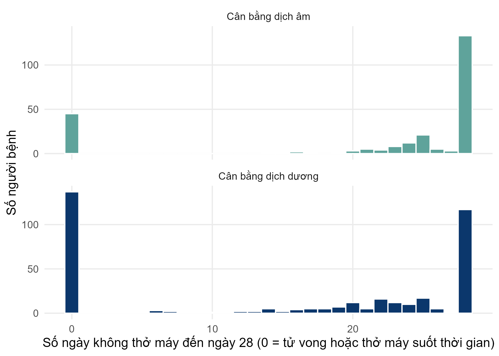
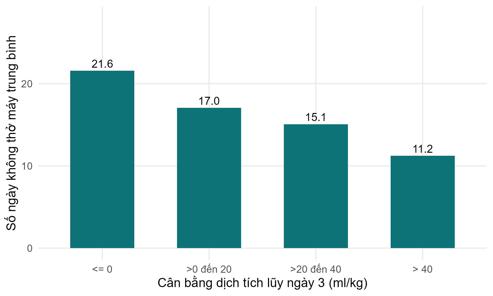

::: {.simulated}
**Dữ liệu mô phỏng, không phải người bệnh thật.** FLUID-ICU là một nghiên cứu giả định: mọi giá trị đều do chương trình máy tính tạo ra với hạt giống ngẫu nhiên cố định. Dữ liệu không mô tả bất kỳ người bệnh, bệnh viện hay ICU thật nào. Mọi bản thảo viết từ bộ dữ liệu này phải ghi rõ dữ liệu là mô phỏng và không bao giờ được nộp như một nghiên cứu thật.
:::

Tải về: [Word](files/data/results_packs/Results_Pack_Q3_VN.docx) · [PDF](files/data/results_packs/Results_Pack_Q3_VN.pdf) · [zip (Markdown, bảng, biểu đồ)](files/data/results_packs/Results_Pack_Q3_VN.zip) · [Quay lại trang bộ dữ liệu](dataset.qmd)

> **DỮ LIỆU MÔ PHỎNG: KHÔNG PHẢI NGƯỜI BỆNH THẬT.** FLUID-ICU được tạo bằng máy tính cho khóa học này. Hãy viết bản thảo như một bài tập huấn luyện và ghi rõ rằng dữ liệu là mô phỏng.

## 1. Câu hỏi

**Ở người lớn bị nhiễm khuẩn huyết điều trị tại ICU, cân bằng dịch tích lũy cao hơn vào ngày 3 có liên quan với ít số ngày không thở máy đến ngày 28 hơn không?**

## 2. Thiết kế và dữ liệu

- Thiết kế: nghiên cứu thuần tập tiến cứu đa trung tâm (quan sát).
- Bối cảnh: 4 ICU (ICU A-D), người lớn bị nhiễm khuẩn huyết được tuyển liên tiếp, thời gian tuyển từ tháng 1/2023 đến tháng 12/2024.
- Phơi nhiễm: cân bằng dịch tích lũy ngày 3 theo mỗi 10 ml/kg (liên tục); phân tích phụ: dương so với âm.
- Kết cục: số ngày không thở máy (VFD) đến ngày 28: số ngày còn sống và không thở máy; người bệnh tử vong = 0; không thở máy và còn sống = 28 (vent_free_days_28).
- Mẫu phân tích: 618 người bệnh; các mô hình hiệu chỉnh 527 trường hợp đầy đủ; 313 người thở máy lúc nhập ICU.
- Các yếu tố gây nhiễu xác định trước (SAP): tuổi, điểm SOFA, lactat, thuốc vận mạch, thở máy, bệnh thận mạn.
- Phần mềm: R 4.6 (các gói gtsummary, survival, mice). Script: FLUID-ICU/R/.

Lưu đồ người tham gia: 620 người bệnh được tuyển -> 2 người không có cân bằng dịch ngày 3 (thiếu cân nặng hoặc lượng dịch ra sau khi làm sạch) -> 618 người trong phân tích phơi nhiễm -> 91 người không có lactat (hoặc tuổi) -> 527 người trong mô hình hiệu chỉnh trên các trường hợp đầy đủ.

## 3. Bảng 1: đối tượng nghiên cứu

**Bảng 1. Đặc điểm ban đầu theo nhóm cân bằng dịch**

|Đặc điểm                            |Toàn bộ   N = 618 |Cân bằng dịch âm   N = 245 |Cân bằng dịch dương   N = 373 |
|:-----------------------------------|:-----------------|:--------------------------|:-----------------------------|
|Tuổi, năm                           |62.6 (15.2)       |64.6 (15.0)                |61.4 (15.2)                   |
|&emsp;Thiếu                         |1                 |1                          |0                             |
|Giới                                |                  |                           |                              |
|&emsp;Nữ                            |243 (39%)         |102 (42%)                  |141 (38%)                     |
|&emsp;Nam                           |375 (61%)         |143 (58%)                  |232 (62%)                     |
|Cân nặng, kg                        |64.7 (11.9)       |65.1 (12.4)                |64.4 (11.6)                   |
|Đái tháo đường                      |158 (26%)         |70 (29%)                   |88 (24%)                      |
|Bệnh thận mạn                       |64 (10%)          |28 (11%)                   |36 (9.7%)                     |
|Suy tim                             |97 (16%)          |54 (22%)                   |43 (12%)                      |
|Tăng huyết áp                       |282 (46%)         |124 (51%)                  |158 (42%)                     |
|Nguồn nhiễm khuẩn                   |                  |                           |                              |
|&emsp;Hô hấp                        |267 (43%)         |101 (41%)                  |166 (45%)                     |
|&emsp;Tiết niệu                     |126 (20%)         |54 (22%)                   |72 (19%)                      |
|&emsp;Ổ bụng                        |106 (17%)         |46 (19%)                   |60 (16%)                      |
|&emsp;Da/mô mềm                     |57 (9.2%)         |18 (7.3%)                  |39 (10%)                      |
|&emsp;Khác                          |62 (10%)          |26 (11%)                   |36 (9.7%)                     |
|Điểm SOFA                           |7 (5, 9)          |6 (4, 8)                   |8 (6, 10)                     |
|Điểm APACHE II                      |19 (15, 24)       |17 (12, 21)                |20 (17, 25)                   |
|&emsp;Thiếu                         |6                 |3                          |3                             |
|Lactat, mmol/L                      |2.6 (1.7, 3.7)    |2.2 (1.4, 3.0)             |2.9 (1.9, 4.0)                |
|&emsp;Thiếu                         |91                |50                         |41                            |
|Huyết áp động mạch trung bình, mmHg |73 (66, 80)       |76 (70, 84)                |71 (65, 78)                   |
|&emsp;Thiếu                         |4                 |1                          |3                             |
|Thuốc vận mạch lúc nhập ICU         |266 (43%)         |61 (25%)                   |205 (55%)                     |
|Thở máy                             |313 (51%)         |97 (40%)                   |216 (58%)                     |

*Trung bình (SD); n (%); trung vị (Q1, Q3). Thiếu = số người bệnh không có giá trị đó.*

Tệp: `tables/table1_by_balance_VN.csv` và `tables/table1_by_balance_VN.docx`

## 4. Kết quả chính

- VFD trung vị (IQR): cân bằng dương 20 (0 đến 28) so với âm 28 (22 đến 28) ngày; Mann-Whitney p <0.001.
- Hồi quy tuyến tính, thô: -1.48 (KTC 95% -1.84 đến -1.13) ngày cho mỗi 10 ml/kg.
- Hồi quy tuyến tính, hiệu chỉnh: **-0.61 (KTC 95% -1.00 đến -0.21) ngày cho mỗi 10 ml/kg**, p 0.003.
- Cân bằng dương so với âm, chênh lệch đã hiệu chỉnh: -2.78 (KTC 95% -4.76 đến -0.80) ngày.

**Bảng 2. Số ngày không thở máy theo nhóm cân bằng dịch**

|Chỉ số                                        |Cân bằng dịch âm |Cân bằng dịch dương |
|:---------------------------------------------|:----------------|:-------------------|
|n                                             |245              |373                 |
|VFD, trung vị (IQR)                           |28 (22 đến 28)   |20 (0 đến 28)       |
|VFD, trung bình (SD)                          |21.6 (10.5)      |15.2 (12.4)         |
|VFD = 0 (tử vong hoặc thở máy 28 ngày), n (%) |45 (18%)         |137 (37%)           |
|VFD = 28 (không thở máy, còn sống), n (%)     |133 (54%)        |117 (31%)           |
|Người bệnh thở máy: VFD trung vị (IQR)        |23 (0 đến 25)    |12 (0 đến 22)       |

Tệp: `tables/table2_vfd_by_group_VN.csv` và `tables/table2_vfd_by_group_VN.docx`

**Bảng 3. Liên quan giữa cân bằng dịch và số ngày không thở máy**

|Mô hình                                                 |n   |Chênh lệch VFD, ngày (KTC 95%) |p      |
|:-------------------------------------------------------|:---|:------------------------------|:------|
|Cân bằng dịch mỗi 10 ml/kg, thô (tuyến tính)            |618 |-1.48 (-1.84 đến -1.13)        |<0.001 |
|Cân bằng dịch mỗi 10 ml/kg, hiệu chỉnh (tuyến tính)     |527 |-0.61 (-1.00 đến -0.21)        |0.003  |
|Cân bằng dương so với âm, hiệu chỉnh (tuyến tính)       |527 |-2.78 (-4.76 đến -0.80)        |0.006  |
|Cân bằng dương so với âm, Mann-Whitney (Hodges-Lehmann) |618 |-3.0 (-5.0 đến 0.0)            |<0.001 |

*Giá trị âm = ít ngày không thở máy hơn. Hiệu chỉnh theo tuổi, SOFA, lactat, thuốc vận mạch, thở máy, bệnh thận mạn.*

Tệp: `tables/table3_vfd_models_VN.csv` và `tables/table3_vfd_models_VN.docx`

*Hình 1. Phân bố số ngày không thở máy theo nhóm (chú ý hai đỉnh tại 0 và 28)* (`figures/fig1_vfd_histogram_VN.png`)

*Hình 2. Số ngày không thở máy trung bình theo nhóm cân bằng dịch tích lũy* (`figures/fig2_vfd_by_balance_category_VN.png`)

## 5. Ý nghĩa (bằng lời đơn giản)

- Người bệnh tích lũy nhiều dịch hơn có ít ngày còn sống và không thở máy hơn.
- Sau hiệu chỉnh, mỗi 10 ml/kg tăng thêm liên quan với ít hơn khoảng 0.6 ngày không thở máy (KTC 95% 0.2 đến 1.0).
- VFD không có phân phối hình chuông: nhiều người bệnh ở mức 0 (tử vong) hoặc 28 (không thở máy). Trung vị và kiểm định Mann-Whitney mô tả biến này một cách trung thực; mô hình tuyến tính cho một chênh lệch trung bình dễ đọc nhưng các giả định của mô hình bị vi phạm phần nào.

## 6. Kết quả này KHÔNG có nghĩa là gì

- Kết quả KHÔNG có nghĩa là dịch giữ người bệnh trên máy thở: VFD gộp cả tử vong và thời gian thở máy, và người bệnh nặng hơn được truyền nhiều dịch hơn.
- Chênh lệch VFD trung bình không giống với 'mỗi người bệnh thở máy lâu hơn một ngày'.

## 7. Các hạn chế cần bàn luận (gợi ý)

- Kết cục gộp: VFD bằng 0 có thể là tử vong sớm hoặc thở máy suốt 28 ngày. Hãy nói rõ thành phần nào quyết định kết quả.
- Kết cục phân phối lệch và bị chặn hai đầu: hồi quy tuyến tính chỉ gần đúng; hãy cân nhắc kết quả Mann-Whitney hoặc mô hình tỷ lệ chênh (proportional-odds) làm phân tích độ nhạy.
- Nhiễu tồn dư do mức độ nặng; nhiễm khuẩn hô hấp vừa làm tăng nhu cầu thở máy vừa có thể làm thay đổi cách truyền dịch.
- Phân tích trường hợp đầy đủ (thiếu lactat).

## Các mục STROBE mà gói này giúp bạn viết

- Mục 7: định nghĩa chính xác kết cục gộp VFD
- Mục 12: phương pháp (vì sao dùng mô hình phi tham số và tuyến tính)
- Mục 14: dữ liệu mô tả (Bảng 1)
- Mục 15-16: tóm tắt kết cục và chênh lệch đã hiệu chỉnh kèm KTC 95%
- Mục 19: hạn chế của một kết cục gộp, phân phối lệch

