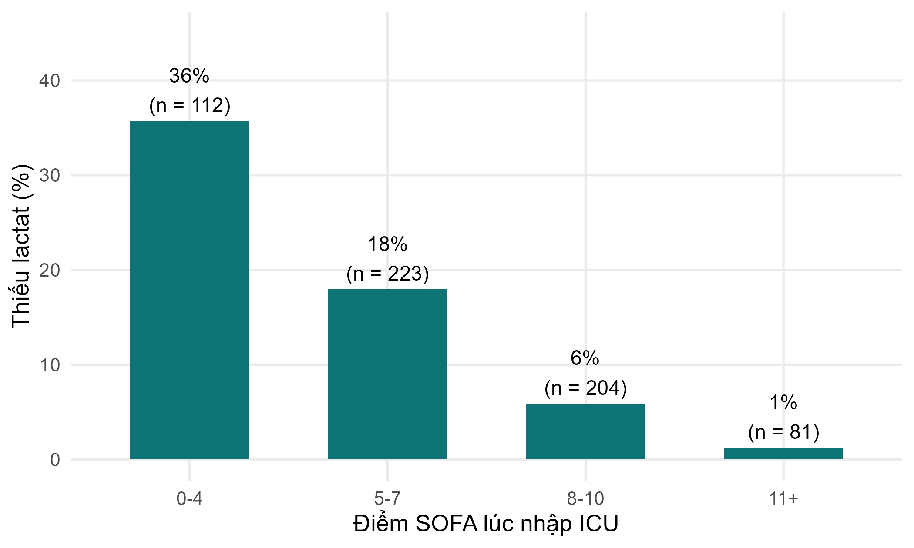
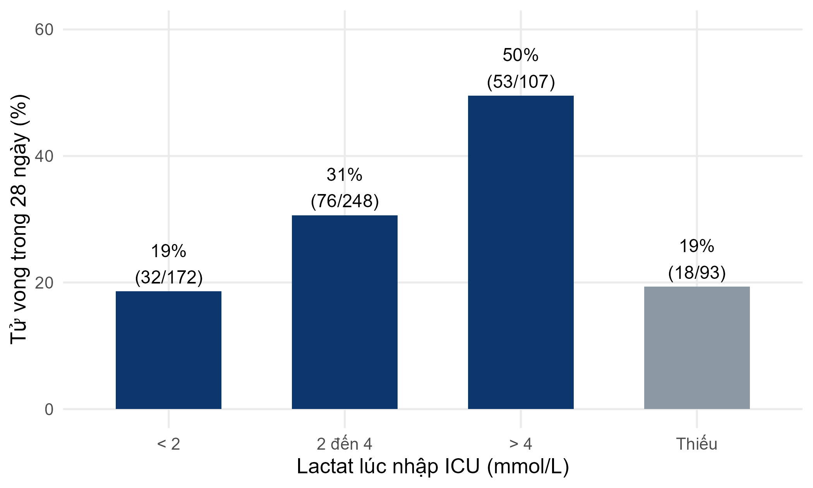
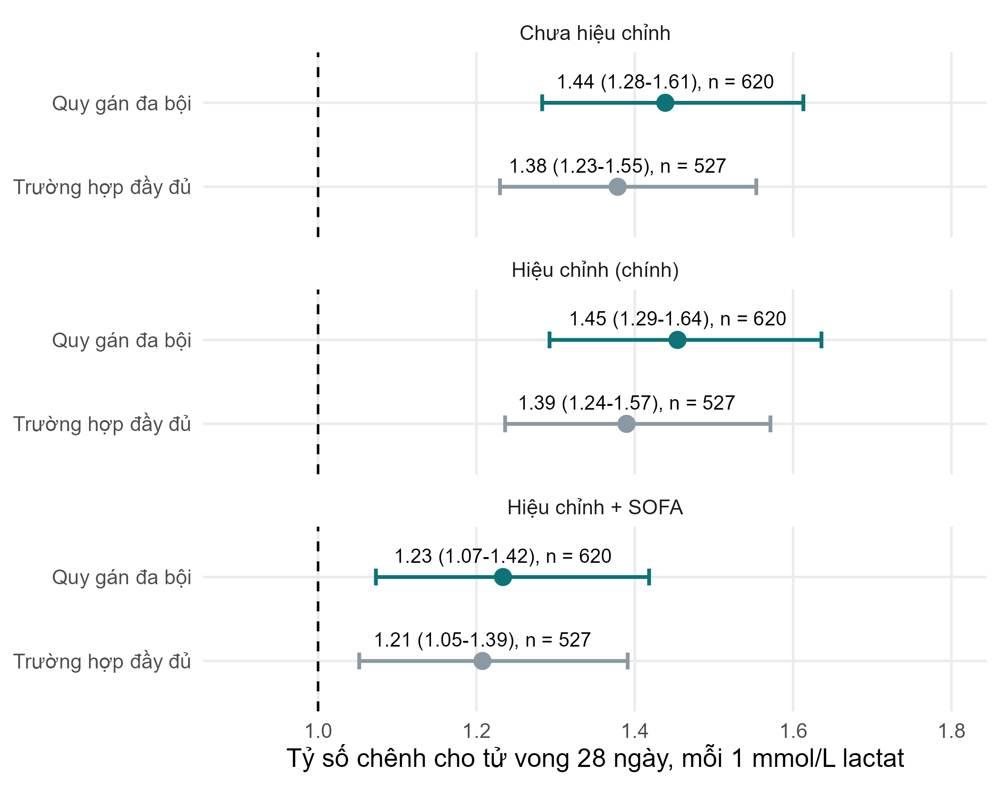

::: {.simulated}
**Dữ liệu mô phỏng, không phải người bệnh thật.** FLUID-ICU là một nghiên cứu giả định: mọi giá trị đều do chương trình máy tính tạo ra với hạt giống ngẫu nhiên cố định. Dữ liệu không mô tả bất kỳ người bệnh, bệnh viện hay ICU thật nào. Mọi bản thảo viết từ bộ dữ liệu này phải ghi rõ dữ liệu là mô phỏng và không bao giờ được nộp như một nghiên cứu thật.
:::

Tải về: [Word](files/data/results_packs/Results_Pack_Q4_VN.docx) · [PDF](files/data/results_packs/Results_Pack_Q4_VN.pdf) · [zip (Markdown, bảng, biểu đồ)](files/data/results_packs/Results_Pack_Q4_VN.zip) · [Quay lại trang bộ dữ liệu](dataset.qmd)

> **DỮ LIỆU MÔ PHỎNG: KHÔNG PHẢI NGƯỜI BỆNH THẬT.** FLUID-ICU được tạo bằng máy tính cho khóa học này. Hãy viết bản thảo như một bài tập huấn luyện và ghi rõ rằng dữ liệu là mô phỏng.

## 1. Câu hỏi

**Ở người lớn bị nhiễm khuẩn huyết điều trị tại ICU, lactat lúc nhập ICU có liên quan với tử vong 28 ngày không, và câu trả lời có thay đổi không khi các giá trị lactat bị thiếu được xử lý bằng quy gán đa bội?**

## 2. Thiết kế và dữ liệu

- Thiết kế: nghiên cứu thuần tập tiến cứu đa trung tâm (quan sát); câu hỏi về yếu tố tiên lượng.
- Bối cảnh: 4 ICU (ICU A-D), người lớn bị nhiễm khuẩn huyết được tuyển liên tiếp, thời gian tuyển từ tháng 1/2023 đến tháng 12/2024.
- Phơi nhiễm: lactat lúc nhập ICU tính bằng mmol/L, theo mỗi 1 mmol/L (liên tục); và theo các nhóm < 2, 2 đến 4, > 4 mmol/L.
- Kết cục: tử vong do mọi nguyên nhân trong vòng 28 ngày (died_28d).
- Mẫu phân tích: tất cả 620 người bệnh; thiếu lactat ở 93/620 (15.0%); các mô hình trường hợp đầy đủ 527 người bệnh; quy gán đa bội 620.
- Các yếu tố gây nhiễu xác định trước (SAP): tuổi, điểm SOFA, lactat, thuốc vận mạch, thở máy, bệnh thận mạn.
- Phần mềm: R 4.6 (các gói gtsummary, survival, mice). Script: Course/Data/R/.

## 3. Bảng 1: đối tượng nghiên cứu

**Bảng 1. Đặc điểm ban đầu của nhóm sống và nhóm tử vong**

|Đặc điểm                             |Toàn bộ   N = 620 |Sống đến ngày 28   N = 441 |Tử vong trong 28 ngày   N = 179 |
|:------------------------------------|:-----------------|:--------------------------|:-------------------------------|
|Tuổi, năm                            |62.6 (15.2)       |61.2 (14.8)                |66.0 (15.7)                     |
|&emsp;Thiếu                          |1                 |1                          |0                               |
|Giới                                 |                  |                           |                                |
|&emsp;Nữ                             |244 (39%)         |179 (41%)                  |65 (36%)                        |
|&emsp;Nam                            |376 (61%)         |262 (59%)                  |114 (64%)                       |
|Cân nặng, kg                         |64.7 (11.9)       |64.5 (11.8)                |65.2 (12.1)                     |
|&emsp;Thiếu                          |1                 |1                          |0                               |
|Đái tháo đường                       |158 (25%)         |108 (24%)                  |50 (28%)                        |
|Bệnh thận mạn                        |64 (10%)          |33 (7.5%)                  |31 (17%)                        |
|Suy tim                              |97 (16%)          |60 (14%)                   |37 (21%)                        |
|Tăng huyết áp                        |282 (45%)         |196 (44%)                  |86 (48%)                        |
|Nguồn nhiễm khuẩn                    |                  |                           |                                |
|&emsp;Hô hấp                         |268 (43%)         |192 (44%)                  |76 (42%)                        |
|&emsp;Tiết niệu                      |126 (20%)         |99 (22%)                   |27 (15%)                        |
|&emsp;Ổ bụng                         |107 (17%)         |72 (16%)                   |35 (20%)                        |
|&emsp;Da/mô mềm                      |57 (9.2%)         |36 (8.2%)                  |21 (12%)                        |
|&emsp;Khác                           |62 (10%)          |42 (9.5%)                  |20 (11%)                        |
|Điểm SOFA                            |7 (5, 9)          |7 (5, 9)                   |8 (7, 10)                       |
|Điểm APACHE II                       |19 (15, 23)       |18 (13, 22)                |23 (19, 27)                     |
|&emsp;Thiếu                          |6                 |5                          |1                               |
|Lactat, mmol/L                       |2.6 (1.7, 3.7)    |2.3 (1.6, 3.4)             |3.1 (2.2, 4.5)                  |
|&emsp;Thiếu                          |93                |75                         |18                              |
|Huyết áp động mạch trung bình, mmHg  |73 (66, 80)       |75 (68, 82)                |70 (63, 76)                     |
|&emsp;Thiếu                          |4                 |3                          |1                               |
|Thuốc vận mạch lúc nhập ICU          |267 (43%)         |153 (35%)                  |114 (64%)                       |
|Thở máy                              |314 (51%)         |190 (43%)                  |124 (69%)                       |
|Cân bằng dịch tích lũy ngày 3, ml/kg |8.8 (-10.3, 26.2) |4.0 (-12.6, 22.7)          |18.4 (-0.3, 35.9)               |
|&emsp;Thiếu                          |2                 |2                          |0                               |

*Trung bình (SD); n (%); trung vị (Q1, Q3). Thiếu = số người bệnh không có giá trị đó.*

Tệp: `tables/table1_by_survival_VN.csv` và `tables/table1_by_survival_VN.docx`

## 4. Ai bị thiếu lactat?

**Bảng 2. Người bệnh có và không có lactat lúc nhập ICU**

|Đặc điểm                     |Có đo lactat   |Thiếu lactat   |
|:----------------------------|:--------------|:--------------|
|n                            |527            |93             |
|SOFA, trung vị (IQR)         |8 (6 đến 10)   |5 (4 đến 6)    |
|MAP, trung vị (IQR)          |72 (65 đến 78) |80 (75 đến 86) |
|Thuốc vận mạch, n (%)        |253 (48%)      |14 (15%)       |
|ICU D, n (%)                 |89 (17%)       |29 (31%)       |
|Tử vong trong 28 ngày, n (%) |161 (31%)      |18 (19%)       |

Tệp: `tables/table2_missing_lactate_comparison_VN.csv` và `tables/table2_missing_lactate_comparison_VN.docx`

Người bệnh không có lactat **ít nặng hơn** (SOFA 5 (4 đến 6) so với 8 (6 đến 10)) và tử vong ít hơn (18/93 (19.4%) so với 161/527 (30.6%)). Vì vậy lactat KHÔNG thiếu hoàn toàn ngẫu nhiên; việc thiếu được giải thích bởi các biến đã quan sát (SOFA, MAP, thuốc vận mạch, ICU), nên giả định 'thiếu ngẫu nhiên' (MAR) là hợp lý.

*Hình 1. Tỷ lệ người bệnh thiếu lactat theo điểm SOFA* (`figures/fig1_missing_lactate_by_sofa_VN.png`)

## 5. Kết quả chính

- Lactat trung vị: nhóm tử vong 3.1 (2.2 đến 4.5) so với nhóm sống 2.3 (1.6 đến 3.4) mmol/L.
- Tử vong theo nhóm lactat: < 2: 19%; 2 đến 4: 31%; > 4: 50%; Thiếu: 19%.
- OR chưa hiệu chỉnh cho mỗi 1 mmol/L: trường hợp đầy đủ 1.38 (1.23 đến 1.55); quy gán đa bội 1.44 (1.28 đến 1.61).
- Hiệu chỉnh (tuổi, giới, bệnh kèm): trường hợp đầy đủ 1.39 (1.24 đến 1.57) so với **quy gán đa bội 1.45 (1.29 đến 1.64)** (phân tích chính).
- Thêm SOFA: trường hợp đầy đủ 1.21 (1.05 đến 1.39) so với quy gán đa bội 1.23 (1.07 đến 1.42).
- Lactat trung vị ở các trường hợp đầy đủ là 2.6 mmol/L so với 2.4 mmol/L sau quy gán: các trường hợp đầy đủ có nhiều người bệnh nặng hơn so với toàn bộ mẫu.

**Bảng 3. Tử vong 28 ngày theo nhóm lactat lúc nhập ICU**

|Lactat lúc nhập ICU, mmol/L |n   |Tử vong trong 28 ngày, n (%) |
|:---------------------------|:---|:----------------------------|
|< 2                         |172 |32 (19%)                     |
|2 đến 4                     |248 |76 (31%)                     |
|> 4                         |107 |53 (50%)                     |
|Thiếu                       |93  |18 (19%)                     |

Tệp: `tables/table3_mortality_by_lactate_VN.csv` và `tables/table3_mortality_by_lactate_VN.docx`

**Bảng 4. Lactat và tử vong 28 ngày: trường hợp đầy đủ so với quy gán đa bội**

|Mô hình                                                                |Phương pháp             |n   |OR mỗi 1 mmol/L (KTC 95%) |p      |
|:----------------------------------------------------------------------|:-----------------------|:---|:-------------------------|:------|
|Chưa hiệu chỉnh                                                        |Trường hợp đầy đủ       |527 |1.38 (1.23 đến 1.55)      |<0.001 |
|Chưa hiệu chỉnh                                                        |Quy gán đa bội (m = 20) |620 |1.44 (1.28 đến 1.61)      |<0.001 |
|Hiệu chỉnh: tuổi, giới, đái tháo đường, bệnh thận mạn, suy tim (chính) |Trường hợp đầy đủ       |527 |1.39 (1.24 đến 1.57)      |<0.001 |
|Hiệu chỉnh: tuổi, giới, đái tháo đường, bệnh thận mạn, suy tim (chính) |Quy gán đa bội (m = 20) |620 |1.45 (1.29 đến 1.64)      |<0.001 |
|Mô hình chính + điểm SOFA                                              |Trường hợp đầy đủ       |527 |1.21 (1.05 đến 1.39)      |0.008  |
|Mô hình chính + điểm SOFA                                              |Quy gán đa bội (m = 20) |620 |1.23 (1.07 đến 1.42)      |0.003  |

Tệp: `tables/table4_cc_vs_mi_VN.csv` và `tables/table4_cc_vs_mi_VN.docx`

*Hình 2. Tử vong 28 ngày theo nhóm lactat lúc nhập ICU (màu xám = không đo lactat)* (`figures/fig2_mortality_by_lactate_VN.png`)

*Hình 3. Tỷ số chênh cho mỗi 1 mmol/L lactat: trường hợp đầy đủ so với quy gán đa bội* (`figures/fig3_cc_vs_mi_VN.png`)

## 6. Ý nghĩa (bằng lời đơn giản)

- Lactat lúc nhập ICU cao hơn đi kèm tử vong 28 ngày cao hơn: mỗi 1 mmol/L tăng thêm làm số chênh tử vong tăng khoảng 40-45% (hiệu chỉnh theo tuổi, giới và bệnh kèm).
- Phần lớn mối liên quan này trùng với mức độ nặng chung: sau khi thêm SOFA, OR giảm còn khoảng 1.2. Lactat một phần là dấu hiệu cho biết người bệnh nặng đến mức nào.
- Loại bỏ 93 người bệnh không có lactat (trường hợp đầy đủ) cho OR nhỏ hơn một chút so với quy gán đa bội (dùng cả 620 người bệnh). Kết luận vẫn như nhau; độ lớn khác nhau ở mức vừa phải, vì các trường hợp đầy đủ là một nhóm nặng hơn, đã bị chọn lọc.

## 7. Kết quả này KHÔNG có nghĩa là gì

- Kết quả KHÔNG có nghĩa là hạ lactat sẽ cứu sống người bệnh. Lactat là một dấu hiệu, không nhất thiết là nguyên nhân.
- Quy gán đa bội KHÔNG bịa ra dữ liệu và KHÔNG 'sửa' được mọi thứ: phương pháp này chỉ hợp lệ khi việc thiếu phụ thuộc vào những yếu tố đã đo (MAR). Nếu lactat bị thiếu vì những lý do liên quan đến chính giá trị không quan sát được (MNAR), không phương pháp nào sửa được hoàn toàn.

## 8. Các hạn chế cần bàn luận (gợi ý)

- Thiếu 15% lactat, không ngẫu nhiên: hãy báo cáo số bị thiếu, đó là những ai, và kết quả của cả hai phân tích.
- Chỉ có một giá trị lúc nhập ICU: độ thanh thải lactat theo thời gian không được ghi nhận.
- Vấn đề đơn vị ở một ICU (mg/dL) được phát hiện khi làm sạch dữ liệu: hãy mô tả các bước kiểm tra dữ liệu.
- OR cho mỗi 1 mmol/L giả định quan hệ đường thẳng (trên thang log-odds); các nhóm trong Bảng 3 giúp người đọc kiểm tra giả định này.

## Các mục STROBE mà gói này giúp bạn viết

- Mục 12c: cách xử lý dữ liệu thiếu (quy gán đa bội, m = 20, các biến trong mô hình quy gán)
- Mục 14b: số người tham gia bị thiếu dữ liệu ở từng biến (Bảng 1, Bảng 2)
- Mục 16: ước lượng chưa hiệu chỉnh và đã hiệu chỉnh kèm KTC 95%; ngưỡng của các nhóm (Bảng 3)
- Mục 17: phân tích độ nhạy (trường hợp đầy đủ so với quy gán đa bội, Bảng 4)
- Mục 19: hạn chế (cơ chế dữ liệu thiếu)

