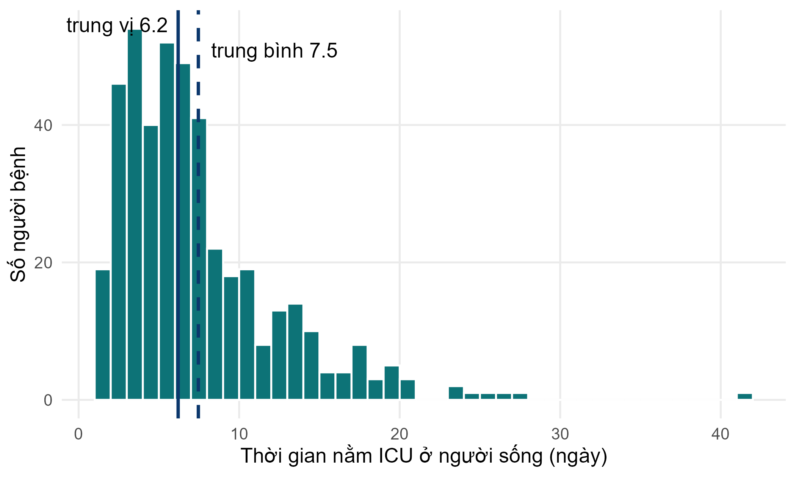
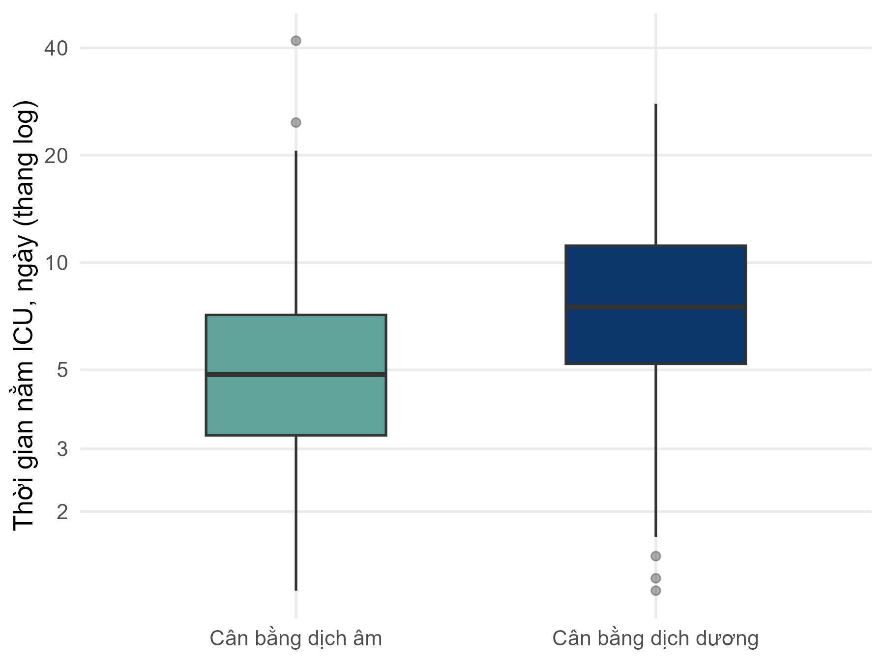

::: {.simulated}
**Dữ liệu mô phỏng, không phải người bệnh thật.** FLUID-ICU là một nghiên cứu giả định: mọi giá trị đều do chương trình máy tính tạo ra với hạt giống ngẫu nhiên cố định. Dữ liệu không mô tả bất kỳ người bệnh, bệnh viện hay ICU thật nào. Mọi bản thảo viết từ bộ dữ liệu này phải ghi rõ dữ liệu là mô phỏng và không bao giờ được nộp như một nghiên cứu thật.
:::

Tải về: [Word](files/data/results_packs/Results_Pack_Q5_VN.docx) · [PDF](files/data/results_packs/Results_Pack_Q5_VN.pdf) · [zip (Markdown, bảng, biểu đồ)](files/data/results_packs/Results_Pack_Q5_VN.zip) · [Quay lại trang bộ dữ liệu](dataset.qmd)

> **DỮ LIỆU MÔ PHỎNG: KHÔNG PHẢI NGƯỜI BỆNH THẬT.** FLUID-ICU được tạo bằng máy tính cho khóa học này. Hãy viết bản thảo như một bài tập huấn luyện và ghi rõ rằng dữ liệu là mô phỏng.

## 1. Câu hỏi

**Ở người lớn bị nhiễm khuẩn huyết còn sống đến ngày 28, cân bằng dịch tích lũy dương vào ngày 3 có liên quan với thời gian nằm ICU dài hơn không?**

## 2. Thiết kế và dữ liệu

- Thiết kế: nghiên cứu thuần tập tiến cứu đa trung tâm (quan sát); phân tích giới hạn ở người bệnh còn sống đến ngày 28.
- Bối cảnh: 4 ICU (ICU A-D), người lớn bị nhiễm khuẩn huyết được tuyển liên tiếp, thời gian tuyển từ tháng 1/2023 đến tháng 12/2024.
- Phơi nhiễm: cân bằng dịch tích lũy dương so với âm vào ngày 3; phân tích phụ: theo mỗi 10 ml/kg.
- Kết cục: thời gian nằm ICU tính bằng ngày (icu_los_days), phân phối lệch phải.
- Mẫu phân tích: 439 người sống có cân bằng dịch ngày 3 (239 dương, 200 âm); mô hình hiệu chỉnh 366 trường hợp đầy đủ.
- Các yếu tố gây nhiễu xác định trước (SAP): tuổi, điểm SOFA, lactat, thuốc vận mạch, thở máy, bệnh thận mạn.
- Phần mềm: R 4.6 (các gói gtsummary, survival, mice). Script: FLUID-ICU/R/.

## 3. Bảng 1: đối tượng nghiên cứu

**Bảng 1. Đặc điểm ban đầu của người bệnh còn sống đến ngày 28 theo nhóm cân bằng dịch**

|Đặc điểm                            |Toàn bộ   N = 439 |Cân bằng dịch âm   N = 200 |Cân bằng dịch dương   N = 239 |
|:-----------------------------------|:-----------------|:--------------------------|:-----------------------------|
|Tuổi, năm                           |61.3 (14.7)       |63.8 (14.6)                |59.1 (14.6)                   |
|&emsp;Thiếu                         |1                 |1                          |0                             |
|Giới                                |                  |                           |                              |
|&emsp;Nữ                            |178 (41%)         |85 (43%)                   |93 (39%)                      |
|&emsp;Nam                           |261 (59%)         |115 (58%)                  |146 (61%)                     |
|Cân nặng, kg                        |64.5 (11.8)       |64.7 (12.5)                |64.2 (11.3)                   |
|Đái tháo đường                      |108 (25%)         |54 (27%)                   |54 (23%)                      |
|Bệnh thận mạn                       |33 (7.5%)         |16 (8.0%)                  |17 (7.1%)                     |
|Suy tim                             |60 (14%)          |43 (22%)                   |17 (7.1%)                     |
|Tăng huyết áp                       |196 (45%)         |102 (51%)                  |94 (39%)                      |
|Nguồn nhiễm khuẩn                   |                  |                           |                              |
|&emsp;Hô hấp                        |191 (44%)         |84 (42%)                   |107 (45%)                     |
|&emsp;Tiết niệu                     |99 (23%)          |45 (23%)                   |54 (23%)                      |
|&emsp;Ổ bụng                        |71 (16%)          |37 (19%)                   |34 (14%)                      |
|&emsp;Da/mô mềm                     |36 (8.2%)         |15 (7.5%)                  |21 (8.8%)                     |
|&emsp;Khác                          |42 (9.6%)         |19 (9.5%)                  |23 (9.6%)                     |
|Điểm SOFA                           |7 (5, 9)          |6 (4, 7)                   |8 (5, 10)                     |
|Điểm APACHE II                      |18 (13, 22)       |16 (12, 20)                |19 (15, 23)                   |
|&emsp;Thiếu                         |5                 |3                          |2                             |
|Lactat, mmol/L                      |2.3 (1.6, 3.4)    |2.1 (1.4, 2.9)             |2.6 (1.8, 3.6)                |
|&emsp;Thiếu                         |73                |45                         |28                            |
|Huyết áp động mạch trung bình, mmHg |75 (68, 82)       |78 (71, 85)                |73 (67, 79)                   |
|&emsp;Thiếu                         |3                 |1                          |2                             |
|Thuốc vận mạch lúc nhập ICU         |152 (35%)         |39 (20%)                   |113 (47%)                     |
|Thở máy                             |189 (43%)         |67 (34%)                   |122 (51%)                     |

*Trung bình (SD); n (%); trung vị (Q1, Q3). Thiếu = số người bệnh không có giá trị đó.*

Tệp: `tables/table1_survivors_by_balance_VN.csv` và `tables/table1_survivors_by_balance_VN.docx`

## 4. Kết quả chính

- Thời gian nằm ICU lệch phải: ở người sống, trung bình 7.5 so với trung vị 6.2 ngày.
- Thời gian nằm ICU trung vị (IQR): cân bằng dương 7.5 (5.2 đến 11.2) so với âm 4.8 (3.3 đến 7.1) ngày; Mann-Whitney p <0.001.
- Chênh lệch Hodges-Lehmann: 2.5 (KTC 95% 1.8 đến 3.2) ngày.
- Hồi quy tuyến tính trên thang log: tỷ số trung bình nhân thô 1.50 (KTC 95% 1.34 đến 1.68); hiệu chỉnh **1.24 (KTC 95% 1.10 đến 1.39)**, p <0.001 (tức là thời gian nằm dài hơn khoảng 24%).
- Mỗi 10 ml/kg cân bằng dịch tăng thêm: tỷ số 1.06 (KTC 95% 1.03 đến 1.08).

**Bảng 2. Thời gian nằm ICU ở người sống theo nhóm cân bằng dịch**

|Chỉ số                |Cân bằng dịch âm  |Cân bằng dịch dương |
|:---------------------|:-----------------|:-------------------|
|n                     |200               |239                 |
|Trung vị (IQR), ngày  |4.8 (3.3 đến 7.1) |7.5 (5.2 đến 11.2)  |
|Trung bình (SD), ngày |6.0 (4.6)         |8.7 (5.0)           |
|Khoảng giá trị, ngày  |1.2 đến 41.9      |1.2 đến 27.9        |
|Trung bình nhân, ngày |4.9               |7.4                 |

Tệp: `tables/table2_los_summary_VN.csv` và `tables/table2_los_summary_VN.docx`

**Bảng 3. Liên quan giữa cân bằng dịch và thời gian nằm ICU (người sống)**

|Phân tích                                                     |n   |Ước lượng (KTC 95%)  |p      |
|:-------------------------------------------------------------|:---|:--------------------|:------|
|Mann-Whitney (chênh lệch Hodges-Lehmann, ngày)                |439 |2.5 (1.8 đến 3.2)    |<0.001 |
|Tuyến tính trên thang log, thô (tỷ số trung bình nhân)        |439 |1.50 (1.34 đến 1.68) |<0.001 |
|Tuyến tính trên thang log, hiệu chỉnh (tỷ số trung bình nhân) |366 |1.24 (1.10 đến 1.39) |<0.001 |
|Tuyến tính trên thang log, hiệu chỉnh, mỗi 10 ml/kg (tỷ số)   |366 |1.06 (1.03 đến 1.08) |<0.001 |

*Tỷ số trung bình nhân: 1.24 = thời gian nằm điển hình dài hơn 24%. Hiệu chỉnh theo tuổi, SOFA, lactat, thuốc vận mạch, thở máy, bệnh thận mạn.*

Tệp: `tables/table3_los_models_VN.csv` và `tables/table3_los_models_VN.docx`

*Hình 1. Thời gian nằm ICU ở người sống: đuôi dài bên phải kéo trung bình lên cao hơn trung vị* (`figures/fig1_los_histogram_VN.png`)

*Hình 2. Thời gian nằm ICU theo nhóm cân bằng dịch (thang log)* (`figures/fig2_los_by_group_log_VN.png`)

## 5. Ý nghĩa (bằng lời đơn giản)

- Trong số người sống, người có cân bằng dịch dương nằm ICU lâu hơn, khoảng 2-3 ngày tính theo trung vị.
- Sau hiệu chỉnh, thời gian nằm điển hình (trung bình nhân) dài hơn khoảng 24%.
- Với một kết cục phân phối lệch, hãy báo cáo trung vị (IQR), dùng kiểm định dựa trên thứ hạng hoặc phân tích logarit của thời gian nằm, và trình bày kết quả dưới dạng tỷ số.

## 6. Kết quả này KHÔNG có nghĩa là gì

- Kết quả KHÔNG cho thấy dịch kéo dài thời gian nằm ICU; người bệnh nằm lâu hơn có nhiều thời gian và lý do hơn để được truyền dịch (quan hệ nhân quả ngược).
- Kết quả KHÔNG mô tả toàn bộ người bệnh: người tử vong đã bị loại ra, và tử vong làm thời gian nằm ngắn lại.

## 7. Các hạn chế cần bàn luận (gợi ý)

- Sai lệch chọn lựa: giới hạn ở người sống là đặt điều kiện trên một kết cục mà bản thân nó có liên quan với dịch (sai lệch người sống sót). Một cách khác là dùng 'số ngày không nằm ICU' (ICU-free days), trong đó tử vong được tính là 0.
- Việc chuyển khỏi ICU còn phụ thuộc vào áp lực giường bệnh và thực hành tại chỗ, không chỉ vào người bệnh.
- Nhiễu tồn dư do mức độ nặng; mô hình hiệu chỉnh dùng các trường hợp đầy đủ.

## Các mục STROBE mà gói này giúp bạn viết

- Mục 6: người tham gia (vì sao chỉ người sống)
- Mục 12: phương pháp cho kết cục phân phối lệch (biến đổi logarit / phi tham số)
- Mục 14: dữ liệu mô tả (Bảng 1)
- Mục 15-16: trung vị (IQR) và tỷ số kèm KTC 95%
- Mục 19: hạn chế (chọn lựa người sống)

