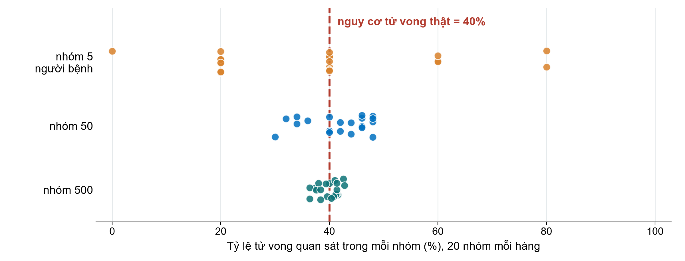

---

:::: {.neu-statement}
::: {.neu-big}
Mỗi ngày bạn đưa ra những quyết định mà nghiên cứu có thể giúp tốt hơn.
:::

::: {.neu-sub}
Khóa học giúp bạn đặt câu hỏi đúng cách, trả lời và công bố câu trả lời.
:::
::::

::: {.notes}
Hỏi: 'Việc gì trong khoa mỗi người làm một kiểu mà chưa ai biết cách nào tốt nhất? Gõ vào chat.' Đọc to hai ba câu trả lời.

Ý chính: nghiên cứu bắt đầu từ điều chưa chắc chắn trong lâm sàng, không phải từ thống kê.

Thời gian: 2 phút.
:::

## Tám thứ Bảy, tám buổi học


```{=html}
<div style="position:relative;width:100%;aspect-ratio:12.3/3.6;container-type:inline-size;margin:0.2em auto;font-family:Arial,sans-serif;line-height:1.1"><svg viewBox="0 0 1230 360" style="position:absolute;inset:0;width:100%;height:100%;overflow:visible"><defs><marker id="dgmD5DDE1138" viewBox="0 0 10 10" refX="8" refY="5" markerWidth="4" markerHeight="4" orient="auto-start-reverse"><path d="M0,0 L10,5 L0,10 z" fill="#D5DDE1"/></marker></defs><line x1="80.0" y1="175.0" x2="1080.0" y2="175.0" stroke="#D5DDE1" stroke-width="13.89" stroke-linecap="round"/></svg><div style="position:absolute;left:1.626%;top:0.000%;width:20.325%;height:22.222%;box-sizing:border-box;display:flex;flex-direction:column;justify-content:center;padding:calc(4.3 * 0.11292cqw);overflow:visible;text-align:center;align-items:stretch"><div style="font-size:calc(17 * 0.11292cqw);color:#0D7377;font-weight:700">Tuần 1-2</div><div style="font-size:calc(14 * 0.11292cqw);color:#595959;margin-top:calc(3 * 0.11292cqw)">Câu hỏi và bằng chứng</div></div><div style="position:absolute;left:2.033%;top:23.889%;width:19.512%;height:1.944%;box-sizing:border-box;display:flex;flex-direction:column;justify-content:center;padding:calc(4.3 * 0.11292cqw);overflow:visible;text-align:center;align-items:stretch;background:#0D7377;border-radius:0.285cqw"></div><div style="position:absolute;left:22.764%;top:0.000%;width:20.325%;height:22.222%;box-sizing:border-box;display:flex;flex-direction:column;justify-content:center;padding:calc(4.3 * 0.11292cqw);overflow:visible;text-align:center;align-items:stretch"><div style="font-size:calc(17 * 0.11292cqw);color:#0B376C;font-weight:700">Tuần 3-4</div><div style="font-size:calc(14 * 0.11292cqw);color:#595959;margin-top:calc(3 * 0.11292cqw)">Thiết kế và sai lệch</div></div><div style="position:absolute;left:23.171%;top:23.889%;width:19.512%;height:1.944%;box-sizing:border-box;display:flex;flex-direction:column;justify-content:center;padding:calc(4.3 * 0.11292cqw);overflow:visible;text-align:center;align-items:stretch;background:#0B376C;border-radius:0.285cqw"></div><div style="position:absolute;left:43.902%;top:0.000%;width:20.325%;height:22.222%;box-sizing:border-box;display:flex;flex-direction:column;justify-content:center;padding:calc(4.3 * 0.11292cqw);overflow:visible;text-align:center;align-items:stretch"><div style="font-size:calc(17 * 0.11292cqw);color:#5FA39B;font-weight:700">Tuần 5-6</div><div style="font-size:calc(14 * 0.11292cqw);color:#595959;margin-top:calc(3 * 0.11292cqw)">Dữ liệu và phân tích</div></div><div style="position:absolute;left:44.309%;top:23.889%;width:19.512%;height:1.944%;box-sizing:border-box;display:flex;flex-direction:column;justify-content:center;padding:calc(4.3 * 0.11292cqw);overflow:visible;text-align:center;align-items:stretch;background:#5FA39B;border-radius:0.285cqw"></div><div style="position:absolute;left:65.041%;top:0.000%;width:20.325%;height:22.222%;box-sizing:border-box;display:flex;flex-direction:column;justify-content:center;padding:calc(4.3 * 0.11292cqw);overflow:visible;text-align:center;align-items:stretch"><div style="font-size:calc(17 * 0.11292cqw);color:#0070C0;font-weight:700">Tuần 7-8</div><div style="font-size:calc(14 * 0.11292cqw);color:#595959;margin-top:calc(3 * 0.11292cqw)">Đạo đức, viết, công bố</div></div><div style="position:absolute;left:65.447%;top:23.889%;width:19.512%;height:1.944%;box-sizing:border-box;display:flex;flex-direction:column;justify-content:center;padding:calc(4.3 * 0.11292cqw);overflow:visible;text-align:center;align-items:stretch;background:#0070C0;border-radius:0.285cqw"></div><div style="position:absolute;left:2.439%;top:34.722%;width:8.130%;height:27.778%;box-sizing:border-box;display:flex;flex-direction:column;justify-content:center;padding:calc(4.3 * 0.11292cqw);overflow:visible;text-align:center;align-items:stretch;background:#0D7377;border:calc(2.5 * 0.11292cqw) solid #FFFFFF;border-radius:50%"><div style="font-size:calc(26 * 0.11292cqw);color:#FFFFFF;font-weight:700">1</div></div><div style="position:absolute;left:1.220%;top:65.278%;width:10.569%;height:22.222%;box-sizing:border-box;display:flex;flex-direction:column;justify-content:center;padding:calc(4.3 * 0.11292cqw);overflow:visible;text-align:center;align-items:stretch;justify-content:flex-start"><div style="font-size:calc(15 * 0.11292cqw);color:#0D7377;font-weight:700">Hỏi</div></div><div style="position:absolute;left:13.008%;top:34.722%;width:8.130%;height:27.778%;box-sizing:border-box;display:flex;flex-direction:column;justify-content:center;padding:calc(4.3 * 0.11292cqw);overflow:visible;text-align:center;align-items:stretch;background:#0D7377;border:calc(2.5 * 0.11292cqw) solid #FFFFFF;border-radius:50%"><div style="font-size:calc(26 * 0.11292cqw);color:#FFFFFF;font-weight:700">2</div></div><div style="position:absolute;left:11.789%;top:65.278%;width:10.569%;height:22.222%;box-sizing:border-box;display:flex;flex-direction:column;justify-content:center;padding:calc(4.3 * 0.11292cqw);overflow:visible;text-align:center;align-items:stretch;justify-content:flex-start"><div style="font-size:calc(15 * 0.11292cqw);color:#0D7377;font-weight:700">Tìm và đọc</div></div><div style="position:absolute;left:23.577%;top:34.722%;width:8.130%;height:27.778%;box-sizing:border-box;display:flex;flex-direction:column;justify-content:center;padding:calc(4.3 * 0.11292cqw);overflow:visible;text-align:center;align-items:stretch;background:#0B376C;border:calc(2.5 * 0.11292cqw) solid #FFFFFF;border-radius:50%"><div style="font-size:calc(26 * 0.11292cqw);color:#FFFFFF;font-weight:700">3</div></div><div style="position:absolute;left:22.358%;top:65.278%;width:10.569%;height:22.222%;box-sizing:border-box;display:flex;flex-direction:column;justify-content:center;padding:calc(4.3 * 0.11292cqw);overflow:visible;text-align:center;align-items:stretch;justify-content:flex-start"><div style="font-size:calc(15 * 0.11292cqw);color:#0B376C;font-weight:700">Thiết kế</div></div><div style="position:absolute;left:34.146%;top:34.722%;width:8.130%;height:27.778%;box-sizing:border-box;display:flex;flex-direction:column;justify-content:center;padding:calc(4.3 * 0.11292cqw);overflow:visible;text-align:center;align-items:stretch;background:#0B376C;border:calc(2.5 * 0.11292cqw) solid #FFFFFF;border-radius:50%"><div style="font-size:calc(26 * 0.11292cqw);color:#FFFFFF;font-weight:700">4</div></div><div style="position:absolute;left:32.927%;top:65.278%;width:10.569%;height:22.222%;box-sizing:border-box;display:flex;flex-direction:column;justify-content:center;padding:calc(4.3 * 0.11292cqw);overflow:visible;text-align:center;align-items:stretch;justify-content:flex-start"><div style="font-size:calc(15 * 0.11292cqw);color:#0B376C;font-weight:700">Sai lệch và tác động</div></div><div style="position:absolute;left:44.715%;top:34.722%;width:8.130%;height:27.778%;box-sizing:border-box;display:flex;flex-direction:column;justify-content:center;padding:calc(4.3 * 0.11292cqw);overflow:visible;text-align:center;align-items:stretch;background:#5FA39B;border:calc(2.5 * 0.11292cqw) solid #FFFFFF;border-radius:50%"><div style="font-size:calc(26 * 0.11292cqw);color:#FFFFFF;font-weight:700">5</div></div><div style="position:absolute;left:43.496%;top:65.278%;width:10.569%;height:22.222%;box-sizing:border-box;display:flex;flex-direction:column;justify-content:center;padding:calc(4.3 * 0.11292cqw);overflow:visible;text-align:center;align-items:stretch;justify-content:flex-start"><div style="font-size:calc(15 * 0.11292cqw);color:#5FA39B;font-weight:700">Dữ liệu</div></div><div style="position:absolute;left:55.285%;top:34.722%;width:8.130%;height:27.778%;box-sizing:border-box;display:flex;flex-direction:column;justify-content:center;padding:calc(4.3 * 0.11292cqw);overflow:visible;text-align:center;align-items:stretch;background:#5FA39B;border:calc(2.5 * 0.11292cqw) solid #FFFFFF;border-radius:50%"><div style="font-size:calc(26 * 0.11292cqw);color:#FFFFFF;font-weight:700">6</div></div><div style="position:absolute;left:54.065%;top:65.278%;width:10.569%;height:22.222%;box-sizing:border-box;display:flex;flex-direction:column;justify-content:center;padding:calc(4.3 * 0.11292cqw);overflow:visible;text-align:center;align-items:stretch;justify-content:flex-start"><div style="font-size:calc(15 * 0.11292cqw);color:#5FA39B;font-weight:700">Phân tích</div></div><div style="position:absolute;left:65.854%;top:34.722%;width:8.130%;height:27.778%;box-sizing:border-box;display:flex;flex-direction:column;justify-content:center;padding:calc(4.3 * 0.11292cqw);overflow:visible;text-align:center;align-items:stretch;background:#0070C0;border:calc(2.5 * 0.11292cqw) solid #FFFFFF;border-radius:50%"><div style="font-size:calc(26 * 0.11292cqw);color:#FFFFFF;font-weight:700">7</div></div><div style="position:absolute;left:64.634%;top:65.278%;width:10.569%;height:22.222%;box-sizing:border-box;display:flex;flex-direction:column;justify-content:center;padding:calc(4.3 * 0.11292cqw);overflow:visible;text-align:center;align-items:stretch;justify-content:flex-start"><div style="font-size:calc(15 * 0.11292cqw);color:#0070C0;font-weight:700">Bảo vệ và viết</div></div><div style="position:absolute;left:76.423%;top:34.722%;width:8.130%;height:27.778%;box-sizing:border-box;display:flex;flex-direction:column;justify-content:center;padding:calc(4.3 * 0.11292cqw);overflow:visible;text-align:center;align-items:stretch;background:#0070C0;border:calc(2.5 * 0.11292cqw) solid #FFFFFF;border-radius:50%"><div style="font-size:calc(26 * 0.11292cqw);color:#FFFFFF;font-weight:700">8</div></div><div style="position:absolute;left:75.203%;top:65.278%;width:10.569%;height:22.222%;box-sizing:border-box;display:flex;flex-direction:column;justify-content:center;padding:calc(4.3 * 0.11292cqw);overflow:visible;text-align:center;align-items:stretch;justify-content:flex-start"><div style="font-size:calc(15 * 0.11292cqw);color:#0070C0;font-weight:700">Công bố</div></div><div style="position:absolute;left:87.398%;top:26.389%;width:12.195%;height:44.444%;box-sizing:border-box;display:flex;flex-direction:column;justify-content:center;padding:calc(4.3 * 0.11292cqw);overflow:visible;text-align:center;align-items:stretch;background:#055F56;border-radius:1.463cqw"><div style="font-size:calc(15 * 0.11292cqw);color:#FFFFFF;font-weight:700">Đề cương</div><div style="font-size:calc(15 * 0.11292cqw);color:#FFFFFF;font-weight:700;margin-top:calc(1 * 0.11292cqw)">+</div><div style="font-size:calc(15 * 0.11292cqw);color:#FFFFFF;font-weight:700;margin-top:calc(1 * 0.11292cqw)">Kết quả</div></div></div>
```

::: {.notes}
Mỗi khối hai buổi, giữa hai buổi cách nhau một tuần.

Một ví dụ xuyên suốt: dịch truyền trong sốc nhiễm khuẩn và tử vong 28 ngày. Từ Buổi 5, ví dụ này tiếp tục trong nghiên cứu của khóa học, FLUID-ICU.

Yêu cầu nằm ở Proposal\_Brief, gửi trước Buổi 1 cùng Presentation\_Guide và Proposal\_Rubric. Hướng dẫn viết bản thảo được chia sẻ ở Buổi 6.

Thời gian: 2 phút.
:::

## Khóa học này là Cấp độ 1 trong ba cấp độ

:::: {.neu-cards style="--n:3"}
::: {.neu-card .plain style="--c:#0D7377"}
[Cấp độ 1  (khóa học này)]{.neu-card-title}

- **Từ câu hỏi đến công bố**
- Hỏi, thiết kế, phân tích, viết và công bố
:::
::: {.neu-card .plain style="--c:#0B376C"}
[Cấp độ 2  (thực hành)]{.neu-card-title}

- **Mô hình thống kê bằng R**
- Bạn tự chạy phân tích
:::
::: {.neu-card .plain style="--c:#04242F"}
[Cấp độ 3  (nâng cao)]{.neu-card-title}

- **Phương pháp nâng cao**
- Hội thảo chuyên đề theo yêu cầu
:::
::::

::: {.neu-takeaway}
**THÔNG ĐIỆP CHÍNH** Cấp độ 1 là khóa học này. Cấp độ 2 và 3 dành cho ai muốn học sâu hơn.
:::

::: {.notes}
Ở Cấp độ 1, giảng viên chạy phần mềm. Các bạn đọc và diễn giải kết quả.

Thời gian: 1 phút.
:::

## Hai sản phẩm, mỗi người tự làm

::: {.neu-intro}
Cả hai đều là bài cá nhân. Mỗi bản hướng dẫn nêu rõ yêu cầu và cách đánh giá.
:::

:::: {.neu-cards style="--n:2"}
::: {.neu-card .plain style="--c:#0D7377"}
[Đề cương nghiên cứu của bạn]{.neu-card-title}

- Về một câu hỏi từ chính khoa của bạn
- Viết từng phần, từ Buổi 1 đến Buổi 7
- Nộp ở Buổi 8 (khoảng 5 bạn tình nguyện trình bày)
- Hướng dẫn viết đề cương: gửi trước Buổi 1
:::
::: {.neu-card .plain style="--c:#0B376C"}
[Phần Kết quả, sẵn sàng để nộp]{.neu-card-title}

- Cho một câu hỏi của FLUID-ICU
- Phương pháp, Đặt vấn đề, Bàn luận và Tóm tắt: không bắt buộc
- Hướng dẫn viết bản thảo: chia sẻ ở Buổi 6
:::
::::

::: {.notes}
Đề cương: khoảng 5 bạn tình nguyện trình bày ở Buổi 8 (mỗi người 6 phút). Mọi người đều nộp đề cương và 6 slide qua email. Chi tiết: Proposal\_Brief, gửi qua email trước Buổi 1.

Phần Kết quả: cuối Buổi 6, mỗi người chọn một câu hỏi FLUID-ICU (Q1 đến Q5) và viết phần Kết quả từ gói kết quả của câu đó. Sau Buổi 8, mỗi người phản biện bản thảo của một đồng nghiệp.

Viết bằng tiếng Anh. Có thể viết tiếng Việt nếu thật sự không viết được tiếng Anh.

Thời gian: 2 phút.
:::

## Sau khóa học, bạn sẽ có thể

:::: {.neu-cards style="--n:4"}
::: {.neu-card .plain style="--c:#0D7377"}
[Hỏi và tìm]{.neu-card-title}

- Biến một vấn đề thành câu hỏi rõ ràng
- Tìm trên PubMed và quản lý tài liệu
- Đọc một bài báo trong 15 phút
:::
::: {.neu-card .plain style="--c:#0B376C"}
[Thiết kế]{.neu-card-title}

- Chọn thiết kế nghiên cứu
- Nhận ra sai lệch
- Đọc các chỉ số đo lường tác động chính
:::
::: {.neu-card .plain style="--c:#5FA39B"}
[Phân tích]{.neu-card-title}

- Lên kế hoạch dữ liệu cần thu thập
- Đọc kết quả một phân tích
- Diễn giải một bộ dữ liệu thật
:::
::: {.neu-card .plain style="--c:#0070C0"}
[Viết và công bố]{.neu-card-title}

- Lên kế hoạch xin phê duyệt đạo đức
- Viết từng phần của bài báo
- Nộp bài và trả lời phản biện
:::
::::

::: {.neu-takeaway}
**THÔNG ĐIỆP CHÍNH** Hiểu và diễn giải: bạn sẽ không phải tự tính toán.
:::

::: {.notes}
Hỏi: 'Thẻ nào làm bạn lo nhất? Trả lời trong chat.' Thường là phân tích. Trấn an: lớp đi chậm và kiểm tra thường xuyên.

Thời gian: 1 phút.
:::

## Mỗi buổi học diễn ra như thế nào


```{=html}
<div style="position:relative;width:100%;aspect-ratio:12.3/3.0;container-type:inline-size;margin:0.2em auto;font-family:Arial,sans-serif;line-height:1.1"><div style="position:absolute;left:0.813%;top:18.333%;width:5.140%;height:56.667%;box-sizing:border-box;display:flex;flex-direction:column;justify-content:center;padding:calc(2.2 * 0.11292cqw);overflow:visible;text-align:center;align-items:stretch;background:#8A99A3"><div style="font-size:calc(13 * 0.11292cqw);color:#FFFFFF;font-weight:700">Ôn tập</div></div><div style="position:absolute;left:-2.439%;top:78.333%;width:6.504%;height:13.333%;box-sizing:border-box;display:flex;flex-direction:column;justify-content:center;padding:calc(4.3 * 0.11292cqw);overflow:visible;text-align:center;align-items:stretch"><div style="font-size:calc(14 * 0.11292cqw);color:#8A99A3">0:00</div></div><div style="position:absolute;left:6.278%;top:18.333%;width:32.466%;height:56.667%;box-sizing:border-box;display:flex;flex-direction:column;justify-content:center;padding:calc(2.2 * 0.11292cqw);overflow:visible;text-align:center;align-items:stretch;background:#0D7377"><div style="font-size:calc(18 * 0.11292cqw);color:#FFFFFF;font-weight:700">Học, kiểm tra, thực hành (A)</div></div><div style="position:absolute;left:3.026%;top:78.333%;width:6.504%;height:13.333%;box-sizing:border-box;display:flex;flex-direction:column;justify-content:center;padding:calc(4.3 * 0.11292cqw);overflow:visible;text-align:center;align-items:stretch"><div style="font-size:calc(14 * 0.11292cqw);color:#8A99A3">0:10</div></div><div style="position:absolute;left:39.070%;top:18.333%;width:7.873%;height:56.667%;box-sizing:border-box;display:flex;flex-direction:column;justify-content:center;padding:calc(2.2 * 0.11292cqw);overflow:visible;text-align:center;align-items:stretch;background:#D5DDE1"><div style="font-size:calc(13 * 0.11292cqw);color:#000000;font-weight:700">Giải lao</div></div><div style="position:absolute;left:35.818%;top:78.333%;width:6.504%;height:13.333%;box-sizing:border-box;display:flex;flex-direction:column;justify-content:center;padding:calc(4.3 * 0.11292cqw);overflow:visible;text-align:center;align-items:stretch"><div style="font-size:calc(14 * 0.11292cqw);color:#8A99A3">1:10</div></div><div style="position:absolute;left:47.267%;top:18.333%;width:32.466%;height:56.667%;box-sizing:border-box;display:flex;flex-direction:column;justify-content:center;padding:calc(2.2 * 0.11292cqw);overflow:visible;text-align:center;align-items:stretch;background:#0B376C"><div style="font-size:calc(18 * 0.11292cqw);color:#FFFFFF;font-weight:700">Học, kiểm tra, thực hành (B)</div></div><div style="position:absolute;left:44.015%;top:78.333%;width:6.504%;height:13.333%;box-sizing:border-box;display:flex;flex-direction:column;justify-content:center;padding:calc(4.3 * 0.11292cqw);overflow:visible;text-align:center;align-items:stretch"><div style="font-size:calc(14 * 0.11292cqw);color:#8A99A3">1:25</div></div><div style="position:absolute;left:80.059%;top:18.333%;width:16.070%;height:56.667%;box-sizing:border-box;display:flex;flex-direction:column;justify-content:center;padding:calc(2.2 * 0.11292cqw);overflow:visible;text-align:center;align-items:stretch;background:#055F56"><div style="font-size:calc(18 * 0.11292cqw);color:#FFFFFF;font-weight:700">Xây dựng đề cương hoặc phần Kết quả</div></div><div style="position:absolute;left:76.807%;top:78.333%;width:6.504%;height:13.333%;box-sizing:border-box;display:flex;flex-direction:column;justify-content:center;padding:calc(4.3 * 0.11292cqw);overflow:visible;text-align:center;align-items:stretch"><div style="font-size:calc(14 * 0.11292cqw);color:#8A99A3">2:25</div></div><div style="position:absolute;left:96.454%;top:18.333%;width:2.407%;height:56.667%;box-sizing:border-box;display:flex;flex-direction:column;justify-content:center;padding:calc(2.2 * 0.11292cqw);overflow:visible;text-align:center;align-items:stretch;background:#8A99A3"></div><div style="position:absolute;left:95.528%;top:78.333%;width:6.504%;height:13.333%;box-sizing:border-box;display:flex;flex-direction:column;justify-content:center;padding:calc(4.3 * 0.11292cqw);overflow:visible;text-align:center;align-items:stretch"><div style="font-size:calc(14 * 0.11292cqw);color:#8A99A3">3:00</div></div><div style="position:absolute;left:86.179%;top:1.667%;width:13.008%;height:13.333%;box-sizing:border-box;display:flex;flex-direction:column;justify-content:center;padding:calc(4.3 * 0.11292cqw);overflow:visible;text-align:right;align-items:stretch"><div style="font-size:calc(14 * 0.11292cqw);color:#8A99A3">Tổng kết</div></div></div>
```

::: {.neu-takeaway}
**THÔNG ĐIỆP CHÍNH** Cứ 20 phút kiểm tra mức hiểu một lần. Slide bổ sung chỉ dùng khi còn thời gian.
:::

::: {.notes}
Thứ Bảy nào cũng cùng một nhịp. Slide bổ sung ở cuối chỉ dùng khi còn thời gian.

Thời gian: 1 phút.
:::

## Viết đề cương của bạn từng phần một

:::: {.neu-steps}
::: {.neu-step style="--c:#0D7377"}
[Phần 1]{.neu-step-label}

- **Buổi 1-2**
- Câu hỏi, tổng quan, mục tiêu
:::
::: {.neu-step style="--c:#0B376C"}
[Phần 2]{.neu-step-label}

- **Buổi 3-4**
- Thiết kế và đối tượng
:::
::: {.neu-step style="--c:#5FA39B"}
[Phần 3]{.neu-step-label}

- **Buổi 5-6**
- Dữ liệu, cỡ mẫu, kế hoạch phân tích
:::
::: {.neu-step style="--c:#0070C0"}
[Phần 4]{.neu-step-label}

- **Buổi 7**
- Đạo đức, tính khả thi, kế hoạch công bố
:::
::: {.neu-step style="--c:#055F56"}
[Nộp]{.neu-step-label}

- **Buổi 8**
- Đề cương hoàn chỉnh
:::
::::

::: {.neu-takeaway}
**THÔNG ĐIỆP CHÍNH** Câu hỏi của riêng bạn, một mẫu đề cương, mỗi hai tuần một phần.
:::

::: {.notes}
Trong mỗi phần xây dựng đề cương, giảng viên điền trước phần đó cho ví dụ xuyên suốt trên màn hình. Sau đó mọi người viết cùng phần đó cho câu hỏi của mình.

Mẫu: Research\_Proposal\_Template\_VN.docx (tiếng Việt) hoặc Research\_Proposal\_Template.docx (tiếng Anh), gửi qua email cùng hướng dẫn viết đề cương trước Buổi 1.

Thời gian: 1 phút.
:::

## Chào mừng: giới thiệu bản thân

::: {.neu-banner style="--c:#0D7377"}
CẢ LỚP CÙNG LÀM · 6 phút
:::

:::: {.columns}
::: {.column width="60%"}
::: {.neu-activity-steps style="--c:#0D7377"}
- Gõ vào chat: tên, khoa và nghề nghiệp của bạn
- Thêm một câu hỏi bạn mong nghiên cứu trả lời được cho khoa mình
- Đọc tin nhắn của mọi người: nhiều câu là chủ đề nghiên cứu tiềm năng
- Sau đó vài bạn bật micro nói câu hỏi của mình
:::
:::
::: {.column width="40%"}
::: {.neu-side .plain style="--c:#0D7377"}
Tin nhắn mẫu

- Lan, ICU, điều dưỡng
- 'Người bệnh sốc nhiễm khuẩn có cần ít dịch hơn lượng mình đang truyền không?'
:::
:::
::::

::: {.neu-output style="--c:#0D7377"}
**SẢN PHẨM** Mỗi người một lời giới thiệu trong chat
:::

::: {.notes}
Cho 3 phút để gõ. Sau đó mời 4-5 người nói và chỉ ra các chủ đề chung (dịch truyền, an thần, nhiễm khuẩn, vận động sớm, an toàn dùng thuốc).

Các câu hỏi nằm sẵn trong chat để dùng ở phần Xây dựng đề cương 1.

Thời gian: 6 phút.
:::

## Chúng ta cùng học trực tuyến như thế nào

:::: {.neu-cards style="--n:4"}
::: {.neu-card .plain style="--c:#0D7377"}
[Cứ hỏi]{.neu-card-title}

- Không có câu hỏi nào ngớ ngẩn
- Dùng chat hoặc nút 'giơ tay'
:::
::: {.neu-card .plain style="--c:#0B376C"}
[Đi chậm]{.neu-card-title}

- Kiểm tra mức hiểu thường xuyên
- Slide bổ sung chỉ khi còn thời gian
:::
::: {.neu-card .plain style="--c:#5FA39B"}
[Lấy ví dụ từ khoa mình]{.neu-card-title}

- Dùng ví dụ từ thực hành của bạn
- Không nêu tên hay chi tiết người bệnh
:::
::: {.neu-card .plain style="--c:#0070C0"}
[Thói quen trực tuyến]{.neu-card-title}

- Bật camera khi có thể
- Tắt micro khi không nói
- Quay lại đúng giờ sau giải lao
:::
::::

::: {.notes}
Có thể nhắn riêng cho giảng viên. Chat bằng tiếng Việt hoặc tiếng Anh đều được.

Thời gian: 1 phút.
:::

## Bài kiểm tra đầu khóa (biểu mẫu trực tuyến)

::: {.neu-banner style="--c:#6C3483"}
CÂU HỎI NHANH · 15 phút
:::

:::: {.columns}
::: {.column width="60%"}
::: {.neu-activity-steps style="--c:#6C3483"}
- Mở biểu mẫu: đường link đang có trong chat
- Nhập họ và tên của bạn
- 24 câu trắc nghiệm, chọn một đáp án cho mỗi câu (khoảng 12 phút)
- Làm một mình: không xem tài liệu, không hỏi đồng nghiệp
- Nếu không chắc, hãy đoán: đây không phải kỳ thi
:::
:::
::: {.column width="40%"}
::: {.neu-side .plain style="--c:#6C3483"}
Vì sao kiểm tra bây giờ?

- Làm lại cùng bài này ở Buổi 8
- Chúng tôi đánh giá khóa học, không đánh giá bạn
:::
:::
::::

::: {.neu-output style="--c:#6C3483"}
**SẢN PHẨM** Đã gửi biểu mẫu
:::

::: {.notes}
Question form in VNM - https://forms.gle/7U2tjio2qVatVJja7
:::

# Buổi 1 · Hỏi: từ vấn đề lâm sàng đến câu hỏi nghiên cứu

## Tuần 1 · Thứ Bảy

- 1.1  Vì sao cần nghiên cứu? Bằng chứng, thiết kế nghiên cứu, hai bài báo của khóa học
- Giải lao
- 1.2  Từ vấn đề đến câu hỏi: PICO(T), PECO và FINER
- 1.3  Mục tiêu tổng quát, mục tiêu cụ thể và giả thuyết
- Xây dựng đề cương 1: bắt đầu câu hỏi của riêng bạn
- Tổng kết: từ khóa, câu hỏi cuối buổi, bài về nhà

::: {.notes}
Bắt đầu lúc 20:05, ngay sau bài kiểm tra. Mục tiêu: mỗi người ra về với bản nháp câu hỏi, mục tiêu tổng quát và mục tiêu cụ thể.

Chỉ vào chương trình, không đọc to. Thời gian: 1 phút.
:::

## 1.1  Vì sao cần nghiên cứu?

:::: {.neu-statement}
::: {.neu-big}
Đã có kinh nghiệm, vì sao vẫn cần nghiên cứu?
:::

::: {.neu-sub}
35 phút: bằng chứng, thiết kế nghiên cứu, hai bài báo của khóa học, các loại nghiên cứu
:::
::::

::: {.notes}
Phần 1.1: 20:05-20:40. Mời hai ba người trả lời. Thường gặp: mình nhớ những ca đáng nhớ, đồng nghiệp mỗi người một ý, thực hành thay đổi.

Ý chính: kinh nghiệm giúp nảy ra câu hỏi, nhưng không trả lời được câu hỏi.

Thời gian: 1 phút.
:::

## Giai thoại và bằng chứng


```{=html}
<div style="position:relative;width:100%;aspect-ratio:12.3/4.3;container-type:inline-size;margin:0.2em auto;font-family:Arial,sans-serif;line-height:1.1"><div style="position:absolute;left:0.000%;top:0.000%;width:40.650%;height:100.000%;box-sizing:border-box;display:flex;flex-direction:column;justify-content:center;padding:calc(4.3 * 0.11292cqw);overflow:visible;text-align:center;align-items:stretch;border:calc(2.5 * 0.11292cqw) solid #D9822B;border-radius:1.748cqw"></div><div style="position:absolute;left:0.000%;top:2.326%;width:40.650%;height:12.791%;box-sizing:border-box;display:flex;flex-direction:column;justify-content:center;padding:calc(4.3 * 0.11292cqw);overflow:visible;text-align:center;align-items:stretch"><div style="font-size:calc(22 * 0.11292cqw);color:#D9822B;font-weight:700">Giai thoại</div></div><div style="position:absolute;left:4.106%;top:24.419%;width:4.537%;height:12.977%;box-sizing:border-box;display:flex;flex-direction:column;justify-content:center;padding:calc(4.3 * 0.11292cqw);overflow:visible;text-align:center;align-items:stretch;background:#0B376C;border-radius:50%"></div><div style="position:absolute;left:2.846%;top:39.558%;width:7.057%;height:20.907%;box-sizing:border-box;display:flex;flex-direction:column;justify-content:center;padding:calc(4.3 * 0.11292cqw);overflow:visible;text-align:center;align-items:stretch;background:#0B376C;border-radius:1.553cqw"></div><div style="position:absolute;left:11.789%;top:17.442%;width:26.829%;height:29.070%;box-sizing:border-box;display:flex;flex-direction:column;justify-content:center;padding:calc(8.6 * 0.11292cqw);overflow:visible;text-align:center;align-items:stretch;background:#EAF2F5;border-radius:1.220cqw"><div style="font-size:calc(16 * 0.11292cqw);color:#1A1A1A">&quot;Tôi truyền ít dịch cho 3 người bệnh và cả 3 đều hồi phục tốt!&quot;</div></div><div style="position:absolute;left:16.667%;top:51.163%;width:2.927%;height:8.372%;box-sizing:border-box;display:flex;flex-direction:column;justify-content:center;padding:calc(4.3 * 0.11292cqw);overflow:visible;text-align:center;align-items:stretch;background:#2E8B57;border-radius:50%"></div><div style="position:absolute;left:15.854%;top:60.930%;width:4.553%;height:13.488%;box-sizing:border-box;display:flex;flex-direction:column;justify-content:center;padding:calc(4.3 * 0.11292cqw);overflow:visible;text-align:center;align-items:stretch;background:#2E8B57;border-radius:1.002cqw"></div><div style="position:absolute;left:23.984%;top:51.163%;width:2.927%;height:8.372%;box-sizing:border-box;display:flex;flex-direction:column;justify-content:center;padding:calc(4.3 * 0.11292cqw);overflow:visible;text-align:center;align-items:stretch;background:#2E8B57;border-radius:50%"></div><div style="position:absolute;left:23.171%;top:60.930%;width:4.553%;height:13.488%;box-sizing:border-box;display:flex;flex-direction:column;justify-content:center;padding:calc(4.3 * 0.11292cqw);overflow:visible;text-align:center;align-items:stretch;background:#2E8B57;border-radius:1.002cqw"></div><div style="position:absolute;left:31.301%;top:51.163%;width:2.927%;height:8.372%;box-sizing:border-box;display:flex;flex-direction:column;justify-content:center;padding:calc(4.3 * 0.11292cqw);overflow:visible;text-align:center;align-items:stretch;background:#2E8B57;border-radius:50%"></div><div style="position:absolute;left:30.488%;top:60.930%;width:4.553%;height:13.488%;box-sizing:border-box;display:flex;flex-direction:column;justify-content:center;padding:calc(4.3 * 0.11292cqw);overflow:visible;text-align:center;align-items:stretch;background:#2E8B57;border-radius:1.002cqw"></div><div style="position:absolute;left:1.626%;top:77.907%;width:37.398%;height:18.605%;box-sizing:border-box;display:flex;flex-direction:column;justify-content:center;padding:calc(4.3 * 0.11292cqw);overflow:visible;text-align:center;align-items:stretch"><div style="font-size:calc(16 * 0.11292cqw);color:#1A1A1A">Ít người bệnh, không so sánh, chỉ nhớ những ca nổi bật</div></div><div style="position:absolute;left:40.650%;top:43.023%;width:6.504%;height:13.953%;box-sizing:border-box;display:flex;flex-direction:column;justify-content:center;padding:calc(4.3 * 0.11292cqw);overflow:visible;text-align:center;align-items:stretch"><div style="font-size:calc(24 * 0.11292cqw);color:#8A99A3;font-weight:700">vs</div></div><div style="position:absolute;left:47.154%;top:0.000%;width:52.846%;height:100.000%;box-sizing:border-box;display:flex;flex-direction:column;justify-content:center;padding:calc(4.3 * 0.11292cqw);overflow:visible;text-align:center;align-items:stretch;border:calc(2.5 * 0.11292cqw) solid #0D7377;border-radius:1.748cqw"></div><div style="position:absolute;left:47.154%;top:2.326%;width:52.846%;height:12.791%;box-sizing:border-box;display:flex;flex-direction:column;justify-content:center;padding:calc(4.3 * 0.11292cqw);overflow:visible;text-align:center;align-items:stretch"><div style="font-size:calc(22 * 0.11292cqw);color:#0D7377;font-weight:700">Bằng chứng</div></div><div style="position:absolute;left:48.374%;top:14.419%;width:24.390%;height:9.302%;box-sizing:border-box;display:flex;flex-direction:column;justify-content:center;padding:calc(4.3 * 0.11292cqw);overflow:visible;text-align:center;align-items:stretch"><div style="font-size:calc(16 * 0.11292cqw);color:#0D7377;font-weight:700">Hạn chế dịch</div></div><div style="position:absolute;left:74.390%;top:14.419%;width:24.390%;height:9.302%;box-sizing:border-box;display:flex;flex-direction:column;justify-content:center;padding:calc(4.3 * 0.11292cqw);overflow:visible;text-align:center;align-items:stretch"><div style="font-size:calc(16 * 0.11292cqw);color:#0B376C;font-weight:700">Chăm sóc thường quy</div></div><div style="position:absolute;left:50.520%;top:25.581%;width:0.995%;height:2.847%;box-sizing:border-box;display:flex;flex-direction:column;justify-content:center;padding:calc(4.3 * 0.11292cqw);overflow:visible;text-align:center;align-items:stretch;background:#B23B2E;border-radius:50%"></div><div style="position:absolute;left:50.244%;top:28.902%;width:1.548%;height:4.586%;box-sizing:border-box;display:flex;flex-direction:column;justify-content:center;padding:calc(4.3 * 0.11292cqw);overflow:visible;text-align:center;align-items:stretch;background:#B23B2E;border-radius:0.341cqw"></div><div style="position:absolute;left:52.715%;top:25.581%;width:0.995%;height:2.847%;box-sizing:border-box;display:flex;flex-direction:column;justify-content:center;padding:calc(4.3 * 0.11292cqw);overflow:visible;text-align:center;align-items:stretch;background:#B23B2E;border-radius:50%"></div><div style="position:absolute;left:52.439%;top:28.902%;width:1.548%;height:4.586%;box-sizing:border-box;display:flex;flex-direction:column;justify-content:center;padding:calc(4.3 * 0.11292cqw);overflow:visible;text-align:center;align-items:stretch;background:#B23B2E;border-radius:0.341cqw"></div><div style="position:absolute;left:54.911%;top:25.581%;width:0.995%;height:2.847%;box-sizing:border-box;display:flex;flex-direction:column;justify-content:center;padding:calc(4.3 * 0.11292cqw);overflow:visible;text-align:center;align-items:stretch;background:#B23B2E;border-radius:50%"></div><div style="position:absolute;left:54.634%;top:28.902%;width:1.548%;height:4.586%;box-sizing:border-box;display:flex;flex-direction:column;justify-content:center;padding:calc(4.3 * 0.11292cqw);overflow:visible;text-align:center;align-items:stretch;background:#B23B2E;border-radius:0.341cqw"></div><div style="position:absolute;left:57.106%;top:25.581%;width:0.995%;height:2.847%;box-sizing:border-box;display:flex;flex-direction:column;justify-content:center;padding:calc(4.3 * 0.11292cqw);overflow:visible;text-align:center;align-items:stretch;background:#B23B2E;border-radius:50%"></div><div style="position:absolute;left:56.829%;top:28.902%;width:1.548%;height:4.586%;box-sizing:border-box;display:flex;flex-direction:column;justify-content:center;padding:calc(4.3 * 0.11292cqw);overflow:visible;text-align:center;align-items:stretch;background:#B23B2E;border-radius:0.341cqw"></div><div style="position:absolute;left:59.301%;top:25.581%;width:0.995%;height:2.847%;box-sizing:border-box;display:flex;flex-direction:column;justify-content:center;padding:calc(4.3 * 0.11292cqw);overflow:visible;text-align:center;align-items:stretch;background:#B23B2E;border-radius:50%"></div><div style="position:absolute;left:59.024%;top:28.902%;width:1.548%;height:4.586%;box-sizing:border-box;display:flex;flex-direction:column;justify-content:center;padding:calc(4.3 * 0.11292cqw);overflow:visible;text-align:center;align-items:stretch;background:#B23B2E;border-radius:0.341cqw"></div><div style="position:absolute;left:61.496%;top:25.581%;width:0.995%;height:2.847%;box-sizing:border-box;display:flex;flex-direction:column;justify-content:center;padding:calc(4.3 * 0.11292cqw);overflow:visible;text-align:center;align-items:stretch;background:#B23B2E;border-radius:50%"></div><div style="position:absolute;left:61.220%;top:28.902%;width:1.548%;height:4.586%;box-sizing:border-box;display:flex;flex-direction:column;justify-content:center;padding:calc(4.3 * 0.11292cqw);overflow:visible;text-align:center;align-items:stretch;background:#B23B2E;border-radius:0.341cqw"></div><div style="position:absolute;left:63.691%;top:25.581%;width:0.995%;height:2.847%;box-sizing:border-box;display:flex;flex-direction:column;justify-content:center;padding:calc(4.3 * 0.11292cqw);overflow:visible;text-align:center;align-items:stretch;background:#B23B2E;border-radius:50%"></div><div style="position:absolute;left:63.415%;top:28.902%;width:1.548%;height:4.586%;box-sizing:border-box;display:flex;flex-direction:column;justify-content:center;padding:calc(4.3 * 0.11292cqw);overflow:visible;text-align:center;align-items:stretch;background:#B23B2E;border-radius:0.341cqw"></div><div style="position:absolute;left:65.886%;top:25.581%;width:0.995%;height:2.847%;box-sizing:border-box;display:flex;flex-direction:column;justify-content:center;padding:calc(4.3 * 0.11292cqw);overflow:visible;text-align:center;align-items:stretch;background:#B23B2E;border-radius:50%"></div><div style="position:absolute;left:65.610%;top:28.902%;width:1.548%;height:4.586%;box-sizing:border-box;display:flex;flex-direction:column;justify-content:center;padding:calc(4.3 * 0.11292cqw);overflow:visible;text-align:center;align-items:stretch;background:#B23B2E;border-radius:0.341cqw"></div><div style="position:absolute;left:68.081%;top:25.581%;width:0.995%;height:2.847%;box-sizing:border-box;display:flex;flex-direction:column;justify-content:center;padding:calc(4.3 * 0.11292cqw);overflow:visible;text-align:center;align-items:stretch;background:#B23B2E;border-radius:50%"></div><div style="position:absolute;left:67.805%;top:28.902%;width:1.548%;height:4.586%;box-sizing:border-box;display:flex;flex-direction:column;justify-content:center;padding:calc(4.3 * 0.11292cqw);overflow:visible;text-align:center;align-items:stretch;background:#B23B2E;border-radius:0.341cqw"></div><div style="position:absolute;left:70.276%;top:25.581%;width:0.995%;height:2.847%;box-sizing:border-box;display:flex;flex-direction:column;justify-content:center;padding:calc(4.3 * 0.11292cqw);overflow:visible;text-align:center;align-items:stretch;background:#B23B2E;border-radius:50%"></div><div style="position:absolute;left:70.000%;top:28.902%;width:1.548%;height:4.586%;box-sizing:border-box;display:flex;flex-direction:column;justify-content:center;padding:calc(4.3 * 0.11292cqw);overflow:visible;text-align:center;align-items:stretch;background:#B23B2E;border-radius:0.341cqw"></div><div style="position:absolute;left:50.520%;top:35.116%;width:0.995%;height:2.847%;box-sizing:border-box;display:flex;flex-direction:column;justify-content:center;padding:calc(4.3 * 0.11292cqw);overflow:visible;text-align:center;align-items:stretch;background:#B23B2E;border-radius:50%"></div><div style="position:absolute;left:50.244%;top:38.437%;width:1.548%;height:4.586%;box-sizing:border-box;display:flex;flex-direction:column;justify-content:center;padding:calc(4.3 * 0.11292cqw);overflow:visible;text-align:center;align-items:stretch;background:#B23B2E;border-radius:0.341cqw"></div><div style="position:absolute;left:52.715%;top:35.116%;width:0.995%;height:2.847%;box-sizing:border-box;display:flex;flex-direction:column;justify-content:center;padding:calc(4.3 * 0.11292cqw);overflow:visible;text-align:center;align-items:stretch;background:#B23B2E;border-radius:50%"></div><div style="position:absolute;left:52.439%;top:38.437%;width:1.548%;height:4.586%;box-sizing:border-box;display:flex;flex-direction:column;justify-content:center;padding:calc(4.3 * 0.11292cqw);overflow:visible;text-align:center;align-items:stretch;background:#B23B2E;border-radius:0.341cqw"></div><div style="position:absolute;left:54.911%;top:35.116%;width:0.995%;height:2.847%;box-sizing:border-box;display:flex;flex-direction:column;justify-content:center;padding:calc(4.3 * 0.11292cqw);overflow:visible;text-align:center;align-items:stretch;background:#B23B2E;border-radius:50%"></div><div style="position:absolute;left:54.634%;top:38.437%;width:1.548%;height:4.586%;box-sizing:border-box;display:flex;flex-direction:column;justify-content:center;padding:calc(4.3 * 0.11292cqw);overflow:visible;text-align:center;align-items:stretch;background:#B23B2E;border-radius:0.341cqw"></div><div style="position:absolute;left:57.106%;top:35.116%;width:0.995%;height:2.847%;box-sizing:border-box;display:flex;flex-direction:column;justify-content:center;padding:calc(4.3 * 0.11292cqw);overflow:visible;text-align:center;align-items:stretch;background:#B23B2E;border-radius:50%"></div><div style="position:absolute;left:56.829%;top:38.437%;width:1.548%;height:4.586%;box-sizing:border-box;display:flex;flex-direction:column;justify-content:center;padding:calc(4.3 * 0.11292cqw);overflow:visible;text-align:center;align-items:stretch;background:#B23B2E;border-radius:0.341cqw"></div><div style="position:absolute;left:59.301%;top:35.116%;width:0.995%;height:2.847%;box-sizing:border-box;display:flex;flex-direction:column;justify-content:center;padding:calc(4.3 * 0.11292cqw);overflow:visible;text-align:center;align-items:stretch;background:#B23B2E;border-radius:50%"></div><div style="position:absolute;left:59.024%;top:38.437%;width:1.548%;height:4.586%;box-sizing:border-box;display:flex;flex-direction:column;justify-content:center;padding:calc(4.3 * 0.11292cqw);overflow:visible;text-align:center;align-items:stretch;background:#B23B2E;border-radius:0.341cqw"></div><div style="position:absolute;left:61.496%;top:35.116%;width:0.995%;height:2.847%;box-sizing:border-box;display:flex;flex-direction:column;justify-content:center;padding:calc(4.3 * 0.11292cqw);overflow:visible;text-align:center;align-items:stretch;background:#B23B2E;border-radius:50%"></div><div style="position:absolute;left:61.220%;top:38.437%;width:1.548%;height:4.586%;box-sizing:border-box;display:flex;flex-direction:column;justify-content:center;padding:calc(4.3 * 0.11292cqw);overflow:visible;text-align:center;align-items:stretch;background:#B23B2E;border-radius:0.341cqw"></div><div style="position:absolute;left:63.691%;top:35.116%;width:0.995%;height:2.847%;box-sizing:border-box;display:flex;flex-direction:column;justify-content:center;padding:calc(4.3 * 0.11292cqw);overflow:visible;text-align:center;align-items:stretch;background:#B23B2E;border-radius:50%"></div><div style="position:absolute;left:63.415%;top:38.437%;width:1.548%;height:4.586%;box-sizing:border-box;display:flex;flex-direction:column;justify-content:center;padding:calc(4.3 * 0.11292cqw);overflow:visible;text-align:center;align-items:stretch;background:#B23B2E;border-radius:0.341cqw"></div><div style="position:absolute;left:65.886%;top:35.116%;width:0.995%;height:2.847%;box-sizing:border-box;display:flex;flex-direction:column;justify-content:center;padding:calc(4.3 * 0.11292cqw);overflow:visible;text-align:center;align-items:stretch;background:#B23B2E;border-radius:50%"></div><div style="position:absolute;left:65.610%;top:38.437%;width:1.548%;height:4.586%;box-sizing:border-box;display:flex;flex-direction:column;justify-content:center;padding:calc(4.3 * 0.11292cqw);overflow:visible;text-align:center;align-items:stretch;background:#B23B2E;border-radius:0.341cqw"></div><div style="position:absolute;left:68.081%;top:35.116%;width:0.995%;height:2.847%;box-sizing:border-box;display:flex;flex-direction:column;justify-content:center;padding:calc(4.3 * 0.11292cqw);overflow:visible;text-align:center;align-items:stretch;background:#B23B2E;border-radius:50%"></div><div style="position:absolute;left:67.805%;top:38.437%;width:1.548%;height:4.586%;box-sizing:border-box;display:flex;flex-direction:column;justify-content:center;padding:calc(4.3 * 0.11292cqw);overflow:visible;text-align:center;align-items:stretch;background:#B23B2E;border-radius:0.341cqw"></div><div style="position:absolute;left:70.276%;top:35.116%;width:0.995%;height:2.847%;box-sizing:border-box;display:flex;flex-direction:column;justify-content:center;padding:calc(4.3 * 0.11292cqw);overflow:visible;text-align:center;align-items:stretch;background:#B23B2E;border-radius:50%"></div><div style="position:absolute;left:70.000%;top:38.437%;width:1.548%;height:4.586%;box-sizing:border-box;display:flex;flex-direction:column;justify-content:center;padding:calc(4.3 * 0.11292cqw);overflow:visible;text-align:center;align-items:stretch;background:#B23B2E;border-radius:0.341cqw"></div><div style="position:absolute;left:50.520%;top:44.651%;width:0.995%;height:2.847%;box-sizing:border-box;display:flex;flex-direction:column;justify-content:center;padding:calc(4.3 * 0.11292cqw);overflow:visible;text-align:center;align-items:stretch;background:#B23B2E;border-radius:50%"></div><div style="position:absolute;left:50.244%;top:47.972%;width:1.548%;height:4.586%;box-sizing:border-box;display:flex;flex-direction:column;justify-content:center;padding:calc(4.3 * 0.11292cqw);overflow:visible;text-align:center;align-items:stretch;background:#B23B2E;border-radius:0.341cqw"></div><div style="position:absolute;left:52.715%;top:44.651%;width:0.995%;height:2.847%;box-sizing:border-box;display:flex;flex-direction:column;justify-content:center;padding:calc(4.3 * 0.11292cqw);overflow:visible;text-align:center;align-items:stretch;background:#0D7377;border-radius:50%"></div><div style="position:absolute;left:52.439%;top:47.972%;width:1.548%;height:4.586%;box-sizing:border-box;display:flex;flex-direction:column;justify-content:center;padding:calc(4.3 * 0.11292cqw);overflow:visible;text-align:center;align-items:stretch;background:#0D7377;border-radius:0.341cqw"></div><div style="position:absolute;left:54.911%;top:44.651%;width:0.995%;height:2.847%;box-sizing:border-box;display:flex;flex-direction:column;justify-content:center;padding:calc(4.3 * 0.11292cqw);overflow:visible;text-align:center;align-items:stretch;background:#0D7377;border-radius:50%"></div><div style="position:absolute;left:54.634%;top:47.972%;width:1.548%;height:4.586%;box-sizing:border-box;display:flex;flex-direction:column;justify-content:center;padding:calc(4.3 * 0.11292cqw);overflow:visible;text-align:center;align-items:stretch;background:#0D7377;border-radius:0.341cqw"></div><div style="position:absolute;left:57.106%;top:44.651%;width:0.995%;height:2.847%;box-sizing:border-box;display:flex;flex-direction:column;justify-content:center;padding:calc(4.3 * 0.11292cqw);overflow:visible;text-align:center;align-items:stretch;background:#0D7377;border-radius:50%"></div><div style="position:absolute;left:56.829%;top:47.972%;width:1.548%;height:4.586%;box-sizing:border-box;display:flex;flex-direction:column;justify-content:center;padding:calc(4.3 * 0.11292cqw);overflow:visible;text-align:center;align-items:stretch;background:#0D7377;border-radius:0.341cqw"></div><div style="position:absolute;left:59.301%;top:44.651%;width:0.995%;height:2.847%;box-sizing:border-box;display:flex;flex-direction:column;justify-content:center;padding:calc(4.3 * 0.11292cqw);overflow:visible;text-align:center;align-items:stretch;background:#0D7377;border-radius:50%"></div><div style="position:absolute;left:59.024%;top:47.972%;width:1.548%;height:4.586%;box-sizing:border-box;display:flex;flex-direction:column;justify-content:center;padding:calc(4.3 * 0.11292cqw);overflow:visible;text-align:center;align-items:stretch;background:#0D7377;border-radius:0.341cqw"></div><div style="position:absolute;left:61.496%;top:44.651%;width:0.995%;height:2.847%;box-sizing:border-box;display:flex;flex-direction:column;justify-content:center;padding:calc(4.3 * 0.11292cqw);overflow:visible;text-align:center;align-items:stretch;background:#0D7377;border-radius:50%"></div><div style="position:absolute;left:61.220%;top:47.972%;width:1.548%;height:4.586%;box-sizing:border-box;display:flex;flex-direction:column;justify-content:center;padding:calc(4.3 * 0.11292cqw);overflow:visible;text-align:center;align-items:stretch;background:#0D7377;border-radius:0.341cqw"></div><div style="position:absolute;left:63.691%;top:44.651%;width:0.995%;height:2.847%;box-sizing:border-box;display:flex;flex-direction:column;justify-content:center;padding:calc(4.3 * 0.11292cqw);overflow:visible;text-align:center;align-items:stretch;background:#0D7377;border-radius:50%"></div><div style="position:absolute;left:63.415%;top:47.972%;width:1.548%;height:4.586%;box-sizing:border-box;display:flex;flex-direction:column;justify-content:center;padding:calc(4.3 * 0.11292cqw);overflow:visible;text-align:center;align-items:stretch;background:#0D7377;border-radius:0.341cqw"></div><div style="position:absolute;left:65.886%;top:44.651%;width:0.995%;height:2.847%;box-sizing:border-box;display:flex;flex-direction:column;justify-content:center;padding:calc(4.3 * 0.11292cqw);overflow:visible;text-align:center;align-items:stretch;background:#0D7377;border-radius:50%"></div><div style="position:absolute;left:65.610%;top:47.972%;width:1.548%;height:4.586%;box-sizing:border-box;display:flex;flex-direction:column;justify-content:center;padding:calc(4.3 * 0.11292cqw);overflow:visible;text-align:center;align-items:stretch;background:#0D7377;border-radius:0.341cqw"></div><div style="position:absolute;left:68.081%;top:44.651%;width:0.995%;height:2.847%;box-sizing:border-box;display:flex;flex-direction:column;justify-content:center;padding:calc(4.3 * 0.11292cqw);overflow:visible;text-align:center;align-items:stretch;background:#0D7377;border-radius:50%"></div><div style="position:absolute;left:67.805%;top:47.972%;width:1.548%;height:4.586%;box-sizing:border-box;display:flex;flex-direction:column;justify-content:center;padding:calc(4.3 * 0.11292cqw);overflow:visible;text-align:center;align-items:stretch;background:#0D7377;border-radius:0.341cqw"></div><div style="position:absolute;left:70.276%;top:44.651%;width:0.995%;height:2.847%;box-sizing:border-box;display:flex;flex-direction:column;justify-content:center;padding:calc(4.3 * 0.11292cqw);overflow:visible;text-align:center;align-items:stretch;background:#0D7377;border-radius:50%"></div><div style="position:absolute;left:70.000%;top:47.972%;width:1.548%;height:4.586%;box-sizing:border-box;display:flex;flex-direction:column;justify-content:center;padding:calc(4.3 * 0.11292cqw);overflow:visible;text-align:center;align-items:stretch;background:#0D7377;border-radius:0.341cqw"></div><div style="position:absolute;left:50.520%;top:54.186%;width:0.995%;height:2.847%;box-sizing:border-box;display:flex;flex-direction:column;justify-content:center;padding:calc(4.3 * 0.11292cqw);overflow:visible;text-align:center;align-items:stretch;background:#0D7377;border-radius:50%"></div><div style="position:absolute;left:50.244%;top:57.507%;width:1.548%;height:4.586%;box-sizing:border-box;display:flex;flex-direction:column;justify-content:center;padding:calc(4.3 * 0.11292cqw);overflow:visible;text-align:center;align-items:stretch;background:#0D7377;border-radius:0.341cqw"></div><div style="position:absolute;left:52.715%;top:54.186%;width:0.995%;height:2.847%;box-sizing:border-box;display:flex;flex-direction:column;justify-content:center;padding:calc(4.3 * 0.11292cqw);overflow:visible;text-align:center;align-items:stretch;background:#0D7377;border-radius:50%"></div><div style="position:absolute;left:52.439%;top:57.507%;width:1.548%;height:4.586%;box-sizing:border-box;display:flex;flex-direction:column;justify-content:center;padding:calc(4.3 * 0.11292cqw);overflow:visible;text-align:center;align-items:stretch;background:#0D7377;border-radius:0.341cqw"></div><div style="position:absolute;left:54.911%;top:54.186%;width:0.995%;height:2.847%;box-sizing:border-box;display:flex;flex-direction:column;justify-content:center;padding:calc(4.3 * 0.11292cqw);overflow:visible;text-align:center;align-items:stretch;background:#0D7377;border-radius:50%"></div><div style="position:absolute;left:54.634%;top:57.507%;width:1.548%;height:4.586%;box-sizing:border-box;display:flex;flex-direction:column;justify-content:center;padding:calc(4.3 * 0.11292cqw);overflow:visible;text-align:center;align-items:stretch;background:#0D7377;border-radius:0.341cqw"></div><div style="position:absolute;left:57.106%;top:54.186%;width:0.995%;height:2.847%;box-sizing:border-box;display:flex;flex-direction:column;justify-content:center;padding:calc(4.3 * 0.11292cqw);overflow:visible;text-align:center;align-items:stretch;background:#0D7377;border-radius:50%"></div><div style="position:absolute;left:56.829%;top:57.507%;width:1.548%;height:4.586%;box-sizing:border-box;display:flex;flex-direction:column;justify-content:center;padding:calc(4.3 * 0.11292cqw);overflow:visible;text-align:center;align-items:stretch;background:#0D7377;border-radius:0.341cqw"></div><div style="position:absolute;left:59.301%;top:54.186%;width:0.995%;height:2.847%;box-sizing:border-box;display:flex;flex-direction:column;justify-content:center;padding:calc(4.3 * 0.11292cqw);overflow:visible;text-align:center;align-items:stretch;background:#0D7377;border-radius:50%"></div><div style="position:absolute;left:59.024%;top:57.507%;width:1.548%;height:4.586%;box-sizing:border-box;display:flex;flex-direction:column;justify-content:center;padding:calc(4.3 * 0.11292cqw);overflow:visible;text-align:center;align-items:stretch;background:#0D7377;border-radius:0.341cqw"></div><div style="position:absolute;left:61.496%;top:54.186%;width:0.995%;height:2.847%;box-sizing:border-box;display:flex;flex-direction:column;justify-content:center;padding:calc(4.3 * 0.11292cqw);overflow:visible;text-align:center;align-items:stretch;background:#0D7377;border-radius:50%"></div><div style="position:absolute;left:61.220%;top:57.507%;width:1.548%;height:4.586%;box-sizing:border-box;display:flex;flex-direction:column;justify-content:center;padding:calc(4.3 * 0.11292cqw);overflow:visible;text-align:center;align-items:stretch;background:#0D7377;border-radius:0.341cqw"></div><div style="position:absolute;left:63.691%;top:54.186%;width:0.995%;height:2.847%;box-sizing:border-box;display:flex;flex-direction:column;justify-content:center;padding:calc(4.3 * 0.11292cqw);overflow:visible;text-align:center;align-items:stretch;background:#0D7377;border-radius:50%"></div><div style="position:absolute;left:63.415%;top:57.507%;width:1.548%;height:4.586%;box-sizing:border-box;display:flex;flex-direction:column;justify-content:center;padding:calc(4.3 * 0.11292cqw);overflow:visible;text-align:center;align-items:stretch;background:#0D7377;border-radius:0.341cqw"></div><div style="position:absolute;left:65.886%;top:54.186%;width:0.995%;height:2.847%;box-sizing:border-box;display:flex;flex-direction:column;justify-content:center;padding:calc(4.3 * 0.11292cqw);overflow:visible;text-align:center;align-items:stretch;background:#0D7377;border-radius:50%"></div><div style="position:absolute;left:65.610%;top:57.507%;width:1.548%;height:4.586%;box-sizing:border-box;display:flex;flex-direction:column;justify-content:center;padding:calc(4.3 * 0.11292cqw);overflow:visible;text-align:center;align-items:stretch;background:#0D7377;border-radius:0.341cqw"></div><div style="position:absolute;left:68.081%;top:54.186%;width:0.995%;height:2.847%;box-sizing:border-box;display:flex;flex-direction:column;justify-content:center;padding:calc(4.3 * 0.11292cqw);overflow:visible;text-align:center;align-items:stretch;background:#0D7377;border-radius:50%"></div><div style="position:absolute;left:67.805%;top:57.507%;width:1.548%;height:4.586%;box-sizing:border-box;display:flex;flex-direction:column;justify-content:center;padding:calc(4.3 * 0.11292cqw);overflow:visible;text-align:center;align-items:stretch;background:#0D7377;border-radius:0.341cqw"></div><div style="position:absolute;left:70.276%;top:54.186%;width:0.995%;height:2.847%;box-sizing:border-box;display:flex;flex-direction:column;justify-content:center;padding:calc(4.3 * 0.11292cqw);overflow:visible;text-align:center;align-items:stretch;background:#0D7377;border-radius:50%"></div><div style="position:absolute;left:70.000%;top:57.507%;width:1.548%;height:4.586%;box-sizing:border-box;display:flex;flex-direction:column;justify-content:center;padding:calc(4.3 * 0.11292cqw);overflow:visible;text-align:center;align-items:stretch;background:#0D7377;border-radius:0.341cqw"></div><div style="position:absolute;left:50.520%;top:63.721%;width:0.995%;height:2.847%;box-sizing:border-box;display:flex;flex-direction:column;justify-content:center;padding:calc(4.3 * 0.11292cqw);overflow:visible;text-align:center;align-items:stretch;background:#0D7377;border-radius:50%"></div><div style="position:absolute;left:50.244%;top:67.042%;width:1.548%;height:4.586%;box-sizing:border-box;display:flex;flex-direction:column;justify-content:center;padding:calc(4.3 * 0.11292cqw);overflow:visible;text-align:center;align-items:stretch;background:#0D7377;border-radius:0.341cqw"></div><div style="position:absolute;left:52.715%;top:63.721%;width:0.995%;height:2.847%;box-sizing:border-box;display:flex;flex-direction:column;justify-content:center;padding:calc(4.3 * 0.11292cqw);overflow:visible;text-align:center;align-items:stretch;background:#0D7377;border-radius:50%"></div><div style="position:absolute;left:52.439%;top:67.042%;width:1.548%;height:4.586%;box-sizing:border-box;display:flex;flex-direction:column;justify-content:center;padding:calc(4.3 * 0.11292cqw);overflow:visible;text-align:center;align-items:stretch;background:#0D7377;border-radius:0.341cqw"></div><div style="position:absolute;left:54.911%;top:63.721%;width:0.995%;height:2.847%;box-sizing:border-box;display:flex;flex-direction:column;justify-content:center;padding:calc(4.3 * 0.11292cqw);overflow:visible;text-align:center;align-items:stretch;background:#0D7377;border-radius:50%"></div><div style="position:absolute;left:54.634%;top:67.042%;width:1.548%;height:4.586%;box-sizing:border-box;display:flex;flex-direction:column;justify-content:center;padding:calc(4.3 * 0.11292cqw);overflow:visible;text-align:center;align-items:stretch;background:#0D7377;border-radius:0.341cqw"></div><div style="position:absolute;left:57.106%;top:63.721%;width:0.995%;height:2.847%;box-sizing:border-box;display:flex;flex-direction:column;justify-content:center;padding:calc(4.3 * 0.11292cqw);overflow:visible;text-align:center;align-items:stretch;background:#0D7377;border-radius:50%"></div><div style="position:absolute;left:56.829%;top:67.042%;width:1.548%;height:4.586%;box-sizing:border-box;display:flex;flex-direction:column;justify-content:center;padding:calc(4.3 * 0.11292cqw);overflow:visible;text-align:center;align-items:stretch;background:#0D7377;border-radius:0.341cqw"></div><div style="position:absolute;left:59.301%;top:63.721%;width:0.995%;height:2.847%;box-sizing:border-box;display:flex;flex-direction:column;justify-content:center;padding:calc(4.3 * 0.11292cqw);overflow:visible;text-align:center;align-items:stretch;background:#0D7377;border-radius:50%"></div><div style="position:absolute;left:59.024%;top:67.042%;width:1.548%;height:4.586%;box-sizing:border-box;display:flex;flex-direction:column;justify-content:center;padding:calc(4.3 * 0.11292cqw);overflow:visible;text-align:center;align-items:stretch;background:#0D7377;border-radius:0.341cqw"></div><div style="position:absolute;left:61.496%;top:63.721%;width:0.995%;height:2.847%;box-sizing:border-box;display:flex;flex-direction:column;justify-content:center;padding:calc(4.3 * 0.11292cqw);overflow:visible;text-align:center;align-items:stretch;background:#0D7377;border-radius:50%"></div><div style="position:absolute;left:61.220%;top:67.042%;width:1.548%;height:4.586%;box-sizing:border-box;display:flex;flex-direction:column;justify-content:center;padding:calc(4.3 * 0.11292cqw);overflow:visible;text-align:center;align-items:stretch;background:#0D7377;border-radius:0.341cqw"></div><div style="position:absolute;left:63.691%;top:63.721%;width:0.995%;height:2.847%;box-sizing:border-box;display:flex;flex-direction:column;justify-content:center;padding:calc(4.3 * 0.11292cqw);overflow:visible;text-align:center;align-items:stretch;background:#0D7377;border-radius:50%"></div><div style="position:absolute;left:63.415%;top:67.042%;width:1.548%;height:4.586%;box-sizing:border-box;display:flex;flex-direction:column;justify-content:center;padding:calc(4.3 * 0.11292cqw);overflow:visible;text-align:center;align-items:stretch;background:#0D7377;border-radius:0.341cqw"></div><div style="position:absolute;left:65.886%;top:63.721%;width:0.995%;height:2.847%;box-sizing:border-box;display:flex;flex-direction:column;justify-content:center;padding:calc(4.3 * 0.11292cqw);overflow:visible;text-align:center;align-items:stretch;background:#0D7377;border-radius:50%"></div><div style="position:absolute;left:65.610%;top:67.042%;width:1.548%;height:4.586%;box-sizing:border-box;display:flex;flex-direction:column;justify-content:center;padding:calc(4.3 * 0.11292cqw);overflow:visible;text-align:center;align-items:stretch;background:#0D7377;border-radius:0.341cqw"></div><div style="position:absolute;left:68.081%;top:63.721%;width:0.995%;height:2.847%;box-sizing:border-box;display:flex;flex-direction:column;justify-content:center;padding:calc(4.3 * 0.11292cqw);overflow:visible;text-align:center;align-items:stretch;background:#0D7377;border-radius:50%"></div><div style="position:absolute;left:67.805%;top:67.042%;width:1.548%;height:4.586%;box-sizing:border-box;display:flex;flex-direction:column;justify-content:center;padding:calc(4.3 * 0.11292cqw);overflow:visible;text-align:center;align-items:stretch;background:#0D7377;border-radius:0.341cqw"></div><div style="position:absolute;left:70.276%;top:63.721%;width:0.995%;height:2.847%;box-sizing:border-box;display:flex;flex-direction:column;justify-content:center;padding:calc(4.3 * 0.11292cqw);overflow:visible;text-align:center;align-items:stretch;background:#0D7377;border-radius:50%"></div><div style="position:absolute;left:70.000%;top:67.042%;width:1.548%;height:4.586%;box-sizing:border-box;display:flex;flex-direction:column;justify-content:center;padding:calc(4.3 * 0.11292cqw);overflow:visible;text-align:center;align-items:stretch;background:#0D7377;border-radius:0.341cqw"></div><div style="position:absolute;left:76.537%;top:25.581%;width:0.995%;height:2.847%;box-sizing:border-box;display:flex;flex-direction:column;justify-content:center;padding:calc(4.3 * 0.11292cqw);overflow:visible;text-align:center;align-items:stretch;background:#B23B2E;border-radius:50%"></div><div style="position:absolute;left:76.260%;top:28.902%;width:1.548%;height:4.586%;box-sizing:border-box;display:flex;flex-direction:column;justify-content:center;padding:calc(4.3 * 0.11292cqw);overflow:visible;text-align:center;align-items:stretch;background:#B23B2E;border-radius:0.341cqw"></div><div style="position:absolute;left:78.732%;top:25.581%;width:0.995%;height:2.847%;box-sizing:border-box;display:flex;flex-direction:column;justify-content:center;padding:calc(4.3 * 0.11292cqw);overflow:visible;text-align:center;align-items:stretch;background:#B23B2E;border-radius:50%"></div><div style="position:absolute;left:78.455%;top:28.902%;width:1.548%;height:4.586%;box-sizing:border-box;display:flex;flex-direction:column;justify-content:center;padding:calc(4.3 * 0.11292cqw);overflow:visible;text-align:center;align-items:stretch;background:#B23B2E;border-radius:0.341cqw"></div><div style="position:absolute;left:80.927%;top:25.581%;width:0.995%;height:2.847%;box-sizing:border-box;display:flex;flex-direction:column;justify-content:center;padding:calc(4.3 * 0.11292cqw);overflow:visible;text-align:center;align-items:stretch;background:#B23B2E;border-radius:50%"></div><div style="position:absolute;left:80.650%;top:28.902%;width:1.548%;height:4.586%;box-sizing:border-box;display:flex;flex-direction:column;justify-content:center;padding:calc(4.3 * 0.11292cqw);overflow:visible;text-align:center;align-items:stretch;background:#B23B2E;border-radius:0.341cqw"></div><div style="position:absolute;left:83.122%;top:25.581%;width:0.995%;height:2.847%;box-sizing:border-box;display:flex;flex-direction:column;justify-content:center;padding:calc(4.3 * 0.11292cqw);overflow:visible;text-align:center;align-items:stretch;background:#B23B2E;border-radius:50%"></div><div style="position:absolute;left:82.846%;top:28.902%;width:1.548%;height:4.586%;box-sizing:border-box;display:flex;flex-direction:column;justify-content:center;padding:calc(4.3 * 0.11292cqw);overflow:visible;text-align:center;align-items:stretch;background:#B23B2E;border-radius:0.341cqw"></div><div style="position:absolute;left:85.317%;top:25.581%;width:0.995%;height:2.847%;box-sizing:border-box;display:flex;flex-direction:column;justify-content:center;padding:calc(4.3 * 0.11292cqw);overflow:visible;text-align:center;align-items:stretch;background:#B23B2E;border-radius:50%"></div><div style="position:absolute;left:85.041%;top:28.902%;width:1.548%;height:4.586%;box-sizing:border-box;display:flex;flex-direction:column;justify-content:center;padding:calc(4.3 * 0.11292cqw);overflow:visible;text-align:center;align-items:stretch;background:#B23B2E;border-radius:0.341cqw"></div><div style="position:absolute;left:87.512%;top:25.581%;width:0.995%;height:2.847%;box-sizing:border-box;display:flex;flex-direction:column;justify-content:center;padding:calc(4.3 * 0.11292cqw);overflow:visible;text-align:center;align-items:stretch;background:#B23B2E;border-radius:50%"></div><div style="position:absolute;left:87.236%;top:28.902%;width:1.548%;height:4.586%;box-sizing:border-box;display:flex;flex-direction:column;justify-content:center;padding:calc(4.3 * 0.11292cqw);overflow:visible;text-align:center;align-items:stretch;background:#B23B2E;border-radius:0.341cqw"></div><div style="position:absolute;left:89.707%;top:25.581%;width:0.995%;height:2.847%;box-sizing:border-box;display:flex;flex-direction:column;justify-content:center;padding:calc(4.3 * 0.11292cqw);overflow:visible;text-align:center;align-items:stretch;background:#B23B2E;border-radius:50%"></div><div style="position:absolute;left:89.431%;top:28.902%;width:1.548%;height:4.586%;box-sizing:border-box;display:flex;flex-direction:column;justify-content:center;padding:calc(4.3 * 0.11292cqw);overflow:visible;text-align:center;align-items:stretch;background:#B23B2E;border-radius:0.341cqw"></div><div style="position:absolute;left:91.902%;top:25.581%;width:0.995%;height:2.847%;box-sizing:border-box;display:flex;flex-direction:column;justify-content:center;padding:calc(4.3 * 0.11292cqw);overflow:visible;text-align:center;align-items:stretch;background:#B23B2E;border-radius:50%"></div><div style="position:absolute;left:91.626%;top:28.902%;width:1.548%;height:4.586%;box-sizing:border-box;display:flex;flex-direction:column;justify-content:center;padding:calc(4.3 * 0.11292cqw);overflow:visible;text-align:center;align-items:stretch;background:#B23B2E;border-radius:0.341cqw"></div><div style="position:absolute;left:94.098%;top:25.581%;width:0.995%;height:2.847%;box-sizing:border-box;display:flex;flex-direction:column;justify-content:center;padding:calc(4.3 * 0.11292cqw);overflow:visible;text-align:center;align-items:stretch;background:#B23B2E;border-radius:50%"></div><div style="position:absolute;left:93.821%;top:28.902%;width:1.548%;height:4.586%;box-sizing:border-box;display:flex;flex-direction:column;justify-content:center;padding:calc(4.3 * 0.11292cqw);overflow:visible;text-align:center;align-items:stretch;background:#B23B2E;border-radius:0.341cqw"></div><div style="position:absolute;left:96.293%;top:25.581%;width:0.995%;height:2.847%;box-sizing:border-box;display:flex;flex-direction:column;justify-content:center;padding:calc(4.3 * 0.11292cqw);overflow:visible;text-align:center;align-items:stretch;background:#B23B2E;border-radius:50%"></div><div style="position:absolute;left:96.016%;top:28.902%;width:1.548%;height:4.586%;box-sizing:border-box;display:flex;flex-direction:column;justify-content:center;padding:calc(4.3 * 0.11292cqw);overflow:visible;text-align:center;align-items:stretch;background:#B23B2E;border-radius:0.341cqw"></div><div style="position:absolute;left:76.537%;top:35.116%;width:0.995%;height:2.847%;box-sizing:border-box;display:flex;flex-direction:column;justify-content:center;padding:calc(4.3 * 0.11292cqw);overflow:visible;text-align:center;align-items:stretch;background:#B23B2E;border-radius:50%"></div><div style="position:absolute;left:76.260%;top:38.437%;width:1.548%;height:4.586%;box-sizing:border-box;display:flex;flex-direction:column;justify-content:center;padding:calc(4.3 * 0.11292cqw);overflow:visible;text-align:center;align-items:stretch;background:#B23B2E;border-radius:0.341cqw"></div><div style="position:absolute;left:78.732%;top:35.116%;width:0.995%;height:2.847%;box-sizing:border-box;display:flex;flex-direction:column;justify-content:center;padding:calc(4.3 * 0.11292cqw);overflow:visible;text-align:center;align-items:stretch;background:#B23B2E;border-radius:50%"></div><div style="position:absolute;left:78.455%;top:38.437%;width:1.548%;height:4.586%;box-sizing:border-box;display:flex;flex-direction:column;justify-content:center;padding:calc(4.3 * 0.11292cqw);overflow:visible;text-align:center;align-items:stretch;background:#B23B2E;border-radius:0.341cqw"></div><div style="position:absolute;left:80.927%;top:35.116%;width:0.995%;height:2.847%;box-sizing:border-box;display:flex;flex-direction:column;justify-content:center;padding:calc(4.3 * 0.11292cqw);overflow:visible;text-align:center;align-items:stretch;background:#B23B2E;border-radius:50%"></div><div style="position:absolute;left:80.650%;top:38.437%;width:1.548%;height:4.586%;box-sizing:border-box;display:flex;flex-direction:column;justify-content:center;padding:calc(4.3 * 0.11292cqw);overflow:visible;text-align:center;align-items:stretch;background:#B23B2E;border-radius:0.341cqw"></div><div style="position:absolute;left:83.122%;top:35.116%;width:0.995%;height:2.847%;box-sizing:border-box;display:flex;flex-direction:column;justify-content:center;padding:calc(4.3 * 0.11292cqw);overflow:visible;text-align:center;align-items:stretch;background:#B23B2E;border-radius:50%"></div><div style="position:absolute;left:82.846%;top:38.437%;width:1.548%;height:4.586%;box-sizing:border-box;display:flex;flex-direction:column;justify-content:center;padding:calc(4.3 * 0.11292cqw);overflow:visible;text-align:center;align-items:stretch;background:#B23B2E;border-radius:0.341cqw"></div><div style="position:absolute;left:85.317%;top:35.116%;width:0.995%;height:2.847%;box-sizing:border-box;display:flex;flex-direction:column;justify-content:center;padding:calc(4.3 * 0.11292cqw);overflow:visible;text-align:center;align-items:stretch;background:#B23B2E;border-radius:50%"></div><div style="position:absolute;left:85.041%;top:38.437%;width:1.548%;height:4.586%;box-sizing:border-box;display:flex;flex-direction:column;justify-content:center;padding:calc(4.3 * 0.11292cqw);overflow:visible;text-align:center;align-items:stretch;background:#B23B2E;border-radius:0.341cqw"></div><div style="position:absolute;left:87.512%;top:35.116%;width:0.995%;height:2.847%;box-sizing:border-box;display:flex;flex-direction:column;justify-content:center;padding:calc(4.3 * 0.11292cqw);overflow:visible;text-align:center;align-items:stretch;background:#B23B2E;border-radius:50%"></div><div style="position:absolute;left:87.236%;top:38.437%;width:1.548%;height:4.586%;box-sizing:border-box;display:flex;flex-direction:column;justify-content:center;padding:calc(4.3 * 0.11292cqw);overflow:visible;text-align:center;align-items:stretch;background:#B23B2E;border-radius:0.341cqw"></div><div style="position:absolute;left:89.707%;top:35.116%;width:0.995%;height:2.847%;box-sizing:border-box;display:flex;flex-direction:column;justify-content:center;padding:calc(4.3 * 0.11292cqw);overflow:visible;text-align:center;align-items:stretch;background:#B23B2E;border-radius:50%"></div><div style="position:absolute;left:89.431%;top:38.437%;width:1.548%;height:4.586%;box-sizing:border-box;display:flex;flex-direction:column;justify-content:center;padding:calc(4.3 * 0.11292cqw);overflow:visible;text-align:center;align-items:stretch;background:#B23B2E;border-radius:0.341cqw"></div><div style="position:absolute;left:91.902%;top:35.116%;width:0.995%;height:2.847%;box-sizing:border-box;display:flex;flex-direction:column;justify-content:center;padding:calc(4.3 * 0.11292cqw);overflow:visible;text-align:center;align-items:stretch;background:#B23B2E;border-radius:50%"></div><div style="position:absolute;left:91.626%;top:38.437%;width:1.548%;height:4.586%;box-sizing:border-box;display:flex;flex-direction:column;justify-content:center;padding:calc(4.3 * 0.11292cqw);overflow:visible;text-align:center;align-items:stretch;background:#B23B2E;border-radius:0.341cqw"></div><div style="position:absolute;left:94.098%;top:35.116%;width:0.995%;height:2.847%;box-sizing:border-box;display:flex;flex-direction:column;justify-content:center;padding:calc(4.3 * 0.11292cqw);overflow:visible;text-align:center;align-items:stretch;background:#B23B2E;border-radius:50%"></div><div style="position:absolute;left:93.821%;top:38.437%;width:1.548%;height:4.586%;box-sizing:border-box;display:flex;flex-direction:column;justify-content:center;padding:calc(4.3 * 0.11292cqw);overflow:visible;text-align:center;align-items:stretch;background:#B23B2E;border-radius:0.341cqw"></div><div style="position:absolute;left:96.293%;top:35.116%;width:0.995%;height:2.847%;box-sizing:border-box;display:flex;flex-direction:column;justify-content:center;padding:calc(4.3 * 0.11292cqw);overflow:visible;text-align:center;align-items:stretch;background:#B23B2E;border-radius:50%"></div><div style="position:absolute;left:96.016%;top:38.437%;width:1.548%;height:4.586%;box-sizing:border-box;display:flex;flex-direction:column;justify-content:center;padding:calc(4.3 * 0.11292cqw);overflow:visible;text-align:center;align-items:stretch;background:#B23B2E;border-radius:0.341cqw"></div><div style="position:absolute;left:76.537%;top:44.651%;width:0.995%;height:2.847%;box-sizing:border-box;display:flex;flex-direction:column;justify-content:center;padding:calc(4.3 * 0.11292cqw);overflow:visible;text-align:center;align-items:stretch;background:#B23B2E;border-radius:50%"></div><div style="position:absolute;left:76.260%;top:47.972%;width:1.548%;height:4.586%;box-sizing:border-box;display:flex;flex-direction:column;justify-content:center;padding:calc(4.3 * 0.11292cqw);overflow:visible;text-align:center;align-items:stretch;background:#B23B2E;border-radius:0.341cqw"></div><div style="position:absolute;left:78.732%;top:44.651%;width:0.995%;height:2.847%;box-sizing:border-box;display:flex;flex-direction:column;justify-content:center;padding:calc(4.3 * 0.11292cqw);overflow:visible;text-align:center;align-items:stretch;background:#0B376C;border-radius:50%"></div><div style="position:absolute;left:78.455%;top:47.972%;width:1.548%;height:4.586%;box-sizing:border-box;display:flex;flex-direction:column;justify-content:center;padding:calc(4.3 * 0.11292cqw);overflow:visible;text-align:center;align-items:stretch;background:#0B376C;border-radius:0.341cqw"></div><div style="position:absolute;left:80.927%;top:44.651%;width:0.995%;height:2.847%;box-sizing:border-box;display:flex;flex-direction:column;justify-content:center;padding:calc(4.3 * 0.11292cqw);overflow:visible;text-align:center;align-items:stretch;background:#0B376C;border-radius:50%"></div><div style="position:absolute;left:80.650%;top:47.972%;width:1.548%;height:4.586%;box-sizing:border-box;display:flex;flex-direction:column;justify-content:center;padding:calc(4.3 * 0.11292cqw);overflow:visible;text-align:center;align-items:stretch;background:#0B376C;border-radius:0.341cqw"></div><div style="position:absolute;left:83.122%;top:44.651%;width:0.995%;height:2.847%;box-sizing:border-box;display:flex;flex-direction:column;justify-content:center;padding:calc(4.3 * 0.11292cqw);overflow:visible;text-align:center;align-items:stretch;background:#0B376C;border-radius:50%"></div><div style="position:absolute;left:82.846%;top:47.972%;width:1.548%;height:4.586%;box-sizing:border-box;display:flex;flex-direction:column;justify-content:center;padding:calc(4.3 * 0.11292cqw);overflow:visible;text-align:center;align-items:stretch;background:#0B376C;border-radius:0.341cqw"></div><div style="position:absolute;left:85.317%;top:44.651%;width:0.995%;height:2.847%;box-sizing:border-box;display:flex;flex-direction:column;justify-content:center;padding:calc(4.3 * 0.11292cqw);overflow:visible;text-align:center;align-items:stretch;background:#0B376C;border-radius:50%"></div><div style="position:absolute;left:85.041%;top:47.972%;width:1.548%;height:4.586%;box-sizing:border-box;display:flex;flex-direction:column;justify-content:center;padding:calc(4.3 * 0.11292cqw);overflow:visible;text-align:center;align-items:stretch;background:#0B376C;border-radius:0.341cqw"></div><div style="position:absolute;left:87.512%;top:44.651%;width:0.995%;height:2.847%;box-sizing:border-box;display:flex;flex-direction:column;justify-content:center;padding:calc(4.3 * 0.11292cqw);overflow:visible;text-align:center;align-items:stretch;background:#0B376C;border-radius:50%"></div><div style="position:absolute;left:87.236%;top:47.972%;width:1.548%;height:4.586%;box-sizing:border-box;display:flex;flex-direction:column;justify-content:center;padding:calc(4.3 * 0.11292cqw);overflow:visible;text-align:center;align-items:stretch;background:#0B376C;border-radius:0.341cqw"></div><div style="position:absolute;left:89.707%;top:44.651%;width:0.995%;height:2.847%;box-sizing:border-box;display:flex;flex-direction:column;justify-content:center;padding:calc(4.3 * 0.11292cqw);overflow:visible;text-align:center;align-items:stretch;background:#0B376C;border-radius:50%"></div><div style="position:absolute;left:89.431%;top:47.972%;width:1.548%;height:4.586%;box-sizing:border-box;display:flex;flex-direction:column;justify-content:center;padding:calc(4.3 * 0.11292cqw);overflow:visible;text-align:center;align-items:stretch;background:#0B376C;border-radius:0.341cqw"></div><div style="position:absolute;left:91.902%;top:44.651%;width:0.995%;height:2.847%;box-sizing:border-box;display:flex;flex-direction:column;justify-content:center;padding:calc(4.3 * 0.11292cqw);overflow:visible;text-align:center;align-items:stretch;background:#0B376C;border-radius:50%"></div><div style="position:absolute;left:91.626%;top:47.972%;width:1.548%;height:4.586%;box-sizing:border-box;display:flex;flex-direction:column;justify-content:center;padding:calc(4.3 * 0.11292cqw);overflow:visible;text-align:center;align-items:stretch;background:#0B376C;border-radius:0.341cqw"></div><div style="position:absolute;left:94.098%;top:44.651%;width:0.995%;height:2.847%;box-sizing:border-box;display:flex;flex-direction:column;justify-content:center;padding:calc(4.3 * 0.11292cqw);overflow:visible;text-align:center;align-items:stretch;background:#0B376C;border-radius:50%"></div><div style="position:absolute;left:93.821%;top:47.972%;width:1.548%;height:4.586%;box-sizing:border-box;display:flex;flex-direction:column;justify-content:center;padding:calc(4.3 * 0.11292cqw);overflow:visible;text-align:center;align-items:stretch;background:#0B376C;border-radius:0.341cqw"></div><div style="position:absolute;left:96.293%;top:44.651%;width:0.995%;height:2.847%;box-sizing:border-box;display:flex;flex-direction:column;justify-content:center;padding:calc(4.3 * 0.11292cqw);overflow:visible;text-align:center;align-items:stretch;background:#0B376C;border-radius:50%"></div><div style="position:absolute;left:96.016%;top:47.972%;width:1.548%;height:4.586%;box-sizing:border-box;display:flex;flex-direction:column;justify-content:center;padding:calc(4.3 * 0.11292cqw);overflow:visible;text-align:center;align-items:stretch;background:#0B376C;border-radius:0.341cqw"></div><div style="position:absolute;left:76.537%;top:54.186%;width:0.995%;height:2.847%;box-sizing:border-box;display:flex;flex-direction:column;justify-content:center;padding:calc(4.3 * 0.11292cqw);overflow:visible;text-align:center;align-items:stretch;background:#0B376C;border-radius:50%"></div><div style="position:absolute;left:76.260%;top:57.507%;width:1.548%;height:4.586%;box-sizing:border-box;display:flex;flex-direction:column;justify-content:center;padding:calc(4.3 * 0.11292cqw);overflow:visible;text-align:center;align-items:stretch;background:#0B376C;border-radius:0.341cqw"></div><div style="position:absolute;left:78.732%;top:54.186%;width:0.995%;height:2.847%;box-sizing:border-box;display:flex;flex-direction:column;justify-content:center;padding:calc(4.3 * 0.11292cqw);overflow:visible;text-align:center;align-items:stretch;background:#0B376C;border-radius:50%"></div><div style="position:absolute;left:78.455%;top:57.507%;width:1.548%;height:4.586%;box-sizing:border-box;display:flex;flex-direction:column;justify-content:center;padding:calc(4.3 * 0.11292cqw);overflow:visible;text-align:center;align-items:stretch;background:#0B376C;border-radius:0.341cqw"></div><div style="position:absolute;left:80.927%;top:54.186%;width:0.995%;height:2.847%;box-sizing:border-box;display:flex;flex-direction:column;justify-content:center;padding:calc(4.3 * 0.11292cqw);overflow:visible;text-align:center;align-items:stretch;background:#0B376C;border-radius:50%"></div><div style="position:absolute;left:80.650%;top:57.507%;width:1.548%;height:4.586%;box-sizing:border-box;display:flex;flex-direction:column;justify-content:center;padding:calc(4.3 * 0.11292cqw);overflow:visible;text-align:center;align-items:stretch;background:#0B376C;border-radius:0.341cqw"></div><div style="position:absolute;left:83.122%;top:54.186%;width:0.995%;height:2.847%;box-sizing:border-box;display:flex;flex-direction:column;justify-content:center;padding:calc(4.3 * 0.11292cqw);overflow:visible;text-align:center;align-items:stretch;background:#0B376C;border-radius:50%"></div><div style="position:absolute;left:82.846%;top:57.507%;width:1.548%;height:4.586%;box-sizing:border-box;display:flex;flex-direction:column;justify-content:center;padding:calc(4.3 * 0.11292cqw);overflow:visible;text-align:center;align-items:stretch;background:#0B376C;border-radius:0.341cqw"></div><div style="position:absolute;left:85.317%;top:54.186%;width:0.995%;height:2.847%;box-sizing:border-box;display:flex;flex-direction:column;justify-content:center;padding:calc(4.3 * 0.11292cqw);overflow:visible;text-align:center;align-items:stretch;background:#0B376C;border-radius:50%"></div><div style="position:absolute;left:85.041%;top:57.507%;width:1.548%;height:4.586%;box-sizing:border-box;display:flex;flex-direction:column;justify-content:center;padding:calc(4.3 * 0.11292cqw);overflow:visible;text-align:center;align-items:stretch;background:#0B376C;border-radius:0.341cqw"></div><div style="position:absolute;left:87.512%;top:54.186%;width:0.995%;height:2.847%;box-sizing:border-box;display:flex;flex-direction:column;justify-content:center;padding:calc(4.3 * 0.11292cqw);overflow:visible;text-align:center;align-items:stretch;background:#0B376C;border-radius:50%"></div><div style="position:absolute;left:87.236%;top:57.507%;width:1.548%;height:4.586%;box-sizing:border-box;display:flex;flex-direction:column;justify-content:center;padding:calc(4.3 * 0.11292cqw);overflow:visible;text-align:center;align-items:stretch;background:#0B376C;border-radius:0.341cqw"></div><div style="position:absolute;left:89.707%;top:54.186%;width:0.995%;height:2.847%;box-sizing:border-box;display:flex;flex-direction:column;justify-content:center;padding:calc(4.3 * 0.11292cqw);overflow:visible;text-align:center;align-items:stretch;background:#0B376C;border-radius:50%"></div><div style="position:absolute;left:89.431%;top:57.507%;width:1.548%;height:4.586%;box-sizing:border-box;display:flex;flex-direction:column;justify-content:center;padding:calc(4.3 * 0.11292cqw);overflow:visible;text-align:center;align-items:stretch;background:#0B376C;border-radius:0.341cqw"></div><div style="position:absolute;left:91.902%;top:54.186%;width:0.995%;height:2.847%;box-sizing:border-box;display:flex;flex-direction:column;justify-content:center;padding:calc(4.3 * 0.11292cqw);overflow:visible;text-align:center;align-items:stretch;background:#0B376C;border-radius:50%"></div><div style="position:absolute;left:91.626%;top:57.507%;width:1.548%;height:4.586%;box-sizing:border-box;display:flex;flex-direction:column;justify-content:center;padding:calc(4.3 * 0.11292cqw);overflow:visible;text-align:center;align-items:stretch;background:#0B376C;border-radius:0.341cqw"></div><div style="position:absolute;left:94.098%;top:54.186%;width:0.995%;height:2.847%;box-sizing:border-box;display:flex;flex-direction:column;justify-content:center;padding:calc(4.3 * 0.11292cqw);overflow:visible;text-align:center;align-items:stretch;background:#0B376C;border-radius:50%"></div><div style="position:absolute;left:93.821%;top:57.507%;width:1.548%;height:4.586%;box-sizing:border-box;display:flex;flex-direction:column;justify-content:center;padding:calc(4.3 * 0.11292cqw);overflow:visible;text-align:center;align-items:stretch;background:#0B376C;border-radius:0.341cqw"></div><div style="position:absolute;left:96.293%;top:54.186%;width:0.995%;height:2.847%;box-sizing:border-box;display:flex;flex-direction:column;justify-content:center;padding:calc(4.3 * 0.11292cqw);overflow:visible;text-align:center;align-items:stretch;background:#0B376C;border-radius:50%"></div><div style="position:absolute;left:96.016%;top:57.507%;width:1.548%;height:4.586%;box-sizing:border-box;display:flex;flex-direction:column;justify-content:center;padding:calc(4.3 * 0.11292cqw);overflow:visible;text-align:center;align-items:stretch;background:#0B376C;border-radius:0.341cqw"></div><div style="position:absolute;left:76.537%;top:63.721%;width:0.995%;height:2.847%;box-sizing:border-box;display:flex;flex-direction:column;justify-content:center;padding:calc(4.3 * 0.11292cqw);overflow:visible;text-align:center;align-items:stretch;background:#0B376C;border-radius:50%"></div><div style="position:absolute;left:76.260%;top:67.042%;width:1.548%;height:4.586%;box-sizing:border-box;display:flex;flex-direction:column;justify-content:center;padding:calc(4.3 * 0.11292cqw);overflow:visible;text-align:center;align-items:stretch;background:#0B376C;border-radius:0.341cqw"></div><div style="position:absolute;left:78.732%;top:63.721%;width:0.995%;height:2.847%;box-sizing:border-box;display:flex;flex-direction:column;justify-content:center;padding:calc(4.3 * 0.11292cqw);overflow:visible;text-align:center;align-items:stretch;background:#0B376C;border-radius:50%"></div><div style="position:absolute;left:78.455%;top:67.042%;width:1.548%;height:4.586%;box-sizing:border-box;display:flex;flex-direction:column;justify-content:center;padding:calc(4.3 * 0.11292cqw);overflow:visible;text-align:center;align-items:stretch;background:#0B376C;border-radius:0.341cqw"></div><div style="position:absolute;left:80.927%;top:63.721%;width:0.995%;height:2.847%;box-sizing:border-box;display:flex;flex-direction:column;justify-content:center;padding:calc(4.3 * 0.11292cqw);overflow:visible;text-align:center;align-items:stretch;background:#0B376C;border-radius:50%"></div><div style="position:absolute;left:80.650%;top:67.042%;width:1.548%;height:4.586%;box-sizing:border-box;display:flex;flex-direction:column;justify-content:center;padding:calc(4.3 * 0.11292cqw);overflow:visible;text-align:center;align-items:stretch;background:#0B376C;border-radius:0.341cqw"></div><div style="position:absolute;left:83.122%;top:63.721%;width:0.995%;height:2.847%;box-sizing:border-box;display:flex;flex-direction:column;justify-content:center;padding:calc(4.3 * 0.11292cqw);overflow:visible;text-align:center;align-items:stretch;background:#0B376C;border-radius:50%"></div><div style="position:absolute;left:82.846%;top:67.042%;width:1.548%;height:4.586%;box-sizing:border-box;display:flex;flex-direction:column;justify-content:center;padding:calc(4.3 * 0.11292cqw);overflow:visible;text-align:center;align-items:stretch;background:#0B376C;border-radius:0.341cqw"></div><div style="position:absolute;left:85.317%;top:63.721%;width:0.995%;height:2.847%;box-sizing:border-box;display:flex;flex-direction:column;justify-content:center;padding:calc(4.3 * 0.11292cqw);overflow:visible;text-align:center;align-items:stretch;background:#0B376C;border-radius:50%"></div><div style="position:absolute;left:85.041%;top:67.042%;width:1.548%;height:4.586%;box-sizing:border-box;display:flex;flex-direction:column;justify-content:center;padding:calc(4.3 * 0.11292cqw);overflow:visible;text-align:center;align-items:stretch;background:#0B376C;border-radius:0.341cqw"></div><div style="position:absolute;left:87.512%;top:63.721%;width:0.995%;height:2.847%;box-sizing:border-box;display:flex;flex-direction:column;justify-content:center;padding:calc(4.3 * 0.11292cqw);overflow:visible;text-align:center;align-items:stretch;background:#0B376C;border-radius:50%"></div><div style="position:absolute;left:87.236%;top:67.042%;width:1.548%;height:4.586%;box-sizing:border-box;display:flex;flex-direction:column;justify-content:center;padding:calc(4.3 * 0.11292cqw);overflow:visible;text-align:center;align-items:stretch;background:#0B376C;border-radius:0.341cqw"></div><div style="position:absolute;left:89.707%;top:63.721%;width:0.995%;height:2.847%;box-sizing:border-box;display:flex;flex-direction:column;justify-content:center;padding:calc(4.3 * 0.11292cqw);overflow:visible;text-align:center;align-items:stretch;background:#0B376C;border-radius:50%"></div><div style="position:absolute;left:89.431%;top:67.042%;width:1.548%;height:4.586%;box-sizing:border-box;display:flex;flex-direction:column;justify-content:center;padding:calc(4.3 * 0.11292cqw);overflow:visible;text-align:center;align-items:stretch;background:#0B376C;border-radius:0.341cqw"></div><div style="position:absolute;left:91.902%;top:63.721%;width:0.995%;height:2.847%;box-sizing:border-box;display:flex;flex-direction:column;justify-content:center;padding:calc(4.3 * 0.11292cqw);overflow:visible;text-align:center;align-items:stretch;background:#0B376C;border-radius:50%"></div><div style="position:absolute;left:91.626%;top:67.042%;width:1.548%;height:4.586%;box-sizing:border-box;display:flex;flex-direction:column;justify-content:center;padding:calc(4.3 * 0.11292cqw);overflow:visible;text-align:center;align-items:stretch;background:#0B376C;border-radius:0.341cqw"></div><div style="position:absolute;left:94.098%;top:63.721%;width:0.995%;height:2.847%;box-sizing:border-box;display:flex;flex-direction:column;justify-content:center;padding:calc(4.3 * 0.11292cqw);overflow:visible;text-align:center;align-items:stretch;background:#0B376C;border-radius:50%"></div><div style="position:absolute;left:93.821%;top:67.042%;width:1.548%;height:4.586%;box-sizing:border-box;display:flex;flex-direction:column;justify-content:center;padding:calc(4.3 * 0.11292cqw);overflow:visible;text-align:center;align-items:stretch;background:#0B376C;border-radius:0.341cqw"></div><div style="position:absolute;left:96.293%;top:63.721%;width:0.995%;height:2.847%;box-sizing:border-box;display:flex;flex-direction:column;justify-content:center;padding:calc(4.3 * 0.11292cqw);overflow:visible;text-align:center;align-items:stretch;background:#0B376C;border-radius:50%"></div><div style="position:absolute;left:96.016%;top:67.042%;width:1.548%;height:4.586%;box-sizing:border-box;display:flex;flex-direction:column;justify-content:center;padding:calc(4.3 * 0.11292cqw);overflow:visible;text-align:center;align-items:stretch;background:#0B376C;border-radius:0.341cqw"></div><div style="position:absolute;left:48.374%;top:72.093%;width:24.390%;height:9.302%;box-sizing:border-box;display:flex;flex-direction:column;justify-content:center;padding:calc(4.3 * 0.11292cqw);overflow:visible;text-align:center;align-items:stretch"><div style="font-size:calc(16 * 0.11292cqw);color:#B23B2E;font-weight:700">21/50 tử vong</div></div><div style="position:absolute;left:74.390%;top:72.093%;width:24.390%;height:9.302%;box-sizing:border-box;display:flex;flex-direction:column;justify-content:center;padding:calc(4.3 * 0.11292cqw);overflow:visible;text-align:center;align-items:stretch"><div style="font-size:calc(16 * 0.11292cqw);color:#B23B2E;font-weight:700">21/50 tử vong</div></div><div style="position:absolute;left:47.967%;top:82.558%;width:51.220%;height:13.953%;box-sizing:border-box;display:flex;flex-direction:column;justify-content:center;padding:calc(4.3 * 0.11292cqw);overflow:visible;text-align:center;align-items:stretch"><div style="font-size:calc(16 * 0.11292cqw);color:#1A1A1A">Nhiều người bệnh, so sánh công bằng, đếm mọi kết cục</div></div></div>
```

::: {.neu-takeaway}
**THÔNG ĐIỆP CHÍNH** Kinh nghiệm gợi ra câu hỏi. So sánh công bằng trên nhiều người bệnh mới trả lời được.
:::

::: {.notes}
Các con số chỉ để minh họa. CLASSIC (NEJM 2022, 1554 người bệnh) thấy tử vong 90 ngày như nhau giữa hạn chế dịch và truyền dịch chuẩn (42.3% so với 42.1%).

Hỏi: 'Vì sao mình nhớ ba ca tốt?' Thường gặp: sai lệch nhớ lại (recall bias).

Thời gian: 4 phút.
:::

## Vì sao kinh nghiệm của một khoa là chưa đủ

{.neu-fig}

::: {.neu-takeaway}
**THÔNG ĐIỆP CHÍNH** Số nhỏ dao động do ngẫu nhiên. So sánh lớn và công bằng mới ổn định.
:::

::: {.notes}
Nguy cơ tử vong thật là 40%. Khoa có 5 người bệnh dao động từ 0% đến 80% do ngẫu nhiên. Nhóm 500 người tập trung quanh 40%.

Bình chọn: 'Một khoa có 0/5 tử vong sau quy trình mới. Quy trình có hiệu quả không?' Đáp án: chưa biết được.

Thời gian: 4 phút.
:::

## Tháp bằng chứng

:::: {.columns}
::: {.column width="38%"}
::: {.neu-side-notes}
### Cách đọc

- Càng lên cao, nguy cơ sai lệch càng thấp với câu hỏi về hiệu quả điều trị
- Thuần tập làm tốt có thể hơn thử nghiệm làm kém
- Câu hỏi mô tả không cần thử nghiệm
:::
:::
::: {.column width="62%"}

```{=html}
<div style="position:relative;width:100%;aspect-ratio:8.0/4.3;container-type:inline-size;margin:0.2em auto;font-family:Arial,sans-serif;line-height:1.1"><svg viewBox="0 0 800 430" style="position:absolute;inset:0;width:100%;height:100%;overflow:visible"><defs><marker id="dgm0D737755" viewBox="0 0 10 10" refX="8" refY="5" markerWidth="4" markerHeight="4" orient="auto-start-reverse"><path d="M0,0 L10,5 L0,10 z" fill="#0D7377"/></marker></defs><line x1="30.0" y1="420.0" x2="30.0" y2="12.0" marker-end="url(#dgm0D737755)" stroke="#0D7377" stroke-width="5.56" stroke-linecap="round"/></svg><div style="position:absolute;left:5.625%;top:6.977%;width:6.250%;height:88.372%;box-sizing:border-box;display:flex;flex-direction:column;justify-content:center;padding:calc(4.3 * 0.17361cqw);overflow:visible;text-align:center;align-items:stretch;writing-mode:vertical-rl;transform:rotate(180deg)"><div style="font-size:calc(15 * 0.17361cqw);color:#0D7377;font-weight:700">ít sai lệch hơn, tin cậy hơn</div></div><div style="position:absolute;left:13.750%;top:84.186%;width:86.250%;height:15.349%;box-sizing:border-box;display:flex;flex-direction:column;justify-content:center;padding:calc(2.9 * 0.17361cqw);overflow:visible;text-align:center;align-items:stretch;background:#8A99A3;clip-path:polygon(4.78% 0,95.22% 0,100% 100%,0 100%);padding-left:4.125cqw;padding-right:4.125cqw"><div style="font-size:calc(15 * 0.17361cqw);color:#FFFFFF;font-weight:700">Ý kiến chuyên gia, báo cáo ca</div></div><div style="position:absolute;left:18.250%;top:67.442%;width:77.250%;height:15.349%;box-sizing:border-box;display:flex;flex-direction:column;justify-content:center;padding:calc(2.9 * 0.17361cqw);overflow:visible;text-align:center;align-items:stretch;background:#5FA39B;clip-path:polygon(5.34% 0,94.66% 0,100% 100%,0 100%);padding-left:4.125cqw;padding-right:4.125cqw"><div style="font-size:calc(15 * 0.17361cqw);color:#FFFFFF;font-weight:700">Loạt ca, nghiên cứu cắt ngang</div></div><div style="position:absolute;left:22.750%;top:50.698%;width:68.250%;height:15.349%;box-sizing:border-box;display:flex;flex-direction:column;justify-content:center;padding:calc(2.9 * 0.17361cqw);overflow:visible;text-align:center;align-items:stretch;background:#0070C0;clip-path:polygon(6.04% 0,93.96% 0,100% 100%,0 100%);padding-left:4.125cqw;padding-right:4.125cqw"><div style="font-size:calc(15 * 0.17361cqw);color:#FFFFFF;font-weight:700">Nghiên cứu bệnh-chứng</div></div><div style="position:absolute;left:27.250%;top:33.953%;width:59.250%;height:15.349%;box-sizing:border-box;display:flex;flex-direction:column;justify-content:center;padding:calc(2.9 * 0.17361cqw);overflow:visible;text-align:center;align-items:stretch;background:#0B376C;clip-path:polygon(6.96% 0,93.04% 0,100% 100%,0 100%);padding-left:4.125cqw;padding-right:4.125cqw"><div style="font-size:calc(15 * 0.17361cqw);color:#FFFFFF;font-weight:700">Nghiên cứu thuần tập</div></div><div style="position:absolute;left:31.750%;top:17.209%;width:50.250%;height:15.349%;box-sizing:border-box;display:flex;flex-direction:column;justify-content:center;padding:calc(2.9 * 0.17361cqw);overflow:visible;text-align:center;align-items:stretch;background:#0D7377;clip-path:polygon(8.21% 0,91.79% 0,100% 100%,0 100%);padding-left:4.125cqw;padding-right:4.125cqw"><div style="font-size:calc(15 * 0.17361cqw);color:#FFFFFF;font-weight:700">Thử nghiệm ngẫu nhiên</div><div style="font-size:calc(15 * 0.17361cqw);color:#FFFFFF;font-weight:700;margin-top:calc(3 * 0.17361cqw)">có đối chứng</div></div><div style="position:absolute;left:36.250%;top:0.465%;width:41.250%;height:15.349%;box-sizing:border-box;display:flex;flex-direction:column;justify-content:center;padding:calc(2.9 * 0.17361cqw);overflow:visible;text-align:center;align-items:stretch;background:#055F56;clip-path:polygon(10.00% 0,90.00% 0,100% 100%,0 100%);padding-left:4.125cqw;padding-right:4.125cqw"><div style="font-size:calc(15 * 0.17361cqw);color:#FFFFFF;font-weight:700">Tổng quan hệ thống</div><div style="font-size:calc(15 * 0.17361cqw);color:#FFFFFF;font-weight:700;margin-top:calc(3 * 0.17361cqw)">và phân tích gộp</div></div></div>
```

:::
::::

::: {.neu-takeaway}
**THÔNG ĐIỆP CHÍNH** Tháp xếp hạng thiết kế, không xếp hạng từng bài báo: vẫn phải kiểm tra chất lượng.
:::

::: {.notes}
Đi từ dưới lên. Thiết kế càng cao càng chống sai lệch tốt hơn với câu hỏi điều trị, nhưng thử nghiệm làm kém vẫn có thể sai.

Không dạy thiết kế ở đây (Buổi 3).

Thời gian: 4 phút.
:::

## Câu hỏi nhanh: xếp hạng bằng chứng

::: {.neu-banner style="--c:#6C3483"}
CÂU HỎI NHANH · 3 phút
:::

:::: {.columns}
::: {.column width="60%"}
::: {.neu-activity-steps style="--c:#6C3483"}
- Câu hỏi: hạn chế dịch có làm giảm tử vong trong sốc nhiễm khuẩn không?
- A: một đồng nghiệp lâu năm: '20 năm nay, người bệnh tôi truyền ít dịch đều hồi phục tốt hơn'
- B: một sổ đăng ký theo dõi hàng nghìn người bệnh ICU (thuần tập)
- C: một thử nghiệm phân bổ ngẫu nhiên 1554 người bệnh vào nhóm hạn chế dịch hoặc dịch thường quy
- D: một tổng quan hệ thống gộp mọi thử nghiệm về hạn chế dịch
- Bình chọn: thứ tự nào đi từ yếu nhất đến mạnh nhất?
:::
:::
::: {.column width="40%"}
::: {.neu-side .plain style="--c:#6C3483"}
Các lựa chọn

- A, B, C, D
- B, A, C, D
- A, C, B, D
- D, C, B, A
:::
:::
::::

::: {.neu-output style="--c:#6C3483"}
**SẢN PHẨM** Kết quả bình chọn, rồi hỏi: điều gì có thể làm C yếu hơn B?
:::

::: {.notes}
Đáp án: A, B, C, D. C chính là thử nghiệm CLASSIC.

Điều gì làm C yếu hơn B? Quá nhỏ, mất nhiều người bệnh, hoặc người bệnh khác với người bệnh của mình.

Thời gian: 3 phút.
:::

## Hai bài báo cả lớp cùng đọc trong khóa học

::: {.neu-intro}
Cả hai đều truy cập mở. Bạn nhận hai tệp PDF qua email trước Buổi 1.
:::

:::: {.neu-cards style="--n:2"}
::: {.neu-card .plain style="--c:#0D7377"}
[Bài báo 1: Boulet 2024, thử nghiệm]{.neu-card-title}

- **Boulet N, et al. Crit Care 2024;28:429**
- Impact on fluid balance of an optimized restrictive strategy targeting non-resuscitative fluids in intensive care patients with septic shock
- Thử nghiệm ngẫu nhiên có đối chứng (RCT) thí điểm (pilot), 48 người bệnh
- Kết cục chính: cân bằng dịch ngày 5
:::
::: {.neu-card .plain style="--c:#0B376C"}
[Bài báo 2: Hyun 2023, thuần tập]{.neu-card-title}

- **Hyun DG, et al. Ann Intensive Care 2023;13:105**
- Impact of a cumulative positive fluid balance during the first three ICU days in patients with sepsis
- Nghiên cứu thuần tập từ sổ đăng ký nhiễm khuẩn huyết Hàn Quốc
- Kết cục chính: tử vong đến ngày 28
:::
::::

::: {.neu-takeaway}
**THÔNG ĐIỆP CHÍNH** Bài báo 1 là thử nghiệm, Bài báo 2 là thuần tập. Cả hai nghiên cứu dịch truyền trong nhiễm khuẩn huyết.
:::

::: {.notes}
Bài báo 1: thử nghiệm thí điểm (thử nghiệm nhỏ để xem có làm được thử nghiệm lớn không). Bài báo 2: thuần tập ghép cặp, giống lựa chọn B trong câu hỏi nhanh.

Chưa đọc bây giờ. Buổi 2 đọc phần tóm tắt của Bài báo 1.

Trước Buổi 1, gửi email hai tệp PDF gốc kèm phiếu bài tập Buổi 1.

Thời gian: 2 phút.
:::

## Chu trình nghiên cứu


```{=html}
<div style="position:relative;width:100%;aspect-ratio:12.3/4.3;container-type:inline-size;margin:0.2em auto;font-family:Arial,sans-serif;line-height:1.1"><div style="position:absolute;left:40.244%;top:0.465%;width:19.512%;height:19.070%;box-sizing:border-box;display:flex;flex-direction:column;justify-content:center;padding:calc(4.3 * 0.11292cqw);overflow:visible;text-align:center;align-items:stretch;background:#0D7377;border-radius:1.200cqw"><div style="font-size:calc(16 * 0.11292cqw);color:#FFFFFF;font-weight:700">Vấn đề lâm sàng</div></div><div style="position:absolute;left:67.551%;top:12.181%;width:19.512%;height:19.070%;box-sizing:border-box;display:flex;flex-direction:column;justify-content:center;padding:calc(4.3 * 0.11292cqw);overflow:visible;text-align:center;align-items:stretch;background:#0D7377;border-radius:1.200cqw"><div style="font-size:calc(16 * 0.11292cqw);color:#FFFFFF;font-weight:700">Câu hỏi nghiên cứu (PICO)</div></div><div style="position:absolute;left:78.862%;top:40.465%;width:19.512%;height:19.070%;box-sizing:border-box;display:flex;flex-direction:column;justify-content:center;padding:calc(4.3 * 0.11292cqw);overflow:visible;text-align:center;align-items:stretch;background:#0D7377;border-radius:1.200cqw"><div style="font-size:calc(16 * 0.11292cqw);color:#FFFFFF;font-weight:700">Tìm y văn</div></div><div style="position:absolute;left:67.551%;top:68.749%;width:19.512%;height:19.070%;box-sizing:border-box;display:flex;flex-direction:column;justify-content:center;padding:calc(4.3 * 0.11292cqw);overflow:visible;text-align:center;align-items:stretch;background:#0B376C;border-radius:1.200cqw"><div style="font-size:calc(16 * 0.11292cqw);color:#FFFFFF;font-weight:700">Thiết kế và đề cương</div></div><div style="position:absolute;left:40.244%;top:80.465%;width:19.512%;height:19.070%;box-sizing:border-box;display:flex;flex-direction:column;justify-content:center;padding:calc(4.3 * 0.11292cqw);overflow:visible;text-align:center;align-items:stretch;background:#0070C0;border-radius:1.200cqw"><div style="font-size:calc(16 * 0.11292cqw);color:#FFFFFF;font-weight:700">Phê duyệt đạo đức</div></div><div style="position:absolute;left:12.937%;top:68.749%;width:19.512%;height:19.070%;box-sizing:border-box;display:flex;flex-direction:column;justify-content:center;padding:calc(4.3 * 0.11292cqw);overflow:visible;text-align:center;align-items:stretch;background:#5FA39B;border-radius:1.200cqw"><div style="font-size:calc(16 * 0.11292cqw);color:#FFFFFF;font-weight:700">Thu thập dữ liệu</div></div><div style="position:absolute;left:1.626%;top:40.465%;width:19.512%;height:19.070%;box-sizing:border-box;display:flex;flex-direction:column;justify-content:center;padding:calc(4.3 * 0.11292cqw);overflow:visible;text-align:center;align-items:stretch;background:#5FA39B;border-radius:1.200cqw"><div style="font-size:calc(16 * 0.11292cqw);color:#FFFFFF;font-weight:700">Phân tích, diễn giải</div></div><div style="position:absolute;left:12.937%;top:12.181%;width:19.512%;height:19.070%;box-sizing:border-box;display:flex;flex-direction:column;justify-content:center;padding:calc(4.3 * 0.11292cqw);overflow:visible;text-align:center;align-items:stretch;background:#0070C0;border-radius:1.200cqw"><div style="font-size:calc(16 * 0.11292cqw);color:#FFFFFF;font-weight:700">Công bố và</div><div style="font-size:calc(16 * 0.11292cqw);color:#FFFFFF;font-weight:700;margin-top:calc(3 * 0.11292cqw)">thay đổi thực hành</div></div><svg viewBox="0 0 1230 430" style="position:absolute;inset:0;width:100%;height:100%;overflow:visible"><defs><marker id="dgm8A99A334" viewBox="0 0 10 10" refX="8" refY="5" markerWidth="4" markerHeight="4" orient="auto-start-reverse"><path d="M0,0 L10,5 L0,10 z" fill="#8A99A3"/></marker></defs><line x1="742.9" y1="62.2" x2="823.0" y2="74.2" marker-end="url(#dgm8A99A334)" stroke="#8A99A3" stroke-width="3.47" stroke-linecap="round"/></svg><svg viewBox="0 0 1230 430" style="position:absolute;inset:0;width:100%;height:100%;overflow:visible"><defs><marker id="dgm8A99A334" viewBox="0 0 10 10" refX="8" refY="5" markerWidth="4" markerHeight="4" orient="auto-start-reverse"><path d="M0,0 L10,5 L0,10 z" fill="#8A99A3"/></marker></defs><line x1="1003.8" y1="139.6" x2="1037.1" y2="168.7" marker-end="url(#dgm8A99A334)" stroke="#8A99A3" stroke-width="3.47" stroke-linecap="round"/></svg><svg viewBox="0 0 1230 430" style="position:absolute;inset:0;width:100%;height:100%;overflow:visible"><defs><marker id="dgm8A99A334" viewBox="0 0 10 10" refX="8" refY="5" markerWidth="4" markerHeight="4" orient="auto-start-reverse"><path d="M0,0 L10,5 L0,10 z" fill="#8A99A3"/></marker></defs><line x1="1037.1" y1="261.3" x2="1003.8" y2="290.4" marker-end="url(#dgm8A99A334)" stroke="#8A99A3" stroke-width="3.47" stroke-linecap="round"/></svg><svg viewBox="0 0 1230 430" style="position:absolute;inset:0;width:100%;height:100%;overflow:visible"><defs><marker id="dgm8A99A334" viewBox="0 0 10 10" refX="8" refY="5" markerWidth="4" markerHeight="4" orient="auto-start-reverse"><path d="M0,0 L10,5 L0,10 z" fill="#8A99A3"/></marker></defs><line x1="823.0" y1="355.8" x2="742.9" y2="367.8" marker-end="url(#dgm8A99A334)" stroke="#8A99A3" stroke-width="3.47" stroke-linecap="round"/></svg><svg viewBox="0 0 1230 430" style="position:absolute;inset:0;width:100%;height:100%;overflow:visible"><defs><marker id="dgm8A99A334" viewBox="0 0 10 10" refX="8" refY="5" markerWidth="4" markerHeight="4" orient="auto-start-reverse"><path d="M0,0 L10,5 L0,10 z" fill="#8A99A3"/></marker></defs><line x1="487.1" y1="367.8" x2="407.0" y2="355.8" marker-end="url(#dgm8A99A334)" stroke="#8A99A3" stroke-width="3.47" stroke-linecap="round"/></svg><svg viewBox="0 0 1230 430" style="position:absolute;inset:0;width:100%;height:100%;overflow:visible"><defs><marker id="dgm8A99A334" viewBox="0 0 10 10" refX="8" refY="5" markerWidth="4" markerHeight="4" orient="auto-start-reverse"><path d="M0,0 L10,5 L0,10 z" fill="#8A99A3"/></marker></defs><line x1="226.2" y1="290.4" x2="192.9" y2="261.3" marker-end="url(#dgm8A99A334)" stroke="#8A99A3" stroke-width="3.47" stroke-linecap="round"/></svg><svg viewBox="0 0 1230 430" style="position:absolute;inset:0;width:100%;height:100%;overflow:visible"><defs><marker id="dgm8A99A334" viewBox="0 0 10 10" refX="8" refY="5" markerWidth="4" markerHeight="4" orient="auto-start-reverse"><path d="M0,0 L10,5 L0,10 z" fill="#8A99A3"/></marker></defs><line x1="192.9" y1="168.7" x2="226.2" y2="139.6" marker-end="url(#dgm8A99A334)" stroke="#8A99A3" stroke-width="3.47" stroke-linecap="round"/></svg><svg viewBox="0 0 1230 430" style="position:absolute;inset:0;width:100%;height:100%;overflow:visible"><defs><marker id="dgm8A99A334" viewBox="0 0 10 10" refX="8" refY="5" markerWidth="4" markerHeight="4" orient="auto-start-reverse"><path d="M0,0 L10,5 L0,10 z" fill="#8A99A3"/></marker></defs><line x1="407.0" y1="74.2" x2="487.1" y2="62.2" marker-end="url(#dgm8A99A334)" stroke="#8A99A3" stroke-width="3.47" stroke-linecap="round"/></svg><div style="position:absolute;left:34.553%;top:33.721%;width:30.894%;height:32.558%;box-sizing:border-box;display:flex;flex-direction:column;justify-content:center;padding:calc(4.3 * 0.11292cqw);overflow:visible;text-align:center;align-items:stretch"><div style="font-size:calc(20 * 0.11292cqw);color:#0D7377;font-weight:700">Tuần 1-2</div><div style="font-size:calc(16 * 0.11292cqw);color:#1A1A1A;margin-top:calc(3 * 0.11292cqw)">vấn đề, câu hỏi, tìm y văn</div></div></div>
```

::: {.neu-takeaway}
**THÔNG ĐIỆP CHÍNH** Nghiên cứu là một chu trình: kết quả công bố thay đổi thực hành và gợi ra câu hỏi mới.
:::

::: {.notes}
Mỗi ô một câu. Tuần 1-2 học ba ô màu xanh đậm.

Ý chính: thu thập số liệu đến sau câu hỏi, thiết kế và phê duyệt đạo đức.

Thời gian: 2 phút.
:::

## Câu hỏi quyết định loại nghiên cứu

| Loại nghiên cứu | Cho biết điều gì | Ví dụ |
|:---|:---|:---|
| Định lượng | Con số: bao nhiêu? X có làm thay đổi Y? | Tử vong 28 ngày với hai chiến lược dịch |
| Định tính | Lời kể: vì sao? Như thế nào? Trải nghiệm ra sao? | Phỏng vấn: vì sao điều dưỡng ngại ngừng dịch |
| Hỗn hợp | Con số và lời kể trong cùng một nghiên cứu | Khảo sát thực hành dịch kèm thảo luận nhóm |
| Nghiên cứu sơ cấp | Bạn thu thập dữ liệu mới | Bài báo 1: một thử nghiệm mới |
| Nghiên cứu thứ cấp | Bạn dùng lại dữ liệu có sẵn: hồ sơ, sổ đăng ký | Bài báo 2: sổ đăng ký nhiễm khuẩn huyết |

::: {.neu-takeaway}
**THÔNG ĐIỆP CHÍNH** Con số trả lời bao nhiêu, mức nào. Lời kể trả lời vì sao, như thế nào.
:::

::: {.notes}
Ý chính: nghiên cứu định tính có phương pháp chặt chẽ riêng.

Thời gian: 3 phút.
:::

## Kiểm tra hiểu bài: loại nghiên cứu nào?

::: {.neu-banner style="--c:#6C3483"}
CÂU HỎI NHANH · 2 phút
:::

::: {.neu-activity-steps style="--c:#6C3483"}
- A: đếm số người bệnh sốc nhiễm khuẩn có cân bằng dịch dương ở ngày 3 trong năm nay
- B: phỏng vấn điều dưỡng ICU vì sao họ ngại ngừng dịch truyền
- C: phân tích lại hồ sơ ICU 3 năm về cân bằng dịch và tử vong
- D: khảo sát cách chỉ định dịch kèm thảo luận nhóm với bác sĩ
- Mỗi câu: con số, lời kể hay cả hai? Dữ liệu mới hay có sẵn?
:::

::: {.neu-output style="--c:#6C3483"}
**SẢN PHẨM** Hai ba người trả lời, ví dụ 'A: con số, mới'
:::

::: {.notes}
Mời hai ba người trả lời. Đáp án ở slide sau.

Nếu lớp lưỡng lự ở câu C: hồ sơ được ghi để chăm sóc người bệnh, nên dùng lại là nghiên cứu thứ cấp.

Thời gian: 2 phút.
:::

## Đáp án: loại nghiên cứu nào?

:::: {.neu-cards style="--n:4"}
::: {.neu-card .plain style="--c:#0D7377"}
[A  Đếm số ca]{.neu-card-title}

- Định lượng
- Sơ cấp
:::
::: {.neu-card .plain style="--c:#0B376C"}
[B  Phỏng vấn]{.neu-card-title}

- Định tính
- Sơ cấp
:::
::: {.neu-card .plain style="--c:#5FA39B"}
[C  Hồ sơ cũ]{.neu-card-title}

- Định lượng
- Thứ cấp
:::
::: {.neu-card .plain style="--c:#0070C0"}
[D  Khảo sát + nhóm]{.neu-card-title}

- Hỗn hợp
- Sơ cấp
:::
::::

::: {.neu-takeaway}
**THÔNG ĐIỆP CHÍNH** Hỏi hai điều: con số hay lời kể? Dữ liệu mới hay có sẵn?
:::

::: {.notes}
Nghiên cứu thứ cấp thường khả thi nhất với một khoa bận rộn, nếu hồ sơ được ghi tốt.

Thời gian: 1 phút.
:::

## Cả con đường: từ ý tưởng đến công bố


```{=html}
<div style="position:relative;width:100%;aspect-ratio:12.3/4.3;container-type:inline-size;margin:0.2em auto;font-family:Arial,sans-serif;line-height:1.1"><svg viewBox="0 0 1230 430" style="position:absolute;inset:0;width:100%;height:100%;overflow:visible"><defs><marker id="dgmD5DDE1194" viewBox="0 0 10 10" refX="8" refY="5" markerWidth="4" markerHeight="4" orient="auto-start-reverse"><path d="M0,0 L10,5 L0,10 z" fill="#D5DDE1"/></marker></defs><line x1="90.0" y1="125.0" x2="1090.0" y2="125.0" stroke="#D5DDE1" stroke-width="19.44" stroke-linecap="round"/></svg><svg viewBox="0 0 1230 430" style="position:absolute;inset:0;width:100%;height:100%;overflow:visible"><defs><marker id="dgmD5DDE1194" viewBox="0 0 10 10" refX="8" refY="5" markerWidth="4" markerHeight="4" orient="auto-start-reverse"><path d="M0,0 L10,5 L0,10 z" fill="#D5DDE1"/></marker></defs><path d="M1090.0,125.0 A100.0,100.0 0 0 1 1090.0,325.0" fill="none" stroke="#D5DDE1" stroke-width="19.44" stroke-linecap="round"/></svg><svg viewBox="0 0 1230 430" style="position:absolute;inset:0;width:100%;height:100%;overflow:visible"><defs><marker id="dgmD5DDE1194" viewBox="0 0 10 10" refX="8" refY="5" markerWidth="4" markerHeight="4" orient="auto-start-reverse"><path d="M0,0 L10,5 L0,10 z" fill="#D5DDE1"/></marker></defs><line x1="1090.0" y1="325.0" x2="190.0" y2="325.0" stroke="#D5DDE1" stroke-width="19.44" stroke-linecap="round"/></svg><div style="position:absolute;left:4.634%;top:21.395%;width:5.366%;height:15.349%;box-sizing:border-box;display:flex;flex-direction:column;justify-content:center;padding:calc(4.3 * 0.11292cqw);overflow:visible;text-align:center;align-items:stretch;background:#0D7377;border:calc(2.5 * 0.11292cqw) solid #FFFFFF;border-radius:50%"><div style="font-size:calc(20 * 0.11292cqw);color:#FFFFFF;font-weight:700">1</div></div><div style="position:absolute;left:-0.813%;top:1.163%;width:16.260%;height:18.605%;box-sizing:border-box;display:flex;flex-direction:column;justify-content:center;padding:calc(4.3 * 0.11292cqw);overflow:visible;text-align:center;align-items:stretch;justify-content:flex-end"><div style="font-size:calc(15 * 0.11292cqw);color:#1A1A1A;font-weight:700">Câu hỏi</div></div><div style="position:absolute;left:20.894%;top:21.395%;width:5.366%;height:15.349%;box-sizing:border-box;display:flex;flex-direction:column;justify-content:center;padding:calc(4.3 * 0.11292cqw);overflow:visible;text-align:center;align-items:stretch;background:#0B376C;border:calc(2.5 * 0.11292cqw) solid #FFFFFF;border-radius:50%"><div style="font-size:calc(20 * 0.11292cqw);color:#FFFFFF;font-weight:700">2</div></div><div style="position:absolute;left:15.447%;top:1.163%;width:16.260%;height:18.605%;box-sizing:border-box;display:flex;flex-direction:column;justify-content:center;padding:calc(4.3 * 0.11292cqw);overflow:visible;text-align:center;align-items:stretch;justify-content:flex-end"><div style="font-size:calc(15 * 0.11292cqw);color:#1A1A1A;font-weight:700">Thiết kế và đề cương</div></div><div style="position:absolute;left:37.154%;top:21.395%;width:5.366%;height:15.349%;box-sizing:border-box;display:flex;flex-direction:column;justify-content:center;padding:calc(4.3 * 0.11292cqw);overflow:visible;text-align:center;align-items:stretch;background:#0070C0;border:calc(2.5 * 0.11292cqw) solid #FFFFFF;border-radius:50%"><div style="font-size:calc(20 * 0.11292cqw);color:#FFFFFF;font-weight:700">3</div></div><div style="position:absolute;left:31.707%;top:1.163%;width:16.260%;height:18.605%;box-sizing:border-box;display:flex;flex-direction:column;justify-content:center;padding:calc(4.3 * 0.11292cqw);overflow:visible;text-align:center;align-items:stretch;justify-content:flex-end"><div style="font-size:calc(15 * 0.11292cqw);color:#1A1A1A;font-weight:700">Đăng ký</div></div><div style="position:absolute;left:53.415%;top:21.395%;width:5.366%;height:15.349%;box-sizing:border-box;display:flex;flex-direction:column;justify-content:center;padding:calc(4.3 * 0.11292cqw);overflow:visible;text-align:center;align-items:stretch;background:#0070C0;border:calc(2.5 * 0.11292cqw) solid #FFFFFF;border-radius:50%"><div style="font-size:calc(20 * 0.11292cqw);color:#FFFFFF;font-weight:700">4</div></div><div style="position:absolute;left:47.967%;top:1.163%;width:16.260%;height:18.605%;box-sizing:border-box;display:flex;flex-direction:column;justify-content:center;padding:calc(4.3 * 0.11292cqw);overflow:visible;text-align:center;align-items:stretch;justify-content:flex-end"><div style="font-size:calc(15 * 0.11292cqw);color:#1A1A1A;font-weight:700">Phê duyệt đạo đức</div></div><div style="position:absolute;left:69.675%;top:21.395%;width:5.366%;height:15.349%;box-sizing:border-box;display:flex;flex-direction:column;justify-content:center;padding:calc(4.3 * 0.11292cqw);overflow:visible;text-align:center;align-items:stretch;background:#5FA39B;border:calc(2.5 * 0.11292cqw) solid #FFFFFF;border-radius:50%"><div style="font-size:calc(20 * 0.11292cqw);color:#FFFFFF;font-weight:700">5</div></div><div style="position:absolute;left:64.228%;top:1.163%;width:16.260%;height:18.605%;box-sizing:border-box;display:flex;flex-direction:column;justify-content:center;padding:calc(4.3 * 0.11292cqw);overflow:visible;text-align:center;align-items:stretch;justify-content:flex-end"><div style="font-size:calc(15 * 0.11292cqw);color:#1A1A1A;font-weight:700">Thu thập dữ liệu</div></div><div style="position:absolute;left:85.935%;top:21.395%;width:5.366%;height:15.349%;box-sizing:border-box;display:flex;flex-direction:column;justify-content:center;padding:calc(4.3 * 0.11292cqw);overflow:visible;text-align:center;align-items:stretch;background:#5FA39B;border:calc(2.5 * 0.11292cqw) solid #FFFFFF;border-radius:50%"><div style="font-size:calc(20 * 0.11292cqw);color:#FFFFFF;font-weight:700">6</div></div><div style="position:absolute;left:80.488%;top:1.163%;width:16.260%;height:18.605%;box-sizing:border-box;display:flex;flex-direction:column;justify-content:center;padding:calc(4.3 * 0.11292cqw);overflow:visible;text-align:center;align-items:stretch;justify-content:flex-end"><div style="font-size:calc(15 * 0.11292cqw);color:#1A1A1A;font-weight:700">Phân tích</div></div><div style="position:absolute;left:85.935%;top:67.907%;width:5.366%;height:15.349%;box-sizing:border-box;display:flex;flex-direction:column;justify-content:center;padding:calc(4.3 * 0.11292cqw);overflow:visible;text-align:center;align-items:stretch;background:#0070C0;border:calc(2.5 * 0.11292cqw) solid #FFFFFF;border-radius:50%"><div style="font-size:calc(20 * 0.11292cqw);color:#FFFFFF;font-weight:700">7</div></div><div style="position:absolute;left:79.675%;top:85.349%;width:17.886%;height:18.605%;box-sizing:border-box;display:flex;flex-direction:column;justify-content:center;padding:calc(4.3 * 0.11292cqw);overflow:visible;text-align:center;align-items:stretch;justify-content:flex-start"><div style="font-size:calc(15 * 0.11292cqw);color:#1A1A1A;font-weight:700">Viết bài</div></div><div style="position:absolute;left:67.642%;top:67.907%;width:5.366%;height:15.349%;box-sizing:border-box;display:flex;flex-direction:column;justify-content:center;padding:calc(4.3 * 0.11292cqw);overflow:visible;text-align:center;align-items:stretch;background:#0070C0;border:calc(2.5 * 0.11292cqw) solid #FFFFFF;border-radius:50%"><div style="font-size:calc(20 * 0.11292cqw);color:#FFFFFF;font-weight:700">8</div></div><div style="position:absolute;left:61.382%;top:85.349%;width:17.886%;height:18.605%;box-sizing:border-box;display:flex;flex-direction:column;justify-content:center;padding:calc(4.3 * 0.11292cqw);overflow:visible;text-align:center;align-items:stretch;justify-content:flex-start"><div style="font-size:calc(15 * 0.11292cqw);color:#1A1A1A;font-weight:700">Nộp bài</div></div><div style="position:absolute;left:49.350%;top:67.907%;width:5.366%;height:15.349%;box-sizing:border-box;display:flex;flex-direction:column;justify-content:center;padding:calc(4.3 * 0.11292cqw);overflow:visible;text-align:center;align-items:stretch;background:#0070C0;border:calc(2.5 * 0.11292cqw) solid #FFFFFF;border-radius:50%"><div style="font-size:calc(20 * 0.11292cqw);color:#FFFFFF;font-weight:700">9</div></div><div style="position:absolute;left:43.089%;top:85.349%;width:17.886%;height:18.605%;box-sizing:border-box;display:flex;flex-direction:column;justify-content:center;padding:calc(4.3 * 0.11292cqw);overflow:visible;text-align:center;align-items:stretch;justify-content:flex-start"><div style="font-size:calc(15 * 0.11292cqw);color:#1A1A1A;font-weight:700">Bình duyệt</div></div><div style="position:absolute;left:31.057%;top:67.907%;width:5.366%;height:15.349%;box-sizing:border-box;display:flex;flex-direction:column;justify-content:center;padding:calc(4.3 * 0.11292cqw);overflow:visible;text-align:center;align-items:stretch;background:#0070C0;border:calc(2.5 * 0.11292cqw) solid #FFFFFF;border-radius:50%"><div style="font-size:calc(20 * 0.11292cqw);color:#FFFFFF;font-weight:700">10</div></div><div style="position:absolute;left:24.797%;top:85.349%;width:17.886%;height:18.605%;box-sizing:border-box;display:flex;flex-direction:column;justify-content:center;padding:calc(4.3 * 0.11292cqw);overflow:visible;text-align:center;align-items:stretch;justify-content:flex-start"><div style="font-size:calc(15 * 0.11292cqw);color:#1A1A1A;font-weight:700">Công bố</div></div><div style="position:absolute;left:12.764%;top:67.907%;width:5.366%;height:15.349%;box-sizing:border-box;display:flex;flex-direction:column;justify-content:center;padding:calc(4.3 * 0.11292cqw);overflow:visible;text-align:center;align-items:stretch;background:#055F56;border:calc(2.5 * 0.11292cqw) solid #FFFFFF;border-radius:50%"><div style="font-size:calc(20 * 0.11292cqw);color:#FFFFFF;font-weight:700">11</div></div><div style="position:absolute;left:6.504%;top:85.349%;width:17.886%;height:18.605%;box-sizing:border-box;display:flex;flex-direction:column;justify-content:center;padding:calc(4.3 * 0.11292cqw);overflow:visible;text-align:center;align-items:stretch;justify-content:flex-start"><div style="font-size:calc(15 * 0.11292cqw);color:#1A1A1A;font-weight:700">Tác động tới người bệnh</div></div><div style="position:absolute;left:6.098%;top:47.907%;width:18.699%;height:8.837%;box-sizing:border-box;display:flex;flex-direction:column;justify-content:center;padding:calc(1.4 * 0.11292cqw);overflow:visible;text-align:center;align-items:stretch;background:#0D7377;border-radius:1.545cqw"><div style="font-size:calc(13 * 0.11292cqw);color:#FFFFFF;font-weight:700">Tuần 1-2  Hỏi và tìm</div></div><div style="position:absolute;left:25.610%;top:47.907%;width:18.699%;height:8.837%;box-sizing:border-box;display:flex;flex-direction:column;justify-content:center;padding:calc(1.4 * 0.11292cqw);overflow:visible;text-align:center;align-items:stretch;background:#0B376C;border-radius:1.545cqw"><div style="font-size:calc(13 * 0.11292cqw);color:#FFFFFF;font-weight:700">Tuần 3-4  Thiết kế</div></div><div style="position:absolute;left:45.122%;top:47.907%;width:18.699%;height:8.837%;box-sizing:border-box;display:flex;flex-direction:column;justify-content:center;padding:calc(1.4 * 0.11292cqw);overflow:visible;text-align:center;align-items:stretch;background:#5FA39B;border-radius:1.545cqw"><div style="font-size:calc(13 * 0.11292cqw);color:#FFFFFF;font-weight:700">Tuần 5-6  Đo lường</div></div><div style="position:absolute;left:64.634%;top:47.907%;width:18.699%;height:8.837%;box-sizing:border-box;display:flex;flex-direction:column;justify-content:center;padding:calc(1.4 * 0.11292cqw);overflow:visible;text-align:center;align-items:stretch;background:#0070C0;border-radius:1.545cqw"><div style="font-size:calc(13 * 0.11292cqw);color:#FFFFFF;font-weight:700">Tuần 7-8  Công bố</div></div></div>
```

::: {.neu-takeaway}
**THÔNG ĐIỆP CHÍNH** Khóa học đi hết con đường. Đề cương của bạn gồm trạm 1 đến 6.
:::

::: {.notes}
Trạm 1-6 là lên kế hoạch và thực hiện nghiên cứu. Trạm 7-11 là công bố.

Hỏi: 'Nghiên cứu ở bệnh viện hay bị kẹt ở trạm nào?' Thường gặp: thủ tục đạo đức, thu thập số liệu hoặc viết bài.

Thời gian: 3 phút + 3 phút hỏi đáp. Phần 1.1 kết thúc lúc 20:40.
:::

---

::: {style="text-align:center"}
{width="32%"}

[Giải lao]{style="color:#0D7377;font-size:1.6em;font-weight:700"}

[15 phút]{style="color:#595959;font-size:0.9em"}
:::

::: {.notes}
Giải lao 20:40-20:55. Gửi giờ bắt đầu lại và đường link phiếu bài tập Buổi 1 vào chat.
:::

## 1.2  Từ vấn đề đến câu hỏi

:::: {.neu-statement}
::: {.neu-big}
Đặt đúng câu hỏi là đã đi được nửa đường.
:::

::: {.neu-sub}
40 phút: PICO(T) và PECO, loại câu hỏi, FINER, rồi một bài tập cả lớp
:::
::::

::: {.notes}
Phần 1.2: 20:55-21:35. Thời gian: 30 giây.
:::

## Câu hỏi nghiên cứu đến từ đâu?

::: {.neu-intro}
Trước hết hãy kiểm tra: đã có câu trả lời chưa? Tìm y văn sẽ cho biết (Buổi 2).
:::

:::: {.neu-cards style="--n:3"}
::: {.neu-card style="--c:#0D7377"}
[Câu hỏi đến từ đâu]{.neu-card-title}

- Băn khoăn tại giường: "Sao mình lại làm như vậy?"
- Mỗi đồng nghiệp làm một kiểu
- Số liệu sự cố, sổ đăng ký
- Hướng dẫn ghi "bằng chứng độ tin cậy thấp"
- Bài báo kết luận "cần thêm nghiên cứu"
- Câu hỏi của người bệnh và gia đình
:::
::: {.neu-card .plain style="--c:#5FA39B"}
[Đã biết]{.neu-card-title}

- **Áp dụng**
- Cập nhật hướng dẫn hoặc quy trình của khoa
:::
::: {.neu-card .plain style="--c:#055F56"}
[Chưa biết]{.neu-card-title}

- **Câu hỏi nghiên cứu**
:::
::::

::: {.neu-takeaway}
**THÔNG ĐIỆP CHÍNH** Nếu đã có câu trả lời, hãy áp dụng. Nếu chưa, bạn có một câu hỏi nghiên cứu.
:::

::: {.notes}
Nhắc lại các câu hỏi cả lớp đã gõ vào chat lúc đầu buổi.

Thời gian: 3 phút.
:::

## PICO(T): ví dụ xuyên suốt

::: {.neu-intro}
Ở người lớn bị sốc nhiễm khuẩn tại ICU, chiến lược hạn chế dịch, so với chăm sóc thường quy, có làm giảm tử vong 28 ngày không?
:::

:::: {.neu-cards style="--n:5"}
::: {.neu-card .plain style="--c:#0D7377"}
[P  Đối tượng]{.neu-card-title}

- Người lớn (≥18 tuổi) bị sốc nhiễm khuẩn tại ICU
:::
::: {.neu-card .plain style="--c:#0B376C"}
[I  Can thiệp]{.neu-card-title}

- Chiến lược hạn chế dịch
:::
::: {.neu-card .plain style="--c:#5FA39B"}
[C  So sánh]{.neu-card-title}

- Chăm sóc thường quy (dịch tiêu chuẩn)
:::
::: {.neu-card .plain style="--c:#0070C0"}
[O  Kết cục]{.neu-card-title}

- Tử vong do mọi nguyên nhân
:::
::: {.neu-card .plain style="--c:#8A99A3"}
[T  Thời gian]{.neu-card-title}

- Trong vòng 28 ngày
:::
::::

::: {.neu-takeaway}
**THÔNG ĐIỆP CHÍNH** Buổi nào cũng quay lại câu hỏi này.
:::

::: {.notes}
Mỗi chữ cái buộc mình phải quyết định.

Hỏi: 'Tử vong 28 ngày có phải kết cục hợp lý duy nhất?' Thường gặp: tử vong 90 ngày, tổn thương thận cần lọc máu, cân bằng dịch.

Thời gian: 4 phút.
:::

## Ba ví dụ khác: PICO, PECO và P + O

| P | I / E | C | O | T |
|:---|:---|:---|:---|:---|
| Điều trị (PICO) | Người lớn thở máy tại ICU | Bảng kiểm đầu giường 2 lần/ngày | Chăm sóc thường quy | Viêm phổi liên quan thở máy | Ngày 28 tại ICU |
| Yếu tố nguy cơ (PECO) E = Phơi nhiễm | Người lớn tại khoa nội | Béo phì (BMI ≥30) | BMI dưới 30 | Tổn thương do tì đè mới | Trong thời gian nằm viện |
| Bao nhiêu? (P + O) | Người ≥65 tuổi sau mổ gãy cổ xương đùi | - | - | Mê sảng | 7 ngày đầu |

::: {.neu-takeaway}
**THÔNG ĐIỆP CHÍNH** PECO: E = Phơi nhiễm (Exposure), dùng khi không thể chủ động phân bổ yếu tố đó (ví dụ béo phì).
:::

::: {.notes}
Hàng 3 hỏi một điều phổ biến đến mức nào, nên chỉ cần P và O (và T).

Hỏi: 'Hãy đặt một câu hỏi PECO về dịch truyền.' Gợi ý: ở người lớn bị nhiễm khuẩn huyết, cân bằng dịch dương đến ngày 3, so với cân bằng trung tính hoặc âm, có liên quan với tử vong đến ngày 28 không? (Câu hỏi của Bài báo 2.)

Thời gian: 4 phút.
:::

## Kiểm tra hiểu bài: tìm PICO

::: {.neu-banner style="--c:#6C3483"}
CÂU HỎI NHANH · 3 phút
:::

:::: {.columns}
::: {.column width="60%"}
::: {.neu-activity-steps style="--c:#6C3483"}
- Câu hỏi của Bài báo 1: 'Ở người lớn bị sốc nhiễm khuẩn trong 24 giờ đầu dùng thuốc vận mạch, hạn chế dịch không nhằm hồi sức, so với chăm sóc thường quy, có làm giảm cân bằng dịch tích lũy ngày 5 không?'
- Bình chọn: những từ nào là kết cục (O)?
- Sau đó hai ba người nói đối tượng (P)
:::
:::
::: {.column width="40%"}
::: {.neu-side .plain style="--c:#6C3483"}
Các lựa chọn

- A: sốc nhiễm khuẩn
- B: hạn chế dịch không nhằm hồi sức
- C: cân bằng dịch tích lũy
- D: ngày 5
:::
:::
::::

::: {.neu-output style="--c:#6C3483"}
**SẢN PHẨM** Kết quả bình chọn, rồi nói P thành lời
:::

::: {.notes}
Đọc chậm câu hỏi. Cho 1 phút bình chọn. Đáp án: C. D là T, A thuộc P, B là I.

Chú ý nếu có người chọn 'sốc nhiễm khuẩn' là O: nó xác định ai đủ tiêu chuẩn.

Thời gian: 3 phút.
:::

## Đáp án: PICO trong câu hỏi của Bài báo 1

:::: {.neu-cards style="--n:5"}
::: {.neu-card .plain style="--c:#0D7377"}
[P]{.neu-card-title}

- Người lớn bị sốc nhiễm khuẩn
- Trong 24 giờ đầu dùng thuốc vận mạch
:::
::: {.neu-card .plain style="--c:#0B376C"}
[I]{.neu-card-title}

- Hạn chế dịch không nhằm hồi sức
:::
::: {.neu-card .plain style="--c:#5FA39B"}
[C]{.neu-card-title}

- Chăm sóc thường quy
:::
::: {.neu-card .plain style="--c:#0070C0"}
[O]{.neu-card-title}

- Cân bằng dịch tích lũy
:::
::: {.neu-card .plain style="--c:#055F56"}
[T]{.neu-card-title}

- Ngày 5
:::
::::

::: {.neu-takeaway}
**THÔNG ĐIỆP CHÍNH** Tình trạng khiến người bệnh vào nghiên cứu (sốc nhiễm khuẩn) thuộc P, không phải O.
:::

::: {.notes}
Kết cục của Bài báo 1 là cân bằng dịch, nên bài này không trả lời được câu hỏi tử vong.

Thời gian: 2 phút.
:::

## Hai nhóm câu hỏi

::: {.neu-intro}
Câu hỏi quyết định thiết kế (học kỹ ở Buổi 3).
:::

:::: {.neu-cards style="--n:3"}
::: {.neu-card .plain style="--c:#5FA39B"}
[Mô tả]{.neu-card-title}

- Cái gì? Bao nhiêu? Ai?
- "Bao nhiêu người bệnh sốc nhiễm khuẩn của khoa có cân bằng dịch dương vào ngày 3?"
- **Loạt ca, cắt ngang**
:::
::: {.neu-card .plain style="--c:#0B376C"}
[Phân tích: quan sát]{.neu-card-title}

- X có liên quan tới Y?
- "Cân bằng dịch dương có liên quan tới tử vong không?"
- **Thuần tập, bệnh-chứng**
:::
::: {.neu-card .plain style="--c:#055F56"}
[Phân tích: can thiệp]{.neu-card-title}

- X có gây ra Y?
- "Hạn chế dịch có làm giảm tử vong 28 ngày không?"
- **Thử nghiệm ngẫu nhiên có đối chứng**
:::
::::

::: {.neu-takeaway}
**THÔNG ĐIỆP CHÍNH** Câu hỏi mô tả để mô tả. Câu hỏi phân tích để so sánh hoặc kiểm định nguyên nhân.
:::

::: {.notes}
Động từ cho biết loại câu hỏi: 'bao nhiêu', 'có liên quan với', 'có làm giảm'.

Hỏi: 'Bài báo 2 thuộc ô nào?' Đáp án: phân tích, quan sát (thuần tập).

Thời gian: 3 phút.
:::

## Từ băn khoăn mơ hồ đến câu hỏi trả lời được

:::: {.neu-cards style="--n:2"}
::: {.neu-card .plain style="--c:#B23B2E"}
[Mơ hồ]{.neu-card-title}

- **"Truyền dịch có hại cho người bệnh ICU không?"**
- Người bệnh nào?
- Dịch gì, bao nhiêu?
- Có hại so với cái gì?
- Hại thế nào? Khi nào?
:::
::: {.neu-card .plain style="--c:#2E8B57"}
[Trả lời được, nhờ PICO]{.neu-card-title}

- P: Ở người lớn bị sốc nhiễm khuẩn tại ICU,
- I: chiến lược hạn chế dịch,
- C: so với chăm sóc thường quy,
- O: có làm giảm tử vong
- T: 28 ngày không?
:::
::::

::: {.neu-takeaway}
**THÔNG ĐIỆP CHÍNH** Nếu chưa điền đủ các ô PICO, câu hỏi chưa sẵn sàng.
:::

::: {.notes}
Hỏi: 'Hãy làm câu này trả lời được: Albumin có tốt hơn không?' Gợi ý: ở người lớn bị sốc nhiễm khuẩn, albumin kèm dịch tinh thể, so với chỉ dịch tinh thể, có làm giảm tử vong 28 ngày không?

Thời gian: 3 phút.
:::

## FINER: câu hỏi có đáng hỏi không?

::: {.neu-intro}
Kiểm tra mọi câu hỏi với năm tiêu chí trước khi bỏ thời gian vào nó.
:::

:::: {.neu-cards style="--n:5"}
::: {.neu-card .plain style="--c:#0D7377"}
[F  Khả thi]{.neu-card-title}

- (Feasible)
- Đủ người bệnh
- Thời gian, kinh phí và kỹ năng
- Lấy được dữ liệu
:::
::: {.neu-card .plain style="--c:#0B376C"}
[I  Thú vị]{.neu-card-title}

- (Interesting)
- Với bạn và đồng nghiệp
- Với người đọc
:::
::: {.neu-card .plain style="--c:#5FA39B"}
[N  Mới]{.neu-card-title}

- (Novel)
- Khẳng định, bác bỏ hoặc mở rộng điều đã biết
:::
::: {.neu-card .plain style="--c:#0070C0"}
[E  Đạo đức]{.neu-card-title}

- (Ethical)
- Hội đồng đạo đức có thể phê duyệt
:::
::: {.neu-card .plain style="--c:#055F56"}
[R  Phù hợp]{.neu-card-title}

- (Relevant)
- Có thể thay đổi thực hành, chính sách hay nghiên cứu
:::
::::

::: {.neu-takeaway}
**THÔNG ĐIỆP CHÍNH** Nếu câu hỏi trượt một tiêu chí, hãy viết lại trước khi đi tiếp.
:::

::: {.notes}
Khả thi là tiêu chí hay trượt nhất trong nghiên cứu tại bệnh viện. Mới có thể là bối cảnh mới hoặc thiết kế tốt hơn.

Bình chọn (F, I, N, E, R): 'Ví dụ xuyên suốt trượt tiêu chí nào?'

Thời gian: 3 phút.
:::

## Kiểm tra FINER cho ví dụ xuyên suốt

::: {.neu-intro}
Hạn chế dịch so với thường quy trong sốc nhiễm khuẩn: tử vong 28 ngày, tại chính ICU của bạn.
:::

:::: {.neu-cards style="--n:5"}
::: {.neu-card .plain style="--c:#B23B2E"}
[F  Khả thi]{.neu-card-title}

- **[Đỏ]{style="color:#B23B2E"}**
- Tử vong cần hơn 1000 người bệnh
- Quá lớn với một ICU
:::
::: {.neu-card .plain style="--c:#2E8B57"}
[I  Thú vị]{.neu-card-title}

- **[Xanh]{style="color:#2E8B57"}**
- Dịch truyền được bàn cãi ở mọi buổi đi buồng
:::
::: {.neu-card .plain style="--c:#D9822B"}
[N  Mới]{.neu-card-title}

- **[Vàng]{style="color:#D9822B"}**
- Đã có những thử nghiệm lớn
:::
::: {.neu-card .plain style="--c:#D9822B"}
[E  Đạo đức]{.neu-card-title}

- **[Vàng]{style="color:#D9822B"}**
- Cả hai chiến lược đang được dùng
- Xin đồng ý ở ICU cần thận trọng
:::
::: {.neu-card .plain style="--c:#2E8B57"}
[R  Phù hợp]{.neu-card-title}

- **[Xanh]{style="color:#2E8B57"}**
- Người bệnh sốc nhiễm khuẩn nào cũng được truyền dịch
:::
::::

::: {.neu-takeaway}
**THÔNG ĐIỆP CHÍNH** Quan trọng, nhưng quá lớn với một ICU. Bước tiếp theo: thu nhỏ câu hỏi.
:::

::: {.notes}
F màu đỏ: CLASSIC (2022) và CLOVERS (2023) mỗi thử nghiệm cần hơn 1500 người bệnh.

Cách thu nhỏ: đổi kết cục, làm thử nghiệm thí điểm, hoặc đặt câu hỏi mô tả.

Thời gian: 3 phút.
:::

## Bài tập cả lớp: cứu ví dụ xuyên suốt

::: {.neu-banner style="--c:#0D7377"}
CẢ LỚP CÙNG LÀM · 11 phút
:::

:::: {.columns}
::: {.column width="60%"}
::: {.neu-activity-steps style="--c:#0D7377"}
- Mở Bài tập 1 trong phiếu bài tập Buổi 1
- Phiếu đưa ra ba phiên bản nhỏ hơn của câu hỏi: A, B và C (bên phải)
- Bình chọn: ICU của bạn làm được phiên bản nào trong vòng hai năm?
- Với phiên bản được chọn, người được mời nói P, I hoặc E, C, O và T
- Cùng nhau: gọi tên loại câu hỏi và tô màu từng chữ cái FINER
:::
:::
::: {.column width="40%"}
::: {.neu-side .plain style="--c:#0D7377"}
Ba phiên bản

- A: quy trình hạn chế dịch so với thường quy, cân bằng dịch ngày 5 (thử nghiệm thí điểm)
- B: có hay không cân bằng dịch dương đến ngày 3, tử vong đến ngày 28 (thuần tập)
- C: bao nhiêu người bệnh của bạn có cân bằng dịch dương ở ngày 3? (mô tả)
:::
:::
::::

::: {.neu-output style="--c:#0D7377"}
**SẢN PHẨM** Một câu hỏi chung của lớp, có PICO(T) và màu FINER, gõ trên màn hình chia sẻ
:::

::: {.notes}
Gõ câu trả lời vào Bài tập 1 còn trống khi mọi người nói, mỗi chữ cái mời một người.

Nếu chia đều, chọn A (thử nghiệm thí điểm Bài báo 1 đã làm, dùng lại ở phần 1.3). B là câu hỏi PECO và là câu hỏi chính của FLUID-ICU.

Chú ý: thiếu nhóm so sánh, thiếu mốc thời gian, hai kết cục.

Đáp án: s1\_solutions\_VN, Bài tập 1.

Thời gian: 8 phút + 3 phút tổng kết. Phần 1.3 bắt đầu lúc 21:35.
:::

## 1.3  Mục tiêu và giả thuyết

:::: {.neu-statement}
::: {.neu-big}
Câu hỏi cho biết mình muốn biết gì. Mục tiêu cho biết mình sẽ làm gì.
:::

::: {.neu-sub}
20 phút: mục tiêu tổng quát, mục tiêu cụ thể, giả thuyết và một bài tập nhanh
:::
::::

::: {.notes}
Phần 1.3: 21:35-21:55. Thời gian: 30 giây.
:::

## Mục tiêu: ví dụ xuyên suốt

:::: {.neu-cards style="--n:2"}
::: {.neu-card .plain style="--c:#055F56"}
[Mục tiêu tổng quát]{.neu-card-title}

- **Mục đích chung, trong một câu**
- So sánh chiến lược hạn chế dịch với chăm sóc thường quy ở người lớn bị sốc nhiễm khuẩn tại ICU
:::
::: {.neu-card .plain style="--c:#0D7377"}
[Mục tiêu cụ thể]{.neu-card-title}

- **Việc cụ thể, với động từ đo được**
- Chính: so sánh tử vong 28 ngày
- So sánh cân bằng dịch ngày 5
- So sánh tổn thương thận cần lọc máu
:::
::::

::: {.neu-takeaway}
**THÔNG ĐIỆP CHÍNH** Một mục tiêu tổng quát, 2-3 mục tiêu cụ thể đo được. Đánh dấu mục tiêu chính.
:::

::: {.notes}
Mục tiêu chính quyết định cỡ mẫu (Buổi 6).

Thời gian: 3 phút.
:::

## Mục tiêu cụ thể bắt đầu bằng động từ đo được

:::: {.neu-cards style="--n:2"}
::: {.neu-card .plain style="--c:#B23B2E"}
[Động từ mơ hồ]{.neu-card-title}

- tìm hiểu, biết, nghiên cứu về, khám phá, xem xét
- "Tìm hiểu về quản lý dịch truyền tại ICU"
:::
::: {.neu-card .plain style="--c:#2E8B57"}
[Động từ đo được]{.neu-card-title}

- so sánh, ước tính, mô tả, xác định, đo lường
- "So sánh cân bằng dịch tích lũy ngày 5 giữa hai nhóm"
:::
::::

::: {.neu-takeaway}
**THÔNG ĐIỆP CHÍNH** Nếu chưa nói được sẽ đo bằng cách nào, đó chưa phải là mục tiêu cụ thể.
:::

::: {.notes}
Hỏi: 'Viết lại: nghiên cứu về cân bằng dịch tại ICU của mình.' Gợi ý: ước tính tỷ lệ người lớn bị sốc nhiễm khuẩn tại ICU của mình có cân bằng dịch dương ở ngày 3.

Thời gian: 3 phút.
:::

## Giả thuyết không và giả thuyết đối

::: {.neu-intro}
Giả thuyết là câu trả lời dự kiến cho mục tiêu chính: so sánh tử vong 28 ngày.
:::


```{=html}
<div style="position:relative;width:100%;aspect-ratio:12.3/3.7;container-type:inline-size;margin:0.2em auto;font-family:Arial,sans-serif;line-height:1.1"><div style="position:absolute;left:0.000%;top:0.000%;width:48.780%;height:100.000%;box-sizing:border-box;display:flex;flex-direction:column;justify-content:center;padding:calc(4.3 * 0.11292cqw);overflow:visible;text-align:center;align-items:stretch;border:calc(2.5 * 0.11292cqw) solid #8A99A3;border-radius:1.504cqw"></div><div style="position:absolute;left:0.000%;top:2.162%;width:48.780%;height:13.514%;box-sizing:border-box;display:flex;flex-direction:column;justify-content:center;padding:calc(4.3 * 0.11292cqw);overflow:visible;text-align:center;align-items:stretch"><div style="font-size:calc(20 * 0.11292cqw);color:#595959;font-weight:700">H0  giả thuyết không</div></div><div style="position:absolute;left:0.000%;top:14.865%;width:48.780%;height:10.811%;box-sizing:border-box;display:flex;flex-direction:column;justify-content:center;padding:calc(4.3 * 0.11292cqw);overflow:visible;text-align:center;align-items:stretch"><div style="font-size:calc(16 * 0.11292cqw);color:#1A1A1A">Tử vong 28 ngày như nhau</div></div><svg viewBox="0 0 1230 370" style="position:absolute;inset:0;width:100%;height:100%;overflow:visible"><defs><marker id="dgm8A99A320" viewBox="0 0 10 10" refX="8" refY="5" markerWidth="4" markerHeight="4" orient="auto-start-reverse"><path d="M0,0 L10,5 L0,10 z" fill="#8A99A3"/></marker></defs><line x1="40.0" y1="300.0" x2="560.0" y2="300.0" stroke="#8A99A3" stroke-width="2.08" stroke-linecap="round"/></svg><div style="position:absolute;left:6.911%;top:40.541%;width:11.382%;height:40.541%;box-sizing:border-box;display:flex;flex-direction:column;justify-content:center;padding:calc(4.3 * 0.11292cqw);overflow:visible;text-align:center;align-items:stretch;background:#0D7377"></div><div style="position:absolute;left:5.285%;top:29.189%;width:14.634%;height:10.811%;box-sizing:border-box;display:flex;flex-direction:column;justify-content:center;padding:calc(4.3 * 0.11292cqw);overflow:visible;text-align:center;align-items:stretch"><div style="font-size:calc(17 * 0.11292cqw);color:#0D7377;font-weight:700">?%</div></div><div style="position:absolute;left:2.846%;top:82.973%;width:19.512%;height:10.811%;box-sizing:border-box;display:flex;flex-direction:column;justify-content:center;padding:calc(4.3 * 0.11292cqw);overflow:visible;text-align:center;align-items:stretch"><div style="font-size:calc(16 * 0.11292cqw);color:#1A1A1A">Hạn chế dịch</div></div><div style="position:absolute;left:30.488%;top:40.541%;width:11.382%;height:40.541%;box-sizing:border-box;display:flex;flex-direction:column;justify-content:center;padding:calc(4.3 * 0.11292cqw);overflow:visible;text-align:center;align-items:stretch;background:#0B376C"></div><div style="position:absolute;left:28.862%;top:29.189%;width:14.634%;height:10.811%;box-sizing:border-box;display:flex;flex-direction:column;justify-content:center;padding:calc(4.3 * 0.11292cqw);overflow:visible;text-align:center;align-items:stretch"><div style="font-size:calc(17 * 0.11292cqw);color:#0B376C;font-weight:700">?%</div></div><div style="position:absolute;left:26.423%;top:82.973%;width:19.512%;height:10.811%;box-sizing:border-box;display:flex;flex-direction:column;justify-content:center;padding:calc(4.3 * 0.11292cqw);overflow:visible;text-align:center;align-items:stretch"><div style="font-size:calc(16 * 0.11292cqw);color:#1A1A1A">Thường quy</div></div><div style="position:absolute;left:19.512%;top:48.649%;width:9.756%;height:21.622%;box-sizing:border-box;display:flex;flex-direction:column;justify-content:center;padding:calc(4.3 * 0.11292cqw);overflow:visible;text-align:center;align-items:stretch"><div style="font-size:calc(36 * 0.11292cqw);color:#595959;font-weight:700">=</div></div><div style="position:absolute;left:51.220%;top:0.000%;width:48.780%;height:100.000%;box-sizing:border-box;display:flex;flex-direction:column;justify-content:center;padding:calc(4.3 * 0.11292cqw);overflow:visible;text-align:center;align-items:stretch;border:calc(2.5 * 0.11292cqw) solid #0D7377;border-radius:1.504cqw"></div><div style="position:absolute;left:51.220%;top:2.162%;width:48.780%;height:13.514%;box-sizing:border-box;display:flex;flex-direction:column;justify-content:center;padding:calc(4.3 * 0.11292cqw);overflow:visible;text-align:center;align-items:stretch"><div style="font-size:calc(20 * 0.11292cqw);color:#0D7377;font-weight:700">H1  giả thuyết đối</div></div><div style="position:absolute;left:51.220%;top:14.865%;width:48.780%;height:10.811%;box-sizing:border-box;display:flex;flex-direction:column;justify-content:center;padding:calc(4.3 * 0.11292cqw);overflow:visible;text-align:center;align-items:stretch"><div style="font-size:calc(16 * 0.11292cqw);color:#1A1A1A">Tử vong 28 ngày khác nhau</div></div><svg viewBox="0 0 1230 370" style="position:absolute;inset:0;width:100%;height:100%;overflow:visible"><defs><marker id="dgm8A99A320" viewBox="0 0 10 10" refX="8" refY="5" markerWidth="4" markerHeight="4" orient="auto-start-reverse"><path d="M0,0 L10,5 L0,10 z" fill="#8A99A3"/></marker></defs><line x1="670.0" y1="300.0" x2="1190.0" y2="300.0" stroke="#8A99A3" stroke-width="2.08" stroke-linecap="round"/></svg><div style="position:absolute;left:58.130%;top:51.351%;width:11.382%;height:29.730%;box-sizing:border-box;display:flex;flex-direction:column;justify-content:center;padding:calc(4.3 * 0.11292cqw);overflow:visible;text-align:center;align-items:stretch;background:#0D7377"></div><div style="position:absolute;left:56.504%;top:40.000%;width:14.634%;height:10.811%;box-sizing:border-box;display:flex;flex-direction:column;justify-content:center;padding:calc(4.3 * 0.11292cqw);overflow:visible;text-align:center;align-items:stretch"><div style="font-size:calc(17 * 0.11292cqw);color:#0D7377;font-weight:700">?%</div></div><div style="position:absolute;left:54.065%;top:82.973%;width:19.512%;height:10.811%;box-sizing:border-box;display:flex;flex-direction:column;justify-content:center;padding:calc(4.3 * 0.11292cqw);overflow:visible;text-align:center;align-items:stretch"><div style="font-size:calc(16 * 0.11292cqw);color:#1A1A1A">Hạn chế dịch</div></div><div style="position:absolute;left:81.707%;top:36.486%;width:11.382%;height:44.595%;box-sizing:border-box;display:flex;flex-direction:column;justify-content:center;padding:calc(4.3 * 0.11292cqw);overflow:visible;text-align:center;align-items:stretch;background:#0B376C"></div><div style="position:absolute;left:80.081%;top:25.135%;width:14.634%;height:10.811%;box-sizing:border-box;display:flex;flex-direction:column;justify-content:center;padding:calc(4.3 * 0.11292cqw);overflow:visible;text-align:center;align-items:stretch"><div style="font-size:calc(17 * 0.11292cqw);color:#0B376C;font-weight:700">?%</div></div><div style="position:absolute;left:77.642%;top:82.973%;width:19.512%;height:10.811%;box-sizing:border-box;display:flex;flex-direction:column;justify-content:center;padding:calc(4.3 * 0.11292cqw);overflow:visible;text-align:center;align-items:stretch"><div style="font-size:calc(16 * 0.11292cqw);color:#1A1A1A">Thường quy</div></div><div style="position:absolute;left:70.732%;top:48.649%;width:9.756%;height:21.622%;box-sizing:border-box;display:flex;flex-direction:column;justify-content:center;padding:calc(4.3 * 0.11292cqw);overflow:visible;text-align:center;align-items:stretch"><div style="font-size:calc(36 * 0.11292cqw);color:#0D7377;font-weight:700">≠</div></div></div>
```

::: {.neu-takeaway}
**THÔNG ĐIỆP CHÍNH** Kiểm định H0: dữ liệu có thể bác bỏ H0, nhưng không bao giờ chứng minh được H0.
:::

::: {.notes}
So sánh: tòa án coi bị cáo 'không có tội' (H0) cho đến khi bằng chứng đủ mạnh. 'Không đủ bằng chứng buộc tội' không có nghĩa là 'vô tội'.

Câu hỏi mô tả (phiên bản C) không cần giả thuyết.

Thời gian: 3 phút. Giá trị p học ở Buổi 6.
:::

## Bài tập nhanh: mục tiêu và giả thuyết cho nghiên cứu thí điểm

::: {.neu-banner style="--c:#0B376C"}
BÀI TẬP CÁ NHÂN · 7 phút
:::

:::: {.columns}
::: {.column width="60%"}
::: {.neu-activity-steps style="--c:#0B376C"}
- Câu hỏi thí điểm (phiên bản A): ở người lớn bị sốc nhiễm khuẩn, quy trình hạn chế dịch, so với chăm sóc thường quy, có làm giảm cân bằng dịch tích lũy ngày 5 không?
- Viết một mục tiêu tổng quát: 'So sánh...'
- Viết hai mục tiêu cụ thể với động từ đo được. Đánh dấu mục tiêu chính
- Viết H0 và H1 cho mục tiêu chính
:::
:::
::: {.column width="40%"}
::: {.neu-side .plain style="--c:#0B376C"}
Động từ dùng được

- so sánh
- ước tính
- mô tả
- xác định
- đo lường
:::
:::
::::

::: {.neu-output style="--c:#0B376C"}
**SẢN PHẨM** Bài tập 2 trong phiếu bài tập. Hai ba người đọc to bài của mình
:::

::: {.notes}
5 phút tự viết, rồi hai ba người đọc mục tiêu chính.

Chú ý: động từ mơ hồ, thiếu mốc thời gian, hoặc giả thuyết về một kết cục không có trong mục tiêu.

Thời gian: 7 phút.
:::

## Đáp án mẫu: câu hỏi thí điểm

:::: {.neu-cards style="--n:3"}
::: {.neu-card .plain style="--c:#0D7377"}
[Mục tiêu tổng quát]{.neu-card-title}

- So sánh quy trình hạn chế dịch với chăm sóc thường quy ở người lớn bị sốc nhiễm khuẩn tại ICU của bạn
:::
::: {.neu-card .plain style="--c:#0B376C"}
[Mục tiêu cụ thể]{.neu-card-title}

- Chính: so sánh cân bằng dịch tích lũy (ml/kg) ở ngày 5 giữa hai nhóm
- Phụ: ước tính tốc độ tuyển chọn và mức tuân thủ quy trình (tính khả thi)
:::
::: {.neu-card .plain style="--c:#5FA39B"}
[Giả thuyết]{.neu-card-title}

- H0: cân bằng dịch tích lũy ở ngày 5 như nhau ở hai nhóm
- H1: có khác nhau
:::
::::

::: {.neu-takeaway}
**THÔNG ĐIỆP CHÍNH** Mục tiêu tổng quát, mục tiêu chính và giả thuyết cùng nêu một kết cục.
:::

::: {.notes}
Kiểm tra chuỗi: O của câu hỏi = mục tiêu chính = kết cục trong H0 và H1.

Đáp án: s1\_solutions\_VN, Bài tập 2.

Thời gian: 3 phút. Phần 1.3 kết thúc lúc 21:55.
:::

## Xây dựng đề cương 1

:::: {.neu-statement}
::: {.neu-big}
Giờ hãy bắt đầu đề cương của riêng bạn: một câu hỏi, một mục tiêu tổng quát.
:::

::: {.neu-sub}
30 phút: giảng viên làm mẫu Phần 1 trên ví dụ xuyên suốt, rồi bạn viết phần của mình
:::
::::

::: {.notes}
Xây dựng đề cương 1: 21:55-22:25. Chuyển ngay sang slide sau.
:::

## Xây dựng đề cương 1: câu hỏi của riêng bạn

::: {.neu-banner style="--c:#055F56"}
XÂY DỰNG ĐỀ CƯƠNG · 30 phút
:::

:::: {.columns}
::: {.column width="60%"}
::: {.neu-activity-steps style="--c:#055F56"}
- Xem giảng viên điền Phần 1 của mẫu đề cương cho ví dụ xuyên suốt
- Mở bản mẫu đề cương của bạn
- Chọn một vấn đề từ chính khoa của bạn
- Viết câu hỏi PICO(T) và kiểm tra bằng FINER
- Thêm một mục tiêu tổng quát, 2-3 mục tiêu cụ thể (đánh dấu mục tiêu chính) và H0/H1
- Hai bạn tình nguyện đọc to câu hỏi
:::
:::
::: {.column width="40%"}
::: {.neu-side .plain style="--c:#055F56"}
Thời gian

- 0-8 phút: giảng viên làm mẫu Phần 1
- 8-25 phút: bạn tự viết
- 25-30 phút: hai bạn chia sẻ
:::
:::
::::

::: {.neu-output style="--c:#055F56"}
**SẢN PHẨM** Bắt đầu Đề cương Phần 1: câu hỏi, FINER, mục tiêu, giả thuyết
:::

::: {.notes}
Phút 0-8: chia sẻ Research\_Proposal\_Template\_VN.docx và điền Phần 1 cho phiên bản A, vừa làm vừa nói lý do.

Phút 8-25: mỗi người tự viết. Trả lời câu hỏi trong chat. Chưa có chủ đề? Xem lại chat lúc chào mừng, hoặc tạm dùng phiên bản A hay C.

Phút 25-30: hai bạn tình nguyện đọc câu hỏi và mục tiêu.

Thời gian: 30 phút. Tổng kết lúc 22:25.
:::

## Từ khóa của buổi học

| Từ khóa | Trong một câu |
|:---|:---|
| Tháp bằng chứng | Xếp hạng thiết kế theo mức chống sai lệch |
| PICO(T) | Đối tượng, Can thiệp, So sánh, Kết cục, Thời gian |
| PECO | Như PICO, với E = Phơi nhiễm, cho yếu tố không do mình chỉ định |
| FINER | Khả thi, Thú vị, Mới, Đạo đức, Phù hợp |
| Mục tiêu tổng quát / cụ thể | Mục đích chung / việc cụ thể, đo được |
| H0 / H1 | Không khác biệt / có khác biệt (kiểm định H0) |

::: {.notes}
Đọc nhanh các từ khóa. Thời gian: 1 phút.
:::

## Ôn tập Buổi 1

:::: {.neu-cards style="--n:3"}
::: {.neu-card .plain style="--c:#0D7377"}
[Vì sao nghiên cứu]{.neu-card-title}

- Kinh nghiệm gợi ra câu hỏi
- So sánh công bằng trên đủ người bệnh trả lời câu hỏi
:::
::: {.neu-card .plain style="--c:#0B376C"}
[Hỏi chính xác]{.neu-card-title}

- Một câu hỏi PICO(T)
- Một kết cục chính
- Kiểm tra FINER trước khi bắt đầu
:::
::: {.neu-card .plain style="--c:#5FA39B"}
[Lập kế hoạch]{.neu-card-title}

- Một mục tiêu tổng quát
- 2-3 mục tiêu cụ thể đo được
- H0 và H1 kiểm định được
:::
::::

::: {.neu-takeaway}
**THÔNG ĐIỆP CHÍNH** Thứ Bảy tuần sau: tìm và đọc những gì đã biết về câu hỏi của bạn.
:::

::: {.notes}
Thời gian: 1 phút.
:::

## Câu hỏi cuối buổi (trong chat)

::: {.neu-banner style="--c:#6C3483"}
CÂU HỎI NHANH · 2 phút
:::

::: {.neu-activity-steps style="--c:#6C3483"}
- Trả lời trong chat trước khi rời lớp
- Câu 1: ví dụ xuyên suốt trượt tiêu chí FINER nào, và vì sao?
- Câu 2: viết lại thành mục tiêu cụ thể: 'Tìm hiểu về cân bằng dịch tại ICU của mình'
:::

::: {.neu-output style="--c:#6C3483"}
**SẢN PHẨM** Mỗi người một câu trả lời ngắn trong chat
:::

::: {.notes}
Đáp án: Câu 1 Khả thi, tử vong cần hơn một nghìn người bệnh. Câu 2 ví dụ: 'Ước tính tỷ lệ người lớn bị sốc nhiễm khuẩn tại ICU của mình có cân bằng dịch dương ở ngày 3'.

Lưu khung chat. Nếu nhiều người vẫn dùng động từ mơ hồ, mở đầu Buổi 2 bằng một phút về mục tiêu.

Thời gian: 2 phút.
:::

## Bài về nhà cho thứ Bảy tuần sau (Buổi 2)

::: {.neu-banner style="--c:#0B376C"}
BÀI TẬP CÁ NHÂN
:::

:::: {.columns}
::: {.column width="60%"}
::: {.neu-activity-steps style="--c:#0B376C"}
- Hoàn thành bản nháp Đề cương Phần 1: câu hỏi, FINER, mục tiêu, H0/H1
- Bài tập 4 trong phiếu bài tập: 2-3 từ đồng nghĩa tiếng Anh cho mỗi từ PICO
- Cài Zotero (miễn phí, zotero.org) và plug-in cho Word
:::
:::
::: {.column width="40%"}
::: {.neu-side .plain style="--c:#0B376C"}
Chuẩn bị cho thứ Bảy tuần sau

- Câu hỏi PICO của bạn
- Danh sách từ đồng nghĩa
- Máy tính đã cài Zotero
:::
:::
::::

::: {.neu-output style="--c:#0B376C"}
**SẢN PHẨM** Câu hỏi, danh sách từ đồng nghĩa và Zotero sẵn sàng cho buổi tìm kiếm
:::

::: {.notes}
Khoảng 45 phút. PubMed tìm bằng tiếng Anh, nên danh sách từ đồng nghĩa giúp tìm nhanh hơn.

Ai gặp khó khăn với Zotero hãy email giảng viên trước thứ Sáu.

Thời gian: 1 phút. Kết thúc đúng giờ.
:::

---

:::: {.neu-statement}
::: {.neu-big}
Slide bổ sung: Buổi 1
:::

::: {.neu-sub}
Dùng nếu còn thời gian, hoặc để tự học
:::
::::

::: {.notes}
Tùy chọn. Dùng nếu còn thời gian, hoặc để tự học.
:::

## Nghiên cứu, audit hay cải tiến chất lượng?

| Nghiên cứu | Audit lâm sàng | Cải tiến chất lượng (QI) |
|:---|:---|:---|
| Câu hỏi | Cách làm nào tốt nhất? | Khoa có đạt tiêu chuẩn không? | Làm sao tốt hơn, từng bước? |
| Ví dụ dịch truyền | Hạn chế hay thường quy: cách nào tốt hơn? | Cân bằng dịch có được ghi hằng ngày? | Bảng kiểm hằng ngày, thử qua từng vòng nhỏ |
| Kết quả dùng cho | Người bệnh ở nơi khác | Khoa mình | Khoa mình |
| Đạo đức | **[Luôn cần hội đồng đạo đức phê duyệt]{style="color:#B23B2E"}** | Phê duyệt nội bộ, thường không cần hội đồng | Phê duyệt nội bộ, xét đạo đức nếu có rủi ro mới |

::: {.neu-table-caption}
Không chắc là loại nào? Hãy hỏi hội đồng đạo đức trước khi bắt đầu.
:::

::: {.neu-takeaway}
**THÔNG ĐIỆP CHÍNH** Nghiên cứu hỏi cách nào tốt nhất. Audit hỏi mình có làm đúng không. QI giúp làm tốt hơn.
:::

::: {.notes}
Dùng khi có người hỏi dự án có cần phê duyệt đạo đức không. Nếu phân bổ ngẫu nhiên, thêm rủi ro hoặc thu thập dữ liệu ngoài chăm sóc thường quy, đó là nghiên cứu. Xem quy định của cơ sở.

Thời gian: 3 phút nếu dùng.
:::

## Bổ sung: ba ví dụ viết thành câu hỏi nghiên cứu

::: {.neu-intro}
Slide dự phòng cho 'Ba ví dụ khác': viết câu hỏi cho từng dòng, rồi so sánh.
:::

:::: {.neu-cards style="--n:3"}
::: {.neu-card .plain style="--c:#0D7377"}
[Điều trị (PICO)]{.neu-card-title}

- Ở người lớn thở máy tại ICU, bảng kiểm đầu giường 2 lần/ngày, so với chăm sóc thường quy, có làm giảm viêm phổi liên quan thở máy đến ngày 28 tại ICU không?
:::
::: {.neu-card .plain style="--c:#0B376C"}
[Yếu tố nguy cơ (PECO)]{.neu-card-title}

- Ở người lớn nằm khoa nội, béo phì (BMI từ 30 trở lên), so với BMI dưới 30, có liên quan với tổn thương do tì đè mới trong thời gian nằm viện không?
:::
::: {.neu-card .plain style="--c:#5FA39B"}
[Bao nhiêu? (P + O)]{.neu-card-title}

- Ở người từ 65 tuổi trở lên sau mổ gãy cổ xương đùi, mê sảng xảy ra ở bao nhiêu người trong 7 ngày đầu?
:::
::::

::: {.neu-takeaway}
**THÔNG ĐIỆP CHÍNH** Mỗi câu hỏi nêu rõ người bệnh, phép so sánh (nếu có), kết cục và thời gian.
:::

::: {.notes}
Dự phòng cho 'Ba ví dụ khác'. Học viên viết mỗi dòng một câu hỏi vào chat, rồi chiếu slide này.

Ý chính: 'làm giảm' vì bảng kiểm được chủ động áp dụng, 'có liên quan' vì béo phì không được chỉ định, câu 'bao nhiêu' không có so sánh.

Thời gian: 5 phút nếu dùng.
:::

## PICO cho các loại câu hỏi khác

:::: {.neu-cards style="--n:3"}
::: {.neu-card .plain style="--c:#0D7377"}
[Chẩn đoán]{.neu-card-title}

- P: người được xét nghiệm
- I: xét nghiệm mới
- C: tiêu chuẩn tham chiếu
- O: độ chính xác
- Ví dụ: ở người nghi nhiễm khuẩn huyết tại khoa cấp cứu, qSOFA chính xác đến đâu so với Sepsis-3?
:::
::: {.neu-card .plain style="--c:#0B376C"}
[Tiên lượng]{.neu-card-title}

- P: người bệnh mắc một tình trạng
- E: yếu tố nguy cơ
- O: điều xảy ra
- T: đến khi nào
- Ví dụ: trong sốc nhiễm khuẩn, lactate trên 4 mmol/L lúc nhập viện có liên quan với tử vong đến ngày 28 không?
:::
::: {.neu-card .plain style="--c:#5FA39B"}
[Định tính (SPIDER)]{.neu-card-title}

- S: Mẫu (Sample)
- PI: Hiện tượng quan tâm
- D: Thiết kế (Design)
- E: Đánh giá, R: Loại nghiên cứu
- Ví dụ: điều dưỡng ICU trải nghiệm việc ngừng dịch truyền như thế nào, qua phỏng vấn?
:::
::::

::: {.neu-takeaway}
**THÔNG ĐIỆP CHÍNH** Chữ cái thay đổi, nhưng nguyên tắc giữ nguyên: nói rõ ràng.
:::

::: {.notes}
Chẩn đoán: xét nghiệm mới = I, tiêu chuẩn tham chiếu = C, kết cục = độ chính xác. Câu hỏi định tính thường dùng SPIDER (Cooke 2012).

Thời gian: 2 phút nếu dùng.
:::

## Luyện thêm: trượt tiêu chí FINER nào?

::: {.neu-banner style="--c:#6C3483"}
CÂU HỎI NHANH · 4 phút
:::

::: {.neu-activity-steps style="--c:#6C3483"}
- Mọi người lớn nằm viện trong cả nước: vitamin D có giảm tử vong trong 10 năm?
- Sốc nhiễm khuẩn: hoãn kháng sinh 24 giờ có giảm kháng thuốc?
- Điều dưỡng ICU có rửa tay không? (đã audit hằng tháng suốt 5 năm)
- Viêm phổi: màu của tờ y lệnh có ảnh hưởng tử vong 28 ngày?
:::

::: {.neu-output style="--c:#6C3483"}
**SẢN PHẨM** Mỗi câu một chữ cái, trong bình chọn
:::

::: {.notes}
Đáp án: 1 Khả thi. 2 Đạo đức. 3 Mới. 4 Phù hợp.

Thời gian: 4 phút nếu dùng.
:::

## Mơ hồ và trả lời được: thêm một ví dụ tại khoa

:::: {.neu-cards style="--n:2"}
::: {.neu-card .plain style="--c:#B23B2E"}
[Mơ hồ]{.neu-card-title}

- **"Ca đêm có gây sai sót thuốc không?"**
- Nhân viên nào?
- So với cái gì?
- Sai sót nào, đếm thế nào?
- Trong bao lâu?
:::
::: {.neu-card .plain style="--c:#2E8B57"}
[Trả lời được, nhờ PECO]{.neu-card-title}

- P: Ở điều dưỡng khoa phòng,
- E: làm ca đêm,
- C: so với ca ngày,
- O: có liên quan với nhiều sai sót hơn trên 1000 liều thuốc
- T: trong 6 tháng không?
:::
::::

::: {.neu-takeaway}
**THÔNG ĐIỆP CHÍNH** Luyện tại khoa của bạn: lấy một câu hỏi hành lang và điền vào các ô.
:::

::: {.notes}
Câu hỏi PECO: khó phân bổ ngẫu nhiên điều dưỡng vào ca đêm.

Thời gian: 3 phút nếu dùng.
:::
