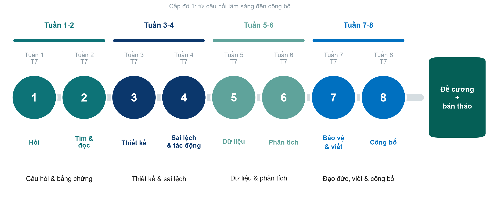
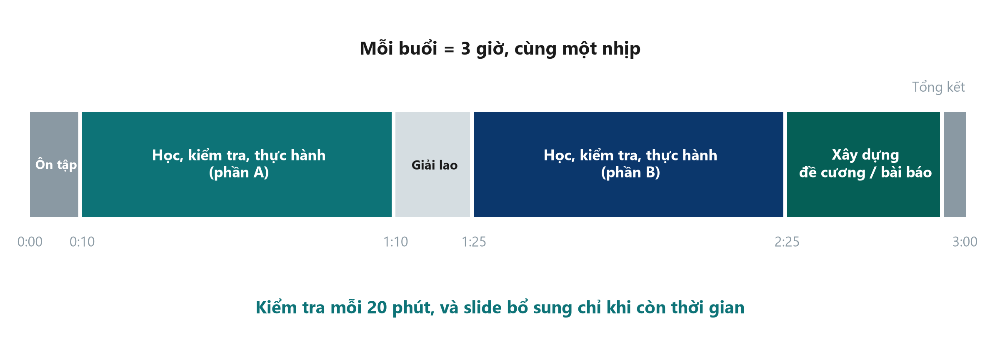
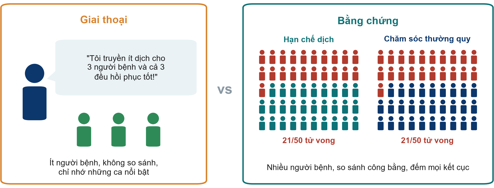
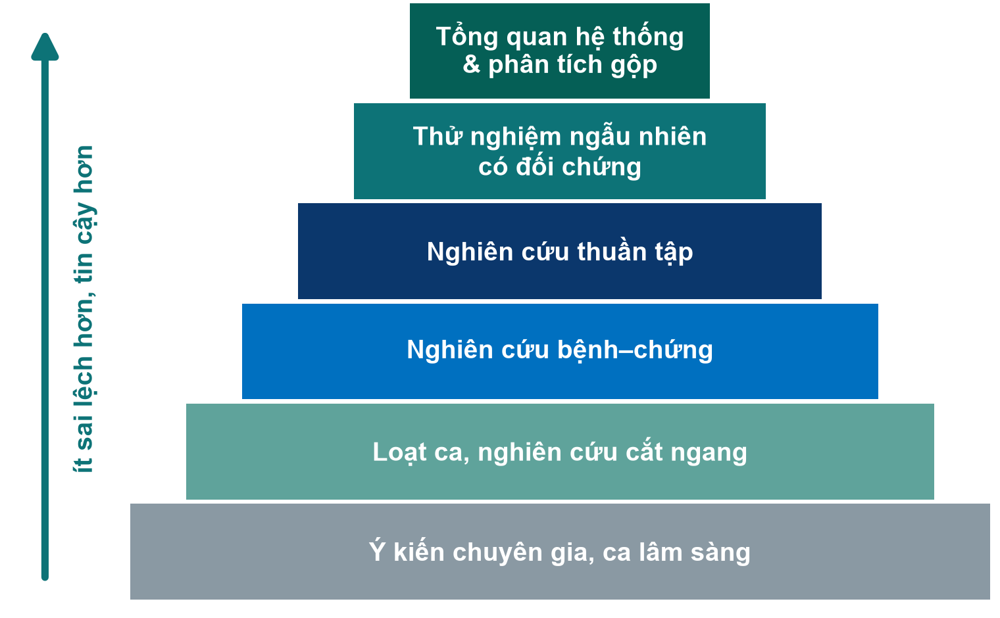
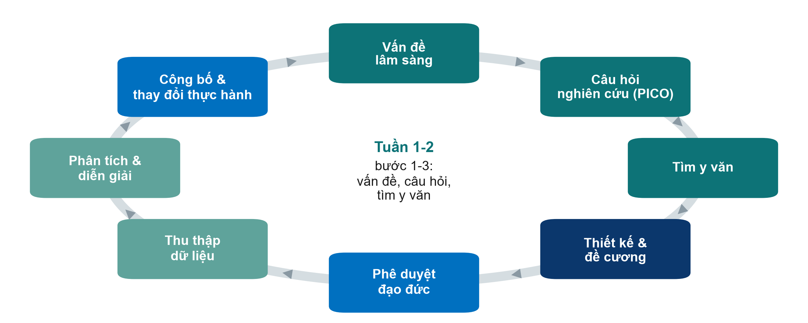
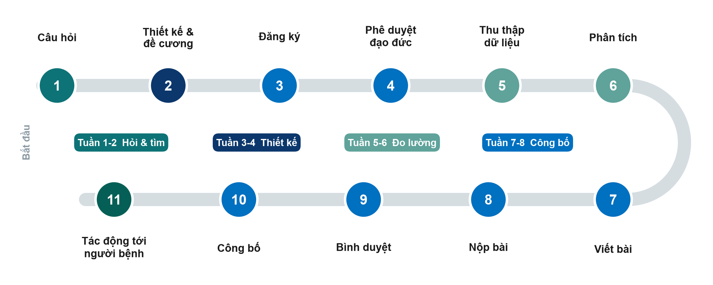
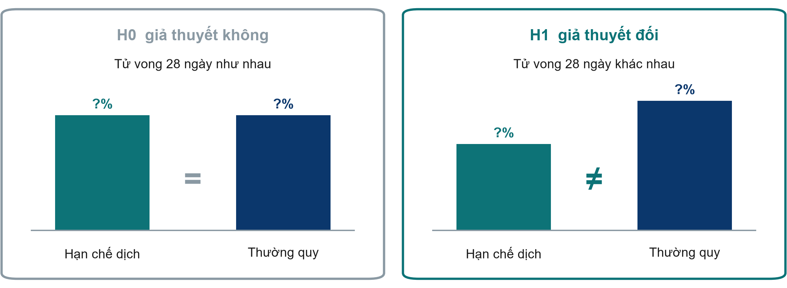

---

:::: {.neu-statement}
::: {.neu-big}
Mỗi ngày bạn đưa ra những quyết định mà nghiên cứu có thể giúp tốt hơn.
:::

::: {.neu-sub}
Khóa học này giúp bạn đặt câu hỏi đúng cách, trả lời chúng và công bố câu trả lời.
:::
::::

::: {.notes}
Mở đầu bằng câu hỏi: 'Hãy nghĩ tới một việc trong khoa mà mỗi đồng nghiệp làm một kiểu và không ai biết cách nào tốt nhất. Gõ vào khung chat.'

Đọc to 2-3 câu trả lời. Dự kiến: dịch truyền, an thần, vận động sớm, băng vết thương, chăm sóc catheter.

Điểm then chốt: nghiên cứu bắt đầu từ sự không chắc chắn trong lâm sàng, không phải từ thống kê.

Chép các câu trả lời trong chat vào tài liệu chung của khóa học. Đó là chủ đề tiềm năng cho đề cương của từng người.

Thời gian: 2 phút.
:::

## Tám thứ Bảy, tám buổi học

{.neu-fig}

::: {.notes}
Đi dọc con đường: Tuần 1-2 là câu hỏi và bằng chứng. Tuần 3-4 thiết kế và sai lệch. Tuần 5-6 dữ liệu và phân tích. Tuần 7-8 đạo đức, viết và công bố. Mỗi thứ Bảy một buổi trực tuyến (19:30 đến 22:30), giữa hai buổi có trọn một tuần để làm bài về nhà.

Toàn bộ khóa học này là Cấp độ 1, bao gồm mọi bước từ câu hỏi đến công bố: Tuần 1-4 xây dựng hiểu biết và kỹ năng thiết kế. Tuần 5-8 áp dụng vào dữ liệu, viết bài và công bố.

Một ví dụ xuyên suốt: dịch truyền trong sốc nhiễm khuẩn và tử vong 28 ngày. Từ Buổi 5, ví dụ này tiếp tục trong nghiên cứu của khóa học, FLUID-ICU.

Thời gian: 2 phút.
:::

## Khóa học này là Cấp độ 1 trong ba cấp độ

:::: {.neu-cards style="--n:3"}
::: {.neu-card .plain style="--c:#0D7377"}
[Cấp độ 1  (khóa học này)]{.neu-card-title}

- **Từ câu hỏi đến công bố**
- Hỏi, thiết kế, phân tích, viết và công bố
- 8 buổi, cả khoa
:::
::: {.neu-card .plain style="--c:#0B376C"}
[Cấp độ 2  (thực hành)]{.neu-card-title}

- **Mô hình thống kê bằng R**
- Tuyến tính, logistic, đếm, Cox
- Bảng 1, cơ bản về dữ liệu thiếu
- Dự án phân tích của bạn
:::
::: {.neu-card .plain style="--c:#04242F"}
[Cấp độ 3  (nâng cao)]{.neu-card-title}

- **Kỹ năng nghiên cứu và phương pháp nâng cao**
- Tái lập, Git, Quarto
- Hình cho tạp chí, phân tích độ nhạy, phân tích gộp
- Thêm theo yêu cầu
:::
::::

::: {.neu-takeaway}
**THÔNG ĐIỆP CHÍNH** Cấp độ 1 là khóa học này, Cấp độ 2 là mô hình thống kê bằng R, Cấp độ 3 là phương pháp nâng cao.
:::

::: {.notes}
Khóa học này (Cấp độ 1) đưa bạn từ câu hỏi lâm sàng đến bài báo được công bố. Cấp độ 2 là khóa thực hành thống kê bằng R cho những ai muốn tự phân tích. Cấp độ 3 gồm các phương pháp nâng cao, chuyên sâu.

Trong Cấp độ 1, chúng ta dùng một bộ dữ liệu thực tế gồm 620 người bệnh ICU (FLUID-ICU): mô tả, phân tích và viết thành bài báo. Giảng viên chạy phần mềm. Các bạn đọc và diễn giải kết quả.

Quan niệm sai cần gỡ bỏ: 'nghiên cứu chỉ dành cho nhà thống kê hay giáo sư'. Phần lớn câu hỏi lâm sàng tốt xuất phát từ điều dưỡng và bác sĩ tại giường bệnh.

Thời gian: 1 phút.
:::

## Hai sản phẩm, mỗi người tự làm

::: {.neu-intro}
Cả hai đều là bài cá nhân. Chúng tôi hướng dẫn từng bước trên lớp.
:::

:::: {.neu-cards style="--n:2"}
::: {.neu-card .plain style="--c:#0D7377"}
[Đề cương nghiên cứu của bạn]{.neu-card-title}

- Về một câu hỏi từ chính khoa của bạn
- Xây dựng từng phần, từ Buổi 1 đến Buổi 7
- Mọi người nộp ở Buổi 8
- Một số bạn tình nguyện trình bày
:::
::: {.neu-card .plain style="--c:#0B376C"}
[Bản thảo bài báo]{.neu-card-title}

- Dựa trên nghiên cứu của khóa học, FLUID-ICU
- Bạn chọn một trong năm câu hỏi (Q1 đến Q5)
- Chúng tôi đưa kết quả. Bạn viết bài báo
- Sau Buổi 8, bạn phản biện bản thảo của một đồng nghiệp
:::
::::

::: {.notes}
Sản phẩm 1: đề cương nghiên cứu của riêng bạn, về một câu hỏi từ chính khoa của bạn, mỗi hai tuần xây dựng một phần và nộp ở Buổi 8. Khoảng năm bạn tình nguyện trình bày ở Buổi 8 (mỗi người 6 phút). Bản đề cương viết là phần được chấm điểm cho mọi người.

Sản phẩm 2: bản thảo bài báo của riêng bạn. FLUID-ICU là nghiên cứu của khóa học trên 620 người bệnh ICU bị nhiễm khuẩn huyết, có năm câu hỏi nghiên cứu (Q1 đến Q5). Mỗi người chọn một câu hỏi và nhận bộ kết quả của câu hỏi đó (bảng và hình). Đúng vậy: chúng tôi đưa kết quả, bạn viết bài báo. Bạn không tự phân tích dữ liệu.

Ta cùng đọc kết quả ở Tuần 5-6 và viết ở Tuần 7-8. Sau Buổi 8, mỗi học viên phản biện bản thảo của một đồng nghiệp (giảng viên phân công) và trả lời phản biện cho bản thảo của mình, như tác giả thật.

Chỉ cho học viên các bản hướng dẫn trong thư mục khóa học: Course/Assignment/proposal\_brief và Course/Assignment/manuscript\_brief.

Thời gian: 3 phút.
:::

## Sau khóa học, bạn sẽ có thể

:::: {.neu-cards style="--n:4"}
::: {.neu-card .plain style="--c:#0D7377"}
[Hỏi & tìm]{.neu-card-title}

- Biến vấn đề thành câu hỏi PICO
- Tìm trên PubMed và quản lý tài liệu
- Đọc một bài báo trong 15 phút
:::
::: {.neu-card .plain style="--c:#0B376C"}
[Thiết kế]{.neu-card-title}

- Chọn đúng thiết kế nghiên cứu
- Nhận biết sai lệch và nhiễu
- Đọc RR, OR, NNT và biểu đồ rừng
:::
::: {.neu-card .plain style="--c:#5FA39B"}
[Phân tích]{.neu-card-title}

- Lập kế hoạch dữ liệu và CRF
- Đọc KTC, giá trị p và hồi quy
- Diễn giải kết quả một bộ dữ liệu thật
:::
::: {.neu-card .plain style="--c:#0070C0"}
[Viết & công bố]{.neu-card-title}

- Lập kế hoạch đạo đức và đăng ký
- Viết từng phần của bài báo
- Nộp bài và trả lời phản biện
:::
::::

::: {.neu-takeaway}
**THÔNG ĐIỆP CHÍNH** Hiểu và diễn giải: bạn sẽ không phải tự tính toán.
:::

::: {.notes}
Đi qua bốn thẻ, mỗi thẻ ứng với hai tuần.

Điểm then chốt: mục tiêu là hiểu và diễn giải, không phải tính toán. Giảng viên chạy phân tích. Các bạn học cách đọc và viết thành bài báo.

Hỏi cả lớp: 'Thẻ nào làm bạn lo nhất? Trả lời trong chat.' Dự kiến: phân tích. Trấn an: chúng ta đi chậm, dùng hình ảnh và kiểm tra mức hiểu mỗi 20 phút.

Quay lại slide này ở Buổi 8 để thấy sự tiến bộ.

Thời gian: 2 phút.
:::

## Mỗi buổi học diễn ra như thế nào

{.neu-fig}

::: {.notes}
Cùng một nhịp mỗi tối thứ Bảy, 19:30 đến 22:30: ôn tập, hai phần học có kiểm tra và bài tập ngắn, 15 phút giải lao, và thời gian xây dựng đề cương hoặc bài báo.

Cứ 20 phút chúng ta dừng lại để kiểm tra nhanh mức hiểu, thường bằng một câu bình chọn. Nếu lớp chưa theo kịp, chúng ta đi chậm lại. Cuối mỗi buổi có 'slide bổ sung' chỉ dùng khi còn thời gian. Các bạn có thể tự đọc ở nhà.

Giữ giải lao đúng 15 phút và bắt đầu lại đúng giờ.

Thời gian: 1 phút.
:::

## Xây dựng đề cương của bạn từng phần một

:::: {.neu-steps}
::: {.neu-step style="--c:#0D7377"}
[Phần 1]{.neu-step-label}

- **Buổi 1-2**
- Câu hỏi, tổng quan, mục tiêu
:::
::: {.neu-step style="--c:#0B376C"}
[Phần 2]{.neu-step-label}

- **Buổi 3-4**
- Thiết kế và đối tượng
:::
::: {.neu-step style="--c:#5FA39B"}
[Phần 3]{.neu-step-label}

- **Buổi 5-6**
- Thu thập dữ liệu, cỡ mẫu, kế hoạch phân tích
:::
::: {.neu-step style="--c:#0070C0"}
[Phần 4]{.neu-step-label}

- **Buổi 7**
- Đạo đức, tính khả thi, kế hoạch công bố
:::
::: {.neu-step style="--c:#055F56"}
[Nộp]{.neu-step-label}

- **Buổi 8**
- Nộp đề cương hoàn chỉnh
:::
::::

::: {.neu-takeaway}
**THÔNG ĐIỆP CHÍNH** Câu hỏi của riêng bạn, một mẫu, mỗi hai tuần một phần, nộp ở Buổi 8.
:::

::: {.notes}
Phần 1 (Tuần 1-2): câu hỏi và tổng quan. Phần 2 (Tuần 3-4): thiết kế. Phần 3 (Tuần 5-6): dữ liệu và kế hoạch phân tích. Phần 4 (Buổi 7): đạo đức, tính khả thi và kế hoạch công bố.

Trong mỗi phần xây dựng đề cương, giảng viên điền trước phần đó cho ví dụ xuyên suốt trên màn hình chia sẻ. sau đó bạn viết cùng phần đó cho câu hỏi của mình.

Mọi người nộp đề cương hoàn chỉnh ở Buổi 8. Khoảng năm bạn tình nguyện trình bày (mỗi người 6 phút).

Mẫu: Course/Templates/Research\_Proposal\_Template.docx (gửi qua email trước Buổi 1).

Thời gian: 1 phút.
:::

## Chào mừng: giới thiệu bản thân

::: {.neu-banner style="--c:#0D7377"}
CẢ LỚP CÙNG LÀM · 6 phút
:::

:::: {.columns}
::: {.column width="60%"}
::: {.neu-activity-steps style="--c:#0D7377"}
- Gõ vào chat: họ tên, khoa và nghề nghiệp của bạn
- Thêm một câu hỏi bạn mong nghiên cứu trả lời được cho khoa mình
- Đọc tin nhắn của người khác: nhiều câu là chủ đề nghiên cứu tiềm năng
- Vài bạn nói câu hỏi của mình, bật micro. Giảng viên lưu cả danh sách cho đề cương của các bạn
:::
:::
::: {.column width="40%"}
::: {.neu-side .plain style="--c:#0D7377"}
Tin nhắn mẫu

- Lan, ICU, điều dưỡng
- 'Người bệnh sốc nhiễm khuẩn có cần ít dịch hơn lượng ta đang truyền không?'
:::
:::
::::

::: {.neu-output style="--c:#0D7377"}
**SẢN PHẨM** Mỗi người một lời giới thiệu trong chat, và vài câu hỏi nói thành lời
:::

::: {.notes}
Lớp có khoảng 30 bác sĩ và điều dưỡng học từ nhà. Cả lớp làm việc như một nhóm trong mọi bài tập, nên không chia nhóm và không phân vai.

Cho 3 phút để gõ. Sau đó mời 4-5 người nói câu hỏi của mình, bật micro, và chỉ ra các chủ đề chung (dịch truyền, an thần, nhiễm khuẩn, vận động sớm, an toàn dùng thuốc).

Lưu khung chat sau buổi học và dán các câu hỏi vào tài liệu chung của khóa học. Đó là danh sách khởi đầu cho đề cương của từng người ở phần Xây dựng đề cương 1.

Thời gian: 6 phút.
:::

## Chúng ta cùng học trực tuyến như thế nào

:::: {.neu-cards style="--n:4"}
::: {.neu-card .plain style="--c:#0D7377"}
[Cứ hỏi]{.neu-card-title}

- Không có câu hỏi nào ngớ ngẩn
- Dùng chat hoặc nút 'giơ tay'
:::
::: {.neu-card .plain style="--c:#0B376C"}
[Đi chậm]{.neu-card-title}

- Chúng ta kiểm tra mức hiểu thường xuyên
- Slide bổ sung chỉ khi còn thời gian
:::
::: {.neu-card .plain style="--c:#5FA39B"}
[Mang khoa phòng vào]{.neu-card-title}

- Dùng ví dụ từ thực hành của bạn
- Không nêu tên hay chi tiết người bệnh
:::
::: {.neu-card .plain style="--c:#0070C0"}
[Thói quen trực tuyến]{.neu-card-title}

- Bật camera khi có thể
- Tắt micro khi không nói
- Khi được mời, bật micro để trả lời
- Quay lại đúng giờ sau giải lao
:::
::::

::: {.notes}
Tạo không khí: đây là nơi an toàn để nói 'tôi chưa hiểu'. Có thể nhắn riêng cho giảng viên trong chat.

Ngôn ngữ: câu hỏi và chat bằng tiếng Việt hoặc tiếng Anh, miễn giúp bạn suy nghĩ tốt nhất.

Bảo mật người bệnh áp dụng cho mọi ví dụ: không nêu tên hay chi tiết nhận dạng.

Thời gian: 1 phút.
:::

## Bài kiểm tra đầu khóa (biểu mẫu trực tuyến)

::: {.neu-banner style="--c:#6C3483"}
CÂU HỎI NHANH · 15 phút
:::

:::: {.columns}
::: {.column width="60%"}
::: {.neu-activity-steps style="--c:#6C3483"}
- Mở biểu mẫu: đường link đang có trong chat
- 24 câu trắc nghiệm, chọn một đáp án cho mỗi câu (khoảng 12 phút)
- Làm một mình: không xem tài liệu, không hỏi đồng nghiệp
- Nếu không chắc, hãy đoán: đây không phải kỳ thi
- Nhập mã số học viên, không nhập tên
:::
:::
::: {.column width="40%"}
::: {.neu-side style="--c:#6C3483"}
Vì sao kiểm tra bây giờ?

- Biết lớp đang bắt đầu từ đâu
- Cùng bài này ở Buổi 8
- Chúng tôi đánh giá khóa học, không đánh giá bạn
:::
:::
::::

::: {.neu-output style="--c:#6C3483"}
**SẢN PHẨM** Đã gửi biểu mẫu (chỉ ghi mã số học viên)
:::

::: {.notes}
Bài kiểm tra là Course/Assessment/pre\_post\_quiz.md (24 câu, mỗi buổi 3 câu), được chuyển thành biểu mẫu trực tuyến trước khóa học. Dán đường link vào chat khi chiếu slide này.

Mã số học viên: con số cạnh tên mỗi người trong danh sách điểm danh, gửi qua email trước Buổi 1. Dùng cùng mã này ở Buổi 8 để so sánh hai lần làm bài.

Đóng biểu mẫu sau 15 phút. Hôm nay không chữa đáp án. Bài này được làm lại trong 15 phút cuối Buổi 8, và đáp án được chia sẻ sau lần làm thứ hai.

Thời gian: 15 phút. Phần học Buổi 1 bắt đầu lúc 0:35 (20:05).
:::

# Buổi 1 · Hỏi: từ vấn đề lâm sàng đến câu hỏi nghiên cứu

## Tuần 1 · Thứ Bảy

- 1.1  Vì sao cần nghiên cứu? Bằng chứng, hai bài báo của khóa học, các loại nghiên cứu, con đường đến công bố
- Giải lao
- 1.2  Từ vấn đề đến câu hỏi: PICO(T) và PECO, FINER, bài tập cả lớp
- 1.3  Mục tiêu tổng quát, mục tiêu cụ thể và giả thuyết (bài tập nhanh)
- Xây dựng đề cương 1: bắt đầu câu hỏi và mục tiêu của riêng bạn
- Tổng kết: từ khóa, ôn tập, câu hỏi cuối buổi, bài về nhà

::: {.notes}
Mở đầu Buổi 1 (0:35, 20:05). Phần mở đầu khóa học (chào mừng, lộ trình, giới thiệu trong chat, bài kiểm tra đầu khóa) vừa kết thúc.

Ý chính: hôm nay chỉ có một việc: mỗi người ra về với bản nháp một câu hỏi nghiên cứu rõ ràng, trả lời được, của riêng mình, cùng mục tiêu tổng quát và mục tiêu cụ thể. Thứ Bảy tuần sau (Buổi 2) ta tìm và đọc y văn cho câu hỏi đó.

Nhịp độ: học viên hầu như chưa có nền tảng nghiên cứu, và đây là buổi tối sau một ngày làm việc. Đi chậm, dùng các ví dụ mẫu, và dừng lại ở mọi slide 'Kiểm tra hiểu bài'. Các slide này được thiết kế ngắn.

Giới thiệu nhịp buổi học: ba phần giảng ngắn, giải lao, một bài tập cả lớp, một bài tập cá nhân nhanh, rồi 30 phút bắt đầu đề cương của riêng mình.

Hỏi cả lớp: 'Ai đã từng tham gia một nghiên cứu, với vai trò nghiên cứu viên, người thu thập số liệu hay người tham gia? Trả lời có hoặc không trong bình chọn.' Kết quả giúp biết nên giảng ở mức nào.

Thời gian: 1 phút. Không đọc to chương trình. Chỉ vào màn hình.
:::

## 1.1  Vì sao cần nghiên cứu?

:::: {.neu-statement}
::: {.neu-big}
Vì sao cần nghiên cứu khi chúng ta đã có kinh nghiệm?
:::

::: {.neu-sub}
35 phút: bằng chứng, hai bài báo của khóa học, tháp bằng chứng, các loại nghiên cứu và con đường đến công bố
:::
::::

::: {.notes}
Phần 1.1 (0:35-1:10, 20:05-20:40).

Dừng lại ở câu hỏi và mời hai ba người trả lời (bật micro) trước khi chuyển slide. Đọc to 2-3 ý kiến.

Câu trả lời mong đợi: kinh nghiệm thiên về những ca đáng nhớ. Đồng nghiệp bất đồng. Thực hành thay đổi. Ta cần biết điều mình làm có thực sự giúp ích không.

Ý chính: kinh nghiệm rất quý để nảy sinh câu hỏi, nhưng là cách yếu để trả lời câu hỏi.

Thời gian: 1 phút.
:::

## Giai thoại và bằng chứng

{.neu-fig}

::: {.neu-takeaway}
**THÔNG ĐIỆP CHÍNH** Kinh nghiệm gợi ra câu hỏi. So sánh công bằng trên nhiều người bệnh trả lời câu hỏi.
:::

::: {.notes}
Bên trái: một bác sĩ, ba người bệnh, một kỷ niệm sống động, không có nhóm so sánh.

Bên phải: mỗi nhóm 50 người bệnh, đếm mọi ca tử vong, cùng một kết cục được đo ở cả hai nhánh.

Các con số chỉ minh họa, nhưng xu hướng là có thật: thử nghiệm lớn CLASSIC (Meyhoff, NEJM 2022, 1 554 người bệnh sốc nhiễm khuẩn) cho thấy tử vong 90 ngày là 42.3% khi hạn chế dịch so với 42.1% khi truyền dịch chuẩn. Ba người bệnh 'thành công' có lẽ vẫn hồi phục dù dùng chiến lược nào.

Quan niệm sai: 'nếu có hiệu quả ở người bệnh của tôi thì là có hiệu quả'. Không có nhóm so sánh, ta không biết điều gì vẫn sẽ xảy ra (tự hồi phục, hồi quy về trung bình, trí nhớ chọn lọc).

Hỏi cả lớp (mời hai ba người trả lời, bật micro): 'Vì sao ta nhớ ba kết cục tốt?' Trả lời mong đợi: sai lệch nhớ lại (recall bias). Ca kịch tính và gần đây dễ nhớ, còn ca thất bại thì ta quên.

Thời gian: 4 phút. Đi chậm: cả khóa học dựa trên ý này.
:::

## Vì sao kinh nghiệm của một khoa là chưa đủ

{.neu-fig}

::: {.neu-takeaway}
**THÔNG ĐIỆP CHÍNH** Số nhỏ dao động do ngẫu nhiên. So sánh lớn và công bằng mới ổn định.
:::

::: {.notes}
Hình này là mô phỏng (hạt giống cố định): giả sử một bệnh có nguy cơ tử vong thật là 40%.

Hàng trên: 20 khoa, mỗi khoa chỉ gặp 5 người bệnh. Hoàn toàn do ngẫu nhiên, có khoa thấy 0% tử vong, có khoa thấy 80%. Mỗi khoa sẽ 'rút ra' một bài học khác nhau từ kinh nghiệm của mình.

Hàng giữa: nhóm 50 người, gần sự thật hơn nhưng vẫn phân tán. Hàng dưới: nhóm 500 người tập trung sát quanh 40%.

Ý chính: chỉ riêng ngẫu nhiên đã tạo ra những khác biệt trông rất ấn tượng ở số nhỏ. Vì vậy nghiên cứu cần đủ người bệnh và có nhóm so sánh, và vì sao 'ba người bệnh gần nhất của tôi' có thể gây hiểu lầm.

Quan niệm sai: 'khác biệt lớn ở nhóm nhỏ chắc chắn là thật'. Khác biệt lớn ở nhóm nhỏ chính là điều ngẫu nhiên hay tạo ra.

Hỏi cả lớp (bình chọn: có / không / chưa biết được): 'Một khoa có 0/5 người bệnh tử vong sau quy trình mới. Quy trình có hiệu quả không?' Trả lời mong đợi: chưa biết được, vì 0/5 xảy ra thường xuyên do ngẫu nhiên ngay cả khi nguy cơ thật là 40%.

Thời gian: 4 phút. Cỡ mẫu sẽ học lại ở Buổi 6.
:::

## Hai bài báo chúng ta cùng đọc trong khóa học

::: {.neu-intro}
Cả hai nằm trong thư mục khóa học, Course/Papers: bản gốc và bản có chú giải tiếng Anh và tiếng Việt.
:::

:::: {.neu-cards style="--n:2"}
::: {.neu-card .plain style="--c:#0D7377"}
[Bài báo 1: Boulet 2024, một thử nghiệm]{.neu-card-title}

- **Boulet N, et al. Crit Care 2024;28:429**
- Impact on fluid balance of an optimized restrictive strategy targeting non-resuscitative fluids in intensive care patients with septic shock
- Thử nghiệm lâm sàng ngẫu nhiên có đối chứng (RCT) thí điểm, 48 người bệnh
- Kết cục chính: cân bằng dịch ngày 5
:::
::: {.neu-card .plain style="--c:#0B376C"}
[Bài báo 2: Hyun 2023, thuần tập]{.neu-card-title}

- **Hyun DG, et al. Ann Intensive Care 2023;13:105**
- Impact of a cumulative positive fluid balance during the first three ICU days in patients with sepsis
- Nghiên cứu thuần tập ghép cặp từ sổ đăng ký nhiễm khuẩn huyết Hàn Quốc
- Kết cục chính: tử vong đến ngày 28
:::
::::

::: {.neu-takeaway}
**THÔNG ĐIỆP CHÍNH** Bài báo 1 là thử nghiệm, Bài báo 2 là thuần tập. Cả hai nghiên cứu dịch truyền trong nhiễm khuẩn huyết.
:::

::: {.notes}
Giới thiệu hai bài báo của khóa học ngay bây giờ, vì từ đây ta nhắc đến chúng ở mọi buổi.

Bài báo 1 (Boulet 2024, Critical Care): RCT thí điểm tại ba ICU ở Pháp. Người lớn bị sốc nhiễm khuẩn được phân bổ ngẫu nhiên vào chiến lược hạn chế dịch 'không nhằm hồi sức' (dịch duy trì và dịch pha thuốc) hoặc chăm sóc thường quy. Kết cục chính: cân bằng dịch tích lũy ngày 5.

Bài báo 2 (Hyun 2023, Annals of Intensive Care): nghiên cứu thuần tập ghép cặp theo điểm xu hướng từ sổ đăng ký của Liên minh Nhiễm khuẩn huyết Hàn Quốc. So sánh người bệnh có cân bằng dịch tích lũy dương ở ngày 2-3 tại ICU với người bệnh không có. Kết cục: tử vong 28 ngày.

Tìm ở đâu: Course/Papers trong thư mục khóa học, gửi qua email trước Buổi 1. Mỗi bài có bản PDF gốc và bản chú giải để học bằng tiếng Anh và tiếng Việt.

Chưa cần đọc bây giờ. Ở Buổi 2, cả lớp cùng đọc phần tóm tắt của Bài báo 1.

Thời gian: 3 phút.
:::

## Tháp bằng chứng

:::: {.columns}
::: {.column width="38%"}
::: {.neu-side-notes}
### Cách đọc

- Càng cao = càng ít nguy cơ sai lệch với câu hỏi về hiệu quả điều trị
- Bài báo 1 (Boulet 2024) là thử nghiệm. Bài báo 2 (Hyun 2023) là thuần tập
- Thuần tập làm tốt có thể hơn thử nghiệm làm kém
- Câu hỏi mô tả không cần thử nghiệm
:::
:::
::: {.column width="62%"}
{.neu-fig-side}
:::
::::

::: {.neu-takeaway}
**THÔNG ĐIỆP CHÍNH** Tháp xếp hạng thiết kế, không phải từng bài báo: vẫn phải kiểm tra chất lượng.
:::

::: {.notes}
Xây từ dưới lên: ý kiến chuyên gia và báo cáo ca, loạt ca và cắt ngang, bệnh–chứng, thuần tập, thử nghiệm ngẫu nhiên, và trên đỉnh là tổng quan hệ thống và phân tích gộp.

Ý chính: càng lên cao, thiết kế càng bảo vệ tốt hơn trước sai lệch. Vì vậy tầng cao cho độ tin cậy lớn hơn với câu hỏi 'điều trị X có hiệu quả không?'.

Quan niệm sai 1: 'RCT luôn đúng'. Thử nghiệm nhỏ hoặc làm kém có thể gây hiểu lầm. Các khung như GRADE đánh giá độ chắc chắn của cả tập hợp bằng chứng, không chỉ nhãn thiết kế.

Quan niệm sai 2: 'chỉ RCT mới có giá trị'. Với mức độ phổ biến, tác hại và tiên lượng, thiết kế quan sát thường là lựa chọn đúng (hoặc duy nhất hợp đạo đức). Nghiên cứu định tính nằm ngoài tháp này vì nó trả lời câu hỏi khác.

Hỏi cả lớp (mời hai ba người trả lời, bật micro): 'Tổng quan hệ thống gồm 10 thử nghiệm kém chất lượng nằm ở đâu?' Trả lời mong đợi: trên đỉnh theo nhãn, nhưng kết luận chỉ mạnh bằng các thử nghiệm bên trong.

Thời gian: 4 phút. Buổi 3 học kỹ từng thiết kế, nên đừng dạy thiết kế ở đây.
:::

## Câu hỏi nhanh: xếp hạng bằng chứng

::: {.neu-banner style="--c:#6C3483"}
CÂU HỎI NHANH · 3 phút
:::

:::: {.columns}
::: {.column width="60%"}
::: {.neu-activity-steps style="--c:#6C3483"}
- Câu hỏi: hạn chế dịch có làm giảm tử vong trong sốc nhiễm khuẩn không?
- A: một đồng nghiệp lâu năm nói: '20 năm nay, người bệnh tôi cho truyền ít dịch đều hồi phục tốt hơn'
- B: một nghiên cứu theo dõi hàng nghìn người bệnh nhiễm khuẩn huyết tại ICU từ sổ đăng ký (thuần tập)
- C: một thử nghiệm phân bổ ngẫu nhiên 1 554 người bệnh vào nhóm hạn chế dịch hoặc dịch thường quy
- D: một tổng quan hệ thống gộp tất cả thử nghiệm về hạn chế dịch
- Bình chọn: thứ tự nào đi từ yếu nhất đến mạnh nhất?
:::
:::
::: {.column width="40%"}
::: {.neu-side .plain style="--c:#6C3483"}
Các lựa chọn

- A, B, C, D
- B, A, C, D
- A, C, B, D
- D, C, B, A
:::
:::
::::

::: {.neu-output style="--c:#6C3483"}
**SẢN PHẨM** Kết quả bình chọn trên màn hình, rồi một câu hỏi: điều gì làm C yếu hơn B?
:::

::: {.notes}
Mở bình chọn với bốn thứ tự ở bên phải. Cho 1 phút, rồi chia sẻ kết quả.

Đáp án: A (ý kiến chuyên gia), rồi B (thuần tập), rồi C (RCT), rồi D (tổng quan hệ thống / phân tích gộp).

C chính là thử nghiệm CLASSIC (NEJM 2022), không thấy khác biệt tử vong 90 ngày. B giống Bài báo 2 (Hyun 2023): cân bằng dịch dương ở ngày 2-3 liên quan với tử vong 28 ngày cao hơn.

Hỏi (mời hai ba người trả lời, bật micro): 'Điều gì có thể làm C yếu hơn B?' Mong đợi: quá nhỏ, mất nhiều người bệnh, che giấu phân bổ kém, đối tượng khác người bệnh của ta.

Nếu còn thời gian: vì sao thuần tập thấy có hại mà thử nghiệm lại không? Trong thuần tập, người bệnh nặng hơn được truyền nhiều dịch hơn, nên dịch trông như có hại (nhiễu do chỉ định, confounding by indication). Đây là phần xem trước Buổi 4.

Thời gian: đúng 3 phút.
:::

## Chu trình nghiên cứu

{.neu-fig}

::: {.neu-takeaway}
**THÔNG ĐIỆP CHÍNH** Nghiên cứu là một chu trình: kết quả công bố thay đổi thực hành và gợi câu hỏi mới.
:::

::: {.notes}
Đi nhanh một vòng, mỗi ô một câu.

Tuần 1-2 = vấn đề lâm sàng và câu hỏi nghiên cứu (hôm nay), tìm y văn (thứ Bảy tuần sau). Đó là ba ô màu xanh mòng két phía trên bên phải.

Ý chính: kết quả công bố làm thay đổi thực hành, từ đó lại nảy sinh điều chưa chắc chắn và câu hỏi mới.

Quan niệm sai: 'nghiên cứu = thu thập dữ liệu'. Thu thập dữ liệu đến sau câu hỏi, thiết kế, đề cương và phê duyệt đạo đức.

Thời gian: 2 phút.
:::

## Câu hỏi quyết định loại nghiên cứu

| Loại nghiên cứu | Cho ta điều gì | Ví dụ |
|:---|:---|:---|
| Định lượng | Con số: bao nhiêu? X có làm thay đổi Y? | Tử vong 28 ngày với hai chiến lược dịch |
| Định tính | Lời nói: vì sao? Thế nào? Trải nghiệm ra sao? | Phỏng vấn: vì sao điều dưỡng ngại ngừng dịch |
| Hỗn hợp | Con số + lời nói trong cùng một nghiên cứu | Khảo sát thực hành dịch + thảo luận nhóm |
| Nghiên cứu sơ cấp | Bạn thu thập dữ liệu mới: thử nghiệm, thuần tập, khảo sát, phỏng vấn | Bài báo 1: thử nghiệm mới |
| Nghiên cứu thứ cấp | Bạn dùng lại dữ liệu có sẵn: hồ sơ, sổ đăng ký, tổng quan hệ thống | Bài báo 2: sổ đăng ký nhiễm khuẩn huyết |

::: {.neu-takeaway}
**THÔNG ĐIỆP CHÍNH** Con số trả lời bao nhiêu, mức nào. Lời nói trả lời vì sao, thế nào.
:::

::: {.notes}
Ba hàng đầu: loại dữ liệu. Nghiên cứu định lượng (quantitative) đếm và đo (tử vong, cân bằng dịch). Nghiên cứu định tính (qualitative) thu thập lời nói (phỏng vấn, thảo luận nhóm, quan sát) để hiểu trải nghiệm, lý do và rào cản. Phương pháp hỗn hợp (mixed methods) kết hợp cả hai trong một nghiên cứu.

Hai hàng cuối: nguồn dữ liệu. Nghiên cứu sơ cấp (primary) thu thập dữ liệu mới (Bài báo 1, một thử nghiệm mới). Nghiên cứu thứ cấp (secondary) dùng lại dữ liệu có sẵn: hồ sơ bệnh án, sổ đăng ký (Bài báo 2 dùng sổ đăng ký nhiễm khuẩn huyết) hoặc các nghiên cứu đã công bố (tổng quan hệ thống).

Ý chính: câu hỏi quyết định loại nghiên cứu. 'Hạn chế dịch có giảm tử vong không?' là định lượng. 'Vì sao điều dưỡng ngại ngừng dịch?' là định tính.

Quan niệm sai: 'nghiên cứu định tính chỉ là ý kiến'. Nó có phương pháp chặt chẽ và hướng dẫn báo cáo riêng (COREQ cho phỏng vấn và thảo luận nhóm). Là công cụ đúng khi con số không giải thích được hành vi.

Thời gian: 3 phút. Thiết kế định tính được học lại ở Buổi 3.
:::

## Kiểm tra hiểu bài: loại nghiên cứu nào?

::: {.neu-banner style="--c:#6C3483"}
CÂU HỎI NHANH · 2 phút
:::

::: {.neu-activity-steps style="--c:#6C3483"}
- A: đếm số người bệnh sốc nhiễm khuẩn có cân bằng dịch dương ở ngày 3 trong năm nay
- B: phỏng vấn điều dưỡng ICU vì sao họ ngại ngừng dịch truyền
- C: phân tích lại hồ sơ ICU 3 năm về cân bằng dịch và tử vong
- D: khảo sát cách chỉ định dịch kèm thảo luận nhóm với bác sĩ
- Mỗi câu: con số, lời nói hay cả hai? Dữ liệu mới hay có sẵn?
:::

::: {.neu-output style="--c:#6C3483"}
**SẢN PHẨM** Hai ba người trả lời bằng lời, ví dụ 'A: con số, mới'. Slide sau có đáp án
:::

::: {.notes}
Kiểm tra nhanh, không phải bài thi. Đọc từng câu. Mời hai ba người trả lời ngắn, bật micro.

Đáp án (slide sau): A định lượng, sơ cấp. B định tính, sơ cấp. C định lượng, thứ cấp (hồ sơ đã có sẵn). D phương pháp hỗn hợp, sơ cấp.

Nếu lớp lưỡng lự ở câu C: dữ liệu được thu thập cho chăm sóc, không phải cho nghiên cứu này, nên dùng lại chúng là nghiên cứu thứ cấp. Vẫn cần xét duyệt đạo đức.

Thời gian: 2 phút.
:::

## Đáp án: loại nghiên cứu nào?

:::: {.neu-cards style="--n:4"}
::: {.neu-card .plain style="--c:#0D7377"}
[A  Đếm số ca]{.neu-card-title}

- Định lượng
- Sơ cấp
- (số liệu mới)
:::
::: {.neu-card .plain style="--c:#0B376C"}
[B  Phỏng vấn]{.neu-card-title}

- Định tính
- Sơ cấp
- (lời nói, vì sao)
:::
::: {.neu-card .plain style="--c:#5FA39B"}
[C  Hồ sơ cũ]{.neu-card-title}

- Định lượng
- Thứ cấp
- (dữ liệu có sẵn)
:::
::: {.neu-card .plain style="--c:#0070C0"}
[D  Khảo sát + nhóm]{.neu-card-title}

- Hỗn hợp
- Sơ cấp
- (số + lời nói)
:::
::::

::: {.neu-takeaway}
**THÔNG ĐIỆP CHÍNH** Hỏi hai điều: con số hay lời nói? Dữ liệu mới hay có sẵn?
:::

::: {.notes}
Đi nhanh qua bốn thẻ.

Ý chính: hai câu hỏi đơn giản phân loại được gần như mọi nghiên cứu: loại dữ liệu (con số hay lời nói) và nguồn dữ liệu (mới hay có sẵn).

Nghiên cứu thứ cấp thường khả thi nhất với một khoa bận rộn, nhưng chất lượng phụ thuộc vào cách ghi chép hồ sơ (Buổi 5).

Phần so sánh nghiên cứu, audit lâm sàng và cải tiến chất lượng nằm trong slide bổ sung cuối buổi, để tự học.

Thời gian: 2 phút.
:::

## Cả con đường: từ ý tưởng đến công bố

{.neu-fig}

::: {.neu-takeaway}
**THÔNG ĐIỆP CHÍNH** Khóa học đi hết con đường. Đề cương của bạn bao gồm trạm 1 đến 6.
:::

::: {.notes}
Mười một trạm từ câu hỏi đến tác động. Màu sắc cho biết những tuần nào của khóa học dạy trạm đó.

Trạm 1-6 là lập kế hoạch và thực hiện: câu hỏi, thiết kế và đề cương, đăng ký (thử nghiệm phải đăng ký trước người bệnh đầu tiên: Bài báo 1 đăng ký tháng 7/2021, bắt đầu tuyển tháng 9/2021), phê duyệt đạo đức, thu thập dữ liệu, phân tích.

Trạm 7-11 là công bố: viết bài, nộp bài, bình duyệt, công bố và tác động tới người bệnh. Con đường thường mất một đến ba năm. Nhiều nghiên cứu tốt dừng lại ở trạm 7.

Ý chính: mọi trạm đều phụ thuộc trạm 1. Câu hỏi mơ hồ tạo ra đề cương yếu, phân tích không trả lời được và bài báo khó công bố.

Quan niệm sai: 'công bố là điểm kết thúc'. Mục đích là tác động: một hướng dẫn, quy trình hay thực hành được thay đổi.

Hỏi cả lớp (mời hai ba người trả lời, bật micro): 'Theo bạn, nghiên cứu ở bệnh viện hay mắc kẹt ở trạm nào?' Mong đợi: thủ tục đạo đức, thu thập dữ liệu, hoặc viết bài (trạm 7). Ta sẽ giải quyết từng trạm.

Thời gian: 3 phút, rồi 3 phút cho câu hỏi (giơ tay hoặc chat). Phần 1.1 kết thúc lúc 1:10 (20:40), sau đó giải lao.
:::

---

::: {style="text-align:center"}
{width="32%"}

[Giải lao]{style="color:#0D7377;font-size:1.6em;font-weight:700"}

[15 phút]{style="color:#595959;font-size:0.9em"}
:::

::: {.notes}
Slide chỉ có hình, có chủ ý. Trước giờ giải lao, nói to giờ bắt đầu lại và gửi giờ đó vào khung chat. Gợi ý (tùy chọn) để cả lớp suy nghĩ: vấn đề nào ở khoa của bạn có thể thành câu hỏi nghiên cứu?

Giải lao (1:10-1:25, 20:40-20:55).

Trong giờ giải lao: dán lại vào chat đường link tới phiếu bài tập Buổi 1 (bản PDF gửi qua email trước buổi học). Bài tập 1 được dùng sau giải lao.

Ghi rõ trong chat giờ bắt đầu lại, và bắt đầu đúng giờ.
:::

## 1.2  Từ vấn đề đến câu hỏi

:::: {.neu-statement}
::: {.neu-big}
Một câu hỏi tốt là một nửa câu trả lời.
:::

::: {.neu-sub}
40 phút: câu hỏi đến từ đâu, PICO(T) và PECO, loại câu hỏi và FINER, rồi một bài tập cả lớp
:::
::::

::: {.notes}
Phần 1.2 (1:25-2:05, 20:55-21:35).

Ý chính: một băn khoăn lâm sàng mơ hồ ('dịch truyền có hại không?') phải được chuyển thành câu hỏi chính xác, trả lời được, trước khi làm việc gì khác.

Ta xây PICO thật chậm trên ví dụ xuyên suốt, xem thêm ba ví dụ khác, rồi cả lớp cùng cải thiện ví dụ xuyên suốt.

Thời gian: 30 giây.
:::

## Câu hỏi nghiên cứu đến từ đâu?

::: {.neu-intro}
Điều chưa chắc chắn: đã có câu trả lời chưa? Cách biết: tìm y văn trước.
:::

:::: {.neu-cards style="--n:3"}
::: {.neu-card style="--c:#0D7377"}
[Câu hỏi đến từ đâu]{.neu-card-title}

- Băn khoăn tại giường: "Sao ta lại làm như vậy?"
- Khác biệt: mỗi người làm một kiểu
- Số liệu kiểm tra, sự cố, sổ đăng ký
- Hướng dẫn ghi "bằng chứng độ tin cậy thấp"
- Bài báo kết luận "cần thêm nghiên cứu"
- Câu hỏi của người bệnh và gia đình
:::
::: {.neu-card .plain style="--c:#5FA39B"}
[Có: đã biết]{.neu-card-title}

- **Áp dụng**
- Hướng dẫn, kiểm tra hoặc dự án cải tiến chất lượng (QI)
:::
::: {.neu-card .plain style="--c:#055F56"}
[Chưa hoặc không rõ]{.neu-card-title}

- **Câu hỏi nghiên cứu**
:::
::::

::: {.neu-takeaway}
**THÔNG ĐIỆP CHÍNH** Nếu đã có câu trả lời, hãy áp dụng. Nếu chưa, bạn có một câu hỏi nghiên cứu.
:::

::: {.notes}
Sáu nguồn thường gặp của câu hỏi hay, đều từ công việc hằng ngày.

Quyết định then chốt nằm ở dòng dưới tiêu đề: trước khi gọi một việc là nghiên cứu, hãy kiểm tra câu trả lời đã có chưa. Nếu đã có, việc cần làm là triển khai: hướng dẫn, audit lâm sàng hay dự án cải tiến chất lượng.

Ý chính: 'cách biết' chính là tìm y văn, nội dung của Buổi 2 thứ Bảy tuần sau.

Nhắc lại các câu hỏi lớp đã gõ vào chat lúc chào mừng. Đó là chủ đề tiềm năng cho đề cương của từng người.

Thời gian: 3 phút.
:::

## PICO(T): ví dụ xuyên suốt

::: {.neu-intro}
Ở người lớn bị sốc nhiễm khuẩn tại ICU, chiến lược hạn chế dịch, so với chăm sóc thường quy, có làm giảm tử vong 28 ngày không?
:::

:::: {.neu-cards style="--n:5"}
::: {.neu-card .plain style="--c:#0D7377"}
[P  Đối tượng]{.neu-card-title}

- Người lớn (≥18 tuổi) bị sốc nhiễm khuẩn tại ICU
:::
::: {.neu-card .plain style="--c:#0B376C"}
[I  Can thiệp]{.neu-card-title}

- Chiến lược hạn chế dịch
:::
::: {.neu-card .plain style="--c:#5FA39B"}
[C  So sánh]{.neu-card-title}

- Chăm sóc thường quy (dịch tiêu chuẩn)
:::
::: {.neu-card .plain style="--c:#0070C0"}
[O  Kết cục]{.neu-card-title}

- Tử vong do mọi nguyên nhân
:::
::: {.neu-card .plain style="--c:#8A99A3"}
[T  Thời gian]{.neu-card-title}

- Trong vòng 28 ngày
:::
::::

::: {.neu-takeaway}
**THÔNG ĐIỆP CHÍNH** Buổi nào chúng ta cũng quay lại câu hỏi này.
:::

::: {.notes}
PICO = Đối tượng (Population), Can thiệp (Intervention), So sánh (Comparison), Kết cục (Outcome). T (Time, thời gian) cho biết khi nào đo kết cục.

Đọc năm ô, rồi đọc cả câu ở phía trên. Đây là ví dụ xuyên suốt cả khóa học.

Ý chính: mỗi chữ cái buộc ta quyết định. Chính xác là người bệnh nào? Hạn chế thế nào? So với cái gì? Kết cục nào, đo lúc nào?

Quan niệm sai: 'nhóm so sánh thì hiển nhiên'. Chăm sóc thường quy khác nhau giữa các bệnh viện và theo thời gian, nên phải mô tả rõ.

Hỏi cả lớp (mời hai ba người trả lời, bật micro): 'Tử vong 28 ngày có phải kết cục hợp lý duy nhất?' Mong đợi: tử vong 90 ngày, số ngày sống không cần hỗ trợ sự sống, tổn thương thận cần lọc máu, cân bằng dịch. Các thử nghiệm lớn dùng tử vong 90 ngày.

Thời gian: 4 phút. Slide sau giới thiệu một biến thể, PECO.
:::

## Ba ví dụ khác: PICO, PECO và P + O

| P | I / E | C | O | T |
|:---|:---|:---|:---|:---|
| Điều trị (PICO) | Người lớn thở máy tại ICU | Bảng kiểm đầu giường 2 lần/ngày | Chăm sóc thường quy | Viêm phổi liên quan thở máy | Ngày 28 tại ICU |
| Yếu tố nguy cơ (PECO) E = Phơi nhiễm | Người lớn tại khoa nội | Béo phì (BMI ≥30) | BMI dưới 30 | Tổn thương do tì đè mới | Trong thời gian nằm viện |
| Bao nhiêu? (P + O) | Người ≥65 tuổi sau mổ gãy cổ xương đùi | - | - | Mê sảng (sàng lọc 4AT) | 7 ngày đầu |

::: {.neu-takeaway}
**THÔNG ĐIỆP CHÍNH** PECO: E = Phơi nhiễm (Exposure), dùng khi ta không thể chủ động phân bổ yếu tố đó (ví dụ béo phì).
:::

::: {.notes}
Ba ví dụ khác, không về dịch truyền, để thấy phương pháp dùng được ở mọi khoa.

Định nghĩa PECO trước: PECO là PICO, trong đó E (Exposure, phơi nhiễm) thay cho I (Intervention, can thiệp). Phơi nhiễm là yếu tố người bệnh có hoặc nhận được nhưng không do nhà nghiên cứu chỉ định, như béo phì hay cân bằng dịch dương. Ta dùng PECO cho câu hỏi về yếu tố nguy cơ (quan sát).

Dòng 1, điều trị (PICO): người lớn thở máy. Bảng kiểm đầu giường 2 lần/ngày so với chăm sóc thường quy. Viêm phổi liên quan thở máy đến ngày 28 tại ICU.

Dòng 2, yếu tố nguy cơ (PECO): ta không thể 'phân' béo phì cho người bệnh, nên I thành E. Người lớn tại khoa nội. Béo phì so với không béo phì. Tổn thương do tì đè mới trong thời gian nằm viện.

Dòng 3, bao nhiêu? Chỉ P và O (và T): người ≥65 tuổi sau mổ gãy cổ xương đùi. Mê sảng sàng lọc bằng 4AT trong 7 ngày đầu.

Hỏi cả lớp (mời hai ba người trả lời, bật micro): 'Hãy đặt một câu hỏi PECO về dịch truyền.' Mong đợi: ở người lớn bị nhiễm khuẩn huyết, cân bằng dịch dương đến ngày 3 (E), so với cân bằng trung tính hoặc âm (C), có liên quan với tử vong đến ngày 28 (O, T) không? Đây là câu hỏi của Bài báo 2, và là câu hỏi chính của nghiên cứu FLUID-ICU của khóa học (Buổi 5).

Thời gian: 4 phút.
:::

## Kiểm tra hiểu bài: tìm PICO

::: {.neu-banner style="--c:#6C3483"}
CÂU HỎI NHANH · 3 phút
:::

:::: {.columns}
::: {.column width="60%"}
::: {.neu-activity-steps style="--c:#6C3483"}
- Câu hỏi của Bài báo 1 (Boulet 2024): 'Ở người lớn bị sốc nhiễm khuẩn trong 24 giờ đầu dùng thuốc vận mạch, hạn chế dịch không nhằm hồi sức, so với chăm sóc thường quy, có làm giảm cân bằng dịch tích lũy ngày 5 không?'
- Những từ nào là P, I, C, O và T?
- Bình chọn: những từ nào là kết cục (O)?
- Sau đó hai ba người nói đối tượng (P), bật micro
:::
:::
::: {.column width="40%"}
::: {.neu-side .plain style="--c:#6C3483"}
Các lựa chọn

- A: sốc nhiễm khuẩn
- B: hạn chế dịch không nhằm hồi sức
- C: cân bằng dịch tích lũy
- D: ngày 5
:::
:::
::::

::: {.neu-output style="--c:#6C3483"}
**SẢN PHẨM** Trả lời bình chọn, rồi nói P thành lời. Đáp án đầy đủ ở slide sau
:::

::: {.notes}
Đọc chậm câu hỏi. Mở bình chọn, cho 1 phút. Chia sẻ kết quả.

Đáp án: C, cân bằng dịch tích lũy, là kết cục. D (ngày 5) là mốc thời gian (T). A là một phần của đối tượng. B là can thiệp.

Sau đó mời hai ba người nói P (bật micro). Đáp án: người lớn bị sốc nhiễm khuẩn trong 24 giờ đầu dùng thuốc vận mạch.

Chú ý học viên chọn 'sốc nhiễm khuẩn' là kết cục. Đó là một phần của đối tượng: nó đã xảy ra rồi.

Thời gian: 3 phút.
:::

## Đáp án: PICO trong câu hỏi của Bài báo 1

:::: {.neu-cards style="--n:5"}
::: {.neu-card .plain style="--c:#0D7377"}
[P]{.neu-card-title}

- Người lớn bị sốc nhiễm khuẩn
- Trong 24 giờ đầu dùng thuốc vận mạch
:::
::: {.neu-card .plain style="--c:#0B376C"}
[I]{.neu-card-title}

- Hạn chế dịch không nhằm hồi sức
:::
::: {.neu-card .plain style="--c:#5FA39B"}
[C]{.neu-card-title}

- Chăm sóc thường quy
:::
::: {.neu-card .plain style="--c:#0070C0"}
[O]{.neu-card-title}

- Cân bằng dịch tích lũy
:::
::: {.neu-card .plain style="--c:#055F56"}
[T]{.neu-card-title}

- Ngày 5
:::
::::

::: {.neu-takeaway}
**THÔNG ĐIỆP CHÍNH** Tình trạng khiến người bệnh vào nghiên cứu (sốc nhiễm khuẩn) thuộc P, không phải O.
:::

::: {.notes}
Hiện đáp án và hỏi bằng bình chọn bao nhiêu người chọn đúng kết cục.

Ý chính: kết cục phải là điều có thể xảy ra sau khi can thiệp bắt đầu. Sốc nhiễm khuẩn đã xảy ra: nó xác định ai đủ tiêu chuẩn.

Lưu ý: kết cục của Bài báo 1 là cân bằng dịch, không phải tử vong. Hãy nhớ điều này: nó giải thích vì sao thử nghiệm không trả lời được câu hỏi tử vong 28 ngày của ta (Buổi 2).

Thời gian: 2 phút.
:::

## Hai nhóm câu hỏi

::: {.neu-intro}
Câu hỏi quyết định thiết kế (học kỹ ở Buổi 3).
:::

:::: {.neu-cards style="--n:3"}
::: {.neu-card .plain style="--c:#5FA39B"}
[Mô tả]{.neu-card-title}

- Cái gì? Bao nhiêu? Ai?
- "Bao nhiêu người bệnh sốc nhiễm khuẩn của khoa có cân bằng dịch dương vào ngày 3?"
- **Loạt ca, cắt ngang**
:::
::: {.neu-card .plain style="--c:#0B376C"}
[Phân tích: quan sát]{.neu-card-title}

- X có liên quan tới Y?
- Quan sát (không can thiệp)
- "Cân bằng dịch dương có liên quan tới tử vong không?"
- **Thuần tập, bệnh–chứng**
:::
::: {.neu-card .plain style="--c:#055F56"}
[Phân tích: can thiệp]{.neu-card-title}

- X có gây ra Y?
- Can thiệp (ta phân nhóm)
- "Hạn chế dịch có làm giảm tử vong 28 ngày không?"
- **Thử nghiệm ngẫu nhiên**
:::
::::

::: {.neu-takeaway}
**THÔNG ĐIỆP CHÍNH** Câu hỏi mô tả thì mô tả. Câu hỏi phân tích thì so sánh hoặc kiểm định nguyên nhân.
:::

::: {.notes}
Mô tả: cái gì, bao nhiêu, ai. Không cần nhóm so sánh.

Phân tích: X có liên quan tới Y (quan sát: ta theo dõi), hoặc X có gây ra Y (thực nghiệm: ta chủ động phân bổ X).

Ý chính: động từ tiết lộ loại câu hỏi. 'Bao nhiêu' là mô tả. 'Có liên quan với' là quan sát. 'Có làm giảm' hàm ý thực nghiệm.

Quan niệm sai: 'nghiên cứu mô tả không phải nghiên cứu thật'. Chúng thường đi trước và cho thấy vấn đề có tồn tại.

Hỏi cả lớp (mời hai ba người trả lời, bật micro): 'Bài báo 2 (Hyun) thuộc ô nào?' Mong đợi: phân tích, quan sát (thuần tập).

Thời gian: 3 phút. Danh mục thiết kế đầy đủ học ở Buổi 3.
:::

## Từ băn khoăn mơ hồ đến câu hỏi trả lời được

:::: {.neu-cards style="--n:2"}
::: {.neu-card .plain style="--c:#B23B2E"}
[Mơ hồ]{.neu-card-title}

- **"Truyền dịch có hại cho người bệnh ICU không?"**
- Người bệnh nào?
- Dịch gì, bao nhiêu?
- Có hại so với cái gì?
- Hại thế nào? Khi nào?
:::
::: {.neu-card .plain style="--c:#2E8B57"}
[Trả lời được, nhờ PICO]{.neu-card-title}

- P: Ở người lớn bị sốc nhiễm khuẩn tại ICU,
- I: chiến lược hạn chế dịch,
- C: so với chăm sóc thường quy,
- O: có làm giảm tử vong
- T: 28 ngày không?
:::
::::

::: {.neu-takeaway}
**THÔNG ĐIỆP CHÍNH** Nếu chưa điền đủ bốn ô PICO, câu hỏi chưa sẵn sàng.
:::

::: {.notes}
Bên trái: câu hỏi ta hay hỏi ngoài hành lang: từ nào cũng chưa được định nghĩa. Bên phải: cùng băn khoăn đó viết theo PICO(T).

Ý chính: câu hỏi nghiên cứu được phải cụ thể, có một kết cục chính, và gợi ra thiết kế.

Quan niệm sai: 'câu hỏi rộng thì quan trọng hơn'. Câu hỏi rộng cho câu trả lời mơ hồ.

Hỏi cả lớp (mời hai ba người trả lời, bật micro): 'Hãy làm câu này trả lời được: Albumin có tốt hơn không?' Hướng mong đợi: ở người lớn bị sốc nhiễm khuẩn (P), albumin kèm dịch tinh thể (I) so với chỉ dịch tinh thể (C) có làm giảm tử vong 28 ngày (O, T) không?

Thời gian: 3 phút.
:::

## FINER: câu hỏi có đáng hỏi không?

::: {.neu-intro}
Kiểm tra mọi câu hỏi với năm tiêu chí trước khi đầu tư thời gian.
:::

:::: {.neu-cards style="--n:5"}
::: {.neu-card .plain style="--c:#0D7377"}
[F  Khả thi]{.neu-card-title}

- (Feasible)
- Đủ người bệnh
- Thời gian, kinh phí và kỹ năng
- Lấy được dữ liệu
:::
::: {.neu-card .plain style="--c:#0B376C"}
[I  Thú vị]{.neu-card-title}

- (Interesting)
- Với bạn và đồng nghiệp
- Với người đọc
:::
::: {.neu-card .plain style="--c:#5FA39B"}
[N  Mới]{.neu-card-title}

- (Novel)
- Khẳng định, bác bỏ hoặc mở rộng điều đã biết
:::
::: {.neu-card .plain style="--c:#0070C0"}
[E  Đạo đức]{.neu-card-title}

- (Ethical)
- Hội đồng đạo đức có thể phê duyệt
:::
::: {.neu-card .plain style="--c:#055F56"}
[R  Phù hợp]{.neu-card-title}

- (Relevant)
- Có thể thay đổi thực hành, chính sách hay nghiên cứu
:::
::::

::: {.neu-takeaway}
**THÔNG ĐIỆP CHÍNH** Nếu câu hỏi trượt một tiêu chí, hãy viết lại trước khi đi tiếp.
:::

::: {.notes}
FINER = Feasible (khả thi), Interesting (thú vị), Novel (mới), Ethical (đạo đức), Relevant (phù hợp), theo Hulley và cộng sự, sách Designing Clinical Research. Đọc mỗi chữ cái cùng từ tiếng Anh, như đã làm với PICO.

Khả thi là tiêu chí hay trượt nhất trong nghiên cứu tại bệnh viện: không đủ người bệnh, hoặc kết cục quá hiếm.

Mới không có nghĩa là 'chưa ai nghiên cứu'. Lặp lại ở bối cảnh mới, hoặc với thiết kế tốt hơn, vẫn có thể là mới. Vì vậy tìm y văn rất quan trọng.

Đạo đức: có thực sự chưa chắc chắn (cân bằng lâm sàng, equipoise) lựa chọn nào tốt hơn không?

Hỏi cả lớp (bình chọn F, I, N, E, R): 'Ví dụ xuyên suốt trượt tiêu chí nào?' Slide sau có đáp án.

Thời gian: 3 phút.
:::

## Kiểm tra FINER cho ví dụ xuyên suốt

::: {.neu-intro}
Hạn chế dịch so với thường quy trong sốc nhiễm khuẩn: tử vong 28 ngày, tại chính ICU của ta.
:::

:::: {.neu-cards style="--n:5"}
::: {.neu-card .plain style="--c:#B23B2E"}
[F  Khả thi]{.neu-card-title}

- **[Đỏ]{style="color:#B23B2E"}**
- Tử vong cần hơn 1 000 người bệnh
- Quá lớn với một khoa
:::
::: {.neu-card .plain style="--c:#2E8B57"}
[I  Thú vị]{.neu-card-title}

- **[Xanh]{style="color:#2E8B57"}**
- Dịch truyền được tranh luận ở mọi buổi giao ban
:::
::: {.neu-card .plain style="--c:#D9822B"}
[N  Mới]{.neu-card-title}

- **[Vàng]{style="color:#D9822B"}**
- Đã có thử nghiệm lớn: CLASSIC 2022 và CLOVERS 2023
:::
::: {.neu-card .plain style="--c:#D9822B"}
[E  Đạo đức]{.neu-card-title}

- **[Vàng]{style="color:#D9822B"}**
- Cả hai chiến lược đang được dùng
- Lấy đồng ý ở ICU cần thận trọng
:::
::: {.neu-card .plain style="--c:#2E8B57"}
[R  Phù hợp]{.neu-card-title}

- **[Xanh]{style="color:#2E8B57"}**
- Mọi người bệnh sốc nhiễm khuẩn đều được truyền dịch
:::
::::

::: {.neu-takeaway}
**THÔNG ĐIỆP CHÍNH** Quan trọng nhưng không khả thi với một khoa: viết lại, ví dụ thành nghiên cứu thí điểm như Bài báo 1.
:::

::: {.notes}
F màu đỏ: để thấy khác biệt vài điểm phần trăm về tử vong cần hơn một nghìn người bệnh. CLASSIC phân bổ ngẫu nhiên 1 554 người. CLOVERS (NEJM 2023) 1 563 người. Một ICU không làm được.

N màu vàng: đã có thử nghiệm lớn và không thử nghiệm nào thấy khác biệt về tử vong.

E màu vàng: cả hai chiến lược đều đang dùng nên có cân bằng lâm sàng, nhưng lấy đồng ý trong sốc nhiễm khuẩn rất khó (Buổi 7).

Cách cứu câu hỏi: đổi kết cục (cân bằng dịch ngày 5, như Bài báo 1), làm nghiên cứu thí điểm (pilot), hoặc đặt câu hỏi mô tả về thực hành của chính khoa mình. Bài tập cả lớp ở slide sau làm đúng việc này.

Quan niệm sai: 'trượt FINER nghĩa là ý tưởng tồi'. Nghĩa là ý tưởng cần được định hình lại, điều này bình thường và được mong đợi.

Thời gian: 3 phút.
:::

## Bài tập cả lớp: cứu ví dụ xuyên suốt

::: {.neu-banner style="--c:#0D7377"}
CẢ LỚP CÙNG LÀM · 11 phút
:::

:::: {.columns}
::: {.column width="60%"}
::: {.neu-activity-steps style="--c:#0D7377"}
- Mở phiếu bài tập Buổi 1 (bản PDF gửi trước buổi học), Bài tập 1
- Phiếu đưa ra ba phiên bản khả thi của câu hỏi: A, B và C (bên phải)
- Bình chọn: phiên bản nào ICU của ta làm được trong vòng hai năm?
- Với phiên bản được nhiều người chọn nhất, người được mời nói P, I hoặc E, C, O và T
- Cùng nhau: gọi tên loại câu hỏi và tô màu cho từng chữ cái FINER
- Cùng nhau: viết H0 và H1, hoặc giải thích vì sao không cần
:::
:::
::: {.column width="40%"}
::: {.neu-side .plain style="--c:#0D7377"}
Ba phiên bản

- A: quy trình hạn chế dịch so với thường quy. Cân bằng dịch ngày 5 (thử nghiệm thí điểm)
- B: cân bằng dịch dương hay không đến ngày 3. Tử vong đến ngày 28 (thuần tập)
- C: bao nhiêu người bệnh của ta có cân bằng dịch dương ở ngày 3? (mô tả)
:::
:::
::::

::: {.neu-output style="--c:#0D7377"}
**SẢN PHẨM** Một câu hỏi chung của lớp với PICO(T), màu FINER và H0/H1, gõ trên màn hình chia sẻ
:::

::: {.notes}
Cả lớp cùng làm, giảng viên dẫn dắt. Chia sẻ bản trống của Bài tập 1 lên màn hình và gõ câu trả lời của lớp vào khi mọi người nói (mỗi chữ cái mời một người, bật micro).

Bình chọn trước (1 phút). Đa số lớp chọn A hoặc C. Nếu phiếu chia đều, làm phiên bản A: đó là nghiên cứu thí điểm Bài báo 1 đã làm, và được dùng lại trong bài tập nhanh ở phần 1.3.

Hỏi từng chữ cái, mỗi lần mời một người khác: 'Đối tượng là ai?', 'So sánh cái gì?', 'Kết cục nào, đo lúc nào?'. Nhận câu trả lời tốt đầu tiên và sửa nhẹ nhàng.

Chỉ ra: phiên bản B là câu hỏi quan sát PECO (cân bằng dịch là phơi nhiễm ta không chỉ định). Đó là câu hỏi chính của nghiên cứu FLUID-ICU từ Buổi 5. Phiên bản C là mô tả và không cần giả thuyết.

Lỗi hay gặp cần sửa: thiếu nhóm so sánh, kết cục không có mốc thời gian, nhồi hai kết cục vào một câu hỏi.

Đáp án mẫu cho cả ba phiên bản: Course/Solutions/s1\_solutions.md, Bài tập 1. Phần luyện thêm với các tình huống ở khoa phòng nằm cuối phiếu bài tập, để làm ở nhà.

Thời gian: 8 phút làm + 3 phút tổng kết. Phần 1.3 bắt đầu lúc 2:05 (21:35).
:::

## 1.3  Mục tiêu và giả thuyết

:::: {.neu-statement}
::: {.neu-big}
Câu hỏi cho biết ta muốn biết gì. Mục tiêu cho biết ta sẽ làm gì.
:::

::: {.neu-sub}
20 phút: mục tiêu tổng quát, mục tiêu cụ thể, giả thuyết không và giả thuyết đối, và một bài tập nhanh
:::
::::

::: {.notes}
Phần 1.3 (2:05-2:25, 21:35-21:55).

Ý chính: mục tiêu tổng quát (aim), mục tiêu cụ thể (objectives) và giả thuyết là câu hỏi được viết thành kế hoạch. Hội đồng đạo đức và người xét duyệt tài trợ đọc phần này đầu tiên.

Giữ cụ thể: mọi ví dụ dùng ví dụ xuyên suốt hoặc phiên bản thí điểm (A) từ bài tập cả lớp.

Thời gian: 30 giây.
:::

## Mục tiêu và giả thuyết: ví dụ xuyên suốt

:::: {.neu-cards style="--n:3"}
::: {.neu-card .plain style="--c:#055F56"}
[Mục tiêu tổng quát]{.neu-card-title}

- **Lý do chung, trong một câu**
- So sánh chiến lược hạn chế dịch với chăm sóc thường quy ở người lớn bị sốc nhiễm khuẩn tại ICU
:::
::: {.neu-card .plain style="--c:#0D7377"}
[Mục tiêu cụ thể]{.neu-card-title}

- **Việc cụ thể, với động từ đo được**
- Chính: so sánh tử vong 28 ngày
- So sánh cân bằng dịch ngày 5
- So sánh tổn thương thận cần lọc máu
:::
::: {.neu-card .plain style="--c:#0B376C"}
[Giả thuyết]{.neu-card-title}

- **Câu trả lời dự kiến cho mục tiêu chính**
- H0: tử vong 28 ngày như nhau ở hai nhóm
- H1: tử vong 28 ngày khác nhau giữa hai nhóm
:::
::::

::: {.neu-takeaway}
**THÔNG ĐIỆP CHÍNH** Một mục tiêu tổng quát, 2-3 mục tiêu cụ thể đo được, một giả thuyết cho mỗi mục tiêu chính.
:::

::: {.notes}
Đọc ba thẻ từ trái sang phải: mục tiêu tổng quát dẫn tới các mục tiêu cụ thể, và mục tiêu chính dẫn tới giả thuyết.

Mục tiêu tổng quát (aim) = mục đích chung trong một câu ('So sánh...', 'Mô tả...').

Mục tiêu cụ thể (objectives) = các bước cụ thể, đo được. Dùng động từ đo được: so sánh, ước tính, mô tả, xác định. Tránh 'tìm hiểu', 'khám phá', 'nghiên cứu'.

Đánh dấu mục tiêu chính: nó quyết định cỡ mẫu (Buổi 6).

Giả thuyết (hypothesis) = câu trả lời dự kiến cho mục tiêu phân tích chính, phát biểu sao cho dữ liệu có thể bác bỏ.

Quan niệm sai: 'nghiên cứu nào cũng cần giả thuyết'. Nghiên cứu thuần mô tả thì ước tính. Không kiểm định giả thuyết.

Thời gian: 3 phút.
:::

## Mục tiêu cụ thể bắt đầu bằng động từ đo được

:::: {.neu-cards style="--n:2"}
::: {.neu-card .plain style="--c:#B23B2E"}
[Động từ mơ hồ]{.neu-card-title}

- tìm hiểu, biết, nghiên cứu về, khám phá, xem xét
- "Tìm hiểu về quản lý dịch truyền ở ICU"
:::
::: {.neu-card .plain style="--c:#2E8B57"}
[Động từ đo được]{.neu-card-title}

- so sánh, ước tính, mô tả, xác định, đo lường
- "So sánh cân bằng dịch tích lũy ngày 5 giữa hai nhóm"
:::
::::

::: {.neu-takeaway}
**THÔNG ĐIỆP CHÍNH** Nếu không nói được sẽ đo bằng cách nào, đó chưa phải là mục tiêu cụ thể.
:::

::: {.notes}
Bên trái: động từ mô tả mong muốn, không phải hành động kiểm tra được. Bên phải: động từ chỉ tới điều đếm được hoặc đo được.

Phía dưới: cùng một ý được viết lại. 'Tìm hiểu về quản lý dịch truyền' không thể hoàn thành hay kiểm tra. 'So sánh cân bằng dịch tích lũy ngày 5 giữa hai nhóm' cho biết kết cục, thời điểm và sự so sánh.

Ý chính: mỗi mục tiêu cụ thể ứng với một kết cục và, sau này, một phân tích (Buổi 6).

Quan niệm sai: 'càng nhiều mục tiêu đề cương càng mạnh'. Hai hoặc ba mục tiêu tập trung tốt hơn tám mục tiêu mơ hồ.

Hỏi cả lớp (mời hai ba người trả lời, bật micro): 'Viết lại: nghiên cứu về cân bằng dịch ở ICU của ta.' Mong đợi: ước tính tỷ lệ người lớn bị sốc nhiễm khuẩn tại ICU của ta có cân bằng dịch tích lũy dương ở ngày 3.

Thời gian: 3 phút.
:::

## Giả thuyết không và giả thuyết đối

{.neu-fig}

::: {.neu-takeaway}
**THÔNG ĐIỆP CHÍNH** Ta kiểm định H0. Dữ liệu có thể bác bỏ hoặc chưa bác bỏ được, nhưng không bao giờ chứng minh H0.
:::

::: {.notes}
H0, giả thuyết không (null hypothesis): không có khác biệt. H1, giả thuyết đối (alternative hypothesis): có khác biệt.

So sánh: tòa án giả định 'không có tội' (H0) cho đến khi bằng chứng đủ mạnh. 'Không có tội' không giống 'vô tội', và 'khác biệt không có ý nghĩa thống kê' không giống 'không có khác biệt'.

H1 thường viết là 'khác nhau' (theo cả hai chiều), ngay cả khi kỳ vọng có lợi, vì hạn chế dịch cũng có thể gây hại. Kiểm định một phía và hai phía: Buổi 6.

Quan niệm sai: 'p \> 0.05 chứng minh hai điều trị như nhau'. Nghiên cứu nhỏ như Bài báo 1 (48 người bệnh) thường không phát hiện được khác biệt có thật. Giá trị p học ở Buổi 6.

Thời gian: 3 phút.
:::

## Bài tập nhanh: mục tiêu và giả thuyết cho nghiên cứu thí điểm

::: {.neu-banner style="--c:#0B376C"}
BÀI TẬP CÁ NHÂN · 7 phút
:::

:::: {.columns}
::: {.column width="60%"}
::: {.neu-activity-steps style="--c:#0B376C"}
- Câu hỏi thí điểm (phiên bản A của Bài tập 1): ở người lớn bị sốc nhiễm khuẩn, quy trình hạn chế dịch, so với chăm sóc thường quy, có làm giảm cân bằng dịch tích lũy ngày 5 không?
- Tự viết một mục tiêu tổng quát: 'So sánh...'
- Viết hai mục tiêu cụ thể với động từ đo được. Đánh dấu mục tiêu chính
- Viết H0 và H1 cho mục tiêu chính
- Hai ba người đọc to mục tiêu chính của mình
:::
:::
::: {.column width="40%"}
::: {.neu-side .plain style="--c:#0B376C"}
Động từ dùng được

- so sánh
- ước tính
- mô tả
- xác định
- đo lường
:::
:::
::::

::: {.neu-output style="--c:#0B376C"}
**SẢN PHẨM** Bài tập 2 trong phiếu bài tập Buổi 1. Đáp án mẫu ở slide sau
:::

::: {.notes}
Làm cá nhân, vào sổ ghi chép hoặc phiếu bài tập: 5 phút viết, rồi 2 phút để hai ba người đọc to bài của mình.

Mời vài người đọc to mục tiêu chính của mình. Tìm: 'tìm hiểu/biết/nghiên cứu', mục tiêu không có mốc thời gian, giả thuyết về một kết cục không có trong mục tiêu.

Đáp án mẫu ở slide sau và trong Course/Solutions/s1\_solutions.md (Bài tập 2).

Thời gian: 7 phút.
:::

## Đáp án mẫu: câu hỏi thí điểm

:::: {.neu-cards style="--n:3"}
::: {.neu-card .plain style="--c:#0D7377"}
[Mục tiêu tổng quát]{.neu-card-title}

- So sánh quy trình hạn chế dịch với chăm sóc thường quy ở người lớn bị sốc nhiễm khuẩn tại ICU của ta
:::
::: {.neu-card .plain style="--c:#0B376C"}
[Mục tiêu cụ thể]{.neu-card-title}

- Chính: so sánh cân bằng dịch tích lũy ngày 5 giữa hai nhóm
- Phụ: ước tính tốc độ tuyển người bệnh và mức tuân thủ quy trình
:::
::: {.neu-card .plain style="--c:#5FA39B"}
[Giả thuyết]{.neu-card-title}

- H0: cân bằng dịch ngày 5 như nhau ở hai nhóm
- H1: cân bằng dịch ngày 5 khác nhau giữa hai nhóm
:::
::::

::: {.neu-takeaway}
**THÔNG ĐIỆP CHÍNH** Mục tiêu tổng quát, mục tiêu chính và giả thuyết cùng nêu một kết cục.
:::

::: {.notes}
Đọc ba thẻ.

Kiểm tra chuỗi: O của câu hỏi (cân bằng dịch tích lũy ngày 5) = mục tiêu chính = kết cục trong H0/H1. Nếu các phần này khác nhau, đề cương thiếu nhất quán, và người phản biện nhận ra ngay.

Phiên bản mô tả (C) không cần giả thuyết: 'Ước tính tỷ lệ người lớn bị sốc nhiễm khuẩn tại ICU của ta có cân bằng dịch tích lũy dương ở ngày 3.'

Thời gian: 3 phút. Phần 1.3 kết thúc lúc 2:25 (21:55).
:::

## Xây dựng đề cương 1

:::: {.neu-statement}
::: {.neu-big}
Giờ hãy bắt đầu đề cương của riêng bạn: một câu hỏi, một mục tiêu tổng quát.
:::

::: {.neu-sub}
30 phút: giảng viên làm mẫu Phần 1 trên ví dụ xuyên suốt, rồi bạn viết phần của mình
:::
::::

::: {.notes}
Xây dựng đề cương 1 (2:25-2:55, 21:55-22:25). 30 phút bắt đầu từ slide này.

Ý chính: mọi điều học hôm nay giờ được áp dụng vào câu hỏi của riêng mỗi học viên, từ chính khoa của mình. Mỗi người viết đề cương của mình. Không ai làm theo nhóm.

Tìm kiếm, 5 tài liệu, đặt vấn đề và tên đề tài là việc của thứ Bảy tuần sau (Xây dựng đề cương 2).

Chuyển ngay sang slide sau.
:::

## Xây dựng đề cương 1: câu hỏi của riêng bạn

::: {.neu-banner style="--c:#055F56"}
XÂY DỰNG ĐỀ CƯƠNG · 30 phút
:::

:::: {.columns}
::: {.column width="60%"}
::: {.neu-activity-steps style="--c:#055F56"}
- Xem giảng viên điền Phần 1 của mẫu đề cương cho ví dụ xuyên suốt
- Mở bản mẫu đề cương của bạn (gửi qua email trước buổi học)
- Chọn một vấn đề từ chính khoa của bạn
- Viết câu hỏi PICO(T) thành một câu và kiểm tra bằng FINER
- Thêm một mục tiêu tổng quát, 2-3 mục tiêu cụ thể (đánh dấu mục tiêu chính) và H0/H1
- Hai bạn tình nguyện đọc to câu hỏi. Những người khác góp một ý cải thiện, bật micro
:::
:::
::: {.column width="40%"}
::: {.neu-side .plain style="--c:#055F56"}
Thời gian

- 0-8 phút: giảng viên làm mẫu Phần 1
- 8-25 phút: bạn tự viết phần của mình
- 25-30 phút: hai bạn tình nguyện chia sẻ
:::
:::
::::

::: {.neu-output style="--c:#055F56"}
**SẢN PHẨM** Bắt đầu Đề cương Phần 1 của bạn: câu hỏi, FINER, mục tiêu, giả thuyết
:::

::: {.notes}
Phút 0-8, giảng viên làm mẫu: chia sẻ Course/Templates/Research\_Proposal\_Template.docx và điền Phần 1 cho phiên bản thí điểm (A) của ví dụ xuyên suốt, dùng câu trả lời của lớp hôm nay: vấn đề, PICO(T), câu hỏi, màu FINER, mục tiêu tổng quát, mục tiêu cụ thể, H0/H1. Nói to lý do của từng lựa chọn.

Phút 8-25, mỗi người tự viết Phần 1 của mình. Có thể tắt camera. Giảng viên vẫn trực tuyến và trả lời câu hỏi trong chat. Giảng viên thứ hai có thể nhận tin nhắn riêng.

Nếu ai chưa chọn được chủ đề, gợi ý danh sách câu hỏi đã lưu từ phần chào mừng, hoặc tạm dùng phiên bản A hay C của ví dụ xuyên suốt.

Nhắc lỗi hay gặp nhất: chữ F đỏ. Hãy thu hẹp kết cục, rút ngắn thời gian, hoặc chuyển thành câu hỏi mô tả hay nghiên cứu thí điểm.

Phút 25-30: hai bạn tình nguyện đọc to câu hỏi và mục tiêu tổng quát. Mời hai ba người, mỗi người góp một ý cải thiện, bật micro.

Thế nào là tốt: Course/Solutions/s1\_solutions.md (Bài tập 3). Phần chưa xong trở thành bài về nhà.

Thời gian: 30 phút. Tổng kết bắt đầu lúc 2:55 (22:25).
:::

## Từ khóa của buổi học

| Từ khóa | Trong một câu |
|:---|:---|
| Tháp bằng chứng | Xếp hạng thiết kế theo mức chống sai lệch |
| PICO(T) | Đối tượng, Can thiệp, So sánh, Kết cục, Thời gian |
| PECO | Như PICO, với E = Phơi nhiễm, cho yếu tố ta không chỉ định |
| FINER | Khả thi, Thú vị, Mới, Đạo đức, Phù hợp |
| Mục tiêu tổng quát / cụ thể | Lý do chung / việc cụ thể, đo được |
| H0 / H1 | Không khác biệt / có khác biệt (ta kiểm định H0) |

::: {.notes}
Tổng kết (2:55-3:00, 22:25-22:30).

Đọc nhanh sáu từ khóa. Chúng cũng có trong bảng thuật ngữ của khóa học (Anh-Việt), Course/References/glossary\_EN\_VN.

Mời một học viên giải thích PICO bằng lời của mình.

Thời gian: 1 phút.
:::

## Ôn tập Buổi 1

:::: {.neu-cards style="--n:3"}
::: {.neu-card .plain style="--c:#0D7377"}
[Vì sao nghiên cứu]{.neu-card-title}

- Kinh nghiệm gợi ra câu hỏi
- So sánh công bằng trên đủ người bệnh trả lời câu hỏi
:::
::: {.neu-card .plain style="--c:#0B376C"}
[Hỏi chính xác]{.neu-card-title}

- Một câu hỏi PICO(T)
- Một kết cục chính
- Kiểm tra FINER trước khi bắt đầu
:::
::: {.neu-card .plain style="--c:#5FA39B"}
[Lập kế hoạch]{.neu-card-title}

- Một mục tiêu tổng quát
- 2-3 mục tiêu cụ thể đo được
- H0 và H1 kiểm định được
:::
::::

::: {.neu-takeaway}
**THÔNG ĐIỆP CHÍNH** Thứ Bảy tuần sau: tìm và đọc những gì đã biết về câu hỏi của bạn.
:::

::: {.notes}
Đọc ba thông điệp.

Nối sang buổi sau: thứ Bảy tuần sau (Buổi 2) ta tìm trực tiếp trên PubMed cho câu hỏi của ta, quản lý tài liệu trong Zotero, và học cách đọc một bài báo trong 15 phút.

Thời gian: 1.5 phút.
:::

## Câu hỏi cuối buổi (trong chat)

::: {.neu-banner style="--c:#6C3483"}
CÂU HỎI NHANH · 2 phút
:::

:::: {.columns}
::: {.column width="60%"}
::: {.neu-activity-steps style="--c:#6C3483"}
- Trả lời ngay trong chat, hoặc trong biểu mẫu một câu hỏi có link trong chat
- Câu 1: ví dụ xuyên suốt trượt tiêu chí FINER nào, và vì sao?
- Câu 2: viết lại thành mục tiêu cụ thể: 'Tìm hiểu về cân bằng dịch ở ICU của ta'
:::
:::
::: {.column width="40%"}
::: {.neu-side .plain style="--c:#6C3483"}
Vì sao hỏi

- Không phải bài về nhà, không chấm điểm
- Cho biết điều gì còn chưa rõ
- Giảng viên đọc mọi câu trả lời trước thứ Bảy tuần sau
- Buổi 2 mở đầu bằng những gì ta thấy
:::
:::
::::

::: {.neu-output style="--c:#6C3483"}
**SẢN PHẨM** Mỗi người một câu trả lời ngắn, trước khi rời lớp
:::

::: {.notes}
Mục đích: kiểm tra nhanh mức hiểu trong 2 phút, trên ví dụ xuyên suốt. Đây không phải bài về nhà.

Đáp án: Câu 1 Khả thi: kết cục tử vong cần hơn một nghìn người bệnh. Câu 2 Ví dụ: 'Ước tính tỷ lệ người lớn bị sốc nhiễm khuẩn tại ICU của ta có cân bằng dịch tích lũy dương ở ngày 3'.

Lưu khung chat (hoặc tải câu trả lời của biểu mẫu). Đọc trong tuần. Nếu nhiều người vẫn dùng động từ mơ hồ, mở đầu Buổi 2 bằng thêm một phút về mục tiêu.

Thời gian: 1.5 phút.
:::

## Bài về nhà cho thứ Bảy tuần sau (Buổi 2)

::: {.neu-banner style="--c:#0B376C"}
BÀI TẬP CÁ NHÂN
:::

:::: {.columns}
::: {.column width="60%"}
::: {.neu-activity-steps style="--c:#0B376C"}
- Hoàn thành bản nháp Đề cương Phần 1 của bạn: câu hỏi, FINER, mục tiêu, H0/H1
- Bài tập 4 trong phiếu bài tập Buổi 1: 2-3 từ đồng nghĩa tiếng Anh cho mỗi từ PICO
- Cài Zotero (miễn phí, zotero.org) và plug-in Word: bắt buộc trước Buổi 2
:::
:::
::: {.column width="40%"}
::: {.neu-side .plain style="--c:#0B376C"}
Sẵn sàng cho thứ Bảy tuần sau

- Câu hỏi PICO của bạn
- Danh sách từ đồng nghĩa
- Máy tính có internet và Zotero
:::
:::
::::

::: {.neu-output style="--c:#0B376C"}
**SẢN PHẨM** Câu hỏi, danh sách từ đồng nghĩa và Zotero sẵn sàng cho buổi tìm kiếm
:::

::: {.notes}
Giữ nhẹ nhàng: khoảng 45 phút trong tuần, tự làm.

Danh sách từ đồng nghĩa giúp tìm kiếm PubMed thứ Bảy tuần sau nhanh hơn nhiều, vì PubMed tìm bằng tiếng Anh.

Zotero là bắt buộc: ở Buổi 2 mọi người nhập tài liệu từ PubMed vào Zotero và trích dẫn trong Word. Cài Zotero desktop, Zotero Connector cho trình duyệt và plug-in Word (zotero.org/download). Ai gặp khó khăn hãy email giảng viên trước thứ Sáu.

Kết thúc đúng giờ. Cảm ơn cả lớp.

Thời gian: 1 phút.
:::

---

:::: {.neu-statement}
::: {.neu-big}
Slide bổ sung: Buổi 1
:::

::: {.neu-sub}
Dùng nếu còn thời gian, hoặc để tự học
:::
::::

::: {.notes}
Slide bổ sung (Buổi 1).

Mọi slide sau slide này là tùy chọn. Dùng nếu lớp đi nhanh hoặc có người hỏi, hoặc giới thiệu để học viên tự học.

Buổi học chính vẫn trọn vẹn khi không dùng các slide này.
:::

## Nghiên cứu, audit hay cải tiến chất lượng?

| Nghiên cứu | Kiểm tra lâm sàng (audit) | Cải tiến chất lượng (QI) |
|:---|:---|:---|
| Câu hỏi | Thực hành nào tốt nhất? | Ta có đạt tiêu chuẩn không? | Làm sao tốt hơn, từng bước? |
| Ví dụ dịch truyền | Hạn chế vs thường quy: cái nào tốt hơn? | Cân bằng dịch có được ghi hằng ngày? | Bảng kiểm hằng ngày, thử theo chu trình PDSA |
| Kết quả dùng cho | Người bệnh nơi khác (khái quát hóa) | Khoa của ta | Khoa của ta |
| Đạo đức | **[Hội đồng đạo đức phê duyệt: luôn luôn]{style="color:#B23B2E"}** | Phê duyệt nội bộ, thường không cần hội đồng | Phê duyệt nội bộ, xét đạo đức nếu có rủi ro mới |

::: {.neu-table-caption}
Không chắc là loại nào? Hỏi hội đồng đạo đức trước khi bắt đầu. Tạp chí sẽ hỏi phê duyệt hoặc miễn trừ.
:::

::: {.neu-takeaway}
**THÔNG ĐIỆP CHÍNH** Nghiên cứu hỏi điều gì tốt nhất. Audit hỏi ta có làm không. QI làm cho tốt hơn.
:::

::: {.notes}
Extra: nghiên cứu, audit lâm sàng và cải tiến chất lượng (để tự học, hoặc khi học viên hỏi dự án của mình có cần phê duyệt đạo đức không).

Nghiên cứu tạo ra kiến thức mới, có thể khái quát hóa: phương án nào tốt nhất? Audit lâm sàng so sánh thực hành của ta với một tiêu chuẩn đã thống nhất. Cải tiến chất lượng (QI) thay đổi một quy trình tại chỗ từng bước, thường theo chu trình Lập kế hoạch, Thực hiện, Nghiên cứu, Hành động (PDSA).

Vì sao quan trọng: nghiên cứu luôn cần hội đồng đạo đức phê duyệt trước khi bắt đầu. Audit và QI thường chỉ cần phê duyệt nội bộ. Nhưng nếu dự án phân bổ ngẫu nhiên, thêm can thiệp hay rủi ro mới, hoặc thu thập dữ liệu ngoài chăm sóc thường quy, thì đó là nghiên cứu và cần xét duyệt đạo đức.

Công bố không làm thay đổi bản chất dự án. Tạp chí sẽ hỏi phê duyệt đạo đức hoặc quyết định miễn trừ chính thức, vì vậy hãy xác định (và hỏi) ngay từ đầu, không phải sau khi đã thu thập dữ liệu.

Lưu ý: quy định khác nhau giữa các cơ sở. Nhắc học viên xem quy định nội bộ và, nếu không chắc, hỏi hội đồng đạo đức. Phê duyệt đạo đức học ở Buổi 7.

Thời gian: 3 phút nếu dùng.
:::

## PICO cho các loại câu hỏi khác

:::: {.neu-cards style="--n:3"}
::: {.neu-card .plain style="--c:#0D7377"}
[Chẩn đoán]{.neu-card-title}

- P: người được xét nghiệm
- I: xét nghiệm mới
- C: tiêu chuẩn tham chiếu
- O: độ chính xác
- Ví dụ: ở người lớn nghi nhiễm khuẩn huyết tại khoa cấp cứu, qSOFA chính xác đến đâu so với tiêu chuẩn Sepsis-3 đầy đủ?
:::
::: {.neu-card .plain style="--c:#0B376C"}
[Tiên lượng]{.neu-card-title}

- P: người bệnh mắc một tình trạng
- E: yếu tố nguy cơ (phơi nhiễm)
- O: điều xảy ra
- T: đến khi nào
- Ví dụ: ở người lớn bị sốc nhiễm khuẩn, lactate trên 4 mmol/L lúc nhập viện có liên quan với tử vong đến ngày 28 không?
:::
::: {.neu-card .plain style="--c:#5FA39B"}
[Định tính (SPIDER)]{.neu-card-title}

- S: Mẫu (Sample)
- PI: Hiện tượng quan tâm
- D: Thiết kế (Design)
- E: Đánh giá. R: Loại nghiên cứu
- Ví dụ: điều dưỡng ICU (S) trải nghiệm việc ngừng dịch truyền (PI) thế nào, qua phỏng vấn (D), về các rào cản (E), trong một nghiên cứu định tính (R)?
:::
::::

::: {.neu-takeaway}
**THÔNG ĐIỆP CHÍNH** Chữ cái thay đổi, nhưng nguyên tắc vẫn giữ nguyên: nói rõ ràng.
:::

::: {.notes}
Extra: khung câu hỏi chẩn đoán, tiên lượng và định tính, mỗi khung có một câu hỏi ví dụ.

Câu hỏi chẩn đoán: xét nghiệm cần đánh giá là I, tiêu chuẩn tham chiếu là C, kết cục là độ chính xác (độ nhạy và độ đặc hiệu, Buổi 4). Ví dụ: qSOFA so với Sepsis-3 tại khoa cấp cứu.

Tiên lượng: thường là PECO cộng mốc thời gian (E = phơi nhiễm). Ví dụ: lactate cao lúc nhập viện và tử vong đến ngày 28.

Câu hỏi định tính thường dùng SPIDER (Cooke và cộng sự, 2012): Sample (mẫu), Phenomenon of Interest (hiện tượng quan tâm), Design (thiết kế), Evaluation (đánh giá), Research type (loại nghiên cứu). Ví dụ: trải nghiệm của điều dưỡng ICU khi ngừng dịch, nghiên cứu qua phỏng vấn.

Thời gian: 2 phút nếu dùng.
:::

## Luyện thêm: trượt tiêu chí FINER nào?

::: {.neu-banner style="--c:#6C3483"}
CÂU HỎI NHANH · 4 phút
:::

::: {.neu-activity-steps style="--c:#6C3483"}
- Mọi người lớn nằm viện trong cả nước: vitamin D có giảm tử vong trong 10 năm?
- Sốc nhiễm khuẩn: hoãn kháng sinh 24 giờ có giảm kháng thuốc?
- Điều dưỡng ICU có rửa tay không? (đã audit hằng tháng suốt 5 năm)
- Viêm phổi: màu của tờ y lệnh có ảnh hưởng tử vong 28 ngày?
:::

::: {.neu-output style="--c:#6C3483"}
**SẢN PHẨM** Mỗi câu một chữ cái, trong bình chọn
:::

::: {.notes}
Extra: luyện thêm FINER.

Đáp án: 1 Khả thi (quá lớn, quá dài, quá tốn kém, cũng đã có thử nghiệm vitamin D lớn, nên cũng trượt tiêu chí Mới). 2 Đạo đức (hoãn kháng sinh trong sốc nhiễm khuẩn gây hại, nên không có cân bằng lâm sàng). 3 Mới (đã có số liệu: đây là câu hỏi audit). 4 Phù hợp (không có cơ chế hợp lý, không tác động tới thực hành).

Cũng có trong phần luyện thêm cuối phiếu bài tập Buổi 1.

Thời gian: 4 phút nếu dùng.
:::

## Mơ hồ và trả lời được: thêm một ví dụ tại khoa

:::: {.neu-cards style="--n:2"}
::: {.neu-card .plain style="--c:#B23B2E"}
[Mơ hồ]{.neu-card-title}

- **"Truyền dịch có hại cho người bệnh ICU không?"**
- Người bệnh nào?
- Dịch gì, bao nhiêu?
- Có hại so với cái gì?
- Hại thế nào? Khi nào?
:::
::: {.neu-card .plain style="--c:#2E8B57"}
[Trả lời được, nhờ PICO]{.neu-card-title}

- P: Ở người lớn bị sốc nhiễm khuẩn tại ICU,
- I: chiến lược hạn chế dịch,
- C: so với chăm sóc thường quy,
- O: có làm giảm tử vong
- T: 28 ngày không?
:::
::::

::: {.neu-takeaway}
**THÔNG ĐIỆP CHÍNH** Luyện trên khoa của bạn: lấy một câu hỏi hành lang và điền các ô PICO.
:::

::: {.notes}
Extra: luyện thêm chuyển câu hỏi mơ hồ thành trả lời được với một ví dụ khác tại khoa.

Dùng lại slide này nếu lớp cần luyện thêm.

Hỏi: 'Làm câu này trả lời được: Ca đêm có gây sai sót thuốc không?' Hướng mong đợi: ở điều dưỡng khoa phòng (P), ca đêm (E) so với ca ngày (C) có liên quan với nhiều sai sót khi dùng thuốc hơn trên 1 000 liều (O) trong 6 tháng (T) không?

Chỉ ra đây là câu hỏi PECO (quan sát), E = phơi nhiễm, vì khó phân bổ ngẫu nhiên điều dưỡng vào ca đêm.

Thời gian: 3 phút nếu dùng.
:::
