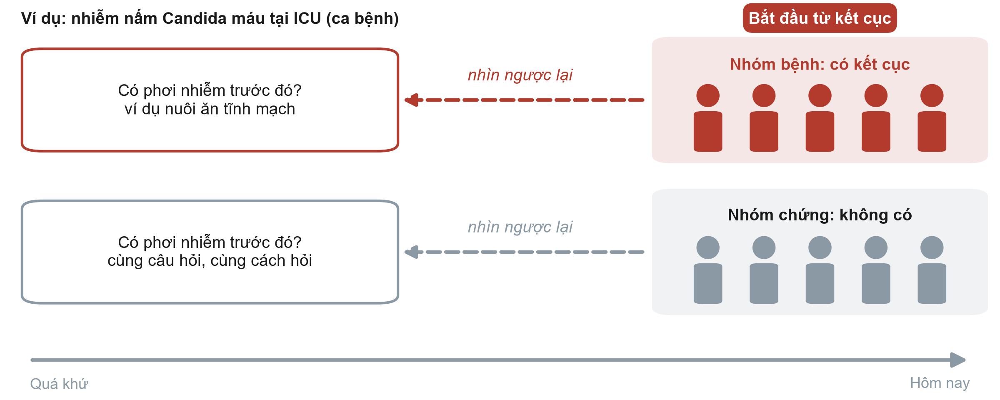
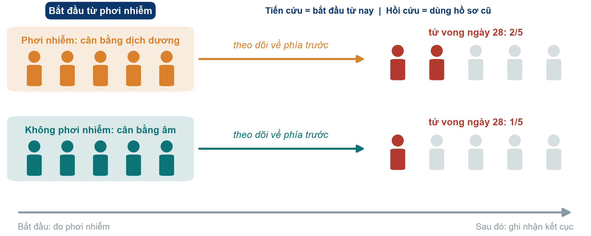
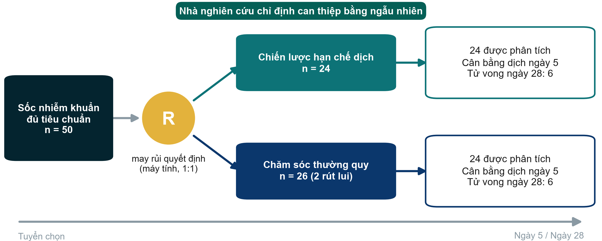
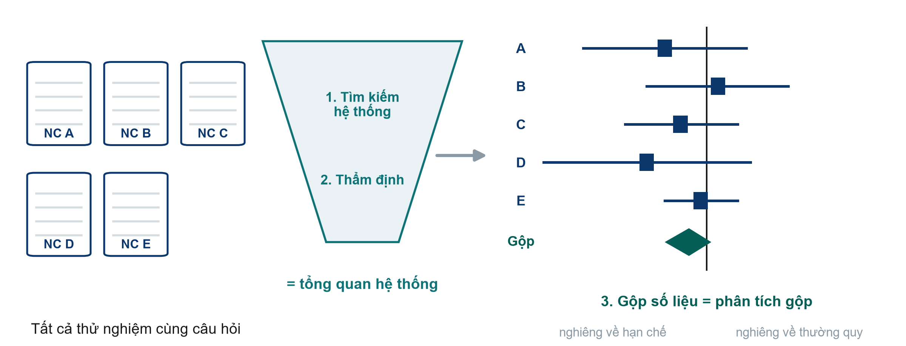
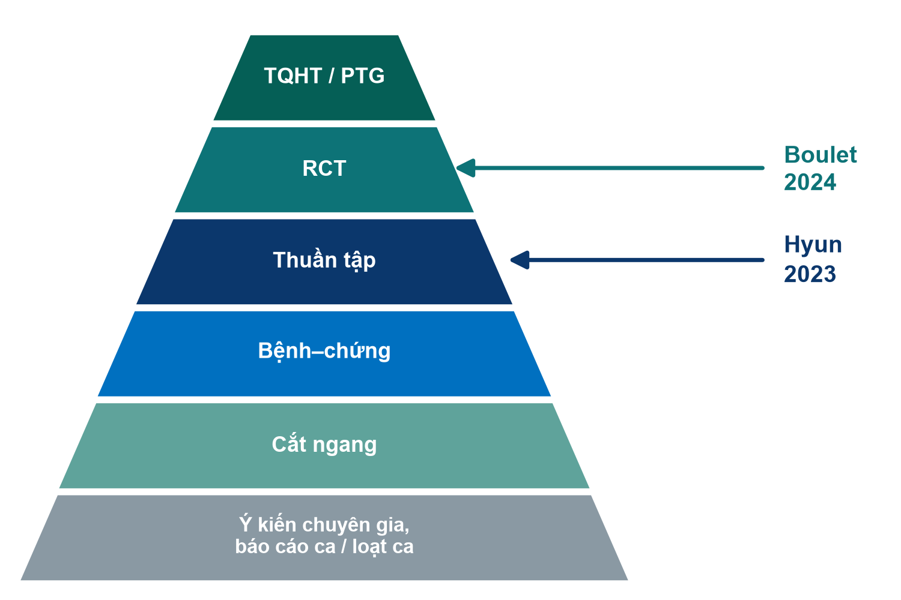
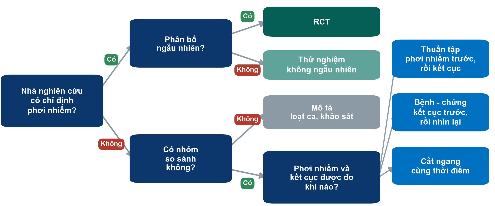
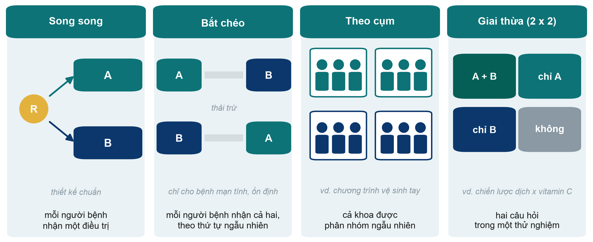
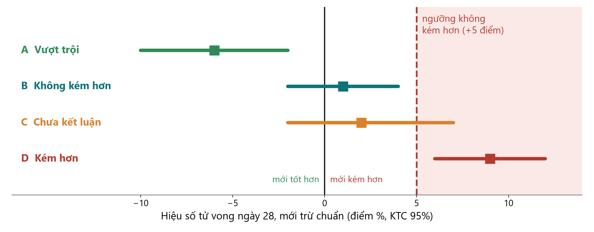
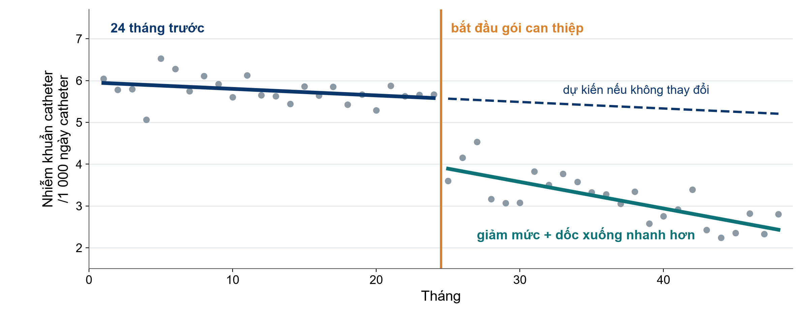
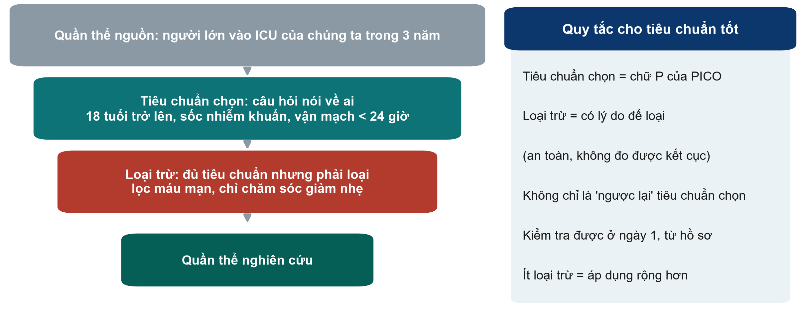

# Buổi 3 · Thiết kế: chọn đúng loại nghiên cứu

## Tuần 3 · Thứ Bảy · trực tuyến, 19:30-22:30

- Câu hỏi ôn tập Buổi 2 (10 phút)
- 3.1  Thiết kế nghiên cứu qua hình ảnh (45 phút)
- Bài tập cả lớp: Gọi tên thiết kế (15 phút)
- Giải lao (15 phút)
- 3.2  Các thiết kế khác: biến thể thử nghiệm, thí điểm, cải tiến chất lượng, định tính (30 phút)
- Bài tập cả lớp: chọn thiết kế (15 phút)
- Xây dựng đề cương 3: thiết kế, bối cảnh và đối tượng (45 phút), rồi tổng kết (5 phút)

::: {.notes}
Mở đầu Buổi 3 (19:30). Chào mừng đến Tuần 3. Ở Buổi 1 và 2 cả lớp đã đặt câu hỏi và tìm bằng chứng. Hôm nay chọn cách một nghiên cứu trả lời câu hỏi. Thứ Bảy tuần sau (Buổi 4) đánh giá có tin được câu trả lời không và tác động lớn đến đâu.

Ý chính: thiết kế quyết định điều được phép kết luận ở cuối nghiên cứu. Câu hỏi hay mà chọn sai thiết kế sẽ cho ra một nghiên cứu yếu.

Cách học trực tuyến (nhắc ngắn): câu trả lời nhanh qua bình chọn (poll). Với các câu hỏi khác, giảng viên mời hai ba người trả lời, bật micro. Bấm nút 'giơ tay' khi muốn phát biểu. Mọi bài tập đều do cả lớp cùng làm, giảng viên gõ câu trả lời chung lên màn hình chia sẻ. Không chia nhóm.

Nhịp độ: buổi này cố ý đi chậm. Mỗi thiết kế được trình bày bằng một hình hoặc một bảng ngắn, rồi một ví dụ từng bước, rồi một câu bình chọn nhanh.

Ví dụ xuyên suốt: câu hỏi về dịch truyền được trả lời hai lần: bằng một thử nghiệm ngẫu nhiên nhỏ (Bài báo 1, Boulet 2024) và một nghiên cứu thuần tập lớn (Bài báo 2, Hyun 2023). Cả hai bài nằm trong thư mục khóa học, Course/Papers.

Hỏi cả lớp (mời hai ba người trả lời, bật micro): ai đã từng thu thập dữ liệu cho một nghiên cứu? Dự kiến: vài người. Dùng họ làm ví dụ sau.

Thời gian: 1 phút. Lịch: 19:30 ôn tập (10), 19:40 phần 3.1 (45), 20:25 Gọi tên thiết kế (15), 20:40 giải lao (15), 20:55 phần 3.2 (30), 21:25 chọn thiết kế (15), 21:40 xây dựng đề cương 3 (45), 22:25 tổng kết (5), 22:30 kết thúc.
:::

## Ôn tập: ba câu hỏi về Buổi 2

::: {.neu-banner style="--c:#6C3483"}
CÂU HỎI NHANH · 9 phút
:::

:::: {.columns}
::: {.column width="60%"}
::: {.neu-activity-steps style="--c:#6C3483"}
- C1. Tìm kiếm PubMed ra 3000 bài. Thêm một khái niệm bằng AND, hay một từ đồng nghĩa bằng OR?
- C2. Sau tiêu đề và tóm tắt, đọc phần nào tiếp theo trong bài báo?
- C3. Một tóm tắt viết 'có xu hướng giảm tử vong (p = 0.42)'. Điều này gọi là gì?
- Sau đó đọc lại câu hỏi nghiên cứu của chính bạn (Phần 1 đề cương, làm ở Buổi 1 và 2): 3 phút
:::
:::
::: {.column width="40%"}
::: {.neu-side .plain style="--c:#6C3483"}
Cách thực hiện

- Trả lời qua bình chọn (30 giây/câu)
- Xem kết quả, rồi công bố đáp án
- Không chấm điểm, chỉ khởi động
:::
:::
::::

::: {.neu-output style="--c:#6C3483"}
**SẢN PHẨM** Câu trả lời bình chọn, và câu hỏi của bạn đã được đọc lại
:::

::: {.notes}
Mục đích: gợi lại Buổi 2 và đặt câu hỏi nghiên cứu của mỗi học viên trở lại trước mắt họ. Phần xây dựng đề cương hôm nay chọn thiết kế cho câu hỏi đó.

Chạy thành ba câu bình chọn (poll trên Zoom hoặc Teams). Chiếu kết quả, rồi công bố đáp án.

Đáp án. C1: AND với một khái niệm khác thu hẹp tìm kiếm. OR mở rộng. C2: hình và bảng (thứ tự đọc: tiêu đề, tóm tắt, hình và bảng, rồi phương pháp). C3: tô vẽ (spin), tức là mô tả kết quả không có ý nghĩa như thể có lợi.

Quan niệm sai cần sửa: 'p = 0.42 là gần có ý nghĩa'. Không phải. Cách nói trung thực là 'không có khác biệt rõ'.

Hỏi cả lớp sau C3 (mời hai ba người trả lời, bật micro): nên viết lại câu đó thế nào? Dự kiến: 'tử vong không khác biệt rõ giữa hai nhóm (p = 0.42)'.

Thời gian: 9 phút (khoảng 6 phút cho ba câu, 3 phút đọc lại). Cộng với slide mở đầu là 10 phút ôn tập.
:::

## Từ khóa của ngày hôm nay

::: {.neu-intro}
Những từ sẽ dùng hôm nay (không cần học thuộc định nghĩa)
:::

:::: {.neu-cards style="--n:4"}
::: {.neu-card .plain style="--c:#0D7377"}
[Các thành phần]{.neu-card-title}

- Phơi nhiễm: điều có trước
- Kết cục: điều đếm sau đó
- Nhóm so sánh
:::
::: {.neu-card .plain style="--c:#0B376C"}
[Ai quyết định?]{.neu-card-title}

- Quan sát: chỉ theo dõi
- Thực nghiệm: nhà nghiên cứu chỉ định
- Ngẫu nhiên: may rủi chỉ định
:::
::: {.neu-card .plain style="--c:#0070C0"}
[Theo chiều thời gian nào?]{.neu-card-title}

- Cắt ngang: đo tại một thời điểm
- Bệnh–chứng: nhìn ngược lại
- Thuần tập: theo dõi về sau
:::
::: {.neu-card .plain style="--c:#055F56"}
[Sau giải lao]{.neu-card-title}

- Thử nghiệm theo cụm, bắt chéo
- Thử nghiệm không kém hơn, thí điểm
- Chuỗi thời gian, định tính
:::
::::

::: {.neu-takeaway}
**THÔNG ĐIỆP CHÍNH** Hai câu hỏi gọi tên hầu hết thiết kế: ai quyết định phơi nhiễm, và theo chiều thời gian nào?
:::

::: {.notes}
Phần 3.1 bắt đầu từ đây (tổng cộng 45 phút, từ slide này đến câu bình chọn 'gây ra hay có liên quan').

Chỉ đọc bốn tiêu đề. Chi tiết đến dần theo từng slide. Các từ này cũng có ở đầu phiếu bài tập Buổi 3 (file PDF gửi trước buổi học).

Ý chính: gần như mọi câu hỏi về thiết kế trở nên dễ khi gọi tên được phơi nhiễm và kết cục. Vì vậy luyện điều đó trước.

Quan niệm sai: 'phải học thuộc tên thiết kế'. Không. Có thể suy ra từ hai câu hỏi ở thông điệp chính.

Hỏi cả lớp (mời hai ba người trả lời, bật micro): trong câu hỏi về dịch truyền, đâu là phơi nhiễm và đâu là kết cục? Dự kiến: phơi nhiễm = chiến lược hạn chế dịch (so với thường quy). Kết cục = tử vong ngày 28.

Thời gian: 1 phút.
:::

## Một câu hỏi, hai thiết kế

::: {.neu-intro}
Ở người lớn bị sốc nhiễm khuẩn, hạn chế dịch truyền có giảm tử vong ngày 28 không? Cả hai bài: thư mục khóa học, Course/Papers
:::

:::: {.neu-cards style="--n:2"}
::: {.neu-card .plain style="--c:#0D7377"}
[Bài báo 1: Boulet 2024, thử nghiệm ngẫu nhiên]{.neu-card-title}

- 50 người bệnh được phân nhóm ngẫu nhiên, 48 được phân tích
- Hạn chế dịch (không phải dịch hồi sức) so với thường quy
- Kết cục chính: cân bằng dịch ngày 5
- **Nhà nghiên cứu chỉ định chiến lược**
:::
::: {.neu-card .plain style="--c:#0070C0"}
[Bài báo 2: Hyun 2023, nghiên cứu thuần tập]{.neu-card-title}

- Sổ bộ nhiễm khuẩn huyết: 11981 người bệnh, 20 bệnh viện
- Cân bằng dịch dương so với âm, ngày 1-3
- Kết cục: tử vong ngày 28 (các cặp đã ghép)
- **Nhà nghiên cứu quan sát điều đã xảy ra**
:::
::::

::: {.neu-takeaway}
**THÔNG ĐIỆP CHÍNH** Cùng câu hỏi, hai thiết kế: thiết kế quyết định điều được phép kết luận.
:::

::: {.notes}
Đây là ví dụ xuyên suốt cả buổi. Đọc to câu hỏi: đó là PICO (Đối tượng, Can thiệp, So sánh, Kết cục) cả lớp đã xây dựng ở Buổi 1.

Các bài báo ở đâu: toàn văn (bản gốc và bản có chú giải) nằm trong thư mục khóa học, Course/Papers: 'Paper 1 - Boulet 2024 Crit Care (RCT)' và 'Paper 2 - Hyun 2023 Ann Intensive Care (cohort)'. Học viên đã đọc hai bài này ở Buổi 2.

Ý chính: Boulet chỉ định chiến lược dịch truyền bằng ngẫu nhiên (một thực nghiệm). Hyun chỉ quan sát điều bác sĩ đã làm và điều xảy ra sau đó (một nghiên cứu thuần tập quan sát).

Chi tiết hay bị bỏ qua: kết cục chính của Boulet là cân bằng dịch ngày 5, không phải tử vong. Đây là thử nghiệm thí điểm (pilot RCT). Hyun xét tử vong ngày 28 (đúng câu hỏi của lớp) nhưng không chỉ định được gì.

Quan niệm sai: 'nghiên cứu lớn hơn luôn tốt hơn'. Cỡ mẫu làm giảm sai số ngẫu nhiên, không loại bỏ sai lệch. Sẽ quay lại ở Buổi 4.

Hỏi cả lớp (bình chọn, hoặc mời hai ba người trả lời): nghiên cứu nào đáng tin hơn để biết hạn chế dịch có cứu sống người bệnh không? Dự kiến: ý kiến khác nhau, và đó chính là vấn đề. Không nghiên cứu nào trả lời trọn vẹn. Giữ sự băn khoăn này đến cuối phần 3.1.

Thời gian: 2.5 phút.
:::

## 3.1  Thiết kế nghiên cứu qua hình ảnh

:::: {.neu-statement}
::: {.neu-big}
Nhà nghiên cứu chỉ định phơi nhiễm, hay chỉ quan sát?
:::

::: {.neu-sub}
Một câu hỏi đó phân loại được gần như mọi thiết kế. (45 phút)
:::
::::

::: {.notes}
Đánh dấu phần 3.1. 45 phút tính từ slide từ khóa đến câu bình chọn 'gây ra hay có liên quan', gồm một lần bình chọn ngắn.

Ý chính: học thiết kế như những hình vẽ trên trục thời gian, không phải định nghĩa. Với mỗi thiết kế hỏi: ai quyết định phơi nhiễm, và theo chiều thời gian nào? Sau mỗi hình là một ví dụ từng bước.

Nói với cả lớp: không cần thuộc tên. Cuối phần này họ sẽ tự phác họa được.

Thời gian: 30 giây.
:::

## Bốn họ thiết kế nghiên cứu

:::: {.neu-cards style="--n:4"}
::: {.neu-card .plain style="--c:#5FA39B"}
[Mô tả]{.neu-card-title}

- Mô tả, không so sánh
- Báo cáo ca hoặc loạt ca
- Khảo sát cắt ngang
:::
::: {.neu-card .plain style="--c:#0070C0"}
[Quan sát]{.neu-card-title}

- So sánh các nhóm, chỉ theo dõi
- Bệnh–chứng
- Thuần tập (tiến cứu hoặc hồi cứu)
:::
::: {.neu-card .plain style="--c:#0D7377"}
[Thực nghiệm]{.neu-card-title}

- So sánh các nhóm, nhà nghiên cứu chỉ định
- Thử nghiệm ngẫu nhiên có đối chứng (RCT)
- Thử nghiệm không ngẫu nhiên
:::
::: {.neu-card .plain style="--c:#0B376C"}
[Nghiên cứu về các nghiên cứu]{.neu-card-title}

- Tổng hợp nhiều nghiên cứu
- Tổng quan hệ thống
- Phân tích gộp
:::
::::

::: {.neu-takeaway}
**THÔNG ĐIỆP CHÍNH** Thiết kế mô tả thì mô tả. Thiết kế phân tích (quan sát và thực nghiệm) thì so sánh các nhóm.
:::

::: {.notes}
Đi từ trái sang phải. Nghiên cứu mô tả mô tả điều đang có, không so sánh. Nghiên cứu phân tích so sánh các nhóm để kiểm định một mối liên quan, và có hai loại: quan sát (nhà nghiên cứu theo dõi điều xảy ra trong chăm sóc thường ngày) và thực nghiệm (nhà nghiên cứu quyết định ai nhận gì).

Tổng quan hệ thống đứng riêng: đó là nghiên cứu về các nghiên cứu, tổng hợp nhiều thiết kế trên slide này.

Quan niệm sai: 'quan sát nghĩa là kém'. Không. Nhiều câu hỏi quan trọng (tác hại, tiên lượng, bệnh hiếm) chỉ trả lời được bằng nghiên cứu quan sát. Vấn đề là sự phù hợp, không phải thứ hạng.

Hỏi cả lớp (bình chọn): Bài báo 1 (Boulet) thuộc thẻ nào? Bài báo 2 (Hyun)? Dự kiến: Boulet = thực nghiệm, RCT. Hyun = quan sát, thuần tập.

Thời gian: 2 phút.
:::

## Phơi nhiễm và kết cục: hai từ bạn cần

| Ví dụ | Phơi nhiễm (có trước) | Kết cục (đếm sau đó) |
|:---|:---|:---|
| Bài báo 2: Hyun 2023, thuần tập | Cân bằng dịch dương đến ngày 3 | Tử vong ngày 28 |
| Bài báo 1: Boulet 2024, RCT | Chiến lược hạn chế dịch | Cân bằng dịch ngày 5 |
| Ví dụ khác: nhiễm khuẩn ở ICU | Nuôi ăn tĩnh mạch | Nhiễm nấm Candida máu |
| Ví dụ khác: tại khoa | Đệm khí | Loét do tì đè |

::: {.neu-table-caption}
Phơi nhiễm: một điều trị, chiến lược hoặc yếu tố nguy cơ. Kết cục: tử vong, nhiễm khuẩn, tổn thương, một chỉ số xét nghiệm. Nhóm so sánh: người không có phơi nhiễm, hoặc được chăm sóc thường quy.
:::

::: {.notes}
Trước mọi thiết kế, ai cũng phải gọi tên được hai thành phần của câu hỏi.

Phơi nhiễm: điều có trước (một điều trị, chiến lược, yếu tố nguy cơ, hành vi). Kết cục: điều đếm sau đó (tử vong, nhiễm khuẩn, tổn thương, một chỉ số xét nghiệm). Nhóm so sánh là những người không có phơi nhiễm, hoặc được chăm sóc thường quy.

Đi qua từng dòng. Cùng một biến có thể đóng vai trò khác nhau: cân bằng dịch là kết cục trong Boulet (cân bằng dịch ngày 5) nhưng là phơi nhiễm trong Hyun (cân bằng đến ngày 3, kết cục tử vong). Hai dòng cuối là ví dụ khác, sẽ gặp lại trong buổi hôm nay.

Quan niệm sai: 'phơi nhiễm phải có hại'. Không. Một điều trị cũng là phơi nhiễm.

Hỏi cả lớp (mời hai ba người trả lời, bật micro): trong câu hỏi xuyên suốt, đâu là phơi nhiễm, kết cục và so sánh? Dự kiến: chiến lược hạn chế dịch. Tử vong ngày 28. Chăm sóc thường quy.

Thời gian: 3 phút.
:::

## Thiết kế mô tả: mô tả, không so sánh

:::: {.neu-cards style="--n:2"}
::: {.neu-card .plain style="--c:#0D7377"}
[Báo cáo ca hoặc loạt ca]{.neu-card-title}

- Vài người bệnh đặc biệt, mô tả chi tiết
- Không có nhóm so sánh
- Gợi ý tưởng nhưng không kiểm định được
- vd. những báo cáo đầu tiên về tác hại của thalidomide
:::
::: {.neu-card .plain style="--c:#0070C0"}
[Nghiên cứu cắt ngang]{.neu-card-title}

- Khảo sát cả khoa trong một ngày
- Cho tỷ lệ hiện mắc: bao nhiêu người đang mắc
- Phơi nhiễm và kết cục đo cùng lúc
- Không cho biết cái nào có trước
:::
::::

::: {.neu-takeaway}
**THÔNG ĐIỆP CHÍNH** Nghiên cứu mô tả gợi câu hỏi. Không trả lời được 'X có gây ra Y không?'
:::

::: {.notes}
Báo cáo ca hoặc loạt ca: vài người bệnh đặc biệt được mô tả chi tiết. Có vai trò lịch sử quan trọng (những báo cáo đầu tiên về AIDS, tác hại của thalidomide) vì chúng báo động và gợi giả thuyết.

Nghiên cứu cắt ngang: khảo sát quần thể tại một thời điểm, ví dụ khảo sát mọi người bệnh trong ICU vào một ngày. Nó đo tỷ lệ hiện mắc (bao nhiêu người đang mắc ngay lúc này).

Ý chính: trong nghiên cứu cắt ngang, phơi nhiễm và kết cục được đo cùng lúc, nên thường không biết cái nào có trước.

Quan niệm sai: 'nghiên cứu cắt ngang chứng minh được nhân quả vì có hai nhóm'. Nó có thể so sánh các nhóm (cắt ngang phân tích) nhưng thiếu trình tự thời gian.

Hỏi cả lớp (mời hai ba người trả lời, bật micro): làm sao đo trong một ngày xem cân bằng dịch dương phổ biến thế nào ở ICU của bạn? Dự kiến: khảo sát hiện mắc tại một thời điểm, trên mọi người bệnh có mặt hôm đó.

Thời gian: 2 phút.
:::

## Ví dụ khác: khảo sát hiện mắc trong một ngày

::: {.neu-intro}
Một nghiên cứu cắt ngang có thể làm ngay tuần tới
:::

:::: {.neu-steps}
::: {.neu-step style="--c:#0D7377"}
[Chọn ngày]{.neu-step-label}

- Mọi người bệnh nội trú ở mọi khoa, một ngày trong tuần
:::
::: {.neu-step style="--c:#0B376C"}
[Khám tất cả]{.neu-step-label}

- Hai điều dưỡng được tập huấn, một phiếu chuẩn
:::
::: {.neu-step style="--c:#5FA39B"}
[Ghi cả hai]{.neu-step-label}

- Loét tì đè (có hoặc không) và loại đệm, trong cùng một lần khám
:::
::: {.neu-step style="--c:#0070C0"}
[Đếm]{.neu-step-label}

- vd. 37/412 người bệnh = 9% hiện mắc hôm nay
:::
::::

::: {.neu-takeaway}
**THÔNG ĐIỆP CHÍNH** Đo tại một thời điểm cho tỷ lệ hiện mắc. Không cho biết cái nào có trước.
:::

::: {.notes}
Một ví dụ khác (ngoài câu hỏi về dịch truyền) để 'cắt ngang' trở nên cụ thể. Số liệu giả định.

Bước 1-2: mọi người có mặt trong một ngày, được khám cùng một cách (giúp tránh sai lệch thông tin, sẽ học ở Buổi 4). Bước 3: phơi nhiễm (đệm) và kết cục (loét) được ghi cùng lúc. Bước 4: kết quả là tỷ lệ hiện mắc: 37/412 người bệnh, 9%.

Ý chính: có thể so sánh các nhóm (loét ở đệm thường và đệm khí), nhưng không biết đệm có trước hay người bệnh đã bị loét mới được chuyển sang đệm khí.

Quan niệm sai: 'cắt ngang = chất lượng thấp'. Với câu hỏi 'hiện nay phổ biến thế nào?' đó đúng là thiết kế phù hợp, lại rẻ và nhanh.

Hỏi cả lớp (mời hai ba người trả lời, bật micro): với câu hỏi về dịch truyền, có thể đo gì ở ICU trong một ngày? Dự kiến: cân bằng dịch và chức năng thận hôm đó của mọi người bệnh có mặt.

Thời gian: 2 phút.
:::

## Bệnh–chứng: bắt đầu từ kết cục, nhìn ngược lại

{.neu-fig}

::: {.neu-caption}
ICU: đơn vị hồi sức tích cực
:::

::: {.neu-takeaway}
**THÔNG ĐIỆP CHÍNH** Bệnh–chứng: chọn người theo kết cục, rồi so sánh phơi nhiễm trong quá khứ.
:::

::: {.notes}
Dùng con trỏ chuột vẽ theo mũi tên từ phải sang trái. Bắt đầu từ hôm nay, với những người đã có kết cục (nhóm bệnh) và những người tương tự không có (nhóm chứng). Rồi nhìn ngược lại tìm phơi nhiễm.

Ví dụ trên hình: người bệnh ICU bị nhiễm nấm Candida máu (nhóm bệnh) so với người bệnh ICU không bị (nhóm chứng). Tra hồ sơ xem có nuôi ăn tĩnh mạch không.

Điểm mạnh: hiệu quả với kết cục hiếm hoặc thời gian ủ bệnh dài, vì không cần theo dõi hàng nghìn người. Điểm yếu: sai lệch nhớ lại (recall bias), khó chọn nhóm chứng tốt, và chỉ tính được tỷ số chênh (OR), không tính được nguy cơ.

Quan niệm sai: 'bệnh–chứng giống thuần tập hồi cứu vì cùng dùng hồ sơ cũ'. Khác biệt nằm ở cách chọn người: theo kết cục trong bệnh–chứng, theo phơi nhiễm trong thuần tập.

Hỏi cả lớp (mời hai ba người trả lời, bật micro): vì sao không tính được nguy cơ nhiễm Candida máu từ nghiên cứu bệnh–chứng? Dự kiến: nhà nghiên cứu tự chọn số ca bệnh và ca chứng, nên tỷ lệ có kết cục do thiết kế quyết định chứ không phải do tự nhiên.

Thời gian: 2.5 phút.
:::

## Ví dụ khác: một nghiên cứu bệnh–chứng ở ICU

::: {.neu-intro}
Câu hỏi: nuôi ăn tĩnh mạch có phải yếu tố nguy cơ của nhiễm Candida máu ở ICU?
:::

:::: {.neu-steps}
::: {.neu-step style="--c:#0D7377"}
[Tìm ca bệnh]{.neu-step-label}

- 40 người bệnh ICU nhiễm Candida máu, từ hồ sơ xét nghiệm
:::
::: {.neu-step style="--c:#0B376C"}
[Tìm ca chứng]{.neu-step-label}

- 80 người bệnh ICU không bị, cùng khoa và cùng tháng
:::
::: {.neu-step style="--c:#5FA39B"}
[Nhìn lại]{.neu-step-label}

- Có nuôi ăn tĩnh mạch trong 14 ngày trước đó?
:::
::: {.neu-step style="--c:#0070C0"}
[So sánh]{.neu-step-label}

- Có phơi nhiễm: 24/40 ca bệnh so với 16/80 ca chứng
:::
::: {.neu-step style="--c:#055F56"}
[Báo cáo]{.neu-step-label}

- Một tỷ số chênh (OR), sẽ tính ở Buổi 4
:::
::::

::: {.neu-takeaway}
**THÔNG ĐIỆP CHÍNH** Ca bệnh và ca chứng được chọn theo kết cục. Phơi nhiễm đo bằng cách nhìn lại.
:::

::: {.notes}
Một ví dụ khác (ngoài câu hỏi về dịch truyền). Ở Buổi 4 cả lớp sẽ tính tỷ số chênh cho một nghiên cứu bệnh–chứng về câu hỏi dịch truyền dùng đúng các con số này (24/40 so với 16/80), nên hãy đi chậm.

Bước 1: ca bệnh là người có kết cục. Bước 2: ca chứng là những người tương tự không có kết cục, từ cùng nguồn (cùng ICU, cùng thời gian). Chọn ca chứng tốt là phần khó nhất. Bước 3: nhìn lại phơi nhiễm, cùng một cách cho cả hai nhóm. Bước 4: 60% ca bệnh so với 20% ca chứng có phơi nhiễm. Bước 5: kết quả là tỷ số chênh (OR = 6.0, sẽ tính thứ Bảy tuần sau).

Quan niệm sai: 'ca chứng nên là người tình nguyện khỏe mạnh'. Không. Ca chứng phải đến từ quần thể đã sinh ra ca bệnh, nếu không phép so sánh không công bằng.

Hỏi cả lớp (mời hai ba người trả lời, bật micro): vì sao không báo cáo được nguy cơ nhiễm Candida máu từ nghiên cứu này? Dự kiến: nhà nghiên cứu tự chọn số ca bệnh và ca chứng (1:2), nên tỷ lệ mắc do thiết kế quyết định.

Thời gian: 2.5 phút.
:::

## Thuần tập: bắt đầu từ phơi nhiễm, theo dõi về sau

{.neu-fig}

::: {.neu-takeaway}
**THÔNG ĐIỆP CHÍNH** Thuần tập: phơi nhiễm trước, kết cục sau, nên trình tự thời gian đúng.
:::

::: {.notes}
Mũi tên từ trái sang phải. Chia người theo phơi nhiễm (ở đây: cân bằng dịch dương và âm trong những ngày đầu ở ICU) rồi đếm ai có kết cục (tử vong ngày 28). Đó là Bài báo 2, Hyun 2023.

Thuần tập tiến cứu: bắt đầu từ bây giờ và theo dõi về tương lai. Thuần tập hồi cứu: bắt đầu từ hồ sơ cũ, nhưng logic vẫn là phơi nhiễm rồi đến kết cục. Hyun phân tích một sổ bộ (registry) có dữ liệu được thu thập tiến cứu.

Điểm mạnh: trình tự thời gian rõ, xét được nhiều kết cục, cho nguy cơ và tỷ lệ mới mắc. Điểm yếu: chậm và tốn kém nếu tiến cứu, kém với kết cục hiếm, và yếu tố nhiễu, vì nhà nghiên cứu không chọn ai được truyền nhiều dịch hơn.

Quan niệm sai: 'hồi cứu nghĩa là chất lượng kém'. Không hẳn. Chất lượng phụ thuộc vào việc ghi chép dữ liệu tốt đến đâu.

Hỏi cả lớp (mời hai ba người trả lời, bật micro): trong Hyun, ai quyết định người bệnh nào được truyền nhiều dịch hơn? Dự kiến: bác sĩ điều trị, tùy theo người bệnh trông nặng đến đâu. Giữ ý này cho phần yếu tố nhiễu ở Buổi 4.

Thời gian: 2 phút.
:::

## Ví dụ: Bài báo 2 (Hyun 2023), từng bước

::: {.neu-intro}
Câu hỏi: cân bằng dịch dương có liên quan với tử vong ngày 28 không?
:::

:::: {.neu-steps}
::: {.neu-step style="--c:#0D7377"}
[Xác định nhóm]{.neu-step-label}

- Người lớn nhiễm khuẩn huyết ở 20 bệnh viện, nằm ICU từ 3 ngày trở lên
:::
::: {.neu-step style="--c:#0B376C"}
[Đo phơi nhiễm]{.neu-step-label}

- Cân bằng dịch tích lũy ngày 1-3 ở ICU: dương hay âm
:::
::: {.neu-step style="--c:#5FA39B"}
[Theo dõi]{.neu-step-label}

- Ghi nhận ai tử vong đến ngày 28
:::
::: {.neu-step style="--c:#0070C0"}
[So sánh]{.neu-step-label}

- Các cặp đã ghép. Tỷ số nguy cơ tức thời (HR) 2.13 ở ngày 2
:::
::::

::: {.neu-takeaway}
**THÔNG ĐIỆP CHÍNH** Thuần tập chia người theo phơi nhiễm rồi theo dõi đến kết cục.
:::

::: {.notes}
Đây là cách Bài báo 2 (Hyun 2023, thư mục khóa học Course/Papers) hoạt động. Đây là ví dụ tốt về thuần tập xây dựng từ một sổ bộ có dữ liệu thu thập tiến cứu.

Bước 1: nhóm thuần tập: ai được theo dõi (và ai bị loại: người bệnh rời ICU trước ngày 3). Bước 2: phơi nhiễm được đo trước kết cục. Bước 3: kết cục được đếm sau đó. Bước 4: so sánh các nhóm. Hyun ghép cặp theo điểm xu hướng (propensity score) để các nhóm tương đồng (483, 373 và 392 cặp cho ngày 1, 2 và 3). Kết quả ngày 2: tỷ số nguy cơ tức thời (HR) 2.13 (khoảng tin cậy, KTC, 95% 1.48-3.06). Ngày 1 không khác biệt rõ. HR được giải thích kỹ ở Buổi 6. Lúc này hiểu là 'tốc độ tử vong khoảng gấp đôi'.

Quan niệm sai: 'thuần tập phải bắt đầu từ hôm nay'. Thuần tập hồi cứu dùng hồ sơ cũ nhưng vẫn đi từ phơi nhiễm đến kết cục.

Hỏi cả lớp (mời hai ba người trả lời, bật micro): ai quyết định người bệnh nào được truyền nhiều dịch hơn? Dự kiến: bác sĩ điều trị, thường vì người bệnh nặng hơn. Sẽ quay lại ở Buổi 4 (yếu tố nhiễu).

Thời gian: 3 phút.
:::

## RCT (thử nghiệm ngẫu nhiên có đối chứng): phân nhóm ngẫu nhiên, rồi theo dõi

{.neu-fig}

::: {.neu-caption}
R: phân nhóm ngẫu nhiên bằng máy tính trung tâm, tỷ lệ 1:1
:::

::: {.neu-takeaway}
**THÔNG ĐIỆP CHÍNH** Trong RCT, may rủi (không phải bác sĩ) quyết định ai nhận gì.
:::

::: {.notes}
Bài báo 1, Boulet 2024: 50 người lớn bị sốc nhiễm khuẩn được máy tính trung tâm phân nhóm ngẫu nhiên tỷ lệ 1:1 vào chiến lược hạn chế dịch không phải hồi sức hoặc chăm sóc thường quy. Hai người bệnh nhóm thường quy rút lại đồng ý, nên 24 + 24 được phân tích.

Ý chính: RCT là một nghiên cứu thuần tập trong đó nhà nghiên cứu chỉ định phơi nhiễm bằng ngẫu nhiên. Vì vậy các nhóm giống nhau từ đầu, cả với yếu tố đã đo và yếu tố chưa đo.

Lưu ý kết quả trung thực: mỗi nhóm có 6 ca tử vong đến ngày 28. Với 24 người bệnh mỗi nhóm, điều này gần như không nói được gì về tử vong. Thử nghiệm thí điểm được tính cỡ mẫu cho cân bằng dịch.

Quan niệm sai: 'RCT = sự thật'. Một RCT nhỏ, không làm mù hoặc thực hiện kém vẫn có thể gây hiểu nhầm. Thiết kế là điều kiện cần, chưa đủ.

Hỏi cả lớp (mời hai ba người trả lời, bật micro): sao không phân nhóm ngẫu nhiên mọi thứ? Dự kiến: có phơi nhiễm không thể chỉ định về mặt đạo đức (hút thuốc, tác hại), có kết cục hiếm hoặc mất nhiều năm, và thử nghiệm rất tốn kém.

Thời gian: 2 phút. Sau giải lao, phần 3.2 cho thấy những cách bố trí thử nghiệm khác.
:::

## Ví dụ: Bài báo 1 (Boulet 2024), từng bước

::: {.neu-intro}
Câu hỏi: hạn chế dịch không phải hồi sức có giảm cân bằng dịch ngày 5 không?
:::

:::: {.neu-steps}
::: {.neu-step style="--c:#0D7377"}
[Tiêu chuẩn]{.neu-step-label}

- Sốc nhiễm khuẩn, 18-85 tuổi, bắt đầu vận mạch chưa đến 24 giờ
:::
::: {.neu-step style="--c:#0B376C"}
[Đồng ý]{.neu-step-label}

- Người bệnh hoặc người đại diện hợp pháp
:::
::: {.neu-step style="--c:#5FA39B"}
[Ngẫu nhiên]{.neu-step-label}

- Máy tính trung tâm, 1:1, nên không ai đoán được
:::
::: {.neu-step style="--c:#0070C0"}
[Điều trị]{.neu-step-label}

- Hạn chế dịch so với thường quy trong 7 ngày
:::
::: {.neu-step style="--c:#055F56"}
[Đo]{.neu-step-label}

- Cân bằng dịch ngày 5. Tử vong ngày 28
:::
::::

::: {.neu-takeaway}
**THÔNG ĐIỆP CHÍNH** Trong thử nghiệm, nhà nghiên cứu chỉ định phơi nhiễm bằng may rủi.
:::

::: {.notes}
Đây là Bài báo 1 (Boulet 2024, thư mục khóa học Course/Papers), thử nghiệm ngẫu nhiên thí điểm tại 3 ICU.

Bước 1: tiêu chuẩn chọn chặt chẽ (sẽ quay lại khi xây dựng đề cương). Bước 2: đồng ý tham gia (ở ICU thường từ người đại diện), trước hoặc ngay sau phân nhóm. Bước 3: phân nhóm bằng máy tính trung tâm giữ kín lần phân bổ tiếp theo (che giấu phân bổ, allocation concealment, Buổi 4). Bước 4: thực hiện hai chiến lược. Bước 5: kết cục chính là cân bằng dịch ngày 5. Tử vong ngày 28 là 6/24 ở mỗi nhóm.

Quan niệm sai: 'ngẫu nhiên = làm mù'. Không phải ở đây. Bác sĩ biết nhóm. Chỉ người bệnh và nhà thống kê được làm mù.

Hỏi cả lớp (bình chọn): bước nào biến đây thành thực nghiệm thay vì thuần tập? Dự kiến: bước 3, khi nhà nghiên cứu chỉ định phơi nhiễm.

Thời gian: 2.5 phút.
:::

## Tổng quan hệ thống và phân tích gộp: nghiên cứu về các nghiên cứu

{.neu-fig}

::: {.neu-takeaway}
**THÔNG ĐIỆP CHÍNH** Tổng quan hệ thống tìm kiếm và thẩm định. Phân tích gộp gộp các con số.
:::

::: {.notes}
Tổng quan hệ thống dùng chiến lược tìm kiếm định trước, có thể lặp lại (nhớ PubMed và toán tử Boolean ở Buổi 2) và thẩm định mọi nghiên cứu tìm được. Phân tích gộp sau đó gộp kết quả thành một ước lượng chung: hình thoi ở cuối biểu đồ rừng (forest plot).

Biểu đồ rừng ở đây chỉ minh họa: mỗi ô vuông là một thử nghiệm, đường ngang là khoảng tin cậy 95%, đường dọc là 'không khác biệt'. Buổi 4 sẽ đọc sơ đồ PRISMA và biểu đồ rừng từng bước.

Quan niệm sai: 'phân tích gộp luôn là bằng chứng tốt nhất'. Nó chỉ tốt bằng các nghiên cứu được gộp: đầu vào kém, đầu ra kém. Gộp các thử nghiệm nhỏ bị sai lệch cho một câu trả lời sai nhưng rất chính xác.

Hỏi cả lớp (mời hai ba người trả lời, bật micro): tổng quan tường thuật khác tổng quan hệ thống thế nào? Dự kiến: tổng quan hệ thống có phương pháp tìm kiếm và chọn lọc được nêu rõ, lặp lại được. Tổng quan tường thuật do tác giả tự chọn.

Thời gian: 2 phút.
:::

## Hai bài báo nằm ở đâu trên tháp bằng chứng

:::: {.columns}
::: {.column width="38%"}
::: {.neu-side-notes}
### Đọc một cách thận trọng

- TQHT / PTG: tổng quan hệ thống và phân tích gộp
- Càng cao = trung bình càng ít sai lệch
- Quy tắc kinh nghiệm, không phải định luật
- Thuần tập tốt có thể hơn RCT kém
- Thiết kế tốt nhất là thiết kế hợp với câu hỏi
:::
:::
::: {.column width="62%"}
{.neu-fig-side}
:::
::::

::: {.notes}
Ôn lại từ Buổi 1, giờ có đặt thêm hai bài báo. Bài báo 1 (Boulet) là RCT, Bài báo 2 (Hyun) là thuần tập.

Ý chính: tháp xếp hạng thiết kế theo mức bảo vệ điển hình trước sai lệch với câu hỏi về hiệu quả điều trị. Nó không xếp hạng câu hỏi về tỷ lệ hiện mắc, tiên lượng hay tác hại hiếm, nơi các thiết kế khác mới là công cụ đúng.

Quan niệm sai: 'bất cứ thứ gì ở tầng cao hơn đều thắng tầng dưới'. Một RCT thí điểm 48 người bệnh không bác bỏ được một thuần tập đa trung tâm cẩn thận về tử vong. Chúng trả lời những phần khác nhau của câu hỏi.

Hỏi cả lớp (bình chọn): bài nào ở cao hơn, và điều đó có làm nó hữu ích hơn cho câu hỏi về tử vong không? Dự kiến: Boulet cao hơn, nhưng không được thiết kế hay đủ cỡ mẫu cho tử vong, nên với tử vong nó đóng góp ít.

Thời gian: 1.5 phút.
:::

## Gọi tên thiết kế bằng ba câu hỏi

{.neu-fig}

::: {.neu-takeaway}
**THÔNG ĐIỆP CHÍNH** Có chỉ định? Có ngẫu nhiên? Theo chiều thời gian nào? Ba câu gọi tên thiết kế.
:::

::: {.notes}
Đây là công cụ cho bài tập 'Gọi tên thiết kế' ở cuối phần 3.1. Đi chậm một lần với Bài báo 1 (Boulet), rồi với Bài báo 2 (Hyun).

Boulet: nhà nghiên cứu có chỉ định chiến lược không? Có. Ngẫu nhiên? Có. RCT.

Hyun: có chỉ định? Không. Có nhóm so sánh? Có (cân bằng dương so với âm). Phơi nhiễm đo trước và kết cục theo dõi sau? Có. Thuần tập.

Quan niệm sai: gọi tên thiết kế theo chữ trong tiêu đề ('tiến cứu', 'sổ bộ', 'hồi cứu'). Tiêu đề có thể gây nhầm, vì vậy hãy dùng ba câu hỏi.

Hỏi cả lớp (bình chọn): một nghiên cứu so sánh cân bằng dịch và chức năng thận của mọi người bệnh ICU trong một ngày. Thiết kế gì? Dự kiến: không chỉ định, có so sánh, cùng thời điểm = cắt ngang. Còn một quy trình dịch truyền áp dụng từ một ngày, so sánh trước và sau? Có chỉ định nhưng không ngẫu nhiên: nghiên cứu không ngẫu nhiên (bán thực nghiệm).

Thời gian: 5 phút. Cây này cũng có trong phiếu bài tập Buổi 3 (PDF), Phần A, để học viên mở sẵn khi làm bài.
:::

## Thiết kế nào cũng có đánh đổi

::: {.neu-intro}
Tóm tắt điểm mạnh và điểm yếu
:::

:::: {.neu-cards style="--n:4"}
::: {.neu-card .plain style="--c:#5FA39B"}
[Cắt ngang]{.neu-card-title}

- [+ nhanh, rẻ]{style="color:#2E8B57"}
- [+ cho tỷ lệ hiện mắc]{style="color:#2E8B57"}
- [- cái nào có trước?]{style="color:#B23B2E"}
:::
::: {.neu-card .plain style="--c:#0070C0"}
[Bệnh–chứng]{.neu-card-title}

- [+ kết cục hiếm]{style="color:#2E8B57"}
- [+ ít người bệnh, nhanh]{style="color:#2E8B57"}
- [- sai lệch nhớ lại]{style="color:#B23B2E"}
- [- chỉ có tỷ số chênh]{style="color:#B23B2E"}
:::
::: {.neu-card .plain style="--c:#0B376C"}
[Thuần tập]{.neu-card-title}

- [+ trình tự thời gian rõ]{style="color:#2E8B57"}
- [+ nguy cơ, nhiều kết cục]{style="color:#2E8B57"}
- [- chậm nếu tiến cứu]{style="color:#B23B2E"}
- [- yếu tố nhiễu]{style="color:#B23B2E"}
:::
::: {.neu-card .plain style="--c:#0D7377"}
[RCT]{.neu-card-title}

- [+ cân bằng cả yếu tố chưa biết]{style="color:#2E8B57"}
- [+ mạnh nhất cho nhân quả]{style="color:#2E8B57"}
- [- tốn kém, giới hạn đạo đức]{style="color:#B23B2E"}
- [- người bệnh được chọn lọc]{style="color:#B23B2E"}
:::
::::

::: {.neu-takeaway}
**THÔNG ĐIỆP CHÍNH** Không thiết kế nào hoàn hảo: chọn thiết kế có điểm yếu ít hại câu hỏi nhất.
:::

::: {.notes}
Đừng đọc từng dòng. Chọn một điểm mạnh và một điểm yếu mỗi thẻ và nối với hình vừa xem.

Ý chính: điểm mạnh độc nhất của RCT là cân bằng các yếu tố nhiễu chưa biết. Điểm yếu thường là khả năng khái quát: người bệnh thử nghiệm được chọn lọc (Boulet loại người trên 85 tuổi, người cần lọc máu và người suy dinh dưỡng nặng).

Quan niệm sai: 'nghiên cứu bệnh–chứng yếu'. Với kết cục hiếm, đó thường là thiết kế khả thi duy nhất, và chính nó lần đầu liên kết hút thuốc với ung thư phổi.

Hỏi cả lớp (mời hai ba người trả lời, bật micro): muốn tìm yếu tố nguy cơ của một phản ứng thuốc hiếm, chọn thiết kế nào? Dự kiến: bệnh–chứng.

Thời gian: 2 phút. Phiếu bài tập Buổi 3 (PDF) có lại bảng này.
:::

## Mỗi thiết kế được kết luận điều gì?

:::: {.neu-cards style="--n:2"}
::: {.neu-card .plain style="--c:#0D7377"}
[RCT: Bài báo 1, Boulet 2024 (48 người bệnh)]{.neu-card-title}

- **[Có thể kết luận]{style="color:#2E8B57"}**
- Hai nhóm giống nhau từ đầu (nhờ ngẫu nhiên)
- Khác biệt có thể quy cho chiến lược
- **[Giới hạn]{style="color:#B23B2E"}**
- Quá nhỏ để nói về tử vong (6 so với 6 ca)
- Bác sĩ biết nhóm (mù đơn)
:::
::: {.neu-card .plain style="--c:#0070C0"}
[Thuần tập: Bài báo 2, Hyun 2023 (hàng nghìn người bệnh)]{.neu-card-title}

- **[Có thể kết luận]{style="color:#2E8B57"}**
- Cỡ mẫu lớn, người bệnh thực tế, tử vong ngày 28
- 'Có liên quan' (HR 2.13 ở ngày 2)
- **[Giới hạn]{style="color:#B23B2E"}**
- Không chứng minh được dịch gây tử vong
- Người bệnh nặng hơn được truyền nhiều dịch hơn (nhiễu)
:::
::::

::: {.neu-takeaway}
**THÔNG ĐIỆP CHÍNH** RCT có thể nói 'gây ra'. Thuần tập nên nói 'có liên quan'.
:::

::: {.notes}
Quay lại ví dụ xuyên suốt để kết thúc phần 3.1.

Boulet (RCT): vì may rủi làm hai nhóm tương đồng, mọi khác biệt về cân bằng dịch có thể quy cho chiến lược. Nhưng với 48 người bệnh và 6 ca tử vong mỗi nhóm, nó không nói được gì chắc chắn về tử vong. Bác sĩ biết phân nhóm, điều này có thể ảnh hưởng lượng dịch họ truyền.

Hyun (thuần tập): hàng nghìn người bệnh và đúng kết cục cần quan tâm. Cân bằng dịch dương ở ngày 2-3 có liên quan với tử vong ngày 28 cao hơn (tỷ số nguy cơ tức thời, HR, 2.13 ở ngày 2 và 1.56 ở ngày 3, ngày 1 không khác biệt rõ). Nhưng không chứng minh được dịch gây tử vong, vì người bệnh nặng hơn được truyền nhiều dịch hơn.

Quan niệm sai: 'đã hiệu chỉnh' hay 'đã ghép cặp theo điểm xu hướng' biến mối liên quan thành nhân quả. Nó chỉ giảm nhiễu do các yếu tố đã đo.

Hỏi cả lớp (mời hai ba người trả lời, bật micro): viết một câu kết luận trung thực cho mỗi bài. Dự kiến: với Boulet, 'chiến lược không làm giảm rõ cân bằng dịch ngày 5'. Với Hyun, 'cân bằng dịch dương ở ngày 2-3 có liên quan với tử vong cao hơn'.

Thời gian: 4 phút. Sau đó là 3 phút bình chọn, rồi đến bài tập.
:::

## Kiểm tra nhanh: gây ra hay có liên quan?

::: {.neu-banner style="--c:#6C3483"}
CÂU HỎI NHANH · 3 phút
:::

:::: {.columns}
::: {.column width="60%"}
::: {.neu-activity-steps style="--c:#6C3483"}
- A. Bài báo 1, Boulet (RCT): 'Chiến lược hạn chế không làm giảm cân bằng dịch ngày 5'
- B. Bài báo 2, Hyun (thuần tập): 'Cân bằng dịch dương gây ra tử vong ngày 28 cao hơn'
- C. Khảo sát một ngày ở ICU: 'Cân bằng dịch dương hôm nay có liên quan với tổn thương thận hôm nay'
:::
:::
::: {.column width="40%"}
::: {.neu-side .plain style="--c:#6C3483"}
Với mỗi câu

- Lời lẽ có hợp với thiết kế không?
- Bình chọn: đúng hay sai
:::
:::
::::

::: {.neu-output style="--c:#6C3483"}
**SẢN PHẨM** Một phiếu bình chọn (đúng hay sai) cho mỗi câu
:::

::: {.notes}
Chạy thành ba câu bình chọn (đúng hay sai cho mỗi câu). Chiếu kết quả sau mỗi câu.

Đáp án. A: đúng. Thử nghiệm ngẫu nhiên được phép nói về nhân quả, và câu này báo cáo trung thực một kết quả âm tính. B: sai. Thuần tập chỉ nói 'có liên quan', không nói 'gây ra' (chính tóm tắt của Hyun dùng đúng chữ 'có liên quan'). C: đúng. 'Có liên quan' là từ đúng cho khảo sát cắt ngang. Nó không cho biết cái nào có trước.

Ý chính: đây là câu 8 trong bảng kiểm thẩm định 10 câu dùng ở Buổi 8 (Course/Resources/Critical\_Appraisal\_Checklist.pdf): lời lẽ có khớp với thiết kế không?

Thời gian: 3 phút. Slide này khép lại 45 phút của phần 3.1.
:::

## Bài tập: Gọi tên thiết kế

::: {.neu-banner style="--c:#0D7377"}
CẢ LỚP CÙNG LÀM · 15 phút
:::

:::: {.columns}
::: {.column width="60%"}
::: {.neu-activity-steps style="--c:#0D7377"}
- Sáu tóm tắt ngắn về câu hỏi dịch truyền: phiếu bài tập Buổi 3 (file PDF gửi trước buổi học), Phần A
- Giảng viên chiếu từng tóm tắt lên màn hình chia sẻ
- Bình chọn thiết kế
- Một bạn tình nguyện nói cụm từ làm bằng chứng, bật micro
- Dùng ba câu hỏi: có chỉ định? có ngẫu nhiên? theo chiều thời gian nào?
:::
:::
::: {.column width="40%"}
::: {.neu-side .plain style="--c:#0D7377"}
Dùng cây quyết định

- Có chỉ định và ngẫu nhiên: RCT
- Kết cục trước, nhìn lại: bệnh–chứng
- Phơi nhiễm trước, theo dõi về sau: thuần tập
- Cùng thời điểm: cắt ngang
:::
:::
::::

::: {.neu-output style="--c:#0D7377"}
**SẢN PHẨM** Cả lớp gọi tên sáu thiết kế, mỗi thiết kế có một cụm từ làm bằng chứng
:::

::: {.notes}
Bài tập cả lớp, khoảng 2.5 phút mỗi tóm tắt. Phiếu: Course/Practicals/s3\_exercises.md, Phần A (gửi dạng PDF trước buổi học). Đáp án: Course/Solutions/s3\_solutions.md, Phần A.

Cách chạy: chiếu tóm tắt 1 lên màn hình chia sẻ và đọc to. Mở bình chọn với các lựa chọn thiết kế (cắt ngang, bệnh–chứng, thuần tập, nghiên cứu không ngẫu nhiên, RCT, tổng quan hệ thống). Chiếu kết quả. Mời một bạn (giơ tay, bật micro) nêu cụm từ làm bằng chứng, và gõ cụm từ đó cạnh tóm tắt trên màn hình. Rồi sang tóm tắt tiếp theo.

Tóm tắt 3 (bệnh–chứng, nhìn ngược lại từ việc phải lọc máu) và 4 (thuần tập hồi cứu nghe giống bệnh–chứng) thường khó nhất. Dành thêm thời gian cho hai câu này.

Ý chính: cụm từ làm bằng chứng quan trọng hơn cái nhãn: 'phân bổ ngẫu nhiên', 'so sánh với những người bệnh không bị', 'chia họ theo', 'trong một ngày'.

Quan niệm sai cần lắng nghe: 'dùng hồ sơ cũ nên là bệnh–chứng'. Hỏi lại: người được chọn theo kết cục hay theo phơi nhiễm?

Nếu lớp làm nhanh: phiếu có thêm chín tóm tắt về chủ đề khác để tự học (Phần A, luyện tập thêm). Thông báo giải lao ở cuối slide này.
:::

---

::: {style="text-align:center"}
{width="32%"}

[Giải lao]{style="color:#0D7377;font-size:1.6em;font-weight:700"}

[15 phút]{style="color:#595959;font-size:0.9em"}
:::

::: {.notes}
Slide chỉ có hình, có chủ ý. Trước giờ giải lao, nói: đứng dậy, vươn vai, uống nước. Gợi ý (tùy chọn): thiết kế nào có thể hợp với câu hỏi của bạn? Sau giải lao sẽ học tiếp các thiết kế khác.

Giải lao 15 phút (20:40-20:55). Chiếu đồng hồ đếm ngược trên màn hình chia sẻ và để phiên họp mở.

Bắt đầu lại đúng giờ, kể cả khi vài người chưa bật lại camera.
:::

## 3.2  Các thiết kế khác

:::: {.neu-statement}
::: {.neu-big}
Dự án thực tế thường biến đổi các thiết kế cơ bản.
:::

::: {.neu-sub}
Biến thể thử nghiệm, không kém hơn, thí điểm, thiết kế cải tiến chất lượng và nghiên cứu định tính. (30 phút)
:::
::::

::: {.notes}
Đánh dấu phần 3.2 (30 phút).

Vì sao quan trọng: phần lớn dự án trong một khoa bệnh viện không phải thử nghiệm hai nhóm kinh điển. Đó là thay đổi ở cấp khoa, dự án cải tiến chất lượng, nghiên cứu thí điểm hay phỏng vấn. Biết các thiết kế này giúp học viên chọn được thiết kế khả thi cho đề cương của mình.

Thời gian: 30 giây.
:::

## Không phải thử nghiệm nào cũng song song: bốn cách bố trí

{.neu-fig}

::: {.neu-caption}
R: phân nhóm ngẫu nhiên. A và B: hai điều trị
:::

::: {.neu-takeaway}
**THÔNG ĐIỆP CHÍNH** Chọn cách bố trí thử nghiệm phù hợp với can thiệp và đơn vị chăm sóc.
:::

::: {.notes}
Phần lớn thử nghiệm là song song (parallel): mỗi người bệnh nhận một điều trị (Boulet). Ba biến thể giải quyết những vấn đề riêng.

Bắt chéo (crossover): mỗi người bệnh nhận cả hai điều trị theo thứ tự ngẫu nhiên, có giai đoạn thải trừ ở giữa, và là đối chứng của chính mình, nên cần ít người bệnh hơn. Chỉ dùng cho bệnh mạn tính, ổn định, khi tác dụng hết đi (ví dụ thuốc hít trong bệnh phổi tắc nghẽn mạn tính). Vô dụng trong sốc nhiễm khuẩn: người bệnh ở ngày 7 không còn như ngày 1.

Theo cụm (cluster): phân nhóm ngẫu nhiên cả khoa, ICU hoặc bệnh viện, không phải từng người bệnh. Dùng khi can thiệp tác động ở cấp đơn vị (chương trình vệ sinh tay, gói xử trí nhiễm khuẩn huyết, quy trình ghi cân bằng dịch do điều dưỡng thực hiện) hoặc khi người bệnh cùng khoa 'lây' can thiệp cho nhau. Cần nhiều người bệnh hơn vì người bệnh trong một cụm giống nhau.

Giai thừa (factorial): hai câu hỏi trong một thử nghiệm. Người bệnh được phân nhóm hai lần (ví dụ chiến lược dịch và vitamin C), tạo bốn nhóm. Hiệu quả nếu hai điều trị không tương tác.

Quan niệm sai: 'thử nghiệm theo cụm là thử nghiệm yếu hơn'. Đó là RCT thực thụ. Phân tích phải tính đến yếu tố cụm.

Hỏi cả lớp (bình chọn): muốn thử một quy trình ghi cân bằng dịch mới do điều dưỡng ICU thực hiện, chọn cách bố trí nào? Dự kiến: theo cụm. Phân nhóm ngẫu nhiên theo ICU, không theo người bệnh.

Thời gian: 5.5 phút.
:::

## Vượt trội hay không kém hơn (non-inferiority)? Đọc theo ngưỡng

{.neu-fig}

::: {.neu-caption}
KTC: khoảng tin cậy. Kết quả giả định.
:::

::: {.neu-takeaway}
**THÔNG ĐIỆP CHÍNH** Không kém hơn: toàn bộ KTC phải nằm dưới ngưỡng định trước.
:::

::: {.notes}
Thử nghiệm vượt trội (superiority) hỏi: điều trị mới có tốt hơn không? Thử nghiệm không kém hơn (non-inferiority) hỏi: nó có không kém hơn đến mức không chấp nhận được không (thường vì nó rẻ hơn, an toàn hơn, đơn giản hơn hoặc dùng ít dịch hơn).

Ngưỡng (ở đây +5 điểm phần trăm tử vong, giả định) là mức thiệt hại lớn nhất có thể chấp nhận. Ngưỡng được định trong đề cương, trước khi có dữ liệu, dựa trên lập luận lâm sàng.

Đọc các thanh (hiệu số và khoảng tin cậy, KTC, 95%). A: toàn bộ KTC dưới 0, vậy là vượt trội. B: KTC cắt 0 nhưng vẫn dưới ngưỡng, vậy là không kém hơn. C: KTC cắt ngưỡng, vậy là chưa kết luận. D: toàn bộ KTC trên ngưỡng, vậy là kém hơn.

Quan niệm sai: 'p \> 0.05 trong thử nghiệm vượt trội chứng tỏ hai điều trị tương đương'. Không. Không có bằng chứng không phải là bằng chứng của sự không có. p = 0.42 của Boulet không chứng tỏ hạn chế dịch tốt bằng chăm sóc thường quy.

Hỏi cả lớp (bình chọn): ai nên quyết định ngưỡng: nhà thống kê hay bác sĩ lâm sàng? Dự kiến: bác sĩ lâm sàng (và người bệnh), cùng nhà thống kê. Đó là một nhận định lâm sàng.

Thời gian: 5 phút.
:::

## Nghiên cứu thí điểm và khả thi: chạy thử trước thử nghiệm lớn

:::: {.neu-cards style="--n:2"}
::: {.neu-card .plain style="--c:#0D7377"}
[Bài báo 1, Boulet 2024: thử nghiệm thí điểm]{.neu-card-title}

- 1201 người bệnh được sàng lọc
- 50 được phân nhóm ngẫu nhiên (4%)
- 48 được phân tích (96%)
- Khoảng 3 người bệnh mỗi tháng tại 3 ICU
:::
::: {.neu-card .plain style="--c:#0070C0"}
[Thí điểm hỏi: có làm được thử nghiệm lớn không?]{.neu-card-title}

- Có tuyển đủ người bệnh không?
- Người bệnh hoặc gia đình có đồng ý không?
- Nhân viên có thực hiện được can thiệp không?
- Kết cục có đo được và đầy đủ không?
- Cần số liệu gì cho thử nghiệm lớn?
:::
::::

::: {.neu-takeaway}
**THÔNG ĐIỆP CHÍNH** Thí điểm hỏi 'có làm được không?', không phải 'có hiệu quả không?'
:::

::: {.notes}
Boulet 2024 tự gọi là thử nghiệm thí điểm (pilot). Giá trị thực sự nằm ở các con số bên trái: 1201 người bệnh được sàng lọc để có 50 người bệnh được phân nhóm (khoảng 4%), khoảng 3 người bệnh mỗi tháng tại 3 ICU, 48/50 được phân tích.

Nghiên cứu thí điểm hay khả thi kiểm tra các khâu vận hành của thử nghiệm lớn: tuyển chọn, đồng ý tham gia, nhân viên có thực hiện được can thiệp không, kết cục có đo đầy đủ không, và các con số cần để tính cỡ mẫu.

Ý chính: không nên dùng nghiên cứu thí điểm để khẳng định hiệu quả. Tiêu chí thành công của nó là về tính khả thi (ví dụ 'tuyển 2 người bệnh mỗi điểm mỗi tháng', 'dữ liệu đầy đủ trên 90%').

Quan niệm sai: 'nghiên cứu nhỏ của chúng tôi không thấy tác động, nên gọi là thí điểm'. Nghiên cứu thí điểm phải được lên kế hoạch như vậy từ đầu, với mục tiêu khả thi.

Hỏi cả lớp (bình chọn): với những con số này, có nên làm thử nghiệm 1000 người bệnh tại đúng 3 ICU đó không? Dự kiến: không theo thiết kế này. Với 3 người bệnh mỗi tháng sẽ mất hàng chục năm. Cần nhiều điểm hơn hoặc tiêu chuẩn chọn rộng hơn.

Thời gian: 4 phút.
:::

## Thiết kế bán thực nghiệm: trước-sau và chuỗi thời gian ngắt quãng

{.neu-fig}

::: {.neu-caption}
Dữ liệu mô phỏng dùng cho giảng dạy. ITS: chuỗi thời gian ngắt quãng. QI: cải tiến chất lượng.
:::

::: {.neu-takeaway}
**THÔNG ĐIỆP CHÍNH** So sánh với xu hướng dự kiến, không phải với một giá trị trung bình 'trước'.
:::

::: {.notes}
Phần lớn dự án cải tiến chất lượng (QI) áp dụng thay đổi cho mọi người cùng lúc, không ngẫu nhiên và không có nhóm chứng song song. Đó là thiết kế bán thực nghiệm (quasi-experimental).

Nghiên cứu trước-sau đơn giản so sánh trung bình trước với trung bình sau. Yếu: tỷ lệ thường tự giảm (mùa, nhân viên mới, dự án khác, hồi quy về trung bình sau một tháng xấu).

Chuỗi thời gian ngắt quãng (interrupted time series, ITS) mạnh hơn nhiều: nhiều lần đo trước và sau (ở đây mỗi bên 24 điểm theo tháng). So sánh điều đã xảy ra với điều mà xu hướng trước thay đổi dự báo (đường nét đứt). Tìm sự thay đổi về mức (sụt giảm) và về độ dốc (giảm nhanh hơn).

Ý chính: ITS là thiết kế chuẩn để đánh giá một gói can thiệp, quy trình hay chính sách trong một bệnh viện. Thêm một chuỗi đối chứng (một khoa không thay đổi) để mạnh hơn.

Quan niệm sai: 'tỷ lệ nhiễm khuẩn giảm sau gói can thiệp, vậy gói can thiệp hiệu quả'. Chỉ đúng nếu mức giảm lớn hơn xu hướng sẵn có.

Hỏi cả lớp (mời hai ba người trả lời, bật micro): trong tháng thực hiện dự án cải tiến gần nhất, bệnh viện còn thay đổi gì khác? Dự kiến: thường có (luân chuyển nhân sự, chính sách mới, kiểm tra), chính vì vậy xu hướng mới quan trọng.

Thời gian: 5 phút.
:::

## Thiết kế định tính: khi con số không trả lời được

::: {.neu-intro}
Vì sao? Như thế nào? Cảm nhận ra sao? Lời nói, không phải con số, được phân tích theo chủ đề
:::

:::: {.neu-cards style="--n:3"}
::: {.neu-card .plain style="--c:#5FA39B"}
[Phỏng vấn sâu]{.neu-card-title}

- Một người, câu hỏi mở
- Thường 30-60 phút
- vd. vì sao lượng nước tiểu ban đêm không được ghi
:::
::: {.neu-card .plain style="--c:#0D7377"}
[Thảo luận nhóm]{.neu-card-title}

- 6-8 người cùng thảo luận
- Ý kiến này gợi ý kiến khác
- vd. gia đình trải qua việc đồng ý ở ICU ra sao
:::
::: {.neu-card .plain style="--c:#0B376C"}
[Quan sát]{.neu-card-title}

- Xem mọi người thực sự làm gì
- Có thể khác với điều họ nói
- vd. phiếu theo dõi dịch được ghi thế nào
:::
::::

::: {.neu-takeaway}
**THÔNG ĐIỆP CHÍNH** Nghiên cứu định tính giải thích vì sao và như thế nào. Nó bổ sung cho con số.
:::

::: {.notes}
Có những câu hỏi không phải về bao nhiêu mà về vì sao, như thế nào và cảm nhận ra sao. Vì sao điều dưỡng không ghi lượng nước tiểu ban đêm? Gia đình trải qua việc đồng ý thay ở ICU như thế nào? Con số không trả lời được.

Ba phương pháp chính: phỏng vấn sâu (một người, câu hỏi mở), thảo luận nhóm (6-8 người, thảo luận làm lộ ra quan điểm chung và bất đồng), và quan sát (điều mọi người thực sự làm, có thể khác điều họ nói).

Chọn mẫu có chủ đích (chọn người hiểu vấn đề) và tiếp tục đến khi không còn chủ đề mới (bão hòa). Phân tích tìm các chủ đề trong bản ghi. Hướng dẫn báo cáo: COREQ (tiêu chí hợp nhất để báo cáo nghiên cứu định tính) hoặc SRQR (chuẩn báo cáo nghiên cứu định tính).

Phương pháp hỗn hợp kết hợp cả hai: một thử nghiệm kèm phỏng vấn để hiểu vì sao can thiệp được hoặc không được thực hiện.

Quan niệm sai: 'định tính nghĩa là giai thoại'. Làm đúng cách, nó có hệ thống, minh bạch và được bình duyệt.

Hỏi cả lớp (mời hai ba người trả lời, bật micro): một câu hỏi về quản lý dịch truyền ở khoa mình mà chỉ phỏng vấn mới trả lời được. Dự kiến: vì sao phiếu theo dõi dịch không đầy đủ, vì sao bác sĩ ngại ngừng dịch duy trì.

Thời gian: 4.5 phút.
:::

## Chọn thiết kế phù hợp với câu hỏi

| Nếu câu hỏi của bạn là... | Bắt đầu với | Ví dụ với câu hỏi dịch truyền |
|:---|:---|:---|
| Hiện nay phổ biến thế nào? | Cắt ngang | Người bệnh có cân bằng dịch dương ở ICU hôm nay |
| Kết cục hiếm: yếu tố nào làm tăng nguy cơ? | Bệnh–chứng | Người bệnh nhiễm khuẩn huyết phải lọc máu mới, nhìn lại lượng dịch đã nhận |
| Điều gì xảy ra sau một phơi nhiễm? | Thuần tập | Cân bằng dịch dương và tử vong ngày 28 (Bài báo 2) |
| Điều trị này có hiệu quả không? | RCT | Hạn chế dịch so với thường quy (Bài báo 1) |
| Tất cả nghiên cứu nói gì? | Tổng quan hệ thống và phân tích gộp | Gộp mọi thử nghiệm hạn chế dịch |

::: {.neu-table-caption}
Bắt đầu từ câu hỏi, thiết kế sẽ theo sau. Rồi kiểm tra xem thiết kế đó có khả thi ở nơi bạn làm việc không.
:::

::: {.notes}
Đây là tóm tắt thực hành của cả hai phần hôm nay. Đọc mỗi dòng như sau: nếu câu hỏi của bạn giống thế này, hãy bắt đầu với thiết kế này.

Ý chính: lát nữa trong phần xây dựng đề cương, mỗi học viên sẽ biện luận thiết kế cho câu hỏi của chính mình bằng đúng logic này: 'câu hỏi của tôi về X, nên thiết kế khả thi tốt nhất là Y'.

Lưu ý chữ khả thi: thiết kế lý tưởng cho câu hỏi 'hạn chế dịch có cứu sống người bệnh không?' là một RCT lớn, nhưng một học viên chỉ có một ICU và không có kinh phí có thể trung thực chọn thuần tập hồi cứu và nêu rõ giới hạn.

Quan niệm sai: 'phải làm RCT mới được coi trọng'. Một nghiên cứu thuần tập làm tốt và báo cáo trung thực vẫn có thể công bố và hữu ích.

Hỏi cả lớp (bình chọn): muốn biết hôm nay có bao nhiêu người bệnh ICU có cân bằng dịch dương. Thiết kế nào? Dự kiến: cắt ngang (hiện mắc tại một thời điểm).

Thời gian: 5.5 phút. Slide này khép lại 30 phút của phần 3.2.
:::

## Bài tập: chọn thiết kế

::: {.neu-banner style="--c:#0D7377"}
CẢ LỚP CÙNG LÀM · 15 phút
:::

:::: {.columns}
::: {.column width="60%"}
::: {.neu-activity-steps style="--c:#0D7377"}
- Năm câu hỏi lập kế hoạch về câu hỏi dịch truyền: phiếu bài tập, Phần B
- Với mỗi câu: bình chọn thiết kế khả thi tốt nhất
- Một bạn tình nguyện nêu một lý do và điểm yếu chính. Giảng viên gõ lên màn hình chia sẻ
- Rồi đến câu hỏi của bạn: hai ba người nói thiết kế mình chọn, và 'gây ra' hay 'có liên quan'
:::
:::
::: {.column width="40%"}
::: {.neu-side .plain style="--c:#0D7377"}
Ghi nhớ

- Có hiệu quả? RCT hoặc thử nghiệm theo cụm
- Không kém hơn? Thử nghiệm không kém hơn
- Đã thay đổi rồi? Chuỗi thời gian
- Vì sao, thế nào? Định tính
- Có làm được không? Thí điểm
:::
:::
::::

::: {.neu-output style="--c:#0D7377"}
**SẢN PHẨM** Cả lớp chọn năm thiết kế, rồi vài người chia sẻ thiết kế và kết luận của mình
:::

::: {.notes}
Bài tập cả lớp. Phiếu: phiếu bài tập Buổi 3 (Course/Practicals/s3\_exercises.md, file PDF gửi trước buổi học), Phần B. Đáp án: Course/Solutions/s3\_solutions.md, Phần B.

Cách chạy: khoảng 2 phút mỗi câu (10 phút), rồi 5 phút cho câu hỏi của chính học viên.

Đáp án cho năm câu: 1 một chiến lược rẻ hơn, chỉ cần chứng minh tử vong ngày 28 không kém hơn (RCT không kém hơn, ngưỡng định trước), 2 quy trình ghi cân bằng dịch do điều dưỡng thực hiện cho cả ICU (thử nghiệm ngẫu nhiên theo cụm), 3 gói xử trí nhiễm khuẩn huyết có giới hạn dịch đã áp dụng từ năm 2023, có số liệu theo tháng (chuỗi thời gian ngắt quãng), 4 vì sao điều dưỡng ca đêm khó ghi lượng nước tiểu (phỏng vấn định tính hoặc thảo luận nhóm), 5 hai ICU của mình có tuyển được người bệnh và thực hiện được hạn chế dịch trước khi làm thử nghiệm lớn không (nghiên cứu thí điểm hoặc khả thi).

Câu hỏi của học viên: mời bốn hoặc năm người nói 'thiết kế của tôi là ..., nên tôi được nói gây ra / có liên quan', bật micro, và nhận xét ngắn. Đây là cầu nối sang phần xây dựng đề cương.

Vấn đề thường gặp: chọn RCT cho câu hỏi về tác hại hay tiên lượng. Hỏi: có thể chỉ định phơi nhiễm này một cách đạo đức không?

Nếu lớp làm nhanh: Phần B của phiếu còn bốn câu về chủ đề khác để tự học.
:::

## Ai trong nghiên cứu của bạn? Tiêu chuẩn chọn và loại trừ

{.neu-fig}

::: {.neu-takeaway}
**THÔNG ĐIỆP CHÍNH** Tiêu chuẩn chọn mô tả chữ P (Đối tượng). Tiêu chuẩn loại trừ loại người đủ tiêu chuẩn vì một lý do nêu rõ.
:::

::: {.notes}
Phần xây dựng đề cương 3 bắt đầu từ đây (tổng cộng 45 phút, đúng như trên băng tiêu đề và trong chương trình: slide này 3 phút, rồi 42 phút xây dựng đề cương).

Slide này chuẩn bị cho phần xây dựng đề cương: hôm nay mỗi người viết đối tượng nghiên cứu cho đề cương của chính mình.

Đi xuống phễu với ví dụ ICU (phiên bản quan sát của câu hỏi về dịch truyền). Quần thể nguồn: mọi người có thể được nghiên cứu. Tiêu chuẩn chọn: chữ P (Đối tượng) của PICO, đo được (từ 18 tuổi, sốc nhiễm khuẩn, vận mạch bắt đầu trong 24 giờ). Tiêu chuẩn loại trừ: người đạt tiêu chuẩn chọn nhưng phải loại vì một lý do như an toàn, hoặc không đo được kết cục (lọc máu mạn, chỉ chăm sóc giảm nhẹ).

So với Bài báo 1 (Boulet): chọn sốc nhiễm khuẩn, 18-85 tuổi, trong 24 giờ từ khi dùng vận mạch. Loại tổn thương thận cấp cần điều trị thay thế thận trong 24 giờ, bệnh thận giai đoạn cuối, suy dinh dưỡng nặng (chỉ số khối cơ thể dưới 18).

Quan niệm sai: viết tiêu chuẩn loại trừ là ngược lại của tiêu chuẩn chọn ('dưới 18 tuổi' không phải loại trừ, chỉ là không được chọn).

Ý chính: mỗi tiêu chuẩn loại trừ thêm vào làm nghiên cứu 'sạch' hơn nhưng kết quả áp dụng cho ít người bệnh hơn (giá trị ngoại suy, Buổi 4).

Hỏi cả lớp (mời hai ba người trả lời, bật micro): nêu một tiêu chuẩn loại trừ tốt cho nghiên cứu dịch truyền của lớp. Dự kiến: lọc máu mạn (không diễn giải được cân bằng dịch), chỉ chăm sóc giảm nhẹ.

Thời gian: 3 phút.
:::

## Xây dựng đề cương 3: thiết kế, bối cảnh và đối tượng

::: {.neu-banner style="--c:#055F56"}
XÂY DỰNG ĐỀ CƯƠNG · 45 phút
:::

:::: {.columns}
::: {.column width="60%"}
::: {.neu-activity-steps style="--c:#055F56"}
- Theo dõi: giảng viên viết trực tiếp Phần 2a cho ví dụ xuyên suốt (15 phút)
- Thiết kế và 3-5 câu biện luận, chọn bằng cây quyết định
- Bối cảnh: ở đâu, khi nào, những khoa nào, nguồn dữ liệu nào
- Đối tượng: 3-5 tiêu chuẩn chọn và 3-5 tiêu chuẩn loại trừ, mỗi tiêu chuẩn loại trừ có lý do
- Đến lượt bạn: viết nháp phần này cho câu hỏi của chính mình (20 phút, làm riêng, yên lặng)
- Ba bạn tình nguyện đọc to câu thiết kế của mình để nhận góp ý (7 phút)
:::
:::
::: {.column width="40%"}
::: {.neu-side .plain style="--c:#055F56"}
Tự kiểm tra bản nháp

- Thiết kế hợp với câu hỏi?
- Khả thi ở khoa bạn?
- Tiêu chuẩn chọn = chữ P (Đối tượng)?
- Mỗi loại trừ có lý do?
- 'Gây ra' hay 'có liên quan'?
:::
:::
::::

::: {.neu-output style="--c:#055F56"}
**SẢN PHẨM** Bản nháp Phần 2a đề cương của chính bạn (hoàn thành ở nhà)
:::

::: {.notes}
Phiếu làm việc: phiếu bài tập Buổi 3 (PDF), Phần C, và mẫu đề cương (Course/Templates/Research\_Proposal\_Template.docx, Phần 2). Mỗi người viết đề cương của chính mình. Không chia nhóm.

Nhịp (42 phút): 15 phút giảng viên điền Phần 2a cho ví dụ xuyên suốt trên màn hình chia sẻ, vừa viết vừa nói ra suy nghĩ, 20 phút học viên tự viết nháp Phần 2a của mình (có thể tắt camera, giảng viên vẫn trực tuyến để trả lời câu hỏi trong khung chat), 7 phút ba bạn tình nguyện đọc to câu thiết kế và biện luận và giảng viên nhận xét.

Đáp án mẫu cho ví dụ xuyên suốt (phiên bản quan sát), để viết trực tiếp: thuần tập hồi cứu người lớn sốc nhiễm khuẩn tại ICU của mình trong 3 năm. Biện luận: RCT là lý tưởng nhưng không khả thi với một ICU không có kinh phí. Hồ sơ sẵn có ghi dịch vào và ra cùng kết cục. Sẽ kết luận 'có liên quan với'. Bối cảnh: một ICU hỗn hợp người lớn, 3 năm, hồ sơ điện tử và sổ ICU. Tiêu chuẩn chọn và loại trừ như slide phễu. Mẫu đầy đủ ở Course/Solutions/s3\_solutions.md, Phần C.

Vấn đề thường gặp: chọn RCT cho phơi nhiễm không thể chỉ định. Bối cảnh quá lớn. Tiêu chuẩn loại trừ chỉ lặp lại tiêu chuẩn chọn theo chiều ngược.

Phần còn lại của Phần 2 (phơi nhiễm, so sánh, kết cục, sai lệch) được xây dựng ở Buổi 4.

Thời gian: nhắc khi còn 10 phút và 2 phút của phần làm riêng.
:::

## Buổi 3 trong một slide

:::: {.neu-cards style="--n:3"}
::: {.neu-card .plain style="--c:#0D7377"}
[3.1 Thiết kế cơ bản]{.neu-card-title}

- Một thời điểm, nhìn lại, theo dõi về sau
- RCT: may rủi chỉ định phơi nhiễm
- RCT nói 'gây ra'. Thuần tập nói 'có liên quan'
:::
::: {.neu-card .plain style="--c:#0B376C"}
[3.2 Thiết kế khác]{.neu-card-title}

- Theo cụm, bắt chéo, giai thừa
- Không kém hơn cần ngưỡng
- Thí điểm, chuỗi thời gian, định tính
:::
::: {.neu-card .plain style="--c:#055F56"}
[Đề cương của bạn]{.neu-card-title}

- Thiết kế và biện luận
- Bối cảnh
- Tiêu chuẩn chọn và loại trừ
:::
::::

::: {.neu-takeaway}
**THÔNG ĐIỆP CHÍNH** Câu hỏi chọn thiết kế. Thiết kế quyết định điều được phép kết luận.
:::

::: {.notes}
Tóm tắt buổi học (22:25). Mời ba bạn tình nguyện (giơ tay) giải thích mỗi thẻ bằng lời của mình.

Nếu thiếu thời gian, chỉ đọc thông điệp chính.

Thời gian: 2 phút. Cùng với slide tổng kết (3 phút) là 5 phút kết thúc buổi.
:::

## Tổng kết và bài về nhà

::: {.neu-banner style="--c:#1F5C7A"}
THẢO LUẬN · 5 phút
:::

::: {.neu-activity-steps style="--c:#1F5C7A"}
- Câu hỏi cuối buổi (trong chat): bác sĩ chọn hạn chế dịch cho một số người bệnh sốc nhiễm khuẩn và không cho số khác. Cả hai nhóm được theo dõi đến ngày 28. Thiết kế gì? 'Gây ra' hay 'có liên quan'?
- Vì sao: để kiểm tra ý chính hôm nay. Giảng viên đọc mọi câu trả lời và mở đầu Buổi 4 bằng chúng
- Bài về nhà: hoàn thành Phần 2a đề cương của bạn (thiết kế, bối cảnh, đối tượng)
- Đọc: đoạn 'Patients' của Bài báo 1 (Boulet) và 'Data source' của Bài báo 2 (Hyun), trong Course/Papers
- Thứ Bảy tuần sau (Buổi 4): có tin được kết quả không, và tác động lớn đến đâu?
:::

::: {.neu-output style="--c:#1F5C7A"}
**SẢN PHẨM** Mỗi người một câu trả lời cuối buổi, trong khung chat
:::

::: {.notes}
Đáp án câu hỏi cuối buổi: thuần tập (chia theo phơi nhiễm do bác sĩ chọn, theo dõi về sau). Chỉ được nói 'có liên quan', vì bác sĩ chọn hạn chế dịch cho những người bệnh khác biệt ở nhiều mặt (nhẹ hơn, hoặc đã quá tải dịch). Đây là bước dẫn vào nhiễu do chỉ định thứ Bảy tuần sau.

Mục đích của câu hỏi cuối buổi: kiểm tra ý chính hôm nay đã được hiểu chưa. Đọc mọi câu trả lời trước Buổi 4 và mở đầu Buổi 4 bằng ba câu (ẩn danh).

Thời gian: 3 phút sau slide tóm tắt 2 phút (tổng cộng 5 phút, đúng như trên băng tiêu đề và trong chương trình). Kết thúc lúc 22:30.
:::

## Slide bổ sung: Buổi 3

:::: {.neu-statement}
::: {.neu-big}
Slide bổ sung: Buổi 3
:::

::: {.neu-sub}
Dùng nếu còn thời gian, hoặc để tự học
:::
::::

::: {.notes}
Extra (slide bổ sung): các slide sau đây là tùy chọn. Dùng nếu lớp đi nhanh, để trả lời câu hỏi, hoặc giới thiệu cho học viên tự học (bộ slide được gửi dạng PDF sau buổi học).

Thời gian: bỏ qua trong buổi học trừ khi còn thời gian.
:::

## Cây quyết định trong thực tế: Bài báo 1 (Boulet) và Bài báo 2 (Hyun)

:::: {.neu-steps}
::: {.neu-step style="--c:#0D7377"}
[Chỉ định?]{.neu-step-label}

- Boulet: có, thử nghiệm chỉ định chiến lược
- Hyun: không, bác sĩ quyết định
:::
::: {.neu-step style="--c:#0B376C"}
[Ngẫu nhiên?]{.neu-step-label}

- Boulet: có, bằng máy tính trung tâm
:::
::: {.neu-step style="--c:#5FA39B"}
[So sánh?]{.neu-step-label}

- Hyun: có, cân bằng dương so với âm
:::
::: {.neu-step style="--c:#0070C0"}
[Thứ tự?]{.neu-step-label}

- Hyun: phơi nhiễm ngày 1-3, rồi tử vong ngày 28
:::
::: {.neu-step style="--c:#055F56"}
[Thiết kế]{.neu-step-label}

- Boulet: RCT
- Hyun: thuần tập
:::
::::

::: {.neu-takeaway}
**THÔNG ĐIỆP CHÍNH** Hỏi các câu này với mọi bài báo trước khi đọc kết quả.
:::

::: {.notes}
Extra (slide bổ sung): đi chậm qua cây quyết định với hai bài báo xuyên suốt (cả hai trong Course/Papers). Hữu ích nếu bài tập 'Gọi tên thiết kế' cho thấy lớp còn lúng túng.

Boulet: chỉ định? Có. Ngẫu nhiên? Có. Vậy là RCT. Hyun: chỉ định? Không. Có nhóm so sánh? Có. Phơi nhiễm đo trước kết cục? Có. Vậy là thuần tập.

Mời học viên làm tương tự với một bài báo trong danh sách tài liệu tham khảo của mình (Phần 1 đề cương).

Thời gian: 2 phút nếu dùng.
:::

## Luyện thêm (ví dụ khác): gọi tên thiết kế

::: {.neu-banner style="--c:#6C3483"}
CÂU HỎI NHANH · 3 phút
:::

:::: {.columns}
::: {.column width="60%"}
::: {.neu-activity-steps style="--c:#6C3483"}
- A. Hôm nay kiểm tra cả 300 người bệnh nội trú: có ống thông tiểu không, có nhiễm khuẩn tiết niệu không
- B. Người bệnh viêm phổi liên quan thở máy được so sánh với người bệnh không viêm phổi về việc dùng an thần trước đó
- C. Người bệnh được vận động sớm (do chuyên viên vật lý trị liệu quyết định) và người bệnh không được, theo dõi đến khi ra viện
:::
:::
::: {.column width="40%"}
::: {.neu-side .plain style="--c:#6C3483"}
Chọn

- Cắt ngang
- Bệnh–chứng
- Thuần tập
- RCT
:::
:::
::::

::: {.neu-output style="--c:#6C3483"}
**SẢN PHẨM** Mỗi tình huống một thiết kế (đáp án ở slide sau)
:::

::: {.notes}
Extra (slide bổ sung): thêm ba tình huống từ các khoa khác, để bình chọn nhanh hoặc tự học.

Chú ý tình huống C: một số người sẽ nói RCT vì có hai nhóm. Hỏi: ai quyết định ai được vận động? (Chuyên viên vật lý trị liệu, không phải may rủi.)

Thời gian: 3 phút tính cả slide đáp án, nếu dùng.
:::

## Đáp án: gọi tên thiết kế (ví dụ khác)

:::: {.neu-cards style="--n:3"}
::: {.neu-card .plain style="--c:#5FA39B"}
[A. Cắt ngang]{.neu-card-title}

- Một ngày, tất cả mọi người
- Phơi nhiễm và kết cục đo cùng lúc
- Cho tỷ lệ hiện mắc
:::
::: {.neu-card .plain style="--c:#0070C0"}
[B. Bệnh–chứng]{.neu-card-title}

- Chọn theo kết cục (viêm phổi)
- Nhìn lại phơi nhiễm (an thần)
- Cho tỷ số chênh
:::
::: {.neu-card .plain style="--c:#0B376C"}
[C. Thuần tập]{.neu-card-title}

- Chia theo phơi nhiễm (vận động)
- Theo dõi đến khi ra viện
- Không phải RCT: không ngẫu nhiên
:::
::::

::: {.neu-takeaway}
**THÔNG ĐIỆP CHÍNH** Hỏi: chọn theo phơi nhiễm hay theo kết cục? Có do may rủi chỉ định không?
:::

::: {.notes}
Extra (slide bổ sung): đáp án cho slide trước.

Ý chính cho C: có hai nhóm không có nghĩa là thử nghiệm. Nếu không phải may rủi quyết định thì đó là nghiên cứu quan sát.

Quan niệm sai: 'xem hồ sơ cũ thì là bệnh–chứng'. Cách chọn mới quyết định: theo kết cục = bệnh–chứng. Theo phơi nhiễm = thuần tập.

Thời gian: nằm trong 3 phút, nếu dùng.
:::

## Luyện thêm (ví dụ khác): thiết kế nào?

::: {.neu-banner style="--c:#6C3483"}
CÂU HỎI NHANH · 3 phút
:::

:::: {.columns}
::: {.column width="60%"}
::: {.neu-activity-steps style="--c:#6C3483"}
- A. Một phác đồ kháng sinh rẻ hơn. Chỉ cần chứng minh nó không kém hơn
- B. Chương trình vệ sinh tay áp dụng cho cả khoa
- C. Vì sao gia đình từ chối đồng ý tham gia nghiên cứu ở ICU?
:::
:::
::: {.column width="40%"}
::: {.neu-side .plain style="--c:#6C3483"}
Chọn

- Thử nghiệm theo cụm
- Thử nghiệm không kém hơn
- Phỏng vấn định tính
:::
:::
::::

::: {.neu-output style="--c:#6C3483"}
**SẢN PHẨM** Mỗi câu một thiết kế (đáp án trong ghi chú)
:::

::: {.notes}
Extra (slide bổ sung): luyện thêm các thiết kế của phần 3.2, với ví dụ từ chủ đề khác.

Đáp án. A: thử nghiệm không kém hơn. Xác định ngưỡng từ trước. B: thử nghiệm ngẫu nhiên theo cụm. Phân nhóm theo khoa, không theo người bệnh. C: thiết kế định tính, dùng phỏng vấn sâu (hoặc thảo luận nhóm) với gia đình.

Thời gian: 3 phút nếu dùng.
:::

## Chọn ca chứng tốt trong nghiên cứu bệnh–chứng

:::: {.neu-cards style="--n:3"}
::: {.neu-card .plain style="--c:#0D7377"}
[Cùng nguồn]{.neu-card-title}

- Cùng bệnh viện, khoa và thời gian với ca bệnh
- Sẽ thành ca bệnh nếu có kết cục
:::
::: {.neu-card .plain style="--c:#0B376C"}
[Cùng cách đo]{.neu-card-title}

- Cùng hồ sơ, cùng câu hỏi
- Tốt nhất người đánh giá không biết ai là ca bệnh
:::
::: {.neu-card .plain style="--c:#0070C0"}
[Ghép cặp (tùy chọn)]{.neu-card-title}

- vd. tuổi, tháng nhập viện
- Không ghép theo chính phơi nhiễm
:::
::::

::: {.neu-takeaway}
**THÔNG ĐIỆP CHÍNH** Ca chứng kém làm mọi nghiên cứu bệnh–chứng trở nên vô nghĩa.
:::

::: {.notes}
Extra (slide bổ sung): dành cho học viên định làm nghiên cứu bệnh–chứng.

Ca chứng phải đến từ quần thể đã sinh ra ca bệnh: trong ví dụ nhiễm Candida máu là những người bệnh ICU khác cùng khoa và cùng tháng, không phải người tình nguyện khỏe mạnh.

Phơi nhiễm phải được đo cùng cách ở ca bệnh và ca chứng, tốt nhất bởi người không biết ai là ai.

Ghép cặp theo vài yếu tố có thể tăng hiệu quả, nhưng ghép quá mức (theo yếu tố liên quan đến phơi nhiễm) che mất tác động.

Thời gian: 2 phút nếu dùng.
:::

## Vượt trội, tương đương và không kém hơn

::: {.neu-intro}
KTC: khoảng tin cậy. Ngưỡng: mức khác biệt lớn nhất chấp nhận được, định trước
:::

:::: {.neu-cards style="--n:3"}
::: {.neu-card .plain style="--c:#2E8B57"}
[Vượt trội]{.neu-card-title}

- Điều trị mới có tốt hơn không?
- Toàn bộ KTC ở phía 'tốt hơn' của 0
:::
::: {.neu-card .plain style="--c:#0B376C"}
[Tương đương]{.neu-card-title}

- Có như nhau không?
- Toàn bộ KTC nằm giữa âm và dương ngưỡng
:::
::: {.neu-card .plain style="--c:#0D7377"}
[Không kém hơn]{.neu-card-title}

- Có không kém đến mức không chấp nhận được?
- Toàn bộ KTC dưới dương ngưỡng
:::
::::

::: {.neu-takeaway}
**THÔNG ĐIỆP CHÍNH** Câu hỏi (tốt hơn, như nhau, không kém) được định trong đề cương, trước khi có dữ liệu.
:::

::: {.notes}
Extra (slide bổ sung): bổ sung cho slide về ngưỡng ở phần 3.2.

Thử nghiệm vượt trội là loại thông thường. Thử nghiệm tương đương (thường gặp với thuốc generic) cần KTC nằm trong ngưỡng ở cả hai phía. Thử nghiệm không kém hơn chỉ cần phía trên.

Quan niệm sai: 'thử nghiệm vượt trội thất bại chứng tỏ tương đương'. Không. Nó không được thiết kế với một ngưỡng.

Thời gian: 2 phút nếu dùng.
:::

## Làm đánh giá cải tiến chất lượng mạnh hơn

:::: {.neu-cards style="--n:3"}
::: {.neu-card .plain style="--c:#0D7377"}
[Nhiều điểm thời gian]{.neu-card-title}

- Ít nhất 8-12 điểm trước và sau
- Cùng một định nghĩa mỗi tháng
:::
::: {.neu-card .plain style="--c:#0B376C"}
[Chuỗi đối chứng]{.neu-card-title}

- Một khoa hay bệnh viện không thay đổi
- Cùng tháng, cùng cách đo
:::
::: {.neu-card .plain style="--c:#B23B2E"}
[Ghi các can thiệp khác]{.neu-card-title}

- Thay đổi nhân sự, chính sách mới, kiểm tra
- Ghi lại ngay khi xảy ra
:::
::::

::: {.neu-takeaway}
**THÔNG ĐIỆP CHÍNH** Trung bình trước-sau là yếu. Chuỗi thời gian dài có đối chứng mạnh hơn nhiều.
:::

::: {.notes}
Extra (slide bổ sung): dành cho học viên có dự án đánh giá một thay đổi đã thực hiện ở khoa.

Chuỗi thời gian ngắt quãng so sánh dữ liệu sau thay đổi với xu hướng trước thay đổi. Nhiều điểm dữ liệu hơn, một chuỗi đối chứng và nhật ký các thay đổi khác làm kết quả thuyết phục hơn nhiều.

Hướng dẫn báo cáo cho dự án cải tiến chất lượng: SQUIRE 2.0 (chuẩn báo cáo cải tiến chất lượng).

Thời gian: 2 phút nếu dùng.
:::
