# Buổi 4 · Sai lệch và tác động: có tin được không, lớn đến đâu?

## Tuần 4 · Thứ Bảy · trực tuyến, 19:30-22:30

- Câu hỏi ôn tập Buổi 3 (10 phút)
- 4.1  Sai lệch, yếu tố nhiễu và nhân quả (40 phút)
- 4.2  Đo lường bệnh và mối liên quan, kèm trình diễn bảng 2x2 (25 phút)
- Giải lao (15 phút), rồi cả lớp cùng làm hai bài tính bảng 2x2 (15 phút)
- 4.3  Vượt ra ngoài một nghiên cứu: xét nghiệm, phân tích gộp, thẩm định (30 phút)
- Xây dựng đề cương 4: phơi nhiễm, kết cục, sai lệch (40 phút), rồi tổng kết (5 phút)

::: {.notes}
Bắt đầu 19:30. Chiếu ba câu trả lời cho câu hỏi cuối Buổi 3: thuần tập, nên 'có liên quan'. Từ đó dẫn vào yếu tố nhiễu.

Phép tính duy nhất hôm nay là phép chia trong bảng 2x2.

Giờ: 19:30 ôn tập, 19:40 phần 4.1, 20:20 phần 4.2 và trình diễn, 20:45 giải lao, 21:00 hai bài tính, 21:15 phần 4.3, 21:45 xây dựng đề cương 4, 22:25 tổng kết.

Thời gian: 1 phút.
:::

## Ôn tập: ba câu hỏi về Buổi 3

::: {.neu-banner style="--c:#6C3483"}
CÂU HỎI NHANH · 9 phút
:::

:::: {.columns}
::: {.column width="60%"}
::: {.neu-activity-steps style="--c:#6C3483"}
- C1. Người bệnh nhiễm khuẩn huyết đã tử vong được so sánh với người sống sót về lượng dịch đã nhận ở ngày 1-3. Thiết kế?
- C2. Thiết kế nào phân nhóm ngẫu nhiên cả đơn vị hồi sức tích cực (ICU) thay vì từng người bệnh?
- C3. Hạn chế dịch so với thường quy: hiệu số tử vong, KTC 95% từ -1 đến +3 điểm. Ngưỡng +4 điểm. Kết quả?
- Sau đó đọc lại Phần 2a đề cương của bạn (thiết kế, bối cảnh, đối tượng): 3 phút
:::
:::
::: {.column width="40%"}
::: {.neu-side .plain style="--c:#6C3483"}
Cách thực hiện

- Trả lời qua bình chọn
- Xem kết quả, rồi công bố đáp án
- Một bạn tình nguyện giải thích
:::
:::
::::

::: {.neu-output style="--c:#6C3483"}
**SẢN PHẨM** Câu trả lời bình chọn, và Phần 2a sẵn sàng để viết tiếp
:::

::: {.notes}
Ba câu bình chọn.

Đáp án: Câu 1 bệnh-chứng (chọn theo kết cục). Câu 2 thử nghiệm ngẫu nhiên theo cụm. Câu 3 không kém hơn: cả KTC nằm dưới ngưỡng +4.

Nếu có người nói 'dùng hồ sơ nên là thuần tập', hỏi: chọn theo điều đã xảy ra với họ hay theo điều họ được nhận?

Thời gian: 9 phút.
:::

## Từ khóa của ngày hôm nay

::: {.neu-intro}
Từ vựng hôm nay. Mỗi từ đi kèm một hình hoặc một ví dụ
:::

:::: {.neu-cards style="--n:4"}
::: {.neu-card .plain style="--c:#B23B2E"}
[Có tin được không?]{.neu-card-title}

- Sai lệch, yếu tố nhiễu
- Thay đổi tác động (effect modification)
- Quan hệ nhân quả ngược
:::
::: {.neu-card .plain style="--c:#0D7377"}
[Lớn đến đâu?]{.neu-card-title}

- Nguy cơ tương đối (RR), tỷ số chênh (OR)
- Hiệu số nguy cơ (RD)
- Số người cần điều trị (NNT)
:::
::: {.neu-card .plain style="--c:#0B376C"}
[Xét nghiệm]{.neu-card-title}

- Độ nhạy, độ đặc hiệu
- Giá trị tiên đoán dương và âm
- Đường cong ROC và diện tích dưới đường cong
:::
::: {.neu-card .plain style="--c:#055F56"}
[Nhiều nghiên cứu]{.neu-card-title}

- Biểu đồ rừng (forest plot), không đồng nhất
- Công cụ đánh giá nguy cơ sai lệch
:::
::::

::: {.neu-takeaway}
**THÔNG ĐIỆP CHÍNH** Tin trước, rồi mới đến độ lớn: một câu trả lời chính xác vẫn có thể bị sai lệch.
:::

::: {.notes}
Phần 4.1 bắt đầu ở đây (40 phút). Xét kết quả có tin được không trước, rồi mới hỏi lớn đến đâu.

Hỏi: 'Tháng này bạn đã gặp từ nào trong bài báo?' Mong đợi: OR, RR, KTC 95%, biểu đồ rừng.

Thời gian: 1 phút.
:::

## 4.1  Sai lệch, yếu tố nhiễu và nhân quả

:::: {.neu-statement}
::: {.neu-big}
Sai lệch là sai số hệ thống. Tăng cỡ mẫu không sửa được.
:::

::: {.neu-sub}
Chọn lựa, thông tin, yếu tố nhiễu, thay đổi tác động, và từ liên quan đến nhân quả. (40 phút)
:::
::::

::: {.notes}
Thời gian: 30 giây.
:::

## Sai số ngẫu nhiên và sai lệch

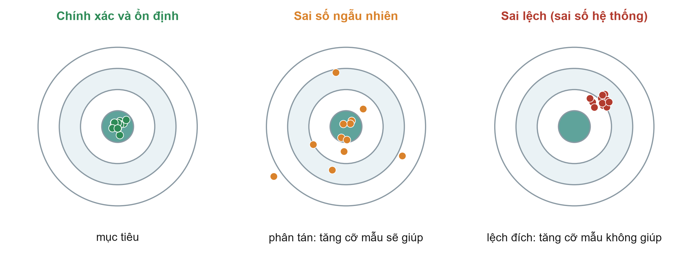{.neu-fig}

::: {.neu-takeaway}
**THÔNG ĐIỆP CHÍNH** Cỡ mẫu lớn làm giảm sai số ngẫu nhiên nhưng không động đến sai lệch.
:::

::: {.notes}
Cỡ mẫu lớn giảm sai số ngẫu nhiên, không giảm sai lệch. KTC hẹp không nói gì về sai lệch.

Bình chọn: 'Bài nào dễ bị sai số ngẫu nhiên, bài nào dễ bị sai lệch?' Mong đợi: Boulet (48 người) sai số ngẫu nhiên, Hyun (quan sát) sai lệch.

Thời gian: 2 phút.
:::

## Sai lệch chọn lựa: ai được đưa vào nghiên cứu?

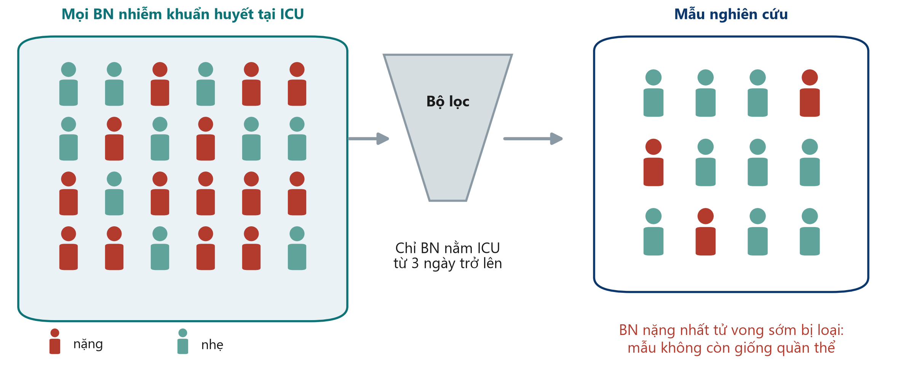{.neu-fig}

::: {.neu-takeaway}
**THÔNG ĐIỆP CHÍNH** Nếu mẫu khác quần thể đích, kết quả có thể không áp dụng được.
:::

::: {.notes}
Hyun chỉ chọn người bệnh còn ở ICU đến ngày 3 (2516/11981). Kết quả áp dụng cho nhóm này, không cho mọi người bệnh nhiễm khuẩn huyết.

Hỏi: 'Boulet sàng lọc 1201, chọn 50. Điều đó cho biết gì?' Mong đợi: người bệnh được chọn lọc nhiều. Kiểm tra họ có giống người bệnh của mình không.

Thời gian: 2.5 phút.
:::

## Sai lệch thông tin: đo lường thế nào

:::: {.neu-cards style="--n:3"}
::: {.neu-card .plain style="--c:#B5651D"}
[Sai lệch nhớ lại]{.neu-card-title}

- Ca bệnh cố nhớ kỹ hơn ca chứng
- vd. gia đình người tử vong nhớ những ngày trước khi nhập viện kỹ hơn
- **Khắc phục: dùng hồ sơ ghi trước khi có kết cục**
:::
::: {.neu-card .plain style="--c:#B23B2E"}
[Sai lệch người quan sát]{.neu-card-title}

- Người đánh giá biết nhóm sẽ đánh giá khác đi
- vd. 'đủ điều kiện ra khỏi ICU' trong thử nghiệm dịch truyền không làm mù
- **Khắc phục: làm mù người đánh giá, kết cục khách quan**
:::
::: {.neu-card .plain style="--c:#0070C0"}
[Sai lệch đo lường]{.neu-card-title}

- Dụng cụ hoặc ghi chép sai một cách hệ thống
- vd. lượng nước tiểu bị ghi thiếu ở ca đêm
- **Khắc phục: định nghĩa chuẩn, kiểm tra hồ sơ**
:::
::::

::: {.neu-takeaway}
**THÔNG ĐIỆP CHÍNH** Đo phơi nhiễm và kết cục theo cùng một cách ở mọi nhóm.
:::

::: {.notes}
Với câu hỏi của mình: ghi thiếu nước tiểu làm cân bằng dịch dương hơn thực tế. Nếu khác nhau giữa hai nhóm, phép so sánh bị sai lệch.

Hỏi: 'Giảm sai lệch người quan sát trong thử nghiệm dịch không làm mù thế nào?' Mong đợi: kết cục khách quan, người đánh giá được làm mù, định nghĩa chuẩn.

Thời gian: 2.5 phút.
:::

## Nhiễu do chỉ định: ví dụ dịch truyền ở ICU

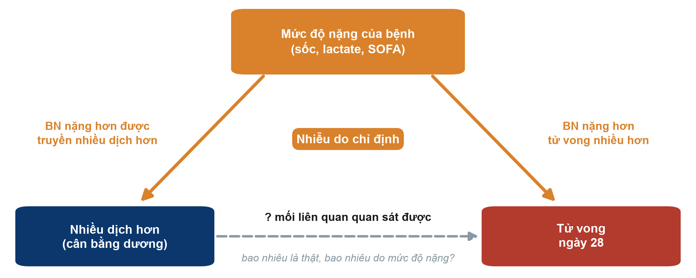{.neu-fig}

::: {.neu-caption}
SOFA: thang điểm đánh giá suy đa cơ quan (Sequential Organ Failure Assessment)
:::

::: {.neu-takeaway}
**THÔNG ĐIỆP CHÍNH** Yếu tố nhiễu liên quan với phơi nhiễm và là nguyên nhân của kết cục.
:::

::: {.notes}
Slide quan trọng nhất của phần 4.1. Chỉ từng mũi tên. Yếu tố nhiễu liên quan với phơi nhiễm, gây ra kết cục và không nằm trên đường nhân quả.

Hỏi: 'Dấu hiệu nào tại giường làm bạn truyền thêm dịch và dự báo tử vong?' Mong đợi: huyết áp thấp, lactate cao, liều vận mạch cao, da nổi vân.

Thời gian: 3.5 phút.
:::

## Yếu tố nhiễu bằng con số: mối liên quan biến mất

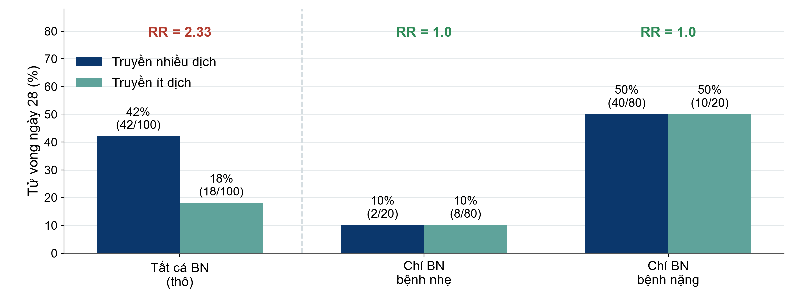{.neu-fig}

::: {.neu-caption}
Số liệu giả định dùng cho giảng dạy. RR: nguy cơ tương đối.
:::

::: {.neu-takeaway}
**THÔNG ĐIỆP CHÍNH** So sánh tương đồng: trong từng mức độ nặng, lượng dịch không tạo khác biệt.
:::

::: {.notes}
Số liệu giả định. RR thô 2.33. Trong từng mức độ nặng RR 1.0. 80/100 người nhiều dịch là ca nặng, nhưng chỉ 20/100 người ít dịch.

Đọc to: 2 + 40 = 42 ca tử vong, 8 + 10 = 18.

Hỏi: 'Cần đo gì lúc ban đầu để làm được việc này?' Mong đợi: SOFA, lactate, liều vận mạch, tuổi, bệnh kèm.

Thời gian: 3.5 phút.
:::

## Yếu tố nhiễu hay thay đổi tác động?

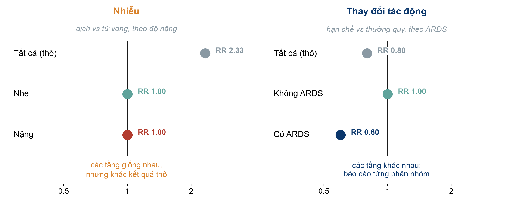{.neu-fig}

::: {.neu-caption}
Số liệu giả định dùng cho giảng dạy. RR: nguy cơ tương đối. ARDS: hội chứng suy hô hấp cấp tiến triển.
:::

::: {.neu-takeaway}
**THÔNG ĐIỆP CHÍNH** Nhiễu là sai lệch cần loại bỏ. Thay đổi tác động là phát hiện cần báo cáo.
:::

::: {.notes}
Các tầng giống nhau nhưng khác số thô: yếu tố nhiễu, cần hiệu chỉnh. Các tầng khác nhau: thay đổi tác động, báo cáo từng tầng.

Bình chọn: 'RR 0.95 khi thận bình thường, 0.60 khi tổn thương thận?' Mong đợi: thay đổi tác động.

Thời gian: 3 phút.
:::

## Thiết kế chống lại sai lệch như thế nào

::: {.neu-intro}
Phòng sai lệch ngay từ thiết kế. Xử lý phần còn lại khi phân tích
:::

:::: {.neu-cards style="--n:3"}
::: {.neu-card .plain style="--c:#0D7377"}
[Ngẫu nhiên và che giấu]{.neu-card-title}

- May rủi quyết định nhóm
- Cân bằng yếu tố nhiễu đã biết và chưa biết
- Không ai đoán được lần phân bổ kế tiếp
:::
::: {.neu-card .plain style="--c:#0B376C"}
[Làm mù]{.neu-card-title}

- Người bệnh, bác sĩ, người đánh giá, người phân tích
- Bảo vệ cách đo kết cục
- Nếu không thể: làm mù người đánh giá
:::
::: {.neu-card .plain style="--c:#0070C0"}
[Giới hạn, ghép cặp, hiệu chỉnh]{.neu-card-title}

- Giới hạn: thu hẹp tiêu chuẩn chọn
- Ghép cặp: ghép người bệnh tương tự
- Hiệu chỉnh: thống kê khi phân tích
- **[Chỉ với yếu tố nhiễu đã đo]{style="color:#B23B2E"}**
:::
::::

::: {.neu-takeaway}
**THÔNG ĐIỆP CHÍNH** Chỉ phân nhóm ngẫu nhiên bảo vệ trước yếu tố nhiễu chưa từng được đo.
:::

::: {.notes}
Chỉ phân bổ ngẫu nhiên cân bằng được điều chưa đo.

Bình chọn: 'Hyun dùng công cụ nào?' Mong đợi: giới hạn đối tượng và ghép cặp theo điểm xu hướng.

Thời gian: 2 phút.
:::

## Phân bổ ngẫu nhiên cân bằng cả điều đã biết và điều chưa biết

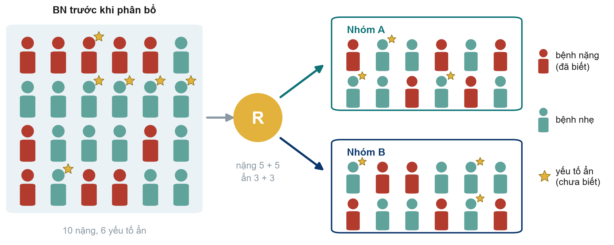{.neu-fig}

::: {.neu-caption}
R: phân nhóm ngẫu nhiên
:::

::: {.neu-takeaway}
**THÔNG ĐIỆP CHÍNH** Nhờ may rủi, hai nhóm có thành phần tương tự, kể cả yếu tố chưa ai đo.
:::

::: {.notes}
Cân bằng là tính trung bình. Boulet có creatinine ban đầu cao hơn ở một nhóm: với 24 người mỗi nhóm, điều này không lạ.

Hỏi: 'Vì sao 500 người tốt hơn 50?' Mong đợi: mất cân bằng do ngẫu nhiên tự bù trừ.

Thời gian: 1.5 phút.
:::

## Che giấu phân bổ trước, làm mù sau

:::: {.neu-cards style="--n:2"}
::: {.neu-card .plain style="--c:#055F56"}
[Trước: che giấu phân bổ]{.neu-card-title}

- Không ai đoán được lần phân bổ kế tiếp
- Bài báo 1 (Boulet): máy tính trung tâm
- Bảo vệ việc phân người bệnh vào từng nhóm
- Luôn làm được, luôn bắt buộc
:::
::: {.neu-card .plain style="--c:#0070C0"}
[Sau: làm mù trong Bài báo 1 (Boulet 2024)]{.neu-card-title}

- [Người bệnh: được làm mù]{style="color:#2E8B57"}
- [Bác sĩ điều trị: biết nhóm]{style="color:#B23B2E"}
- [Người đánh giá kết cục: biết nhóm]{style="color:#B23B2E"}
- [Nhà thống kê: được làm mù]{style="color:#2E8B57"}
:::
::::

::: {.neu-takeaway}
**THÔNG ĐIỆP CHÍNH** Che giấu phân bổ bảo vệ việc phân người bệnh vào nhóm. Làm mù bảo vệ cách đo kết cục.
:::

::: {.notes}
Trong Boulet, người bệnh và người phân tích thống kê được làm mù, bác sĩ thì không. Khi không làm mù được bác sĩ, làm mù người đánh giá và dùng kết cục khách quan.

Bình chọn: 'Không làm mù được thì có che giấu phân bổ được không?' Mong đợi: có, luôn luôn.

Thời gian: 2 phút.
:::

## Ghép cặp có ích, nhưng chỉ với điều đã được đo

::: {.neu-intro}
Bài báo 2 (Hyun 2023). SOFA: thang điểm đánh giá suy đa cơ quan
:::

:::: {.neu-cards style="--n:3"}
::: {.neu-card .plain style="--c:#0070C0"}
[Ghép cặp 1:1]{.neu-card-title}

- Mỗi người bệnh cân bằng dương ghép với một người bệnh cân bằng âm tương tự
- 483, 373 và 392 cặp cho ngày 1, 2 và 3
:::
::: {.neu-card .plain style="--c:#2E8B57"}
[Đã đo: được cân bằng]{.neu-card-title}

- Tuổi, giới, điểm SOFA, sốc nhiễm khuẩn
- Bệnh kèm, vị trí nhiễm khuẩn
- Lượng dịch ra
:::
::: {.neu-card .plain style="--c:#B23B2E"}
[Chưa đo: có thể vẫn khác]{.neu-card-title}

- Loại dịch, dinh dưỡng
- Nhận định lâm sàng tại giường của bác sĩ
- **Đây là nhiễu tồn dư**
:::
::::

::: {.neu-takeaway}
**THÔNG ĐIỆP CHÍNH** Ghép cặp và hiệu chỉnh không cân bằng được điều không ai ghi lại.
:::

::: {.notes}
Hyun không đo loại dịch và dinh dưỡng. Phần còn lại là nhiễu tồn dư, nên thuần tập vẫn chỉ nói 'có liên quan'.

Hỏi: 'Một yếu tố không đo được làm truyền thêm dịch và dự báo tử vong?' Mong đợi: ấn tượng lâm sàng về sốc, suy tim, thảo luận mục tiêu điều trị.

Thời gian: 2 phút.
:::

## Giá trị nội tại trước, rồi đến giá trị ngoại suy

:::: {.neu-cards style="--n:2"}
::: {.neu-card .plain style="--c:#0D7377"}
[Giá trị nội tại]{.neu-card-title}

- **Kết quả có đúng với những người được nghiên cứu?**
- Phân bổ ngẫu nhiên
- Che giấu phân bổ và làm mù
- Theo dõi đầy đủ
- Đo lường tốt
:::
::: {.neu-card .plain style="--c:#0070C0"}
[Giá trị ngoại suy]{.neu-card-title}

- **Có áp dụng cho người bệnh của tôi?**
- Boulet: 18-85 tuổi. ICU của tôi: nhiều người trên 85?
- Boulet: không lọc máu. ICU của tôi: có người đang lọc máu?
- Boulet: 3 ICU tại một quốc gia
- Boulet: chỉ 4% số được sàng lọc được đưa vào
:::
::::

::: {.neu-takeaway}
**THÔNG ĐIỆP CHÍNH** Trước hết: đúng với người được nghiên cứu? Sau đó: có áp dụng cho người bệnh của tôi?
:::

::: {.notes}
Kết quả sai lệch không áp dụng được ở đâu. Thử nghiệm đúng nhưng chọn lọc có thể không áp dụng cho khoa của bạn.

Hỏi: 'Nhóm người bệnh nào ở ICU của bạn không được vào thử nghiệm Boulet?' Mong đợi: trên 85 tuổi, lọc máu mạn, dùng vận mạch quá 24 giờ.

Thời gian: 2 phút.
:::

## Quan hệ nhân quả ngược: cái nào có trước?

:::: {.neu-cards style="--n:3"}
::: {.neu-card .plain style="--c:#0070C0"}
[Giả định thường gặp]{.neu-card-title}

- Cân bằng dịch dương làm hại thận
- Tổn thương thận rồi dẫn đến tử vong
:::
::: {.neu-card .plain style="--c:#B5651D"}
[Điều có thể thực sự xảy ra]{.neu-card-title}

- Thận suy tạo ít nước tiểu
- Ít dịch ra làm cân bằng dịch dương
- **Mũi tên chạy theo chiều ngược lại**
:::
::: {.neu-card .plain style="--c:#055F56"}
[Cách kiểm tra]{.neu-card-title}

- Cái nào có trước?
- Đo phơi nhiễm trước khi kết cục bắt đầu
- Dùng độ trễ thời gian
- Ưu tiên thuần tập hoặc RCT hơn nghiên cứu cắt ngang
:::
::::

::: {.neu-takeaway}
**THÔNG ĐIỆP CHÍNH** Trước khi nói X gây ra Y, hãy chắc rằng Y không gây ra X.
:::

::: {.notes}
Thận suy làm giảm nước tiểu, nên cân bằng dịch dương lên. Vì vậy Hyun ghép cặp cả theo lượng dịch ra.

Hỏi: 'Người bệnh sốc dùng nhiều vận mạch hơn và tử vong nhiều hơn. Mũi tên có thể đi chiều nào?' Mong đợi: cả hai chiều.

Thời gian: 2.5 phút.
:::

## Từ liên quan đến nhân quả: các quan điểm của Bradford Hill

| Quan điểm | Câu hỏi đặt ra | Áp dụng cho Bài báo 2 (Hyun 2023) |
|:---|:---|:---|
| Độ mạnh | Tác động có lớn không? | Vừa phải (HR khoảng 1.6 đến 2.1) |
| Tính nhất quán | Có lặp lại ở nghiên cứu và nơi khác? | Có, ở các thuần tập khác |
| Tính đặc hiệu | Một nguyên nhân, một hậu quả? (yếu nhất) | Không hữu ích ở đây |
| Trình tự thời gian | Nguyên nhân có xảy ra trước? (điều bắt buộc) | Cân bằng dịch đo trước tử vong, nhưng có thể có nhân quả ngược |
| Liều - đáp ứng | Phơi nhiễm nhiều hơn, tác động lớn hơn? | Chưa cho thấy |
| Tính hợp lý | Có cơ chế sinh học không? | Có: quá tải dịch, phù, sung huyết cơ quan |
| Tính mạch lạc | Có phù hợp với điều đã biết? | Phần lớn có |
| Thực nghiệm | Loại bỏ phơi nhiễm có làm giảm kết cục? | Các thử nghiệm như Boulet: chưa thấy tác động lên tử vong |
| Tương tự | Nguyên nhân tương tự có hậu quả tương tự? | Quá tải dịch gây hại ở bối cảnh khác |

::: {.neu-table-caption}
HR: tỷ số nguy cơ tức thời. Nhân quả là nhận định từ nhiều manh mối. Trình tự thời gian là điều bắt buộc duy nhất.
:::

::: {.notes}
Các quan điểm là manh mối, không phải bảng chấm điểm. Dừng ở trình tự thời gian (bắt buộc) và thực nghiệm (do RCT cung cấp).

Với Hyun: có thể, chưa chứng minh.

Bình chọn: 'Quan điểm nào RCT cho được mà thuần tập không cho được?' Mong đợi: thực nghiệm.

Thời gian: 4.5 phút.
:::

## Câu hỏi nhanh: Phát hiện sai lệch

::: {.neu-banner style="--c:#6C3483"}
CÂU HỎI NHANH · 5 phút
:::

:::: {.columns}
::: {.column width="60%"}
::: {.neu-activity-steps style="--c:#6C3483"}
- Gia đình người tử vong nhớ những ngày trước khi vào ICU kỹ hơn gia đình người sống sót
- Trong thử nghiệm dịch truyền không làm mù, bác sĩ biết nhóm quyết định khi nào người bệnh 'đủ điều kiện ra khỏi ICU'
- Một nghiên cứu về dịch truyền chỉ đưa vào người bệnh nằm ICU từ 3 ngày trở lên
- Người bệnh có lactate cao hơn được truyền nhiều dịch hơn và tử vong nhiều hơn
:::
:::
::: {.column width="40%"}
::: {.neu-side .plain style="--c:#6C3483"}
Bình chọn một

- Sai lệch chọn lựa
- Sai lệch nhớ lại
- Sai lệch người quan sát
- Yếu tố nhiễu
:::
:::
::::

::: {.neu-output style="--c:#6C3483"}
**SẢN PHẨM** Mỗi tình huống gọi tên một sai lệch, và nói một cách khắc phục
:::

::: {.notes}
Bốn câu bình chọn. Sau mỗi câu, mời một hai người đề xuất cách khắc phục.

Đáp án: 1 sai lệch nhớ lại (dùng hồ sơ ghi trước khi có kết cục). 2 sai lệch người quan sát (người đánh giá được làm mù). 3 sai lệch chọn lựa (chọn mọi người từ khi nhập viện, báo cáo số bị loại). 4 nhiễu do chỉ định (phân bổ ngẫu nhiên, hoặc đo mức độ nặng và hiệu chỉnh).

Thời gian: 5 phút. Kết thúc phần 4.1.
:::

## 4.2  Đo lường bệnh và mối liên quan

:::: {.neu-statement}
::: {.neu-big}
Phổ biến đến đâu? Khả năng cao hơn bao nhiêu?
:::

::: {.neu-sub}
Hiện mắc, mới mắc, nguy cơ, và bảng 2x2 đằng sau RR, OR, RD và NNT. (25 phút)
:::
::::

::: {.notes}
Phần 4.2: khoảng 17 phút slide, rồi 8 phút trình diễn.

Thời gian: 30 giây.
:::

## Hiện mắc và mới mắc: hình ảnh bồn tắm

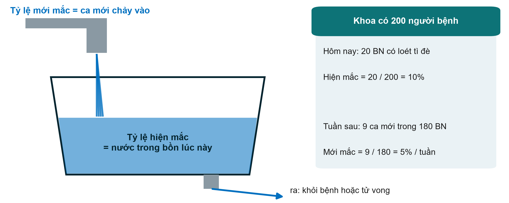{.neu-fig}

::: {.neu-takeaway}
**THÔNG ĐIỆP CHÍNH** Hiện mắc = bao nhiêu người đang mắc. Mới mắc = bao nhiêu ca mới theo thời gian.
:::

::: {.notes}
Mới mắc cần một khoảng thời gian, và mẫu số chỉ gồm người có nguy cơ.

Hỏi: 'Cân bằng dịch dương hôm nay: hiện mắc hay mới mắc? Tổn thương thận trong tuần đầu?' Mong đợi: hiện mắc, mới mắc.

Thời gian: 2.5 phút.
:::

## Nguy cơ ở hai nhóm, bằng hình ảnh

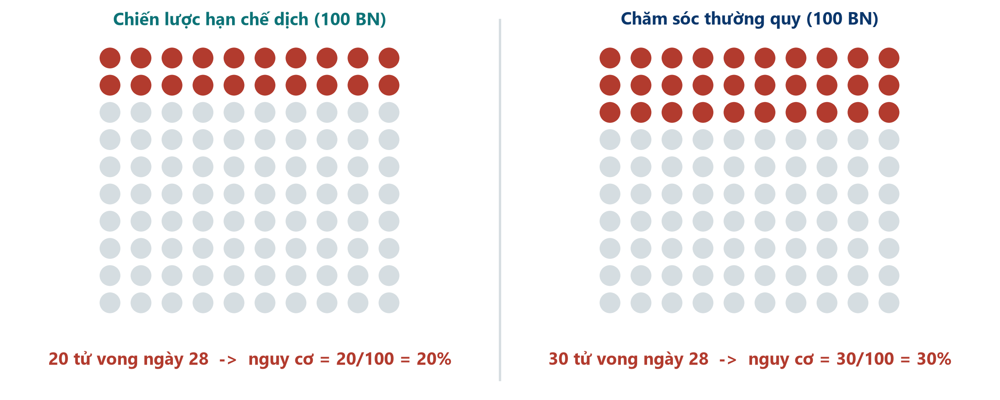{.neu-fig}

::: {.neu-caption}
Thử nghiệm giả định dùng cho giảng dạy: 100 người bệnh mỗi nhóm
:::

::: {.neu-takeaway}
**THÔNG ĐIỆP CHÍNH** Nguy cơ = số người có kết cục / số người trong nhóm.
:::

::: {.notes}
Thử nghiệm giả định, không phải Boulet. Luôn hỏi 'trên tổng số bao nhiêu?'.

Hỏi: 'Odds tử vong ở nhóm hạn chế dịch?' Mong đợi: 20 trên 80, tức 0.25.

Thời gian: 2.5 phút.
:::

## Bảng 2x2: một công cụ cho mọi số đo

| Thử nghiệm giả định | Tử vong | Sống | Tổng | Nguy cơ |
|:---|:---|:---|:---|:---|
| Hạn chế dịch | a = 20 | b = 80 | a + b = 100 | a / (a + b) = 20% |
| Thường quy | c = 30 | d = 70 | c + d = 100 | c / (c + d) = 30% |

::: {.neu-table-caption}
Luôn cùng một cách trình bày: phơi nhiễm ở hàng, nhóm phơi nhiễm (được điều trị) ở trên. Kết cục ở cột, 'có kết cục' (tử vong) ở bên trái. Khi đó a, b, c và d luôn mang cùng ý nghĩa.
:::

::: {.notes}
Giữ một cách trình bày: phơi nhiễm theo hàng (có phơi nhiễm ở trên), có kết cục ở cột trái. Phần lớn lỗi do vẽ bảng ngược.

Hỏi: 'Boulet, tử vong ngày 28: a, b, c, d?' Mong đợi: 6, 18, 6, 18.

Thời gian: 2.5 phút.
:::

## Bốn số đo từ một bảng 2x2

::: {.neu-intro}
Ví dụ: hạn chế dịch 20/100 tử vong, thường quy 30/100 tử vong
:::

:::: {.neu-cards style="--n:4"}
::: {.neu-card .plain style="--c:#0D7377"}
[Nguy cơ tương đối (RR)]{.neu-card-title}

- \[a/(a+b)\] / \[c/(c+d)\]
- **20% / 30% = 0.67**
- Nguy cơ thấp hơn một phần ba
:::
::: {.neu-card .plain style="--c:#0B376C"}
[Hiệu số nguy cơ (RD)]{.neu-card-title}

- a/(a+b) - c/(c+d)
- **20% - 30% = -10 điểm**
- Ít hơn 10 ca tử vong trên 100
:::
::: {.neu-card .plain style="--c:#2E8B57"}
[Số người cần điều trị (NNT)]{.neu-card-title}

- 1 / \|hiệu số nguy cơ\|
- **1 / 0.10 = 10**
- Điều trị 10 người để ngăn 1 ca tử vong
:::
::: {.neu-card .plain style="--c:#0070C0"}
[Tỷ số chênh (OR)]{.neu-card-title}

- (a x d) / (b x c)
- **(20 x 70) / (80 x 30) = 0.58**
- Odds, không phải nguy cơ
:::
::::

::: {.neu-takeaway}
**THÔNG ĐIỆP CHÍNH** Tỷ số cho biết mạnh đến đâu. Hiệu số cho biết bao nhiêu người bệnh.
:::

::: {.notes}
Đi từng thẻ, mỗi lần quay về bảng. 'Giảm một phần ba' và 'ít hơn 10 ca trên 100' là cùng một kết quả.

Hỏi: 'Nguy cơ nền 3%, cùng RR 0.67: NNT bao nhiêu?' Mong đợi: 2% so với 3%, NNT = 100.

Thời gian: 5 phút.
:::

## NNT (số người cần điều trị) bằng hình ảnh

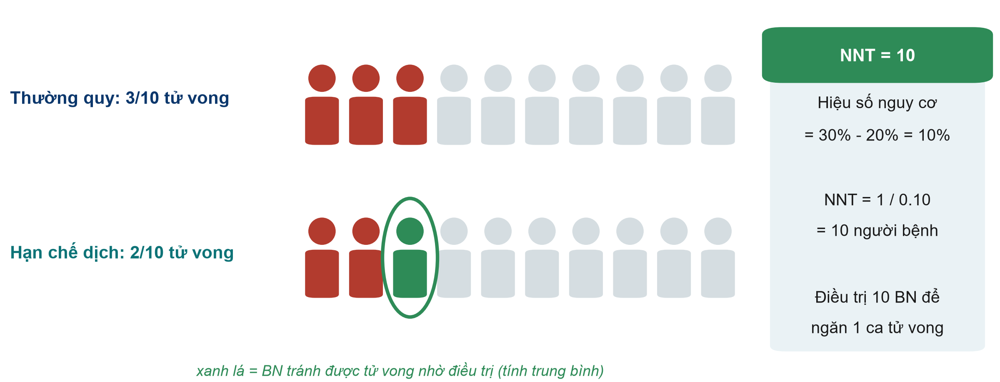{.neu-fig}

::: {.neu-takeaway}
**THÔNG ĐIỆP CHÍNH** NNT = 1 / hiệu số nguy cơ: cần điều trị bao nhiêu người để một người có lợi.
:::

::: {.notes}
9 người còn lại vẫn sống hoặc vẫn tử vong. NNT là trung bình, không phải dự đoán cho một người bệnh.

Bình chọn: 'NNT 5 hay 50 tốt hơn?' Mong đợi: 5.

Thời gian: 2.5 phút.
:::

## Khi nào tỷ số chênh gần bằng nguy cơ tương đối?

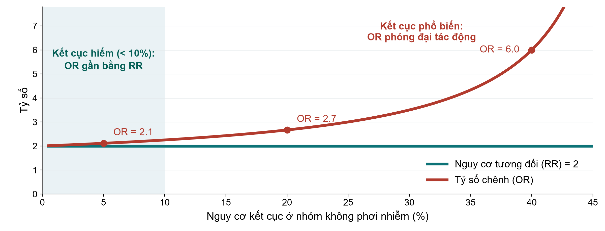{.neu-fig}

::: {.neu-takeaway}
**THÔNG ĐIỆP CHÍNH** OR chỉ gần bằng RR khi kết cục hiếm (dưới khoảng 10%).
:::

::: {.notes}
OR chỉ gần RR khi kết cục hiếm. Tử vong ở ICU là kết cục thường gặp.

Hỏi: 'OR của mình là 0.58, RR 0.67. Vì sao khác?' Mong đợi: tử vong thường gặp, nên OR phóng đại.

Thời gian: 1.5 phút.
:::

## Trình diễn trực tiếp: công cụ tính bảng 2x2

::: {.neu-banner style="--c:#B5651D"}
TRÌNH DIỄN TRỰC TIẾP · 8 phút
:::

:::: {.columns}
::: {.column width="60%"}
::: {.neu-activity-steps style="--c:#B5651D"}
- Giảng viên chia sẻ màn hình: 2x2\_calculator.xlsx, trang Association
- Nhập a, b, c, d của ví dụ: 20, 80, 30, 70
- Đọc nguy cơ, RR, RD, NNT, OR, và các câu diễn giải
- Đổi số tử vong thành 2 và 3 trên 100: xem OR tiến gần RR
- Chỉ vào dòng chữ đỏ: dữ liệu bệnh–chứng chỉ cho OR
:::
:::
::: {.column width="40%"}
::: {.neu-side .plain style="--c:#B5651D"}
Chú ý

- Cùng cách trình bày như slide
- Tác động tương đối và tuyệt đối
- Kết cục hiếm: OR gần RR
:::
:::
::::

::: {.neu-output style="--c:#B5651D"}
**SẢN PHẨM** Mọi người thấy mọi số đo được tính từ một bảng
:::

::: {.notes}
Kịch bản: s4\_demo\_VN.md. Tệp: 2x2\_calculator.xlsx, đã điền sẵn. Học viên chỉ xem. Gửi tệp qua email sau buổi học.

Điểm chính: a = 2, c = 3. RR vẫn 0.67, OR thành 0.66, NNT tăng lên 100.

Công cụ vẫn tính 'nguy cơ' cho dữ liệu bệnh-chứng, nhưng chỉ OR là có giá trị.

Nếu không chia sẻ được màn hình, tính RR và NNT bằng tay.

Thời gian: 8 phút. Sau đó giải lao.
:::

---

::: {style="text-align:center"}
{width="32%"}

[Giải lao]{style="color:#0D7377;font-size:1.6em;font-weight:700"}

[15 phút]{style="color:#595959;font-size:0.9em"}
:::

::: {.notes}
Giải lao 20:45-21:00. Nhắc chuẩn bị bút, giấy và máy tính. Chiếu đồng hồ đếm ngược.
:::

## Bài tập: cả lớp cùng làm hai bài tính bảng 2x2

::: {.neu-banner style="--c:#0D7377"}
CẢ LỚP CÙNG LÀM · 15 phút
:::

:::: {.columns}
::: {.column width="60%"}
::: {.neu-activity-steps style="--c:#0D7377"}
- Phiếu bài tập Buổi 4 (file PDF gửi trước buổi học), Phần C: vẽ mỗi bảng 2x2 trước, phơi nhiễm ở hàng
- Bài 1 (thử nghiệm dịch truyền, 200 người mỗi nhóm): nguy cơ, RR, RD, NNT, OR. Trả lời từng câu qua bình chọn
- Bài 2 (nghiên cứu bệnh–chứng về dịch truyền): chỉ tính OR. Bình chọn: có tính được RR không?
- Giảng viên kiểm tra trực tiếp từng đáp án bằng công cụ tính 2x2
- Một bạn tình nguyện nói mỗi kết quả bằng một câu dễ hiểu
:::
:::
::: {.column width="40%"}
::: {.neu-side .plain style="--c:#0D7377"}
Ghi nhớ

- Nguy cơ = a / (a + b)
- RR = nguy cơ / nguy cơ
- NNT = 1 / hiệu số nguy cơ
- OR = (a x d) / (b x c)
:::
:::
::::

::: {.neu-output style="--c:#0D7377"}
**SẢN PHẨM** Cả lớp giải xong hai bài, mỗi bài có một câu diễn giải dễ hiểu
:::

::: {.notes}
7 phút mỗi bài. Bình chọn từng bước và gõ bảng vào công cụ tính.

Bài 1: nguy cơ 10% và 15%, RR 0.67, RD -5 điểm, NNT 20, OR 0.63. Cùng RR, nguy cơ nền thấp hơn, nên NNT gấp đôi.

Bài 2: OR = (24 x 64) / (16 x 16) = 6.0. Không tính RR: nhà nghiên cứu tự chọn số ca bệnh và ca chứng. Hỏi về nhân quả ngược (thận suy).

Lỗi thường gặp là cách trình bày bảng. Đáp án: s4\_solutions\_VN, Phần C.
:::

## 4.3  Vượt ra ngoài một nghiên cứu

:::: {.neu-statement}
::: {.neu-big}
Một nghiên cứu hiếm khi là câu trả lời.
:::

::: {.neu-sub}
Xét nghiệm chẩn đoán, tổng quan hệ thống và phân tích gộp, và cách thẩm định chúng. (30 phút)
:::
::::

::: {.notes}
Phần 4.3: 30 phút, kể cả 8 phút bài biểu đồ rừng. Khoảng 2.5 phút mỗi slide.

Thời gian: 30 giây.
:::

## Độ chính xác chẩn đoán: nhìn lại độ nhạy và độ đặc hiệu

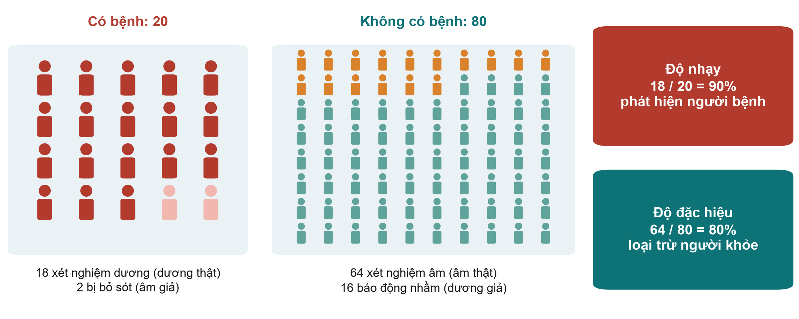{.neu-fig}

::: {.neu-takeaway}
**THÔNG ĐIỆP CHÍNH** Độ nhạy phát hiện người bệnh. Độ đặc hiệu loại trừ người khỏe.
:::

::: {.notes}
Xét nghiệm nhạy giúp loại trừ. Xét nghiệm đặc hiệu giúp khẳng định. PPV ở đây chỉ 53%.

Bình chọn: 'Sàng lọc không được bỏ sót nhiễm khuẩn huyết: ưu tiên độ nhạy hay độ đặc hiệu?' Mong đợi: độ nhạy.

Thời gian: 2.5 phút.
:::

## Cùng xét nghiệm, khác bối cảnh: PPV phụ thuộc tỷ lệ hiện mắc

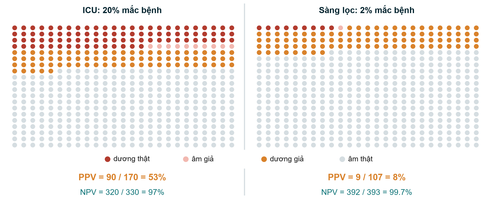{.neu-fig}

::: {.neu-caption}
PPV, NPV: giá trị tiên đoán dương và âm, khả năng một kết quả dương hoặc âm là đúng
:::

::: {.neu-takeaway}
**THÔNG ĐIỆP CHÍNH** Kết quả dương tính có ít ý nghĩa hơn nhiều khi bệnh hiếm gặp.
:::

::: {.notes}
PPV và NPV phụ thuộc tỷ lệ hiện mắc. Không mượn PPV từ bối cảnh khác.

Hỏi: 'Vì sao chương trình sàng lọc dùng xét nghiệm thứ hai đặc hiệu hơn?' Mong đợi: để loại dương tính giả.

Tùy chọn: chiếu ô 'PPV ở tỷ lệ hiện mắc khác' (s4\_demo\_VN.md, Phần 2).

Thời gian: 3 phút.
:::

## Đường cong ROC và AUC

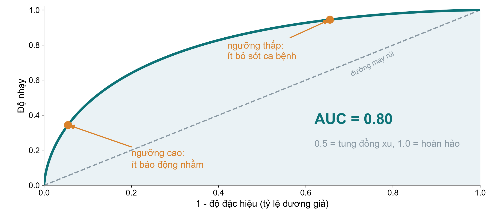{.neu-fig}

::: {.neu-caption}
ROC: đường cong đặc trưng hoạt động của xét nghiệm. AUC: diện tích dưới đường cong. Xét nghiệm mô phỏng.
:::

::: {.neu-takeaway}
**THÔNG ĐIỆP CHÍNH** Mỗi ngưỡng đổi độ nhạy lấy độ đặc hiệu. AUC tóm tắt toàn bộ đường cong.
:::

::: {.notes}
Ngưỡng tốt nhất tùy vào cái giá của bỏ sót so với báo động giả. AUC không chọn ngưỡng.

Bình chọn: 'Loại trừ nhiễm khuẩn huyết khi phân loại: ngưỡng lactate thấp hay cao?' Mong đợi: thấp.

Thời gian: 2.5 phút.
:::

## Sơ đồ PRISMA: từ 1300 bản ghi đến 9 nghiên cứu

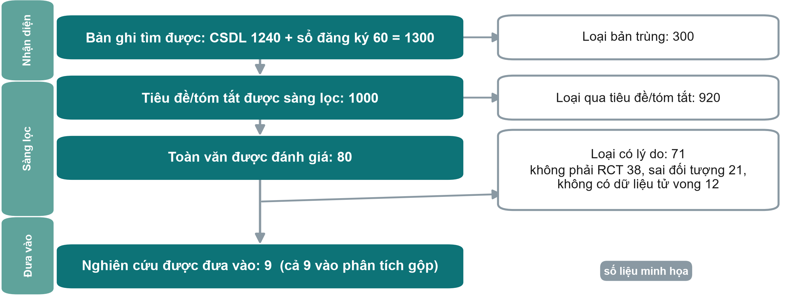{.neu-fig}

::: {.neu-caption}
PRISMA: hướng dẫn báo cáo tổng quan hệ thống và phân tích gộp. RCT: thử nghiệm ngẫu nhiên có đối chứng.
:::

::: {.neu-takeaway}
**THÔNG ĐIỆP CHÍNH** Sơ đồ PRISMA cho thấy cách tìm, sàng lọc và loại nghiên cứu, kèm lý do.
:::

::: {.notes}
Số liệu minh họa. Hai người sàng lọc độc lập. Đề cương được đăng ký trên PROSPERO.

Hỏi: 'Vì sao tìm cả sổ đăng ký thử nghiệm?' Mong đợi: thử nghiệm chưa công bố hoặc âm tính (sai lệch xuất bản).

Thời gian: 2.5 phút.
:::

## Đọc biểu đồ rừng (forest plot) trong bốn bước

{.neu-fig}

::: {.neu-caption}
RR: nguy cơ tương đối. KTC: khoảng tin cậy
:::

::: {.neu-takeaway}
**THÔNG ĐIỆP CHÍNH** Ô vuông = nghiên cứu, đường ngang = KTC, hình thoi = kết quả gộp, đường dọc = không tác động.
:::

::: {.notes}
Bốn bước: đường không tác động, hình vuông (trọng số), đường ngang (KTC), hình thoi: RR 0.79 (0.64-0.98).

Từng thử nghiệm đều cắt qua 1, nhưng kết quả gộp thì không. KTC cắt qua 1 là chưa chắc chắn, không phải không có tác động.

Chưa hỏi lớp: bài tập cuối phần 4.3 dùng biểu đồ này.

Thời gian: 3.5 phút.
:::

## Tính không đồng nhất (heterogeneity): các nghiên cứu có thống nhất?

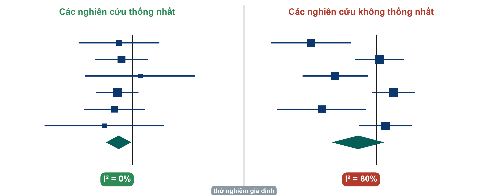{.neu-fig}

::: {.neu-caption}
I bình phương (i²): phần biến thiên giữa các nghiên cứu vượt quá mức may rủi
:::

::: {.neu-takeaway}
**THÔNG ĐIỆP CHÍNH** I bình phương cao nghĩa là các nghiên cứu bất đồng: tìm lý do trước khi tin hình thoi.
:::

::: {.notes}
Khi không đồng nhất cao, hỏi vì sao: người bệnh, liều, thời điểm, định nghĩa hay nguy cơ sai lệch. Mô hình hiệu ứng ngẫu nhiên chỉ làm KTC rộng ra.

Hỏi: 'Một lý do các thử nghiệm dịch truyền không thống nhất?' Mong đợi: quần thể, quy trình hoặc thời điểm khác nhau.

Thời gian: 3 phút.
:::

## Công cụ đánh giá nguy cơ sai lệch nào cho thiết kế nào?

| Nếu nghiên cứu là... | Thẩm định bằng | Báo cáo theo | Ví dụ trong khóa học |
|:---|:---|:---|:---|
| Thử nghiệm ngẫu nhiên | RoB 2 | CONSORT | Bài báo 1 (Boulet) |
| Nghiên cứu không ngẫu nhiên về một can thiệp | ROBINS-I | TREND hoặc STROBE |
| Thuần tập hoặc bệnh–chứng về một phơi nhiễm | Thang Newcastle-Ottawa (hoặc ROBINS-E) | STROBE | Bài báo 2 (Hyun) |
| Nghiên cứu độ chính xác chẩn đoán | QUADAS-2 | STARD |
| Tổng quan hệ thống | AMSTAR 2 | PRISMA |

::: {.neu-table-caption}
RoB 2: công cụ đánh giá nguy cơ sai lệch của Cochrane cho thử nghiệm ngẫu nhiên. ROBINS-I / -E: nguy cơ sai lệch trong nghiên cứu không ngẫu nhiên về can thiệp / phơi nhiễm. QUADAS-2: cho nghiên cứu chẩn đoán. AMSTAR 2: cho tổng quan hệ thống. Các hướng dẫn báo cáo được học ở Buổi 8.
:::

::: {.notes}
Hướng dẫn báo cáo kiểm tra điều đã báo cáo. Công cụ nguy cơ sai lệch đánh giá độ tin cậy. Đánh giá theo từng lĩnh vực, không cộng sao.

Bản một trang: Risk\_of\_Bias\_Tool\_Chooser.pdf.

Bình chọn: 'Nghiên cứu trước-sau về gói nhiễm khuẩn huyết: công cụ nào?' Mong đợi: ROBINS-I.

Thời gian: 2.5 phút.
:::

## Câu hỏi cuối: kết luận có được dữ liệu ủng hộ?

::: {.neu-intro}
Câu 7-9 trong bảng kiểm thẩm định 10 câu dùng ở Buổi 8
:::

:::: {.neu-cards style="--n:3"}
::: {.neu-card .plain style="--c:#0D7377"}
[Lời lẽ khớp thiết kế]{.neu-card-title}

- 'Gây ra' cần phân bổ ngẫu nhiên
- Quan sát: 'có liên quan với'
- Thí điểm: khả thi, không phải hiệu quả
:::
::: {.neu-card .plain style="--c:#0B376C"}
[Con số khớp lời lẽ]{.neu-card-title}

- Cỡ tác động kèm KTC 95%
- Tác động tương đối và tuyệt đối
- Không nói 'xu hướng' khi p = 0.42
:::
::: {.neu-card .plain style="--c:#B23B2E"}
[Trung thực, không tô vẽ]{.neu-card-title}

- Kết cục chính được báo cáo trước
- Nêu rõ hạn chế chính
- Kết luận dựa trên kết quả chính
:::
::::

::: {.neu-takeaway}
**THÔNG ĐIỆP CHÍNH** Đọc kết luận sau cùng, và đối chiếu với thiết kế và con số.
:::

::: {.notes}
Liên kết với bảng kiểm 10 câu ở Buổi 8 (Critical\_Appraisal\_Checklist.pdf).

Hỏi: 'Tìm một từ trong tiêu đề hay tóm tắt nói quá.' Mong đợi: 'impact', 'effect', 'reduces' trong nghiên cứu quan sát.

Thời gian: 2 phút.
:::

## Bài tập: đọc biểu đồ rừng, chọn công cụ

::: {.neu-banner style="--c:#0D7377"}
CẢ LỚP CÙNG LÀM · 8 phút
:::

:::: {.columns}
::: {.column width="60%"}
::: {.neu-activity-steps style="--c:#0D7377"}
- Phiếu bài tập Buổi 4 (PDF), Phần E: biểu đồ rừng của sáu thử nghiệm dịch truyền, cũng chiếu trên màn hình chia sẻ
- Bình chọn: thử nghiệm nào có trọng số lớn nhất?
- Bình chọn: có thử nghiệm riêng lẻ nào cho tác động rõ không?
- Bình chọn: hình thoi có cắt RR = 1 không? Nói kết quả bằng một câu
- Bình chọn: công cụ đánh giá sai lệch cho Bài báo 1 (Boulet), Bài báo 2 (Hyun) và một tổng quan về dịch truyền
:::
:::
::: {.column width="40%"}
::: {.neu-side .plain style="--c:#0D7377"}
Nhắc lại

- Ô vuông = một nghiên cứu
- Đường ngang = KTC 95%
- Hình thoi = kết quả gộp
- Công cụ: xem bảng ở hai slide trước
:::
:::
::::

::: {.neu-output style="--c:#0D7377"}
**SẢN PHẨM** Một câu chung của cả lớp về kết quả gộp, và ba công cụ được gọi tên
:::

::: {.notes}
Chiếu lại slide biểu đồ rừng khi lớp trả lời.

Đáp án: Thử nghiệm 4 có trọng số lớn nhất (38%). Mọi thử nghiệm đều cắt qua 1. Hình thoi thì không: nguy cơ tương đối thấp hơn khoảng 21%, giới hạn trên gần không tác động. Công cụ: RoB 2 cho Boulet, Newcastle-Ottawa hoặc ROBINS-E cho Hyun, AMSTAR 2 cho tổng quan.

Luôn nêu KTC cùng hình thoi. Nếu thiếu thời gian, chỉ làm câu về hình thoi và công cụ.

Đáp án: s4\_solutions\_VN, Phần E.

Thời gian: 8 phút. Kết thúc phần 4.3.
:::

## Kết cục: một kết cục chính, định nghĩa bằng cái gì, thế nào, khi nào

::: {.neu-intro}
Ví dụ xuyên suốt (phiên bản quan sát)
:::

:::: {.neu-cards style="--n:4"}
::: {.neu-card .plain style="--c:#B23B2E"}
[Cái gì]{.neu-card-title}

- Tử vong do mọi nguyên nhân
- Không phải 'cải thiện tử vong'
:::
::: {.neu-card .plain style="--c:#0070C0"}
[Đo thế nào]{.neu-card-title}

- Hồ sơ bệnh viện
- Gọi điện nếu đã ra viện
:::
::: {.neu-card .plain style="--c:#0D7377"}
[Khi nào]{.neu-card-title}

- Ngày 28 sau khi vào ICU
- Cùng một mốc cho mọi người bệnh
:::
::: {.neu-card .plain style="--c:#5FA39B"}
[2-3 kết cục phụ]{.neu-card-title}

- Tổn thương thận cấp đến ngày 7
- Số ngày không thở máy đến ngày 28
- Thời gian nằm ICU
:::
::::

::: {.neu-takeaway}
**THÔNG ĐIỆP CHÍNH** Chọn kết cục chính trước khi thấy dữ liệu, và báo cáo nó đầu tiên.
:::

::: {.notes}
Xây dựng đề cương 4 bắt đầu ở đây (slide này 2 phút, rồi 38 phút).

Nhiều kết cục chính dễ dẫn đến chọn kết quả có lợi.

Hỏi: 'Viết lại cải thiện kết cục người bệnh thành một kết cục chính.' Mong đợi: ví dụ lọc máu mới trước ngày 28 sau khi vào ICU, theo hồ sơ ICU.

Thời gian: 2 phút.
:::

## Xây dựng đề cương 4: phơi nhiễm, kết cục và sai lệch

::: {.neu-banner style="--c:#055F56"}
XÂY DỰNG ĐỀ CƯƠNG · 40 phút
:::

:::: {.columns}
::: {.column width="60%"}
::: {.neu-activity-steps style="--c:#055F56"}
- Theo dõi: giảng viên viết trực tiếp Phần 2b cho ví dụ xuyên suốt (15 phút)
- Phơi nhiễm hoặc can thiệp, và nhóm so sánh: chính xác là gì, bao nhiêu, khi nào
- Một kết cục chính (cái gì, thế nào, khi nào) và 2-3 kết cục phụ
- Hai sai lệch chính, một biện pháp cụ thể cho mỗi sai lệch, và 'gây ra' hay 'có liên quan'
- Đến lượt bạn: viết nháp phần này cho câu hỏi của chính mình (16 phút, làm riêng, yên lặng)
- Ba bạn tình nguyện đọc to một sai lệch và biện pháp để nhận góp ý (7 phút)
:::
:::
::: {.column width="40%"}
::: {.neu-side .plain style="--c:#055F56"}
Tự kiểm tra bản nháp

- Có nêu nhóm so sánh?
- Chỉ một kết cục chính?
- Kết cục có mốc thời gian?
- Nhiễu do chỉ định?
- Mỗi sai lệch có biện pháp cụ thể?
:::
:::
::::

::: {.neu-output style="--c:#055F56"}
**SẢN PHẨM** Phần 2 đề cương của chính bạn hoàn chỉnh (2a từ Buổi 3, 2b hôm nay). Hoàn thành ở nhà
:::

::: {.notes}
15 phút: điền Phần 2b cho ví dụ xuyên suốt trên màn hình. 16 phút: mỗi người tự viết. 7 phút: ba bạn tình nguyện đọc một sai lệch và cách khắc phục.

Mẫu: phơi nhiễm cân bằng dịch dương ở 72 giờ, so sánh với bằng 0 hoặc âm, kết cục chính tử vong đến ngày 28. Sai lệch: mức độ nặng (hiệu chỉnh hoặc ghép cặp), chọn lựa (người bệnh liên tiếp), thông tin (kiểm tra lại 10% hồ sơ). Bản đầy đủ trong s4\_solutions\_VN, Phần F.

Chú ý: thiếu nhóm so sánh, ba kết cục chính, 'chúng tôi sẽ cẩn thận' không phải là cách khắc phục.

Nhắc khi còn 10 phút và 2 phút.
:::

## Buổi 4 trong một slide

:::: {.neu-cards style="--n:4"}
::: {.neu-card .plain style="--c:#B23B2E"}
[4.1 Tin cậy]{.neu-card-title}

- Sai lệch: cỡ mẫu không sửa được
- Yếu tố nhiễu: loại bỏ
- Thay đổi tác động: báo cáo
:::
::: {.neu-card .plain style="--c:#0D7377"}
[4.2 Độ lớn]{.neu-card-title}

- Tương đối: RR, OR
- Tuyệt đối: RD, NNT
- OR gần RR chỉ khi kết cục hiếm
:::
::: {.neu-card .plain style="--c:#0B376C"}
[4.3 Nhiều nghiên cứu]{.neu-card-title}

- PPV phụ thuộc tỷ lệ hiện mắc
- Biểu đồ rừng: đọc hình thoi
- Đúng công cụ cho thiết kế
:::
::: {.neu-card .plain style="--c:#055F56"}
[Đề cương của bạn]{.neu-card-title}

- Phần 2 hoàn chỉnh
- Gây ra hay có liên quan?
:::
::::

::: {.neu-takeaway}
**THÔNG ĐIỆP CHÍNH** Tin trước, rồi đến độ lớn, và kiểm tra lời lẽ có khớp với thiết kế.
:::

::: {.notes}
Mời bốn bạn tình nguyện giải thích mỗi người một thẻ. Mỗi đề cương giờ đã có Phần 1 và Phần 2.

Thời gian: 2 phút.
:::

## Tổng kết và bài về nhà

::: {.neu-banner style="--c:#1F5C7A"}
THẢO LUẬN · 5 phút
:::

::: {.neu-activity-steps style="--c:#1F5C7A"}
- Câu hỏi cuối buổi (trong chat): người bệnh ICU được truyền nhiều dịch hơn tử vong nhiều hơn. Nêu một lý do khác ngoài bản thân dịch truyền
- Bài về nhà: hoàn thành Phần 2 đề cương của bạn (phơi nhiễm, so sánh, kết cục, sai lệch)
- Tùy chọn: phiếu bài tập Phần B và D (thay đổi tác động, PPV ở hai bối cảnh)
- Thứ Bảy tuần sau (Buổi 5): dữ liệu, và bộ dữ liệu khóa học FLUID-ICU
:::

::: {.neu-output style="--c:#1F5C7A"}
**SẢN PHẨM** Mỗi người một câu trả lời cuối buổi, trong khung chat
:::

::: {.notes}
Đáp án câu hỏi cuối buổi: nhiễu do chỉ định, hoặc nhân quả ngược (thận suy).

Mở đầu Buổi 5 bằng ba câu trả lời (ẩn tên).

Giới thiệu trước: Tuần 5-6 chuyển thiết kế thành dữ liệu và giới thiệu FLUID-ICU. Ở Buổi 6, mỗi người chọn một câu hỏi (Q1-Q5) để viết phần Kết quả.

Thời gian: 3 phút. Kết thúc lúc 22:30.
:::

## Slide bổ sung: Buổi 4

:::: {.neu-statement}
::: {.neu-big}
Slide bổ sung: Buổi 4
:::

::: {.neu-sub}
Dùng nếu còn thời gian, hoặc để tự học
:::
::::

::: {.notes}
Tùy chọn. Dùng nếu còn thời gian, hoặc để tự học.
:::

## Luyện thêm (ví dụ khác): sai lệch nào?

::: {.neu-banner style="--c:#6C3483"}
CÂU HỎI NHANH · 2 phút
:::

:::: {.columns}
::: {.column width="60%"}
::: {.neu-activity-steps style="--c:#6C3483"}
- A. Chỉ phỏng vấn những người bệnh sống đến lúc ra viện về chăm sóc tại ICU
- B. Điều dưỡng biết người bệnh thuộc nhóm nào chấm điểm đau
- C. Một cái cân luôn chỉ cao 0.5 kg chỉ được dùng ở một khoa
:::
:::
::: {.column width="40%"}
::: {.neu-side .plain style="--c:#6C3483"}
Chọn

- Sai lệch chọn lựa
- Sai lệch người quan sát
- Sai lệch đo lường
:::
:::
::::

::: {.neu-output style="--c:#6C3483"}
**SẢN PHẨM** Mỗi câu một sai lệch (đáp án trong ghi chú)
:::

::: {.notes}
Đáp án: A sai lệch chọn lựa. B sai lệch người quan sát. C sai lệch đo lường, làm sai phép so sánh vì chỉ xảy ra ở một khoa.

Thời gian: 2 phút nếu dùng.
:::

## Ví dụ khác: tìm yếu tố nhiễu

::: {.neu-intro}
Trong mỗi ví dụ, một yếu tố thứ ba chi phối cả phơi nhiễm lẫn kết cục
:::

:::: {.neu-cards style="--n:3"}
::: {.neu-card .plain style="--c:#0D7377"}
[Kháng sinh và tử vong]{.neu-card-title}

- Nhiều kháng sinh, nhiều tử vong?
- **Yếu tố nhiễu: độ nặng nhiễm khuẩn**
- Người bệnh nặng hơn dùng nhiều thuốc hơn
:::
::: {.neu-card .plain style="--c:#0B376C"}
[Dinh dưỡng và sụt cân]{.neu-card-title}

- Được chuyên gia dinh dưỡng khám, sụt cân nhiều hơn?
- **Yếu tố nhiễu: suy dinh dưỡng khi vào viện**
- Chính là lý do được giới thiệu
:::
::: {.neu-card .plain style="--c:#B23B2E"}
[Vận mạch và rối loạn nhịp]{.neu-card-title}

- Dùng vận mạch, nhiều rối loạn nhịp hơn?
- **Yếu tố nhiễu: mức độ sốc**
- Một phần cũng do thuốc
:::
::::

::: {.neu-takeaway}
**THÔNG ĐIỆP CHÍNH** Hỏi: vì sao những người bệnh này nhận phơi nhiễm? Lý do đó có thể là yếu tố nhiễu.
:::

::: {.notes}
Hỏi yếu tố thứ ba trước khi hiện đáp án. Thẻ 3 vừa có tác động thật vừa có nhiễu.

Thời gian: 2 phút nếu dùng.
:::

## Tỷ số khả dĩ (LR) và báo cáo nghiên cứu chẩn đoán

::: {.neu-intro}
Cùng xét nghiệm: độ nhạy 90%, độ đặc hiệu 80%
:::

:::: {.neu-cards style="--n:3"}
::: {.neu-card .plain style="--c:#B23B2E"}
[LR+ (xét nghiệm dương)]{.neu-card-title}

- độ nhạy / (1 - độ đặc hiệu)
- **0.90 / 0.20 = 4.5**
- Kết quả dương gặp ở người bệnh nhiều gấp 4.5 lần
:::
::: {.neu-card .plain style="--c:#0D7377"}
[LR- (xét nghiệm âm)]{.neu-card-title}

- (1 - độ nhạy) / độ đặc hiệu
- **0.10 / 0.80 = 0.13**
- LR trên 10 hoặc dưới 0.1 thay đổi quyết định nhiều nhất
:::
::: {.neu-card .plain style="--c:#0B376C"}
[Báo cáo và thẩm định]{.neu-card-title}

- STARD: bảng kiểm báo cáo và sơ đồ luồng
- QUADAS-2: nguy cơ sai lệch
- Thử trên đúng người bệnh sẽ dùng xét nghiệm
:::
::::

::: {.neu-takeaway}
**THÔNG ĐIỆP CHÍNH** Tỷ số khả dĩ không đổi theo tỷ lệ hiện mắc. Giá trị tiên đoán thì có.
:::

::: {.notes}
Chỉ giới thiệu khái niệm. LR+ 4.5, LR- 0.13. LR không phụ thuộc tỷ lệ hiện mắc. Báo cáo: STARD. Đánh giá: QUADAS-2.

Thời gian: 1.5 phút nếu dùng.
:::

## Biểu đồ đèn giao thông RoB 2

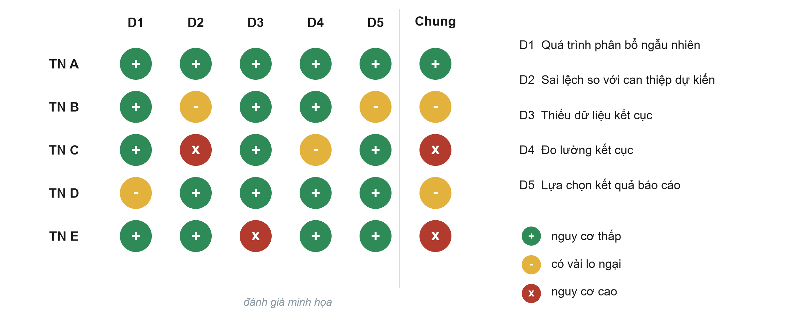{.neu-fig}

::: {.neu-caption}
RoB 2: công cụ đánh giá nguy cơ sai lệch của Cochrane cho thử nghiệm ngẫu nhiên. D1-D5: năm lĩnh vực. Đánh giá minh họa.
:::

::: {.neu-takeaway}
**THÔNG ĐIỆP CHÍNH** Đánh giá từng lĩnh vực. Nguy cơ chung do lĩnh vực xấu nhất quyết định.
:::

::: {.notes}
Minh họa. Lĩnh vực kém nhất quyết định đánh giá chung. Boulet: D1 có lẽ thấp, D2 có vài lo ngại, D4 thấp với cân bằng dịch.

Không làm mù chưa chắc là nguy cơ cao.

Thời gian: 1.5 phút nếu dùng.
:::

## Ví dụ: hiện mắc hay mới mắc?

:::: {.neu-steps}
::: {.neu-step style="--c:#0D7377"}
[Hôm nay]{.neu-step-label}

- 200 người bệnh ở khoa, 20 người có loét tì đè
- Hiện mắc 10%
:::
::: {.neu-step style="--c:#0B376C"}
[Có nguy cơ]{.neu-step-label}

- 180 người bệnh chưa bị loét
:::
::: {.neu-step style="--c:#5FA39B"}
[Một tuần]{.neu-step-label}

- 9 người bị loét mới
:::
::: {.neu-step style="--c:#0070C0"}
[Mới mắc]{.neu-step-label}

- 9 / 180 = 5% mỗi tuần
- Mẫu số: chỉ người có nguy cơ
:::
::::

::: {.neu-takeaway}
**THÔNG ĐIỆP CHÍNH** Tỷ lệ mới mắc luôn có khoảng thời gian và chỉ tính người có nguy cơ.
:::

::: {.notes}
Khác biệt nằm ở mẫu số: mọi người hôm nay (200) so với người có nguy cơ (180) trong một khoảng thời gian.

Thời gian: 1.5 phút nếu dùng.
:::
