# Buổi 6 · Phân tích: từ mẫu đến câu trả lời

## Tuần 6 · Thứ Bảy

- Câu hỏi ôn tập Buổi 5 (10 phút)
- 6.1 Từ mẫu đến quần thể: KTC, giá trị p, một phía hay hai phía, lực thống kê, cỡ mẫu, chọn kiểm định
- 6.2 So sánh các nhóm trong bộ dữ liệu khóa học (trình diễn R)
- 6.3 Mối liên quan và mô hình: hồi quy, Kaplan-Meier và Cox
- 6.4 Mô hình hóa bộ dữ liệu: OR đã hiệu chỉnh, HR từ mô hình Cox, dữ liệu bị thiếu, SAP
- Xây dựng đề cương 6: cỡ mẫu, kế hoạch phân tích, kế hoạch xử lý dữ liệu thiếu

::: {.notes}
Buổi 6 (19:30-22:30, giải lao 20:40-20:55). Buổi nặng về kỹ thuật nhất: đi chậm, bỏ trang bổ sung, không bỏ câu kiểm tra.

FLUID-ICU xuất hiện lại ở 6.2 (so sánh) và 6.4 (mô hình, sống còn, dữ liệu thiếu): Q1 đầy đủ, Q2 đến Q5 ngắn gọn.

Cuối buổi, mỗi học viên chọn một câu hỏi để viết phần Kết quả và nhận hướng dẫn bài tập bản thảo.
:::

## Ôn tập: Buổi 5 trong ba câu hỏi

::: {.neu-banner style="--c:#6C3483"}
CÂU HỎI NHANH · 10 phút
:::

:::: {.columns}
::: {.column width="60%"}
::: {.neu-activity-steps style="--c:#6C3483"}
- C1. Thời gian nằm ICU của 300 người bệnh lệch phải. Đưa cách tóm tắt nào vào Bảng 1?
- C2. Một mục CRF ghi 'Lactat: \_\_\_\_'. Nêu hai điều còn thiếu.
- C3. Trong dữ liệu thô FLUID-ICU, có một tuổi là 210. Phép kiểm tra nào bắt được, và ghi gì vào nhật ký làm sạch?
- C1 qua bình chọn. C2 và C3: hai ba người trả lời, bật micro (mỗi câu 1 đến 2 phút)
:::
:::
::: {.column width="40%"}
::: {.neu-side .plain style="--c:#6C3483"}
Đáp án (công bố sau)

- C1: trung vị (IQR)
- C2: đơn vị (mmol/L), thời điểm, lựa chọn 'không làm'
- C3: kiểm tra khoảng giá trị. Giá trị, cách sửa, lý do, ai và khi nào
:::
:::
::::

::: {.neu-output style="--c:#6C3483"}
**SẢN PHẨM** Mọi người nắm lại loại dữ liệu, mục CRF và làm sạch dữ liệu
:::

::: {.notes}
Ôn tập (19:30-19:40). Q1 bằng thăm dò, Q2 và Q3: mời hai hoặc ba người trả lời. Rồi mở đáp án.

Q1: trung vị (IQR). Q2: đơn vị, thời điểm, lựa chọn 'không làm'. Q3: kiểm tra khoảng giá trị. Nhật ký ghi mã người bệnh, giá trị, việc đã làm, lý do, ai làm và khi nào.

Trước đó, đọc ba hoặc bốn câu trả lời cuối Buổi 5 và sửa các hiểu lầm.
:::

## 6.1 Từ mẫu đến quần thể

:::: {.neu-statement}
::: {.neu-big}
Nghiên cứu một ít người bệnh để hiểu về rất nhiều người bệnh.
:::

::: {.neu-sub}
6.1 Từ mẫu đến quần thể  \|  40 phút
:::
::::

::: {.notes}
Phần 6.1 (19:40-20:20).

Ta nghiên cứu một mẫu và dùng thống kê để nói câu trả lời có thể cách sự thật bao xa.

Trấn an: đọc đúng KTC và giá trị p đã là hơn nhiều tác giả có bài đăng.
:::

## Khoảng tin cậy qua 20 lần lặp lại nghiên cứu

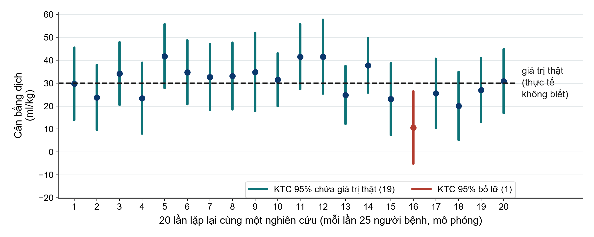{.neu-fig}

::: {.neu-takeaway}
**THÔNG ĐIỆP CHÍNH** Khoảng 95/100 khoảng như vậy chứa giá trị thật. Không biết được là khoảng nào.
:::

::: {.notes}
Hình quan trọng nhất tối nay. Cùng một nghiên cứu lặp 20 lần, mỗi lần 25 người bệnh: 19 khoảng chứa giá trị thật, một khoảng trượt. Đó là ý nghĩa của '95%'.

Ngoài đời, ta chỉ thấy một khoảng và không bao giờ thấy đường nét đứt.

Cách nói an toàn: 'một khoảng các giá trị hợp lý'.

Hỏi: điều gì làm khoảng ngắn lại? Kỳ vọng: nhiều người bệnh hơn, ít biến thiên hơn.
:::

## Giá trị p trong một hình

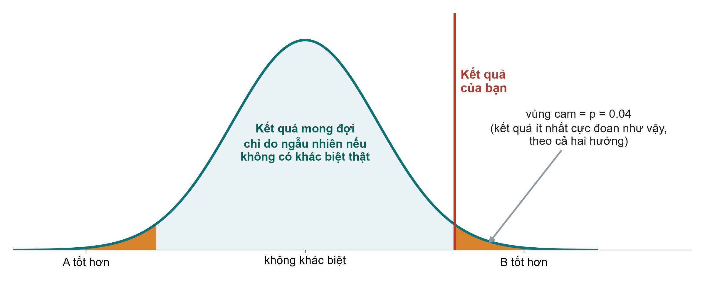{.neu-fig}

::: {.neu-takeaway}
**THÔNG ĐIỆP CHÍNH** p = kết quả của bạn đáng ngạc nhiên đến đâu nếu thực sự không có khác biệt.
:::

::: {.notes}
Hãy hình dung không có khác biệt thật (H0): riêng sự ngẫu nhiên đã làm kết quả dao động quanh số 0. Giá trị p là vùng màu cam: các kết quả ít nhất cũng cực đoan như kết quả của ta.

p = 0.04: đáng ngạc nhiên nếu không có khác biệt. p = 0.42 (Bài báo 1): không đáng ngạc nhiên, nhưng không chứng minh là không có khác biệt.

0.05 chỉ là quy ước: 0.049 và 0.051 là cùng một mức bằng chứng.
:::

## Một phía hay hai phía? Mặc định là hai phía

::: {.neu-intro}
H0 (giả thuyết không): không có khác biệt. H1 (giả thuyết đối): có khác biệt. Chiều của H1 quyết định đuôi nào được tính.
:::

:::: {.neu-cards style="--n:3"}
::: {.neu-card .plain style="--c:#0D7377"}
[Hai phía (mặc định)]{.neu-card-title}

- H1: hai nhóm khác nhau, theo bất kỳ hướng nào
- Có lợi và có hại đều được tính
- Giá trị p dùng cả hai đuôi
:::
::: {.neu-card .plain style="--c:#B5651D"}
[Một phía (hiếm khi hợp lý)]{.neu-card-title}

- H1: chỉ một hướng, ví dụ 'hạn chế dịch tốt hơn'
- Cần lý do vững, viết ra trước khi có dữ liệu
- Cùng dữ liệu cho giá trị p chỉ bằng khoảng một nửa
:::
::: {.neu-card .plain style="--c:#0B376C"}
[Không phải 'không kém hơn']{.neu-card-title}

- Thử nghiệm không kém hơn là một thiết kế khác
- Có ngưỡng định trước (Buổi 3)
- Cần cách tính cỡ mẫu và phân tích riêng
:::
::::

::: {.neu-takeaway}
**THÔNG ĐIỆP CHÍNH** Hãy dùng kiểm định hai phía. Chọn kiểm định một phía sau khi đã xem dữ liệu là không chấp nhận được.
:::

::: {.notes}
Mặc định là hai phía: lợi ích và tác hại đều được tính. Bài báo 1 và SAP của FLUID-ICU dùng kiểm định hai phía.

Một phía làm giá trị p giảm một nửa: chỉ chấp nhận khi có lý do ghi trước khi có dữ liệu. Đổi sau khi xem kết quả là p-hacking.

Không kém hơn là một thiết kế khác, có ngưỡng riêng.

Thăm dò: 'p một phía = 0.03' không giải thích lý do. Có thuyết phục không? Kỳ vọng: không.

Thời gian: 3 phút.
:::

## Năm cách hiểu sai giá trị p thường gặp

::: {.neu-intro}
Mỗi câu dưới đây đều xuất hiện trong các bài báo đã đăng. Tất cả đều sai. (H0 = giả thuyết không: không có khác biệt.)
:::

:::: {.neu-cards style="--n:5"}
::: {.neu-card .plain style="--c:#0D7377"}
['Xác suất H0']{.neu-card-title}

- p không phải xác suất không có tác động
:::
::: {.neu-card .plain style="--c:#0B376C"}
['Tác động lớn']{.neu-card-title}

- p nhỏ không có nghĩa tác động lớn hay quan trọng
:::
::: {.neu-card .plain style="--c:#5FA39B"}
['Không tác động']{.neu-card-title}

- p \> 0.05 không chứng minh không có tác động
:::
::: {.neu-card .plain style="--c:#0070C0"}
['Xu hướng']{.neu-card-title}

- p = 0.08 không phải 'gần có ý nghĩa'
:::
::: {.neu-card .plain style="--c:#055F56"}
['Chỉ có p']{.neu-card-title}

- Chỉ có p là không đủ
- Cần độ lớn tác động và KTC 95%
:::
::::

::: {.neu-takeaway}
**THÔNG ĐIỆP CHÍNH** Báo cáo độ lớn tác động kèm KTC 95%. Giá trị p chỉ là thông tin phụ.
:::

::: {.notes}
Cho thăm dò đúng/sai nhanh với từng thẻ trước khi giải thích.

1: p giả định H0, không phải xác suất của H0. 2: p rất nhỏ vẫn có thể đi với tác động không đáng kể. 3: Bài báo 1, p = 0.42 với KTC rộng nghĩa là 'chưa biết'. 4: không dùng 'xu hướng'. 5: nêu tác động và KTC, như Bài báo 2 (HR 2.13, 1.48-3.06).

Cũng có trong Bài 1.
:::

## Kiểm tra nhanh: KTC và giá trị p

::: {.neu-banner style="--c:#6C3483"}
CÂU HỎI NHANH · 3 phút
:::

:::: {.columns}
::: {.column width="60%"}
::: {.neu-activity-steps style="--c:#6C3483"}
- 'Tỷ số nguy cơ tức thời (HR) 2.13, khoảng tin cậy 95% (KTC 95%) 1.48 đến 3.06': dữ liệu phù hợp với HR thật từ khoảng 1.5 đến 3.1. Đúng hay sai?
- 'p = 0.42, vậy hai chiến lược tương đương.' Đúng hay sai?
- 'p = 0.03 nghĩa là có 3% khả năng không có tác động.' Đúng hay sai?
- 'Nghiên cứu lớn hơn thường cho KTC hẹp hơn.' Đúng hay sai?
:::
:::
::: {.column width="40%"}
::: {.neu-side .plain style="--c:#6C3483"}
Đáp án

- Đúng
- Sai: chưa biết
- Sai: p giả định không có tác động
- Đúng
:::
:::
::::

::: {.neu-output style="--c:#6C3483"}
**SẢN PHẨM** Mọi người đọc được KTC và tránh các lỗi kinh điển về giá trị p
:::

::: {.notes}
Kiểm tra (3 phút), mỗi câu một thăm dò đúng/sai.

1 đúng. 2 sai: không có bằng chứng không phải là bằng chứng không có. 3 sai: p giả định không có tác động. 4 đúng.

Nếu lớp chia đôi ở câu 2 hoặc 3, quay lại hình giá trị p.
:::

## Sai lầm loại I và loại II: chuông báo cháy

| Có cháy (tác động thật) | Không có cháy (không có tác động thật) |
|:---|:---|
| Chuông reo (p \< 0.05, 'có ý nghĩa') | Báo đúng: lực thống kê (mục tiêu 80-90%) | Báo động giả: sai lầm loại I (alpha, thường 5%) |
| Chuông im (p từ 0.05 trở lên) | Bỏ sót đám cháy: sai lầm loại II (beta) | Im lặng đúng |

::: {.neu-table-caption}
Alpha = nguy cơ báo động giả. Lực thống kê = khả năng phát hiện tác động thật. Chuông kém nhạy hơn (alpha nhỏ hơn) thì ít báo động giả nhưng bỏ sót nhiều đám cháy hơn, trừ khi mua chuông tốt hơn: nhiều người bệnh hơn.
:::

::: {.notes}
Kiểm định giống chuông báo cháy. Sai lầm loại I: báo động giả (alpha, 5%). Sai lầm loại II: bỏ sót đám cháy (beta). Lực mẫu: chuông reo khi có cháy (mục tiêu 80-90%).

Một thử nghiệm nhỏ 'âm tính' có thể là bỏ sót đám cháy: Bài báo 1 là nghiên cứu thí điểm.

Hỏi: sai lầm nào tệ hơn với một thuốc đắt và nhiều rủi ro? Với một can thiệp rẻ và an toàn?
:::

## Cỡ mẫu: tác động lớn hơn, ít nhiễu hơn = ít người bệnh hơn

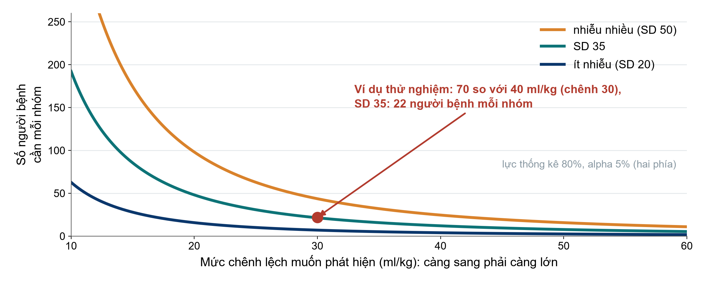{.neu-fig}

::: {.neu-takeaway}
**THÔNG ĐIỆP CHÍNH** Cỡ mẫu phụ thuộc vào tác động muốn phát hiện và mức độ nhiễu.
:::

::: {.notes}
Cần ít người bệnh hơn khi khác biệt lớn hơn và người bệnh ít biến thiên hơn.

Giảm khác biệt một nửa: cần khoảng gấp bốn số người bệnh.

Bài báo 1: 70 so với 40 ml/kg, SD 35, lực mẫu 80%: 22 người mỗi nhóm, tổng 50 khi tính cả tử vong.

Tác động kỳ vọng lấy từ nghiên cứu trước hoặc khác biệt nhỏ nhất đủ để thay đổi thực hành.
:::

## Trình diễn trực tiếp: công cụ tính cỡ mẫu trực tuyến

::: {.neu-banner style="--c:#B5651D"}
TRÌNH DIỄN TRỰC TIẾP · 5 phút
:::

:::: {.columns}
::: {.column width="60%"}
::: {.neu-activity-steps style="--c:#B5651D"}
- Mở một công cụ tính trực tuyến miễn phí (ví dụ OpenEpi) trên màn hình chia sẻ
- Hai trung bình: 70 so với 40 ml/kg, SD (độ lệch chuẩn) 35, lực thống kê 80%, alpha 5%: 22 mỗi nhóm
- Hai tỷ lệ: tử vong 40% so với 30%: khoảng 356 mỗi nhóm
- Thay đổi từng đầu vào một. Đoán hướng thay đổi trước (bình chọn)
- Dự phòng khi không có mạng: bảng tính cỡ mẫu của Neudata
:::
:::
::: {.column width="40%"}
::: {.neu-side .plain style="--c:#B5651D"}
Điều gì làm n thay đổi?

- Tác động nhỏ hơn: n tăng
- Nhiễu (SD) nhiều hơn: n tăng
- Lực thống kê cao hơn: n tăng
- Cộng thêm 10-20% bỏ cuộc
:::
:::
::::

::: {.neu-output style="--c:#B5651D"}
**SẢN PHẨM** Mọi người biết 4 con số cần cho câu phát biểu cỡ mẫu của mình
:::

::: {.notes}
Trình diễn trực tiếp, 5 phút. Kịch bản: s6\_demo\_VN.md, Phần A.

Tái lập Bài báo 1 (70 so với 40, SD 35): 22 người mỗi nhóm. Rồi tử vong 40% so với 30%: khoảng 356 người mỗi nhóm.

Đổi từng thông số một và cho lớp đoán chiều thay đổi trước.

Khi mất mạng: bảng tính cỡ mẫu. Học viên quan sát và dự đoán, không tự tính.
:::

## Chọn kiểm định: một bảng quyết định

| Kết cục | Hình dạng hoặc tần số | Hai nhóm độc lập | Cùng người bệnh đo hai lần (ghép cặp) |
|:---|:---|:---|:---|
| Một số đo (liên tục) | Gần đối xứng | Kiểm định t | Kiểm định t ghép cặp |
| Một số đo (liên tục) | Lệch, hoặc mẫu nhỏ | Mann-Whitney U | Wilcoxon cho cặp (signed-rank) |
| Một phân loại (có/không) | Tần số kỳ vọng từ 5 trở lên | Khi bình phương | McNemar |
| Một phân loại (có/không) | Tần số nhỏ (dưới 5) | Chính xác Fisher | McNemar |

::: {.neu-table-caption}
Loại kết cục + hình dạng + ghép cặp hay không = kiểm định phù hợp. Bài báo 1 (Boulet 2024) dùng Mann-Whitney vì cân bằng dịch bị lệch.
:::

::: {.notes}
Hai câu hỏi chọn kiểm định: biến số hay biến phân nhóm, rồi hình dạng hay số đếm. Dữ liệu bắt cặp dùng cột cuối.

Bài báo 1 dùng Mann-Whitney vì cân bằng dịch phân bố lệch.

Ba nhóm trở lên: chỉ nhắc ANOVA hoặc Kruskal-Wallis.

Hỏi: AKI ở 24 so với 24 người bệnh, 3 và 7 biến cố? Kỳ vọng: Fisher chính xác.
:::

## Ghép cặp hay không ghép cặp? Cùng hay khác người bệnh

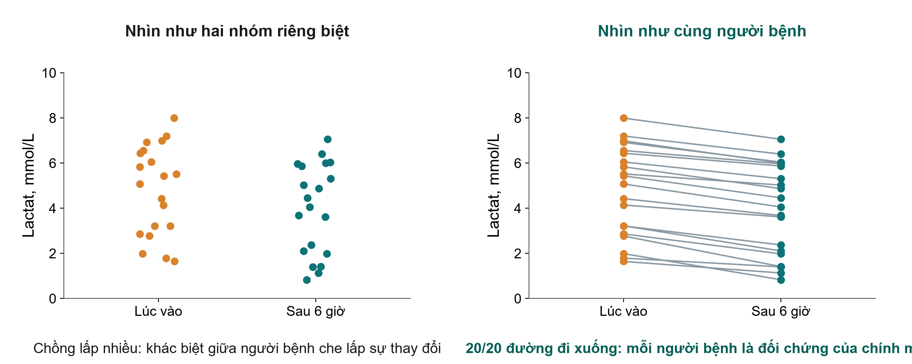{.neu-fig}

::: {.neu-takeaway}
**THÔNG ĐIỆP CHÍNH** Cùng người bệnh đo hai lần = kiểm định ghép cặp. Khác người bệnh = không ghép cặp.
:::

::: {.notes}
Cùng 20 người bệnh: vẽ thành hai đám mây thì thay đổi bị che, nối thành cặp thì đường nào cũng đi xuống. Mỗi người bệnh là đối chứng của chính mình.

Lỗi thường gặp: dùng kiểm định không bắt cặp cho dữ liệu trước/sau.

Hỏi: điểm đau trước và sau phác đồ mới ở 30 người bệnh? Kỳ vọng: bắt cặp.

Thời gian: 2 phút.
:::

## So sánh bội (multiple comparisons): ví dụ kẹo dẻo

:::: {.columns}
::: {.column width="38%"}
::: {.neu-side-notes}
### Cần làm gì

- Định trước một kết cục chính
- Gọi phần còn lại là thăm dò
- Hiệu chỉnh, ví dụ Bonferroni: 0.05 / số kiểm định
- Báo cáo mọi kiểm định đã làm
:::
:::
::: {.column width="62%"}
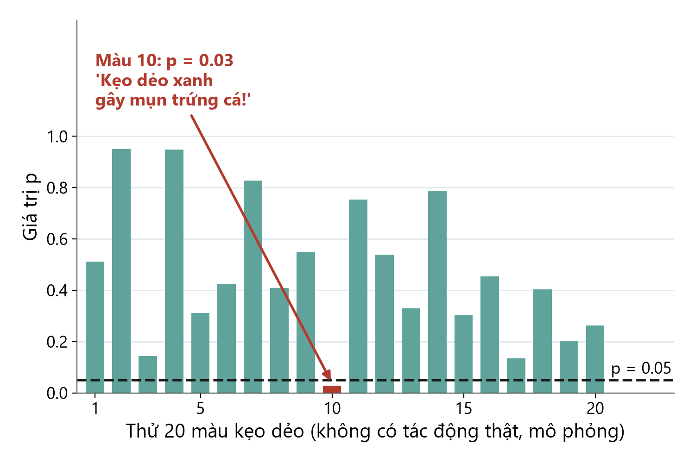{.neu-fig-side}
:::
::::

::: {.neu-takeaway}
**THÔNG ĐIỆP CHÍNH** Kiểm định 20 thứ thì sẽ có một thứ 'có ý nghĩa' chỉ do ngẫu nhiên.
:::

::: {.notes}
Kiểm định 20 màu khi không có tác động thật, sẽ có một màu ra p = 0.03. Với 20 kiểm định, khả năng có ít nhất một báo động giả khoảng 64%.

Cách khắc phục: một kết cục chính định trước, các phân tích khác là thăm dò, Bonferroni nếu cần, báo cáo mọi kiểm định.

Hỏi: 12 phân nhóm, một nhóm có p = 0.04. Có tin không? Kỳ vọng: không nhiều.

Thời gian: 2 phút.
:::

## Kiểm tra nhanh: kiểm định nào?

::: {.neu-banner style="--c:#6C3483"}
CÂU HỎI NHANH · 3 phút
:::

:::: {.columns}
::: {.column width="60%"}
::: {.neu-activity-steps style="--c:#6C3483"}
- Thời gian nằm ICU (lệch) ở nhóm cân bằng dịch dương và âm
- Tử vong 28 ngày (có/không) ở 300 so với 300 người bệnh
- Lactat lúc vào và sau 6 giờ trên cùng 40 người bệnh
- Lọc máu (có/không): 2/24 so với 5/24 người bệnh
:::
:::
::: {.column width="40%"}
::: {.neu-side .plain style="--c:#6C3483"}
Đáp án

- Mann-Whitney U
- Khi bình phương
- t ghép cặp
- Chính xác Fisher
:::
:::
::::

::: {.neu-output style="--c:#6C3483"}
**SẢN PHẨM** Mọi người dùng được bảng chọn kiểm định
:::

::: {.notes}
Kiểm tra (3 phút), mỗi tình huống một thăm dò.

1 Mann-Whitney (phân bố lệch, đây là Q5). 2 khi bình phương. 3 t-test bắt cặp. 4 Fisher chính xác.

Tiếp theo: các kiểm định này trên FLUID-ICU.
:::

## 6.2 So sánh các nhóm trong bộ dữ liệu khóa học

:::: {.neu-statement}
::: {.neu-big}
Chọn kiểm định theo kết cục, rồi đọc kết quả như một tác động kèm KTC.
:::

::: {.neu-sub}
6.2 So sánh các nhóm trong bộ dữ liệu  \|  20 phút
:::
::::

::: {.notes}
Phần 6.2 (20:20-20:40).

Bảng chọn kiểm định áp dụng cho FLUID-ICU. Mọi so sánh đều chưa hiệu chỉnh: nhóm cân bằng dương nặng hơn (Bảng 1).
:::

## Trình diễn: so sánh hai nhóm bằng R

::: {.neu-banner style="--c:#B5651D"}
TRÌNH DIỄN TRỰC TIẾP · 6 phút
:::

:::: {.columns}
::: {.column width="60%"}
::: {.neu-activity-steps style="--c:#B5651D"}
- Mở 03\_compare.R
- Tuổi (đối xứng): kiểm định t
- SOFA và lactat (lệch): Mann-Whitney
- Tử vong 28 ngày (có/không): bảng 2x2 và khi bình phương
- Lỗi thường gặp: kiểm định t trên thời gian nằm ICU lệch
:::
:::
::: {.column width="40%"}
::: {.neu-side .plain style="--c:#B5651D"}
Bảng quyết định

- Số đo hay phân loại?
- Đối xứng hay lệch?
- Ghép cặp hay không?
- Tác động + KTC 95%
:::
:::
::::

::: {.neu-output style="--c:#B5651D"}
**SẢN PHẨM** Mọi người thấy kiểm định được chọn theo loại kết cục
:::

::: {.notes}
Trình diễn trực tiếp, 6 phút. Kịch bản: s6\_demo\_VN.md, Phần B (03\_compare.R).

Mời một người gọi tên kiểm định trước mỗi lần chạy.

Cho xem tử vong dạng bảng 2x2: 134/373 (35.9%) so với 45/245 (18.4%). Kết thúc bằng t-test sai trên thời gian nằm ICU phân bố lệch.

Nếu R lỗi, dùng trang sau.
:::

## FLUID-ICU: bốn kết cục, bốn phép so sánh

| Kết cục (loại) | Cân bằng âm (n = 245) | Cân bằng dương (n = 373) | Kiểm định | Kết quả |
|:---|:---|:---|:---|:---|
| Tử vong 28 ngày (có/không) | 45 (18.4%) | 134 (35.9%) | Khi bình phương | Hiệu số nguy cơ 17.6 điểm (KTC 95% 10.7 đến 24.4), p \< 0.001 |
| Tổn thương thận cấp (có/không) | 71 (29.0%) | 230 (61.7%) | Khi bình phương | p \< 0.001 |
| Số ngày không thở máy (0-28, lệch) | Trung vị 28 (22 đến 28) | Trung vị 20 (0 đến 28) | Mann-Whitney | p \< 0.001 |
| Thời gian nằm ICU ở người sống (ngày, lệch) | 4.8 (3.3 đến 7.1), n = 200 | 7.5 (5.2 đến 11.2), n = 239 | Mann-Whitney | Chênh lệch 2.5 ngày (KTC 95% 1.8 đến 3.2), p \< 0.001 |

::: {.neu-table-caption}
n (%) hoặc trung vị (IQR). So sánh chưa hiệu chỉnh. Dữ liệu mô phỏng (key\_results.md). Mọi kết cục đều xấu hơn ở nhóm cân bằng dương, trước khi hiệu chỉnh.
:::

::: {.notes}
Mỗi loại kết cục một kiểm định, mỗi kết quả đọc thành một tác động.

Tử vong (Q1): chênh lệch nguy cơ 17.6 điểm (10.7 đến 24.4). AKI (Q2): 61.7% so với 29.0%. Số ngày không thở máy (Q3): trung vị 20 so với 28. Thời gian nằm ICU ở người sống sót (Q5): chênh 2.5 ngày (1.8 đến 3.2).

Tất cả chưa hiệu chỉnh: lẫn ảnh hưởng của dịch và mức độ nặng.

Hỏi: số nào đưa vào tóm tắt? Kỳ vọng: tác động kèm KTC.
:::

## Ví dụ minh họa: đọc phép so sánh tử vong

::: {.neu-intro}
Câu hỏi 1 (Q1), chưa hiệu chỉnh: cân bằng dịch dương so với âm đến ngày 3.
:::

:::: {.neu-steps}
::: {.neu-step style="--c:#0D7377"}
[Nguy cơ]{.neu-step-label}

- Dương: 134/373 = 35.9%
- Âm: 45/245 = 18.4%
:::
::: {.neu-step style="--c:#0B376C"}
[Hiệu số]{.neu-step-label}

- 17.6 điểm phần trăm
- KTC 95% 10.7 đến 24.4
:::
::: {.neu-step style="--c:#5FA39B"}
[Tỷ số]{.neu-step-label}

- Nguy cơ tương đối (RR) 1.96
- Nguy cơ khoảng gấp đôi
:::
::: {.neu-step style="--c:#0070C0"}
[Kiểm định]{.neu-step-label}

- Khi bình phương, p \< 0.001
:::
::: {.neu-step style="--c:#055F56"}
[Nhưng...]{.neu-step-label}

- Chưa hiệu chỉnh: nhóm dương nặng hơn
:::
::::

::: {.neu-takeaway}
**THÔNG ĐIỆP CHÍNH** Báo cáo tác động và KTC. Rồi hỏi điều gì khác có thể giải thích nó.
:::

::: {.notes}
Ví dụ minh họa (3 phút): bảng 2x2 của Buổi 4 áp dụng cho bộ dữ liệu.

35.9% so với 18.4%: chênh 17.6 điểm (10.7 đến 24.4), RR 1.96, p \< 0.001.

Nhưng nhóm dương nặng hơn: so sánh thô không tách được dịch khỏi mức độ nặng.

Câu mẫu cho phần Kết quả: 'Tử vong 28 ngày là 35.9% ở nhóm cân bằng dương và 18.4% ở nhóm cân bằng âm (chênh lệch nguy cơ 17.6 điểm phần trăm, KTC 95% 10.7 đến 24.4).'
:::

## Cả lớp cùng diễn giải các phép so sánh

::: {.neu-banner style="--c:#0D7377"}
CẢ LỚP CÙNG LÀM · 7 phút
:::

:::: {.columns}
::: {.column width="60%"}
::: {.neu-activity-steps style="--c:#0D7377"}
- Q1 đầy đủ: tử vong 28 ngày trong bảng so sánh của gói kết quả Q1 (PDF)
- Bình chọn: kiểm định nào đã được dùng, và vì sao?
- Câu hỏi cho cả lớp: nói kết quả như một tác động kèm KTC 95%. Giảng viên viết thành một câu Kết quả
- Câu hỏi cho cả lớp: một lý do khiến phép so sánh có thể bị sai lệch
- Q2 đến Q5: giảng viên đọc mỗi kết quả trong một câu
:::
:::
::: {.column width="40%"}
::: {.neu-side .plain style="--c:#0D7377"}
Tránh

- Chỉ có giá trị p
- 'chứng minh', 'gây ra'
- 'xu hướng' khi p \> 0.05
- Quên ghi n
:::
:::
::::

::: {.neu-output style="--c:#0D7377"}
**SẢN PHẨM** Một câu Kết quả cho Q1, mỗi câu Q2 đến Q5 một dòng (Bài 4)
:::

::: {.notes}
Cả lớp, 7 phút (20:33-20:40). Bài 4. Đáp án: s6\_solutions\_VN.md.

Q1 (4 phút): thăm dò kiểm định (khi bình phương), cùng viết một câu Kết quả kèm KTC, rồi hỏi một sai lệch: nhiễu do chỉ định.

Q2 đến Q5 (3 phút): đọc mỗi câu một dòng trong đáp án.

Sau đó học viên làm lại cho câu hỏi mình chọn. Rồi giải lao.
:::

---

::: {style="text-align:center"}
{width="32%"}

[Giải lao]{style="color:#0D7377;font-size:1.6em;font-weight:700"}

[15 phút]{style="color:#595959;font-size:0.9em"}
:::

::: {.notes}
Giải lao (20:40-20:55). Nói: 20:55 bắt đầu lại với 6.3.

Mở 04\_models.R và 05\_missing.R. Gom các câu hỏi trong khung chat về phần so sánh và trả lời ở đầu 6.3.
:::

## 6.3 Mối liên quan và mô hình (khái niệm)

:::: {.neu-statement}
::: {.neu-big}
Không cần chạy mô hình mới đọc được mô hình.
:::

::: {.neu-sub}
6.3 Mối liên quan và mô hình  \|  35 phút
:::
::::

::: {.notes}
Phần 6.3 (20:55-21:30).

Mọi mô hình trả lời một câu hỏi: kết cục liên quan với phơi nhiễm thế nào, và ta chắc đến đâu? Đọc bốn điều: kết cục, mô hình, con số, giá trị 'không tác động'.

Mô hình là công cụ chính để xử lý nhiễu đã đo được (Buổi 4).
:::

## Tương quan: hai con số cùng thay đổi chặt chẽ đến đâu

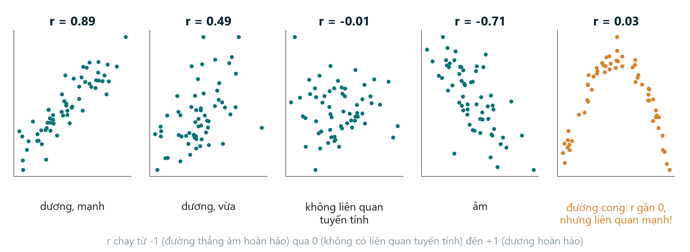{.neu-fig}

::: {.neu-takeaway}
**THÔNG ĐIỆP CHÍNH** r đo liên quan theo đường thẳng, từ -1 đến +1. Luôn nhìn biểu đồ.
:::

::: {.notes}
r tóm tắt biểu đồ phân tán bằng một con số, từ -1 đến +1.

Ô cuối là cái bẫy: r gần 0 nhưng có đường cong rất rõ. Luôn nhìn biểu đồ.

Với nhiều người bệnh, r rất nhỏ vẫn có thể 'có ý nghĩa' mà vô dụng.

Thời gian: 2 phút.
:::

## Hồi quy tuyến tính: đường thẳng phù hợp nhất

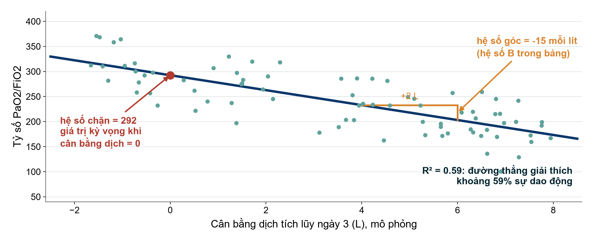{.neu-fig}

::: {.neu-takeaway}
**THÔNG ĐIỆP CHÍNH** Hệ số góc = thay đổi của kết cục theo mỗi đơn vị phơi nhiễm. R² = mức giải thích.
:::

::: {.notes}
Hồi quy tuyến tính: đường thẳng phù hợp nhất cho kết cục dạng số. Hệ số góc = thay đổi trên mỗi đơn vị phơi nhiễm, giá trị không tác động là 0. R² = mức đường thẳng giải thích được.

Thêm biến cho ta các hệ số 'đã hiệu chỉnh'.

Hỏi: B = -15 (-19 đến -11)? Kỳ vọng: mỗi lít thêm đi kèm tỷ lệ P/F thấp hơn khoảng 15.

Thời gian: 2 phút.
:::

## Hồi quy logistic: đường cong chữ S cho kết cục có/không

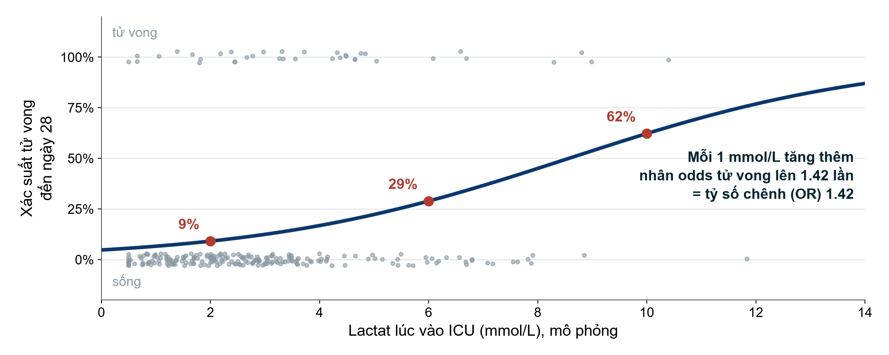{.neu-fig}

::: {.neu-takeaway}
**THÔNG ĐIỆP CHÍNH** Hồi quy logistic biến kết cục có/không thành tỷ số chênh theo mỗi đơn vị phơi nhiễm.
:::

::: {.notes}
Với kết cục có/không, đường cong có hình chữ S. Mô hình cho OR trên mỗi đơn vị (ở đây 1.42 mỗi mmol/L lactat). Giá trị không tác động là 1.

Lỗi thường gặp: 'OR 1.42 nghĩa là tử vong nhiều hơn 42%'. Đó là odds cao hơn 42%.

Hỏi: nếu lactat không có tác động thì sao? Kỳ vọng: đường nằm ngang, OR 1.

Thời gian: 2 phút.
:::

## Mô hình nào? Tùy vào kết cục

| Kết cục của anh chị là... | Mô hình | Bài báo báo cáo | Giá trị 'không tác động' |
|:---|:---|:---|:---|
| Một số đo, ví dụ cân bằng dịch (ml/kg) | Hồi quy tuyến tính | Hệ số (B): một hiệu số | 0 |
| Có / không, ví dụ tử vong đến ngày 28 | Hồi quy logistic | Tỷ số chênh (OR) | 1 |
| Thời gian đến sự kiện, ví dụ thời gian đến tử vong | Hồi quy Cox | Tỷ số nguy cơ tức thời (HR) | 1 |

::: {.neu-table-caption}
Loại kết cục cho biết mô hình và con số cần đọc.
:::

::: {.notes}
Kết cục quyết định mô hình: biến số, hồi quy tuyến tính (chênh lệch, không tác động = 0). Có/không, hồi quy logistic (OR, không tác động = 1). Thời gian đến sự kiện, Cox (HR, không tác động = 1).

Lỗi thường gặp: tìm số 0 trong bảng OR.

Hỏi: thời gian nằm viện dạng số? Kỳ vọng: tuyến tính, giá trị 0.
:::

## 'Hiệu chỉnh' nghĩa là gì: so sánh những người giống nhau

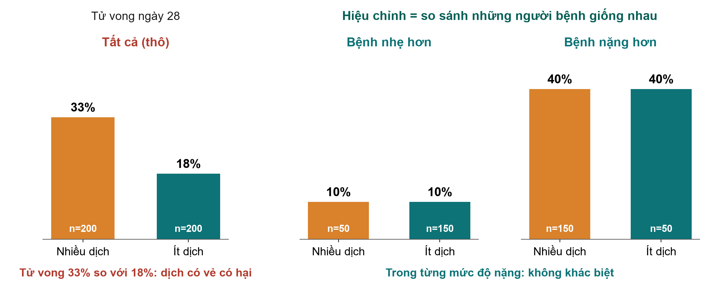{.neu-fig}

::: {.neu-caption}
Số liệu mô phỏng
:::

::: {.neu-takeaway}
**THÔNG ĐIỆP CHÍNH** Hiệu chỉnh = so sánh những người bệnh giống nhau về các yếu tố gây nhiễu.
:::

::: {.notes}
Thô: nhiều dịch hơn, tử vong nhiều hơn (33% so với 18%). Chia theo mức độ nặng: không có khác biệt trong từng tầng.

Mức độ nặng quyết định cả hai: nhiễu do chỉ định. Mô hình làm phép chia này cho nhiều biến nhiễu cùng lúc.

Chỉ hiệu chỉnh được các biến nhiễu đã đo. Chỉ phân bổ ngẫu nhiên xử lý được phần còn lại.
:::

## Đọc bảng hồi quy, từng dòng một

| Biến | OR đã hiệu chỉnh | KTC 95% | Giá trị p | KTC có chứa 1 không? |
|:---|:---|:---|:---|:---|
| Cân bằng dịch dương (có so với không) | 1.80 | 1.20 đến 2.70 | 0.004 | Không |
| Tuổi (mỗi 10 năm) | 1.25 | 1.10 đến 1.42 | \< 0.001 | Không |
| Điểm SOFA (mỗi 1 điểm) | 1.15 | 1.08 đến 1.23 | \< 0.001 | Không |
| Nữ (so với nam) | 0.92 | 0.65 đến 1.30 | 0.64 | Có: phù hợp với không có tác động |
| Lactat (mỗi 1 mmol/L) | 1.10 | 0.98 đến 1.24 | 0.11 | Có: phù hợp với không có tác động |

::: {.neu-table-caption}
Kết cục: tử vong đến ngày 28. Hồi quy logistic đa biến, số liệu giả định. Các dòng sau dòng 1 là những yếu tố gây nhiễu tác giả đã 'hiệu chỉnh'. Đọc mỗi dòng: so sánh gì, tác động, KTC 95%, KTC có chứa 1 không?
:::

::: {.notes}
Đọc mỗi dòng theo bốn bước: so sánh gì (nhóm tham chiếu và đơn vị), tác động, KTC, KTC có chứa 1 không?

OR 1.80 (1.20 đến 2.70): odds gấp 1.8 lần, đã hiệu chỉnh.

Dòng giới tính và lactat chứa 1: phù hợp với không có mối liên quan.

Số liệu giả định. Nói 'có liên quan', và 'odds' chứ không phải 'nguy cơ'.
:::

## Kiểm tra nhanh: đọc bảng hồi quy

::: {.neu-banner style="--c:#6C3483"}
CÂU HỎI NHANH · 4 phút
:::

:::: {.columns}
::: {.column width="60%"}
::: {.neu-activity-steps style="--c:#6C3483"}
- Dùng bảng ở trang trước ('Đọc bảng hồi quy, từng dòng một')
- Bình chọn: với giới nữ, KTC 95% có chứa 1 không? Điều đó nghĩa là gì?
- Bình chọn: 'OR 1.15 mỗi điểm SOFA' nghĩa là gì?
- Câu hỏi cho cả lớp: một câu dễ hiểu cho cân bằng dịch dương
- Luyện thêm ở nhà: Bài 5 và 6 trong phiếu bài tập
:::
:::
::: {.column width="40%"}
::: {.neu-side .plain style="--c:#6C3483"}
Đọc theo 4 bước

- So sánh cái gì?
- Tác động lớn đến đâu?
- KTC rộng đến đâu?
- Có cắt qua 1 (hoặc 0)?
:::
:::
::::

::: {.neu-output style="--c:#6C3483"}
**SẢN PHẨM** Một câu diễn giải đúng, dễ hiểu, được cả lớp thống nhất
:::

::: {.notes}
Kiểm tra (4 phút), dùng bảng ở trang trước.

Thăm dò 1: có, phù hợp với không có mối liên quan. Thăm dò 2: odds nhân 1.15 cho mỗi điểm SOFA ('tử vong nhiều hơn 15%' là câu trả lời sai kinh điển).

Câu mẫu: 'Sau hiệu chỉnh, người bệnh có cân bằng dịch dương có odds tử vong đến ngày 28 gấp khoảng 1.8 lần (OR 1.80, KTC 95% 1.20 đến 2.70).'

Bài 5 và 6 làm ở nhà.
:::

## Quá khớp: quá nhiều biến cho quá ít biến cố

:::: {.columns}
::: {.column width="38%"}
::: {.neu-side-notes}
### Vì sao chọn biến từng bước gây hiểu nhầm

- Chọn biến theo giá trị p
- Tìm ra 'yếu tố dự báo' ngẫu nhiên
- Tác động quá lớn, KTC quá hẹp
- Tốt hơn: chọn yếu tố gây nhiễu từ trước
:::
:::
::: {.column width="62%"}
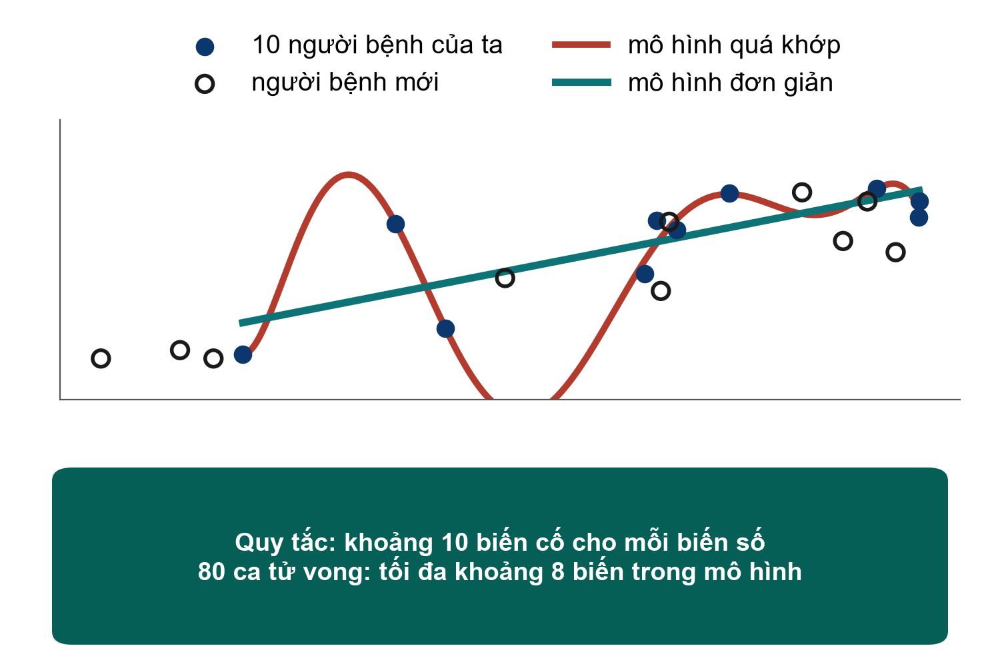{.neu-fig-side}
:::
::::

::: {.neu-takeaway}
**THÔNG ĐIỆP CHÍNH** Dự kiến khoảng 10 biến cố mỗi biến và chọn biến theo kiến thức, không theo p.
:::

::: {.notes}
Quá nhiều biến so với số biến cố: mô hình học cả nhiễu và thất bại với người bệnh mới.

Quy tắc nhanh: khoảng 10 biến cố cho mỗi biến. Chọn biến từng bước giữ lại các phát hiện do ngẫu nhiên.

Chọn biến nhiễu từ trước và ghi vào SAP.

Thời gian: 2 phút.
:::

## Phân tích sống còn bắt đầu từ kiểm duyệt

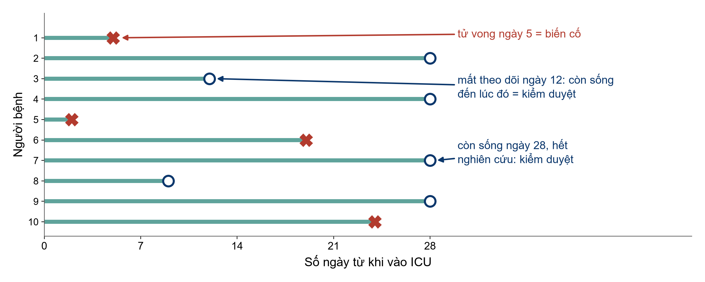{.neu-fig}

::: {.neu-takeaway}
**THÔNG ĐIỆP CHÍNH** Người bệnh bị kiểm duyệt vẫn được tính: họ cho biết đã sống đến ngày đó.
:::

::: {.notes}
Vòng tròn là người bệnh bị kiểm duyệt: được theo dõi đến lúc đó mà chưa có biến cố. Bị kiểm duyệt không có nghĩa là bị loại: họ vẫn cho biết mình còn sống đến ngày đó.

Hỏi: ra viện ngày 9, không liên lạc lại được? Kỳ vọng: kiểm duyệt ở ngày 9.

Thời gian: 2 phút.
:::

## Cách đọc đường cong Kaplan-Meier

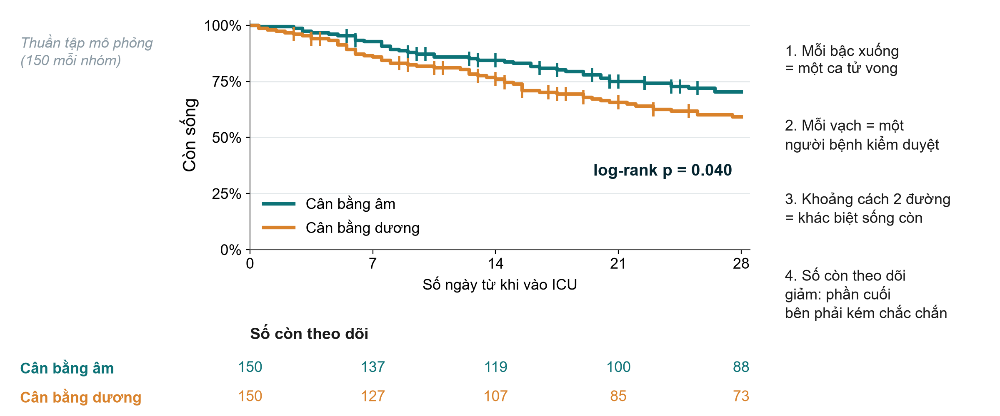{.neu-fig}

::: {.neu-takeaway}
**THÔNG ĐIỆP CHÍNH** Đọc các bậc, các vạch, khoảng cách, và luôn xem số còn theo dõi.
:::

::: {.notes}
Bốn bước đọc: mỗi bậc đi xuống là tử vong, vạch nhỏ là người bị kiểm duyệt, khoảng cách là khác biệt, và số người còn nguy cơ cho biết phần cuối đường cong chắc đến đâu.

Kiểm định log-rank cho giá trị p, không cho độ lớn tác động (Cox, 6.4).

Hỏi: hai đường cắt nhau giữa chừng? Kỳ vọng: tác động thay đổi theo thời gian.

Thời gian: 3 phút.
:::

## 6.4 Mô hình hóa bộ dữ liệu khóa học

:::: {.neu-statement}
::: {.neu-big}
Hiệu chỉnh theo kế hoạch, đọc KTC, và trung thực về các ô trống.
:::

::: {.neu-sub}
6.4 Mô hình hóa bộ dữ liệu khóa học  \|  25 phút
:::
::::

::: {.notes}
Phần 6.4 (21:30-21:55): các mô hình áp dụng cho FLUID-ICU. Anh chị sẽ thấy nhiễu do chỉ định làm OR nhỏ lại.
:::

## SAP có trước

::: {.neu-intro}
Kế hoạch phân tích thống kê (SAP) được ký trước khi khóa cơ sở dữ liệu.
:::

:::: {.neu-steps}
::: {.neu-step style="--c:#0D7377"}
[Chính]{.neu-step-label}

- Tử vong 28 ngày
- Hồi quy logistic, tỷ số chênh (OR)
:::
::: {.neu-step style="--c:#0B376C"}
[Gây nhiễu]{.neu-step-label}

- Tuổi, SOFA, lactat
- Vận mạch, thở máy
- Bệnh thận mạn (CKD)
:::
::: {.neu-step style="--c:#5FA39B"}
[Hỗ trợ]{.neu-step-label}

- Kaplan-Meier và kiểm định log-rank
- Tỷ số nguy cơ tức thời (HR) từ mô hình Cox
:::
::: {.neu-step style="--c:#0070C0"}
[Phân nhóm]{.neu-step-label}

- Một phân nhóm định trước: suy tim
:::
::: {.neu-step style="--c:#055F56"}
[Dữ liệu thiếu]{.neu-step-label}

- Phân tích các trường hợp đầy đủ
- Quy gán đa bội
:::
::::

::: {.neu-takeaway}
**THÔNG ĐIỆP CHÍNH** Mọi thứ ở các trang sau đã được quyết định trước khi ai thấy kết quả.
:::

::: {.notes}
Chiếu SAP lên màn hình (SAP\_FLUID-ICU\_VN.md). Phân tích chính: hồi quy logistic cho tử vong 28 ngày. Biến nhiễu chọn từ trước. Kaplan-Meier và Cox để hỗ trợ. Một phân nhóm. Trường hợp đầy đủ cộng quy gán đa bội.

AKI và lọc máu không được hiệu chỉnh: chúng xảy ra sau khi truyền dịch.

Hỏi: vì sao viết trước? Kỳ vọng: không ai có thể nói anh chị chọn phân tích cho giá trị p đẹp nhất.
:::

## Nhiễu do chỉ định, nhìn thấy được

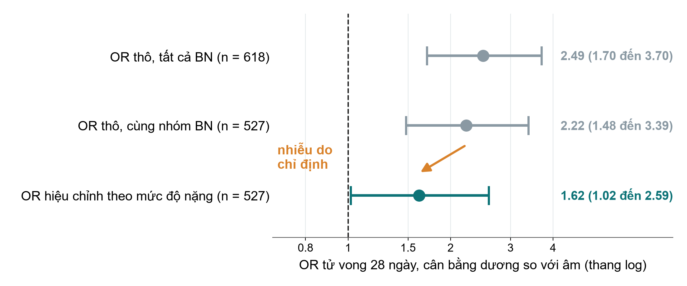{.neu-fig}

::: {.neu-takeaway}
**THÔNG ĐIỆP CHÍNH** OR thô 2.49 giảm còn 1.62 sau khi hiệu chỉnh mức độ nặng: vẫn trên 1.
:::

::: {.notes}
Hình quan trọng nhất của bộ dữ liệu (4 phút).

OR thô 2.49 (1.70 đến 3.70). OR thô trên cùng 527 trường hợp đầy đủ 2.22. Đã hiệu chỉnh 1.62 (1.02 đến 2.59), p = 0.044.

OR nhỏ lại vì người nặng hơn được truyền nhiều dịch hơn và tử vong nhiều hơn. Phần còn lại vừa phải, kém chính xác, và vẫn chỉ là mối liên quan.

Hỏi: có nên hiệu chỉnh thêm AKI? Kỳ vọng: không, AKI xảy ra sau khi truyền dịch.
:::

## Mô hình hiệu chỉnh, dạng biểu đồ rừng

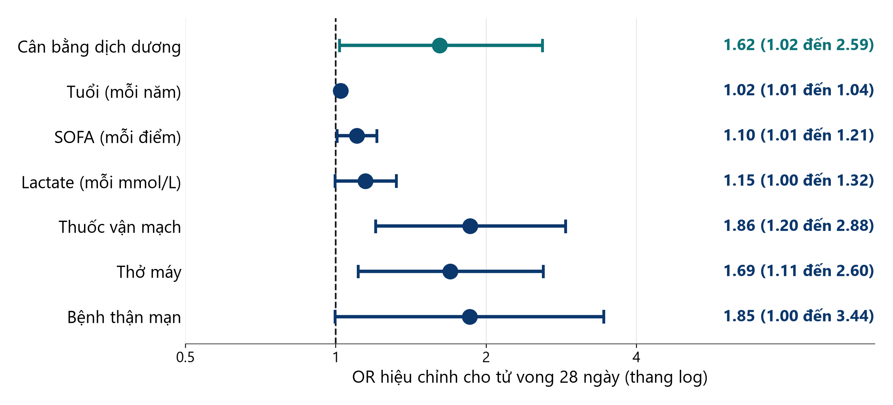{.neu-fig}

::: {.neu-takeaway}
**THÔNG ĐIỆP CHÍNH** Đọc từng dòng: so sánh gì, OR, KTC 95%, có cắt qua 1 không?
:::

::: {.notes}
Mô hình của Q1 dạng biểu đồ rừng (n = 527). Cân bằng dương: OR 1.62 (1.02 đến 2.59).

Các dòng khác là biến nhiễu: có mặt để hiệu chỉnh, không phải để diễn giải.

Hỏi: dòng nào đưa vào tóm tắt? Kỳ vọng: chỉ dòng phơi nhiễm, kèm KTC.
:::

## Kaplan-Meier: sống còn đến ngày 28 theo cân bằng dịch

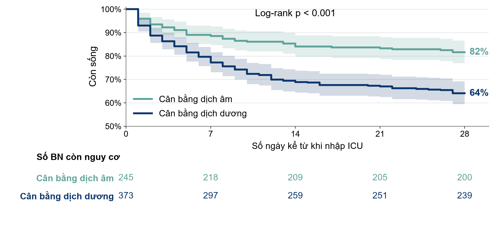{.neu-fig}

::: {.neu-takeaway}
**THÔNG ĐIỆP CHÍNH** Sống còn ngày 28: 81.6% so với 64.1%, log-rank p \< 0.001: chưa hiệu chỉnh.
:::

::: {.notes}
Đọc đường cong thật theo bốn bước. Phần lớn tử vong trong tuần đầu.

Sống còn ngày 28: 81.6% so với 64.1%, log-rank p \< 0.001, nhưng chưa hiệu chỉnh.

Hỏi: khoảng cách lớn hơn lúc đầu hay lúc sau? Kỳ vọng: mở ra sớm, rồi hai đường gần như song song.
:::

## Mô hình Cox: cùng câu chuyện bằng tỷ số nguy cơ tức thời

::: {.neu-intro}
Phân tích hỗ trợ của Q1 (04\_models.R). HR = tỷ số nguy cơ tức thời. OR = tỷ số chênh.
:::

:::: {.neu-cards style="--n:4"}
::: {.neu-card .plain style="--c:#0D7377"}
[HR thô]{.neu-card-title}

- 2.17
- KTC 95% 1.55 đến 3.05
:::
::: {.neu-card .plain style="--c:#0B376C"}
[HR đã hiệu chỉnh]{.neu-card-title}

- 1.46
- KTC 95% 1.00 đến 2.13
- p = 0.053
:::
::: {.neu-card .plain style="--c:#5FA39B"}
[Giả định]{.neu-card-title}

- Nguy cơ tỷ lệ: kiểm định chung p = 0.10
- Chấp nhận được
:::
::: {.neu-card .plain style="--c:#0070C0"}
[So sánh]{.neu-card-title}

- OR đã hiệu chỉnh 1.62, p = 0.044
- HR đã hiệu chỉnh 1.46, p = 0.053
- Cùng chiều và độ lớn
:::
::::

::: {.neu-takeaway}
**THÔNG ĐIỆP CHÍNH** p = 0.044 và p = 0.053 nói cùng một điều: hãy đọc ước lượng và KTC.
:::

::: {.notes}
HR Cox đã hiệu chỉnh 1.46 (1.00 đến 2.13), p = 0.053. Giả định nguy cơ tỷ lệ chấp nhận được (p = 0.10).

Bài học: OR p = 0.044 và HR p = 0.053 kể cùng một câu chuyện. Đừng để 0.05 quyết định anh chị tin gì.

Hỏi: viết điều này trong phần Kết quả thế nào? Kỳ vọng: cả hai ước lượng kèm KTC.
:::

## RR, OR và HR: ý nghĩa và khi nào gặp

::: {.neu-intro}
Cả ba đều so sánh hai nhóm. 1 = không khác biệt. Trên 1: nhiều biến cố hơn. Dưới 1: ít hơn.
:::

:::: {.neu-cards style="--n:3"}
::: {.neu-card .plain style="--c:#0D7377"}
[Tỷ số nguy cơ (RR)]{.neu-card-title}

- Nguy cơ ở nhóm này / nguy cơ ở nhóm kia
- Thử nghiệm và thuần tập, từ bảng 2x2
- Buổi 4
:::
::: {.neu-card .plain style="--c:#0070C0"}
[Tỷ số chênh (OR)]{.neu-card-title}

- Odds ở nhóm này / odds ở nhóm kia
- Nghiên cứu bệnh-chứng và hồi quy logistic
- Gần bằng RR khi kết cục hiếm
:::
::: {.neu-card .plain style="--c:#0B376C"}
[Tỷ số nguy cơ tức thời (HR)]{.neu-card-title}

- Tốc độ xảy ra biến cố theo thời gian, nhóm này so với nhóm kia
- Thời gian đến biến cố: Kaplan-Meier và hồi quy Cox
- Buổi 6
:::
::::

::: {.neu-takeaway}
**THÔNG ĐIỆP CHÍNH** Kết cục và thiết kế quyết định tỷ số: nguy cơ (RR), odds (OR) hay tốc độ theo thời gian (HR).
:::

::: {.notes}
RR: nguy cơ, từ bảng 2x2 (thử nghiệm, thuần tập). OR: odds, từ nghiên cứu bệnh-chứng và hồi quy logistic, gần RR chỉ khi kết cục hiếm. HR: tốc độ xảy ra biến cố theo thời gian, từ Cox.

Hỏi: Bài báo 2 so sánh tử vong theo thời gian. Tỷ số nào? Kỳ vọng: HR.

Thời gian: 2 phút.
:::

## Vì sao bị thiếu? MCAR, MAR và MNAR

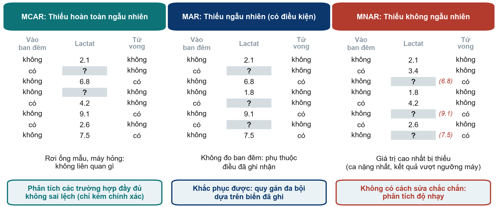{.neu-fig}

::: {.neu-takeaway}
**THÔNG ĐIỆP CHÍNH** Lý do dữ liệu bị thiếu quyết định các ô trống nguy hiểm đến đâu.
:::

::: {.notes}
Ba cơ chế trên cùng 8 người bệnh. MCAR: không liên quan đến người bệnh. MAR: phụ thuộc vào điều đã ghi nhận, quy gán có thể giúp. MNAR: phụ thuộc vào chính giá trị bị thiếu, không phương pháp nào sửa được hoàn toàn.

Dữ liệu không chứng minh được cơ chế nào: hãy ghi lại vì sao giá trị bị thiếu.

Thời gian: 2 phút.
:::

## Ai bị thiếu lactat? Không phải 15% ngẫu nhiên

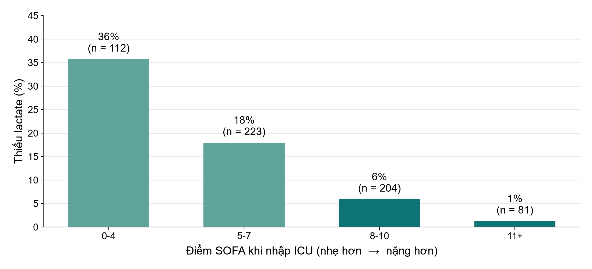{.neu-fig}

::: {.neu-takeaway}
**THÔNG ĐIỆP CHÍNH** Lactat thiếu chủ yếu ở người bệnh nhẹ hơn: không phải MCAR, nhưng MAR là hợp lý.
:::

::: {.notes}
Lactat thiếu ở 93 trên 620 (15.0%), chủ yếu ở người bệnh nhẹ hơn (trung vị SOFA 5 so với 8, tử vong 19.4% so với 30.6%).

Vậy không phải MCAR: phân tích trường hợp đầy đủ loại bỏ người nhẹ hơn. MAR là hợp lý, phù hợp với quy gán đa bội.

Hỏi: vì sao người nhẹ hơn lại không được đo lactat?
:::

## Trường hợp đầy đủ so với quy gán đa bội (Q4)

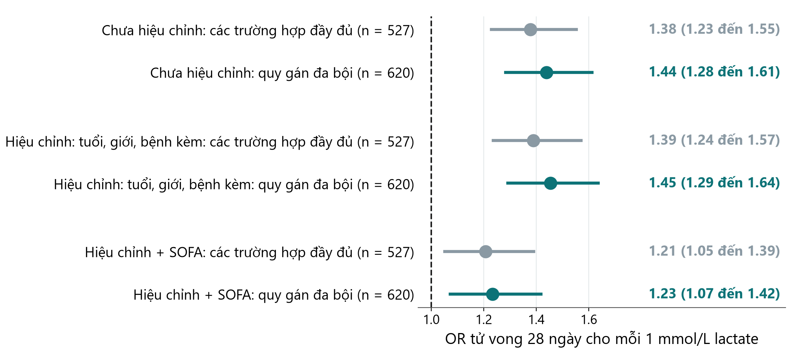{.neu-fig}

::: {.neu-takeaway}
**THÔNG ĐIỆP CHÍNH** Quy gán đa bội giữ cả 620 người bệnh. Câu trả lời chỉ thay đổi ít.
:::

::: {.notes}
Phân tích độ nhạy định trước trong SAP.

Q4: OR mỗi mmol/L 1.39 (trường hợp đầy đủ, n = 527) so với 1.45 (quy gán, n = 620).

Q1: OR đã hiệu chỉnh 1.70 (1.09 đến 2.64) khi quy gán so với 1.62 ở trường hợp đầy đủ.

Kết luận không phụ thuộc vào cách xử lý lactat bị thiếu.

Hỏi: báo cáo điều này thế nào? Kỳ vọng: cả hai ước lượng, và nói rằng chúng tương tự nhau.
:::

## Cả lớp cùng diễn giải các mô hình

::: {.neu-banner style="--c:#0D7377"}
CẢ LỚP CÙNG LÀM · 7 phút
:::

:::: {.columns}
::: {.column width="60%"}
::: {.neu-activity-steps style="--c:#0D7377"}
- Q1 đầy đủ: OR thô và đã hiệu chỉnh trong bảng mô hình của gói kết quả Q1 (PDF)
- Câu hỏi cho cả lớp: hiệu chỉnh làm ước lượng thay đổi bao nhiêu, và vì sao?
- Bình chọn: KTC 95% đã hiệu chỉnh có chứa 1 không?
- Cả lớp cùng viết hai câu Kết quả: thô, rồi đã hiệu chỉnh, kèm KTC
- Q2 đến Q5: ước lượng thô và đã hiệu chỉnh, mỗi câu một dòng
:::
:::
::: {.column width="40%"}
::: {.neu-side .plain style="--c:#0D7377"}
Từ nên dùng

- 'có liên quan với'
- 'sau khi hiệu chỉnh'
- 'KTC 95%'
- không dùng 'gây ra'
:::
:::
::::

::: {.neu-output style="--c:#0D7377"}
**SẢN PHẨM** Hai câu Kết quả cho Q1, mỗi câu Q2 đến Q5 một dòng (Bài 8)
:::

::: {.notes}
Cả lớp, 7 phút (21:48-21:55). Bài 8. Đáp án: s6\_solutions\_VN.md.

Q1 (4 phút): thô 2.49, hiệu chỉnh 1.62. Hỏi vì sao nhỏ lại. Gõ hai câu Kết quả, thô rồi hiệu chỉnh, kèm KTC.

Q2 đến Q5 (3 phút): đọc mỗi câu một dòng trong đáp án.

Quy luật: mọi ước lượng đã hiệu chỉnh đều gần mức không tác động hơn. Các câu này là phần cốt lõi của phần Kết quả mỗi học viên sẽ viết.
:::

## Xây dựng đề cương 6: một phần tốt gồm những gì

::: {.neu-intro}
Làm mẫu trên ví dụ xuyên suốt (một thử nghiệm hạn chế dịch).
:::

:::: {.neu-cards style="--n:4"}
::: {.neu-card .plain style="--c:#0D7377"}
[Cỡ mẫu]{.neu-card-title}

- Tử vong 40% so với 30%
- Lực thống kê 80%, alpha 5% hai phía
- 356 mỗi nhóm, cộng thêm 10%
:::
::: {.neu-card .plain style="--c:#0B376C"}
[Kế hoạch phân tích]{.neu-card-title}

- Mô tả: n (%), trung vị (IQR)
- So sánh: khi bình phương
- Báo cáo: RR kèm KTC 95%
:::
::: {.neu-card .plain style="--c:#5FA39B"}
[Yếu tố gây nhiễu]{.neu-card-title}

- Chọn từ trước
- Khoảng 10 biến cố mỗi biến
:::
::: {.neu-card .plain style="--c:#0070C0"}
[Dữ liệu thiếu]{.neu-card-title}

- Dự kiến thiếu gì và vì sao
- Phòng ngừa
- Báo cáo dữ liệu thiếu thế nào
:::
::::

::: {.neu-takeaway}
**THÔNG ĐIỆP CHÍNH** Hôm nay: bao nhiêu người bệnh, phân tích gì, và nếu dữ liệu bị thiếu thì sao.
:::

::: {.notes}
Chiếu 1 phút trước khi làm mẫu.

Cỡ mẫu trong một câu với bốn thông số và phần bù mất mẫu (356 người mỗi nhóm, 396 khi tính 10% mất mẫu).

Kế hoạch phân tích bằng lời đơn giản, biến nhiễu chọn trước, kế hoạch xử lý dữ liệu thiếu.

Mỗi học viên viết phần này cho đề cương của mình.
:::

## Xây dựng đề cương 6: cỡ mẫu và kế hoạch phân tích

::: {.neu-banner style="--c:#055F56"}
XÂY DỰNG ĐỀ CƯƠNG · 30 phút
:::

:::: {.columns}
::: {.column width="60%"}
::: {.neu-activity-steps style="--c:#055F56"}
- Giảng viên làm mẫu trực tiếp từng phần trên ví dụ xuyên suốt (18 phút)
- Cỡ mẫu, kế hoạch phân tích, yếu tố gây nhiễu, kế hoạch dữ liệu thiếu
- Sau đó anh chị tự viết các đầu vào cỡ mẫu vào mẫu đề cương của mình (10 phút, làm riêng)
- Hỏi đáp (2 phút): giơ tay hoặc dùng khung chat. Các phần còn lại làm ở nhà
:::
:::
::: {.column width="40%"}
::: {.neu-side .plain style="--c:#055F56"}
Dùng các công cụ này

- Bảng tính cỡ mẫu
- Bảng chọn kiểm định (6.1)
- SAP của FLUID-ICU làm mẫu
- Phiếu bài tập: Bài 9
:::
:::
::::

::: {.neu-output style="--c:#055F56"}
**SẢN PHẨM** Đề cương của chính anh chị, Phần 3 hoàn chỉnh: bắt đầu cỡ mẫu trên lớp, phần còn lại làm ở nhà
:::

::: {.notes}
Xây dựng đề cương 6, 30 phút (21:55-22:25). Mẫu: Research\_Proposal\_Template\_VN.docx. Phiếu: Bài 9.

Làm mẫu trực tiếp (18 phút): cỡ mẫu, kế hoạch phân tích, biến nhiễu, kế hoạch dữ liệu thiếu. Sau đó 10 phút học viên tự viết các thông số cỡ mẫu, 2 phút hỏi đáp.

Chú ý: 'sẽ dùng SPSS' thay cho kế hoạch, chọn biến từng bước, không nhắc đến dữ liệu thiếu.
:::

## Từ khóa của buổi học

::: {.neu-intro}
Mười hai thuật ngữ anh chị giờ có thể giải thích cho đồng nghiệp.
:::

:::: {.neu-cards style="--n:4"}
::: {.neu-card .plain style="--c:#0D7377"}
[Không chắc chắn]{.neu-card-title}

- KTC 95%
- Giá trị p (hai phía)
- Lực thống kê
:::
::: {.neu-card .plain style="--c:#0B376C"}
[So sánh]{.neu-card-title}

- Kiểm định t / Mann-Whitney
- Khi bình phương
- Ghép cặp
:::
::: {.neu-card .plain style="--c:#5FA39B"}
[Mô hình]{.neu-card-title}

- OR đã hiệu chỉnh
- Tỷ số nguy cơ tức thời (HR)
- Kiểm duyệt
:::
::: {.neu-card .plain style="--c:#0070C0"}
[Trung thực]{.neu-card-title}

- SAP
- MCAR / MAR / MNAR
- Quy gán đa bội
:::
::::

::: {.neu-takeaway}
**THÔNG ĐIỆP CHÍNH** Nếu từ nào chưa rõ, hãy hỏi ngay hoặc tra trong bảng thuật ngữ.
:::

::: {.notes}
Từ khóa (2 phút). Chỉ vào một từ và mời một người định nghĩa trong một dòng.

Mọi thuật ngữ đều có trong bảng thuật ngữ Anh-Việt.
:::

## Tóm tắt Buổi 6

::: {.neu-intro}
Ba thông điệp mang về.
:::

:::: {.neu-cards style="--n:3"}
::: {.neu-card .plain style="--c:#0D7377"}
[Đọc KTC]{.neu-card-title}

- Tác động + KTC 95%
- Giá trị không tác động ở đâu?
- p chỉ là thông tin phụ
:::
::: {.neu-card .plain style="--c:#0B376C"}
[Hiệu chỉnh trung thực]{.neu-card-title}

- Thô so với đã hiệu chỉnh
- Yếu tố gây nhiễu chọn từ trước
:::
::: {.neu-card .plain style="--c:#5FA39B"}
[Lập kế hoạch trước]{.neu-card-title}

- SAP trước khi có dữ liệu
- Kiểm định hai phía
- Dữ liệu thiếu: báo cáo, xử lý, kiểm tra
:::
::::

::: {.neu-takeaway}
**THÔNG ĐIỆP CHÍNH** Phân tích tốt được lên kế hoạch trước, hiệu chỉnh trung thực và đọc qua KTC.
:::

::: {.notes}
Tóm tắt (1 phút). Mời người tình nguyện nêu một ví dụ cho mỗi thẻ.

Thứ Bảy tuần sau: đạo đức, liêm chính, Phương pháp và Kết quả (viết trực tiếp phần Kết quả của Q1).
:::

## Sản phẩm thứ hai: phần Kết quả

::: {.neu-intro}
Chọn một câu hỏi FLUID-ICU (Q1 đến Q5) ngay tối nay. Hướng dẫn bài tập bản thảo sẽ được gửi qua email.
:::

:::: {.neu-cards style="--n:3"}
::: {.neu-card .plain style="--c:#0D7377"}
[Bắt buộc]{.neu-card-title}

- Phần Kết quả cho câu hỏi của anh chị
- Tên bài dự kiến
- Bảng 1 và một bảng hoặc hình chính
:::
::: {.neu-card .plain style="--c:#0B376C"}
[Không bắt buộc nộp]{.neu-card-title}

- Phương pháp, Đặt vấn đề
- Bàn luận, Tóm tắt
- Đều được dạy ở Buổi 7 và 8
:::
::: {.neu-card .plain style="--c:#5FA39B"}
[Khi nào]{.neu-card-title}

- Buổi 7: viết trực tiếp phần Kết quả của Q1
- Buổi 8: hoàn thiện bản nháp
- Hạn nộp 23:59 Chủ nhật 20/12
:::
::::

::: {.neu-takeaway}
**THÔNG ĐIỆP CHÍNH** Báo cho giảng viên câu hỏi anh chị chọn ngay tối nay, trong khung chat hoặc qua email.
:::

::: {.notes}
Sản phẩm 2 (2 phút). Nói rõ: chúng tôi đưa kết quả, anh chị viết một phần Kết quả sẵn sàng để nộp. Các phần khác đều được dạy ở Buổi 7 và 8. Không bắt buộc nộp các phần này, nhưng nếu nộp, giảng viên vẫn nhận xét.

Mời mọi người ghi câu hỏi mình chọn (Q1 đến Q5) vào khung chat. Q1 dễ bắt đầu nhất vì được làm mẫu trực tiếp vào thứ Bảy tuần sau.

Sau buổi học, gửi email hướng dẫn bài tập bản thảo (Manuscript\_Brief\_VN.pdf) và mẫu bản thảo.
:::

## Tổng kết và bài tập về nhà

::: {.neu-banner style="--c:#1F5C7A"}
THẢO LUẬN · 5 phút
:::

:::: {.columns}
::: {.column width="60%"}
::: {.neu-activity-steps style="--c:#1F5C7A"}
- Từ khóa, tóm tắt và phần Kết quả của anh chị (các trang trước)
- Câu hỏi cuối buổi trong khung chat: trong một câu, 'KTC 95% 1.48 đến 3.06' cho biết điều gì?
- Về nhà: hoàn thành Phần 3 đề cương của chính anh chị. Bắt đầu các slide đề cương (mọi người đều nộp)
- Chọn câu hỏi FLUID-ICU ngay tối nay và đọc gói kết quả của câu đó
:::
:::
::: {.column width="40%"}
::: {.neu-side .plain style="--c:#1F5C7A"}
Tuần 7-8

- Đề cương, đạo đức, đăng ký
- Liêm chính nghiên cứu
- Viết từng phần của bài báo
- Công bố bài báo
- Trình bày của người tình nguyện
:::
:::
::::

::: {.neu-output style="--c:#1F5C7A"}
**SẢN PHẨM** Câu trả lời trong khung chat. Phần 3 hoàn chỉnh
:::

::: {.notes}
Tổng kết (22:25-22:30).

Câu hỏi cuối buổi: 'KTC 95% 1.48 đến 3.06' cho biết gì? Câu trả lời tốt: HR thật có thể nằm trong khoảng 1.48 đến 3.06, đều trên 1. Mở đầu Buổi 7 bằng hai hoặc ba câu trả lời.

Về nhà: Phần 3 đề cương, bắt đầu 6 slide, chọn câu hỏi và đọc gói kết quả.

Sau buổi học: gửi email hướng dẫn bài tập bản thảo cho mọi người.
:::

## Trang bổ sung: Buổi 6

:::: {.neu-statement}
::: {.neu-big}
Trang bổ sung: dùng nếu còn thời gian, hoặc để tự học.
:::

::: {.neu-sub}
Tương tác, giá trị không tác động, dự báo và học máy, chi tiết về dữ liệu bị thiếu
:::
::::

::: {.notes}
Trang bổ sung: không bắt buộc, dùng khi lớp đi nhanh hoặc để tự học.
:::

## Bổ sung: tương tác định trước với suy tim (Q1)

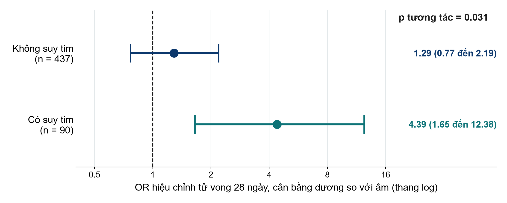{.neu-fig}

::: {.neu-takeaway}
**THÔNG ĐIỆP CHÍNH** Liên quan mạnh hơn ở suy tim (p tương tác 0.031): cần được xác nhận.
:::

::: {.notes}
Bổ sung. Yếu tố thay đổi tác động duy nhất được định trước: suy tim (n = 90) OR 4.39 (1.65 đến 12.38) so với 1.29 khi không suy tim, p tương tác 0.031.

Hợp lý, nhưng nhóm nhỏ và kém chính xác: báo cáo như kết quả thăm dò.
:::

## Bổ sung: AKI tăng theo cân bằng dịch (Q2)

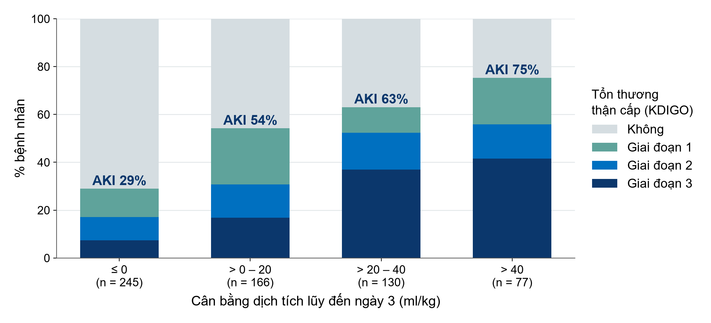{.neu-fig}

::: {.neu-takeaway}
**THÔNG ĐIỆP CHÍNH** Một gradient liều-đáp ứng: AKI 29%, 54%, 63%, 75% qua các nhóm cân bằng.
:::

::: {.notes}
Bổ sung, Q2. AKI tăng dần theo nhóm cân bằng dịch: 29%, 54%, 63%, 75%. OR đã hiệu chỉnh 1.27 (1.16 đến 1.40) mỗi 10 ml/kg.

Thận trọng: AKI cũng có thể gây cân bằng dương (quan hệ nhân quả ngược).
:::

## Bổ sung: số ngày không thở máy, một kết cục khó (Q3)

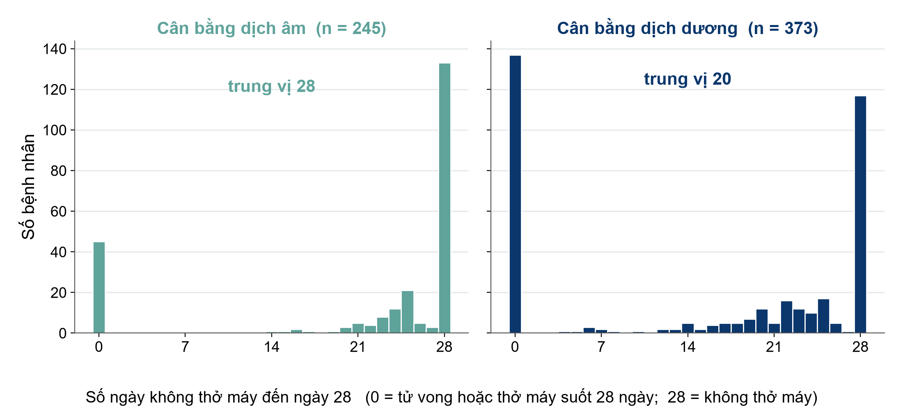{.neu-fig}

::: {.neu-takeaway}
**THÔNG ĐIỆP CHÍNH** Dồn ở 0 và 28: báo cáo trung vị và dùng kiểm định phi tham số.
:::

::: {.notes}
Bổ sung, Q3. Số ngày không thở máy dồn ở 0 (tử vong) và 28: báo cáo trung vị, dùng kiểm định phi tham số.

Đã hiệu chỉnh -0.61 ngày (-1.00 đến -0.21) mỗi 10 ml/kg.
:::

## Bổ sung: Mẫu và quần thể

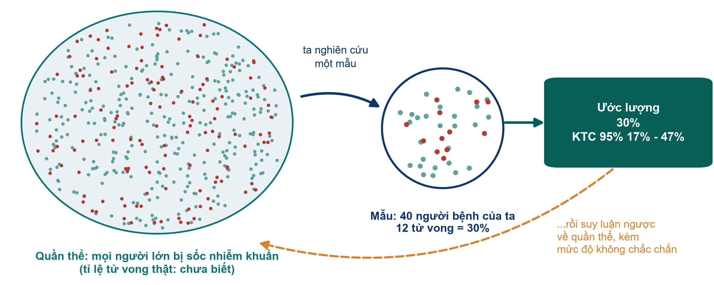{.neu-fig}

::: {.neu-takeaway}
**THÔNG ĐIỆP CHÍNH** Mẫu cho một ước lượng. KTC cho biết ước lượng đó chính xác đến đâu.
:::

::: {.notes}
Bổ sung. Mẫu là những người bệnh ta nghiên cứu, quần thể là tất cả những người ta muốn hiểu. 12 trên 40 tử vong: 30% (KTC 95% 17% đến 47%).

Hỏi: 400 người bệnh thay vì 40? Kỳ vọng: khoảng hẹp hơn.
:::

## Bổ sung: Đọc KTC 95% trong một bài báo thật

::: {.neu-intro}
Bài báo 1 (Boulet 2024, RCT thí điểm), kết cục chính: cân bằng dịch tích lũy ngày 5.
:::

:::: {.neu-cards style="--n:3"}
::: {.neu-card .plain style="--c:#0D7377"}
[Kết quả]{.neu-card-title}

- Trung vị 6.9 so với 35.0 ml/kg
- Chênh lệch trung bình 13.2 ml/kg
- KTC 95% -15.2 đến 41.6
- p = 0.42
:::
::: {.neu-card .plain style="--c:#0B376C"}
[Số 0 ở đâu?]{.neu-card-title}

- 0 = không khác biệt
- KTC chứa số 0
- Nên 'không khác biệt' phù hợp với dữ liệu
:::
::: {.neu-card .plain style="--c:#5FA39B"}
[Rộng đến đâu?]{.neu-card-title}

- Từ 15 ml/kg theo một hướng đến 42 ml/kg theo hướng kia
- Rất kém chính xác: chỉ 48 người bệnh
:::
::::

::: {.neu-takeaway}
**THÔNG ĐIỆP CHÍNH** 'Không có ý nghĩa' với KTC rộng nghĩa là 'chưa biết', không phải 'không tác động'.
:::

::: {.notes}
Bổ sung. Đọc mọi KTC theo ba bước: ước lượng, giá trị không tác động ở đâu, rộng đến đâu.

Bài báo 1: 13.2 ml/kg (-15.2 đến 41.6), p = 0.42. Chứa 0 và cũng chứa một khác biệt lớn: chưa biết.

Nếu có người hỏi vì sao 13.2 không bằng 35.0 trừ 6.9: đó là chênh lệch trung bình, còn trung vị mô tả dữ liệu lệch.
:::

## Bổ sung: ví dụ xuyên suốt trong một biểu đồ rừng

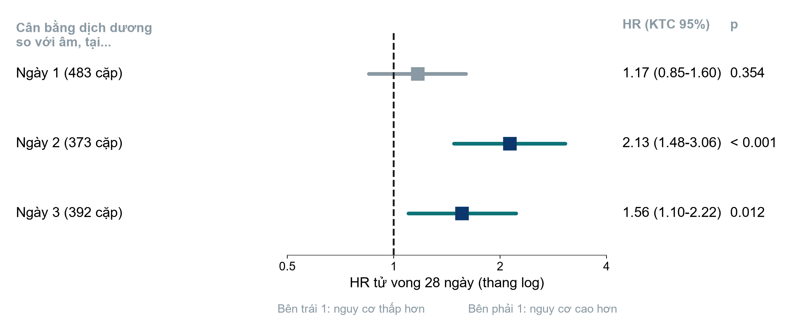{.neu-fig}

::: {.neu-caption}
Bài báo 2 (Hyun 2023): cân bằng dịch tích lũy dương so với âm, các thuần tập ghép cặp theo điểm xu hướng
:::

::: {.neu-takeaway}
**THÔNG ĐIỆP CHÍNH** Ngày 1: KTC cắt qua 1. Ngày 2 và 3: KTC nằm trên 1, nguy cơ cao hơn.
:::

::: {.notes}
Bổ sung. Biểu đồ rừng của Bài báo 2: ngày 1 HR 1.17 (0.85-1.60) cắt qua 1. Ngày 2 HR 2.13 (1.48-3.06) và ngày 3 HR 1.56 (1.10-2.22) nằm trên 1.

Có liên quan, không phải gây ra: vẫn còn nhiễu tồn dư.
:::

## Bổ sung: Log-rank, Cox và nguy cơ tỷ lệ

::: {.neu-intro}
Ba thuật ngữ anh chị sẽ gặp trong mọi bài báo về sống còn. KM = Kaplan-Meier. HR = tỷ số nguy cơ tức thời.
:::

:::: {.neu-cards style="--n:3"}
::: {.neu-card .plain style="--c:#0D7377"}
[Kiểm định log-rank]{.neu-card-title}

- So sánh toàn bộ đường KM
- Cho giá trị p
- Không cho độ lớn, không hiệu chỉnh
:::
::: {.neu-card .plain style="--c:#0B376C"}
[Hồi quy Cox]{.neu-card-title}

- Cho HR kèm KTC 95%
- Không tác động = 1
- Hiệu chỉnh được yếu tố gây nhiễu
:::
::: {.neu-card .plain style="--c:#5FA39B"}
[Nguy cơ tỷ lệ]{.neu-card-title}

- Giả định HR không đổi theo thời gian
- Đường cong cắt nhau: thận trọng
:::
::::

::: {.neu-takeaway}
**THÔNG ĐIỆP CHÍNH** Bài báo 2 (Hyun 2023): HR từ mô hình Cox 2.13 (1.48-3.06), nguy cơ tử vong khoảng gấp đôi.
:::

::: {.notes}
Bổ sung. Log-rank: có giá trị p, không có độ lớn, không hiệu chỉnh. Cox: HR đã hiệu chỉnh kèm KTC. Nguy cơ tỷ lệ: giả định HR không đổi, cần kiểm tra khi hai đường cắt nhau.

Thời gian: 2 phút.
:::

## Bổ sung: Tương quan không phải đồng thuận, cũng không phải nhân quả

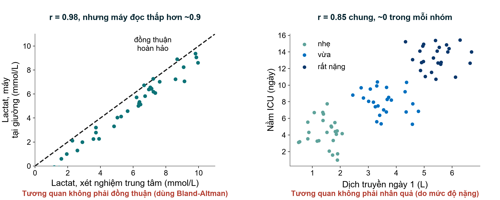{.neu-fig}

::: {.neu-takeaway}
**THÔNG ĐIỆP CHÍNH** r cao không có nghĩa hai phương pháp đồng thuận, hay cái này gây ra cái kia.
:::

::: {.notes}
Bổ sung. Bên trái: r = 0.98 nhưng máy đọc thấp hơn 0.9: tương quan không phải là tương đồng (dùng Bland-Altman). Bên phải: dịch và thời gian nằm ICU tương quan chỉ qua mức độ nặng.

Thời gian: 2 phút.
:::

## Bổ sung: Tương tác trong mô hình: tác động có khác nhau giữa các nhóm?

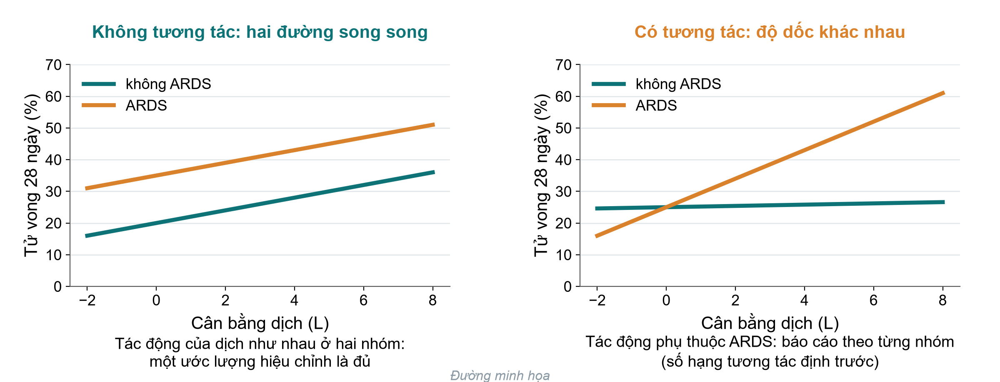{.neu-fig}

::: {.neu-takeaway}
**THÔNG ĐIỆP CHÍNH** Đường song song: hiệu chỉnh. Độ dốc khác nhau: báo cáo tác động theo từng nhóm.
:::

::: {.notes}
Bổ sung. Hai đường song song: một tác động đã hiệu chỉnh là đủ. Độ dốc khác nhau: có tương tác, báo cáo tác động ở từng nhóm.

Định trước một vài tương tác cần kiểm định, và kiểm định chính tương tác đó.

Thời gian: 2 phút.
:::

## Bổ sung: Đường 'không tác động': 0 cho hiệu số, 1 cho tỷ số

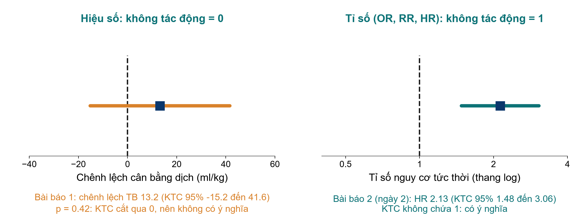{.neu-fig}

::: {.neu-takeaway}
**THÔNG ĐIỆP CHÍNH** Tìm giá trị không tác động trước, rồi xem KTC có cắt qua nó không.
:::

::: {.notes}
Bổ sung. Tìm giá trị không tác động trước: 0 với chênh lệch (Bài báo 1 cắt qua 0), 1 với tỷ số (Bài báo 2 ngày 2 nằm trên 1).

KTC không chứa giá trị không tác động nghĩa là p \< 0.05, và KTC còn cho biết độ lớn và độ chính xác.
:::

## Bổ sung: Mô hình dự báo: khả năng phân biệt và hiệu chuẩn

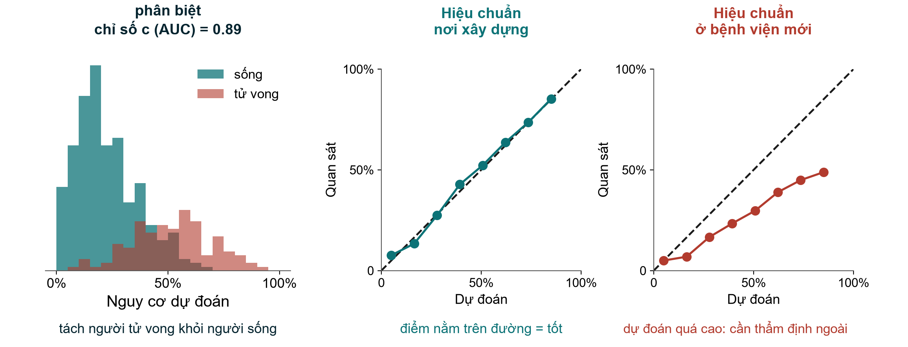{.neu-fig}

::: {.neu-takeaway}
**THÔNG ĐIỆP CHÍNH** Mô hình dự báo tốt phân biệt được người bệnh và ước đúng nguy cơ, cả ở bệnh viện mới.
:::

::: {.notes}
Bổ sung. Mô hình dự báo được đánh giá bằng khả năng phân biệt (AUC), hiệu chuẩn và thẩm định bên ngoài. Chỉ AUC cao là chưa đủ.

Hỏi: nhà cung cấp nêu AUC 0.92 trên dữ liệu của chính họ. Anh chị hỏi gì?

Thời gian: 2 phút.
:::

## Bổ sung: Dự báo và học máy: cách đánh giá một mô hình

::: {.neu-intro}
Học máy (ML) là cách linh hoạt để xây dựng mô hình dự báo. Các câu hỏi vẫn như cũ.
:::

:::: {.neu-cards style="--n:4"}
::: {.neu-card .plain style="--c:#0D7377"}
[Dùng để làm gì?]{.neu-card-title}

- Dự đoán nguy cơ từng người
- Không để giải thích nguyên nhân
- Cho ai, khi nào, quyết định gì?
:::
::: {.neu-card .plain style="--c:#0B376C"}
[Đủ dữ liệu?]{.neu-card-title}

- Học máy cần rất nhiều biến cố
- Nguy cơ quá khớp cao
- Đã thẩm định nội bộ?
:::
::: {.neu-card .plain style="--c:#5FA39B"}
[Có hiệu quả?]{.neu-card-title}

- Phân biệt (AUC)
- Biểu đồ hiệu chuẩn
- Thẩm định ngoài
:::
::: {.neu-card .plain style="--c:#0070C0"}
[Báo cáo đủ?]{.neu-card-title}

- Bảng kiểm TRIPOD+AI
- Mã, dữ liệu, công bằng
- Tác động lên người bệnh?
:::
::::

::: {.neu-takeaway}
**THÔNG ĐIỆP CHÍNH** Điểm AI là một mô hình dự báo: hãy hỏi về hiệu chuẩn và thẩm định ngoài.
:::

::: {.notes}
Bổ sung. Học máy là dự báo. Bốn câu hỏi: dùng để làm gì, đủ dữ liệu chưa, có hiệu quả không (AUC, hiệu chuẩn, thẩm định bên ngoài), có báo cáo đúng không (TRIPOD+AI)?

Chính xác không đồng nghĩa với có lợi.

Thời gian: 2 phút.
:::

## Bổ sung: Phân tích các trường hợp đầy đủ và quy gán đa bội

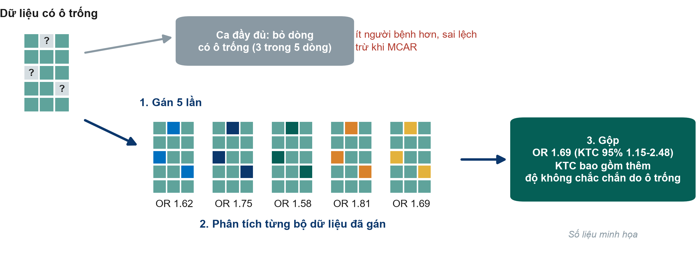{.neu-fig}

::: {.neu-takeaway}
**THÔNG ĐIỆP CHÍNH** Quy gán đa bội giữ mọi người bệnh và thừa nhận độ không chắc chắn của ô trống.
:::

::: {.notes}
Bổ sung. Trường hợp đầy đủ: đơn giản, mất người bệnh, sai lệch trừ khi MCAR. Quy gán đa bội: điền mỗi ô trống nhiều lần, phân tích từng bộ, rồi gộp lại. Cách này trung thực về những gì ta không biết.

Thời gian: 2 phút.
:::

## Bổ sung: Báo cáo và kiểm tra dữ liệu bị thiếu

::: {.neu-intro}
Bốn điều người phản biện sẽ tìm.
:::

:::: {.neu-cards style="--n:4"}
::: {.neu-card .plain style="--c:#0D7377"}
[Báo cáo]{.neu-card-title}

- Số thiếu theo từng biến
- Sơ đồ: ai và vì sao
- Trong Bảng 1 hoặc chú thích
:::
::: {.neu-card .plain style="--c:#0B376C"}
[So sánh]{.neu-card-title}

- Người bệnh có và không có dữ liệu đầy đủ
- Họ có khác nhau không?
:::
::: {.neu-card .plain style="--c:#5FA39B"}
[Độ nhạy (Cấp độ 3)]{.neu-card-title}

- Trường hợp đầy đủ so với quy gán đa bội
- Script mẫu: 05\_missing.R
- Thực hành ở Cấp độ 3, Học phần H
:::
::: {.neu-card .plain style="--c:#0070C0"}
[Kế hoạch]{.neu-card-title}

- Viết trong SAP trước khi thấy dữ liệu
- Phần 3 của đề cương
:::
::::

::: {.neu-takeaway}
**THÔNG ĐIỆP CHÍNH** Dữ liệu thiếu cũng là một kết quả: báo cáo, xử lý, và kiểm tra lại kết luận.
:::

::: {.notes}
Bổ sung. Người phản biện tìm: số giá trị thiếu của từng biến, so sánh người có và không có dữ liệu đầy đủ, một phân tích độ nhạy, và kế hoạch viết từ trước.

Thời gian: 2 phút.
:::
