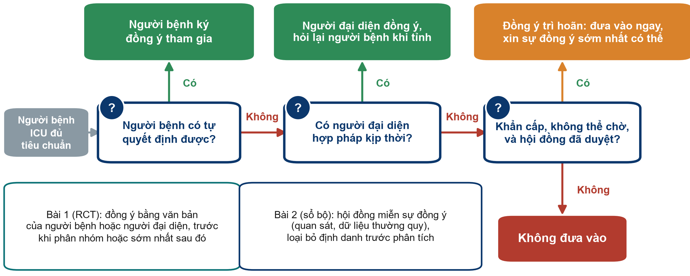
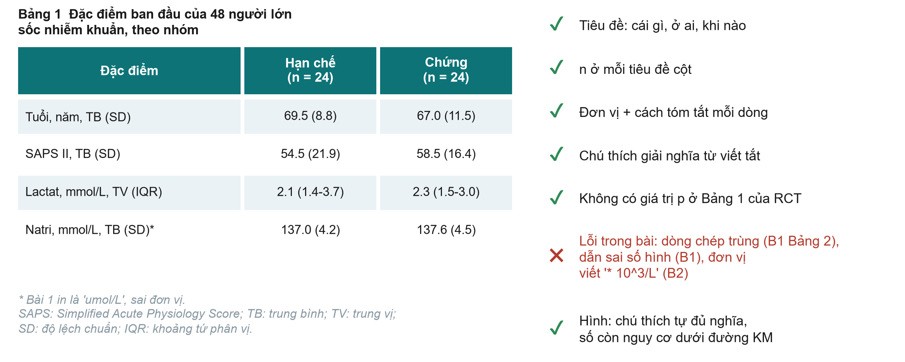
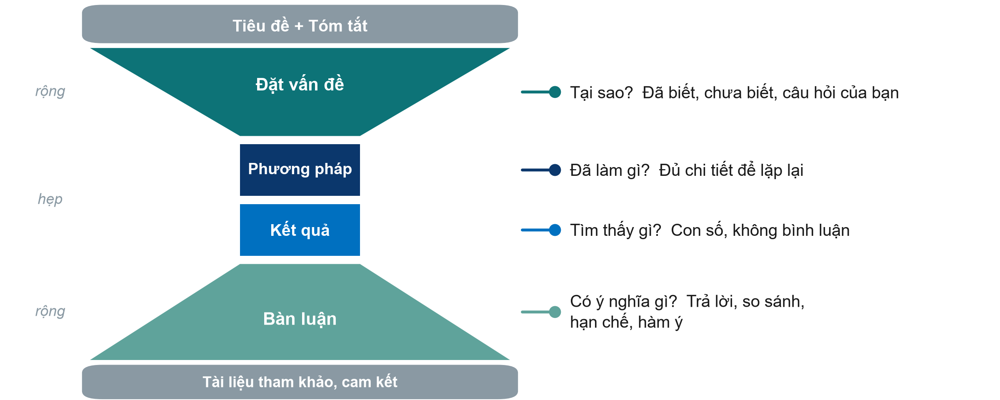

# Buổi 7 · Bảo vệ & viết: đạo đức, liêm chính, Phương pháp và Kết quả

## Tuần 7 · Thứ Bảy, 19:30-22:30 (trực tuyến)

- 19:30  Ôn tập: Buổi 6
- 19:40  7.1  Đề cương chi tiết, đạo đức, sự đồng ý, đăng ký, tính khả thi
- 20:10  7.2  Liêm chính: quyền tác giả, xung đột lợi ích, chia sẻ dữ liệu, AI
- 20:30  Xây dựng đề cương 7: đạo đức và kế hoạch công bố
- 21:00  7.3  Viết bài báo (I): Phương pháp, Kết quả, bảng, STROBE
- 21:35  Thực hành bản thảo 1: cả lớp cùng viết, rồi mỗi người tự viết

::: {.notes}
Buổi 7 (19:30). Trực tuyến, 19:30-22:30, giải lao 15 phút lúc 20:45. Hai nửa: trước giải lao chúng ta bảo vệ người bệnh và khoa học (đạo đức, liêm chính) và làm mẫu Phần 4 của đề cương. Sau giải lao chúng ta bắt đầu viết bản thảo FLUID-ICU.

Hình thức: cả lớp làm chung. Học viên trả lời bằng bình chọn (poll), hoặc giảng viên mời hai ba người trả lời, bật micro. Giảng viên (hoặc một học viên tình nguyện) gõ câu trả lời của lớp lên màn hình chia sẻ. Không dùng phòng nhóm nhỏ.

Trước buổi học: gửi các tệp PDF (phiếu bài tập Buổi 7, năm gói kết quả phân tích Q1-Q5, Bài 1 và Bài 2, mẫu bản thảo). Cài sẵn các câu bình chọn. Mở một tài liệu chung để ghi câu trả lời của lớp.

Nhịp: chậm. Nếu thiếu thời gian, bỏ các slide trong mục 'Slide bổ sung: Buổi 7' ở cuối, không bao giờ bỏ phần thực hành.
:::

## Câu hỏi ôn tập: Buổi 6 trong năm câu

::: {.neu-banner style="--c:#6C3483"}
CÂU HỎI NHANH · 8 phút
:::

:::: {.columns}
::: {.column width="60%"}
::: {.neu-activity-steps style="--c:#6C3483"}
- OR (tỷ số chênh) thô là 2.1. OR hiệu chỉnh là 1.4. Điều gì đã xảy ra?
- HR (tỷ số nguy cơ tức thời) 0.85, KTC 95% 0.60 đến 1.20: có lợi rõ ràng không?
- Lactat bị thiếu ở 15% người bệnh. Nêu một cách xử lý
- Đường cong Kaplan-Meier: người bệnh 'bị kiểm duyệt' nghĩa là gì?
- Câu hỏi FLUID-ICU bạn đã chọn (Q1 đến Q5): kết quả chính là gì? Trả lời trong khung chat
:::
:::
::: {.column width="40%"}
::: {.neu-side .plain style="--c:#6C3483"}
Đáp án

- Nhiễu: một phần liên quan thô là do mức độ nặng
- Không: KTC chứa giá trị 1
- Phân tích các trường hợp đầy đủ, hoặc quy gán đa bội kèm phân tích độ nhạy
- Rời nghiên cứu khi còn sống. Sau đó không biết kết cục
- Theo gói kết quả phân tích của bạn
:::
:::
::::

::: {.neu-output style="--c:#6C3483"}
**SẢN PHẨM** Mọi người nhớ lại: hiệu chỉnh, KTC, dữ liệu bị thiếu, sống còn
:::

::: {.notes}
Ôn tập (19:30-19:40, gồm 1 phút chào và slide 'Hôm nay'). Mở đầu bằng cách đọc hai ba câu trả lời cho câu hỏi cuối Buổi 6 (đã đọc trong tuần) và sửa những chỗ hiểu sai.

Câu 1-4 là câu hỏi mở. Đọc từng câu, cho 30 giây, rồi mời hai ba người trả lời, bật micro. Mở khung đáp án sau mỗi câu. Dành nhiều thời gian nhất cho câu có nhiều câu trả lời khác nhau.

Câu 1 nối thẳng với phần viết hôm nay: trong Kết quả ta báo cáo cả ước lượng thô và hiệu chỉnh (mục STROBE 16), và trong Bàn luận ta giải thích vì sao chúng khác nhau.

Câu 5 trả lời trong khung chat. Đây là con số mỗi học viên sẽ viết sau giải lao. Ai chưa chọn câu hỏi thì chọn ngay hôm nay (Q1 đến Q5, gói kết quả đã gửi trước buổi học).
:::

## Hôm nay: hoàn thành đề cương, bắt đầu bài báo

::: {.neu-intro}
FLUID-ICU = bộ dữ liệu của khóa học: thuần tập mô phỏng 620 người lớn nhiễm khuẩn huyết ở 4 ICU (Buổi 5-6).
:::

:::: {.neu-cards style="--n:3"}
::: {.neu-card .plain style="--c:#0D7377"}
[Sản phẩm 1: đề cương của bạn]{.neu-card-title}

- Câu hỏi của chính bạn
- Hôm nay: Phần 4 (đạo đức, đăng ký, khả thi, công bố)
- Buổi 8: nộp. Khoảng 5 bạn trình bày
:::
::: {.neu-card .plain style="--c:#0B376C"}
[Sản phẩm 2: bản thảo của bạn]{.neu-card-title}

- Câu hỏi FLUID-ICU của bạn (Q1 đến Q5)
- Chúng tôi đưa kết quả. Bạn viết
- Hôm nay: Phương pháp, Kết quả
- Buổi 8: Đặt vấn đề, Bàn luận, Tóm tắt, Tiêu đề
:::
::: {.neu-card .plain style="--c:#5FA39B"}
[Hai bài báo làm ví dụ]{.neu-card-title}

- Bài 1: Boulet 2024, thử nghiệm ngẫu nhiên, 48 người bệnh
- Bài 2: Hyun 2023, thuần tập, 2 516 người bệnh
- Tệp PDF trong Course/Papers
:::
::::

::: {.neu-takeaway}
**THÔNG ĐIỆP CHÍNH** Trước giải lao: Đề cương Phần 4. Sau giải lao: Phương pháp và Kết quả.
:::

::: {.notes}
Hai sản phẩm, cả hai đều là bài cá nhân. Sản phẩm 1, đề cương nghiên cứu của từng học viên, hôm nay có phần cuối cùng (đạo đức, đăng ký, khả thi, kế hoạch công bố). Mọi người đều nộp. Khoảng năm học viên tình nguyện sẽ trình bày vào thứ Bảy tuần sau.

Sản phẩm 2, bản thảo của từng học viên, chuyển từ 'đọc kết quả phân tích' (Buổi 6) sang viết. Nói rõ: chúng tôi đưa kết quả của câu hỏi FLUID-ICU bạn chọn trong một gói kết quả phân tích, và bạn viết bài báo. Không ai phải tự tính toán.

Nhắc lại tên hai bài báo: Bài 1 (Boulet 2024) là thử nghiệm ngẫu nhiên về hạn chế dịch trong sốc nhiễm khuẩn (48 người bệnh). Bài 2 (Hyun 2023) là nghiên cứu thuần tập về cân bằng dịch và tử vong trong nhiễm khuẩn huyết (2 516 người bệnh). Cả buổi ta dùng chúng làm ví dụ về cách làm tốt và chưa tốt.

Hỏi (mời hai ba người trả lời, bật micro): bạn đã chọn câu hỏi nào (Q1-Q5)?
:::

## 7.1  \|  30 phút

:::: {.neu-statement}
::: {.neu-big}
Đề cương chi tiết, đạo đức và sự đồng ý tham gia
:::

::: {.neu-sub}
Bảo vệ người bệnh trước khi có dữ liệu đầu tiên
:::
::::

::: {.notes}
Phần 7.1 (19:40-20:10). Mười slide, khoảng 3 phút mỗi slide, gồm hai ví dụ mẫu.

Slide về sự đồng ý trong ICU và ví dụ mẫu đi kèm cần nhiều thời gian nhất: đó là vấn đề thực tế của các ICU.

Liên hệ: mọi nội dung của phần này sẽ thành một đoạn trong Đề cương Phần 4 (Xây dựng đề cương 7 lúc 20:30).
:::

## Đề cương chi tiết: bản thiết kế của nghiên cứu

::: {.neu-intro}
Đề cương chi tiết (protocol) = kế hoạch đầy đủ, được duyệt trước người bệnh đầu tiên. Bảng kiểm cho thử nghiệm: SPIRIT 2025.
:::

:::: {.neu-cards style="--n:4"}
::: {.neu-card .plain style="--c:#0D7377"}
[Ai và cái gì]{.neu-card-title}

- Trang bìa
- Tên đề tài, phiên bản, ngày
- Số đăng ký
- Nhóm, vai trò, kinh phí
:::
::: {.neu-card .plain style="--c:#0B376C"}
[Tại sao]{.neu-card-title}

- Đề cương Phần 1
- Vấn đề và lý do
- Câu hỏi (PICO)
- Mục tiêu, giả thuyết
:::
::: {.neu-card .plain style="--c:#5FA39B"}
[Như thế nào]{.neu-card-title}

- Đề cương Phần 2-3
- Thiết kế, bối cảnh, đối tượng
- Phơi nhiễm, kết cục
- Cỡ mẫu, dữ liệu, kế hoạch phân tích
:::
::: {.neu-card .plain style="--c:#0070C0"}
[Bảo vệ và chia sẻ]{.neu-card-title}

- Đề cương Phần 4 (hôm nay)
- Phê duyệt đạo đức, sự đồng ý
- Bảo mật, an toàn dữ liệu
- Kế hoạch công bố
:::
::::

::: {.neu-takeaway}
**THÔNG ĐIỆP CHÍNH** Bốn phần đề cương của bạn chính là khung của một đề cương chi tiết.
:::

::: {.notes}
Ý chính: đề cương chi tiết là kế hoạch đầy đủ bằng văn bản, được viết và phê duyệt trước khi đưa người bệnh đầu tiên vào nghiên cứu. SPIRIT 2025 (Standard Protocol Items: Recommendations for Interventional Trials) là bảng kiểm quốc tế về nội dung đề cương thử nghiệm lâm sàng. Nghiên cứu quan sát cũng theo cùng logic.

Đi qua bốn thẻ: ai và cái gì (trang bìa, đăng ký, nhóm, kinh phí), tại sao (Phần 1), như thế nào (Phần 2 và 3), bảo vệ và chia sẻ (Phần 4, hôm nay). PICO = Đối tượng, Can thiệp hoặc phơi nhiễm, So sánh, Kết cục.

Mọi thay đổi sau khi phê duyệt phải là sửa đổi chính thức, được duyệt trước khi áp dụng, không lặng lẽ thay đổi.

Ví dụ xuyên suốt: Bài 1 cho biết đề cương và kế hoạch phân tích thống kê đã đăng ký trên ClinicalTrials.gov (NCT04947904) trước người bệnh đầu tiên. Nhờ vậy người đọc kiểm tra được tác giả có làm đúng kế hoạch hay không.

Bình chọn: phần nào trong đề cương của bạn đang yếu nhất? Thường là Như thế nào (cỡ mẫu hoặc kế hoạch phân tích). Trấn an: mẫu đề cương (Course/Templates/Research\_Proposal\_Template) theo đúng thứ tự này.
:::

## Hai bộ nguyên tắc: Helsinki và Thực hành tốt thử nghiệm lâm sàng

:::: {.neu-cards style="--n:2"}
::: {.neu-card style="--c:#0D7377"}
[Tuyên bố Helsinki (Hiệp hội Y khoa Thế giới, 2024)]{.neu-card-title}

- Quyền và lợi ích của người tham gia trên hết
- Đề cương được hội đồng đạo đức phê duyệt
- Đồng ý tự nguyện, có hiểu biết
- Rủi ro tối thiểu và có lý do chính đáng
- Quyền riêng tư và bảo mật
- Đăng ký trước. Công bố tất cả kết quả
:::
::: {.neu-card style="--c:#0B376C"}
[Thực hành tốt thử nghiệm lâm sàng (GCP: ICH E6(R3), 2025)]{.neu-card-title}

- Nhóm đủ năng lực, được đào tạo
- Chất lượng được thiết kế từ đầu
- Đề cương rõ ràng, khả thi
- Giám sát tương xứng với rủi ro
- Dữ liệu tin cậy, truy xuất được
- Vai trò và trách nhiệm rõ ràng
:::
::::

::: {.neu-takeaway}
**THÔNG ĐIỆP CHÍNH** Helsinki nói tại sao bảo vệ người tham gia. GCP nói làm thế nào cho tốt.
:::

::: {.notes}
Ý chính: Tuyên bố Helsinki (Hiệp hội Y khoa Thế giới, bản sửa đổi mới nhất tháng 10/2024) là nền tảng đạo đức của nghiên cứu trên người. Cốt lõi: quyền và lợi ích của từng người tham gia đặt trên mục tiêu tạo ra tri thức. Đề cương được một hội đồng đạo đức độc lập phê duyệt trước khi bắt đầu. Đồng ý tự nguyện, có hiểu biết. Rủi ro tối thiểu và có lý do chính đáng. Bảo vệ quyền riêng tư. Mọi nghiên cứu đăng ký trước người tham gia đầu tiên và công bố tất cả kết quả, kể cả âm tính hoặc chưa kết luận được.

Bản 2024 dùng từ 'người tham gia' thay cho 'đối tượng', tăng cường bảo vệ đối tượng dễ bị tổn thương và người không thể tự đồng ý, và nhấn mạnh liêm chính khoa học.

ICH E6(R3) Thực hành tốt thử nghiệm lâm sàng (ICH = Hội đồng Quốc tế về Hài hòa, thông qua tháng 1/2025) là chuẩn chất lượng quốc tế cho thử nghiệm lâm sàng. Tinh thần này áp dụng cho mọi nghiên cứu.

Quan niệm sai: 'GCP chỉ dành cho công ty dược'. Bài 1, một thử nghiệm ICU học thuật, ghi rõ phân tích theo ICH-GCP.

Bình chọn: điểm nào trong 12 điểm này khó thực hiện nhất ở khoa ta? Thường là dữ liệu tin cậy (hồ sơ thiếu) hoặc thời gian dành riêng cho nghiên cứu.
:::

## Hành trình qua hội đồng đạo đức: phê duyệt trước dữ liệu

::: {.neu-intro}
Dự kiến 1 đến 3 tháng. Hội đồng đặt câu hỏi và yêu cầu chỉnh sửa là chuyện bình thường.
:::

:::: {.neu-steps}
::: {.neu-step style="--c:#0D7377"}
[Chuẩn bị]{.neu-step-label}

- Đề cương
- Phiếu đồng ý tham gia
- Phiếu thu thập dữ liệu (CRF)
:::
::: {.neu-step style="--c:#0B376C"}
[Thẩm định]{.neu-step-label}

- Thẩm định khoa học hoặc cấp khoa trước
:::
::: {.neu-step style="--c:#5FA39B"}
[Nộp]{.neu-step-label}

- Hồ sơ gửi hội đồng đạo đức
:::
::: {.neu-step style="--c:#0070C0"}
[Xét duyệt]{.neu-step-label}

- Miễn, rút gọn hoặc hội đồng toàn thể
- Hội đồng quyết định
:::
::: {.neu-step style="--c:#055F56"}
[Phê duyệt]{.neu-step-label}

- Quyết định phê duyệt có số và ngày
:::
::: {.neu-step style="--c:#8A99A3"}
[Bắt đầu]{.neu-step-label}

- Thử nghiệm: đăng ký trước
- Rồi mới đến người bệnh đầu tiên
:::
::::

::: {.neu-takeaway}
**THÔNG ĐIỆP CHÍNH** Chưa có quyết định phê duyệt thì không thu thập dữ liệu, kể cả 'vài ca thôi'.
:::

::: {.notes}
Đi qua sáu bước từ trái sang phải. Phần lớn cơ sở yêu cầu thẩm định khoa học hoặc cấp khoa trước. sau đó hồ sơ được nộp cho hội đồng đạo đức trong nghiên cứu y sinh học (còn gọi là IRB hoặc IEC).

Hồ sơ gồm: đề cương, bản thông tin và phiếu đồng ý tham gia, phiếu thu thập dữ liệu (CRF), lý lịch nghiên cứu viên và chứng chỉ GCP, dự toán kinh phí và bảo hiểm khi cần.

Các hình thức xét duyệt: một số nghiên cứu nguy cơ thấp được miễn hoặc xét duyệt rút gọn. Thử nghiệm và nghiên cứu có nguy cơ cao hơn mức tối thiểu được xét tại hội đồng toàn thể. Hội đồng quyết định hình thức, không phải nghiên cứu viên.

Trong quá trình nghiên cứu: sửa đổi đề cương, báo cáo biến cố bất lợi, báo cáo tiến độ và báo cáo cuối đều gửi hội đồng.

Quan niệm sai cần sửa: 'cứ thu thập trước, xin phép sau'. Hội đồng không thể phê duyệt hồi tố và tạp chí sẽ từ chối bài.

Ví dụ xuyên suốt: Bài 1 ghi tên hội đồng và số phê duyệt trong phần Phương pháp. Bài 2 ghi số phê duyệt IRB trong phần Cam kết.
:::

## Đăng ký trước người tham gia đầu tiên

::: {.neu-intro}
Thứ tự: đề cương, phê duyệt đạo đức, đăng ký, người tham gia đầu tiên.
:::

:::: {.neu-cards style="--n:3"}
::: {.neu-card .plain style="--c:#0D7377"}
[Thử nghiệm lâm sàng]{.neu-card-title}

- **[Bắt buộc]{style="color:#C0392B"}**
- ClinicalTrials.gov hoặc một cơ sở đăng ký chính thức khác của WHO
- Bài 1: đăng ký 1/7/2021, người bệnh đầu tiên tháng 9/2021
:::
::: {.neu-card .plain style="--c:#0B376C"}
[Tổng quan hệ thống]{.neu-card-title}

- **[Được yêu cầu]{style="color:#D9822B"}**
- PROSPERO, nơi đăng ký đề cương tổng quan
- Trước khi trích xuất dữ liệu
:::
::: {.neu-card .plain style="--c:#5FA39B"}
[Nghiên cứu quan sát]{.neu-card-title}

- **[Khuyến khích]{style="color:#2E8B57"}**
- Ví dụ trên ClinicalTrials.gov
- Xem quy định của tạp chí và địa phương
:::
::::

::: {.neu-takeaway}
**THÔNG ĐIỆP CHÍNH** Thử nghiệm: không đăng ký trước người bệnh đầu tiên thì không được công bố.
:::

::: {.notes}
Ý chính: đăng ký đưa sự tồn tại, thiết kế và kết cục chính của nghiên cứu lên hồ sơ công khai Trước khi đưa bất kỳ ai vào. Điều này ngăn việc giấu các nghiên cứu âm tính và đổi kết cục.

Thử nghiệm lâm sàng: bắt buộc đăng ký. Các tạp chí theo ICMJE (Ủy ban Quốc tế các Biên tập viên Tạp chí Y khoa) không đăng thử nghiệm không được đăng ký trước người tham gia đầu tiên, và nhiều quốc gia quy định bằng luật. Dùng ClinicalTrials.gov hoặc một cơ sở đăng ký chính thức khác của WHO. Cổng WHO ICTRP (Nền tảng Đăng ký Thử nghiệm Lâm sàng Quốc tế) tra cứu tất cả cùng lúc. Đó là cổng tìm kiếm, không phải nơi đăng ký.

Tổng quan hệ thống: đăng ký đề cương trên PROSPERO trước khi trích xuất dữ liệu. Nhiều tạp chí yêu cầu.

Nghiên cứu quan sát: khuyến khích chứ chưa bắt buộc. Tuyên bố Helsinki yêu cầu mọi nghiên cứu trên người được đăng ký.

Ví dụ xuyên suốt: Bài 1 đăng ký NCT04947904 ngày 1/7/2021, người bệnh đầu tiên vào tháng 9/2021, tức là đăng ký tiến cứu. Số đăng ký có ngay trong phần tóm tắt.

Hỏi (mời hai ba người trả lời, bật micro): nghiên cứu của bạn có cần đăng ký không? Đáp án: thử nghiệm thì có. Phần lớn đề cương thuần tập là 'khuyến khích'. Nếu còn thời gian, có câu bình chọn bốn tình huống trong phần Slide bổ sung.
:::

## Sự đồng ý tham gia nghiên cứu: bốn yếu tố cốt lõi

::: {.neu-intro}
Sự đồng ý là một cuộc trao đổi, không chỉ là một chữ ký.
:::

:::: {.neu-cards style="--n:4"}
::: {.neu-card .plain style="--c:#0D7377"}
[Được thông tin]{.neu-card-title}

- Mục đích, những gì sẽ diễn ra
- Rủi ro, lợi ích, lựa chọn khác
- Dữ liệu được bảo vệ ra sao
- Liên hệ với ai
:::
::: {.neu-card .plain style="--c:#0B376C"}
[Hiểu rõ]{.neu-card-title}

- Ngôn ngữ đơn giản, quen thuộc
- Có thời gian để hỏi
- Nhắc lại: 'bác hãy nói theo cách của bác'
:::
::: {.neu-card .plain style="--c:#5FA39B"}
[Tự nguyện]{.neu-card-title}

- Không ép buộc
- Được từ chối hoặc rút lui
- Việc điều trị không bị ảnh hưởng
:::
::: {.neu-card .plain style="--c:#0070C0"}
[Có văn bản]{.neu-card-title}

- Phiếu ký tên, ghi ngày
- Một bản cho người tham gia
- Xin lại sự đồng ý nếu nghiên cứu thay đổi
:::
::::

::: {.neu-takeaway}
**THÔNG ĐIỆP CHÍNH** Nếu người bệnh không giải thích lại được nghiên cứu, sự đồng ý chưa dựa trên hiểu biết.
:::

::: {.notes}
Ý chính: sự đồng ý hợp lệ cần đủ bốn yếu tố: thông tin, hiểu biết, tự nguyện và có văn bản.

Người bệnh thường hỏi lại điều dưỡng và các thành viên khác trong nhóm 'tôi đã ký cái gì?', nên đây là việc của mọi người, không riêng nghiên cứu viên chính.

Rút lui: người tham gia có thể rời nghiên cứu bất cứ lúc nào, không cần nêu lý do và không ảnh hưởng đến điều trị. Ví dụ xuyên suốt: trong Bài 1, hai người bệnh nhóm chứng rút lại sự đồng ý và không được đưa vào phân tích. Quyền đó được tôn trọng, và vì vậy thử nghiệm phân tích 48 trên 50 người.

Lỗi thường gặp: phiếu đồng ý viết như văn bản học thuật, bằng ngôn ngữ mà gia đình không đọc thành thạo. Hãy xin mẫu của hội đồng (có một mẫu trong Course/Templates/Informed\_Consent\_Template).

Hỏi (mời hai ba người trả lời, bật micro): trong nghiên cứu của bạn, ai sẽ xin sự đồng ý và vào lúc nào? Đáp án mong đợi: một thành viên đã được đào tạo, nếu được thì không phải bác sĩ điều trị đang chịu áp lực thời gian.
:::

## Sự đồng ý trong ICU: khi người bệnh không thể tự quyết định

{.neu-fig}

::: {.neu-takeaway}
**THÔNG ĐIỆP CHÍNH** Người bệnh, rồi người đại diện hợp pháp, rồi đồng ý trì hoãn (chỉ khi được duyệt).
:::

::: {.notes}
Đây là vấn đề thực tế của ICU: phần lớn người bệnh đang an thần, mê sảng hoặc sốc khi đủ tiêu chuẩn. Sơ đồ này giữ dạng hình vì các nhánh rẽ chính là thông điệp.

Đọc sơ đồ từ trái sang phải. 1) Người bệnh có tự quyết định được không? Nếu có, người bệnh ký đồng ý. 2) Nếu không, người đại diện hợp pháp (thường là gia đình, theo quy định pháp luật) đồng ý, và hỏi lại người bệnh khi họ có khả năng. 3) Nếu không liên lạc kịp người đại diện và điều trị không thể chờ, nghiên cứu chỉ được tiến hành khi đề cương đã giải thích lý do và hội đồng đạo đức đã duyệt trước quy trình khẩn cấp này. Sau đó xin sự đồng ý để tiếp tục sớm nhất có thể. Đó là 'đồng ý trì hoãn'. Tuyên bố Helsinki 2024 cho phép đúng điều này, với các điều kiện trên.

Bài 1 áp dụng cách này: đồng ý bằng văn bản của người bệnh hoặc người đại diện hợp pháp 'trước khi phân nhóm ngẫu nhiên hoặc sớm nhất có thể sau đó' (trang 3).

Bài 2 khác: một sổ bộ dùng dữ liệu thường quy. Hội đồng miễn sự đồng ý cá nhân và dữ liệu được loại bỏ thông tin định danh trước khi phân tích (trang 8).

Luật địa phương quy định ai được làm người đại diện và có cho phép đồng ý trì hoãn hay không. Hãy hỏi hội đồng trước khi viết đề cương.

Hỏi: nếu gia đình từ chối sau khi người bệnh đã được đưa vào theo đồng ý trì hoãn thì sao? Đáp án: người bệnh rời nghiên cứu. Dữ liệu đã thu có được dùng hay không tùy đề cương đã duyệt và sự đồng ý của gia đình.
:::

## Ví dụ mẫu: ai đồng ý cho ba người bệnh ICU này?

::: {.neu-intro}
Đưa từng người bệnh qua sơ đồ ở slide trước.
:::

:::: {.neu-cards style="--n:3"}
::: {.neu-card .plain style="--c:#0D7377"}
[Ông A, 54 tuổi]{.neu-card-title}

- Viêm phổi, tỉnh, định hướng tốt
- Đủ tiêu chuẩn thử nghiệm dịch truyền
- **[Người bệnh tự đồng ý]{style="color:#2E8B57"}**
:::
::: {.neu-card .plain style="--c:#0B376C"}
[Bà B, 71 tuổi]{.neu-card-title}

- Sốc nhiễm khuẩn, đang an thần
- Con gái ở cạnh giường
- **[Người đại diện đồng ý. Hỏi lại bà B khi tỉnh]{style="color:#2E8B57"}**
:::
::: {.neu-card .plain style="--c:#5FA39B"}
[Ông C, 38 tuổi]{.neu-card-title}

- Sốc nhiễm khuẩn lúc 3 giờ sáng, chưa có người nhà
- Điều trị không thể chờ. Hội đồng đã duyệt
- **[Đồng ý trì hoãn: hỏi sớm nhất có thể]{style="color:#D9822B"}**
:::
::::

::: {.neu-takeaway}
**THÔNG ĐIỆP CHÍNH** Quy trình và thời điểm được ghi trong đề cương trước người bệnh đầu tiên.
:::

::: {.notes}
Ví dụ mẫu, cả lớp cùng làm. Với từng người bệnh, mời một người trả lời trước khi mở dòng cuối (bấm chậm).

Ông A: có năng lực quyết định, nên người bệnh tự quyết định.

Bà B: hiện không có năng lực. Người đại diện hợp pháp (ở đây là con gái, nếu luật địa phương cho phép) đồng ý. Bà B được hỏi lại khi có năng lực, và bà có thể rút lui.

Ông C: không liên lạc kịp người đại diện và điều trị không thể chờ. Đồng ý trì hoãn chỉ áp dụng khi đề cương mô tả và hội đồng đã phê duyệt. Xin sự đồng ý của gia đình hoặc người bệnh sớm nhất có thể. Bài 1 dùng cách này.

Quan niệm sai: 'bác sĩ điều trị có thể đồng ý thay người bệnh'. Không. Bác sĩ điều trị không phải người đại diện.
:::

## Bảo mật: loại bỏ thông tin định danh trước khi phân tích

| Mục | Trước: nhận diện được | Sau: đã loại bỏ định danh |
|:---|:---|:---|
| Họ tên | Ana P. | Mã nghiên cứu SEP-001 |
| Mã bệnh án | 1084521 | Đã xóa |
| Ngày sinh | 12/03/1956 | 68 tuổi |
| Ngày nhập viện | 14/03/2024 | Tháng 03/2024 |
| Cân bằng dịch, ml/kg | +35 | +35 |

::: {.neu-table-caption}
Họ tên ở lại khoa. Chỉ mã nghiên cứu được mang đi. Tệp khóa (mã = danh tính) được khóa và lưu riêng. Cẩn thận với nhóm rất nhỏ (n \< 5).
:::

::: {.notes}
Ý chính: bảo mật được bảo đảm bằng thiết kế, không phải bằng thiện chí.

Trước: các thông tin định danh trực tiếp như họ tên, mã bệnh án, ngày sinh chính xác, địa chỉ, số điện thoại, ảnh. Sau: mã nghiên cứu, tuổi thay cho ngày sinh, tháng thay cho ngày chính xác, và chỉ các biến có trong từ điển dữ liệu. Dòng ví dụ (hư cấu) là một người bệnh trước và sau.

Tệp khóa nối mã với danh tính được lưu riêng, có mật khẩu, chỉ một hai người có tên được truy cập.

Cẩn thận nhận diện gián tiếp: 'người bệnh 19 tuổi duy nhất chạy ECMO trong tháng 3' vẫn nhận ra được dù không có tên. Báo cáo các nhóm rất nhỏ một cách thận trọng.

Quy tắc thực hành: không lưu dữ liệu người bệnh trên điện thoại cá nhân, ứng dụng nhắn tin, email cá nhân, đám mây công cộng hay công cụ AI. Chỉ dùng nơi lưu trữ được mã hóa và được cơ sở cho phép.

Ví dụ xuyên suốt: Bài 2 ghi rõ thông tin người bệnh đã được ẩn danh và loại bỏ định danh trước khi phân tích.

Hỏi (mời hai ba người trả lời, bật micro): tệp khóa trong nghiên cứu của bạn sẽ nằm ở đâu? Đáp án: nơi lưu trữ được cơ sở phê duyệt, có mật khẩu, không phải USB trong túi áo.
:::

## Ví dụ mẫu: đoạn đạo đức cho một nghiên cứu thuần tập như FLUID-ICU

::: {.neu-intro}
FLUID-ICU là dữ liệu mô phỏng. Nếu là thật, bài báo sẽ viết như sau.
:::

:::: {.neu-cards style="--n:4"}
::: {.neu-card .plain style="--c:#0D7377"}
[Phê duyệt]{.neu-card-title}

- Hội đồng đạo đức của từng ICU
- Số và ngày phê duyệt
- Trước khi thu thập dữ liệu
:::
::: {.neu-card .plain style="--c:#0B376C"}
[Sự đồng ý]{.neu-card-title}

- Dữ liệu thường quy, nguy cơ tối thiểu
- Hội đồng có thể miễn sự đồng ý (như Bài 2)
:::
::: {.neu-card .plain style="--c:#5FA39B"}
[Bảo mật]{.neu-card-title}

- Chỉ dùng mã nghiên cứu
- Tệp khóa lưu ở từng ICU
- Loại bỏ định danh trước khi phân tích
:::
::: {.neu-card .plain style="--c:#0070C0"}
[Đăng ký và chia sẻ]{.neu-card-title}

- Khuyến khích đăng ký
- Tuyên bố chia sẻ dữ liệu
- Chia sẻ từ điển dữ liệu
:::
::::

::: {.neu-takeaway}
**THÔNG ĐIỆP CHÍNH** Đoạn đạo đức trong bản thảo trả lời bốn câu hỏi bằng bốn câu.
:::

::: {.notes}
Ví dụ mẫu nối 7.1 với bản thảo. Nói rõ FLUID-ICU là bộ dữ liệu giảng dạy mô phỏng, không có phê duyệt thật, nên trong bản thảo học viên viết: 'Phân tích này dùng bộ dữ liệu giảng dạy mô phỏng. Không cần phê duyệt đạo đức hay sự đồng ý.' Với một nghiên cứu thuần tập thật, đoạn văn sẽ như bốn thẻ trên.

Câu mẫu (nghiên cứu thật): 'Nghiên cứu được hội đồng đạo đức của bốn bệnh viện tham gia phê duyệt (số, ngày). Hội đồng miễn sự đồng ý cá nhân vì dữ liệu được thu thập trong chăm sóc thường quy và phân tích sau khi loại bỏ thông tin định danh.'

Hỏi: đoạn này nằm ở đâu? Đáp án: trong Phương pháp. Đa số tạp chí còn yêu cầu ở phần 'Cam kết'.
:::

## Tính khả thi: năm câu hỏi trung thực

:::: {.neu-cards style="--n:5"}
::: {.neu-card .plain style="--c:#0D7377"}
[Thời gian]{.neu-card-title}

- Riêng phê duyệt đạo đức: 1 đến 3 tháng
- Tuyển chọn luôn lâu hơn dự kiến
- Vẽ một biểu đồ Gantt đơn giản
:::
::: {.neu-card .plain style="--c:#0B376C"}
[Kinh phí]{.neu-card-title}

- Thời gian nhân sự
- Vật tư và xét nghiệm
- Phí công bố
:::
::: {.neu-card .plain style="--c:#5FA39B"}
[Nhân lực]{.neu-card-title}

- Ai thu thập số liệu ca đêm?
- Ai phân tích?
- Có thời gian dành riêng?
:::
::: {.neu-card .plain style="--c:#0070C0"}
[Tuyển chọn]{.neu-card-title}

- Bài 1: sàng lọc 1201, phân nhóm 50 (4%)
- 17 tháng, 3 ICU
:::
::: {.neu-card .plain style="--c:#055F56"}
[Dữ liệu]{.neu-card-title}

- Có ghi thường quy không?
- Sẽ thiếu bao nhiêu?
- Bài 2: không có dữ liệu thuốc lợi tiểu
:::
::::

::: {.neu-takeaway}
**THÔNG ĐIỆP CHÍNH** Đếm số người bệnh đủ tiêu chuẩn ở khoa trước khi viết cỡ mẫu.
:::

::: {.notes}
Đi qua năm thẻ. Thời gian: riêng phê duyệt đạo đức có thể mất 1-3 tháng. Tuyển chọn luôn lâu hơn dự kiến. Kinh phí: ghi các khoản dù số tiền nhỏ. Nhân lực: ai thu thập số liệu ca đêm và cuối tuần, ai phân tích, có thời gian dành riêng không? Tuyển chọn: Bài 1 sàng lọc 1201 người bệnh ở ba ICU trong 17 tháng để phân nhóm được 50 (khoảng 4%). Phần lớn người bệnh 'trông có vẻ đủ tiêu chuẩn' lại không đủ hoặc không được đưa vào. Dữ liệu: biến đó đã được ghi thường quy chưa? Bài 2 không thể nghiên cứu thuốc lợi tiểu vì sổ bộ không ghi nhận.

Quy tắc kinh nghiệm: đếm số người bệnh thỏa tiêu chuẩn mà khoa đã gặp năm ngoái, rồi giả định bạn chỉ đưa vào được một phần nhỏ.

Bình chọn: thẻ nào là rủi ro lớn nhất cho nghiên cứu của bạn? Thường là tuyển chọn và nhân lực (thu thập số liệu ca đêm).

Đây là slide khả thi duy nhất của Cấp độ 1. Không đi sâu hơn.
:::

## 7.2  \|  20 phút

:::: {.neu-statement}
::: {.neu-big}
Liêm chính nghiên cứu
:::

::: {.neu-sub}
Dữ liệu trung thực, ghi công trung thực, dùng AI trung thực
:::
::::

::: {.notes}
Phần 7.2 (20:10-20:30). Sáu slide (khoảng 2.5 phút mỗi slide), rồi 5 phút bình chọn tình huống lúc 20:25.

Giọng điệu: không phải để 'bắt lỗi'. Phần lớn vấn đề liêm chính bắt đầu từ những lối tắt nhỏ khi bị áp lực: một giá trị thiếu 'được điền vào', một giá trị ngoại lai 'được làm sạch', thêm sếp vào danh sách tác giả. Chúng ta muốn mọi người nhận ra con dốc này sớm.

Liên hệ bản thảo: bản thảo của mỗi học viên cần tuyên bố về tác giả, xung đột lợi ích, khả năng cung cấp dữ liệu và việc dùng AI.
:::

## Hành vi sai trái trong nghiên cứu: bịa đặt, làm sai lệch, đạo văn

::: {.neu-intro}
FFP = ba dạng hành vi sai trái trong nghiên cứu. Sai sót trung thực thì không phải: hãy đính chính công khai.
:::

:::: {.neu-cards style="--n:3"}
::: {.neu-card .plain style="--c:#0D7377"}
[Bịa đặt]{.neu-card-title}

- Tự tạo ra dữ liệu hoặc người bệnh
- Ví dụ: điền cân bằng dịch ngày 3 'theo trí nhớ'
:::
::: {.neu-card .plain style="--c:#0B376C"}
[Làm sai lệch]{.neu-card-title}

- Sửa hoặc bỏ bớt dữ liệu cho hợp ý
- Ví dụ: loại hai người bệnh 'lạ' vì họ làm yếu kết quả
:::
::: {.neu-card .plain style="--c:#5FA39B"}
[Đạo văn]{.neu-card-title}

- Dùng câu chữ, ý tưởng của người khác mà không ghi nguồn
- Ví dụ: chép một đoạn có trích dẫn nhưng không đặt trong ngoặc kép
:::
::::

::: {.neu-takeaway}
**THÔNG ĐIỆP CHÍNH** Dữ liệu thiếu được báo cáo là thiếu: không bao giờ bịa ra, không lặng lẽ loại bỏ.
:::

::: {.notes}
Ý chính: ba hình thức hành vi sai trái kinh điển trong nghiên cứu (FFP: fabrication, falsification, plagiarism).

Bịa đặt: tạo ra dữ liệu hoặc người bệnh (VD: điền cân bằng dịch ngày 3 'theo trí nhớ' vì mất phiếu theo dõi).

Làm sai lệch: sửa, chọn lọc hoặc bỏ bớt dữ liệu, hình ảnh hay kết quả cho đẹp (VD: loại hai người bệnh 'lạ' sau khi thấy họ làm yếu kết quả).

Đạo văn: dùng câu chữ, ý tưởng hoặc hình ảnh của người khác mà không ghi nguồn, kể cả chép nguyên đoạn có trích dẫn nhưng không đặt trong ngoặc kép.

Sai sót trung thực không phải hành vi sai trái, nhưng phải được đính chính công khai.

Liên hệ Buổi 5: kế hoạch chất lượng dữ liệu (kiểm tra khoảng giá trị, quy tắc xử lý giá trị ngoại lai định trước) bảo vệ bạn khỏi làm sai lệch vô tình.

Bình chọn: trong ba loại này, loại nào hay gặp nhất trong luận văn? Đáp án: đạo văn, thường là chép phần đặt vấn đề. Phần mềm kiểm tra trùng lặp sẽ phát hiện.
:::

## Cũng không được làm: những mẹo làm sai lệch y văn

::: {.neu-intro}
Một nghiên cứu nên kể một câu chuyện đầy đủ và trung thực.
:::

:::: {.neu-cards style="--n:3"}
::: {.neu-card .plain style="--c:#0D7377"}
[Xuất bản trùng lặp]{.neu-card-title}

- Cùng kết quả đăng hai lần
- Bài thứ hai không nói rõ điều đó
:::
::: {.neu-card .plain style="--c:#0B376C"}
[Xuất bản 'cắt lát']{.neu-card-title}

- Cắt một nghiên cứu thành nhiều bài mỏng
- Để tăng số bài báo
- Người đọc không thấy toàn cảnh
:::
::: {.neu-card .plain style="--c:#5FA39B"}
[Báo cáo chọn lọc]{.neu-card-title}

- Chỉ báo cáo kết cục 'có ý nghĩa'
- Đổi kết cục chính sau khi xem dữ liệu
:::
::::

::: {.neu-takeaway}
**THÔNG ĐIỆP CHÍNH** Đăng ký trước, định trước kết cục chính, báo cáo tất cả.
:::

::: {.notes}
Ý chính: các hành vi này làm sai lệch bằng chứng mà bác sĩ và hội đồng xây dựng hướng dẫn dựa vào.

Xuất bản trùng lặp làm cùng một nhóm người bệnh bị tính hai lần trong phân tích gộp và có thể phóng đại tác dụng. Một bài phân tích thứ cấp hợp lệ vẫn được chấp nhận nếu trích dẫn chéo rõ ràng và có thêm điều mới.

Xuất bản 'cắt lát': VD tử vong ở một bài, tổn thương thận ở bài khác, thời gian nằm ICU ở bài thứ ba, cùng một nghiên cứu thuần tập, không bài nào nhắc đến bài kia.

Báo cáo chọn lọc và đổi kết cục là lý do thử nghiệm phải đăng ký với một kết cục chính trước người bệnh đầu tiên. Ví dụ xuyên suốt: Bài 1 đăng ký đề cương trên ClinicalTrials.gov ngày 1/7/2021, trước khi tuyển chọn từ tháng 9/2021, và báo cáo thẳng kết cục chính âm tính trong phần tóm tắt. Đó là thực hành tốt.

Hỏi: kết cục chính của Bài 1 là âm tính. Vì sao việc nó được công bố lại quan trọng? Đáp án: sai lệch công bố. Nếu chỉ thử nghiệm dương tính được đăng, y văn sẽ phóng đại lợi ích.
:::

## Ai là tác giả? Bốn tiêu chí ICMJE

::: {.neu-intro}
ICMJE = Ủy ban Quốc tế các Biên tập viên Tạp chí Y khoa. Tác giả phải đáp ứng đủ cả bốn.
:::

:::: {.neu-cards style="--n:5"}
::: {.neu-card .plain style="--c:#0D7377"}
[1  Đóng góp đáng kể]{.neu-card-title}

- Ý tưởng, thiết kế, dữ liệu, phân tích hoặc diễn giải
:::
::: {.neu-card .plain style="--c:#0B376C"}
[2  Viết bài]{.neu-card-title}

- Viết bản thảo hoặc chỉnh sửa quan trọng
:::
::: {.neu-card .plain style="--c:#5FA39B"}
[3  Phê duyệt]{.neu-card-title}

- Duyệt phiên bản cuối cùng
:::
::: {.neu-card .plain style="--c:#0070C0"}
[4  Chịu trách nhiệm]{.neu-card-title}

- Về toàn bộ công trình
:::
::: {.neu-card .plain style="--c:#C0392B"}
[Chưa đủ bốn?]{.neu-card-title}

- Cảm ơn trong phần Lời cảm ơn
- Tác giả 'danh dự': có tên nhưng không làm
- Tác giả 'ma': làm nhưng không có tên
:::
::::

::: {.neu-takeaway}
**THÔNG ĐIỆP CHÍNH** Đủ cả bốn tiêu chí, cho mọi tác giả. Thống nhất danh sách ngay từ đầu.
:::

::: {.notes}
Ý chính: Ủy ban Quốc tế các Biên tập viên Tạp chí Y khoa (ICMJE) yêu cầu đủ cả bốn tiêu chí: 1) đóng góp đáng kể vào ý tưởng hoặc thiết kế, hoặc thu thập, phân tích hay diễn giải dữ liệu. 2) viết bản thảo hoặc chỉnh sửa quan trọng về nội dung, 3) duyệt phiên bản cuối cùng để công bố. 4) đồng ý chịu trách nhiệm về mọi khía cạnh của công trình.

Ai có đóng góp nhưng chưa đủ bốn tiêu chí được ghi trong Lời cảm ơn (người thu thập số liệu, đồng nghiệp kiểm tra tuân thủ, trưởng khoa hỗ trợ).

Tác giả 'danh dự': tên được thêm vì thâm niên hay quan hệ. Tác giả 'ma': người thực sự làm (thường là người trẻ hoặc người viết thuê) nhưng không có tên. Cả hai đều không được chấp nhận.

Ví dụ xuyên suốt: Bài 2 được công bố 'thay mặt' một nhóm nghiên cứu, và các thành viên được liệt kê trong Lời cảm ơn. Đó là cách ghi công đúng cho một mạng lưới lớn.

Bình chọn: chỉ thu thập số liệu, có đủ để đứng tên tác giả không? Đáp án: không, nếu thiếu tiêu chí 2, 3 và 4.

Mẹo: thống nhất bằng văn bản danh sách và thứ tự tác giả từ giai đoạn đề cương và xem lại trước khi nộp bài. CRediT (ai làm gì) có trong phần Slide bổ sung.
:::

## Xung đột lợi ích và nguồn tài trợ: khai báo tất cả

:::: {.neu-cards style="--n:3"}
::: {.neu-card .plain style="--c:#0D7377"}
[Lợi ích tài chính]{.neu-card-title}

- Tư vấn, thù lao báo cáo
- Tài trợ, hỗ trợ đi lại
- Cổ phần, bằng sáng chế
- Việc làm
:::
::: {.neu-card .plain style="--c:#0B376C"}
[Lợi ích phi tài chính]{.neu-card-title}

- Quan hệ cá nhân
- Thành viên nhóm soạn hướng dẫn
- Niềm tin định sẵn mạnh
- Cạnh tranh học thuật
:::
::: {.neu-card .plain style="--c:#5FA39B"}
[Tuyên bố nguồn tài trợ]{.neu-card-title}

- Ai tài trợ. Mã số tài trợ
- Vai trò nhà tài trợ trong thiết kế, phân tích, viết bài và quyết định công bố
- Bài 2: nhà tài trợ không có vai trò
:::
::::

::: {.neu-takeaway}
**THÔNG ĐIỆP CHÍNH** Lợi ích được khai báo là thông tin. Lợi ích bị che giấu là bê bối.
:::

::: {.notes}
Ý chính: xung đột lợi ích là bất cứ điều gì có thể bị xem là ảnh hưởng đến nhận định của bạn, tài chính hoặc phi tài chính. Có xung đột lợi ích là chuyện thường gặp và không sai. Che giấu mới là sai.

Mỗi tác giả điền mẫu khai báo của tạp chí (đa số dùng mẫu khai báo của ICMJE), thường cho 36 tháng gần nhất.

Tuyên bố nguồn tài trợ: ai tài trợ, mã số tài trợ, và vai trò của nhà tài trợ trong thiết kế, thu thập dữ liệu, phân tích, viết bài và quyết định công bố.

Ví dụ xuyên suốt: Bài 2 ghi rõ nhà tài trợ không có vai trò trong thiết kế, thu thập, phân tích dữ liệu hay soạn bản thảo, một yêu cầu của ICMJE thường bị quên (chú giải \#39). Bài 1 ghi kinh phí nội bộ của bệnh viện và không có xung đột lợi ích (trang 12).

Hỏi: năm ngoái một công ty dược tài trợ bạn đi hội nghị. Có khai báo khi viết bài về dịch truyền không? Đáp án: có nếu có thể bị xem là liên quan. Khi phân vân, hãy khai báo.
:::

## Chia sẻ dữ liệu: từ 'theo yêu cầu' đến mở

:::: {.neu-cards style="--n:2"}
::: {.neu-card style="--c:#0D7377"}
[Từ đóng đến mở]{.neu-card-title}

- Không chia sẻ
- 'Có thể cung cấp theo yêu cầu hợp lý' (Bài 1 và 2)
- Kho dữ liệu có kiểm soát
- Kho mở có mã DOI (mã định danh vĩnh viễn trên mạng)
:::
::: {.neu-card style="--c:#0B376C"}
[Trước khi chia sẻ]{.neu-card-title}

- Phiếu đồng ý và phê duyệt đạo đức cho phép
- Đã loại bỏ thông tin định danh
- Kèm từ điển dữ liệu và mã phân tích
- Có tuyên bố chia sẻ dữ liệu trong bài
:::
::::

::: {.neu-takeaway}
**THÔNG ĐIỆP CHÍNH** Lên kế hoạch chia sẻ dữ liệu từ đề cương: phiếu đồng ý phải cho phép.
:::

::: {.notes}
Ý chính: tạp chí ngày càng yêu cầu tuyên bố chia sẻ dữ liệu. ICMJE bắt buộc với thử nghiệm lâm sàng, và thử nghiệm phải mô tả kế hoạch chia sẻ dữ liệu khi đăng ký.

Các bậc: không chia sẻ. 'Có thể cung cấp theo yêu cầu hợp lý' (cam kết yếu nhất, cả hai bài đều dùng, trang 12 và 8). Kho dữ liệu có kiểm soát (nhà nghiên cứu nộp đơn xin). Kho mở có mã DOI (cho dữ liệu đã loại bỏ định danh hoàn toàn).

Trước khi chia sẻ: phiếu đồng ý và phê duyệt đạo đức phải cho phép, dữ liệu đã loại bỏ định danh, và chia sẻ kèm từ điển dữ liệu và mã phân tích để người khác dùng được.

Liên hệ Buổi 5: từ điển dữ liệu sạch là điều làm cho dữ liệu chia sẻ dùng được.

Hỏi (mời hai ba người trả lời, bật micro): hôm nay cần viết gì trong phiếu đồng ý để ngày mai dữ liệu có thể được chia sẻ? Đáp án: một câu xin phép chia sẻ dữ liệu đã loại bỏ định danh cho các nghiên cứu sau này.
:::

## AI trong nghiên cứu và viết bài: điều gì được phép

:::: {.neu-cards style="--n:2"}
::: {.neu-card style="--c:#2E8B57"}
[Được phép, nhưng cẩn trọng]{.neu-card-title}

- Trau chuốt ngôn ngữ cho văn bản của bạn
- Gợi ý ý tưởng hoặc tóm tắt, rồi kiểm tra từng ý
- Công khai công cụ, phiên bản và mục đích
:::
::: {.neu-card style="--c:#C0392B"}
[Không bao giờ]{.neu-card-title}

- Ghi ai là tác giả
- Dán dữ liệu người bệnh hoặc bản thảo bảo mật vào công cụ AI công cộng
- Để AI bịa tài liệu tham khảo, dữ liệu hay hình ảnh
:::
::::

::: {.neu-takeaway}
**THÔNG ĐIỆP CHÍNH** Dùng AI như một trợ lý mới vào nghề: kiểm tra mọi thứ, công khai, giữ dữ liệu người bệnh bên ngoài.
:::

::: {.notes}
Ý chính: quan điểm hiện nay của ICMJE và COPE (Ủy ban Đạo đức Xuất bản). Công cụ ai không thể là tác giả, vì không thể nhận trách nhiệm về công trình. Tác giả dùng AI phải công khai (hỗ trợ viết thường ghi ở Lời cảm ơn, dùng trong thu thập, phân tích dữ liệu hay tạo hình ghi ở phần Phương pháp) và vẫn chịu hoàn toàn trách nhiệm về từng chữ, con số và tài liệu tham khảo, kể cả phần do công cụ tạo ra.

Không bao giờ dán dữ liệu nhận diện được người bệnh, hoặc bản thảo bạn đang phản biện, vào công cụ AI công cộng: vi phạm bảo mật, và người phản biện có nghĩa vụ giữ bí mật bản thảo.

Công cụ AI có thể bịa ra tài liệu tham khảo trông như thật. Kiểm tra từng trích dẫn trên PubMed.

Hình ảnh: hình do AI tạo hoặc chỉnh sửa không được dùng làm dữ liệu.

Luôn đọc chính sách AI trong Hướng dẫn tác giả của tạp chí dự kiến, vì chính sách thay đổi liên tục.

Hỏi: một đồng nghiệp nhờ chatbot 'viết phần bàn luận' rồi nộp mà không đọc. Vi phạm những điểm không bao giờ nào? Đáp án: tài liệu tham khảo có thể bị bịa, văn bản không ai chịu trách nhiệm, và không công khai.
:::

## Tình huống liêm chính: xanh, vàng hay đỏ?

::: {.neu-banner style="--c:#6C3483"}
CÂU HỎI NHANH · 5 phút
:::

:::: {.columns}
::: {.column width="60%"}
::: {.neu-activity-steps style="--c:#6C3483"}
- Tình huống: phiếu bài tập Buổi 7, Phần A (PDF gửi trước buổi học), cũng có trên màn hình chia sẻ
- Bình chọn: xanh (ổn), vàng (chỉ ổn nếu sửa hoặc công khai) hoặc đỏ (hành vi sai trái)
- Một hai học viên giải thích lựa chọn, bật micro
- Làm 3 tình huống cùng nhau bây giờ, 3 tình huống còn lại làm ở nhà
:::
:::
::: {.column width="40%"}
::: {.neu-side .plain style="--c:#6C3483"}
Tình huống 1

- Mất ba phiếu theo dõi dịch ngày 3. Một bác sĩ nội trú điền cân bằng dịch 'theo trí nhớ'.
- Bạn chọn màu gì?
:::
:::
::::

::: {.neu-output style="--c:#6C3483"}
**SẢN PHẨM** Mọi người gọi tên được FFP, tác giả 'danh dự' và 'ma', và quy tắc dùng AI
:::

::: {.notes}
Câu hỏi nhanh, cả lớp (20:25-20:30). Tình huống và đáp án: Course/Practicals/s7\_exercises.md (Phần A) và Course/Solutions/s7\_solutions.md.

Dùng ba tình huống: 1 (dữ liệu thiếu 'điền theo trí nhớ': đỏ, bịa đặt), 3 (trưởng khoa đứng tác giả cuối mà không đóng góp: đỏ, tác giả danh dự, đề nghị ghi Lời cảm ơn), 4 (dùng AI sửa tiếng Anh, có kiểm tra và công khai: xanh. Cũng chatbot đó nhưng được đưa bảng dữ liệu người bệnh: đỏ).

Mỗi tình huống là một câu bình chọn ba phương án. Chiếu kết quả, rồi mời một người ở màu nhiều nhất và một người ở màu ít nhất nêu lý do.

Nếu lớp chia rẽ, đó chính là lúc dạy.
:::

## Xây dựng đề cương 7: đạo đức, đăng ký, khả thi, kế hoạch công bố

::: {.neu-banner style="--c:#055F56"}
XÂY DỰNG ĐỀ CƯƠNG · 15 phút
:::

:::: {.columns}
::: {.column width="60%"}
::: {.neu-activity-steps style="--c:#055F56"}
- Theo dõi: giảng viên soạn Phần 4 cho ví dụ xuyên suốt trên màn hình chia sẻ
- Sự đồng ý: ai đồng ý, ai hỏi, khi nào? Hai ba người trả lời, bật micro (4 phút)
- Đăng ký và tệp khóa: ở đâu? (3 phút)
- Tính khả thi: rủi ro lớn nhất và một cách khắc phục (3 phút)
- Kế hoạch công bố: tạp chí, hướng dẫn báo cáo, tác giả và vai trò (5 phút)
:::
:::
::: {.column width="40%"}
::: {.neu-side .plain style="--c:#055F56"}
Sau đó, ở nhà

- Viết Phần 4 cho đề cương của bạn
- Phiếu: phiếu bài tập Buổi 7, Phần B (PDF)
- Dùng ví dụ của lớp làm mẫu
:::
:::
::::

::: {.neu-output style="--c:#055F56"}
**SẢN PHẨM** Phần 4 được làm mẫu cùng cả lớp. Mỗi người soạn Phần 4 của mình ở nhà trong tuần này
:::

::: {.notes}
Xây dựng đề cương 7 (20:30-20:45). Cả lớp. Chia sẻ phiếu Phần B và điền trực tiếp cho ví dụ xuyên suốt: nghiên cứu thuần tập hồi cứu về cân bằng dịch và tử vong 28 ngày ở người lớn sốc nhiễm khuẩn tại ICU của ta (đáp án mẫu: Course/Solutions/s7\_solutions.md, Phần B). Với mỗi câu, mời hai ba người trả lời và gõ câu tốt nhất.

Nêu các vấn đề thường gặp khi làm: (1) 'sẽ xin sự đồng ý' mà không nói ai, khi nào, thế nào (dùng sơ đồ ICU). (2) nghiên cứu hồi cứu hồ sơ cho rằng không cần hội đồng (sai: hội đồng quyết định và có thể miễn sự đồng ý). (3) số người bệnh lấy từ tính cỡ mẫu thay vì từ số nhập viện của khoa. (4) chọn CONSORT cho nghiên cứu quan sát.

Bài về nhà: mỗi học viên viết Phần 4 cho đề cương của mình trong tuần này. Tạp chí và hướng dẫn báo cáo sẽ được kiểm tra lại ở 8.2 thứ Bảy tuần sau.

Nhắc: mọi người nộp đề cương viết và 6 slide trình bày. Khoảng năm học viên tình nguyện trình bày thứ Bảy tuần sau (mỗi người 6 phút). Đề nghị người tình nguyện báo qua khung chat hoặc email trong tuần.
:::

---

::: {style="text-align:center"}
{width="32%"}

[Giải lao]{style="color:#0D7377;font-size:1.6em;font-weight:700"}

[15 phút]{style="color:#595959;font-size:0.9em"}
:::

::: {.notes}
Slide chỉ có hình, có chủ ý. Trước giờ giải lao, nói: ta quay lại lúc 21:00 với phần 7.3, viết bài báo (35 phút), rồi thực hành bản thảo 1 (45 phút). Trong giờ giải lao, mở gói kết quả phân tích của câu hỏi bạn đã chọn (Q1 đến Q5) và mẫu bản thảo (Course/Templates/Manuscript\_Template\_IMRaD). Ai chưa chọn câu hỏi thì chọn ngay bây giờ.

Giải lao (20:45-21:00).

Giữ phòng học mở. Có mặt trong khung chat cho những ai chưa nói được kết quả chính trong phần ôn tập.

Chuẩn bị màn hình cho phần thực hành: mẫu bản thảo và gói kết quả Q1 đặt cạnh nhau.
:::

## 7.3  \|  35 phút

:::: {.neu-statement}
::: {.neu-big}
Viết bài báo (I): Phương pháp và Kết quả
:::

::: {.neu-sub}
Viết những gì đã làm và đã thấy, không hơn
:::
::::

::: {.notes}
Phần 7.3 (21:00-21:35). Chín slide (khoảng 3.5 phút mỗi slide) và 3 phút kiểm tra lúc 21:32.

Mọi ví dụ lấy từ bộ dữ liệu của khóa học (Q1, câu hỏi chính) hoặc từ hai bài báo.

Hai ví dụ mẫu là trọng tâm. Đọc chậm cùng cả lớp.
:::

## Viết theo thứ tự khác với thứ tự người đọc

::: {.neu-intro}
Người đọc đọc: Tiêu đề, Tóm tắt, Đặt vấn đề, Phương pháp, Kết quả, Bàn luận. Người viết bắt đầu từ dữ liệu.
:::

:::: {.neu-steps}
::: {.neu-step style="--c:#0D7377"}
[1 Bảng]{.neu-step-label}

- Bảng và hình: câu chuyện nằm trong dữ liệu
:::
::: {.neu-step style="--c:#0B376C"}
[2 Phương pháp]{.neu-step-label}

- Bạn biết mình đã làm gì
:::
::: {.neu-step style="--c:#5FA39B"}
[3 Kết quả]{.neu-step-label}

- Mô tả các bảng
:::
::: {.neu-step style="--c:#0070C0"}
[4 Đặt vấn đề]{.neu-step-label}

- Dẫn tới câu hỏi bạn đã trả lời
:::
::: {.neu-step style="--c:#055F56"}
[5 Bàn luận]{.neu-step-label}

- Trả lời, so sánh, giải thích
:::
::: {.neu-step style="--c:#8A99A3"}
[6 Tóm tắt, tiêu đề]{.neu-step-label}

- Tóm lược toàn bài. Đặt tên sau cùng
:::
::::

::: {.neu-takeaway}
**THÔNG ĐIỆP CHÍNH** Bắt đầu từ các bảng. Viết tiêu đề sau cùng.
:::

::: {.notes}
Ý chính: người đọc đi từ tiêu đề đến tóm tắt, đặt vấn đề, phương pháp, kết quả và bàn luận. Người viết thì không nên. Hãy bắt đầu từ bằng chứng: soạn bảng và hình, rồi Phương pháp (có thể soạn từ đề cương ngay cả trước khi có dữ liệu), rồi Kết quả (mô tả các bảng), rồi Đặt vấn đề (dẫn tới đúng câu hỏi bạn đã trả lời), rồi Bàn luận, và chỉ sau đó mới viết tóm tắt và tiêu đề.

Vì sao hiệu quả: mỗi phần được viết từ thứ đã có sẵn, còn tóm tắt và tiêu đề tóm lược một bài đã xong, nên không thể hứa hẹn nhiều hơn những gì bài báo có.

Quan niệm sai: 'phải viết xong phần đặt vấn đề mới bắt đầu được'. Nhiều người viết lần đầu bị tắc ở phần đặt vấn đề hàng tháng trời.

Với bản thảo FLUID-ICU, các bảng đã có sẵn: chúng nằm trong gói kết quả phân tích của bạn.
:::

## Phương pháp: đủ chi tiết để người khác làm lại

::: {.neu-intro}
Nếu đồng nghiệp không làm lại được nghiên cứu từ phần Phương pháp, hãy thêm chi tiết.
:::

:::: {.neu-cards style="--n:4"}
::: {.neu-card .plain style="--c:#0D7377"}
[Ai và ở đâu]{.neu-card-title}

- Thiết kế, bối cảnh, thời gian
- Tiêu chuẩn chọn
- Phê duyệt đạo đức và sự đồng ý
- Số đăng ký
:::
::: {.neu-card .plain style="--c:#0B376C"}
[Đã làm gì]{.neu-card-title}

- Mô tả đầy đủ can thiệp hoặc phơi nhiễm
- Định nghĩa các biến
- Bài 1: tập huấn nhân viên, dược sĩ kiểm tra hằng ngày
:::
::: {.neu-card .plain style="--c:#5FA39B"}
[Kết cục và cỡ mẫu]{.neu-card-title}

- Một kết cục chính: đo thế nào, khi nào
- Cỡ mẫu: giả định và nguồn
- Bài 2: không nêu cỡ mẫu
:::
::: {.neu-card .plain style="--c:#0070C0"}
[Phân tích thống kê]{.neu-card-title}

- Mỗi so sánh có một phương pháp
- Ước lượng khớp với kiểm định
- Dữ liệu bị thiếu, so sánh bội
- Phần mềm và phiên bản
:::
::::

::: {.neu-takeaway}
**THÔNG ĐIỆP CHÍNH** Đoạn phân tích thống kê nêu phương pháp cho mọi so sánh được báo cáo.
:::

::: {.notes}
Ý chính: Phương pháp = đủ chi tiết để lặp lại nghiên cứu, theo thứ tự của bảng kiểm báo cáo (CONSORT cho thử nghiệm hoặc STROBE cho nghiên cứu quan sát).

Thực hành tốt: Bài 1 đặt tên hội đồng đạo đức, số phê duyệt, quy trình xin sự đồng ý và nguồn tài trợ ngay trong Phương pháp (chú giải \#13). Mô tả can thiệp đủ để làm lại: tập huấn nhân viên, dược sĩ kiểm tra hằng ngày, bảng pha loãng thuốc trong phụ lục (\#16). Tách một kết cục chính khỏi kết cục phụ và an toàn (\#17). Ghi phần mềm và phiên bản (\#21). Bài 2 định nghĩa rõ dịch vào và dịch ra nào tạo nên cân bằng dịch (\#13) và dẫn bài mô tả nghiên cứu thuần tập thay vì viết lại (\#12).

Cần sửa: Bài 1 là 'thí điểm' nhưng tính cỡ mẫu theo hiệu quả với giả định (70 so với 40 ml/kg) không đạt (\#18). Nêu kiểm định Mann-Whitney nhưng báo cáo chênh lệch trung bình kèm KTC (\#19). Khoảng 40 giá trị p phụ không nói gì về so sánh bội (\#20). Bài 2: 'caliper 0.1' của cái gì? Xử lý biến bị thiếu thế nào? Phân cụm theo gì? (\#15, \#17). Không có câu về cỡ mẫu (\#19).

Các bài có chú giải nằm trong Course/Papers (số chú giải tham chiếu tới các bài này).
:::

## Ví dụ mẫu: Phương pháp cho FLUID-ICU câu hỏi 1

::: {.neu-intro}
Mỗi mục STROBE một câu (dữ liệu mô phỏng). STROBE = bảng kiểm báo cáo nghiên cứu quan sát.
:::

- Mục 4-6: Chúng tôi phân tích FLUID-ICU, một nghiên cứu thuần tập tiến cứu gồm người lớn nhiễm khuẩn huyết liên tiếp nhập bốn ICU từ tháng 1/2023 đến tháng 12/2024.
- Mục 7: Phơi nhiễm là cân bằng dịch tích lũy dương đến ngày ICU thứ 3 (dịch vào trừ dịch ra ngày 1-3, \> 0 ml/kg). Kết cục là tử vong do mọi nguyên nhân trong 28 ngày sau nhập ICU.
- Mục 8: Dữ liệu lấy từ hồ sơ ICU theo phiếu thu thập dữ liệu chuẩn.
- Mục 9: Để xử lý nhiễu do chỉ định, chúng tôi hiệu chỉnh theo mức độ nặng và bệnh nền đã định trước trong kế hoạch phân tích.
- Mục 10: Toàn bộ người bệnh đủ tiêu chuẩn trong nghiên cứu thuần tập được đưa vào (không tính cỡ mẫu riêng).
- [Đạo đức (bản khóa học): Phân tích này dùng bộ dữ liệu giảng dạy mô phỏng. Không cần phê duyệt đạo đức hay sự đồng ý.]{style="color:#0B376C"}

::: {.notes}
Ví dụ mẫu (bộ dữ liệu khóa học). Đọc từng câu và nêu mục STROBE tương ứng.

Mọi thông tin lấy từ gói kết quả Q1, mục 2: nghiên cứu thuần tập tiến cứu đa trung tâm, 4 ICU, người lớn nhiễm khuẩn huyết liên tiếp, từ 1/2023 đến 12/2024. Phơi nhiễm = cân bằng tích lũy (vào trừ ra, ngày 1-3) \> 0 ml/kg. Kết cục = tử vong trong 28 ngày sau nhập ICU.

STROBE 10 (cỡ mẫu): với một nghiên cứu thuần tập cố định ta không bịa ra phép tính cỡ mẫu. Chỉ nói đã đưa vào toàn bộ người bệnh đủ tiêu chuẩn.

Câu đạo đức là riêng của khóa học: FLUID-ICU là dữ liệu mô phỏng, và mọi bản thảo phải nói rõ.

Hỏi (mời hai ba người trả lời, bật micro): câu nào người đọc cần để lặp lại nghiên cứu? Đáp án: định nghĩa phơi nhiễm (cân bằng dịch được tính thế nào).
:::

## Ví dụ mẫu: đoạn phân tích thống kê

::: {.neu-intro}
Mục STROBE 12 cho Q1: mỗi quyết định một câu, tất cả được chọn trước khi xem dữ liệu.
:::

- Đặc điểm ban đầu: trung bình (độ lệch chuẩn, SD), trung vị (khoảng tứ phân vị, IQR) hoặc n (%), theo nhóm cân bằng.
- Tử vong 28 ngày: kiểm định chi bình phương. Tỷ số chênh thô và hiệu chỉnh bằng hồi quy logistic (tuổi, điểm SOFA, lactat, vận mạch, thở máy, bệnh thận mạn).
- Thời gian đến tử vong: đường cong Kaplan-Meier (kiểm định log-rank) và hồi quy Cox với cùng các biến. Kiểm tra giả định nguy cơ tỷ lệ.
- Thay đổi tác động theo suy tim: một số hạng tương tác (định trước).
- Phân tích chính trên các trường hợp đầy đủ. Lactat bị thiếu (15%) được xử lý bằng quy gán đa bội (20 bộ dữ liệu) trong phân tích độ nhạy.
- Ước lượng kèm khoảng tin cậy 95%. Phân tích bằng R 4.6.

::: {.notes}
Ví dụ mẫu. Đây là mục STROBE 12 viết cho Q1 (gói kết quả Q1, mục 2 và 4-5). SOFA = thang điểm đánh giá suy đa cơ quan.

Biến hiệu chỉnh: tuổi, SOFA, lactat, vận mạch, thở máy, bệnh thận mạn. Tất cả được định trước trong kế hoạch phân tích thống kê (SAP, Buổi 6), không chọn theo giá trị p.

Dữ liệu bị thiếu: lactat thiếu ở 93/620 (15.0%). Phân tích chính trên các trường hợp đầy đủ (n = 527), quy gán đa bội (m = 20) là phân tích độ nhạy.

Thay đổi tác động: suy tim, định trước.

Quan niệm sai: 'đoạn thống kê là việc của nhà thống kê'. Người phản biện đọc nó trước tiên. Mọi con số trong Kết quả phải truy được về một câu ở đây.
:::

## Kết quả: báo cáo, không bình luận

:::: {.neu-cards style="--n:4"}
::: {.neu-card .plain style="--c:#0D7377"}
[1  Đối tượng trước]{.neu-card-title}

- Sàng lọc, đưa vào, phân tích, và vì sao mất một số
- Bài 1: sàng lọc 1201, phân nhóm 50, phân tích 48
:::
::: {.neu-card .plain style="--c:#0B376C"}
[2  Con số kèm KTC]{.neu-card-title}

- Độ lớn tác động kèm khoảng tin cậy 95% (KTC 95%)
- Không phải 'p = 0.42, không có ý nghĩa'
:::
::: {.neu-card .plain style="--c:#5FA39B"}
[3  Không bình luận]{.neu-card-title}

- Kết quả báo cáo. Bàn luận diễn giải
- Bài 2: kết quả theo thứ tự mục tiêu
:::
::: {.neu-card .plain style="--c:#0070C0"}
[4  Mỗi số một chỗ]{.neu-card-title}

- Số chính trong văn bản, chi tiết trong bảng
- Bài 1: văn bản và Bảng 1 mâu thuẫn về creatinine
:::
::::

::: {.neu-takeaway}
**THÔNG ĐIỆP CHÍNH** Đối tượng trước, rồi mỗi kết cục là độ lớn tác động kèm KTC 95%.
:::

::: {.notes}
Bốn quy tắc. 1) Đối tượng trước tiên: bao nhiêu người được sàng lọc, đưa vào, phân tích và vì sao mất một số, kèm sơ đồ dòng người tham gia. Bài 1 có sơ đồ CONSORT trong bài chính (chú giải \#23, \#27). Bài 2 để trong phụ lục dù 79% sổ bộ bị loại (\#20).

2) Con số kèm khoảng tin cậy, không phải 'p = 0.42, KCYN'. Phân tích 48 trên 50 người bệnh đã phân nhóm là phân tích theo ý định điều trị có điều chỉnh và nên gọi đúng tên (\#24).

3) Không bình luận trong phần Kết quả. Bài 2 báo cáo kết quả theo thứ tự mục tiêu, mỗi kết quả có HR, KTC và P, không bình luận (\#25).

4) Mỗi con số một chỗ: số chính trong văn bản, chi tiết trong bảng, và phải khớp nhau. Văn bản Bài 1 nói creatinine cao hơn ở nhóm can thiệp. Bảng 1 cho thấy ngược lại (\#25). Mâu thuẫn giữa văn bản và bảng là lý do bị từ chối kinh điển.

Nói với học viên: trước khi nộp bản nháp, đối chiếu từng con số trong bài với gói kết quả phân tích.
:::

## Ví dụ mẫu: Kết quả cho FLUID-ICU câu hỏi 1

::: {.neu-intro}
Đối tượng, Bảng 1, số liệu kết cục, ước lượng thô và hiệu chỉnh (dữ liệu mô phỏng).
:::

- Mục 13: Trong 620 người bệnh được đưa vào, 618 có cân bằng dịch ngày 3 và được phân tích, 527 có đủ dữ liệu cho mô hình hiệu chỉnh.
- Mục 14: 373 người (60.4%) có cân bằng dương. Nhóm này nặng hơn: SOFA trung vị 8 so với 6. Vận mạch 55.0% so với 24.9% (Bảng 1).
- Mục 15: Đến ngày 28, 134 trên 373 (35.9%) người bệnh cân bằng dương và 45 trên 245 (18.4%) người bệnh cân bằng âm đã tử vong.
- Mục 16: OR thô 2.49 (KTC 95% 1.70 đến 3.70). OR hiệu chỉnh 1.62 (KTC 95% 1.02 đến 2.59).
- Mục 17: Quy gán đa bội: OR hiệu chỉnh 1.70 (1.09 đến 2.64). HR Cox hiệu chỉnh 1.46 (1.00 đến 2.13).
- [Không 'vì', không 'có ý nghĩa', không 'gợi ý': chỉ con số kèm KTC 95%.]{style="color:#0B376C"}

::: {.notes}
Ví dụ mẫu. Mọi con số lấy từ Course/Data/key\_results.md (dữ liệu mô phỏng). OR = tỷ số chênh. HR = tỷ số nguy cơ tức thời.

Luồng: 620 đưa vào, 618 có cân bằng ngày 3, 527 trong mô hình hiệu chỉnh các trường hợp đầy đủ (91 thiếu lactat hoặc tuổi).

Cân bằng dương 373/618 (60.4%). SOFA trung vị 8 (6 đến 10) so với 6 (4 đến 8). Vận mạch 205/373 (55.0%) so với 61/245 (24.9%).

Tử vong: 134/373 (35.9%) so với 45/245 (18.4%). OR thô 2.49 (1.70 đến 3.70). OR hiệu chỉnh 1.62 (1.02 đến 2.59), p 0.044. Độ nhạy: quy gán đa bội OR 1.70 (1.09 đến 2.64). HR Cox hiệu chỉnh 1.46 (1.00 đến 2.13).

Chỉ ra điều không có trong đoạn: không 'vì', không 'có ý nghĩa', không giải thích vì sao OR giảm. Đó là việc của Bàn luận thứ Bảy tuần sau.

Bình chọn: câu thô-và-hiệu chỉnh đáp ứng mục STROBE nào? Đáp án: 16.
:::

## Bảng và hình tự đứng được

{.neu-fig}

::: {.neu-takeaway}
**THÔNG ĐIỆP CHÍNH** Người đọc phải hiểu mỗi bảng mà không cần đọc văn bản.
:::

::: {.notes}
Ý chính: người phản biện và bác sĩ đọc bảng kỹ hơn văn bản. Bảng phải tự đứng được: tiêu đề nói cái gì, ở ai, khi nào, n ở mỗi tiêu đề cột. Đơn vị và cách tóm tắt ở mỗi dòng. Chú thích giải nghĩa từ viết tắt và dữ liệu bị thiếu. Hình là Bảng 1 của Bài 1, vẽ lại.

Thực hành tốt: Bảng 1 Bài 1 có n mỗi cột, SD hoặc IQR mỗi dòng và không có giá trị p ban đầu, đúng cho thử nghiệm ngẫu nhiên (chú giải \#31). Bảng 1 Bài 2 thêm SMD (chênh lệch trung bình chuẩn hóa) và chú thích số người bệnh thiếu dữ liệu (\#30). hình trục thời gian có chú thích tự đủ nghĩa (\#21).

Lỗi cần tránh: natri và kali in đơn vị umol/L (đúng là mmol/L) ở Bài 1 (\#30). Một dòng chép trùng ở Bảng 2 Bài 1 (\#32). Dẫn sai số hình ở Bài 1 (\#28, \#41). Tiêu đề bảng mơ hồ (\#34). Đơn vị bạch cầu viết '\* 10\^3/L' ở Bài 2 (\#30). Đường cong Kaplan-Meier nên có số còn nguy cơ (Bài 2, \#31).

Liên hệ Buổi 5: quy tắc bảng đạt chuẩn công bố. Bảng 1 FLUID-ICU trong mỗi gói kết quả đã theo các quy tắc này.

Hỏi: bảng có tiêu đề 'Kết quả' sai ở đâu? Đáp án: không nói gì về cái gì, ở ai, khi nào.
:::

## Ví dụ mẫu: Bảng 1 FLUID-ICU trong một câu

| Đặc điểm | Cân bằng âm (n = 245) | Cân bằng dương (n = 373) |
|:---|:---|:---|
| Tuổi, năm, trung bình | 64.6 | 61.4 |
| Điểm SOFA, trung vị (IQR) | 6 (4 đến 8) | 8 (6 đến 10) |
| Vận mạch, n (%) | 61 (24.9%) | 205 (55.0%) |
| Thở máy, n (%) | 97 (39.6%) | 216 (57.9%) |
| Lactat, mmol/L, trung vị (IQR) | 2.2 (1.4 đến 3.0) | 2.9 (1.9 đến 4.0) |
| Suy tim, n (%) | 54 (22.0%) | 43 (11.5%) |

::: {.neu-table-caption}
Dữ liệu mô phỏng (gói kết quả Q1, Bảng 1). SOFA = điểm suy đa cơ quan. IQR = khoảng tứ phân vị. Câu: 'Người bệnh cân bằng dương nặng hơn lúc ban đầu.'
:::

::: {.notes}
Ví dụ mẫu: từ Bảng 1 đến một câu Kết quả (STROBE 14).

Câu mẫu: 'Người bệnh cân bằng dương nặng hơn lúc ban đầu (SOFA trung vị 8 so với 6, vận mạch 55.0% so với 24.9%) và ít suy tim hơn (11.5% so với 22.0%).'

Ý chính: câu về Bảng 1 mô tả, không kiểm định, nên không cần giá trị p (Bảng 1 của nghiên cứu quan sát thường dùng SMD).

Suy tim thấp hơn ở nhóm dương vì bác sĩ truyền ít dịch cho người bệnh suy tim: ví dụ hay về việc quyết định điều trị định hình dữ liệu.

Bảng 1 đầy đủ, có các dòng dữ liệu bị thiếu, nằm trong mỗi gói kết quả.
:::

## STROBE cho bài báo FLUID-ICU: mục nào ở đâu

::: {.neu-intro}
FLUID-ICU là nghiên cứu thuần tập, nên bài báo theo STROBE. Các số là số mục STROBE.
:::

:::: {.neu-cards style="--n:2"}
::: {.neu-card .plain style="--c:#0D7377"}
[Phương pháp (mục 4-12)]{.neu-card-title}

- 4  Thiết kế
- 5  Bối cảnh, thời gian
- 6  Đối tượng
- 7  Biến số
- 8  Nguồn dữ liệu
- 9  Sai lệch
- 10  Cỡ mẫu
- 12  Thống kê, dữ liệu bị thiếu
:::
::: {.neu-card .plain style="--c:#0B376C"}
[Kết quả (mục 13-17)]{.neu-card-title}

- 13  Đối tượng và sơ đồ
- 14  Dữ liệu mô tả (Bảng 1)
- 15  Dữ liệu kết cục
- 16  Kết quả chính: thô và hiệu chỉnh, KTC 95%
- 17  Phân tích khác
:::
::::

::: {.neu-takeaway}
**THÔNG ĐIỆP CHÍNH** Viết với bảng kiểm STROBE mở bên cạnh và đánh dấu từng mục khi viết.
:::

::: {.notes}
Ý chính: FLUID-ICU là nghiên cứu thuần tập, nên bài báo theo STROBE (STrengthening the Reporting of OBservational studies in Epidemiology), bản cho thuần tập. Mục 11 (biến định lượng) nằm trong mục 7 và 12.

Các mục hay bị quên: 9 (sai lệch: nói rõ cách xử lý nhiễu do chỉ định, tức là hiệu chỉnh theo mức độ nặng), 10 (cỡ mẫu: với bộ dữ liệu cố định ghi 'đưa vào toàn bộ người bệnh đủ tiêu chuẩn trong nghiên cứu thuần tập'), 12 (dữ liệu bị thiếu: xử lý lactat thiếu thế nào), 16 (báo cáo cả ước lượng thô và hiệu chỉnh, kèm các biến hiệu chỉnh).

Bảng kiểm có trong phiếu bài tập Buổi 7 (Phần C) và trên equator-network.org (trình diễn thứ Bảy tuần sau).

Bình chọn: mục nào nói về Bảng 1? Đáp án: 14 (dữ liệu mô tả).
:::

## Kiểm tra: Phương pháp, Kết quả hay Bàn luận?

::: {.neu-banner style="--c:#6C3483"}
CÂU HỎI NHANH · 3 phút
:::

:::: {.columns}
::: {.column width="60%"}
::: {.neu-activity-steps style="--c:#6C3483"}
- 'Chúng tôi dùng hồi quy logistic hiệu chỉnh theo điểm SOFA và tuổi.'
- 'Trong 620 người bệnh được đưa vào, 618 có cân bằng dịch ngày 3.'
- 'Điều này có thể do người bệnh nặng hơn được truyền nhiều dịch hơn.'
- 'Lactat bị thiếu ở 15.0% người bệnh và được quy gán.'
- 'Tử vong 28 ngày cao hơn khi cân bằng dương (OR hiệu chỉnh 1.62, KTC 95% 1.02 đến 2.59).'
:::
:::
::: {.column width="40%"}
::: {.neu-side .plain style="--c:#6C3483"}
Đáp án

- Phương pháp
- Kết quả (đối tượng)
- Bàn luận (giải thích)
- Phương pháp (cách xử lý) và Kết quả (bao nhiêu)
- Kết quả
:::
:::
::::

::: {.notes}
Kiểm tra (21:32-21:35). Mỗi câu một lượt bình chọn ba phương án: Phương pháp, Kết quả, Bàn luận. Mọi con số là kết quả FLUID-ICU Q1 (key\_results.md).

Câu 4 là bẫy: cách xử lý dữ liệu bị thiếu thuộc Phương pháp. Bao nhiêu bị thiếu thuộc Kết quả.

Câu 3 là lỗi kinh điển: một lời diễn giải lọt vào Kết quả. Chuyển nó sang Bàn luận.
:::

## Thực hành bản thảo 1  \|  45 phút

:::: {.neu-statement}
::: {.neu-big}
Viết Phương pháp và Kết quả: cả lớp cùng viết, rồi mỗi người tự viết
:::

::: {.neu-sub}
30 phút cả lớp cùng soạn Q1, rồi 15 phút cho câu hỏi của riêng bạn
:::
::::

::: {.notes}
Thực hành bản thảo 1 (21:35-22:20). Bộ dữ liệu khóa học.

Phần 1 (21:35-22:05): giảng viên soạn Phương pháp và Kết quả cho Q1 ngay trên màn hình chia sẻ, mời từng người đề xuất câu, bật micro.

Phần 2 (22:05-22:20): mỗi học viên bắt đầu bản nháp của mình với câu hỏi đã chọn (Q1 đến Q5) và hoàn thành ở nhà.

Hướng dẫn: Course/Practicals/s7\_exercises.md, Phần C. Đoạn văn mẫu cho Q1: Course/Solutions/s7\_solutions.md (dùng để định hướng bản nháp của lớp, không dán nguyên văn).
:::

## Thực hành bản thảo 1, phần 1: cả lớp cùng soạn Q1

::: {.neu-banner style="--c:#0D7377"}
CẢ LỚP CÙNG LÀM · 30 phút
:::

:::: {.columns}
::: {.column width="60%"}
::: {.neu-activity-steps style="--c:#0D7377"}
- Giảng viên chia sẻ mẫu bản thảo và gói kết quả Q1
- Phương pháp (15 phút): khi được mời, bạn nói câu mình đề xuất. Giảng viên gõ câu tốt nhất
- Kết quả (12 phút): đối tượng, câu về Bảng 1, OR thô và hiệu chỉnh
- Kiểm số (3 phút): một học viên đọc đối chiếu từng con số với gói kết quả
:::
:::
::: {.column width="40%"}
::: {.neu-side .plain style="--c:#0D7377"}
Dùng

- Gói kết quả Q1 (gửi trước buổi học)
- Mẫu bản thảo (Course/Templates)
- Mục STROBE 4-17
- Các ví dụ mẫu (slide)
:::
:::
::::

::: {.neu-output style="--c:#0D7377"}
**SẢN PHẨM** Bản nháp của lớp cho Phương pháp và Kết quả Q1, gửi dạng PDF sau buổi học
:::

::: {.notes}
Thực hành Phần 1 (21:35-22:05). Cả lớp. Bật đồng hồ trên màn hình và nhắc từng giai đoạn.

Phương pháp theo thứ tự: thiết kế và bối cảnh, đối tượng, biến số (phơi nhiễm, kết cục, yếu tố gây nhiễu), nguồn dữ liệu và sai lệch, cỡ mẫu, phân tích thống kê, câu đạo đức (dữ liệu mô phỏng). Kết quả: đối tượng và sơ đồ, câu về Bảng 1, số liệu kết cục, OR thô và hiệu chỉnh, một kết quả phân tích độ nhạy.

Câu gợi ý cho lớp: 'Đoạn phân tích thống kê ở đâu?' 'Ta đã hiệu chỉnh theo gì?' 'Có con số nào không có khoảng tin cậy?' 'Có tính từ ("có ý nghĩa", "mạnh") nào lẽ ra phải là con số?' 'Có lời diễn giải nào trong phần Kết quả không?'

Mục tiêu khoảng 300 từ mỗi phần. Lưu bản nháp của lớp và gửi dạng PDF sau buổi học: đây là mẫu cho bản nháp của mỗi người.
:::

## Thực hành bản thảo 1, phần 2: bắt đầu bản nháp của bạn

::: {.neu-banner style="--c:#0B376C"}
BÀI TẬP CÁ NHÂN · 15 phút
:::

:::: {.columns}
::: {.column width="60%"}
::: {.neu-activity-steps style="--c:#0B376C"}
- Mở gói kết quả phân tích của câu hỏi của bạn (Q1 đến Q5)
- Theo cấu trúc bản nháp của lớp. Lấy mọi con số từ gói kết quả của bạn
- Bắt đầu với Phương pháp: thiết kế, đối tượng, biến số, thống kê
- Có câu hỏi: giơ tay hoặc dùng khung chat. Giảng viên trả lời
- Ở nhà: hoàn thành Phương pháp và Kết quả, Bảng 1 và một hình hoặc bảng
:::
:::
::: {.column width="40%"}
::: {.neu-side .plain style="--c:#0B376C"}
Năm câu hỏi

- Q1 Cân bằng dịch và tử vong 28 ngày
- Q2 Cân bằng dịch và AKI (tổn thương thận cấp)
- Q3 Cân bằng dịch và số ngày không thở máy
- Q4 Lactat, tử vong và dữ liệu bị thiếu
- Q5 Cân bằng dịch và thời gian nằm ICU (người sống sót)
:::
:::
::::

::: {.neu-output style="--c:#0B376C"}
**SẢN PHẨM** Phương pháp và Kết quả của bạn (khoảng 600 từ), gửi vào thư mục khóa học trước Buổi 8
:::

::: {.notes}
Thực hành Phần 2 (22:05-22:20). Cá nhân, viết trong im lặng. Để đồng hồ trên màn hình và trả lời câu hỏi trong khung chat.

Học viên chọn Q1 viết lại bản nháp của lớp bằng lời của mình và thêm một hình hoặc bảng. Không chép nguyên.

Lưu ý riêng cho từng câu hỏi (gửi vào khung chat): Q4 báo cáo cả ước lượng các trường hợp đầy đủ và quy gán. Q5 dùng trung vị và IQR (chỉ người sống sót). Q3: số ngày không thở máy bị lệch và tính tử vong là 0, nên kiểm tra cách tóm tắt.

Hạn nộp bản nháp Phương pháp và Kết quả: trước Buổi 8 (thư mục khóa học hoặc email). Thực hành thứ Bảy tuần sau sẽ thêm Đặt vấn đề, Bàn luận, Tóm tắt và Tiêu đề.
:::

## Từ khóa của Buổi 7

| Thuật ngữ | Nói đơn giản |
|:---|:---|
| Đồng ý trì hoãn | Cấp cứu: đưa vào trước, xin sự đồng ý sớm nhất có thể (hội đồng đã duyệt) |
| Đăng ký nghiên cứu | Hồ sơ công khai về nghiên cứu trước người bệnh đầu tiên (bắt buộc với thử nghiệm) |
| FFP | Hành vi sai trái trong nghiên cứu: bịa đặt, làm sai lệch, đạo văn |
| Tiêu chí ICMJE | Bốn điều kiện mà mọi tác giả phải đáp ứng |
| Xung đột lợi ích | Điều có thể bị xem là ảnh hưởng đến nhận định. Hãy khai báo |
| STROBE | Bảng kiểm báo cáo nghiên cứu quan sát: Phương pháp mục 4-12, Kết quả 13-17 |

::: {.neu-table-caption}
Bảng thuật ngữ đầy đủ (Anh-Việt): Course/References/glossary\_EN\_VN (PDF trong thư mục khóa học)
:::

::: {.notes}
Từ khóa (22:20-22:23). Chiếu thuật ngữ, mời một người giải thích, bật micro, rồi mở cột bên phải.

Đây cũng là những từ dễ xuất hiện nhất trong bài kiểm tra cuối khóa thứ Bảy tuần sau.
:::

## Tổng kết, câu hỏi cuối buổi và bài về nhà

::: {.neu-banner style="--c:#1F5C7A"}
THẢO LUẬN · 7 phút
:::

:::: {.columns}
::: {.column width="60%"}
::: {.neu-activity-steps style="--c:#1F5C7A"}
- Ba thông điệp mang về (bên phải)
- Câu hỏi cuối buổi trong khung chat: 'Ai đồng ý cho người bệnh sốc nhiễm khuẩn đang an thần, và khi nào?'
- Bài về nhà 1: viết Phần 4 cho đề cương của bạn
- Bài về nhà 2: hoàn thành bản nháp Phương pháp và Kết quả trước Buổi 8
- Bài về nhà 3: chuẩn bị 6 slide trình bày (mọi người đều nộp)
:::
:::
::: {.column width="40%"}
::: {.neu-side .plain style="--c:#1F5C7A"}
Mang về

- Chưa phê duyệt thì không có dữ liệu, kể cả 'vài ca'
- Mọi tác giả đủ bốn tiêu chí. Khai báo mọi lợi ích
- Phương pháp = đã làm gì. Kết quả = con số kèm KTC, không bình luận
:::
:::
::::

::: {.neu-output style="--c:#1F5C7A"}
**SẢN PHẨM** Câu trả lời cuối buổi được đọc trước Buổi 8. Phần 4 và Phương pháp + Kết quả đã soạn
:::

::: {.notes}
Tổng kết (22:23-22:30). Đọc ba thông điệp. Mời một người nói thêm thông điệp thứ tư.

Câu hỏi cuối buổi: mục đích là kiểm tra mức hiểu bài. Đọc các câu trả lời trước Buổi 8 và mở đầu Buổi 8 bằng chúng (phần ôn tập).

Bài về nhà: Phần 4 của đề cương (phiếu Phần B). Bản nháp Phương pháp + Kết quả, 6 slide theo hướng dẫn trình bày (Course/Assignment/presentation\_guide.md). Mọi người nộp slide và đề cương viết. Khoảng năm học viên tình nguyện trình bày (mỗi người 6 phút). Đề nghị người tình nguyện báo trong tuần.
:::

## Slide bổ sung  \|  Buổi 7

:::: {.neu-statement}
::: {.neu-big}
Slide bổ sung: Buổi 7
:::

::: {.neu-sub}
Chỉ dùng khi còn thời gian, hoặc để tự học
:::
::::

::: {.notes}
Extra: các slide sau mục này là tùy chọn. Dùng khi lớp đi nhanh hơn dự kiến, hoặc giới thiệu cho học viên tự học.
:::

## Kiểm tra: có cần đăng ký không?

::: {.neu-banner style="--c:#6C3483"}
CÂU HỎI NHANH · 2 phút
:::

:::: {.columns}
::: {.column width="60%"}
::: {.neu-activity-steps style="--c:#6C3483"}
- Thử nghiệm ngẫu nhiên so sánh hạn chế dịch với dịch thông thường trong sốc nhiễm khuẩn
- Tổng quan hệ thống về chiến lược dịch truyền trong nhiễm khuẩn huyết
- Nghiên cứu thuần tập hồi cứu từ hồ sơ ICU (như FLUID-ICU)
- Đánh giá lâm sàng (audit) việc ghi phiếu cân bằng dịch so với chuẩn của khoa
:::
:::
::: {.column width="40%"}
::: {.neu-side .plain style="--c:#6C3483"}
Đáp án

- Bắt buộc: cơ sở đăng ký thử nghiệm, trước người bệnh đầu tiên
- Nên: PROSPERO
- Khuyến khích, không bắt buộc
- Audit: không đăng ký nghiên cứu. Phê duyệt nội bộ
:::
:::
::::

::: {.notes}
Kiểm tra bổ sung (1 phút + 1 phút đáp án). Mỗi tình huống một lượt bình chọn ba phương án: bắt buộc, nên, không cần. Rồi mở đáp án.

Tình huống 4 mở ra một thảo luận hữu ích: audit so sánh thực hành với một chuẩn và thường được phê duyệt qua phòng quản lý chất lượng, không đăng ký. Nếu định công bố như một nghiên cứu, hãy hỏi hội đồng đạo đức trước (Buổi 1: nghiên cứu, audit và cải tiến chất lượng).
:::

## IMRaD: hình đồng hồ cát của mọi bài báo

{.neu-fig}

::: {.neu-takeaway}
**THÔNG ĐIỆP CHÍNH** Đặt vấn đề thu hẹp đến câu hỏi. Bàn luận mở rộng trở lại thực hành.
:::

::: {.notes}
Extra: Ý chính: hầu hết bài báo lâm sàng theo cấu trúc IMRaD (Đặt vấn đề, Phương pháp, Kết quả, Bàn luận), mở đầu bằng tiêu đề và tóm tắt, kết thúc bằng tài liệu tham khảo và các cam kết.

Đặt vấn đề: từ điều đã biết, đến điều chưa biết, đến câu hỏi của bạn (hình phễu). Phương pháp: đủ chi tiết để người khác lặp lại. Kết quả: con số, không bình luận. Bàn luận: trả lời câu hỏi trước, so sánh với nghiên cứu khác, nêu hạn chế, rồi mới nói ý nghĩa.

Ví dụ xuyên suốt: phần đặt vấn đề của Bài 1 là một hình phễu mẫu mực trong ba đoạn (trang 2-3), kết thúc bằng mục tiêu chính là đánh giá cân bằng dịch sau 5 ngày đầu. Phần Bàn luận mở đầu bằng câu trả lời cho câu hỏi đó (trang 8).

Mẹo cho phần thẩm định ở Buổi 8: đồng hồ cát chỉ chỗ cần tìm. PICO ở đoạn cuối Đặt vấn đề, thiết kế và kết cục ở Phương pháp, tác dụng chính ở đoạn đầu Kết quả, hạn chế ở gần cuối Bàn luận.
:::

## CRediT: ghi rõ ai làm gì

::: {.neu-intro}
CRediT (phân loại vai trò đóng góp): 14 vai trò chuẩn mà tạp chí ngày nay yêu cầu.
:::

:::: {.neu-cards style="--n:3"}
::: {.neu-card .plain style="--c:#0D7377"}
[Một số trong 14 vai trò]{.neu-card-title}

- Conceptualization
- Methodology
- Investigation
- Formal analysis
- Writing (original draft)
- Writing (review and editing)
- Supervision
:::
::: {.neu-card .plain style="--c:#0B376C"}
[Bài 1 đã làm]{.neu-card-title}

- NB: Writing (original draft)
- CS: Methodology, Formal analysis
- SDB: Conceptualization, Supervision, Funding acquisition
:::
::: {.neu-card .plain style="--c:#5FA39B"}
[Đề cương của bạn]{.neu-card-title}

- Thống nhất danh sách tác giả ngay
- Ghi vai trò từng người
- Xem lại trước khi nộp
:::
::::

::: {.neu-takeaway}
**THÔNG ĐIỆP CHÍNH** Vai trò minh bạch ngăn tác giả 'danh dự' và tác giả 'ma'.
:::

::: {.notes}
Extra: CRediT (Contributor Roles Taxonomy, phân loại vai trò đóng góp) gồm 14 vai trò chuẩn, giữ nguyên tên tiếng Anh khi nộp bài. Nó không thay thế tiêu chí ICMJE mà làm cho đóng góp của mỗi người được nhìn thấy.

Ví dụ xuyên suốt: Bài 1 (trang 12) có tuyên bố CRediT. VD nhà thống kê được ghi công Methodology và Formal analysis. Bài 2 (trang 8) mô tả đóng góp bằng văn xuôi và ghi tất cả tác giả đã đọc và duyệt bản thảo cuối. Cách này chấp nhận được, nhưng CRediT là định dạng đa số tạp chí đang yêu cầu.

Đề nghị mỗi học viên ghi vào đề cương của mình ai là tác giả thứ nhất và ai làm gì. Điều này tránh những cuộc nói chuyện khó khăn về sau.

Hỏi: trong bệnh viện, ai thường đứng tên tác giả cuối, vì sao? Đáp án: người hướng dẫn cấp cao. Hợp lệ nếu đủ bốn tiêu chí, là 'danh dự' nếu không.
:::
