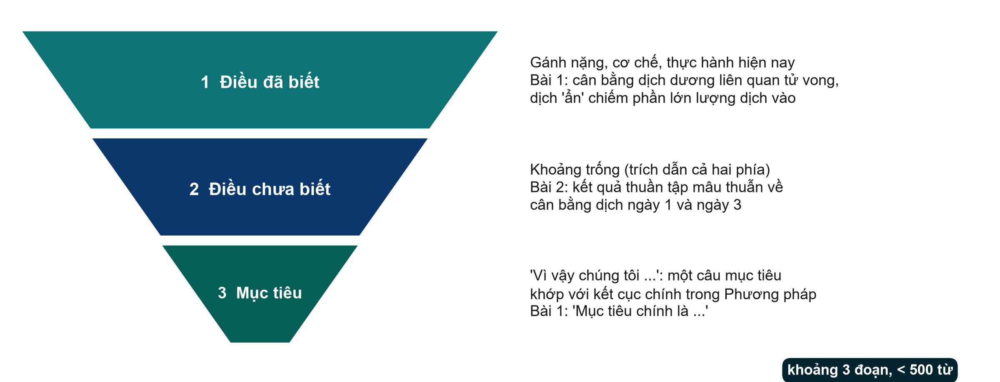
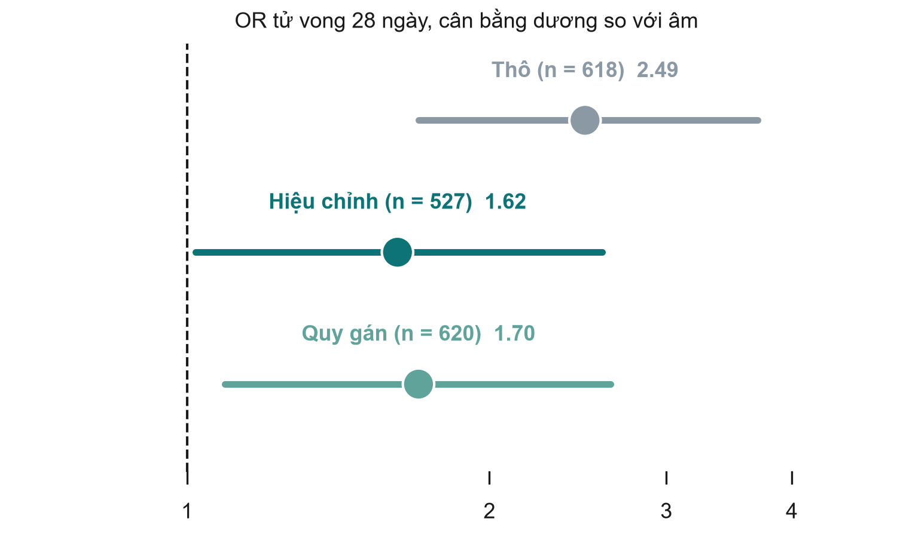
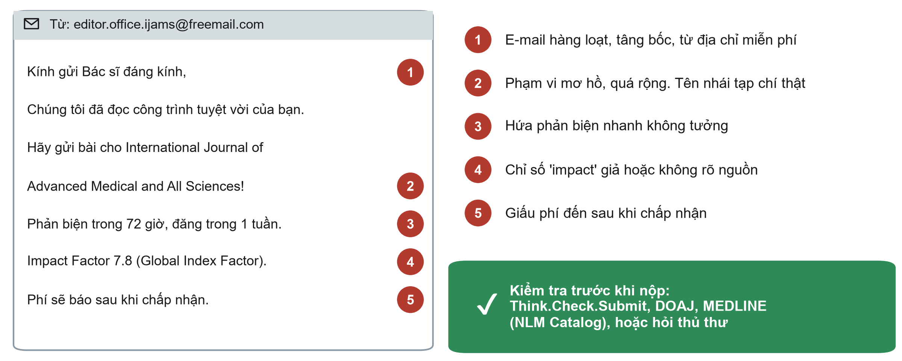
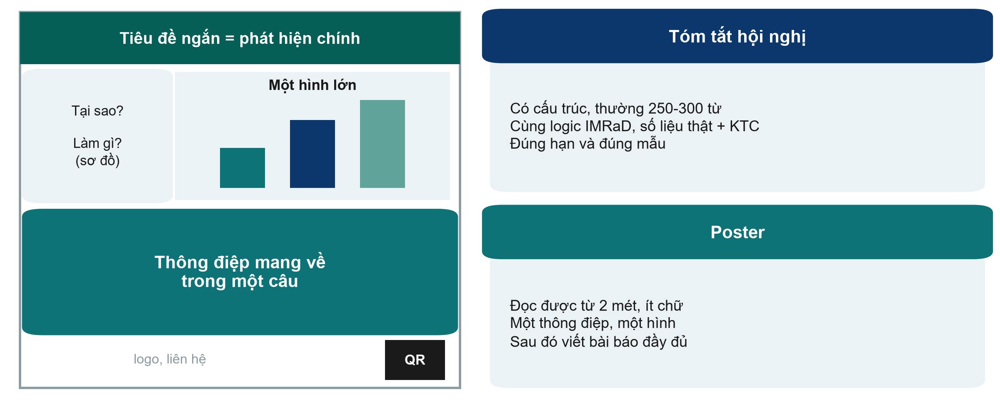

# Buổi 8 · Công bố: hoàn thiện bài báo, gửi đăng, trình bày

## Tuần 8 · Thứ Bảy, 19:30-22:30 (trực tuyến)

- 19:30  Ôn tập: Buổi 7
- 19:35  8.1  Viết bài báo (II): Đặt vấn đề, Bàn luận, Tóm tắt, Tiêu đề
- 20:00  Thực hành bản thảo 2: cả lớp làm Q1, rồi mỗi người tự viết
- 20:30  8.2  Công bố: từ bảng kiểm đến người phản biện
- 21:05  8.3  Làm người phản biện: Bài 1 và Bài 2, cả lớp cùng làm
- 21:30  Trình bày đề cương (khoảng 5 người tình nguyện), 22:15 bế mạc

::: {.notes}
Buổi 8 (19:30). Trực tuyến, 19:30-22:30, giải lao 15 phút lúc 20:50. Buổi cuối cùng. Hôm nay cả lớp hoàn thành phần viết bản thảo FLUID-ICU (cả lớp làm Q1, rồi mỗi học viên làm câu hỏi của mình), theo một bài báo từ lúc nộp đến khi nhận ý kiến phản biện, cả lớp luyện phản biện, và khoảng năm học viên tình nguyện trình bày đề cương của mình.

Trước buổi học: gửi các tệp PDF (phiếu bài tập Buổi 8, Bài 1 và Bài 2 bản gốc, bản nháp Q1 của lớp từ Buổi 7). Nhận slide của người trình bày và mở sẵn trên máy của bạn. Cài sẵn các câu bình chọn.
:::

## Ôn tập: ba câu hỏi từ Buổi 7

::: {.neu-banner style="--c:#6C3483"}
CÂU HỎI NHANH · 5 phút
:::

:::: {.columns}
::: {.column width="60%"}
::: {.neu-activity-steps style="--c:#6C3483"}
- Ai đồng ý cho người bệnh sốc nhiễm khuẩn đang an thần?
- Mục STROBE nào yêu cầu ước lượng thô và hiệu chỉnh?
- Câu 'có thể do người bệnh nặng hơn được truyền nhiều dịch hơn' thuộc phần nào?
:::
:::
::: {.column width="40%"}
::: {.neu-side .plain style="--c:#6C3483"}
Đáp án

- Người đại diện hợp pháp (hoặc đồng ý trì hoãn, nếu hội đồng đã duyệt)
- Mục 16 (kết quả chính)
- Bàn luận, không phải Kết quả
:::
:::
::::

::: {.neu-output style="--c:#6C3483"}
**SẢN PHẨM** Mọi người sẵn sàng viết tiếp
:::

::: {.notes}
Ôn tập (19:30-19:35). Câu 1 là câu hỏi cuối buổi tuần trước: đọc hai ba câu trả lời đã nhận và sửa những chỗ hiểu sai. Câu 2 và 3 là bình chọn nhanh. Mở đáp án.

Câu 3 dẫn vào 8.1: Bàn luận là nơi dành cho diễn giải.
:::

## 8.1  \|  25 phút

:::: {.neu-statement}
::: {.neu-big}
Viết bài báo (II)
:::

::: {.neu-sub}
Đặt vấn đề, Bàn luận, Tóm tắt và Tiêu đề, theo thứ tự đó
:::
::::

::: {.notes}
Phần 8.1 (19:35-20:00). Mười slide với ba ví dụ mẫu từ FLUID-ICU Q1 và 2 phút kiểm tra.

Thứ tự theo thứ tự viết đã học thứ Bảy tuần trước: Đặt vấn đề, Bàn luận, rồi Tóm tắt và Tiêu đề sau cùng.

Nhịp: khoảng 2 phút mỗi slide. Chậm lại ở ví dụ Bàn luận.
:::

## Đặt vấn đề: hình phễu trong ba đoạn

{.neu-fig}

::: {.neu-takeaway}
**THÔNG ĐIỆP CHÍNH** Đã biết, chưa biết, mục tiêu. Mục tiêu khớp với kết cục chính.
:::

::: {.notes}
Ý chính: phần đặt vấn đề là một cái phễu, không phải bài tổng quan tài liệu. Đoạn 1: điều đã biết (gánh nặng, cơ chế, thực hành hiện nay). Đoạn 2: điều chưa biết: khoảng trống, tốt nhất có dẫn chứng mâu thuẫn của cả hai phía. Đoạn 3: 'Vì vậy chúng tôi nhằm ...', một câu mục tiêu khớp với kết cục chính trong phần Phương pháp.

Bài 1 (Boulet 2024, thử nghiệm) là mẫu (chú giải \#10-\#12): đã biết (cân bằng dịch dương liên quan tử vong, dịch 'ẩn' chiếm phần lớn lượng dịch vào), chưa biết (các thử nghiệm trước chỉ nhắm dịch hồi sức), mục tiêu (mục tiêu chính = cân bằng dịch sau 5 ngày), tất cả dưới 500 từ (trang 2-3).

Bài 2 (Hyun 2023, nghiên cứu thuần tập) xác định khoảng trống ở đoạn 2 bằng cách dẫn cả hai phía mâu thuẫn (\#9). Nên làm theo. Nhưng phần đặt vấn đề dài khoảng 550 từ và câu mục tiêu lặp lại từ nhân quả 'impact' (\#3, \#10).

Liên hệ Buổi 1-2: phần nêu vấn đề và PICO trong đề cương của bạn đã cho bạn cái phễu này.

Hỏi (mời hai ba người trả lời, bật micro): trong một câu, điều gì chưa biết về câu hỏi bạn đã chọn? Câu đó là đoạn 2 của bạn.
:::

## Ví dụ mẫu: phễu Đặt vấn đề cho FLUID-ICU (Q1)

:::: {.neu-cards style="--n:3"}
::: {.neu-card .plain style="--c:#0D7377"}
[1  Đã biết]{.neu-card-title}

- Dịch truyền cứu sống ở giai đoạn sớm của nhiễm khuẩn huyết
- Cân bằng dương liên quan với tử vong (Bài 2 và các nghiên cứu thuần tập khác)
:::
::: {.neu-card .plain style="--c:#0B376C"}
[2  Chưa biết]{.neu-card-title}

- Người bệnh nặng hơn được truyền nhiều dịch hơn
- Chưa rõ mối liên quan còn không sau khi hiệu chỉnh theo mức độ nặng
:::
::: {.neu-card .plain style="--c:#5FA39B"}
[3  Mục tiêu]{.neu-card-title}

- Chúng tôi đánh giá liệu cân bằng dương đến ngày 3 có liên quan với tử vong 28 ngày hay không, sau khi hiệu chỉnh
:::
::::

::: {.neu-takeaway}
**THÔNG ĐIỆP CHÍNH** Ba đoạn, khoảng 350 từ. Câu mục tiêu dùng 'có liên quan'.
:::

::: {.notes}
Ví dụ mẫu. Câu mở đầu mẫu (điều chỉnh, không chép nguyên):

Đoạn 1: 'Dịch truyền tĩnh mạch là nền tảng điều trị sớm nhiễm khuẩn huyết, nhưng cân bằng dịch dương tích lũy có liên quan với tử vong cao hơn trong nhiều nghiên cứu quan sát \[TLTK\].'

Đoạn 2: 'Vì người bệnh nặng hơn được truyền nhiều dịch hơn, chưa rõ mối liên quan này còn tồn tại sau khi hiệu chỉnh theo mức độ nặng hay không \[TLTK\].'

Đoạn 3: 'Vì vậy chúng tôi đánh giá liệu cân bằng dịch dương tích lũy đến ngày ICU thứ 3 có liên quan với tử vong 28 ngày ở người lớn nhiễm khuẩn huyết, trước và sau khi hiệu chỉnh theo mức độ nặng.'

Tài liệu: học viên dùng tài liệu đã tìm ở Buổi 1-2 cùng Bài 1 và 2.

Lưu ý: nhiễu do chỉ định (Buổi 4) chính là khoảng trống. Đó là lý do nghiên cứu đáng làm.
:::

## Bàn luận: sáu bước

:::: {.neu-steps}
::: {.neu-step style="--c:#0D7377"}
[1 Trả lời]{.neu-step-label}

- Câu đầu tiên trả lời câu hỏi
- Bài 1, tr.8
:::
::: {.neu-step style="--c:#0B376C"}
[2 So sánh]{.neu-step-label}

- Với nghiên cứu khác, và vì sao khác
- Bài 1: so với CLASSIC, POINCARE-2
:::
::: {.neu-step style="--c:#5FA39B"}
[3 Giải thích]{.neu-step-label}

- Cơ chế, ngắn gọn
- Bài 2: mô hình dịch bốn giai đoạn
:::
::: {.neu-step style="--c:#0070C0"}
[4 Hạn chế]{.neu-step-label}

- Cụ thể: cơ chế, hướng sai lệch, cách sửa
- Bài 1: nhiễm chéo nhóm chứng
:::
::: {.neu-step style="--c:#055F56"}
[5 Hàm ý]{.neu-step-label}

- Cho thực hành và nghiên cứu, ghi rõ
- Bài 1: 'có lẽ sẽ có lợi' là suy đoán
:::
::: {.neu-step style="--c:#8A99A3"}
[6 Kết luận]{.neu-step-label}

- Cùng thông điệp với tóm tắt và tiêu đề
:::
::::

::: {.neu-takeaway}
**THÔNG ĐIỆP CHÍNH** Trả lời trước. Hạn chế kèm hướng sai lệch. Kết luận = tóm tắt = tiêu đề.
:::

::: {.notes}
Ý chính: phần bàn luận tốt đi qua sáu bước theo thứ tự: trả lời câu hỏi. So sánh với nghiên cứu khác và giải thích vì sao khác. Giải thích cơ chế ngắn gọn. Nêu hạn chế cụ thể, kèm hướng sai lệch và cách khắc phục. Nêu hàm ý cho thực hành và nghiên cứu, có ghi rõ. Kết luận cùng thông điệp với tóm tắt và tiêu đề.

Bài 1 làm tốt phần lớn: câu đầu trả lời câu hỏi chính (chú giải \#36). So sánh với các thử nghiệm CLASSIC và POINCARE-2 giải thích vì sao kết quả khác (\#37). Hạn chế cụ thể, có cơ chế và cách khắc phục (\#38, \#39). Kết luận khớp với tóm tắt (\#44). Điểm yếu: 'có lẽ sẽ có lợi' là suy đoán không có dữ liệu (\#46).

Bài 2: cơ chế trong một đoạn với mô hình bốn giai đoạn dịch (\#34). Phần so sánh khép lại vòng với các nghiên cứu mâu thuẫn từ phần đặt vấn đề (\#35). Nhưng phần hạn chế bỏ sót sai lệch người sống sót, mất cân bằng lactat còn lại và nhiễu do chỉ định (\#36).

Bình chọn: người viết lần đầu thường bỏ qua bước nào? Đáp án: hướng của hạn chế, tức là nói rõ sai lệch làm tác động trông lớn hơn hay nhỏ hơn.
:::

## Ví dụ mẫu: Bàn luận cho FLUID-ICU câu hỏi 1

::: {.neu-intro}
Sáu bước, mỗi bước một câu (dữ liệu mô phỏng).
:::

- 1 Trả lời: Cân bằng dương đến ngày 3 có liên quan với tử vong 28 ngày cao hơn (OR hiệu chỉnh 1.62, KTC 95% 1.02 đến 2.59).
- 2 So sánh: Phù hợp với Bài 2 (HR ngày 2 là 2.13), dù ước lượng hiệu chỉnh của chúng tôi nhỏ hơn.
- 3 Giải thích: Phần lớn liên quan thô (OR 2.49) phản ánh nhiễu do chỉ định: người bệnh nặng hơn được truyền nhiều dịch hơn.
- 4 Hạn chế: Nhiễu còn sót và quan hệ nhân quả ngược có thể phóng đại mối liên quan. KTC của HR Cox hiệu chỉnh chạm 1.00.
- 5 Hàm ý: Dữ liệu này không đủ để khuyến cáo hạn chế dịch. Cần một thử nghiệm ngẫu nhiên (như Bài 1).
- 6 Kết luận: 'có liên quan với', cùng động từ với mục tiêu, tóm tắt và tiêu đề.

::: {.notes}
Ví dụ mẫu (sáu bước, mỗi bước một câu, số liệu từ key\_results.md, dữ liệu mô phỏng). OR = tỷ số chênh. HR = tỷ số nguy cơ tức thời. KTC = khoảng tin cậy.

1 Trả lời: OR hiệu chỉnh 1.62 (KTC 95% 1.02 đến 2.59). 2 So sánh: Bài 2 có HR ngày 2 là 2.13 (1.48 đến 3.06). 3 Giải thích: OR thô 2.49 giảm còn 1.62 sau hiệu chỉnh (nhiễu do chỉ định). 4 Hạn chế: nhiễu còn sót, quan hệ nhân quả ngược (người bệnh đang xấu đi tích dịch), người bệnh tử vong trước ngày 3. HR Cox hiệu chỉnh 1.46 có KTC chạm 1.00. 5 Hàm ý: không có cơ sở hạn chế dịch. Cần thử nghiệm như Bài 1. 6 Kết luận: 'có liên quan với'.

Ý tùy chọn cho người chọn Q1: mối liên quan có vẻ mạnh hơn ở người bệnh suy tim (OR hiệu chỉnh 4.39 so với 1.29, p tương tác 0.031, chỉ 90 người bệnh). Đây là giả thuyết, không phải phát hiện.
:::

## Vì sao OR giảm: giải thích trong Bàn luận

:::: {.columns}
::: {.column width="38%"}
::: {.neu-side-notes}
### FLUID-ICU Q1 (mô phỏng)

- OR thô 2.49 (1.70 đến 3.70)
- OR hiệu chỉnh 1.62 (1.02 đến 2.59)
- OR quy gán 1.70 (1.09 đến 2.64)
- Chênh lệch = nhiễu do chỉ định
:::
:::
::: {.column width="62%"}
{.neu-fig-side}
:::
::::

::: {.neu-takeaway}
**THÔNG ĐIỆP CHÍNH** Báo cáo cả hai. Giải thích chênh lệch. Giữ động từ 'có liên quan'.
:::

::: {.notes}
Hình cho thấy ba ước lượng từ gói kết quả Q1 (Bảng 6): thô (n = 618), hiệu chỉnh các trường hợp đầy đủ (n = 527) và hiệu chỉnh sau quy gán đa bội (n = 620).

Ý chính: việc giảm từ 2.49 xuống 1.62 là bài học Buổi 4 hiện ra trước mắt: người bệnh nặng hơn được truyền nhiều dịch hơn và tử vong nhiều hơn. Ước lượng quy gán gần với ước lượng các trường hợp đầy đủ, nên lactat bị thiếu không làm đổi kết luận.

KTC hiệu chỉnh bắt đầu từ 1.02, vừa trên 1. Câu chừng mực: 'vẫn còn mối liên quan ở mức vừa phải'.

Hỏi: nếu KTC hiệu chỉnh vượt qua 1 thì viết gì? Đáp án: 'không có bằng chứng rõ về mối liên quan sau hiệu chỉnh', không phải 'không có tác dụng'.
:::

## Ngôn ngữ chừng mực: chọn động từ theo thiết kế

::: {.neu-intro}
Khẳng định mạnh hơn = cần thiết kế mạnh hơn
:::

| Động từ (mạnh nhất ở trên) | Cần ít nhất |
|:---|:---|
| **['gây ra', 'phòng ngừa', 'chứng minh']{style="color:#FFFFFF"}** | Nhiều RCT lớn thống nhất |
| **['làm giảm', 'làm tăng', 'không làm giảm']{style="color:#FFFFFF"}** | Một thử nghiệm ngẫu nhiên (Bài 1) |
| **['có thể góp phần', 'phù hợp với']{style="color:#FFFFFF"}** | Quan sát + lập luận nhân quả |
| **['có liên quan với', 'dự báo']{style="color:#FFFFFF"}** | Thuần tập, bệnh–chứng (Bài 2) |
| **['được ghi nhận ở', 'thường gặp']{style="color:#FFFFFF"}** | Mô tả, loạt ca |

::: {.neu-table-caption}
Không bao giờ: 'xu hướng' với p = 0.42. 'Không khác biệt' (hãy nói 'không có bằng chứng khác biệt'). 'Đầu tiên', 'chưa từng', 'mới' khi chưa kiểm chứng. 'Tác động' trong nghiên cứu quan sát.
:::

::: {.neu-takeaway}
**THÔNG ĐIỆP CHÍNH** Chỉ dùng động từ mạnh đến mức thiết kế của bạn cho phép.
:::

::: {.notes}
Ý chính: độ mạnh của động từ là một khẳng định. Diễn giải quá mức (kết luận vượt quá dữ liệu) là một trong những lý do bị từ chối thường gặp nhất.

Đọc thang từ dưới lên: nghiên cứu mô tả 'ghi nhận'. Nghiên cứu thuần tập và bệnh–chứng thấy một yếu tố 'có liên quan với' kết cục. Bằng chứng quan sát mạnh cộng lập luận nhân quả có thể nói 'có thể góp phần'. Thử nghiệm ngẫu nhiên được nói 'làm giảm' hoặc 'không làm giảm'. 'Gây ra' hay 'chứng minh' cần nhiều thử nghiệm lớn thống nhất.

Không bao giờ: 'xu hướng không có ý nghĩa' với p = 0.42 (Bài 1, trang 10, chú giải \#41). 'Không khác biệt' khi nghiên cứu quá nhỏ (hãy nói 'không có bằng chứng về khác biệt', \#29). 'Đầu tiên', 'chưa từng', 'mới' khi chưa kiểm chứng ('cân bằng dịch thấp nhất từng được công bố', \#40). 'Tác động', 'không tác động', 'chứng tỏ' trong nghiên cứu quan sát (Bài 2, \#1, \#27, \#28). 'So sánh đáng tin cậy nhất' (\#32). Xếp hạng HR từ các nghiên cứu thuần tập khác nhau thành 'nguy cơ cao nhất' mà không có kiểm định (\#37).

Hỏi (mời hai ba người trả lời, bật micro): viết lại câu 'cân bằng dịch dương làm tăng tử vong' cho Bài 2. Đáp án: 'cân bằng dịch dương vào ngày ICU thứ 2 có liên quan với tử vong 28 ngày cao hơn'.
:::

## Kiểm tra: sửa động từ (FLUID-ICU, mô phỏng)

::: {.neu-banner style="--c:#6C3483"}
CÂU HỎI NHANH · 2 phút
:::

:::: {.columns}
::: {.column width="60%"}
::: {.neu-activity-steps style="--c:#6C3483"}
- 'Cân bằng dương gây ra tử vong cao hơn (OR 1.62).'
- 'Quá tải dịch làm tăng AKI (tổn thương thận cấp) (OR 1.27 mỗi 10 ml/kg).'
- 'Có xu hướng tử vong (HR Cox 1.46, KTC 95% 1.00 đến 2.13).'
- 'Lactat dự báo tử vong (OR 1.39 mỗi mmol/L).'
:::
:::
::: {.column width="40%"}
::: {.neu-side .plain style="--c:#6C3483"}
Tốt hơn

- '... có liên quan với ...'
- '... có liên quan với khả năng AKI cao hơn'
- 'HR 1.46 (1.00 đến 2.13): KTC chạm 1'
- Được nếu là dự báo. Nếu nói nhân quả, dùng 'có liên quan với'
:::
:::
::::

::: {.notes}
Kiểm tra (2 phút). Số liệu từ key\_results.md (mô phỏng): Q1 OR hiệu chỉnh 1.62. Q2 OR hiệu chỉnh 1.27 mỗi 10 ml/kg. Q1 HR Cox hiệu chỉnh 1.46 (1.00 đến 2.13). Q4 OR hiệu chỉnh các trường hợp đầy đủ 1.39 mỗi mmol/L.

Mỗi câu một lượt bình chọn: 'ổn' hay 'cần sửa'. Mời một người nói câu sửa, bật micro.

Câu 3: không dùng 'xu hướng'. Nêu ước lượng và nói KTC chạm 1.

Câu 4: 'dự báo' chấp nhận được theo nghĩa tiên lượng. Nếu tác giả muốn nói nhân quả, 'có liên quan với' là động từ trung thực.
:::

## Tóm tắt có cấu trúc: phần được đọc đầu tiên

| Phần | Phải nêu gì | Ví dụ tốt |
|:---|:---|:---|
| Đặt vấn đề | Vấn đề, khoảng trống và mục tiêu trong 1-2 câu |
| Phương pháp | Thiết kế, bối cảnh, đối tượng, phơi nhiễm, kết cục chính, phân tích | Bài 2: quần thể, bối cảnh và cỡ mẫu |
| Kết quả | Số được phân tích. Tác động chính kèm KTC 95%. Kết quả phụ chính | Bài 2: mọi kết quả dạng HR (KTC 95%) |
| Kết luận | Trả lời mục tiêu bằng lời văn mà thiết kế cho phép | Bài 1: kết quả âm tính nêu thẳng thắn |

::: {.neu-table-caption}
250-300 từ, cộng số đăng ký với thử nghiệm. Cần sửa ở Bài 1: báo cáo trung vị nhưng ước lượng lại gọi là 'chênh lệch trung bình'.
:::

::: {.notes}
Ý chính: đa số tạp chí lâm sàng yêu cầu tóm tắt có cấu trúc (Đặt vấn đề, Phương pháp, Kết quả, Kết luận), khoảng 250-300 từ. Thử nghiệm thêm số đăng ký. Nhiều người đọc không đọc tiếp, nên tóm tắt phải đọc riêng vẫn hiểu được.

Thực hành tốt: tóm tắt Bài 2 nêu quần thể nguồn, bối cảnh và cỡ mẫu (chú giải \#4) và mọi kết quả dạng HR với KTC 95% và giá trị P chính xác (\#5). Kết luận của Bài 1 nêu thẳng kết quả âm tính, không 'tô vẽ' (\#6), và số đăng ký có trong tóm tắt (\#7).

Cần sửa (Bài 1, \#4): báo cáo trung vị nhưng ước lượng gọi là 'chênh lệch trung bình', và p = 0.0506 với KTC chạm 0 được ghi tới bốn chữ số thập phân. Cách tóm tắt, ước lượng và kiểm định phải khớp nhau, và p sát ngưỡng không phải là 'gần có ý nghĩa'.

Viết tóm tắt sau cùng, và kiểm tra mỗi con số giống hệt nhau ở tóm tắt, văn bản và bảng.
:::

## Ví dụ mẫu: tóm tắt và tiêu đề cho FLUID-ICU câu hỏi 1

::: {.neu-intro}
Chép số liệu từ phần Kết quả của bạn (dữ liệu mô phỏng, khoảng 120 từ).
:::

- **Tiêu đề: Cân bằng dịch dương đến ngày 3 và tử vong 28 ngày ở người bệnh nhiễm khuẩn huyết: nghiên cứu thuần tập đa trung tâm**
- Đặt vấn đề: Cân bằng dịch dương liên quan với tử vong trong nhiễm khuẩn huyết, nhưng người bệnh nặng hơn được truyền nhiều dịch hơn. Chúng tôi đánh giá mối liên quan sau khi hiệu chỉnh theo mức độ nặng.
- Phương pháp: Nghiên cứu thuần tập tiến cứu (dữ liệu giảng dạy mô phỏng), 620 người lớn, 4 ICU, 2023-2024. Phơi nhiễm: cân bằng dương đến ngày 3. Kết cục: tử vong 28 ngày. Hồi quy logistic và Cox hiệu chỉnh theo mức độ nặng.
- Kết quả: Trong 618 người bệnh, 373 (60.4%) có cân bằng dương. Tử vong 35.9% so với 18.4%. OR thô 2.49 (1.70 đến 3.70). OR hiệu chỉnh 1.62 (KTC 95% 1.02 đến 2.59).
- Kết luận: Cân bằng dương có liên quan ở mức vừa phải với tử vong 28 ngày. Phần lớn mối liên quan thô phản ánh mức độ nặng. Cần một thử nghiệm ngẫu nhiên.

::: {.notes}
Ví dụ mẫu (dữ liệu mô phỏng, khoảng 120 từ, còn tóm tắt đầy đủ tối đa 250).

Tiêu đề: nêu phơi nhiễm, kết cục, đối tượng và thiết kế. Không 'tác động'.

Phương pháp: phải nói dữ liệu là mô phỏng (quy định của khóa học).

Kết quả: OR thô và hiệu chỉnh, như trong Kết quả. Số người bệnh (618 được phân tích, 373 cân bằng dương).

Kết luận: 'liên quan ở mức vừa phải', khớp với KTC hiệu chỉnh 1.02 đến 2.59.

Hỏi: câu nào trong tóm tắt sẽ thay đổi nếu KTC hiệu chỉnh là 0.95 đến 2.40? Đáp án: Kết quả và Kết luận, sẽ thành 'không có bằng chứng rõ về mối liên quan sau hiệu chỉnh'.
:::

## Tiêu đề và từ khóa: PICO của bạn trong một dòng

::: {.neu-intro}
Công thức từ PICO: thiết kế, I so với C, ở P, lên O. 10-16 từ. Không 'tác động', 'mới', 'đầu tiên'.
:::

:::: {.neu-cards style="--n:2"}
::: {.neu-card .plain style="--c:#0D7377"}
[Bài 1 (thử nghiệm)]{.neu-card-title}

- Đã đăng: 'Impact on fluid balance of an optimized restrictive strategy targeting non-resuscitative fluids in ... septic shock: a single-blind, ... pilot study'
- [Vấn đề: hơn 25 từ. Có từ ngữ đánh giá]{style="color:#C0392B"}
- **[Tốt hơn: Hạn chế dịch không hồi sức trong sốc nhiễm khuẩn: thử nghiệm ngẫu nhiên thí điểm đa trung tâm]{style="color:#2E8B57"}**
:::
::: {.neu-card .plain style="--c:#0B376C"}
[Bài 2 (nghiên cứu thuần tập)]{.neu-card-title}

- Đã đăng: 'Impact of a cumulative positive fluid balance during the first three ICU days in patients with sepsis: a propensity score-matched cohort study'
- [Vấn đề: 'impact' là từ nhân quả, không hợp với nghiên cứu thuần tập]{style="color:#C0392B"}
- **[Tốt hơn: Cân bằng dịch dương trong 3 ngày đầu ở ICU và tử vong 28 ngày ở nhiễm khuẩn huyết: nghiên cứu thuần tập ghép cặp theo điểm xu hướng]{style="color:#2E8B57"}**
:::
::::

::: {.neu-takeaway}
**THÔNG ĐIỆP CHÍNH** Từ khóa: 3-6 thuật ngữ MeSH (đề mục chủ đề của PubMed) chưa có trong tiêu đề.
:::

::: {.notes}
Ý chính: tiêu đề là câu được đọc nhiều nhất của bài. Xây dựng từ PICO: thiết kế, can thiệp hoặc phơi nhiễm so với nhóm chứng, đối tượng, kết cục. Khoảng 10-16 từ, nêu thiết kế. Tránh từ mang tính đánh giá ('impact', 'optimized', 'novel', 'first').

Bài 1 (chú giải \#1): tiêu đề có nêu thiết kế (tốt), nhưng hơn 25 từ và có từ đánh giá. Phiên bản mô tả ngắn hơn có màu xanh lá.

Bài 2 (chú giải \#1): 'Impact' là từ nhân quả cho một nghiên cứu thuần tập quan sát. Người phản biện thường yêu cầu 'Association between ...'.

Từ khóa (Bài 1, chú giải \#9): từ khóa lặp lại chữ đã có trong tiêu đề. Chọn 3-6 thuật ngữ MeSH (Medical Subject Headings) chưa có trong tiêu đề để bài được tìm thấy qua nhiều lượt tìm kiếm hơn.

Bạn sẽ viết tiêu đề của mình trong phần thực hành ngay sau đây.
:::

## Trước khi nộp: tài liệu tham khảo, bảng kiểm, đọc lần cuối

:::: {.neu-cards style="--n:3"}
::: {.neu-card .plain style="--c:#0D7377"}
[Tài liệu tham khảo]{.neu-card-title}

- Dùng phần mềm quản lý tài liệu
- Kiểm tra từng trích dẫn
- Bài 2 dẫn sai tài liệu cho các biến hiệu chỉnh
:::
::: {.neu-card .plain style="--c:#0B376C"}
[Bảng kiểm báo cáo]{.neu-card-title}

- Điền ngay trong lúc viết
- Ghi số trang
- Cả hai bài không nêu CONSORT hay STROBE
:::
::: {.neu-card .plain style="--c:#5FA39B"}
[Đọc lần cuối]{.neu-card-title}

- Văn bản khớp với bảng, từng con số
- Dẫn đúng số hình
- Một đồng nghiệp đọc các bảng
:::
::::

::: {.neu-takeaway}
**THÔNG ĐIỆP CHÍNH** Phần lớn lỗi của hai bài không cần dữ liệu mới, chỉ cần một đồng tác giả cẩn thận.
:::

::: {.notes}
Tài liệu tham khảo: dùng phần mềm quản lý tài liệu (Zotero, Mendeley, EndNote) và kiểm tra từng trích dẫn. Ở Bài 2, danh sách biến hiệu chỉnh dẫn tài liệu 26 (bài định nghĩa Sepsis-3), gần như chắc chắn sai số (chú giải \#22). Không bao giờ trích dẫn tài liệu do AI gợi ý mà chưa đọc.

Bảng kiểm báo cáo: điền CONSORT (thử nghiệm) hoặc STROBE (nghiên cứu quan sát) trong lúc viết, kèm số trang. Nhiều tạp chí yêu cầu khi nộp. Cả hai bài đều không nêu tên hướng dẫn (cả hai bản tóm tắt chú giải đều chỉ ra).

Đọc lần cuối: đối chiếu mọi con số trong văn bản với bảng (creatinine ở Bài 1, \#25), mọi chỗ dẫn hình (Bài 1 dẫn Hình 1 trong khi ý là Hình 2A, \#28), và cách viết số (một IQR có cận trên nhỏ hơn cận dưới, \#35).

Thông điệp từ bản tóm tắt chú giải: gần như mọi lỗi của Bài 1 lẽ ra đã được phát hiện nếu một đồng tác giả đọc bảng đối chiếu với văn bản.
:::

## Thực hành bản thảo 2  \|  30 phút

:::: {.neu-statement}
::: {.neu-big}
Hoàn thiện bản nháp: cả lớp cùng viết, rồi mỗi người tự viết
:::

::: {.neu-sub}
22 phút cả lớp cùng soạn Q1, rồi 8 phút cho mục tiêu và tiêu đề của riêng bạn
:::
::::

::: {.notes}
Thực hành bản thảo 2 (20:00-20:30). Bộ dữ liệu khóa học.

Phần 1 (20:00-20:22): giảng viên thêm Đặt vấn đề, Bàn luận, Tóm tắt và Tiêu đề vào bản nháp Q1 của lớp từ thứ Bảy tuần trước, ngay trên màn hình chia sẻ.

Phần 2 (20:22-20:30): mỗi học viên viết câu mục tiêu và tiêu đề cho câu hỏi của mình, rồi hoàn thành bản nháp và nộp trước 23:59 tối nay (Course/Assignment/manuscript\_brief.md).

Hướng dẫn: Course/Practicals/s8\_exercises.md, Phần B. Đoạn văn mẫu cho Q1: Course/Solutions/s8\_solutions.md.
:::

## Thực hành bản thảo 2, phần 1: cả lớp hoàn thiện Q1

::: {.neu-banner style="--c:#0D7377"}
CẢ LỚP CÙNG LÀM · 22 phút
:::

:::: {.columns}
::: {.column width="60%"}
::: {.neu-activity-steps style="--c:#0D7377"}
- Đặt vấn đề (6 phút): ba đoạn. Khi được mời, bạn nói câu mình đề xuất
- Bàn luận (9 phút): sáu bước, mỗi bước một hai câu
- Tóm tắt (5 phút): chép số liệu từ phần Kết quả của lớp
- Tiêu đề và kiểm tra động từ (2 phút): mọi 'gây ra' hay 'tác động' đổi thành 'có liên quan với'
:::
:::
::: {.column width="40%"}
::: {.neu-side .plain style="--c:#0D7377"}
Dùng

- Bản nháp Q1 của lớp từ Buổi 7 (PDF)
- Gói kết quả Q1
- Các ví dụ mẫu (slide)
:::
:::
::::

::: {.neu-output style="--c:#0D7377"}
**SẢN PHẨM** Bản nháp Q1 hoàn chỉnh của lớp, gửi dạng PDF sau buổi học
:::

::: {.notes}
Thực hành Phần 1 (20:00-20:22). Cả lớp. Mở bản nháp của lớp tuần trước và gõ tiếp vào đó. Nhắc từng giai đoạn.

Câu gợi ý: 'Câu đầu Bàn luận của lớp có trả lời câu hỏi bằng con số không?' 'Có hạn chế nào kèm hướng sai lệch không?' 'Kết luận có dùng cùng động từ với mục tiêu không?' 'Mọi con số trong tóm tắt có giống hệt phần Kết quả không?'

Gửi bản nháp hoàn chỉnh của lớp dạng PDF sau buổi học. Đây là mẫu cho bản thảo của mỗi người.
:::

## Thực hành bản thảo 2, phần 2: mục tiêu và tiêu đề của bạn

::: {.neu-banner style="--c:#0B376C"}
BÀI TẬP CÁ NHÂN · 8 phút
:::

:::: {.columns}
::: {.column width="60%"}
::: {.neu-activity-steps style="--c:#0B376C"}
- Viết câu mục tiêu cho câu hỏi của bạn (Q1 đến Q5)
- Viết tiêu đề: nêu thiết kế, 10-16 từ, dùng 'có liên quan'
- Hai bạn tình nguyện đọc to tiêu đề. Giảng viên nhận xét hai tiêu đề
- Tối nay: thêm Đặt vấn đề, Bàn luận và Tóm tắt. Nộp trước 23:59
:::
:::
::: {.column width="40%"}
::: {.neu-side .plain style="--c:#0B376C"}
Nộp bài

- Bản nháp hoàn chỉnh, khoảng 2000 từ
- Trước 23:59 tối nay
- Thư mục khóa học hoặc email cho trưởng khóa học
- Sau đó là bình duyệt (slide bế mạc)
:::
:::
::::

::: {.neu-output style="--c:#0B376C"}
**SẢN PHẨM** Câu mục tiêu và tiêu đề tạm của bạn. Bản nháp hoàn chỉnh nộp trước 23:59 tối nay
:::

::: {.notes}
Thực hành Phần 2 (20:22-20:30). Cá nhân.

Lưu ý riêng cho từng câu hỏi (gửi vào khung chat): Q2, AKI cũng có thể gây tích dịch (quan hệ nhân quả ngược). Q3, số ngày không thở máy tính tử vong là 0. Giải thích chỉ số này. Q4, so sánh ước lượng các trường hợp đầy đủ và quy gán, và nói giả định MAR (thiếu ngẫu nhiên) có ý nghĩa gì cho kết luận. Q5, chỉ người sống sót: nói rõ kết quả áp dụng cho ai.

Hạn nộp: bản nháp hoàn chỉnh trước 23:59 ngày học Buổi 8 (Course/Assignment/manuscript\_brief.md). Sau đó bản nháp được dùng cho bài bình duyệt cá nhân (slide bế mạc).
:::

## 8.2  \|  20 phút

:::: {.neu-statement}
::: {.neu-big}
Công bố bài báo
:::

::: {.neu-sub}
Từ bảng kiểm đến người phản biện, và những điều cần tránh
:::
::::

::: {.notes}
Phần 8.2 (20:30-20:50). Sáu slide, 3 phút trình diễn trực tiếp lúc 20:36 và 2 phút kiểm tra lúc 20:48.

Nhịp: khoảng 2 phút mỗi slide. Chỉ vào slide, nêu một ví dụ, đi tiếp.

Liên hệ bản thảo: một bài báo FLUID-ICU sẽ đi đúng con đường này: bảng kiểm STROBE, chọn tạp chí, bộ hồ sơ nộp bài, bình duyệt. Bản tiền ấn phẩm, giấy phép, các bước sau khi được chấp nhận và khi bị từ chối nằm trong phần Slide bổ sung.
:::

## Hướng dẫn báo cáo: chọn theo thiết kế

| Thiết kế nghiên cứu | Hướng dẫn báo cáo | Ví dụ trong khóa học |
|:---|:---|:---|
| Thử nghiệm ngẫu nhiên | CONSORT | Bài 1 |
| Thuần tập, bệnh–chứng, cắt ngang | STROBE | Bài 2, FLUID-ICU |
| Nghiên cứu độ chính xác chẩn đoán | STARD |
| Tổng quan hệ thống hoặc phân tích gộp | PRISMA |
| Đề cương thử nghiệm | SPIRIT |
| Báo cáo ca bệnh | CARE |

::: {.neu-table-caption}
Mọi bảng kiểm đều miễn phí trên Mạng lưới EQUATOR (equator-network.org). Ghi tên hướng dẫn trong Đề cương Phần 4 và dùng nó làm bảng kiểm khi viết.
:::

::: {.notes}
Ý chính: với mỗi thiết kế nghiên cứu có một bảng kiểm báo cáo được quốc tế thống nhất. Tất cả được tập hợp miễn phí tại Mạng lưới EQUATOR (Enhancing the QUAlity and Transparency Of health Research).

CONSORT cho thử nghiệm ngẫu nhiên (bản cập nhật CONSORT 2025), STROBE cho nghiên cứu quan sát (thuần tập, bệnh–chứng, cắt ngang), STARD cho độ chính xác chẩn đoán, PRISMA cho tổng quan hệ thống, SPIRIT cho đề cương thử nghiệm (SPIRIT 2025), CARE cho báo cáo ca bệnh.

Ví dụ xuyên suốt: Bài 1 là RCT (CONSORT). Bài 2 là nghiên cứu thuần tập (STROBE). Phát hiện thú vị từ bản chú giải: cả hai bài đều không ghi tên hướng dẫn. Bài 1 có sơ đồ CONSORT trong bài chính. Bài 2 để sơ đồ dòng người tham gia trong phụ lục.

Nhiều tạp chí yêu cầu nộp bảng kiểm đã điền, kèm số trang.

Quan niệm sai: 'hướng dẫn báo cáo chỉ cách làm nghiên cứu'. Chúng chỉ cần báo cáo gì, nhưng đọc chúng trước khi bắt đầu là bảng kiểm thiết kế tốt nhất.

Bình chọn: hướng dẫn nào phù hợp đề cương của bạn? Thường là thuần tập hoặc cắt ngang (STROBE). Một vài đề cương là thử nghiệm (CONSORT, và SPIRIT cho đề cương).
:::

## Chọn tạp chí: bốn điều cần kiểm tra

::: {.neu-intro}
Chọn tạp chí trước khi viết: quy định của tạp chí chi phối cách viết.
:::

:::: {.neu-cards style="--n:4"}
::: {.neu-card .plain style="--c:#0D7377"}
[Phù hợp]{.neu-card-title}

- Ai cần kết quả của bạn?
- Đọc 3 số gần đây
- Có đăng thiết kế tương tự?
:::
::: {.neu-card .plain style="--c:#0B376C"}
[Tin cậy]{.neu-card-title}

- Có trong MEDLINE, DOAJ, Scopus hoặc Web of Science
- Chính sách bình duyệt rõ ràng
:::
::: {.neu-card .plain style="--c:#5FA39B"}
[Quy định]{.neu-card-title}

- Hướng dẫn tác giả
- Giới hạn số chữ, bảng kiểm
- Có yêu cầu đăng ký?
:::
::: {.neu-card .plain style="--c:#0070C0"}
[Chi phí và tốc độ]{.neu-card-title}

- Phí xử lý bài báo (APC) và miễn giảm
- Giấy phép: ai được dùng lại bài
- Bài 1: 7 tuần. Bài 2: 7 tháng
:::
::::

::: {.neu-takeaway}
**THÔNG ĐIỆP CHÍNH** Tạp chí tốt là nơi người đọc của bạn đọc, và được vận hành trung thực.
:::

::: {.notes}
Ý chính: chọn tạp chí ngay từ đầu, vì Hướng dẫn tác giả quy định số chữ, cấu trúc, bảng kiểm và yêu cầu đăng ký.

Phù hợp: những người cần câu trả lời của bạn (điều dưỡng ICU? bác sĩ hồi sức?) quyết định tạp chí. Tin cậy: được chỉ mục trong MEDLINE/PubMed, Danh mục Tạp chí Truy cập Mở (DOAJ), Scopus hoặc Web of Science, có chính sách bình duyệt và rút bài rõ ràng.

Chi phí: nhiều tạp chí truy cập mở thu phí xử lý bài báo (APC). Hỏi về miễn giảm và thỏa thuận của cơ sở. Giấy phép: Bài 1 là CC BY-NC-ND (được chia sẻ, không được chỉnh sửa hay dùng thương mại), Bài 2 là CC BY (được tái sử dụng nếu ghi nguồn). CC = Creative Commons.

Tốc độ: Bài 1 từ lúc nộp đến khi được chấp nhận khoảng 7 tuần (10/9 đến 31/10/2024). Bài 2 khoảng 7 tháng (15/1 đến 24/8/2023). Tốc độ khác nhau và tự nó không nói lên chất lượng.

Hỏi (mời hai ba người trả lời, bật micro): kể tên một tạp chí khoa bạn thường đọc. Đó thường là lựa chọn đầu tiên hợp lý.
:::

## Nhận diện tạp chí săn mồi (predatory journal)

{.neu-fig}

::: {.neu-takeaway}
**THÔNG ĐIỆP CHÍNH** Nếu tạp chí tìm đến bạn bằng email tâng bốc, hãy kiểm tra kỹ.
:::

::: {.notes}
Ý chính: tạp chí săn mồi thu phí đăng bài nhưng không bình duyệt, biên tập hay chỉ mục thực sự. Công trình của bạn biến mất vào một tạp chí không ai tin, và không thể nộp lại nơi khác.

Đi qua năm dấu hiệu trên email (hư cấu) này: email hàng loạt tâng bốc từ địa chỉ miễn phí. Phạm vi mơ hồ, quá rộng và tên nhái tạp chí thật. Phản biện nhanh không tưởng. Chỉ số 'impact' giả hoặc không rõ nguồn. Giấu phí đến sau khi chấp nhận. Dấu hiệu khác: ban biên tập không xác minh được, không có địa chỉ, nhiều lỗi chính tả.

Kiểm tra: Think.Check.Submit (bảng kiểm miễn phí), DOAJ cho tạp chí truy cập mở, NLM Catalog (Thư viện Y khoa Quốc gia Hoa Kỳ) để xem tạp chí có thật sự trong MEDLINE. Hỏi thêm thủ thư bệnh viện.

Bình chọn: tháng vừa rồi bạn có nhận được email kiểu này không? Thường đa số trả lời có: ai đã từng đăng một bài đều nhận.

Phiếu bài tập Buổi 8 (Phần C) có bài tập ngắn 'nhận diện tạp chí săn mồi' để làm ở nhà.
:::

## Trình diễn: tìm bảng kiểm và kiểm tra tạp chí

::: {.neu-banner style="--c:#B5651D"}
TRÌNH DIỄN TRỰC TIẾP · 3 phút
:::

:::: {.columns}
::: {.column width="60%"}
::: {.neu-activity-steps style="--c:#B5651D"}
- Mở trang Mạng lưới EQUATOR và tìm 'CONSORT'
- Xem bảng kiểm và sơ đồ dòng người tham gia (Bài 1 có sơ đồ này)
- Tìm STROBE theo cách tương tự (Bài 2 và FLUID-ICU)
- Kiểm tra một tạp chí trên DOAJ và NLM Catalog
- Mở bảng kiểm Think.Check.Submit
:::
:::
::: {.column width="40%"}
::: {.neu-side .plain style="--c:#B5651D"}
Chú ý

- Tệp PDF bảng kiểm ở đâu
- Cách xem tạp chí có trong MEDLINE
- Ba câu hỏi cho mọi tạp chí
:::
:::
::::

::: {.neu-output style="--c:#B5651D"}
**SẢN PHẨM** Mỗi người kiểm tra tạp chí và hướng dẫn báo cáo trong kế hoạch công bố của mình ở nhà
:::

::: {.notes}
Trình diễn (20:36-20:39), trên màn hình chia sẻ. Kịch bản đầy đủ và phương án dự phòng khi mất mạng: Course/Demos/s8\_demo.md.

Giữ trong 3 phút: trang chủ EQUATOR, ô tìm kiếm, trang CONSORT 2025, bảng kiểm và sơ đồ. Rồi STROBE. Sau đó tìm tên một tạp chí trên DOAJ, và trên NLM Catalog với bộ lọc 'currently indexed in MEDLINE'. Kết thúc bằng bảng kiểm Think.Check.Submit. Dán bốn địa chỉ trang web vào khung chat.

Nếu mạng của bạn bị mất, dùng các ảnh chụp màn hình mô tả trong kịch bản.
:::

## Bộ hồ sơ nộp bài

| Thành phần | Nội dung |
|:---|:---|
| Thư gửi ban biên tập | Vì sao chọn tạp chí này, điểm mới. Chưa nộp nơi khác |
| Trang tiêu đề | Tác giả, đơn vị, mã ORCID (mã định danh nhà nghiên cứu miễn phí), tác giả liên hệ, số từ |
| Bản thảo | IMRaD, định dạng theo Hướng dẫn tác giả (ẩn danh nếu được yêu cầu) |
| Bảng và hình | Tệp riêng, đúng định dạng và độ phân giải |
| Bảng kiểm báo cáo | CONSORT, STROBE ..., kèm số trang |
| Các cam kết | Số phê duyệt đạo đức, sự đồng ý, xung đột lợi ích, tài trợ, chia sẻ dữ liệu, vai trò tác giả, việc dùng AI |
| Số đăng ký | Thử nghiệm và tổng quan hệ thống |
| Gợi ý người phản biện | Chuyên gia không xung đột lợi ích. Không là đồng tác giả gần đây |
| Tài liệu bổ sung | Đề cương, bảng phụ, sơ đồ dài |

::: {.notes}
Ý chính: tạp chí kiểm tra bộ hồ sơ trước mọi đánh giá khoa học. Thiếu thành phần là bản thảo bị trả về ngay.

Thư gửi ban biên tập: một trang, nêu vì sao chọn tạp chí này, điểm mới, bài chưa được nộp nơi khác, và bản tiền ấn phẩm nếu có. Trang tiêu đề: tất cả tác giả, đơn vị, mã ORCID (mã định danh nhà nghiên cứu miễn phí, cố định mà mọi học viên có thể đăng ký tại orcid.org), tác giả liên hệ, số từ. Bản thảo theo định dạng của tạp chí (ẩn danh nếu tạp chí bình duyệt kín hai chiều). Các cam kết: số phê duyệt đạo đức, sự đồng ý, xung đột lợi ích, tài trợ, khả năng cung cấp dữ liệu, đóng góp tác giả (CRediT) và việc dùng AI. Gợi ý người phản biện: chuyên gia không xung đột. Biên tập viên quyết định có dùng hay không.

Ví dụ xuyên suốt: Bài 1 có phần cam kết đầy đủ, đúng những gì hệ thống nộp bài hỏi, từng mục một (chú giải \#48). Mẫu: Course/Templates/Cover\_Letter\_Template.

Hỏi: ai đã có mã ORCID? Khuyến khích mọi người đăng ký trong tuần này.
:::

## Hành trình bình duyệt

::: {.neu-intro}
Bị từ chối? Sửa bài, rồi gửi tạp chí khác. Không bao giờ gửi hai nơi cùng lúc.
:::

:::: {.neu-steps}
::: {.neu-step style="--c:#0D7377"}
[Nộp bài]{.neu-step-label}

- Bản thảo, thư gửi ban biên tập, bảng kiểm
:::
::: {.neu-step style="--c:#0B376C"}
[Biên tập]{.neu-step-label}

- Sàng lọc bài
- Từ chối ngay là chuyện thường
:::
::: {.neu-step style="--c:#5FA39B"}
[Phản biện]{.neu-step-label}

- 2 hoặc 3 người phản biện nhận xét
:::
::: {.neu-step style="--c:#0070C0"}
[Quyết định]{.neu-step-label}

- Chấp nhận, sửa chữa nhỏ hoặc lớn, hoặc từ chối
:::
::: {.neu-step style="--c:#055F56"}
[Sửa bài]{.neu-step-label}

- Sửa bản thảo
- Phản hồi theo từng ý
:::
::: {.neu-step style="--c:#8A99A3"}
[Được nhận]{.neu-step-label}

- Bản in thử, rồi xuất bản
:::
::::

::: {.neu-takeaway}
**THÔNG ĐIỆP CHÍNH** Hầu hết bài báo phải sửa trước khi được nhận. Hãy trả lời lịch sự từng ý.
:::

::: {.notes}
Đi qua sáu bước. Nộp bài (kèm thư gửi ban biên tập, bảng kiểm báo cáo và các cam kết). Biên tập viên sàng lọc, nhiều bài bị từ chối ngay mà không qua phản biện ('desk rejection') vì không phù hợp hoặc báo cáo kém. Hai ba người phản biện nhận xét. Biên tập quyết định: chấp nhận, sửa chữa nhỏ, sửa chữa lớn hoặc từ chối. Bạn sửa và trả lời từng ý. Được chấp nhận, rồi đọc bản in thử (thật cẩn thận!) và xuất bản.

Ví dụ xuyên suốt: người chú giải đánh giá Bài 1 'sửa chữa nhỏ' và Bài 2 'sửa chữa lớn'. Cả hai đã được đăng, và cả hai vẫn còn lỗi mà một người phản biện cẩn thận sẽ phát hiện. Bài 1 mất khoảng 7 tuần từ lúc nộp đến khi được nhận. Bài 2 khoảng 7 tháng.

Quy tắc: mỗi lần chỉ nộp một tạp chí. Nếu bị từ chối, sửa bài theo góp ý rồi mới nộp nơi khác.

Hỏi: người phản biện hiểu sai một điểm. Bạn làm gì? Đáp án: cảm ơn, giải thích lịch sự có bằng chứng, và làm rõ câu chữ để người đọc sau không hiểu lầm.
:::

## Thư phản hồi ý kiến phản biện: phản hồi theo từng ý

::: {.neu-intro}
Nhận xét, câu trả lời, và chính xác chỗ đã sửa. Ví dụ minh họa dựa trên Bài 1 có chú giải.
:::

:::: {.neu-cards style="--n:3"}
::: {.neu-card .plain style="--c:#0D7377"}
[R1.1]{.neu-card-title}

- Nhận xét: đề nghị không gọi p = 0.42 là 'xu hướng không có ý nghĩa'.
- [Chấp nhận: cảm ơn, chúng tôi đồng ý. Đã báo cáo ước lượng kèm KTC 95% và bỏ chữ 'xu hướng'.]{style="color:#2E8B57"}
- Thay đổi: Bàn luận, tr.10, dòng 4-6
:::
::: {.neu-card .plain style="--c:#0B376C"}
[R1.2]{.neu-card-title}

- Nhận xét: che giấu phân nhóm thế nào khi dùng khối cỡ 2?
- [Làm rõ: phân nhóm tập trung bằng máy tính. Đã thêm cỡ khối vào phần hạn chế.]{style="color:#0B376C"}
- Thay đổi: Phương pháp tr.3, hạn chế tr.10
:::
::: {.neu-card .plain style="--c:#5FA39B"}
[R2.1]{.neu-card-title}

- Nhận xét: đề nghị bổ sung tử vong 90 ngày.
- [Phản hồi, lịch sự: tử vong 90 ngày không phải kết cục định trước và không được thu thập.]{style="color:#D9822B"}
- Thay đổi: nêu thành hạn chế, tr.10
:::
::::

::: {.neu-takeaway}
**THÔNG ĐIỆP CHÍNH** Cảm ơn, trả lời mọi ý, chỉ rõ chỗ đã sửa, và phản hồi lịch sự, có bằng chứng.
:::

::: {.notes}
Ý chính: thư phản hồi là một bảng: mỗi nhận xét của người phản biện, câu trả lời của bạn, và chính xác chỗ bản thảo đã thay đổi (trang và dòng). Đánh số các nhận xét (R1.1, R1.2, R2.1 ...).

Giọng văn: cảm ơn người phản biện, đồng ý khi có thể, không bỏ sót ý nào, không tranh luận cảm tính. Khi không đồng ý (phản hồi), giải thích lịch sự kèm bằng chứng và, nếu được, vẫn làm rõ câu chữ để người đọc sau không hiểu lầm.

Ba dòng là những gì người chú giải cho rằng người phản biện sẽ hỏi Bài 1: bỏ 'xu hướng không có ý nghĩa' (chấp nhận). Giải thích khối cỡ 2 (làm rõ và thêm hạn chế). Yêu cầu một kết cục chưa từng thu thập (phản hồi lịch sự: không thể thêm dữ liệu không tồn tại, nhưng có thể nêu thành hạn chế).

Lỗi thường gặp: sửa bản thảo mà không nói sửa ở đâu. Trả lời 'đã sửa' không có chi tiết. Chấp nhận một yêu cầu làm bài sai đi chỉ để chiều lòng người phản biện.

Mẫu: Course/Templates/Response\_to\_Reviewers\_Template. Học viên dùng đúng định dạng này khi trả lời người bình duyệt bản thảo của mình sau khóa học.
:::

## Kiểm tra: đúng hay sai?

::: {.neu-banner style="--c:#6C3483"}
CÂU HỎI NHANH · 2 phút
:::

:::: {.columns}
::: {.column width="60%"}
::: {.neu-activity-steps style="--c:#6C3483"}
- 'Tạp chí gửi email mời trước thường là tạp chí săn mồi'
- 'Tôi có thể gửi bài cho hai tạp chí cùng lúc cho nhanh'
- 'Bản tiền ấn phẩm đã được bình duyệt'
- 'Tôi phải trả lời mọi nhận xét của người phản biện, kể cả khi không đồng ý'
- 'Bài báo FLUID-ICU nên theo CONSORT'
:::
:::
::: {.column width="40%"}
::: {.neu-side .plain style="--c:#6C3483"}
Đáp án

- Thường đúng: kiểm tra kỹ
- Sai: nộp trùng lặp
- Sai: đăng trước khi bình duyệt
- Đúng: lịch sự, có bằng chứng
- Sai: STROBE (nghiên cứu thuần tập)
:::
:::
::::

::: {.notes}
Kiểm tra (20:48-20:50). Mỗi câu một lượt bình chọn đúng/sai. Mở đáp án.

Câu 1 'thường đúng' chứ không phải luôn đúng. Tạp chí thật cũng mời viết bài, nhưng email tâng bốc gửi hàng loạt từ tạp chí lạ cần được kiểm tra năm dấu hiệu.

Câu 3: bản tiền ấn phẩm (preprint) là bản thảo đăng công khai (VD trên medRxiv) trước khi bình duyệt (Slide bổ sung).
:::

---

::: {style="text-align:center"}
{width="32%"}

[Giải lao]{style="color:#0D7377;font-size:1.6em;font-weight:700"}

[15 phút]{style="color:#595959;font-size:0.9em"}
:::

::: {.notes}
Slide chỉ có hình, có chủ ý. Trước giờ giải lao, nói: lớp quay lại lúc 21:05 với phần 8.3, làm người phản biện (25 phút), rồi trình bày đề cương (45 phút) và bế mạc (15 phút). Trong giờ giải lao, mở Bài 1 và Bài 2 (bản PDF gốc) và phiếu bài tập Buổi 8, Phần D (phiếu trả lời). Người trình bày: kiểm tra giảng viên đã nhận slide của bạn.

Giải lao (20:50-21:05).

Mở slide của những người trình bày trên máy của bạn và thử chia sẻ từng tệp. Xác nhận thứ tự trình bày với người tình nguyện qua khung chat.

Chuẩn bị màn hình cho 8.3: Bài 1 và Bài 2 (bản PDF gốc, không chú giải) ở hai thẻ.
:::

## 8.3  \|  25 phút

:::: {.neu-statement}
::: {.neu-big}
Làm người phản biện
:::

::: {.neu-sub}
Cả lớp cùng thẩm định Bài 1 và Bài 2
:::
::::

::: {.notes}
Phần 8.3 (21:05-21:30). Hướng dẫn đầy đủ cho giảng viên: Course/Resources/appraisal\_instructor\_guide.md (đáp án mẫu, câu gợi ý, thông điệp chính).

Cấu trúc: 3 phút giới thiệu (hai bài báo, 10 câu hỏi), 15 phút cả lớp thẩm định bằng bình chọn, 7 phút về điều mỗi thiết kế được phép kết luận.

Vì sao lúc này: sau khóa học mỗi học viên bình duyệt bản nháp FLUID-ICU của một bạn khác bằng chính 10 câu hỏi này. Đây là buổi tập dượt.

Trấn an: 'Không rõ' là câu trả lời hợp lệ nếu bài báo không nói.
:::

## Hai bài báo, một câu hỏi

::: {.neu-intro}
Cùng câu hỏi lâm sàng (dịch truyền trong sốc nhiễm khuẩn), hai thiết kế. Cả hai tệp PDF: Course/Papers.
:::

:::: {.neu-cards style="--n:2"}
::: {.neu-card .plain style="--c:#0D7377"}
[Bài 1: thử nghiệm ngẫu nhiên]{.neu-card-title}

- Boulet 2024, Critical Care
- Thử nghiệm thí điểm, phân tích 48 người bệnh
- Hạn chế dịch so với dịch thông thường trong sốc nhiễm khuẩn
- Kết cục chính: cân bằng dịch ngày 5
:::
::: {.neu-card .plain style="--c:#0B376C"}
[Bài 2: nghiên cứu thuần tập]{.neu-card-title}

- Hyun 2023, Annals of Intensive Care
- Thuần tập ghép cặp theo điểm xu hướng, 2516 người bệnh
- Cân bằng dịch dương trong nhiễm khuẩn huyết
- Kết cục: tử vong 28 ngày
:::
::::

::: {.neu-takeaway}
**THÔNG ĐIỆP CHÍNH** Cùng câu hỏi, hai thiết kế: so sánh mỗi bài được kết luận gì.
:::

::: {.notes}
Giải thích trong một phút. Cả hai bài cùng trả lời câu hỏi xuyên suốt của khóa (dịch truyền trong sốc nhiễm khuẩn) bằng hai thiết kế khác nhau. Cả lớp thẩm định cả hai bài, với cùng 10 câu hỏi (hai slide tiếp theo).

Mỗi học viên giữ một bản phiếu trả lời của mình (phiếu bài tập Buổi 8, Phần D) và điền trong lúc làm: Có / Không / Không rõ, kèm số trang.

Liên hệ Buổi 4: 10 câu hỏi là phiên bản đơn giản của các công cụ đánh giá nguy cơ sai lệch chính thức: RoB 2 cho Bài 1, Newcastle-Ottawa (hoặc ROBINS-E mới hơn) cho Bài 2. Hôm nay không dùng các công cụ chính thức.
:::

## Bảng kiểm 10 câu hỏi (1-5)

:::: {.neu-cards style="--n:5"}
::: {.neu-card .plain style="--c:#0D7377"}
[1  Câu hỏi]{.neu-card-title}

- Bạn có viết được PICO của nghiên cứu trong một dòng không?
:::
::: {.neu-card .plain style="--c:#0B376C"}
[2  Thiết kế]{.neu-card-title}

- Thiết kế là gì, và có phù hợp với câu hỏi không?
:::
::: {.neu-card .plain style="--c:#5FA39B"}
[3  Đối tượng]{.neu-card-title}

- Ai được đưa vào, ai bị loại ra?
- Người bệnh của bạn có được đưa vào không?
:::
::: {.neu-card .plain style="--c:#0070C0"}
[4  Nhóm so sánh]{.neu-card-title}

- Các nhóm có tương đồng lúc ban đầu không (Bảng 1)?
- Đạt được bằng cách nào: ngẫu nhiên, ghép cặp hay hiệu chỉnh?
:::
::: {.neu-card .plain style="--c:#055F56"}
[5  Sai lệch]{.neu-card-title}

- Ai biết người bệnh thuộc nhóm nào (làm mù)?
- Điều đó có thể thay đổi kết cục không?
:::
::::

::: {.notes}
Bảng kiểm, phần 1. Đọc to mỗi câu một lần. Không giải thích đáp án.

Câu 1-2 về câu hỏi và thiết kế (Buổi 1-4). Câu 3 về đối tượng nghiên cứu, tức giá trị ngoại suy: người bệnh của bạn có nằm trong nghiên cứu này không? Câu 4 về tính tương đồng ban đầu (xem Bảng 1). Câu 5 về làm mù.

Trả lời Có / Không / Không rõ, kèm số trang.
:::

## Bảng kiểm 10 câu hỏi (6-10)

:::: {.neu-cards style="--n:5"}
::: {.neu-card .plain style="--c:#0D7377"}
[6  Kết cục]{.neu-card-title}

- Có một kết cục chính định trước, đo cùng một cách ở cả hai nhóm không?
:::
::: {.neu-card .plain style="--c:#0B376C"}
[7  Con số]{.neu-card-title}

- Kết quả chính là số đo tác động nào, kèm KTC 95%?
- KTC hẹp hay rộng?
:::
::: {.neu-card .plain style="--c:#5FA39B"}
[8  Lời văn và thiết kế]{.neu-card-title}

- Kết luận có tương xứng với thiết kế không ('liên quan' hay 'gây ra', không 'xu hướng' với p = 0.42)?
:::
::: {.neu-card .plain style="--c:#0070C0"}
[9  Hạn chế]{.neu-card-title}

- Các hạn chế chính có được nêu trung thực không?
- Kể một hạn chế tác giả bỏ sót.
:::
::: {.neu-card .plain style="--c:#055F56"}
[10  Ứng dụng]{.neu-card-title}

- Bài này có thay đổi thực hành ở khoa bạn không?
- Vì sao, hoặc vì sao không?
:::
::::

::: {.notes}
Bảng kiểm, phần 2. Câu 6 và 7 dùng kiến thức Buổi 6: một kết cục chính, một số đo tác động kèm khoảng tin cậy 95%.

Câu 8 là trọng tâm của bài tập hôm nay: lời văn trong tiêu đề, tóm tắt và bàn luận có mạnh vượt quá mức thiết kế cho phép không? 'Gây ra' hay 'tác động' cần phân nhóm ngẫu nhiên. Nghiên cứu quan sát nói 'có liên quan'. Và p = 0.42 không bao giờ là 'xu hướng'.

Câu 9: phần hạn chế của tác giả, cộng một hạn chế họ bỏ sót. Mỗi bài có một hạn chế rõ (xem hướng dẫn giảng viên).

Câu 10: nhận định lâm sàng. Không có đáp án duy nhất, nhưng cần nêu lý do.
:::

## Làm người phản biện: cả lớp thẩm định hai bài

::: {.neu-banner style="--c:#0D7377"}
CẢ LỚP CÙNG LÀM · 15 phút
:::

:::: {.columns}
::: {.column width="60%"}
::: {.neu-activity-steps style="--c:#0D7377"}
- Giảng viên chiếu đúng trang của từng bài trên màn hình chia sẻ
- Bài 1: câu 4, 5, 7, 8 và 9
- Bài 2: câu 4, 5, 8 và 9
- Mỗi câu, bình chọn: Có, Không hoặc Không rõ
- Một học viên nêu số trang và câu văn, bật micro
:::
:::
::: {.column width="40%"}
::: {.neu-side .plain style="--c:#0D7377"}
Tìm ở đâu

- Tóm tắt: câu hỏi và kết quả
- Phương pháp: thiết kế, làm mù, kết cục
- Bảng 1: các nhóm tương đồng?
- Bàn luận: lời văn và hạn chế
:::
:::
::::

::: {.neu-output style="--c:#0D7377"}
**SẢN PHẨM** Phiếu trả lời của lớp cho cả hai bài, gửi dạng PDF. Các câu còn lại làm ở nhà
:::

::: {.notes}
Cả lớp thẩm định (21:08-21:23). Khoảng 1.5 phút mỗi câu. Đọc câu hỏi, chiếu trang, chạy bình chọn, rồi mời một người nêu bằng chứng, bật micro. Gõ câu trả lời của lớp vào phiếu trên màn hình chia sẻ.

Các câu gợi ý hữu ích nhất (xem thêm trong hướng dẫn giảng viên): Bài 1: 'Ai không được làm mù, và ai quyết định lượng dịch truyền?' (bác sĩ không bị làm mù và chính họ kê dịch tạo nên kết cục). 'Tìm p = 0.42 trong phần Bàn luận. Tác giả dùng từ gì?' (trang 10, 'xu hướng không có ý nghĩa thống kê'). Bài 2: 'Ai quyết định người bệnh nào được truyền nhiều dịch hơn?' (bác sĩ, và người bệnh nặng hơn được truyền nhiều hơn: nhiễu do chỉ định). 'Người bệnh phải nằm ICU ít nhất 3 ngày. Ai bị thiếu?' (tử vong sớm và chuyển khoa sớm: sai lệch người sống sót).

Các câu còn lại (1-3, 6 và 10) là bài về nhà trên phiếu trả lời: luyện tập tốt cho việc bình duyệt sau khóa học.
:::

## Mỗi thiết kế được phép kết luận gì?

:::: {.neu-cards style="--n:2"}
::: {.neu-card .plain style="--c:#0D7377"}
[Bài 1: thử nghiệm ngẫu nhiên (n = 48)]{.neu-card-title}

- Ngẫu nhiên quyết định nhóm: yếu tố đã biết và chưa biết đều cân bằng
- Cân bằng dịch ngày 5: chênh 13.2 ml/kg (KTC 95% -15.2 đến 41.6), p = 0.42
- **[Được nói: 'không làm giảm']{style="color:#2E8B57"}**
- [Nhưng quá nhỏ để chắc chắn: không có 'xu hướng']{style="color:#C0392B"}
:::
::: {.neu-card .plain style="--c:#0B376C"}
[Bài 2: thuần tập ghép cặp (n = 2516)]{.neu-card-title}

- Bác sĩ quyết định dịch truyền: chỉ yếu tố đo được mới cân bằng
- Cân bằng dương ngày 2 và tử vong 28 ngày: HR 2.13 (KTC 95% 1.48 đến 3.06)
- **[Được nói: 'có liên quan với']{style="color:#2E8B57"}**
- [Không nói 'tác động' hay 'chứng tỏ': người bệnh nặng hơn được truyền nhiều hơn]{style="color:#C0392B"}
:::
::::

::: {.neu-takeaway}
**THÔNG ĐIỆP CHÍNH** Phân nhóm ngẫu nhiên mới được nói 'gây ra'. Quan sát chỉ được nói 'có liên quan'.
:::

::: {.notes}
Thảo luận chung (21:23-21:30), cùng với bảng tiếp theo.

Bài 1: may rủi quyết định ai nhận chiến lược hạn chế dịch, nên các yếu tố đã biết và chưa biết cân bằng về trung bình, nên thử nghiệm ngẫu nhiên được phép kết luận nhân quả. Kết luận của bài là âm tính: chiến lược không làm giảm cân bằng dịch ngày 5 (chênh 13.2 ml/kg, KTC 95% -15.2 đến 41.6, p = 0.42). Nhưng với 48 người bệnh, KTC rất rộng: đây là 'không có bằng chứng về tác dụng', không phải 'bằng chứng không có tác dụng', và chắc chắn không phải 'xu hướng'.

Bài 2: bác sĩ quyết định lượng dịch cho từng người bệnh. Ghép cặp theo điểm xu hướng chỉ cân bằng được các yếu tố đã đo. Người bệnh nặng hơn được truyền nhiều hơn (nhiễu do chỉ định, Buổi 4) và mức độ nặng không bao giờ đo được đầy đủ. Vì vậy bài chỉ được nói cân bằng dịch dương ngày 2 'có liên quan với' tử vong 28 ngày cao hơn (HR, tỷ số nguy cơ tức thời, 2.13, KTC 95% 1.48 đến 3.06), không phải 'tác động' hay 'chứng tỏ' quan hệ nhân quả, dù tiêu đề dùng chữ 'Impact'.

Bình chọn: nếu phải đổi thực hành ICU ngày mai, bài nào là bằng chứng nhân quả mạnh hơn, bài nào cho biết nhiều hơn về nguy cơ ngoài thực tế? Đáp án: RCT cho nhân quả (nhưng chỉ là thử nghiệm thí điểm nhỏ). Nghiên cứu thuần tập cho một mối liên quan lớn, thực tế, cần thử nghiệm để khẳng định.
:::

## Hai bài báo đặt cạnh nhau

| Bài 1: RCT (Boulet 2024) | Bài 2: thuần tập (Hyun 2023) |
|:---|:---|
| Các nhóm tương đồng nhờ | Phân nhóm ngẫu nhiên 1:1 (khối 2) | Ghép cặp theo điểm xu hướng (chỉ yếu tố đã đo) |
| Ai biết nhóm | Bác sĩ biết. Người bệnh, người phân tích thống kê được làm mù | Tất cả (quan sát) |
| Kết quả chính | 13.2 ml/kg (KTC 95% -15.2 đến 41.6), p = 0.42 | Ngày 2: HR 2.13 (1.48 đến 3.06) |
| Hạn chế bị bỏ sót | Khối 2 với bác sĩ không bị làm mù | Sai lệch người sống sót (nằm ICU từ 3 ngày) |
| Lỗi lời văn | 'Xu hướng không có ý nghĩa' (p = 0.42) | 'Impact', 'did not impact', 'show' |
| Được kết luận | Không giảm cân bằng dịch ngày 5 (thí điểm nhỏ) | Cân bằng dương liên quan với tử vong |

::: {.neu-table-caption}
RCT = thử nghiệm ngẫu nhiên có đối chứng. Số trang và chi tiết: Course/Resources/appraisal\_instructor\_guide.md
:::

::: {.notes}
Chỉ chiếu bảng này ở cuối phần thảo luận chung để tổng kết, sau khi cả lớp đã nêu câu trả lời của mình, không chiếu trước.

Từng dòng: các nhóm được làm tương đồng thế nào. Ai biết phân nhóm. Tác dụng chính với KTC. Hạn chế tác giả bỏ sót (Bài 1: khối hoán vị cỡ 2 khiến lần phân nhóm tiếp theo đoán được khi bác sĩ không bị làm mù, trang 3. Bài 2: yêu cầu nằm ICU ít nhất 3 ngày loại bỏ người bệnh tử vong hoặc rời ICU sớm (sai lệch người sống sót), trang 2). Lỗi lời văn (Bài 1 trang 10, Bài 2 tiêu đề và trang 4). Và kết luận mà mỗi thiết kế cho phép.

Cả hai đều là bài tốt, đăng trên tạp chí Q1, và cả hai đều có lỗi sửa được. Đó là trạng thái bình thường của các bài đã công bố, và vì thế thẩm định phê bình là một kỹ năng lâm sàng.

Chốt bốn thông điệp: thiết kế quyết định động từ. KTC rộng nghĩa là 'chưa biết'. Đã đăng không có nghĩa là đúng. Ghi tên hướng dẫn báo cáo.

Chuyển tiếp: 'Giờ là lúc nghe một số đề cương của chính các bạn.'
:::

## Trình bày đề cương  \|  45 phút

:::: {.neu-statement}
::: {.neu-big}
Đề cương và kế hoạch công bố của các bạn
:::

::: {.neu-sub}
Khoảng 5 người tình nguyện, mỗi người 6 phút, rồi 2 phút góp ý. Mọi người đều nộp slide.
:::
::::

::: {.notes}
Trình bày (21:30-22:15). Khoảng năm học viên tình nguyện trình bày đề cương của mình (người tình nguyện đã báo trưởng khóa học trước thứ Tư tuần đó): 5 x (6 phút + 2 phút góp ý) = 40 phút, rồi 5 phút tổng kết, trong đó bạn nêu những điểm mạnh và vấn đề chung trong các đề cương đã nộp và nhắc lại các hạn nộp. Chiếu slide này và slide chấm điểm trong phút đầu tiên.

Mọi người, dù trình bày hay không, đều nộp slide và đề cương viết trước 19:30 hôm nay (Course/Assignment/proposal\_brief.md).

Trợ giảng bấm giờ và gửi vào khung chat '2 phút' lúc 4:00, '1 phút' lúc 5:00 và 'Hết giờ' lúc 6:00. Chủ tọa dừng bài lúc 6:30.

Nhắc lớp: kỹ năng phản biện vừa dùng nay áp dụng cho đề cương của chính các bạn, nhưng góp ý theo cách mà bạn muốn được nhận.
:::

## Cách chấm đề cương và phần trình bày

| Tiêu chí | Điều chúng tôi tìm | Điểm |
|:---|:---|:---|
| 12  Cấu trúc và nội dung | Đủ 6 slide. Thấy rõ câu hỏi, thiết kế, kết cục, cỡ mẫu, đạo đức, tạp chí và hướng dẫn báo cáo | 0-6 |
| 13  Rõ ràng | Mọi bác sĩ và điều dưỡng trong lớp đều hiểu. Mỗi slide một thông điệp | 0-6 |
| 14  Hình thức slide | Đọc được trên màn hình chia sẻ. Hình ảnh thay cho khối chữ | 0-6 |
| 15  Thời gian | Kết thúc trong khoảng 5:00 đến 6:00 | 0-6 |
| 16  Câu hỏi và thảo luận | Trả lời thẳng, trung thực. Nêu được hạn chế | 0-6 |

::: {.neu-table-caption}
Đề cương viết (tiêu chí 1-11, /70): mọi người. Tiêu chí 12-16 (/30): chỉ người trình bày. Thang chấm: Course/Assignment/proposal\_rubric.md
:::

::: {.notes}
Chấm điểm: đề cương viết (tiêu chí 1-11 trong Course/Assignment/proposal\_rubric.md, 70 điểm) được chấm cho mọi học viên, sau khóa học. Tiêu chí 12-16 (mỗi tiêu chí 6/4/2/0 điểm, tổng 30 điểm) chấm phần trình bày, và chỉ cho người trình bày. Người không trình bày: điểm đề cương viết được quy đổi ra thang 100 (quy tắc ở đầu thang chấm). Việc trình bày không bao giờ làm giảm điểm của ai.

Ai chấm phần trình bày: giảng viên. Hai ba người góp ý, bật micro (hai điểm mạnh và một đề xuất cải thiện).

Góp ý trong 2 phút (Course/Assignment/presentation\_guide.md): mời hai người nói hai điểm mạnh và một đề xuất cải thiện, bật micro (45 giây). Giảng viên 1 phút (một điểm mạnh, cải thiện quan trọng nhất, một câu hỏi). Người trình bày 15 giây ('cảm ơn', không biện hộ). Điền phiếu góp ý ở cuối thang chấm và gửi email kèm khung chat đã lưu sau buổi học.

Điểm là góp ý để mỗi học viên hoàn thiện đề cương trước khi nộp hội đồng đạo đức.
:::

## Trình bày đề cương

::: {.neu-banner style="--c:#0070C0"}
TRÌNH BÀY · 45 phút
:::

:::: {.columns}
::: {.column width="60%"}
::: {.neu-activity-steps style="--c:#0070C0"}
- Khoảng 5 người tình nguyện trình bày đề cương của mình: 6 phút, 6 slide
- Slide: tiêu đề, vấn đề và PICO, thiết kế, dữ liệu và phân tích, đạo đức và khả thi, kế hoạch công bố
- Tín hiệu giờ trong khung chat: '2 phút' lúc 4:00, '1 phút' lúc 5:00, 'Hết giờ' lúc 6:00
- Góp ý 2 phút: hai người nói hai điểm mạnh và một đề xuất cải thiện (bật micro), rồi giảng viên
- Mọi người đều nộp slide và đề cương viết
:::
:::
::: {.column width="40%"}
::: {.neu-side .plain style="--c:#0070C0"}
Thứ tự trình bày

- 21:30  Người trình bày 1
- 21:38  Người trình bày 2
- 21:46  Người trình bày 3
- 21:54  Người trình bày 4
- 22:02  Người trình bày 5
- 22:10  Tổng kết (5 phút)
:::
:::
::::

::: {.neu-output style="--c:#0070C0"}
**SẢN PHẨM** Khoảng năm đề cương được trình bày. Mọi đề cương và slide đều được nộp
:::

::: {.notes}
Trình bày (21:30-22:15). Chia sẻ slide của từng người từ máy của bạn, hoặc để người trình bày tự chia sẻ màn hình. Để slide này giữa các lượt trình bày.

Góp ý của giảng viên: bắt đầu bằng một điểm mạnh thật sự. Nêu cải thiện quan trọng nhất cho đề cương viết hoặc kế hoạch công bố (thường về thiết kế, định nghĩa kết cục, tính khả thi hoặc chọn tạp chí và hướng dẫn báo cáo). Một câu hỏi nếu còn thời gian.

Kiểm tra slide 6 của từng người: tạp chí dự kiến và đúng hướng dẫn (STROBE cho thuần tập, CONSORT cho thử nghiệm), tiêu đề tạm với ngôn ngữ chừng mực, vai trò tác giả, một dòng khung tóm tắt.

Vấn đề thường gặp: kết cục không đo được từ dữ liệu thường quy. Dự định kết luận nhân quả từ thiết kế quan sát (liên hệ lại phần thẩm định!). Không có kế hoạch xin sự đồng ý cho người bệnh an thần. Tuyển chọn không thực tế.

Nếu bị trễ, rút ngắn phần tổng kết, không bao giờ rút ngắn bài của những người trình bày cuối.
:::

## Slide bổ sung  \|  Buổi 8

:::: {.neu-statement}
::: {.neu-big}
Slide bổ sung: Buổi 8
:::

::: {.neu-sub}
Chỉ dùng khi còn thời gian, hoặc để tự học
:::
::::

::: {.notes}
Extra: các slide sau mục này là tùy chọn. Dùng khi còn thời gian hoặc giới thiệu cho học viên tự học.
:::

## Từ khóa của Buổi 8

| Thuật ngữ | Nói đơn giản |
|:---|:---|
| Phễu Đặt vấn đề | Đã biết, chưa biết, mục tiêu: ba đoạn |
| Sáu bước | Trả lời, so sánh, giải thích, hạn chế, hàm ý, kết luận |
| Ngôn ngữ chừng mực | Động từ mạnh đúng mức thiết kế cho phép ('có liên quan', không 'gây ra') |
| Tạp chí săn mồi | Thu phí mà không bình duyệt hay chỉ mục thực sự |
| Phản hồi theo từng ý | Bảng trả lời mọi nhận xét phản biện kèm chỗ đã sửa |
| Bản tiền ấn phẩm | Bản thảo đăng công khai trước khi bình duyệt |

::: {.neu-table-caption}
Bảng thuật ngữ đầy đủ (Anh-Việt): Course/References/glossary\_EN\_VN (PDF trong thư mục khóa học)
:::

::: {.notes}
Extra: từ khóa của Buổi 8, để tự học. Chúng cũng có trong bài kiểm tra cuối khóa.
:::

## Viết cho đúng: sửa câu 'tô vẽ', rồi soạn tiêu đề

::: {.neu-banner style="--c:#0B376C"}
BÀI TẬP CÁ NHÂN · 6 phút
:::

:::: {.columns}
::: {.column width="60%"}
::: {.neu-activity-steps style="--c:#0B376C"}
- Viết lại trung thực câu 'xu hướng không có ý nghĩa' của Bài 1 (2 phút)
- Viết lại tiêu đề Bài 2 với ngôn ngữ chừng mực
- Soạn tiêu đề tạm cho đề cương của bạn từ PICO (4 phút)
- Mỗi phần một dòng: Đặt vấn đề, Phương pháp, Kết quả dự kiến, Kết luận
:::
:::
::: {.column width="40%"}
::: {.neu-side .plain style="--c:#0B376C"}
Kế hoạch công bố (Phần 4)

- Tiêu đề tạm
- Khung tóm tắt
- Tác giả và vai trò
- Tạp chí và hướng dẫn báo cáo (8.2)
:::
:::
::::

::: {.neu-output style="--c:#0B376C"}
**SẢN PHẨM** Tiêu đề tạm và khung tóm tắt cho bài trình bày của bạn
:::

::: {.notes}
Extra: bài luyện viết 6 phút tùy chọn trên hai bài báo (dùng làm bài về nhà). Phiếu bài tập: Course/Practicals/s8\_exercises.md, Phần A.

Câu 'tô vẽ' (Bài 1, trang 10): tác giả dựa vào 'xu hướng không có ý nghĩa' của việc giảm cân bằng dịch để đề xuất thử nghiệm lớn hơn. Câu viết lại mẫu: 'Ước lượng điểm nghiêng về chiến lược hạn chế, nhưng KTC 95% rộng (-15.2 đến 41.6 ml/kg) và bao gồm cả không có tác dụng. Cần một thử nghiệm lớn hơn để phát hiện chênh lệch nhỏ hơn.'

Tiêu đề (Bài 2): 'Cân bằng dịch dương tích lũy trong ba ngày đầu ở ICU và tử vong 28 ngày ở người bệnh nhiễm khuẩn huyết: nghiên cứu thuần tập ghép cặp theo điểm xu hướng'. Dùng 'liên quan', không dùng 'tác động'.

Tiêu đề của bạn: kiểm tra 10-16 từ, nêu thiết kế, không có từ đánh giá. Khung tóm tắt: Kết quả là kết quả dự kiến, nên viết dạng trình bày, VD 'tử vong 28 ngày, RR (KTC 95%)'.
:::

## Bản tiền ấn phẩm, truy cập mở và giấy phép

:::: {.neu-cards style="--n:3"}
::: {.neu-card .plain style="--c:#0D7377"}
[Bản tiền ấn phẩm]{.neu-card-title}

- Đăng trước khi bình duyệt (VD: medRxiv)
- Nhanh, có dấu thời gian, góp ý mở
- Chưa qua bình duyệt: phải nói rõ
- Xem chính sách của tạp chí
:::
::: {.neu-card .plain style="--c:#0B376C"}
[Truy cập mở]{.neu-card-title}

- Ai cũng đọc miễn phí
- Gold: tạp chí thu phí (APC)
- Green: bản được chấp nhận lưu ở kho lưu trữ
- Hỏi về miễn giảm phí
:::
::: {.neu-card .plain style="--c:#5FA39B"}
[Giấy phép]{.neu-card-title}

- CC BY: tái sử dụng, ghi nguồn (Bài 2)
- CC BY-NC-ND: chia sẻ, không chỉnh sửa (Bài 1)
- Đọc kỹ trước khi ký
:::
::::

::: {.neu-takeaway}
**THÔNG ĐIỆP CHÍNH** Biết ai được đọc, ai được tái sử dụng và ai trả phí trước khi nộp bài.
:::

::: {.notes}
Extra. Bản tiền ấn phẩm (preprint): bản thảo đăng trên máy chủ công khai (với nghiên cứu y tế, nổi tiếng nhất là medRxiv) trước hoặc trong khi bình duyệt. Lợi ích: nhanh, có dấu thời gian công khai, nhận góp ý sớm. Rủi ro: chưa qua bình duyệt, báo chí hoặc đồng nghiệp có thể coi như đã được khẳng định. Đa số tạp chí chấp nhận bài đã đăng bản tiền ấn phẩm. Kiểm tra chính sách trước.

Truy cập mở: gold OA là tạp chí cho đọc miễn phí và thường thu phí xử lý bài báo (APC). Cả hai bài ví dụ đều là gold OA. Green OA là tự lưu bản thảo được chấp nhận vào kho lưu trữ, thường sau một thời gian cấm.

Giấy phép (CC = Creative Commons): Bài 2 là CC BY (ai cũng được tái sử dụng và chỉnh sửa nếu ghi nguồn). Bài 1 là CC BY-NC-ND (được chia sẻ, không được chỉnh sửa hay dùng thương mại). Điều này cũng quan trọng khi muốn dùng lại hình trong giảng dạy.
:::

## Sau khi được chấp nhận: bản in thử, chia sẻ, đính chính

:::: {.neu-steps}
::: {.neu-step style="--c:#0D7377"}
[Được nhận]{.neu-step-label}

- Chúc mừng
:::
::: {.neu-step style="--c:#0B376C"}
[Bản in thử]{.neu-step-label}

- Kiểm tra từng con số, tên và bảng
:::
::: {.neu-step style="--c:#5FA39B"}
[Xuất bản]{.neu-step-label}

- Trực tuyến, có mã DOI
:::
::: {.neu-step style="--c:#0070C0"}
[Chia sẻ]{.neu-step-label}

- Kho lưu trữ, tóm tắt dễ hiểu, khoa của bạn
:::
::: {.neu-step style="--c:#055F56"}
[Đính chính]{.neu-step-label}

- Công khai, nếu phát hiện lỗi
:::
::::

::: {.neu-takeaway}
**THÔNG ĐIỆP CHÍNH** Đọc bản in thử kỹ như đọc dữ liệu. Lỗi sẽ thành vĩnh viễn.
:::

::: {.notes}
Extra. Ý chính: sau khi được chấp nhận, nhà xuất bản gửi bản in thử, thường với hạn rất ngắn (vài ngày). Đọc chậm: từng con số, từng tên và đơn vị công tác, từng bảng và hình. Đây là cơ hội cuối cùng.

Ví dụ xuyên suốt: Bài 1 in toàn bộ đoạn 'Study protocol' hai lần: trong Phương pháp (trang 4) và lại sau phần Kết luận (trang 11). Đây là lỗi trùng lặp lẽ ra phải được phát hiện ở bước in thử (chú giải \#45). Đơn vị công tác ở Bài 2 viết hoa không thống nhất (\#42).

Chia sẻ: đăng bài theo giấy phép và chính sách của tạp chí (Bài 2 là CC BY, cho tái sử dụng. Bài 1 là CC BY-NC-ND, không cho chỉnh sửa): kho lưu trữ của cơ sở, bản tóm tắt dễ hiểu cho người bệnh và đồng nghiệp, một buổi trình bày ngắn tại khoa.

Đính chính: nếu phát hiện lỗi sau khi đăng, liên hệ tạp chí. Đính chính là trung thực. Rút bài dành cho lỗi nghiêm trọng hoặc hành vi sai trái.
:::

## Bị từ chối? Nộp lại thông minh hơn

::: {.neu-intro}
Bị từ chối là bình thường: đa số bài báo bị từ chối ít nhất một lần.
:::

:::: {.neu-cards style="--n:3"}
::: {.neu-card .plain style="--c:#0D7377"}
[Từ chối ngay]{.neu-card-title}

- Ngoài phạm vi hoặc báo cáo kém
- Thường trong vài ngày
- Chọn lại tạp chí
:::
::: {.neu-card .plain style="--c:#0B376C"}
[Sau bình duyệt]{.neu-card-title}

- Đọc nhận xét, chờ một ngày
- Sửa những gì họ phát hiện
- Không nộp lại nguyên bản
:::
::: {.neu-card .plain style="--c:#5FA39B"}
[Tạp chí tiếp theo]{.neu-card-title}

- Định dạng theo Hướng dẫn tác giả mới
- Dùng đề nghị chuyển bài nếu có
- Chỉ khiếu nại khi có lỗi rõ ràng
:::
::::

::: {.neu-takeaway}
**THÔNG ĐIỆP CHÍNH** Người phản biện tiếp theo có thể vẫn là người cũ. Hãy sửa lỗi trước.
:::

::: {.notes}
Extra: Ý chính: bị từ chối là một phần của việc công bố, không phải lời phán xét về bạn. Nhiều bài tốt bị từ chối một hai lần trước khi được nhận.

Từ chối ngay (desk rejection): biên tập từ chối không qua phản biện, thường vì chủ đề không hợp tạp chí hoặc báo cáo kém. Chọn lại: tạp chí mà người đọc cần kết quả của bạn.

Sau bình duyệt: đọc nhận xét, chờ một ngày trước khi phản ứng, rồi sửa những gì họ phát hiện. Tạp chí tiếp theo trong cùng lĩnh vực thường mời lại chính những người phản biện đó. Bản thảo không sửa sẽ làm họ khó chịu.

Tạp chí tiếp theo: định dạng lại theo Hướng dẫn tác giả mới. Một số nhà xuất bản đề nghị chuyển bản thảo và nhận xét sang tạp chí khác cùng nhà xuất bản, việc này có thể tiết kiệm hàng tháng. Chỉ khiếu nại khi quyết định có lỗi sai rõ ràng về sự kiện.

Không bao giờ nộp cho hai tạp chí cùng lúc (nộp trùng lặp là hành vi sai trái).
:::

## Tóm tắt hội nghị và poster

{.neu-fig}

::: {.neu-takeaway}
**THÔNG ĐIỆP CHÍNH** Poster: một thông điệp, một hình, đọc được từ 2 mét.
:::

::: {.notes}
Extra: Ý chính: tóm tắt hội nghị thường là sản phẩm đầu tiên của một nghiên cứu. Nó theo cùng logic IMRaD như tóm tắt bài báo, thường 250-300 từ, với số liệu thật và khoảng tin cậy. Tóm tắt chỉ ghi 'kết quả sẽ được trình bày' thường bị loại. Tuân theo mẫu và hạn nộp của hội nghị.

Poster không phải bài báo dán lên tường. Tiêu đề ngắn nêu phát hiện, vài chữ về đặt vấn đề và phương pháp (một sơ đồ), một hình lớn, thông điệp mang về trong một câu, và mã QR dẫn tới chi tiết. Phải đọc được từ khoảng cách 2 mét.

Trình bày tóm tắt hội nghị thường không cản trở việc đăng bài đầy đủ, nhưng hãy kiểm tra chính sách của tạp chí. Hãy viết bài đầy đủ: nhiều tóm tắt không bao giờ trở thành bài báo.

Có mẫu tóm tắt hội nghị trong Course/Templates/Conference\_Abstract\_Template.
:::

## Từ câu hỏi đến công bố: những gì bạn làm được

:::: {.neu-cards style="--n:4"}
::: {.neu-card .plain style="--c:#0D7377"}
[Bảo vệ]{.neu-card-title}

- Đạo đức, sự đồng ý, đăng ký
- Dữ liệu và tác giả trung thực
:::
::: {.neu-card .plain style="--c:#0B376C"}
[Viết]{.neu-card-title}

- IMRaD đúng thứ tự
- Con số kèm KTC
- Động từ đúng thiết kế
:::
::: {.neu-card .plain style="--c:#5FA39B"}
[Công bố]{.neu-card-title}

- Bảng kiểm báo cáo
- Tạp chí đáng tin
- Trả lời lịch sự, đầy đủ
:::
::: {.neu-card .plain style="--c:#0070C0"}
[Phản biện]{.neu-card-title}

- 10 câu hỏi
- Mỗi thiết kế được kết luận gì
:::
::::

::: {.neu-takeaway}
**THÔNG ĐIỆP CHÍNH** Tiếp theo: nộp đề cương và bản thảo, rồi bình duyệt bản nháp của một bạn.
:::

::: {.notes}
Extra: tóm tắt Buổi 7-8 trong một slide để tự học. Các slide bế mạc nói về những gì cả khóa học đã xây dựng.
:::

# Bế mạc: những gì bạn đã xây dựng và bước tiếp theo

## Buổi 8 · 22:15-22:30

- Bài kiểm tra cuối khóa (cùng 24 câu)
- Những gì bạn đã xây dựng trong tám buổi
- Đánh giá khóa học
- Sau khóa học: nộp bài, rồi bình duyệt bản thảo của một bạn
- Bước tiếp theo

::: {.notes}
Bế mạc (22:15-22:30), 15 phút cuối của Buổi 8. Giữ nhịp nhanh và tích cực.

Cảm ơn những người tình nguyện đã trình bày, và mọi người đã nộp slide, trước khi bắt đầu bài kiểm tra.

Dán đường dẫn bài kiểm tra cuối khóa và phiếu đánh giá vào khung chat.
:::

## Bài kiểm tra cuối khóa

::: {.neu-banner style="--c:#6C3483"}
CÂU HỎI NHANH · 8 phút
:::

::: {.neu-activity-steps style="--c:#6C3483"}
- Mở biểu mẫu: đường link có trong chat
- Nhập họ và tên của bạn, như ở Buổi 1
- Cùng 24 câu hỏi như Buổi 1
- Làm một mình. Đáp án được gửi sau khóa học
:::

::: {.neu-output style="--c:#6C3483"}
**SẢN PHẨM** Đã gửi biểu mẫu
:::

::: {.notes}
Bài kiểm tra cuối khóa (22:15-22:23), cùng Google Form như Buổi 1. Họ và tên dùng để ghép hai lần làm bài.

Giảng viên xem kết quả ngay trong thẻ Câu trả lời (Responses) và bảng kết quả liên kết. Học viên không thấy điểm.

Sau đó: báo cáo mức thay đổi điểm trung bình trước/sau trong báo cáo khóa học (đáp án: Course/Assessment).
:::

## Những gì bạn đã xây dựng trong tám buổi

:::: {.neu-steps}
::: {.neu-step style="--c:#0D7377"}
[Hỏi & tìm]{.neu-step-label}

- Một câu hỏi PICO
- 5 tài liệu chính
- Tên đề tài dự kiến
:::
::: {.neu-step style="--c:#0B376C"}
[Thiết kế]{.neu-step-label}

- Thiết kế có lý giải
- Kết cục
- Kế hoạch giảm sai lệch
:::
::: {.neu-step style="--c:#5FA39B"}
[Phân tích]{.neu-step-label}

- CRF và kế hoạch phân tích
- Đọc và diễn giải bộ dữ liệu của khóa học
:::
::: {.neu-step style="--c:#0070C0"}
[Viết]{.neu-step-label}

- Phương pháp, Kết quả
- Đặt vấn đề, Bàn luận, Tóm tắt
:::
::: {.neu-step style="--c:#055F56"}
[Công bố]{.neu-step-label}

- Đề cương của chính bạn
- Bản thảo bài báo của chính bạn
:::
::::

::: {.neu-takeaway}
**THÔNG ĐIỆP CHÍNH** Mỗi bạn ra về với một đề cương nghiên cứu và một bản thảo bài báo.
:::

::: {.notes}
Những gì đã xây dựng (1 phút). Mỗi học viên có một đề cương có thể nộp hội đồng đạo đức và một bản thảo bài báo. CRF = phiếu thu thập dữ liệu.

Hỏi hai ba người: bước tiếp theo với đề cương của bạn là gì?
:::

## Đánh giá khóa học

::: {.neu-banner style="--c:#0B376C"}
BÀI TẬP CÁ NHÂN · 2 phút
:::

::: {.neu-activity-steps style="--c:#0B376C"}
- Chấm điểm từng buổi: nội dung, tốc độ, mức hữu ích
- Một điều nên giữ, một điều nên thay đổi
- Bạn có quan tâm đến Cấp độ 2 (mô hình thống kê bằng R)?
:::

::: {.neu-output style="--c:#0B376C"}
**SẢN PHẨM** Đã nộp phiếu đánh giá (ẩn danh)
:::

::: {.notes}
Đánh giá (2 phút). Phiếu trực tuyến ngắn, ẩn danh, đường link trong chat. Câu hỏi về tốc độ học là quan trọng nhất.
:::

## Sau khóa học: bình duyệt như tác giả thật

:::: {.neu-steps}
::: {.neu-step style="--c:#0D7377"}
[Tối nay]{.neu-step-label}

- Nộp bản nháp hoàn chỉnh trước 23:59
- Thư mục khóa học hoặc email
:::
::: {.neu-step style="--c:#0B376C"}
[2 ngày]{.neu-step-label}

- Trưởng khóa học gửi cho bạn bản nháp của một bạn để bình duyệt
:::
::: {.neu-step style="--c:#5FA39B"}
[Tuần 1]{.neu-step-label}

- Gửi báo cáo bình duyệt
- Dùng bảng kiểm 10 câu hỏi
:::
::: {.neu-step style="--c:#0070C0"}
[Tuần 2]{.neu-step-label}

- Bản sửa và thư phản hồi
- Dùng mẫu thư phản hồi ý kiến phản biện
:::
::::

::: {.neu-takeaway}
**THÔNG ĐIỆP CHÍNH** Bài về nhà cá nhân: mỗi người bình duyệt một bản nháp và nhận một bản bình duyệt.
:::

::: {.notes}
Bình duyệt (2 phút). Đây là bài về nhà cá nhân. Hạn nộp bản nháp là 23:59 tối nay. Trong vòng 2 ngày, trưởng khóa học gửi cho mỗi học viên bản nháp của một bạn để bình duyệt (theo một danh sách đơn giản để mỗi bản nháp được bình duyệt đúng một lần, nếu được thì khác câu hỏi), qua email hoặc thư mục khóa học. Báo cáo bình duyệt nộp trong vòng 1 tuần. Bản sửa và thư phản hồi trong vòng 2 tuần.

Bình duyệt theo Course/Assignment/peer\_review\_instructions.md và bảng kiểm 10 câu hỏi ở 8.3. Tác giả trả lời bằng Course/Templates/Response\_to\_Reviewers\_Template.
:::

## Bước tiếp theo

:::: {.neu-cards style="--n:2"}
::: {.neu-card .plain style="--c:#0D7377"}
[Bộ công cụ của bạn]{.neu-card-title}

- Slide, tài liệu, bảng thuật ngữ
- Mẫu cho mọi bước, từ đề cương đến thư trả lời phản biện
:::
::: {.neu-card .plain style="--c:#0B376C"}
[Tiếp tục]{.neu-card-title}

- Đưa đề cương đến hội đồng đạo đức
- Cấp độ 2: thống kê với R
- Cấp độ 3: phương pháp nâng cao
:::
::::

::: {.notes}
Không bắt buộc phải trình bày.

Cấp độ 2: mô hình thống kê bằng R (tuyến tính, logistic, mô hình đếm và Cox) kèm một dự án phân tích cá nhân. Cấp độ 3: phương pháp nâng cao, theo yêu cầu. Chi tiết trong Course\_Levels/.

Gửi thông tin liên hệ của giảng viên vào chat.
:::

---

:::: {.neu-statement}
::: {.neu-big}
Xin cảm ơn!
:::

::: {.neu-sub}
Câu hỏi tốt. Thiết kế chặt chẽ. Phân tích trung thực. Viết rõ ràng.
:::
::::

::: {.notes}
Cảm ơn lãnh đạo khoa, ban tổ chức và các học viên. Nếu mọi người đồng ý, chụp ảnh màn hình cả lớp khi bật camera.
:::
